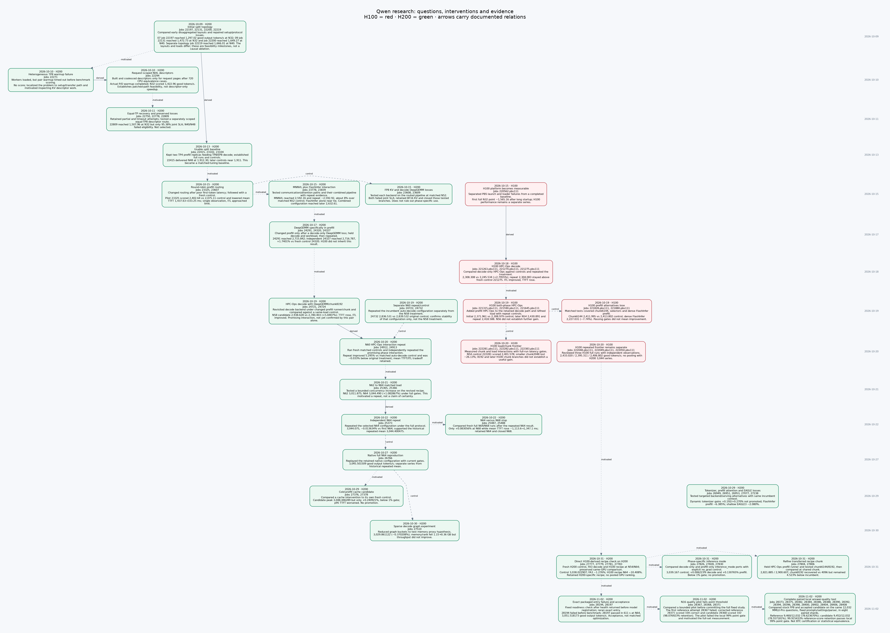
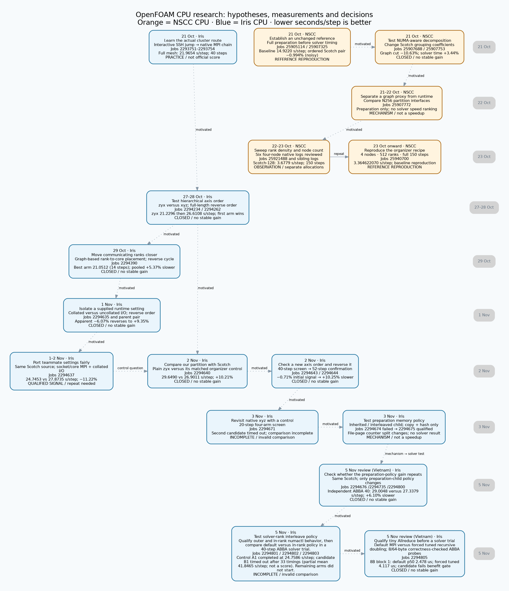

# APAC HPC-AI research archive

This repository imports the team's existing Qwen-serving research, run evidence, learning notes and presentation work from a temporary cluster account. It preserves the two original directory trees so links, run IDs and frozen execution payloads remain traceable.

**[Interactive team atlas ↗](https://trungdangtapcode.github.io/apac-hpc-ai-2026/)** — AI and HPC now share one page and one interface. Switch tasks in place; search, filters and selections are retained separately. [Open the HPC view](https://trungdangtapcode.github.io/apac-hpc-ai-2026/#hpc).

## AI research at a glance

**419 retained allocation IDs · 406 confirmed starts · 31 research milestones.** The history includes successful runs, failed attempts, rejected ideas, controls and the final accuracy check. Snapshot: 3 November 2026.

| Platform | Confirmed started | Cancelled before start | Start unknown | Recorded IDs |
|---|---:|---:|---:|---:|
| 🟢 H200 · Firmus / Slurm | **284** | 11 | 0 | 295 |
| 🔴 H100 · NSCC / PBS | **122** | 1 | 1 | 124 |
| **Total** | **406** | **12** | **1** | **419** |

Counts refer to scheduler allocations, including probes and failures; one allocation may contain several benchmark points. H200 includes the original HelloGPU lesson. [Count definitions and evidence](workspace/reports/ai-run-lineage-20261103/README.md#how-many-times-did-we-run).

[](workspace/reports/ai-run-lineage-20261103/journey.svg)

**Click the diagram to zoom.** Green identifies H200; red identifies H100. Solid arrows show documented derivation, dashed arrows identify controls, and dotted arrows show which finding motivated the next question. The overview groups 31 technical milestones; the complete inventory contains all 419 job IDs, including different concurrency settings.

| What the investigation established | Retained result |
|---|---|
| A repeatable H200 serving operating point | Historical N64 three-run mean: **3,044.400475 good output tokens/s** |
| A complete portable deployment | Job **28197**: **3,051.518173 good output tokens/s**, **98.636602%** joint latency pass share; a separate acceptance run, not a matched optimisation gain |
| A complete answer-quality comparison on the same 16 H200 | Stock FP8 **9,460/12,032** correct; optimised service **9,452/12,032**; **99.915433% accuracy retention**, passing the team's local 99% gate |

The H100 and H200 performance series remain separate. The local MMLU-Pro result is distinct from organiser quality certification. [Full quality method and result](workspace/reports/ai-quality-verification-20261103/FULL_RESULTS.md).

**Explore the data:** [research guide](workspace/reports/ai-run-lineage-20261103/README.md) · [all 419 nodes](workspace/reports/ai-run-lineage-20261103/all-allocations.svg) · [PDF map](workspace/reports/ai-run-lineage-20261103/journey.pdf) · [CSV inventory](workspace/reports/ai-run-lineage-20261103/runs.csv).

**[Open the interactive research atlas ↗](https://trungdangtapcode.github.io/apac-hpc-ai-2026/)** — explore **31 milestones / all 419 jobs** with pan/zoom, search, platform filters and evidence details. Hover shows **good output tokens/s · mean TTFT (ms) · mean ITL (ms) · SLA pass (%)**; missing values are N/A. [Offline copy](workspace/reports/ai-run-lineage-20261103/index.html.gz): decompress and open in a browser. The hosted viewer is the retained 3 November snapshot, not a live queue.

## HPC research at a glance

**18 curated OpenFOAM CPU research milestones · NSCC and Iris kept separate.** The map follows the questions, changed settings, measured outcomes and decisions, including losing branches and incomplete tests. Retrospective overview with retained reviews through 5 November 2026 (Vietnam time).

[](workspace/reports/hpc-run-lineage-20261104/journey.svg)

**Click to zoom.** Orange identifies NSCC CPU and blue identifies Iris CPU. Dotted arrows show the next research question; solid arrows identify a repeat. Node labels distinguish baseline reproduction, observations, qualified signals, mechanisms and rejected performance claims. This is a curated overview, not an exhaustive allocation count.

NSCC job **25940700** reproduced the organizer recipe at **3.364622070 seconds/step**. On Iris, supplied teammate settings had a qualified **11.2228% lower mean** against their own control; our decomposition and graph-placement branches have **no stable matched win**. The selected **21.0512 seconds/step** graph arm used only **14 steps** and does not establish first place. Different platforms, allocations and horizons are never combined into a speed ranking.

**[Open the interactive HPC research map ↗](https://trungdangtapcode.github.io/apac-hpc-ai-2026/#hpc)** — the same team atlas now links AI and HPC, with platform-specific results, evidence details and search.

**Explore:** [research guide](workspace/reports/hpc-run-lineage-20261104/README.md) · [PDF](workspace/reports/hpc-run-lineage-20261104/journey.pdf) · [milestone CSV](workspace/reports/hpc-run-lineage-20261104/milestones.csv) · [offline hover/zoom viewer](workspace/reports/hpc-run-lineage-20261104/index.html.gz). Extract the viewer and open it locally; GitHub displays the static map above.

Reviewed 40-step job **2294916** gives a qualified rank-density signal: **26.703648 versus 32.322053 s/step**, 17.3826% lower time for 48 ranks versus the 56-rank control. Independent reversed confirmation **2294918** passes at **26.159177 versus 32.380544 s/step**, 19.2133% lower time. Both opposite-order forty-step jobs favor 48 ranks on iris001; this is a repeated local signal, not a full-simulation or teammate comparison. The static/local map has 18 milestones. [Hosted publication is blocked by a GitHub billing lock](workspace/reports/hpc-rank-density-atlas-20261105/README.md), and the last served-content check found the previous 17-milestone snapshot. Latest confirmation metrics are retained in source JSON pending a reviewed rebuild/publication.

## Read the whole research journey

Start with [the complete retained research journal](workspace/reports/research-journey-20261019/journal/README.md). Its [32 stages](workspace/reports/research-journey-20261019/journal/JOURNEY.md) connect the original questions, hypotheses, tested changes, observations, assessments, next decisions and later corrections, including failed and losing branches.

| Detail needed | Record |
|---|---|
| Reasoning from the first cluster trials to later phase experiments | [Journey](workspace/reports/research-journey-20261019/journal/JOURNEY.md) |
| A specific attempt and its assessment sources | [194-job index](workspace/reports/research-journey-20261019/journal/JOBS.md) |
| Retained plans, reviews, session comments and learning notes | [247-document index](workspace/reports/research-journey-20261019/journal/DOCUMENTS.md) |
| Verified preservation and remaining gaps | [Dated coverage audit](workspace/reports/research-journey-20261019/journal/AUDIT.md) |

The audit verifies retained written records, not a complete chat transcript. Of the indexed jobs, 127 have dedicated purpose/observation/lesson sections; the rest link reports or plans and are not certified as equally complete reviews. The new journey is a source-linked retrospective, not fabricated original dated entries. Read the dated corrections before reusing old conclusions.

- `2026-APAC-HPC-AI/`: organiser reference material and `qwen-experiments/`, containing serving configurations, Slurm/PBS scripts, run artifacts, reviews, transport patches and failed attempts.
- `workspace/`: persistent notes, tutorials, reports, submission materials and reviewed operational source.
- `backup/manifest.jsonl`: every retained original file, SHA-256, size, permissions, modification time and storage location.
- `provenance/`: original upstream Git bundles and the explicit import-history ledger.
- `tools/`: snapshot, verification and restoration programs.

## Private GitHub repository

The owner authorised GitHub publication on 19 October 2026. The private repository is [trungdangtapcode/apac-hpc-ai-research](https://github.com/trungdangtapcode/apac-hpc-ai-research), with `main` tracking `origin/main`. The first 50 local commits were successfully pushed before the publication documentation updates.

GitHub contains the Git history and reviewed inline files. External artifacts remain in the sibling store on the cluster; they have not been uploaded by this Git push. Follow [the GitHub workflow](docs/GITHUB_WORKFLOW.md) for later milestones and [off-host recovery coverage](docs/OFF_HOST_RECOVERY.md) before relying on the remote as a complete backup.

## Read the current research state

Start with [the handoff](workspace/notes/CURRENT.md), [notes index](workspace/notes/README.md), and the latest linked experiment review. These are dated snapshots, not live scheduler state. Failed deployments and incomplete benchmarks remain evidence; they are not accepted performance results. Local synthetic output checks do not establish organiser full-set accuracy.

The existing absolute `/home/apacsc42` links and container/model paths are part of the original records. See [reproduction and portability](REPRODUCIBILITY.md) before running them under another account. Preserve frozen submitted bundles; adapt a new derived experiment instead of editing historical evidence.

## Git is only one part of this backup

Small reviewed files are stored directly in Git. Larger files are stored once by content hash, compressed with Zstandard, in the **sibling directory `../apac-hpc-ai-research-artifacts/`**. Multiple original files with the same bytes refer to one object. This retains repeated inputs, raw requests, logs, profiles, slide assets and exact local container images without putting huge blobs in Git.

**Copy both directories off this machine. A local commit alone is not a remote backup. Cloning this Git repository alone does not recover the external objects.** The object store's manifest is committed; the bytes must be uploaded separately when remote backup is configured. Objects marked `LOCAL_ONLY_REVIEW_REQUIRED` are not approved for automatic upload. The initial local preparation did not authenticate or upload. The later owner-authorised GitHub push covers only Git objects; it does not transfer the sibling artifact store.

```bash
python3 tools/verify_snapshot.py --store ../apac-hpc-ai-research-artifacts
python3 tools/verify_snapshot.py --store ../apac-hpc-ai-research-artifacts --deep
python3 tools/restore_snapshot.py --store ../apac-hpc-ai-research-artifacts --destination ../restored-apac
```

Verification without `--deep` hashes Git files and checks object presence and metadata. Deep verification decompresses each unique object and checks its full hash and length. Restoration verifies every copied file and refuses to replace existing different content by default. Requirements: Python 3.9+, Git and the `zstd` command.

## History and secret handling

The early research history is reconstructed from retained artifacts. Its conventional commit subjects describe the actual grouped work; both author and committer dates for these record commits follow retained file metadata after the owner-requested correction. The provenance ledger preserves the reconstruction and original capture dates. No commits are invented for missing days. Original organiser history is retained separately with its original attribution. See [history provenance](HISTORY_PROVENANCE.md).

Credentials, VPN authentication/session state, private logs, environment secrets, machine-private directories, container homes and recreatable environments are excluded. Potential secret matches are excluded from all portable payloads, with paths and reasons recorded in `backup/scan-results.json`; secret values are never written into that report. Pattern scanning is a precaution, not proof against every possible secret. Frozen model/client containers are opaque local runtime objects, not Git blobs or published assets.

See [backup summary](backup/summary.json), [scope and exclusions](BACKUP_SCOPE.md), and [verification report](backup/verification.json) for actual coverage and unresolved limitations.

The archive is a captured copy. Active research still runs from the original source directories; future results are not automatically mirrored here. See [local preservation status](workspace/reports/local-repository-backup-20261018/REPORT.md).

## Later milestone captures

The initial 47-commit import is followed by ordinary commits using actual dates. The 19 October status milestone recovers three PBS runs, captures the five completed H200 runs and records live queue, VPN and credit observations. Read `2026-APAC-HPC-AI/qwen-experiments/research-followup-20261019-0400/RESULTS.md` and `backup/updates/20261019-status/` for this capture's scope. This is a manual archive, not an automatic mirror of the active source directories.

For an explicit later milestone, supply a JSON list of source-relative paths to `tools/capture_update.py --selection <list.json> --report <capture.json>`. It applies the existing exclusion/scanning policy and hashes selected data, verifies newly compressed objects, updates the cumulative manifest, and retains unselected paths. It does not infer that every source change has been captured. Verify, commit and refresh the recovery set before claiming the milestone is backed up. Never rerun the initial fresh-tree builder over this repository.

The later 19 October continuation milestone submits four H200 trials (24721–24724) and two serial PBS trials (221589–221590), with sealed H100 profile analysis, frozen new bundles, resource reservations and explicit returned receipts. Its scope is `backup/updates/20261019-followups/`; the source-linked report is `2026-APAC-HPC-AI/qwen-experiments/research-followup-20261019-0412/RESULTS.md`. These new jobs were queued at capture, not measured results.

The next 19 October load-results milestone retains H200 24721/24722 and PBS 221589/221590 raw evidence and passing local reviews, with higher observations of 2839.532 and 2430.891 good tokens/s on their respective platforms. Independent repeats and one further load step were submitted as H200 24732/24733 and PBS 221645/221646. See `backup/updates/20261019-load-results/` and `2026-APAC-HPC-AI/qwen-experiments/research-followup-20261019-0527/RESULTS.md`; new higher-load points are not independently repeated or officially accuracy-certified yet.

The next reviewed interaction milestone is [19 October chunk/decode research](2026-APAC-HPC-AI/qwen-experiments/research-followup-20261019-0600/RESULTS.md): H200 24724 reaches 2938.628 good tokens/s at N58 (+5.6907% versus matched control), while chunk 12288 loses. Fresh control/repeat/load jobs 24736–24738 and the source-checked H100 prefill Tree trial 221669 were submitted. New configurations await full GPU review. Capture scope is `backup/updates/20261019-interaction/`.

For a self-contained explanation, read [How Qwen serving reached 2938.628 good tokens/s](workspace/reports/research-journey-20261019/REPORT.md). It documents the measured trajectory, units, matched controls, failed branches, highest-observation versus repeated-evidence distinction, latest N60 repeat and prioritised next directions. This reporting milestone submits no new job and uses the owner-requested `report` commit category.
