# Slide-by-slide transcript and learning guide — English

This is a **proposed speaking script and learning guide**, not a verbatim record of a delivered talk. It follows all 40 slides of the current presentation. The separately requested Vietnamese companion is a narrow language exception; code and other reports remain English.

**How to use it:** open the slide, read its purpose, follow the reading instructions, then rehearse the spoken script. Use the other sections to prepare answers. Do not read every explanatory paragraph aloud. Distinguish “we observed,” “our hypothesis was,” and “we have not established.”

- **Slides 1–24:** main AI talk. Follow the [15–20 minute plan](PRESENTATION_PLAN.md); select and shorten the scripts when rehearsing.
- **Slides 25–32:** AI backup material. Slides 31–32 remain backups even though their titles omit Appendix.
- **Slides 33–40:** read-only explanation of the existing HPC section. Its scheduler statements are **23 October snapshots**, not live 30 October status. This guide neither updates nor independently certifies later HPC work. Do not automatically include HPC in the AI time allowance.
- Colors have **slide-local meanings**. Orange does not always mean a win or a failure. Background photographs, gradients and footer decorations are not measurements.
- **↑ / ↓** generally indicate the desired optimization direction, not an observed increase/decrease. “No axes” means a table, card or schematic; do not invent X/Y quantities.
- Research has stopped at the owner's request. Future actions shown on slides are proposals or historical next decisions, not newly executed jobs.

Sources: [PowerPoint](../../VNUHCM%20-%20TripleU/Presentation/TripleU_APAC2026_Presentation.pptx), [PDF](../../submission-review/ai-journey-update-20261030/TripleU_APAC2026_Presentation.pdf), [Vietnamese companion](TRANSCRIPT_VI.md). PowerPoint SHA-256: `b2e1c88aba8d5a3d5ec181e3fccc6b95bb6ea12c29f214e7c3c964619dc81616`. This guide describes that version; recheck it if the deck changes.

## Shared vocabulary

| Symbol / term | Plain explanation |
|---|---|
| request | One prompt submitted to the service and its generated response. |
| token | A model vocabulary unit: a word, word fragment, or punctuation; it is not necessarily one word. |
| prefill / decode | Prefill processes the prompt; decode repeatedly generates the next token. |
| TTFT | Time to first token, in milliseconds (ms). Includes the observed wait before the first response token. |
| ITL | Inter-token latency. The gate here uses each request’s mean interval between output tokens, in ms. |
| SLO / SLA fraction | The latency objective / fraction of all requests jointly meeting both latency limits. This is not model accuracy. |
| goodput | Qualifying requests per second. The official displayed score is this value multiplied by 200 output tokens per request. |
| N / concurrency | Maximum simultaneous in-flight benchmark requests in the closed-loop workload; not the GPU count. |
| closed-loop | Keep up to N requests in flight; after one finishes, send another. There is no separate fixed request rate. |
| p50 / median; p95; max | Median: half the samples are at or below it. p95: 95% are at or below it. Max: largest observed value. A mean is a different statistic. |
| TP / EP / replica | Tensor parallelism splits model computation; expert parallelism distributes MoE experts; a replica is another worker instance. |
| MoE | Mixture of Experts: a model routes each token to selected expert networks rather than activating every expert. |
| KV cache | Stored attention keys and values representing processed context, used when generating later tokens. |
| NIXL | The transfer layer used here to move KV state between prefill and decode workers. |
| FP8 / BF16 | 8-bit floating-point / 16-bit bfloat formats. Weights, activations and KV can use different formats. |
| FI / FA3 / DG / HPC-Ops | FlashInfer / FlashAttention 3 / DeepGEMM / the reused HPC-Ops kernel implementation. HPC-Ops is not the OpenFOAM HPC track. |
| kernel / GEMM | A GPU computation routine / general matrix multiplication. Faster isolated kernels do not automatically improve the whole service. |
| MNNVL / collective | Multi-node NVLink communication path / an operation in which multiple ranks communicate together. The actual enabled path must be checked. |
| CUDA graph / bucket | A captured GPU execution graph / a selected execution shape to capture. Bucket count is not request concurrency. |
| baseline / control / candidate | Reference configuration / comparison arm / proposed changed configuration. State the exact baseline for every percentage. |
| matched trial / repeat | A comparison preserving intended factors except the tested change / another allocation to check reproducibility. Neither automatically proves causality. |
| ms / s / tokens/s / req/s | 1,000 ms = 1 s. tokens/s counts tokens per second; req/s counts requests per second. |
| % / percentage points | A move from 90% to 95% is +5 percentage points, or +5.56% relative to 90%; these are different. |
| 2,989.175 / 2.989,175 | The deck uses English separators: comma for thousands and point for decimals. These two forms express the same value in English and Vietnamese conventions. |
| MPI rank / affinity / NUMA | An MPI process / placement on CPU cores / a CPU memory architecture with different local and remote access costs. CPU HPC ranks differ from GPU serving ranks. |
| Scotch / Hierarchical / graph cut | Mesh partitioning methods / another partitioning method / a partition-boundary proxy. A smaller cut is not automatically faster runtime. |

## Slide navigation

- [Slide 01 — Qwen serving: from topology to reproduced performance](#slide-01)
- [Slide 02 — Highest observation and strongest recommendation](#slide-02)
- [Slide 03 — Optimise useful throughput under a latency gate](#slide-03)
- [Slide 04 — One workload, two deployment systems](#slide-04)
- [Slide 05 — Separate prompt processing from token generation](#slide-05)
- [Slide 06 — Topology search established the serving layout](#slide-06)
- [Slide 07 — Make KV-transfer setup scale with the request](#slide-07)
- [Slide 08 — FP8 block geometry constrains parallelism](#slide-08)
- [Slide 09 — A repeatable experiment loop](#slide-09)
- [Slide 10 — H200 journey: recover, specialise, then reproduce](#slide-10)
- [Slide 11 — Backend combinations matter](#slide-11)
- [Slide 12 — H200: the N62-to-N64 step survives a full repeat](#slide-12)
- [Slide 13 — Profile the deployed interaction](#slide-13)
- [Slide 14 — The N60 gain survives an independent deployment](#slide-14)
- [Slide 15 — The reproduced N64 service still loses first-token tails](#slide-15)
- [Slide 16 — H100 has its own operating point and uncertainty](#slide-16)
- [Slide 17 — FA3: faster first token does not guarantee goodput](#slide-17)
- [Slide 18 — Test the cost hypothesis, then reverse the order](#slide-18)
- [Slide 19 — A local N52 calibration, not a universal multiplier](#slide-19)
- [Slide 20 — Freeze the forecast, then test it on H200](#slide-20)
- [Slide 21 — Use source evidence to test one small hypothesis](#slide-21)
- [Slide 22 — Latency acceptance is separate from model accuracy](#slide-22)
- [Slide 23 — EAGLE3: follow the failed hypothesis through its repairs](#slide-23)
- [Slide 24 — Topology → transport → kernels → replication](#slide-24)
- [Slide 25 — Appendix · diagnose performance drift with controlled cells](#slide-25)
- [Slide 26 — Appendix · profiles and source also close attractive detours](#slide-26)
- [Slide 27 — Appendix · the selected AI deployment is N64](#slide-27)
- [Slide 28 — Appendix · sparse graphs save memory, not goodput](#slide-28)
- [Slide 29 — Appendix · what the benchmark actually measures](#slide-29)
- [Slide 30 — Appendix · larger prefill chunks did not help](#slide-30)
- [Slide 31 — A real replay can invalidate a static deployment claim](#slide-31)
- [Slide 32 — What the evidence supports next](#slide-32)
- [Slide 33 — The task: same 65-million-cell airflow calculation](#slide-33)
- [Slide 34 — The whole required pipeline comes before the score](#slide-34)
- [Slide 35 — A smaller partition cut did not make the solver faster](#slide-35)
- [Slide 36 — Observed scaling changed which decomposition led](#slide-36)
- [Slide 37 — At four nodes, the winner depends on ranks per node](#slide-37)
- [Slide 38 — Keep the slow step in the mean; inspect the tail](#slide-38)
- [Slide 39 — A reproducible candidate needs more than a fast log](#slide-39)
- [Slide 40 — What we learned — and the next measurement](#slide-40)

---

## Slide 01 — Qwen serving: from topology to reproduced performance

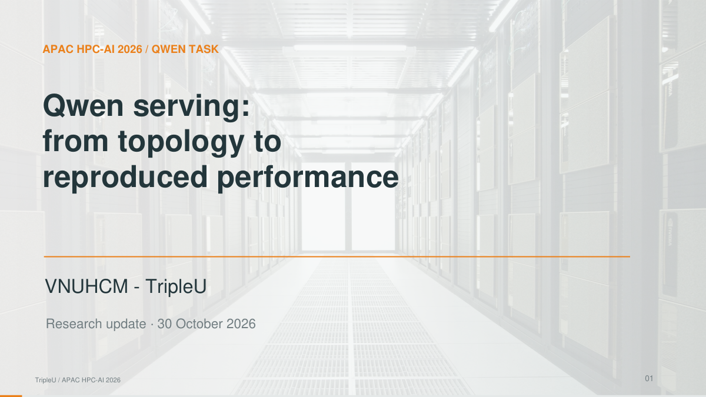

### Purpose

Open the AI research story and define its scope: turning a distributed Qwen deployment into a reproducible service measurement. The talk follows the engineering and evidence from topology through transfer and kernels to repeated performance; the title does not claim an official win or certified model quality.

### What is on the slide

A photographic server-aisle background is washed out for legibility. Dark teal carries the title, orange identifies the task label and thin rule, and grey carries the date. These are presentation-theme colors, not data categories. The slide has no chart, numeric axes, or legend.

### Terms and symbols

- **Qwen:** The family of language models used in the serving task; this study serves the specified Qwen3-235B checkpoint.
- **APAC HPC-AI 2026:** The competition context for the research, not a statement of award or official acceptance.
- **30 October 2026:** The date of this research update; results are historical observations through that date.
- **VNUHCM - TripleU:** The presenting team identity.

### How to read the figure, axes, units and colors

- Read the title as a journey from system layout to repeatable measurement.
- The server-room photograph is illustrative, not evidence that it depicts the tested installation.
- There are no units or measured values on this opening slide.

### Tradeoff and strength of evidence

- **Observation:** The work progressed from resolving the two-node serving topology and KV transfer to phase-specific backend experiments and repeated full-protocol measurements.
- **Hypothesis:** Reliable performance depends on making the deployment and measurement path work end to end before tuning individual kernels.
- **Supported conclusion:** The presentation will support a reproduced operating point and selected configuration, while distinguishing that evidence from isolated peaks and official accuracy verification.
- **Unknown / limitation:** Official full-set model accuracy remains unverified, and the local result is not an official contest ranking.

### Spoken script

Hello. We are VNUHCM–TripleU, and this is our Qwen serving research update through 30 October 2026. Our question was not simply how to make one run produce a larger number. We first had to establish a working two-node deployment, make request data move correctly between prompt processing and token generation, then measure controlled backend changes under the service limits. I will show which results repeated, which attractive changes did not help, and what the evidence still cannot establish. The server image is a visual backdrop, not a photograph of a verified competition installation.

### Avoid this interpretation

Do not call the displayed work a contest win, official acceptance, or accuracy certification. The date limits the claim to this research update.

### Transition

First I will state what counts as a useful result and how to read the headline numbers.

---

## Slide 02 — Highest observation and strongest recommendation

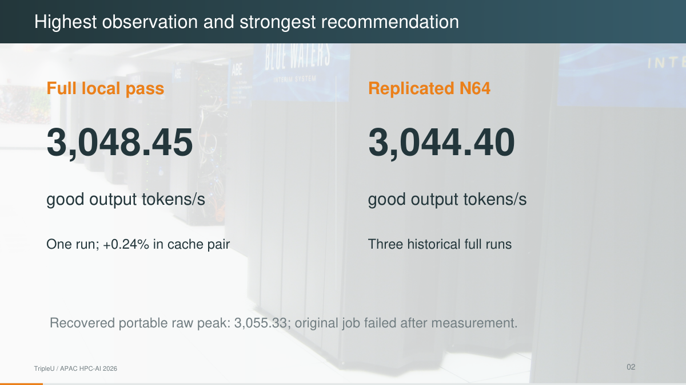

### Purpose

Separate the largest independently reviewed local full-pass observation from the configuration supported by repeated evidence. The slide teaches that the headline peak and the strongest recommendation need not be the same item.

### What is on the slide

Two large score callouts sit side by side over a faded server image. Orange labels distinguish the two named evidence categories on this slide; dark teal is used for the values. A grey footnote gives the recovered portable raw peak. These colors do not imply pass/fail or a shared global legend. No numeric axes are present.

### Terms and symbols

- **3,048.45 good output tokens/s:** Rounded value for one complete local full pass, job 27378; exact reviewed value is 3048.446289.
- **+0.24%:** Rounded difference within the prefill-cache comparison, specifically +0.240921% versus fresh control 27376; below the prospective 1% useful-gain gate.
- **3,044.40 good output tokens/s:** Rounded mean of three historical full N64 runs, a separate repeated series.
- **3,055.33:** Recovered raw portable result from job 27145; its original scheduler job failed after GPU measurement, so this is not a successful full-allocation completion.
- **tokens/s:** Good output tokens per second: output tokens belonging to requests that pass the joint per-request latency gate, aggregated as throughput.

### How to read the figure, axes, units and colors

- The left callout is one full local pass, not a replicated mean.
- The right callout is the mean of three historical full N64 measurements, not a value directly paired with the left run.
- The note below the callouts says that a portable raw peak was recovered even though the original job failed after measuring.

### Tradeoff and strength of evidence

- **Observation:** 27378 reached 3048.446289 good output tokens/s and passed local gates; its matched cache-pair gain was 0.240921%. The historical N64 series mean is 3044.400475. Recovered portable raw data reached 3055.330517, but the originating job was FAILED.
- **Hypothesis:** A seemingly higher point should be promoted only if the change is useful under the predeclared gate and survives matched independent replication.
- **Supported conclusion:** Retain replicated N64 as the stronger recommendation. Keep 27378 as the highest reviewed local full-pass observation, not as a demonstrated useful optimization.
- **Unknown / limitation:** This slide alone does not compare the two callouts under identical runtime conditions, and the portable raw peak is not a successful end-to-end allocation result.

### Spoken script

Here I separate two ideas that are easy to confuse. On the left is our highest independently reviewed local full-pass score: 3,048.45 good output tokens per second, from one run. Its change improved the matched cache comparison by only 0.24 percent, below our one-percent useful-gain threshold. On the right is the 3,044.40 mean from three historical full N64 runs. That repeated result is the stronger basis for a recommendation, even though it is not the single largest number. A portable run has a recovered raw value of 3,055.33, but its original job failed after measurement. We preserve that evidence without calling it a successful deployment run.

### Avoid this interpretation

Do not rank these callouts as if they were one matched experiment. The recovered 3055.33 is not a passed scheduler job or proof of a portable end-to-end repeat.

### Transition

To understand what good output tokens per second means, we need the workload and its per-request latency gate.

---

## Slide 03 — Optimise useful throughput under a latency gate

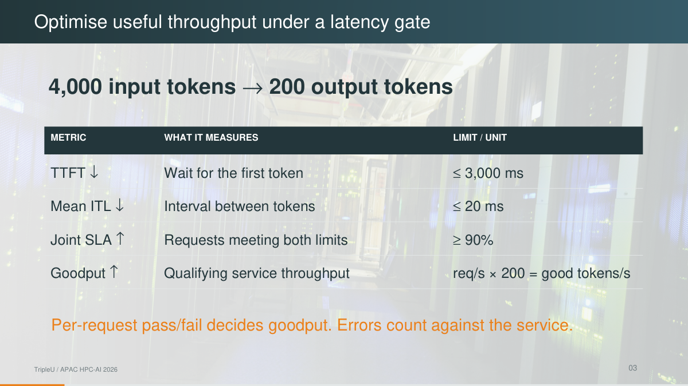

### Purpose

Define the benchmark objective before discussing system changes: maximize qualifying service throughput while meeting both latency thresholds for enough individual requests. This prevents confusing raw generation speed or an average latency with the scoring rule.

### What is on the slide

A workload statement sits above a four-row table. The dark-teal table header identifies metric, meaning, and limit/unit; orange text emphasizes the accounting rule. There is no plotted chart, numeric axis, or color legend.

### Terms and symbols

- **4,000 input tokens → 200 output tokens:** The fixed synthetic request shape: a 4,000-token prompt and 200 requested output tokens.
- **TTFT ↓:** Time to first token; lower is better, with a per-request limit of 3,000 milliseconds.
- **Mean ITL ↓:** Mean inter-token latency, the average interval between generated tokens in a request; lower is better, limit 20 milliseconds.
- **Joint SLA ↑:** Share of all evaluated requests that satisfy both latency limits; target is at least 90%. Errors remain in the denominator.
- **Goodput ↑:** Rate of requests that qualify under the joint gate. Multiply qualifying requests per second by 200 to report good output tokens per second.
- **ms:** Milliseconds, one thousandth of a second; a latency unit.
- **req/s × 200:** Qualifying requests per second multiplied by the requested 200 output tokens per request.

### How to read the figure, axes, units and colors

- Read each arrow as the preferred direction: latency down, qualifying share and goodput up.
- Both TTFT and mean ITL limits must pass on the same request for it to count as qualifying.
- The 90% threshold applies to the proportion of all evaluated requests, not just successful requests.

### Tradeoff and strength of evidence

- **Observation:** The benchmark fixes the request size and applies a joint per-request latency rule; errors count against the service. Goodput is based on requests passing both limits.
- **Hypothesis:** A system that produces more raw tokens can still be worse if too many requests violate first-token or token-spacing requirements.
- **Supported conclusion:** We judge candidates by qualifying throughput together with the latency and output gates, not by a single mean or raw token count.
- **Unknown / limitation:** The table defines the protocol but contains no candidate measurement; it does not show any configuration's actual latency distribution.

### Spoken script

Our objective is useful throughput under a latency gate. Each synthetic request has 4,000 input tokens and asks for 200 output tokens. A request qualifies only if its time to first token is at most 3,000 milliseconds and its mean interval between tokens is at most 20 milliseconds. At least 90 percent of all evaluated requests must meet both limits; errors count against us. Goodput is qualifying requests per second, and multiplying by 200 gives the good output tokens per second used in the talk. This is why an average latency by itself cannot tell us whether the service passed: the decision is made request by request.

### Avoid this interpretation

Do not infer per-request compliance from an aggregate mean. Do not drop errors from the denominator or multiply by a different output length.

### Transition

With the objective fixed, the next slide shows why platform details must travel with every comparison.

---

## Slide 04 — One workload, two deployment systems

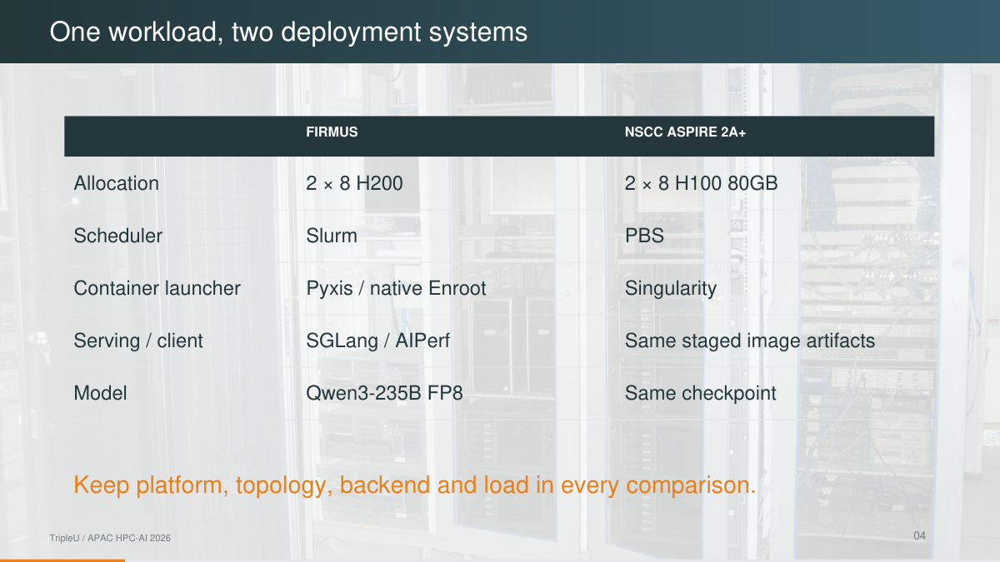

### Purpose

Show the two hardware environments used for separate platform studies and establish the rule that comparisons must name the platform, topology, backend, and load. Sharing workload and model checkpoint does not make two clusters interchangeable.

### What is on the slide

A two-column comparison table contrasts Firmus with NSCC ASPIRE 2A+. The dark-teal header labels columns and orange takeaway text emphasizes the comparison rule. The pale server-room image is decorative. There are no numeric axes or legend.

### Terms and symbols

- **2 × 8 H200:** Two nodes with eight NVIDIA H200 GPUs each, sixteen GPUs in the Firmus allocation.
- **2 × 8 H100 80GB:** Two nodes with eight 80-gigabyte H100 GPUs each on NSCC ASPIRE 2A+. This is a different GPU generation and environment.
- **Slurm / PBS:** Different cluster schedulers used to request and manage compute allocations.
- **Pyxis / native Enroot:** Firmus container-launch path. NSCC uses Singularity.
- **SGLang / AIPerf:** Serving engine and benchmark client used in the study; same staged image artifacts are used across systems.
- **Qwen3-235B FP8:** The model/checkpoint and weight precision held in common for the displayed platform setup.
- **80GB:** Nominal GPU memory capacity per H100 as shown in the table; it is not a performance unit.

### How to read the figure, axes, units and colors

- Rows describe allocation, scheduler, container launcher, serving/client, and model.
- The table says the staged image artifacts and checkpoint are shared, while the GPUs and deployment software differ.
- Orange text at the bottom is the study rule, not a plotted result.

### Tradeoff and strength of evidence

- **Observation:** Both sites provide sixteen GPUs in two nodes and use the same staged serving/client artifacts and checkpoint, but hardware, scheduler and container launcher differ.
- **Hypothesis:** Matched workload and model are necessary controls, but hardware and software environment differences may still affect performance.
- **Supported conclusion:** Keep platform, topology, backend and load attached to every result; never convert an H100 score to an H200 score using hardware names alone.
- **Unknown / limitation:** This slide does not quantify the contribution of each platform difference or provide a general H100-to-H200 conversion.

### Spoken script

We used two deployment systems. Firmus has two nodes with eight H200 GPUs per node, managed by Slurm and launched with Pyxis or native Enroot. NSCC ASPIRE 2A+ has two eight-GPU H100 nodes with 80 gigabytes per GPU, PBS, and Singularity. We stage the same serving and client images and use the same Qwen checkpoint, but the machines and deployment stacks still differ. Therefore, every comparison needs its platform, topology, backend, and load. A GPU model name or memory size is not a conversion factor for performance.

### Avoid this interpretation

Do not pool H100 and H200 measurements as one series or claim equal system performance because the allocation sizes and software images match.

### Transition

Now we can look inside the selected sixteen-GPU H200 topology and follow the request through it.

---

## Slide 05 — Separate prompt processing from token generation

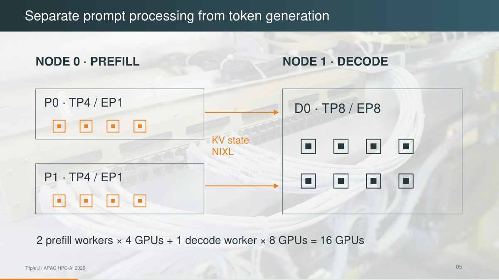

### Purpose

Explain the disaggregated serving design: dedicate one node to prompt prefill and one to autoregressive decode, then transfer each request's KV state between roles. The figure links hardware placement to the later transfer and layout experiments.

### What is on the slide

Two outlined boxes on Node 0 hold prefill workers P0 and P1; one larger box on Node 1 holds decode worker D0. Four small orange GPU marks in each P box and eight dark-teal marks in D0 visually encode the listed GPU allocation. Orange arrows labeled KV state/NIXL point from prefill to decode. The background photo is decorative. This is a schematic, not a data chart, so it has no numeric axes or legend; colors identify roles only in this diagram.

### Terms and symbols

- **Prefill:** The prompt-processing phase. It reads the input tokens and creates the KV state needed for generation.
- **Decode:** The token-generation phase. It produces the requested output tokens using the prompt's KV state.
- **P0 / P1 / D0:** Names for two prefill workers and one decode worker; they are worker labels, not GPU IDs.
- **TP4 / TP8:** Tensor parallelism across four or eight GPUs within the worker. TP is a model-partitioning configuration.
- **EP1 / EP8:** Expert parallelism across one or eight expert partitions for the mixture-of-experts model.
- **KV state:** Key/value attention data generated during prompt processing and required to continue decoding the same request.
- **NIXL:** The transfer mechanism used here to move KV data between the prefill and decode sides.
- **2 × 4 + 1 × 8 = 16 GPUs:** Two four-GPU prefill workers plus one eight-GPU decode worker, for sixteen GPUs total.

### How to read the figure, axes, units and colors

- Read from left to right: requests are processed for prefill on either P0 or P1, then KV data moves to D0 for generated output.
- Each prefill worker is TP4/EP1; the decode worker is TP8/EP8. The TP groups stay within their node.
- Orange squares and arrows are visual role cues in this slide, not a general chart color key or evidence of traffic volume.

### Tradeoff and strength of evidence

- **Observation:** The selected layout allocates two TP4/EP1 prefill workers on Node 0 and one TP8/EP8 decode worker on Node 1; the request's KV state must cross between roles.
- **Hypothesis:** Separating prompt processing from generation can let each phase use a fitting topology, but adds a correctness- and startup-sensitive transfer path.
- **Supported conclusion:** Round-robin routes requests to a prefill worker, and decode produces all generated tokens. The diagram defines the experiment's architecture, not a measured performance benefit by itself.
- **Unknown / limitation:** The drawing does not quantify network bandwidth, transfer latency, utilization or the causal advantage over a unified deployment.

### Spoken script

This is our sixteen-GPU disaggregated layout. The left node runs two prefill workers, P0 and P1, each on four GPUs with TP4 and EP1. The right node runs one decode worker on eight GPUs with TP8 and EP8. A request is sent to one prefill worker, which processes its prompt and creates the key/value state, or KV state. NIXL transfers that request's state to the decode worker, which generates every output token. The orange squares and arrows mark the prefill side and transfer in this drawing; they do not report traffic volume. Splitting the roles gives us a topology to study, but it also makes transfer correctness and readiness part of the service.

### Avoid this interpretation

TP and EP values are specific to each worker and this configuration. Do not interpret each square as a measured GPU utilization or claim the diagram proves a speedup.

### Transition

The next slide shows how earlier topology trials led to this split, while keeping failed attempts separate from replacements.

---

## Slide 06 — Topology search established the serving layout

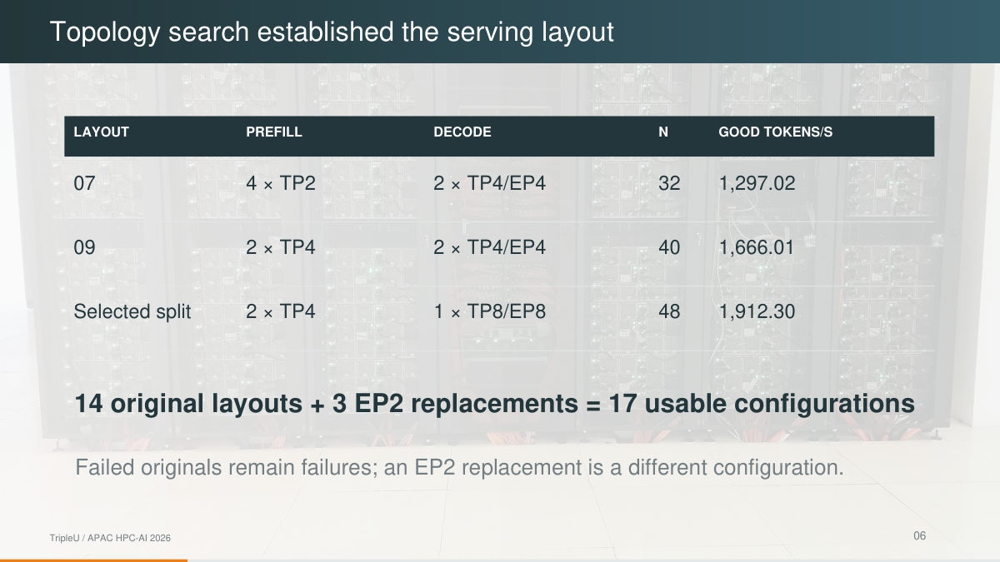

### Purpose

Show a small selection of topology search results and explain that the selected split emerged from measured, usable configurations. The lower caption protects the experimental record: replacements are new configurations, not retroactive repairs of failed originals.

### What is on the slide

A table lists layout ID, prefill arrangement, decode arrangement, N, and good tokens/s. Dark teal is used for the table header and text; a bold summary counts configurations, with a grey caution beneath. The image is only a washed-out background. There are no numeric axes, plotted marks, or color legend.

### Terms and symbols

- **07 / 09:** Identifiers for early layout trials, not software versions.
- **4 × TP2 / 2 × TP4:** Four prefill workers with tensor parallelism two; the next listed layout uses two prefill workers with tensor parallelism four.
- **TP4/EP4:** Decode workers configured with tensor parallelism four and expert parallelism four.
- **Selected split: 2 × TP4; 1 × TP8/EP8:** Two prefill workers each TP4 and one decode worker TP8/EP8.
- **N:** Client concurrency: the target number of requests kept in flight, not number of GPUs or tokens.
- **good tokens/s:** Qualifying output token throughput under the per-request latency gate.
- **14 + 3 = 17 usable configurations:** Fourteen measured original layouts plus three measured EP2 replacements in the recovery ledger.

### How to read the figure, axes, units and colors

- Compare rows horizontally across role topology, concurrency N, and good output tokens per second.
- N rises from 32 to 40 to 48 across these illustrative rows; the measurements also differ in load and transport history.
- The summary counts usable measured configurations; it does not say all attempted originals passed.

### Tradeoff and strength of evidence

- **Observation:** The selected split reached 1912.30 good tokens/s at N48 in this early topology sample, after displayed N32 and N40 configurations reached 1297.02 and 1666.01. Overall, the recovery ledger counted 14 original layouts plus three EP2 replacements.
- **Hypothesis:** A balanced allocation of prefill replication and decode parallelism could better serve the chosen request concurrency.
- **Supported conclusion:** These trials established a usable architecture to develop. They are initial operating points, not a clean causal ranking because load and transport history varied.
- **Unknown / limitation:** The slide does not show all 17 configurations or confidence intervals; it cannot isolate which topology change caused the score differences.

### Spoken script

This table gives three points from the topology search. Layout 07 used four TP2 prefill workers and two TP4/EP4 decode workers; at concurrency 32 it measured 1,297 good tokens per second. Layout 09 widened prefill to two TP4 workers and reached 1,666 at concurrency 40. The selected split used two TP4 prefill workers and one TP8/EP8 decode worker, reaching 1,912 at concurrency 48. These loads and transport histories were not identical, so read them as architecture milestones, not a controlled causal sweep. Our recovery ledger contains 14 measured original layouts and three measured EP2 replacements. A replacement is a different configuration; failed originals remain failures.

### Avoid this interpretation

Do not treat 07 or 09 as software versions. Do not infer that the throughput increase was caused only by the displayed topology because N and other history differed.

### Transition

The next obstacle was not just choosing parallelism: cold request setup examined far more KV metadata than the request needed.

---

## Slide 07 — Make KV-transfer setup scale with the request

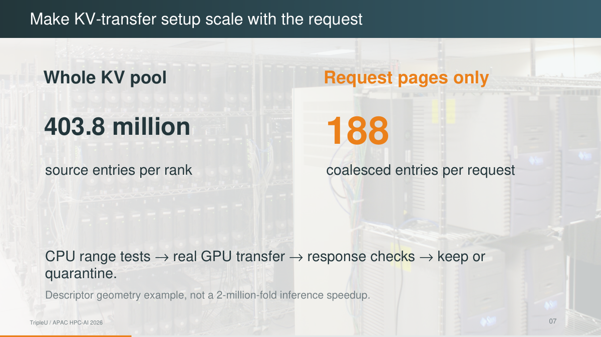

### Purpose

Explain why cold-start KV setup was redesigned around the pages a request actually transfers. The numerical comparison is descriptor geometry, demonstrating the scale of metadata enumeration; it is deliberately not presented as an inference speedup.

### What is on the slide

A two-column before/after comparison places “Whole KV pool” on the left in dark teal and “Request pages only” on the right in orange. The left value is 403.8 million source entries per rank; the right value is 188 coalesced entries per request. A bottom line shows the validation sequence. Photo background is decorative. There are no numeric axes or plotted bars; orange is a local emphasis, not a pass/fail legend.

### Terms and symbols

- **KV pool:** The full allocated key/value cache address space available to a rank, much of which a particular request will not transfer.
- **403.8 million source entries per rank:** Approximate count of descriptor source entries enumerated for the whole-pool geometry in a representative TP8 case.
- **188 coalesced entries per request:** Number of contiguous descriptor ranges after combining adjacent request pages in the illustrated 4,000-token request geometry.
- **rank:** One distributed model process/partition participating in the parallel deployment; not a server rank in a competition.
- **descriptor:** Metadata that describes memory ranges to a transfer layer; it is not the KV tensor contents themselves.
- **coalescing:** Combining adjacent memory ranges into fewer larger range descriptions.
- **CPU range tests → GPU transfer → response checks:** The layered validation path: check address calculations, then actual transfer, then request response semantics.

### How to read the figure, axes, units and colors

- The left count describes whole-pool source enumeration per rank; the right count describes coalesced ranges for one request. Their scopes differ.
- The values are descriptor counts, with no seconds, bytes-per-second, or score unit on the slide.
- Read the bottom sequence as successive evidence gates. A correct CPU mapping alone is insufficient; real GPU transfer and response checks follow.

### Tradeoff and strength of evidence

- **Observation:** Cold disaggregated serving stalled during whole-pool KV descriptor preparation. A request-scoped implementation constructs ranges for only the pages actually transferred and coalesces contiguous ones; the shown TP8 example is about 403.8 million pool entries versus 188 entries for one request.
- **Hypothesis:** Enumerating request pages rather than the full pool should reduce setup work and improve readiness without changing the request's KV mapping.
- **Supported conclusion:** Range correctness was checked on CPU, then the path was tested with real GPU transfer and response validation. A later EP2 route with superficially successful execution still failed short-output checks, so startup success is necessary but not sufficient.
- **Unknown / limitation:** Descriptor counts do not measure wall-clock startup speed, inference throughput, memory savings, or a 2-million-fold speedup. The diagram's geometry example is not a universal ratio for every request/topology.

### Spoken script

Our cold-start investigation found that KV transfer setup was enumerating descriptors for the whole cache pool, although one request touches only a fraction of it. In a representative TP8 geometry, that meant about 403.8 million source entries per rank, compared with 188 coalesced range entries for one 4,000-token request. These are counts of transfer descriptions, not measurements in seconds and not a two-million-fold inference speedup. We changed setup to describe only the pages the request needs and combine adjacent ranges. We validated the mapping on CPU, then checked a real GPU transfer and response behavior. One later EP2 route looked as though it ran, yet produced too few valid responses. That taught us that efficient setup and successful transfer still do not prove correct service output.

### Avoid this interpretation

Do not divide the counts and call the result an inference speedup. The count scopes differ, and the figure does not report latency or throughput. Do not equate a transfer that completes with a valid response.

### Transition

That EP2 recovery also exposed a different prerequisite: the FP8 weight blocks must align with the model partition.

---

## Slide 08 — FP8 block geometry constrains parallelism

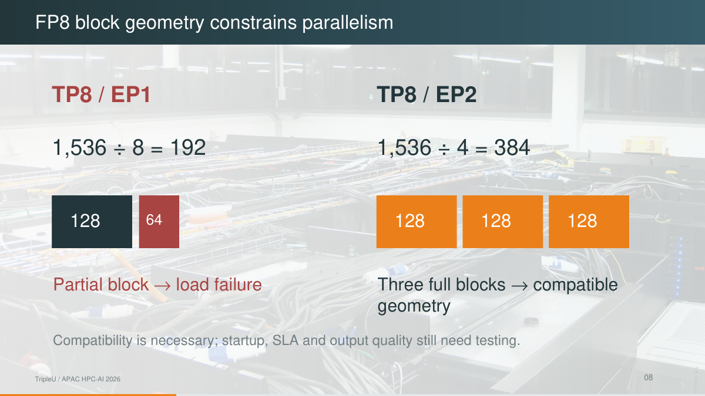

### Purpose

Explain a concrete deployment failure caused by FP8 block alignment and the geometric change used to recover a compatible partition. The key learning is that compatibility permits a load attempt but does not establish successful service or quality.

### What is on the slide

The slide compares TP8/EP1 at left with TP8/EP2 at right. The left partition is drawn as a dark teal block labeled 128 plus a red block labeled 64, visually showing a partial FP8 block; the right has three orange 128 blocks. Red labels the failure side in this diagram, orange labels full blocks on the compatible side. These are local explanatory colors, not a global legend. There are no axes.

### Terms and symbols

- **FP8:** Eight-bit floating-point weight format used by the checkpoint; weights are organized into fixed-width blocks for the relevant kernel path.
- **1,536:** MoE intermediate dimension used in this partition calculation.
- **128:** FP8 block width in this implementation path; a full compatible chunk contains 128 elements.
- **TP8 / EP1:** Eight-way tensor parallelism with one expert partition; effective MoE tensor parallelism is eight, giving 1536 ÷ 8 = 192 elements per partition.
- **128 + 64:** The 192-element partition contains one full 128-element block plus a 64-element remainder, which is not a whole FP8 block.
- **TP8 / EP2:** Eight-way tensor parallelism with two expert partitions; effective MoE tensor parallelism is four, giving 1536 ÷ 4 = 384 elements.
- **3 × 128 = 384:** The EP2 partition maps to three complete 128-element blocks. This changes the layout; it does not drop experts or weights.
- **SLA:** Service-level agreement: the joint request latency acceptance rule defined earlier.

### How to read the figure, axes, units and colors

- Read both equations before the blocks: 1536 ÷ 8 = 192 and 1536 ÷ 4 = 384.
- Left blocks show 128 plus 64; the red remainder marks a partial block and load failure in the tested path.
- Right blocks show three complete 128 chunks. The footer lists additional required checks: startup, SLA, and output quality.

### Tradeoff and strength of evidence

- **Observation:** A TP8/EP1 prefill partition gives 192 elements, which is 128 plus 64 and does not align to 128-wide FP8 blocks. With EP2, effective MoE tensor parallelism is four and each partition has 384 elements, or three full blocks.
- **Hypothesis:** Changing expert partitioning can make the tensor shape compatible with the kernel's FP8 block requirement while retaining all model weights and experts.
- **Supported conclusion:** The EP2 replacement corrected the tested block geometry and enabled a compatible deployment attempt. It is a combined layout change, not an isolated TP speedup; compatibility is only a necessary precondition.
- **Unknown / limitation:** Alignment alone does not prove startup success, request-level SLA, output quality, or performance gain. The figure is a shape calculation rather than a measured throughput comparison.

### Spoken script

Here is why one prefill configuration failed before performance measurement. The model's MoE intermediate dimension is 1,536 and this FP8 path expects blocks of 128 elements. With TP8 and EP1, each partition gets 1,536 divided by 8, or 192 elements. That leaves one full 128-element block plus a remainder of 64, so the kernel cannot load the partial block. With TP8 and EP2, the effective MoE tensor parallelism is four. Each partition has 384 elements, exactly three blocks of 128. This keeps the weights and experts; it changes how the model is partitioned. The right side therefore shows compatible geometry, not a performance win. Startup, service latency, and output quality still need their own checks.

### Avoid this interpretation

The red 64 is a leftover portion of a weight partition, not 64 GPUs or tokens. EP2 changes the configuration, so do not describe this as an isolated tensor-parallel speedup or as a throughput result.

### Transition

With the deployment path made workable, the next slide lays out how we turn each such explanation into a controlled experiment.

---

## Slide 09 — A repeatable experiment loop

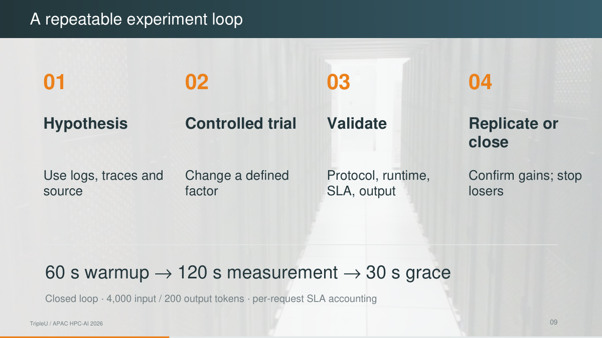

### Purpose

Describe the evidence discipline used to decide which ideas deserve a run and which should be closed. It connects the early engineering stories to the later measured backend results and makes the full measurement phases explicit.

### What is on the slide

Four numbered stages run left to right: hypothesis, controlled trial, validate, then replicate or close. Orange stage numbers are visual navigation markers; dark text describes each stage. A line separates the workflow from the 60/120/30 timing and workload note. There are no axes or chart legend.

### Terms and symbols

- **01–04:** Sequence numbers for the four experimental stages, not scores or job IDs.
- **60 s warmup:** A one-minute measured-protocol warmup before the scoring window.
- **120 s measurement:** Two-minute scoring window for the shown full measurement protocol.
- **30 s grace:** A settling interval after measurement for in-flight requests to finish; not another steady-state scoring period.
- **closed loop:** A client keeps the target number of requests in flight, replacing completed requests.
- **4,000 / 200 tokens:** Fixed input and requested output sizes for the workload described earlier.
- **SLA accounting:** Evaluating latency and success for each request, including failed requests in the denominator.

### How to read the figure, axes, units and colors

- Stage 1 uses logs, traces and source to formulate a hypothesis; stage 2 changes one defined factor.
- Stage 3 checks protocol, runtime activation, SLA and output; stage 4 confirms useful gains or closes losing branches.
- The times below are seconds, not milliseconds. The 120-second window is the measurement phase.

### Tradeoff and strength of evidence

- **Observation:** The retained workflow keeps the benchmark protocol and output/runtime gates visible, and distinguishes a terminal job from a reviewed valid result.
- **Hypothesis:** A bounded change with a control and stopping rule should yield more interpretable evidence than broad or repeated blind sweeps.
- **Supported conclusion:** Candidates need actual activation checks and independent replication before promotion; a run without valid export or passing gates does not establish a result.
- **Unknown / limitation:** The diagram is a process summary; it does not show any particular trial, cost, failure rate, or replication statistics.

### Spoken script

Our loop has four steps. First, use logs, traces, and source to form a hypothesis. Second, change a defined factor against a control. Third, validate that the intended setting actually ran, then check the protocol, request-level SLA, and output. Finally, repeat a useful gain independently or close the branch. The full protocol shown here uses 60 seconds of warmup, 120 seconds of measurement, and a 30-second grace period for outstanding requests. The grace period is not more scored steady state. This discipline helped us keep failed runs, distinguish terminal status from a valid result, and stop changes that were real but too small to justify promotion.

### Avoid this interpretation

A four-step diagram is not evidence that every historical experiment followed an identical protocol. Cite each result's actual protocol and job record.

### Transition

Now I will use that evidence framework to summarize the H200 progression, while warning that it is not one cumulative experiment.

---

## Slide 10 — H200 journey: recover, specialise, then reproduce

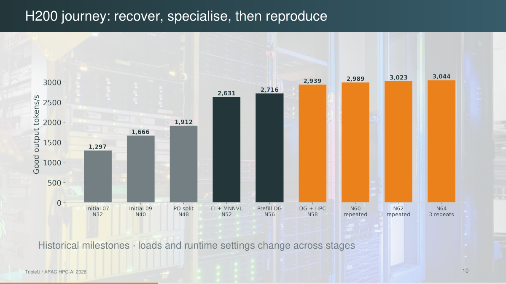

### Purpose

Give a historical overview of measured H200 goodput as the serving system recovered and acquired phase-specific backends, then reached repeated operating points. This is orientation for the detailed evidence on the following slides, not a causal ablation plot.

### What is on the slide

A vertical bar chart shows nine milestone labels on the categorical x-axis: Initial 07 N32; Initial 09 N40; PD split N48; FI + MNNVL N52; Prefill DG N56; DG + HPC N58; N60 repeated; N62 repeated; N64 three repeats. The y-axis is Good output tokens/s, marked at 0, 500, 1000, 1500, 2000, 2500, and 3000; units are good output tokens per second. Bar labels are rounded values 1,297; 1,666; 1,912; 2,631; 2,716; 2,939; 2,989; 3,023; and 3,044. The gray first three, dark-teal next two, and orange later four bars mark thematic stages only; colors are not pass/fail and have no global meaning. No legend is drawn. The footer explicitly says loads and runtime settings change.

### Terms and symbols

- **H200:** The GPU platform used for these milestones; do not combine these values with H100 results.
- **x-axis milestones and N:** Categorical experiment stages and client concurrency values, not elapsed time or a continuous independent variable. N is target in-flight requests.
- **y-axis: Good output tokens/s:** Qualifying output-token throughput under the joint latency gate; the plotted labels are rounded.
- **FI:** FlashInfer, the attention backend in the named stage.
- **MNNVL:** The collective/communication backend used in the decode-side combination.
- **DG:** DeepGEMM, used for prefill in the named milestones.
- **HPC:** HPC-Ops decode backend in the “DG + HPC” milestone.
- **N60 / N62 / N64 repeated:** Later full operating points with repeated observations; N64's 3,044 bar summarizes three historical full runs.

### How to read the figure, axes, units and colors

- Read the x-axis as a sequence of named historical milestones; it does not encode calendar time or equal intervals.
- Read the y-axis in good output tokens per second, increasing upward; each label is a rounded score.
- Gray, teal, and orange distinguish broad thematic groups in this chart only. The bars do not indicate pass/fail.
- The footer warns that load and runtime settings vary between stages, so a taller later bar is not by itself a causal effect.

### Tradeoff and strength of evidence

- **Observation:** The historical chart moves from early layouts at N32–N48 to backend specialization and later repeated N60, N62, and N64 operating points. Its N64 label, 3,044, is a rounded mean of three historical full runs.
- **Hypothesis:** After recovering a usable split and transfer path, tuning phase-specific attention, collective, and prefill backends could improve qualifying throughput.
- **Supported conclusion:** The chart documents research progression and points to later matched comparisons and replication; it is useful as a map of milestones, not evidence for one monotonic cumulative gain.
- **Unknown / limitation:** Loads, runtime settings, and historical observation conditions change. The chart cannot attribute the total rise to one change, establish statistical uncertainty, or identify a global optimum.

### Spoken script

This chart is a map of the H200 research journey, not one cumulative ablation. The horizontal axis lists categorical milestones and their client concurrency N, from initial layouts at N32 and N40 through the selected split at N48, backend work, and later N60, N62, and N64 points. N means target requests kept in flight; it is not elapsed time. The vertical axis is good output tokens per second. We recovered the split, combined FlashInfer attention with MNNVL, introduced DeepGEMM prefill, and later tested HPC-Ops decode. N60, N62, and N64 have repeated evidence, with the N64 bar rounded to 3,044 from three historical full runs. The groups use gray, teal, and orange as thematic stages only. Loads and runtime settings changed, so the rising bars do not show that each change caused the entire increase.

### Avoid this interpretation

The x-axis is categorical, not time. Do not interpolate between milestones or interpret color as a pass/fail legend. Do not describe the bars as a causal ablation or a global optimum.

### Transition

The next slide zooms into one more controlled comparison: attention and collective backend combinations at the same H200 load.

---

## Slide 11 — Backend combinations matter

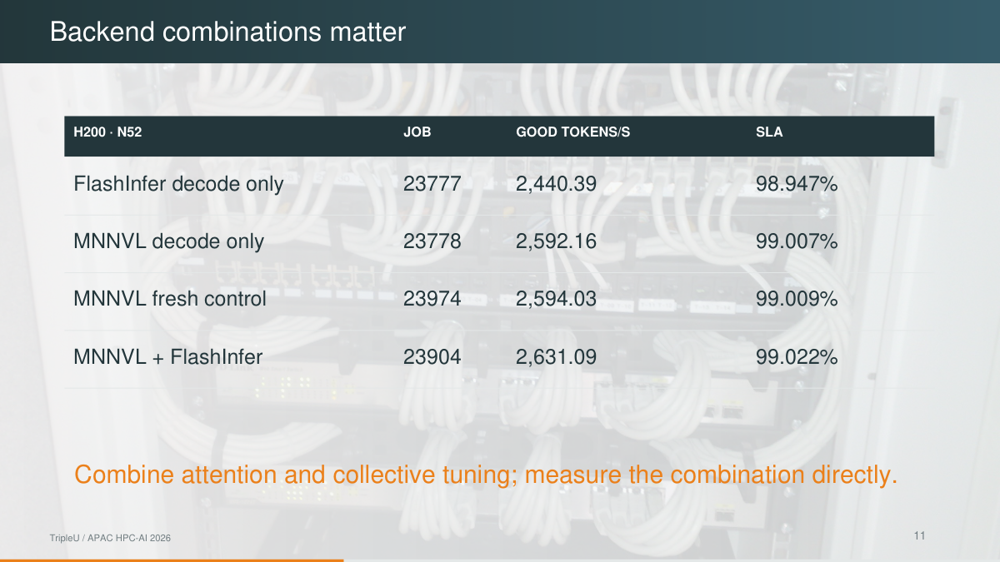

### Purpose

Introduce the first detailed backend interaction result: a combined attention and collective configuration outperformed the individual choices in a same-load H200 N52 comparison. The design lesson is to measure interactions directly rather than add separate gains arithmetically.

### What is on the slide

A four-row table reports configuration, job ID, good tokens/s, and SLA at H200 and N52. The header is dark teal; orange takeaway text emphasizes direct combination measurement. The background photograph is decorative. There are no numeric axes, plotted bars, or color legend.

### Terms and symbols

- **H200 · N52:** The GPU platform and client concurrency for the displayed comparison. N52 means a target of 52 in-flight requests.
- **FlashInfer decode only:** The decode attention path uses FlashInfer while collective configuration remains at its comparison setting.
- **MNNVL decode only:** The decode collective/communication path uses MNNVL without the FlashInfer combination shown in the last row.
- **MNNVL fresh control:** A later fresh control measurement at the MNNVL setting, used to reduce reliance on an older comparison point.
- **MNNVL + FlashInfer:** The combined backend choice measured directly in job 23904.
- **good tokens/s:** Qualifying output tokens per second under the request-level latency gate.
- **SLA:** Percentage of requests satisfying both TTFT and mean ITL limits; the displayed values are local measurements.
- **job:** Scheduler record identifier linking a row to its run evidence; not a ranking.

### How to read the figure, axes, units and colors

- Compare 23777 (2,440.39), 23778 (2,592.16), and combo 23904 (2,631.09) as exploratory same-load evidence.
- The fresh MNNVL control 23974 reaches 2,594.03, giving the more relevant comparison to the combo; the difference is about 1.43%.
- All displayed SLA values are percentages. The table itself has no axes; row order does not imply time or a statistical ranking.

### Tradeoff and strength of evidence

- **Observation:** At H200 N52, standalone FlashInfer decode measured 2440.386 good tokens/s; MNNVL decode measured 2592.162; fresh MNNVL control 2594.028; the combination measured 2631.085. Against the fresh control, the combo is about 1.43% higher, with SLA values near 99%.
- **Hypothesis:** Attention-kernel choice and collective choice may interact, so their combined service performance should be tested as a configuration rather than predicted by adding isolated improvements.
- **Supported conclusion:** The combo provides a promising operating point and supports measuring attention plus communication tuning together. Later runtime checks and repeats add evidence, but this table alone is not a universal backend rule.
- **Unknown / limitation:** The small gain and listed single observations do not establish a broad causal effect, confidence interval, or that component gains add linearly. Full official model accuracy is not represented by SLA.

### Spoken script

This table compares backend choices on H200 at client concurrency N52. FlashInfer decode alone reached about 2,440 good tokens per second. MNNVL alone measured about 2,592, and a fresh MNNVL control measured 2,594. The directly measured combination of MNNVL and FlashInfer reached about 2,631, around 1.43 percent above that fresh control in these observations. The request-level SLA values are all close to 99 percent. The lesson is not that the separate gains add up. Attention and collective operations interact, so we measured their combination as its own configuration. Later activation checks and repeats support this operating range, while this table by itself does not make a universal claim about every workload or backend.

### Avoid this interpretation

Do not calculate a predicted combined score by adding the two standalone changes. These are not repeated distributions, and latency SLA is not model-accuracy certification.

### Transition

The following slides test these backend observations more deeply, including profile evidence and a matched repeat of the N60 treatment.

---

## Slide 12 — H200: the N62-to-N64 step survives a full repeat

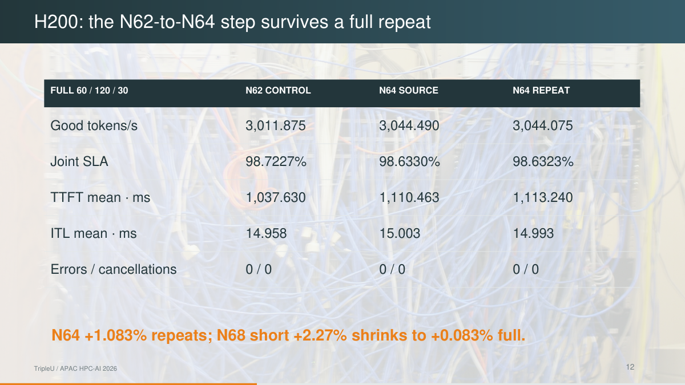

### Purpose

Show why the team selected N64: a full comparison and an independent repeat support a modest gain, while a promising short N68 screen did not survive full measurement.

### What is on the slide

Read the table left to right: full N62 control, N64 source run, independent N64 repeat. Rows show goodput, joint SLA, mean TTFT, mean ITL, and errors/cancellations.

### Terms and symbols

- **N62/N64:** Configured client concurrency; not GPU count or decode batch size.
- **Good tokens/s:** Qualifying request rate multiplied by the fixed 200-token output target.
- **Joint SLA:** Share of requests meeting both TTFT and request-mean ITL limits.
- **60/120/30:** Warmup seconds / scored seconds / grace seconds.
- **N68:** Higher-concurrency screen whose gain shrank in the full pair.

### How to read the figure, axes, units and colors

- Independent N64 deployment 25373 repeats at 3,044.075, only 0.014% below the source. Read columns in order: goodput, joint SLA, mean TTFT, mean ITL, errors/cancellations. N64's higher throughput trades against slightly higher mean TTFT and a small SLA decline. The full protocol is 60 seconds warmup, 120 scored, 30 grace. A short N68 screen suggested +2.27%, but its full pair narrowed to +0.083%; short screens are triage, not final evidence. The repeated N64 pair reused sampled GPU UUIDs, so it supports a local repeatability claim, not a confidence interval or global optimum. Hypothesis: moderate client concurrency improves pipeline utilization. Supported conclusion: keep reproduced N64 at this operating point. Unknown: separate queue, transfer and compute causes, other loads, and global optimum.
- There are no numerical X/Y axes on this slide. Read the printed rows, columns or cards; dark teal headings organize the content and orange text emphasizes the message. These colors do not add a separate pass/fail data series.
- Good output tokens/s is a throughput unit (higher is desirable); latency values are milliseconds (lower is desirable); joint SLA is a percentage of requests, not model accuracy. N is concurrent client requests, not GPUs. Read only the metrics actually printed on this slide.

### Tradeoff and strength of evidence

- **Observation:** N64 gains 1.083% and repeats within 0.014%; TTFT rises modestly and SLA dips slightly.
- **Hypothesis:** Moderately higher client concurrency may improve pipeline use.
- **Supported conclusion:** Keep reproduced N64 at this measured point.
- **Unknown / limitation:** Queue, transfer, compute contributions and global optimum remain unknown.

### Spoken script

“N62 produced about 3,012 good output tokens per second. N64 reached about 3,044, and an independent deployment repeated almost exactly. That is a roughly 1.08 percent full-protocol gain. Mean TTFT rose modestly and ITL stayed near 15 milliseconds. The short N68 screen looked better, but its full result nearly disappeared. We keep N64 because the full comparison and repeat support it, without calling it globally optimal.”

### Avoid this interpretation

Keep units and configuration attached; do not state a hypothesis as a measured cause.

### Transition

“Next we use traces to choose diagnostic questions.”

---

## Slide 13 — Profile the deployed interaction

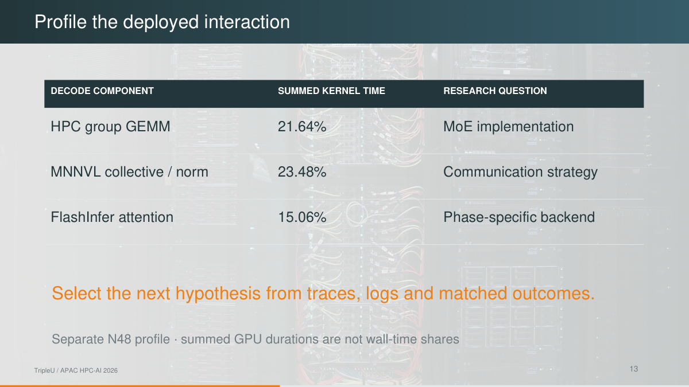

### Purpose

Explain how profiling generates the next testable question, while keeping diagnostic kernel shares separate from end-to-end service performance.

### What is on the slide

A three-row table lists decode component, summed kernel-time share, and the follow-up research question. It is a table, not a bar chart. Percentages are descriptive shares of summed recorded kernel durations, not end-to-end wall-time shares.

### Terms and symbols

- **GEMM:** General matrix multiplication used in compute kernels.
- **MNNVL:** NVIDIA NVLink communication backend.
- **RMSNorm:** Root mean square normalization operation.
- **Kernel duration:** Recorded GPU-kernel time; not end-to-end wall time.
- **N48/N58:** Separate diagnostic and repeated deployment concurrency settings.

### How to read the figure, axes, units and colors

- Named decode groups are HPC group GEMM 21.642%, MNNVL collective/RMSNorm 23.479%, and FlashInfer paged attention 15.064% of summed recorded kernel duration. These percentages are descriptive sums, not shares of end-to-end wall time: kernels can overlap and the trace covers only recorded activity. Terms: GEMM is matrix multiplication; MNNVL is a communication backend; RMSNorm normalizes hidden activations; rank is one distributed process. The three groups suggest questions about MoE implementation, communication strategy, and phase-specific attention backend. They do not predict equivalent speedups, prove FLOP saturation, or causally explain N58/N60 service results. Keep the N48 diagnostic distinct from the N58 repeat. Hypothesis: large recorded groups deserve follow-up. Conclusion: use traces to design a controlled full-service test. Unknown: per-request phase attribution and causal latency shares.
- There are no numerical X/Y axes on this slide. Read the printed rows, columns or cards; dark teal headings organize the content and orange text emphasizes the message. These colors do not add a separate pass/fail data series.

### Tradeoff and strength of evidence

- **Observation:** Three named groups account for stated shares of recorded kernel duration.
- **Hypothesis:** Large recorded groups may guide next experiments.
- **Supported conclusion:** Use profile as a hypothesis source, not an end-to-end explanation.
- **Unknown / limitation:** Wall-time shares, overlap effects, FLOP saturation and causality are unknown.

### Spoken script

“These profile percentages help point to follow-up questions. They are summed kernel durations in a separate N48 diagnostic, not fractions of request wall time. Kernels may overlap. We use the trace to choose a controlled experiment, not to claim the same percentage as an achievable speedup.”

### Avoid this interpretation

Keep units and configuration attached; do not state a hypothesis as a measured cause.

### Transition

“A separate full N60 comparison tests a backend interaction.”

---

## Slide 14 — The N60 gain survives an independent deployment

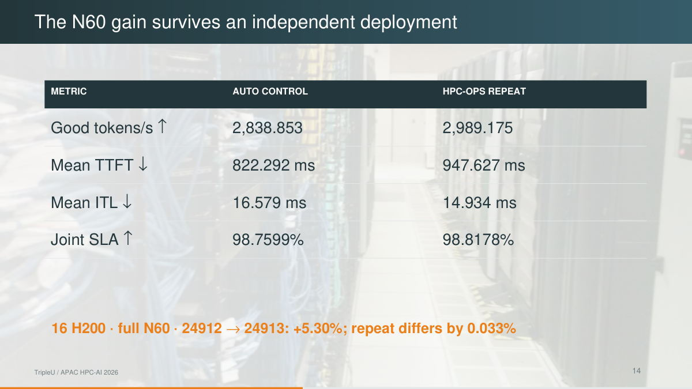

### Purpose

Demonstrate a repeatable backend tradeoff: improved useful throughput and token gaps can coexist with worse first-token delay.

### What is on the slide

Compare the full N60 auto-decode control with the HPC-Ops decode repeat. Goodput and ITL improve while mean TTFT rises.

### Terms and symbols

- **HPC-Ops:** Provided decode runner/backend in the treatment.
- **DeepGEMM:** Prefill matrix multiplication backend held fixed.
- **TTFT:** Time to first token, in milliseconds.
- **ITL:** Inter-token latency; here request-mean intervals.
- **N60:** Configured client concurrency for this full comparison.

### How to read the figure, axes, units and colors

- Both hold DeepGEMM prefill and chunk 8192 at full N60. Mean TTFT rises 125.335 ms (822.292 to 947.627), while mean request-mean ITL falls 1.644 ms (16.579 to 14.934). Joint SLA is 98.7599% versus 98.8178%. Original treatment 24738 scored 2,990.151; repeat 24913 is 0.033% lower. The close repeat supports reproducibility of this interaction. HPC-Ops is a provided backend, not a team-invented kernel. Terms: TTFT is time to first token; ITL is inter-token interval; joint SLA requires both limits. Conclusion: local full-service evidence supports this setup, not universal HPC-Ops superiority. Official full-set quality remains unverified; no exact kernel cause follows.
- There are no numerical X/Y axes on this slide. Read the printed rows, columns or cards; dark teal headings organize the content and orange text emphasizes the message. These colors do not add a separate pass/fail data series.
- Good output tokens/s is a throughput unit (higher is desirable); latency values are milliseconds (lower is desirable); joint SLA is a percentage of requests, not model accuracy. N is concurrent client requests, not GPUs. Read only the metrics actually printed on this slide.

### Tradeoff and strength of evidence

- **Observation:** Goodput rises 5.295%, ITL falls, mean TTFT increases 125.335 ms; treatment repeat is close to original.
- **Hypothesis:** Decode backend interaction may improve useful throughput at N60.
- **Supported conclusion:** Evidence supports this matched configuration, not universal backend superiority.
- **Unknown / limitation:** Exact kernel cause and official full-set quality remain unknown.

### Spoken script

“Goodput rises about 5.30 percent, and the treatment repeat is nearly identical to the original. But first-token latency gets about 125 milliseconds worse while ITL improves. This is a reproduced tradeoff at N60, not a universal backend claim.”

### Avoid this interpretation

The down arrow beside TTFT states the desired direction; actual TTFT rises in this pair. Do not say every latency metric improved or that the team invented HPC-Ops.

### Transition

“The next plot shows request-level misses rather than averages.”

---

## Slide 15 — The reproduced N64 service still loses first-token tails

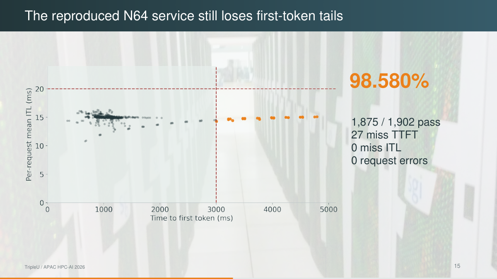

### Purpose

Teach the audience to inspect individual requests: high average performance can hide first-token tail failures, and averages alone do not explain their cause.

### What is on the slide

Each dot is one request. X is TTFT (ms), Y is per-request mean ITL (ms). Red vertical/horizontal lines mark 3,000 ms TTFT and 20 ms ITL. Dark teal (#23373B; may look blue-green) passes both; orange (#EB811B; may look yellow) misses at least one. Pale green marks only the TTFT region. Darker dots are overlap/alpha, not a new category.

### Terms and symbols

- **TTFT:** Request start to first generated token, milliseconds.
- **Request-mean ITL:** Mean interval between generated tokens for that request, milliseconds.
- **Joint pass:** TTFT ≤ 3,000 ms AND request-mean ITL ≤ 20 ms.
- **Good/all:** 1,875 joint passes divided by all 1,902 requests.
- **Alpha overlap:** Overlapping points render darker; darkness is not another outcome class.

### How to read the figure, axes, units and colors

- X is TTFT in milliseconds; Y is per-request mean ITL. Red vertical and horizontal lines mark 3,000 ms and 20 ms. A request passes only if it is left of and below both lines. Teal marks jointly pass; orange marks miss at least one condition. The pale green region represents TTFT only and does not certify the ITL condition. Darker clusters are alpha overlap, not a third class. Result: 1,875/1,902, or 98.580%, jointly pass; 27 miss TTFT, zero miss ITL, zero request errors/cancellations. Mean/p95 TTFT is 1,108.869/1,311.693 ms; mean/p95 ITL is 15.0075/15.1930 ms. All misses begin within 13.004 ms of profiling admission, an association only. Hypothesis: an initial-cohort effect may contribute. Conclusion: all observed SLA misses are TTFT-only in this run. Unknown: causation and queue/prefill/transfer/compute decomposition.
- Moving left means shorter first-token delay; moving down means shorter mean token gaps. The acceptable region is on or left of x = 3000 AND on or below y = 20; equality passes. Orange points are larger only to make failures easier to see, not because they have larger requests or token counts.
- This is a distribution of individual requests from one run, not a Pareto frontier of competing configurations. It cannot decompose queueing, prefill computation, transfer and decode time.

### Tradeoff and strength of evidence

- **Observation:** 1,875/1,902 jointly pass; 27 miss TTFT only and no request errors occur.
- **Hypothesis:** An initial-cohort effect may contribute to TTFT misses.
- **Supported conclusion:** The observed miss type is precisely TTFT-only in this run.
- **Unknown / limitation:** Admission timing is association, not proof; phase-level causes are unresolved.

### Spoken script

“Each dot is one request. It passes only left of 3,000 ms TTFT and below 20 ms ITL. Teal passes both, orange misses at least one. There are 1,875 passes from 1,902; all 27 misses are TTFT-only. Their timing near admission motivates investigation, but does not prove startup caused them.”

### Avoid this interpretation

The green band marks TTFT only. Do not treat it as the joint pass region; every request stays in the denominator.

### Transition

“We now treat H100 as a separate operating point.”

---

## Slide 16 — H100 has its own operating point and uncertainty

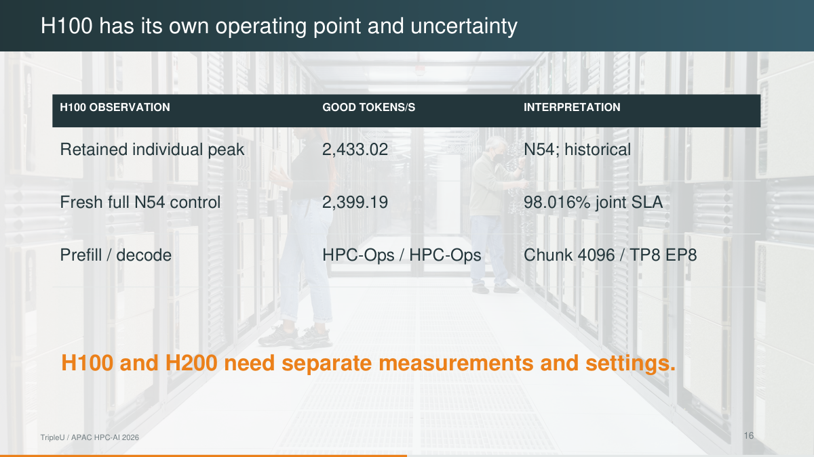

### Purpose

Keep the H100 operating point, backend settings and repeat variation separate from H200 claims.

### What is on the slide

The H100 historical individual peak and fresh full N54 control are shown alongside the H100 backend and parallelism settings.

### Terms and symbols

- **H100/H200:** Distinct accelerator systems with separately measured operating points.
- **N54:** Configured client concurrency in the H100 comparison.
- **TP8:** Tensor parallelism across eight GPUs.
- **EP8:** Expert parallelism across eight partitions.
- **Chunk 4096:** Configured prefill chunk size on this H100 setup.

### How to read the figure, axes, units and colors

- Fresh full control 225227 reached 2,399.186728 with 98.015873% joint SLA and zero errors/cancellations. H100 uses HPC-Ops for prefill and decode, chunk 4096, TP8/EP8; H200 uses DeepGEMM prefill and chunk 8192. Thus these values are not a matched hardware comparison or multiplier. Retain both peak and fresh control: they answer different questions. TP means tensor parallelism; EP means expert parallelism. A functional EAGLE transport response is not an accepted aggregate performance result. Hypothesis: hardware families require their own settings. Conclusion: report a distinct H100 point with its actual configuration. Unknown: cross-generation causal effect and universal conversion.
- There are no numerical X/Y axes on this slide. Read the printed rows, columns or cards; dark teal headings organize the content and orange text emphasizes the message. These colors do not add a separate pass/fail data series.
- Good output tokens/s is a throughput unit (higher is desirable); latency values are milliseconds (lower is desirable); joint SLA is a percentage of requests, not model accuracy. N is concurrent client requests, not GPUs. Read only the metrics actually printed on this slide.

### Tradeoff and strength of evidence

- **Observation:** Historical individual peak exceeds fresh full control; settings differ from H200.
- **Hypothesis:** Hardware families may need separate configurations.
- **Supported conclusion:** Report H100 as its own operating point.
- **Unknown / limitation:** No matched cross-generation effect or universal multiplier is established.

### Spoken script

“The historical H100 peak is about 2,433, while a fresh full N54 control is about 2,399 and passes 98.016 percent of joint latency checks. The H100 recipe differs from H200, so these are separate observations, not a hardware conversion experiment.”

### Avoid this interpretation

Keep units and configuration attached; do not state a hypothesis as a measured cause.

### Transition

“Within H100, one decode-attention change tests whether faster first token improves the whole request.”

---

## Slide 17 — FA3: faster first token does not guarantee goodput

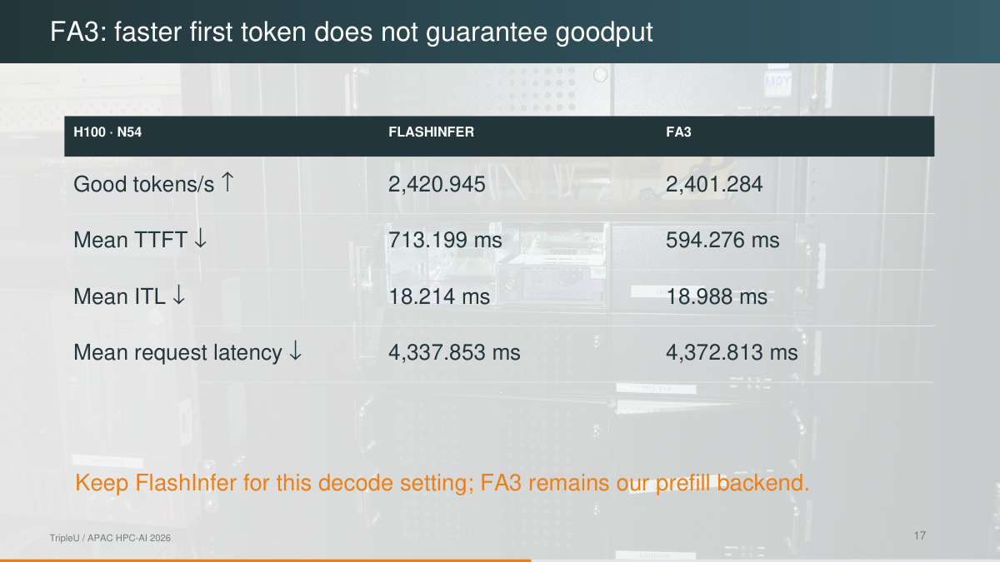

### Purpose

Use a losing FA3 decode trial to explain why optimizing first-token latency alone can reduce the final throughput objective.

### What is on the slide

The H100 N54 table compares FlashInfer and FA3 for goodput, mean TTFT, mean ITL, and mean request latency.

### Terms and symbols

- **FlashInfer:** Control decode-attention backend.
- **FA3:** Treatment decode-attention backend; prefill remains FA3.
- **Goodput:** Qualifying output tokens per second.
- **Request latency:** End-to-end request duration, including generation.
- **Matched pair:** Full runs differing only in the intended decode attention factor.

### How to read the figure, axes, units and colors

- FlashInfer versus FA3: good tokens/s 2,420.945 vs 2,401.284; mean TTFT 713.199 vs 594.276 ms; mean ITL 18.214 vs 18.988 ms; mean request latency 4,337.853 vs 4,372.813 ms. FA3 saves 118.922 ms to first token, but ITL increases 0.773 ms; over about 199 intervals that adds roughly 154 ms. Mean request latency rises and goodput falls 0.812%. Keep FlashInfer for this decode setting; FA3 remains the prefill backend. One pair cannot rank backends universally or identify exact kernel causality.
- There are no numerical X/Y axes on this slide. Read the printed rows, columns or cards; dark teal headings organize the content and orange text emphasizes the message. These colors do not add a separate pass/fail data series.
- Good output tokens/s is a throughput unit (higher is desirable); latency values are milliseconds (lower is desirable); joint SLA is a percentage of requests, not model accuracy. N is concurrent client requests, not GPUs. Read only the metrics actually printed on this slide.

### Tradeoff and strength of evidence

- **Observation:** FA3 reduces TTFT but worsens ITL/request latency and loses 0.812% goodput.
- **Hypothesis:** Attention choice shifts startup and per-token costs differently.
- **Supported conclusion:** Keep FlashInfer for this decode setting; retain FA3 prefill.
- **Unknown / limitation:** One pair cannot rank backends generally or identify exact kernel causality.

### Spoken script

“FA3 lowers TTFT, but token intervals widen. Across the output those intervals outweigh the initial saving: request latency rises and goodput falls. We keep FlashInfer for this decode configuration.”

### Avoid this interpretation

Keep units and configuration attached; do not state a hypothesis as a measured cause.

### Transition

“Next we assess a startup cost change using a predeclared gate.”

---

## Slide 18 — Test the cost hypothesis, then reverse the order

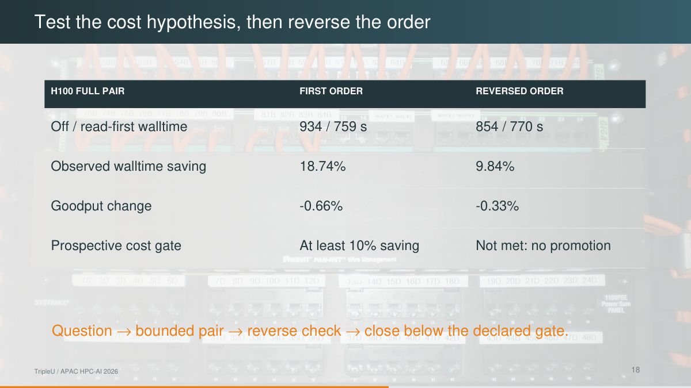

### Purpose

Show the value of reversing trial order and enforcing a predeclared promotion gate rather than selecting a favorable first result.

### What is on the slide

Two full H100 pairs show off/read-first walltime, resulting saving, goodput change, and the predeclared cost gate.

### Terms and symbols

- **Read-first:** Startup treatment that reads prefill checkpoint data first.
- **Walltime:** Scheduler-measured runtime in seconds.
- **Reverse order:** Confirmation that runs the pair in the opposite sequence.
- **Cost gate:** Predeclared requirement of at least 10% walltime saving.
- **Goodput change:** Change in qualifying throughput relative to the paired control.

### How to read the figure, axes, units and colors

- First full pair: off/read-first 934/759 s, saving 18.74%, goodput −0.66%. Reverse-order confirmation: 854/770 s, saving 9.84%, goodput −0.33%. Prospective gate required at least 10% saving and no more than 2% goodput loss; confirmation meets throughput tolerance but misses walltime gate, so no promotion. Unknown cache state and node differences prevent a cold-storage causal claim. Walltime is scheduler duration, not steady-state throughput.
- There are no numerical X/Y axes on this slide. Read the printed rows, columns or cards; dark teal headings organize the content and orange text emphasizes the message. These colors do not add a separate pass/fail data series.

### Tradeoff and strength of evidence

- **Observation:** First saving is 18.74%; reversed confirmation is 9.84%, below the 10% gate.
- **Hypothesis:** Read-first loading may reduce startup walltime.
- **Supported conclusion:** Close without promotion after the confirmation misses the gate.
- **Unknown / limitation:** Cache state and node effects prevent cold-storage attribution.

### Spoken script

“The first pair saved 18.74 percent, but reversing the order gave 9.84 percent, below the declared 10 percent gate. Goodput changed only slightly. Since the confirmation misses the threshold, we close this branch rather than promote its favorable first result.”

### Avoid this interpretation

Do not report only the favorable first order. Unknown cache state limits causal interpretation.

### Transition

“A separate question asks whether a local hardware ratio can forecast a nearby load.”

---

## Slide 19 — A local N52 calibration, not a universal multiplier

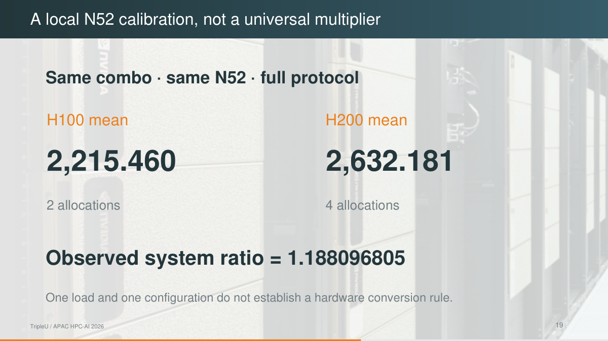

### Purpose

Define a limited, measured bridge between platforms and explain why it is not a universal H100-to-H200 conversion rule.

### What is on the slide

H100 and H200 full-protocol means at the same N52 combo produce a dimensionless observed ratio.

### Terms and symbols

- **N52:** Client concurrency used for this calibration point.
- **Allocation:** One scheduled resource assignment/run.
- **System ratio:** H200 mean goodput divided by H100 mean goodput here.
- **Dimensionless:** A ratio with no physical units.
- **Calibration point:** One load/configuration, not a validated conversion curve.

### How to read the figure, axes, units and colors

- H200/H100 observed system ratio is 1.188096805, dimensionless. It describes this measured point only. Repeats at one load do not define a conversion function or prediction interval, and the ratio must not be applied to TTFT, ITL, SLA or other backend branches. Allocation means scheduled resources, not independent hardware generations. Hypothesis: local calibration may inform a nearby held-out forecast. Conclusion: use it only as a scoped forecast input. Unknown: variation across loads/configurations and uncertainty.
- There are no numerical X/Y axes on this slide. Read the printed rows, columns or cards; dark teal headings organize the content and orange text emphasizes the message. These colors do not add a separate pass/fail data series.
- Good output tokens/s is a throughput unit (higher is desirable); latency values are milliseconds (lower is desirable); joint SLA is a percentage of requests, not model accuracy. N is concurrent client requests, not GPUs. Read only the metrics actually printed on this slide.
- The printed means are 2215.460 and 2632.181 good output tokens/s, summarized over two H100 and four H200 allocations respectively. The ratio 1.188096805 has no unit; locally it corresponds to about 18.81% higher observed system throughput, not 18.81 percentage points of SLA.

### Tradeoff and strength of evidence

- **Observation:** N52 means yield a local H200/H100 ratio of 1.188096805.
- **Hypothesis:** Local calibration may inform a nearby held-out point.
- **Supported conclusion:** Treat it as a scoped ratio, not a hardware conversion rule.
- **Unknown / limitation:** Variation across loads, settings and latency metrics is unknown.

### Spoken script

“At the same N52 combo, H200 goodput divided by H100 goodput is 1.1881. It is a local system association, not a universal conversion factor. The next slide tests one frozen forecast at N50.”

### Avoid this interpretation

This ratio applies only to the stated load and configuration; it is not a percentage or conversion for latency.

### Transition

“We now check a forecast fixed before seeing held-out H200 data.”

---

## Slide 20 — Freeze the forecast, then test it on H200

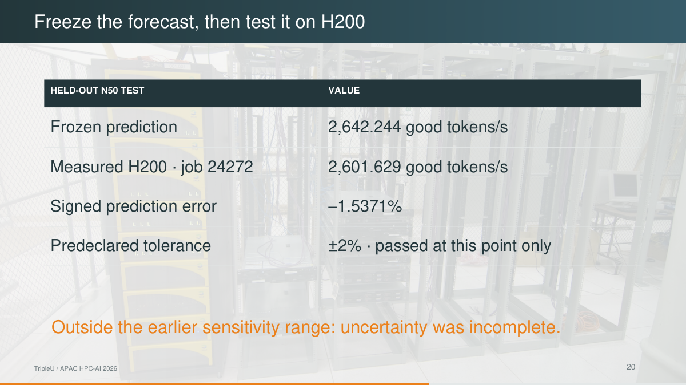

### Purpose

Show an honest forecast test: freeze the prediction, test a held-out point, and report both the operational pass and the missing uncertainty.

### What is on the slide

A prediction frozen before the result is compared with held-out H200 N50 measurement, signed error, and tolerance.

### Terms and symbols

- **Held-out:** Observation reserved for checking a frozen prediction.
- **Signed error:** Relative difference; negative means measurement is below prediction.
- **±2% tolerance:** Predeclared operational gate, not a 95% confidence interval.
- **Sensitivity range:** Input variation range that omitted model error here.
- **N50:** Client concurrency of this forecast check.

### How to read the figure, axes, units and colors

- Held-out job 24272 measures 2,601.629; signed error is −1.5371%, within the predeclared ±2% operational tolerance. It is outside the earlier sensitivity range because that range omitted model error. The tolerance is not a 95% confidence interval or measurement error bar. Do not refit the frozen ratio after observing the point. One held-out pass supports only this local check, not broad predictive validity.
- There are no numerical X/Y axes on this slide. Read the printed rows, columns or cards; dark teal headings organize the content and orange text emphasizes the message. These colors do not add a separate pass/fail data series.
- Good output tokens/s is a throughput unit (higher is desirable); latency values are milliseconds (lower is desirable); joint SLA is a percentage of requests, not model accuracy. N is concurrent client requests, not GPUs. Read only the metrics actually printed on this slide.
- The minus sign means the measurement is below the forecast: 2601.629 versus 2642.244 good output tokens/s. The signed percentage is (measured − predicted) / predicted × 100; ± means a symmetric allowed tolerance, not a measurement error bar.

### Tradeoff and strength of evidence

- **Observation:** Held-out error is −1.5371%, within ±2% but outside an incomplete sensitivity range.
- **Hypothesis:** N52 calibration may predict nearby N50 throughput.
- **Supported conclusion:** One local gate passes; retain the omitted model-error caveat.
- **Unknown / limitation:** Broader predictive accuracy and complete uncertainty are unknown.

### Spoken script

“The forecast was frozen before the result. H200 measured 2,601.629 against 2,642.244 predicted, a −1.5371 percent error. That is within the predeclared operational tolerance, but outside an earlier incomplete sensitivity range. We keep both findings and do not refit.”

### Avoid this interpretation

±2% is an operational tolerance, not a confidence interval. Do not refit after observing held-out data.

### Transition

“Next, we compare small source-guided hypotheses by complete outcome.”

---

## Slide 21 — Use source evidence to test one small hypothesis

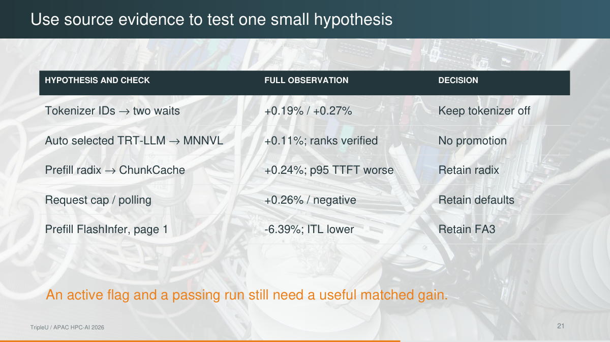

### Purpose

Show how source-based ideas are closed or retained after complete measured trials; plausible code paths and small gains are not enough for promotion.

### What is on the slide

Rows connect each source-guided hypothesis to the full observation and the retain-or-close decision.

### Terms and symbols

- **Source evidence:** Code and runtime show which path was selected/activated.
- **Exact-ID preflight:** Checks tokenizer batching preserves intended token IDs.
- **p95 TTFT:** 95th percentile first-token latency; a tail measure.
- **Useful-gain gate:** Prospective threshold for promotion.
- **Prefill/decode:** Prompt processing / autoregressive generation phases.

### How to read the figure, axes, units and colors

- Source evidence and runtime activation establish what executed; they do not prove a bottleneck. Each decision relies on full matched outcomes and a useful-gain gate. p95 is the 95th percentile tail, not a mean. Do not add percentages across branches.
- There are no numerical X/Y axes on this slide. Read the printed rows, columns or cards; dark teal headings organize the content and orange text emphasizes the message. These colors do not add a separate pass/fail data series.

### Tradeoff and strength of evidence

- **Observation:** Small gains fail the useful-gain threshold; cache tail or attention goodput worsens.
- **Hypothesis:** Source-supported settings may improve a service metric.
- **Supported conclusion:** Promote only an activated matched change with useful full-run gain.
- **Unknown / limitation:** A shared bottleneck or cross-setting effect is not established.

### Spoken script

“A working flag is only the start. We verify activation, run the full protocol, and compare the result to its control. Small gains below the useful threshold are not promoted; a better ITL that costs 6.39 percent goodput is also not a win.”

### Avoid this interpretation

Keep units and configuration attached; do not state a hypothesis as a measured cause.

### Transition

“Service latency and model accuracy are separate acceptance questions.”

---

## Slide 22 — Latency acceptance is separate from model accuracy

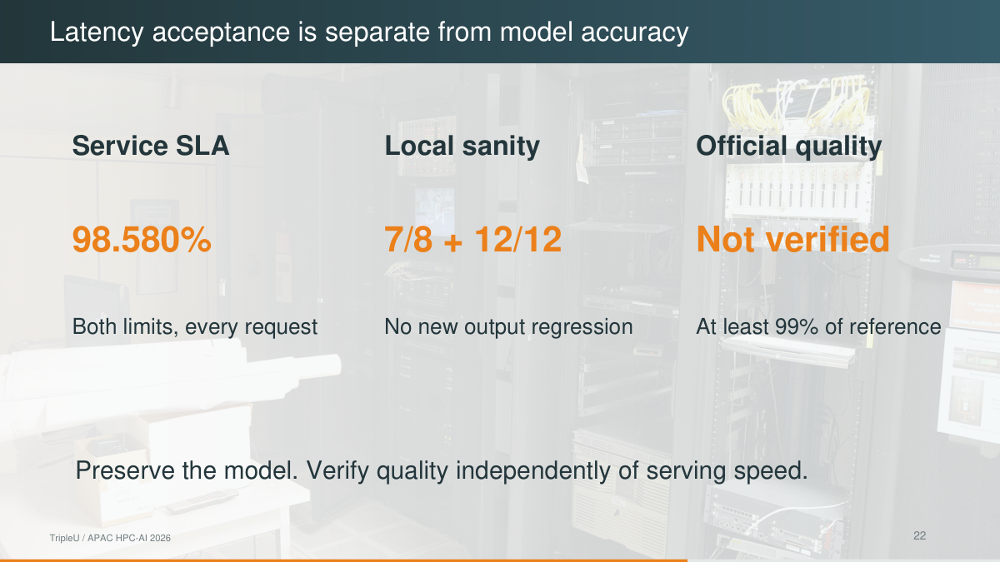

### Purpose

Separate fast service from correct model behavior: local sanity checks and latency acceptance cannot certify the official full-set quality gate.

### What is on the slide

Three evidence bands separate service latency acceptance, small local sanity checks, and unverified official model quality.

### Terms and symbols

- **SLA:** Request-level service latency acceptance.
- **Smoke:** Small basic-behavior/regression check suite.
- **Retrieval:** Local retrieval sanity suite, not official quality benchmark.
- **99% of reference:** Official model-quality threshold, still unverified.
- **FP8/BF16:** FP8 weights; BF16 activation and KV cache formats.

### How to read the figure, axes, units and colors

- Local smoke is 7/8 with no new regression; retrieval is 12/12. These small local checks do not certify the official quality requirement of at least 99% of reference. The primary retains FP8 weights and BF16 activation/KV; it does not use quantized KV or speculative decoding. Terms: SLA is service-level latency acceptance; reference is organiser's quality comparator. Conclusion: report service performance separately, and leave official quality explicitly unverified.
- There are no numerical X/Y axes on this slide. Read the printed rows, columns or cards; dark teal headings organize the content and orange text emphasizes the message. These colors do not add a separate pass/fail data series.

### Tradeoff and strength of evidence

- **Observation:** Latency SLA and small local checks pass; official model quality is unverified.
- **Hypothesis:** Preserve model while evaluating serving independently from quality.
- **Supported conclusion:** Report latency and official quality as separate outcomes.
- **Unknown / limitation:** The 99%-of-reference full-set threshold remains unverified.

### Spoken script

“The service meets its local latency gate, and small sanity checks show no new regression. The official 99-percent-of-reference quality evaluation has not been verified. We therefore make no quality certificate or ranking claim.”

### Avoid this interpretation

Smoke and retrieval checks are not full accuracy certification.

### Transition

“The EAGLE3 case shows how failed hypotheses and repaired tools should be reported.”

---

## Slide 23 — EAGLE3: follow the failed hypothesis through its repairs

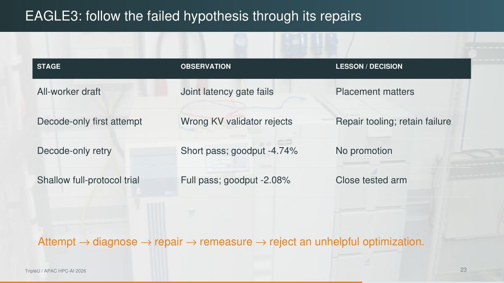

### Purpose

Preserve the entire speculative-decoding failure-and-repair chain, and explain why fixing integration did not establish a speedup.

### What is on the slide

Four chronological EAGLE3 stages show placement failure, validator error and repair, short retry, and full trial.

### Terms and symbols

- **EAGLE3:** Speculative decoding method that proposes draft tokens.
- **Draft placement:** Worker role on which the draft model is run.
- **KV region:** Role-specific key/value cache memory region.
- **Short protocol:** Limited test, not the complete benchmark protocol.
- **Full protocol:** Complete fixed workload, warmup, score window and grace period.

### How to read the figure, axes, units and colors

- Decode-only attempt 25988 is rejected by a validator incorrectly applying draft KV-region counts to target-only prefill. A role-aware validator repair preserves the old failure. Short retry 25998 passes its limited protocol but loses 4.74% goodput against its target-only control. Separate shallow full trial 27238 scores 2,971.628430 versus 3,034.761104 for control 26949, a 2.080318% loss. Functional draft transfer is not speedup; low acceptance telemetry is not a causal timing breakdown. Terms: EAGLE3 speculative decoding; KV key/value cache; full protocol complete workload; short protocol limited test. Conclusion: close tested arms while retaining failure and repair history. Unknown: other configs and official quality.
- There are no numerical X/Y axes on this slide. Read the printed rows, columns or cards; dark teal headings organize the content and orange text emphasizes the message. These colors do not add a separate pass/fail data series.

### Tradeoff and strength of evidence

- **Observation:** Repaired checks permit reruns; decode-only and shallow variants lose goodput.
- **Hypothesis:** Changed draft placement or shallow decoding may recover TTFT.
- **Supported conclusion:** Close tested variants and preserve failure/repair provenance.
- **Unknown / limitation:** Other settings, causal timing and official quality remain unknown.

### Spoken script

“The first attempt missed latency. A tooling bug then rejected a decode-only run; we repaired the validator and kept the original failure. The short retry ran but lost goodput, and a distinct full trial also lost. These tested settings close; we do not claim the method can never help.”

### Avoid this interpretation

Do not erase the validator failure or confuse short and full protocols.

### Transition

“The summary returns to replicated N64 and the small unpromoted cache result.”

---

## Slide 24 — Topology → transport → kernels → replication

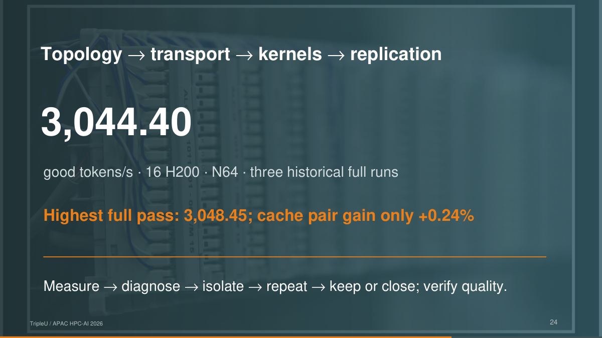

### Purpose

Close the main AI talk with the replicated configuration and the limits of its evidence, instead of choosing an isolated peak.

### What is on the slide

The replicated historical N64 mean is contrasted with the small cache gain and a separately reported native-runtime run.

### Terms and symbols

- **Three-run mean:** Mean of historical full N64 runs 25366/25373/25487.
- **Native runtime:** Separate runtime path used by job 26766.
- **Cache pair:** 27376 fresh control versus 27378 candidate.
- **+0.240921%:** Candidate gain, below the prospective useful-gain gate.
- **Official quality:** Full-set accuracy requirement, not verified here.

### How to read the figure, axes, units and colors

- Later native-runtime job 26766 independently reaches 3,045.501509 and 98.580442% joint SLA; keep it separate because runtime path differs. Highest full cache result 27378 reaches 3,048.446289, only +0.240921% over fresh control 27376, below useful-gain gate. Lower valid replays around 2,802–2,831 remain retained. Replication supports choosing N64, not a global optimum. No speculative speedup, official quality certificate, or causal native-runtime speedup is claimed.
- There are no numerical X/Y axes on this slide. Read the printed rows, columns or cards; dark teal headings organize the content and orange text emphasizes the message. These colors do not add a separate pass/fail data series.
- Good output tokens/s is a throughput unit (higher is desirable); latency values are milliseconds (lower is desirable); joint SLA is a percentage of requests, not model accuracy. N is concurrent client requests, not GPUs. Read only the metrics actually printed on this slide.

### Tradeoff and strength of evidence

- **Observation:** Historical N64 mean is replicated; cache point gains 0.240921%; native path is separate.
- **Hypothesis:** A reproduced point is a safer selection basis than isolated peak.
- **Supported conclusion:** Retain N64; do not promote the small cache gain.
- **Unknown / limitation:** Global optimum, official quality and causal runtime differences are unknown.

### Spoken script

“The selected point is the replicated historical N64 mean. A later native result is similar but separately reported. The cache high is only 0.24 percent above its control and is not promoted. We retain lower valid runs too. This is a measured operating point, not a global optimum; official quality still needs verification.”

### Avoid this interpretation

Keep units and configuration attached; do not state a hypothesis as a measured cause.

### Transition

“The next section changes topic to the HPC CPU/OpenFOAM study.”

---

## Slide 25 — Appendix · diagnose performance drift with controlled cells

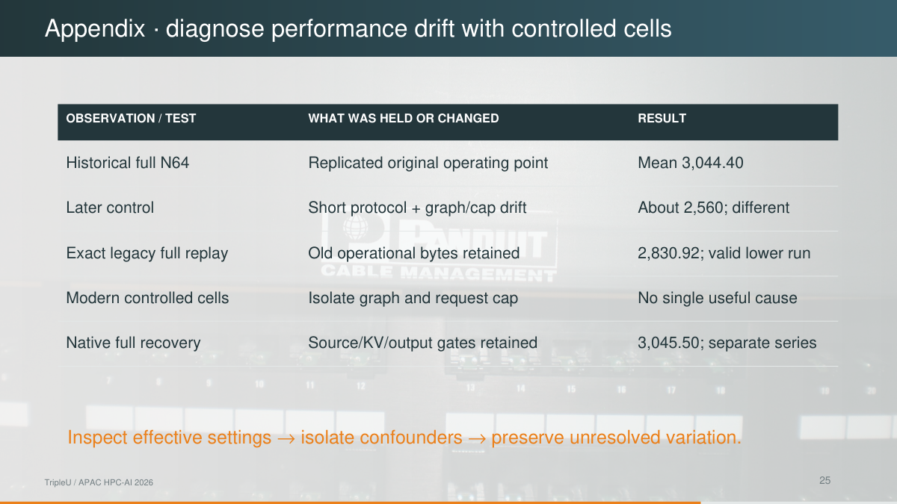

**AI backup section: open when a deeper explanation is needed.**

### Purpose

Explain the gap between the replicated full N64 result and a later short control without assigning an unproved cause.

### What is on the slide

Columns show observation/test, held or changed setting, and result. Rows cover the historical full run, short control, exact legacy replay, controlled cells, and separate native run. Scores are good output tokens/s. N64 is client concurrency, not GPU count. No plotted axes or colored data-point encoding appears.

### Terms and symbols

- **N64:** A target client concurrency of 64 in-flight requests.
- **graph policy:** Rules that decide which decode request shapes receive captured GPU execution graphs.
- **request cap:** A configured upper bound on running requests accepted by the serving engine.
- **native runtime:** The later serving execution path used for the separately reported full recovery.
- **KV:** Key-value attention state transferred from prompt processing to token generation.

### How to read the figure, axes, units and colors

- Historical full N64 mean: 3,044.400475 across three runs. The short control was about 2,560, but its protocol, graph policy, and request cap differed.
- The valid legacy full replay scored 2,830.923547. Modern controls did not isolate one useful cause. Native full 26766 scored 3,045.501509 in a separate series.

### Tradeoff and strength of evidence

- **Observation:** Historical and native full results are near 3,044–3,046 good output tokens/s; the short and legacy observations are lower.
- **Hypothesis:** Graph policy and the running-request cap might explain part of the drift.
- **Supported conclusion:** Controlled tests established no single useful cause; retain the valid lower replay.
- **Unknown / limitation:** Remaining variation, including harness and observation differences, is unresolved.

### Spoken script

The historical full result and a later short control differed sharply. We checked effective settings, replayed the old configuration, and tested modern settings separately. Those tests did not identify one useful cause. A later native full run returned near the historical level, but that does not explain why the short control was lower.

### Avoid this interpretation

Do not call the short control a matched full run, attribute recovery to one flag, or omit the valid lower replay.

### Transition

Next, review architecture and kernel leads at the scope their evidence supports.

---

## Slide 26 — Appendix · profiles and source also close attractive detours

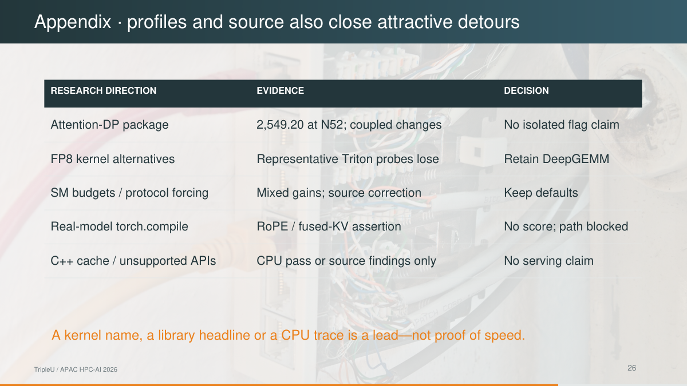

### Purpose

Show why architecture and kernel ideas are bounded leads, not proof of faster full serving.

### What is on the slide

Columns are research direction, evidence, and decision. Rows are separate branches, not one ranking. Attention-DP changed several factors at N52; Triton probes covered representative shapes; SM checks were bounded. Real-model compilation stopped at an assertion and has no score. CPU fixtures are not serving measurements. No plotted axes or colored data-point encoding appears.

### Terms and symbols

- **DP:** Data parallelism: multiple model replicas or partitions process separate requests; here it labels an attention configuration.
- **FP8:** Eight-bit floating-point format used for model weights in the retained deployment.
- **Triton:** A GPU-kernel programming and compilation system; probe results apply only to tested shapes.
- **SM:** Streaming multiprocessor, a GPU execution unit; an SM budget limits how many units a kernel may use.
- **torch.compile:** PyTorch's compilation path for turning model operations into compiled execution.
- **RoPE:** Rotary positional embedding, a position-encoding operation used by the model.
- **C++:** The compiled programming language used by the separate cache and API probes.

### How to read the figure, axes, units and colors

- Attention-DP with DeepGEMM/DeepEP scored 2,549.20 at N52, below the retained MNNVL point; coupled changes prevent one-flag attribution.
- Representative FP8 Triton probes lost to DeepGEMM. SM budgets 80, 96, and 120 were mixed or inconsistent. Real-model torch.compile failed at a RoPE/fused-KV assertion; C++ fixtures ran on CPU only.

### Tradeoff and strength of evidence

- **Observation:** Evidence includes a lower coupled-configuration score, losing kernel probes, mixed SM checks, and a compile assertion with no score.
- **Hypothesis:** Alternative layouts, kernels, resource budgets, compilation, or cache paths might help full serving.
- **Supported conclusion:** Only tested-scope conclusions are supported; tested Triton shapes did not beat DeepGEMM and compile produced no score.
- **Unknown / limitation:** Untested shapes and compatible compile paths may differ; CPU fixtures do not settle full-model serving.

### Spoken script

We tested these ideas only as far as evidence allowed. The attention package changed several factors, kernel probes covered representative shapes, and real-model compilation stopped before a score. CPU fixtures can validate a small C++ path but cannot prove GPU serving integration. A library name or profile lead motivates a test; it does not demonstrate a speedup.

### Avoid this interpretation

Do not present coupled changes as a one-factor test, generalize probes to every shape, call CPU fixtures a serving pass, or assign a score to the failed compile.

### Transition

Next, read the retained H200 configuration and the separate H100 operating point.

---

## Slide 27 — Appendix · the selected AI deployment is N64

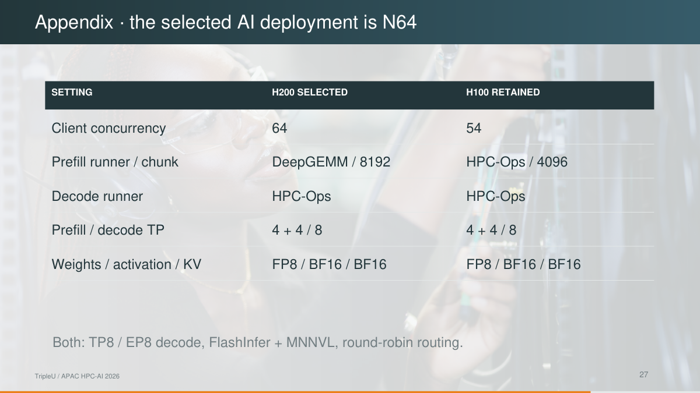

### Purpose

Summarize the selected H200 N64 deployment and the separate retained H100 setting.

### What is on the slide

Rows name settings; the right columns give H200 and H100 values. Client concurrency is 64 versus 54. Prefill, decode, TP allocation, and precision are distinct settings; the footer lists shared components. This is configuration documentation, not a matched hardware comparison. No plotted axes or colored data-point encoding appears.

### Terms and symbols

- **H200 / H100:** Two different GPU models; results and settings are reported separately.
- **N64:** Client concurrency target of 64 requests in flight; H100 retained setting uses 54.
- **prefill:** Processing the input prompt before generating the answer.
- **decode:** Generating the output tokens one step at a time.
- **TP:** Tensor parallelism: splitting tensor operations across GPUs.
- **EP:** Expert parallelism: distributing mixture-of-experts model experts across GPUs.
- **FP8 / BF16:** Eight-bit floating-point weights; BF16 means brain floating point with 16 bits and is used for activation and KV state.
- **FlashInfer:** GPU attention implementation used for decode attention in the retained setting.
- **MNNVL:** The selected collective-communication backend for the relevant GPU groups.
- **HPC-Ops:** The runtime's GPU operations backend used for decode and, on H100, prefill.

### How to read the figure, axes, units and colors

- H200 uses two TP4 DeepGEMM prefill workers with chunk 8,192 and one TP8/EP8 HPC-Ops decode worker. H100 uses two TP4 HPC-Ops prefill workers with chunk 4,096 and TP8/EP8 decode.
- Both use FP8 weights, BF16 activations and KV state, FlashInfer decode attention, MNNVL, and round-robin routing. Reader fixes passed a compute-only check on real data, not a full GPU replay after repair.

### Tradeoff and strength of evidence

- **Observation:** H200 and H100 use distinct concurrency and prefill settings; both retain the listed precision and shared components.
- **Hypothesis:** The replicated target-only N64 service is a practical primary configuration.
- **Supported conclusion:** Report H200 and H100 separately; this table does not rank the GPU models.
- **Unknown / limitation:** Official accuracy and a full portable replay after reader repair remain unverified.

### Spoken script

The selected H200 setup processes prompts on two TP4 workers and generates tokens on one TP8/EP8 worker. H100 uses lower concurrency and a different prefill backend and chunk size. Both retain FP8 weights and BF16 activation and KV state. Reader fixes were checked on real data, but the full GPU allocation was not replayed afterward.

### Avoid this interpretation

Do not make a direct H100-versus-H200 speed claim or say the full portable job passed after repair.

### Transition

Next, compare dense and sparse graph capture against the service objective.

---

## Slide 28 — Appendix · sparse graphs save memory, not goodput

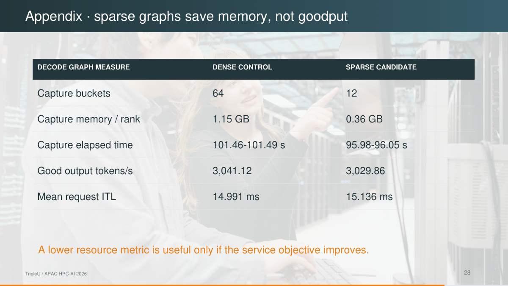

### Purpose

Explain why sparse decode graphs reduced logged capture memory but did not improve measured goodput.

### What is on the slide

Columns are measure, dense control, and sparse candidate. Rows compare those settings. Buckets count captured request shapes, not concurrency or GPU count. Memory is native-log GB per rank, not total VRAM or GiB; capture time is for that phase, not total job wall time. No plotted axes or colored data-point encoding appears.

### Terms and symbols

- **decode graph bucket:** A request-shape category for which the serving engine captures a GPU execution graph.
- **rank:** One distributed worker process, typically associated with one GPU in this deployment.
- **GB:** Gigabyte as recorded by the native log; do not silently relabel it GiB or total VRAM.
- **goodput:** Rate of requests that meet the joint latency limits; the displayed score multiplies exported good requests/s by 200 requested output tokens.
- **ITL:** Inter-token latency: time between generated tokens; the shown mean is in milliseconds.
- **compile off:** Model graph compilation was disabled in this test; successful capture does not establish compiled model support.

### How to read the figure, axes, units and colors

- The dense control captured 64 buckets; the candidate captured 12 on all eight ranks with compile off. Memory fell from 1.15 to 0.36 GB/rank; capture time changed from 101.46–101.49 to 95.98–96.05 seconds.
- Goodput was 3,041.119598 for control 27376 and 3,029.861122 for candidate 27510, a 0.370208% decrease. Mean request ITL rose from 14.991 to 15.136 ms; TTFT improved.

### Tradeoff and strength of evidence

- **Observation:** The candidate reduced logged capture memory and slightly shortened capture, but measured goodput was lower.
- **Hypothesis:** Fewer graph shapes might save memory without harming the service objective.
- **Supported conclusion:** Retain dense graphs for this deployment; the measured service objective did not improve.
- **Unknown / limitation:** One earlier control and differing generated seeds limit causal interpretation; capture memory is not total GPU memory.

### Spoken script

The sparse candidate reduced graph buckets from 64 to 12 and logged capture memory from 1.15 to 0.36 GB per rank. Capture took only a few seconds less. Full goodput was 0.370208 percent below the earlier control, and mean inter-token latency rose slightly. We retain dense graphs; this single comparison does not establish a cause.

### Avoid this interpretation

Do not call bucket count concurrency, interpret capture memory as total VRAM or GiB, or treat capture time as total job duration. Accuracy was not measured here.

### Transition

Next, separate synthetic serving measurements from model-quality evaluation.

---

## Slide 29 — Appendix · what the benchmark actually measures

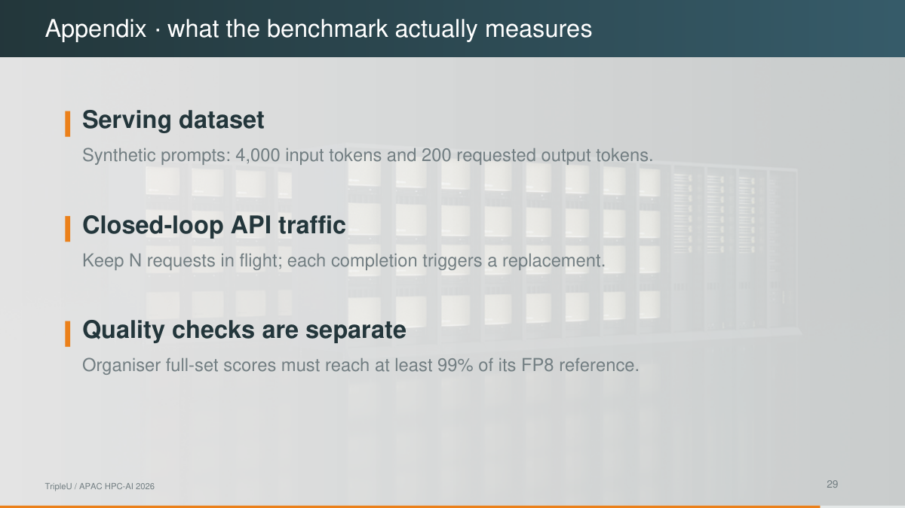

### Purpose

Clarify what the serving benchmark measures and separate it from model-quality evaluation.

### What is on the slide

Three statements describe synthetic requests of 4,000 input and 200 output tokens, closed-loop traffic, and separate official quality checks. Timing is 60 seconds warmup, 120 seconds scored profiling, and 30 seconds grace. Grace lets outstanding requests settle; it is not extra scoring time. This slide has no table, axes, or colored data-point encoding.

### Terms and symbols

- **AIPerf:** The benchmark client and measurement tool that sends serving requests and exports performance metrics.
- **closed loop:** A traffic pattern that holds a target number of requests in flight by replacing each completed request.
- **concurrency:** The target count of simultaneously active client requests; the main N64 workload targets 64.
- **warmup:** A preliminary phase to initialize workers and serving paths before measured client traffic.
- **profiling window:** The fixed 120-second interval used for scored performance measurements.
- **grace:** A 30-second allowance for in-flight requests to settle after the scored window.
- **99% quality threshold:** The official requirement that full-set model quality reach at least 99% of the organizer's FP8 reference score.

### How to read the figure, axes, units and colors

- AIPerf maintains target concurrency by replacing completed requests. Workers and serving paths receive separate warmup traffic.
- Only the scored window contributes to reported performance. Requested and actual token lengths may differ; physical truncation is not established.
- Official quality requires at least 99% of the organizer FP8 reference and remains unverified.

### Tradeoff and strength of evidence

- **Observation:** This serving workload uses synthetic 4,000/200 requests and a 60/120/30-second warmup, profiling, and grace schedule.
- **Hypothesis:** Fixed workload and timing support comparisons when configuration and protocol match.
- **Supported conclusion:** Goodput describes service performance here, not model accuracy; do not divide all completions by 120.
- **Unknown / limitation:** Actual token IDs/usage and official full-set quality remain unknown.

### Spoken script

This benchmark measures serving on synthetic prompts, not the official model-quality set. The client replaces completed requests to maintain concurrency. After warmup, 120 seconds count toward the score, then grace lets remaining requests settle. Goodput comes from AIPerf accounting; it should not be reconstructed by dividing every completion by 120 seconds.

### Avoid this interpretation

Do not treat grace as scored time, equate requested and actual tokens, or claim the 99% quality criterion passed.

### Transition

Next, compare chunk sizes under the same full protocol.

---

## Slide 30 — Appendix · larger prefill chunks did not help

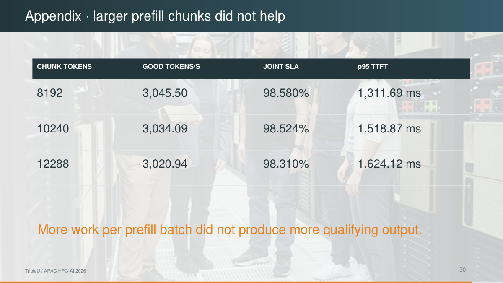

### Purpose

Compare three prefill chunk sizes under the full N64 protocol; larger chunks did not improve the observed service objective.

### What is on the slide

Columns are chunk tokens, good output tokens/s, joint SLA percentage, and p95 TTFT in milliseconds. Each row is one run. All used 60/120/30-second timing, requested 4,000/200 tokens, seed 2026, cold prefixes, and the same model and runtime. No plotted axes or colored data-point encoding appears.

### Terms and symbols

- **prefill chunk:** The number of prompt tokens handled together by the prefill worker in a scheduling unit.
- **good output tokens/s:** Reported good request rate multiplied by 200 requested output tokens per request.
- **SLA:** Service-level agreement: the fraction of all requests meeting both latency thresholds.
- **p95:** The 95th percentile: 95% of measured requests have a value at or below this number.
- **TTFT:** Time to first token, the delay from request start until the first generated token.
- **seed 2026:** The configured workload seed; it does not make engine-generated seeds identical across launches.

### How to read the figure, axes, units and colors

- Chunk 8,192: 3,045.501509 good output tokens/s, 98.580% SLA, 1,311.69 ms p95 TTFT.
- Chunk 10,240: 3,034.088251, 98.524%, 1,518.87 ms. Chunk 12,288: 3,020.943099, 98.310%, 1,624.12 ms. All passed local checks; each arm has one run.

### Tradeoff and strength of evidence

- **Observation:** Goodput fell and p95 TTFT rose as chunk size increased in these observations.
- **Hypothesis:** More tokens per prefill batch might raise throughput.
- **Supported conclusion:** Retain 8,192 for this setting and close the bounded larger-chunk branch.
- **Unknown / limitation:** One observation per arm does not establish a global optimum.

### Spoken script

We tested three chunk sizes in full runs with the same workload and runtime. As size increased from 8,192 to 12,288, goodput declined and p95 first-token delay worsened. All arms passed local checks, but each has one observation. We retain 8,192 for this setting without claiming a universal optimum.

### Avoid this interpretation

Keep chunk, goodput, SLA, and p95 TTFT units distinct. A local pass is not a useful gain or proof of a global optimum.

### Transition

Next, see how real portable replay exposed reader defects missed by static checks.

---

## Slide 31 — A real replay can invalidate a static deployment claim

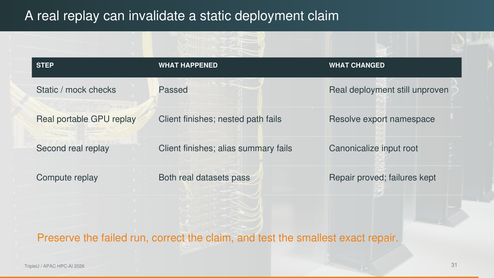

### Purpose

Explain how actual portable outputs exposed two reader defects that static and mock checks missed.

### What is on the slide

Columns are step, what happened, and what changed. Rows proceed from static/mock checks to the first GPU replay, second replay, and compute-only verification. Both GPU clients completed before reader failures. This is a repair sequence, not a performance trend. No plotted axes or colored data-point encoding appears.

### Terms and symbols

- **portable replay:** Execution of the packaged serving and benchmark workflow on the separate portable deployment environment.
- **GPU client:** The benchmark client execution that sends requests to the deployed GPU serving system.
- **AIPerf 0.12:** The retained benchmark-client version whose exports were written in an immediate child directory in the first real replay.
- **canonical path:** A normalized absolute filesystem path resolving aliases such as symbolic links.
- **lexical path:** A path string as written, without resolving aliases or symbolic links.
- **compute-only:** A job that executes reader verification on CPU without allocating GPUs; it does not replay serving.
- **scheduler FAILED:** The original jobs retain their actual failure state even when their raw outputs are later read successfully.

### How to read the figure, axes, units and colors

- Job 27136 completed both semantic routes and the official client, then failed because AIPerf 0.12 exports were in a nested directory. The first repair handled that layout.
- Job 27145 completed its client but the summary failed because /scratch/home and /home aliases used different path forms. Canonicalizing the input root fixed this. Zero-GPU job 27152 passed both readers on both real datasets.

### Tradeoff and strength of evidence

- **Observation:** Two reader failures occurred: a nested export directory and a canonical-versus-lexical path alias mismatch. Corrected readers passed real outputs in compute-only verification.
- **Hypothesis:** Reader defects caused the post-client failures.
- **Supported conclusion:** The narrow fixes are verified, but the original GPU jobs remain FAILED.
- **Unknown / limitation:** No full-allocation portable GPU replay was performed after both fixes.

### Spoken script

Static checks passed, but real portable runs found two reader bugs after the GPU clients finished: nested exports, then inconsistent aliases for the same path. A compute-only job verified both fixes on real datasets. The original GPU jobs remain failures, and there was no full portable replay after repair.

### Avoid this interpretation

Do not relabel original jobs, call compute-only verification a serving replay, or present recovered goodput as a successful repaired deployment.

### Transition

Finally, separate retained conclusions from future validation proposals.

---

## Slide 32 — What the evidence supports next

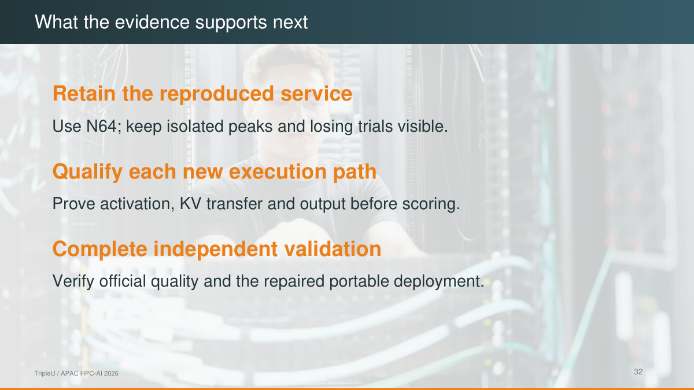

### Purpose

Close with evidence-supported conclusions and distinguish future validation proposals from completed work.

### What is on the slide

Three recommendations are listed: retain the reproduced service, qualify new execution paths, and complete independent validation. There is no quantitative table or chart. Open checks are official model quality and a full portable replay after reader repair. No plotted axes or colored data-point encoding appears.

### Terms and symbols

- **target-only:** Serving only the target model, without an added speculative draft model.
- **N64:** The selected client concurrency target of 64 in-flight requests.
- **EAGLE:** A speculative decoding approach that proposes draft tokens for the target model to verify; the tested shallow full arm lost performance.
- **RoPE/KV compatibility:** Compatibility between the model's rotary position embedding operation and the key-value cache interface needed by the compiled execution path.
- **official accuracy:** The organizer's full-set model-quality score compared with the required FP8 reference threshold.
- **end-to-end:** A complete run through packaged deployment, client, output processing, and result review.

### How to read the figure, axes, units and colors

- Retain target-only N64: cache, cap, and polling changes showed no useful gain, while the tested full shallow EAGLE arm lost. Sparse graphs scored 0.370208% below the earlier control.
- Before scoring a new path, verify backend activation, KV transfer, and output. Official accuracy and a full portable replay after reader repair remain open; compiled model execution still needs a compatible RoPE/KV solution.

### Tradeoff and strength of evidence

- **Observation:** N64 has replicated full-run evidence; isolated changes showed no useful gain. Official quality and post-repair portable replay are not available.
- **Hypothesis:** Path-specific activation, transfer, output, and independent checks can improve deployment confidence.
- **Supported conclusion:** Keep the reproduced target-only N64 configuration; listed checks are future requirements, not completed work.
- **Unknown / limitation:** Official model accuracy and end-to-end behavior after reader repair remain unknown.

### Spoken script

The replicated target-only N64 service remains the supported choice; a larger isolated score is not enough to replace it. New execution paths should prove backend activation, KV transfer, and output before scoring. Official full-set quality and a complete portable replay after reader repair remain open. These are validation priorities, not work already scheduled or performed.

### Avoid this interpretation

Do not claim official accuracy passed, portable deployment is fully validated, sparse graphs improved goodput, or compile compatibility is fixed.

### Transition

End the appendix here; distinguish observation, supported conclusion, and unknown when answering questions.

---

## Slide 33 — The task: same 65-million-cell airflow calculation

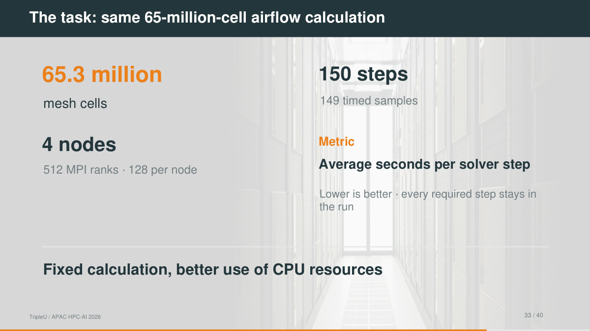

**Unchanged HPC section: explanation of the existing slide, not a new status or result update.**

### Purpose

Define the fixed CPU workload and the performance quantity being optimized. The comparison holds the prescribed calculation constant and asks how efficiently the cluster executes it.

### What is on the slide

The slide gives 65.3 million mesh cells, four nodes, 512 MPI ranks (128 on each node), and 150 solver steps, of which 149 are timed. The metric is average elapsed seconds per solver step; lower is better. Orange highlights the cell count and the progress rule at the bottom. There are no plotted axes or data series here.

### Terms and symbols

- **65.3 million:** Rounded display of the 65,334,765-cell mesh.
- **MPI rank:** One distributed solver process; 512 total means 128 per node on four nodes.
- **s/step:** Wall-clock seconds per solver iteration, not seconds of simulated driving.

### How to read the figure, axes, units and colors

- Read this as a workload definition, not a result comparison: same mesh and required solver work, executed on four CPU nodes.
- The 149 timed samples begin after the first solver iteration; the complete run still performs all 150 steps.
- The task is to reduce runtime through better CPU-resource use, not by reducing mesh size or required work.

### Tradeoff and strength of evidence

- **Observation:** The fixed run has substantial parallel work: roughly 65.3 million cells distributed across 512 ranks.
- **Hypothesis:** A more effective distribution and placement of work may reduce time per step.
- **Supported conclusion:** The slide establishes the measurement frame; it reports no tuning win by itself.
- **Unknown / limitation:** It does not identify a bottleneck or establish a causal performance improvement.

### Spoken script

We are optimizing the prescribed OpenFOAM airflow calculation, not changing its mathematics. The mesh has 65.3 million cells. On four nodes, 512 MPI ranks perform all 150 solver steps. The first iteration is excluded from timing, leaving 149 measured steps. We compare the average wall-clock seconds per step, where lower is better. That makes this a fixed-work CPU-efficiency question.

### Avoid this interpretation

Do not call 65.3 million the exact count, do not describe the 149 timed steps as the whole solve, and do not treat the displayed task definition as evidence of a speedup. The retained drag coefficient is a physical sanity check, not this performance metric.

### Transition

Next, show which preparation stages must be retained for a valid end-to-end run.

---

## Slide 34 — The whole required pipeline comes before the score

**Unchanged HPC section: explanation of the existing slide, not a new status or result update.**

### Purpose

Explain why the score is meaningful only after preserving the full required pipeline, and distinguish mesh decomposition from CPU affinity.

### What is on the slide

Five white cards run left to right with orange arrows: decomposePar assigns mesh cells to ranks; renumberMesh reorders local cell data; potentialFoam initializes flow fields; applyBoundaryLayer applies the prescribed boundary layer; simpleFoam performs all 150 solver steps. The two labels beneath define decomposition as deciding cell ownership and CPU affinity as deciding which CPU runs each rank. There are no numerical axes; the arrows show required sequence.

### Terms and symbols

- **MPI:** Message Passing Interface; separate ranks exchange data, especially across partition boundaries.
- **decomposePar:** OpenFOAM utility that partitions mesh cells among ranks.
- **CPU affinity:** Binding a process or rank to CPU resources; distinct from assigning it mesh cells.

### How to read the figure, axes, units and colors

- Follow the orange arrows from preprocessing into the solver; the final timing is not a substitute for those stages.
- A decomposition answers which cells a rank owns. Affinity answers where that rank executes.
- The sequence shown is the complete required preparation and 150-step solve, not an optional menu.

### Tradeoff and strength of evidence

- **Observation:** The pipeline contains data setup, initialization, boundary treatment, then iterative solving.
- **Hypothesis:** Choices in decomposition and placement can affect execution while preserving the prescribed calculation.
- **Supported conclusion:** Valid comparisons must retain each required stage and its successful completion.
- **Unknown / limitation:** This flow diagram alone does not measure the cost of each stage or prove which mapping is faster.

### Spoken script

Before comparing solver times, we keep the entire required pipeline: assign cells to MPI ranks, reorder the local data, initialize the flow, apply the prescribed boundary layer, and run all 150 simpleFoam steps. Decomposition decides which cells each rank owns. CPU affinity decides which CPU runs the rank. Those are separate decisions, and a valid run must preserve every preparation step as well as the solve.

### Avoid this interpretation

Do not imply that the background photograph depicts the contest cluster. The slide gives process order, not per-stage timings, and it does not establish that affinity was measured or optimized in a particular result.

### Transition

With the workload and pipeline fixed, the next slide tests whether a locality proxy predicted solver runtime.

---

## Slide 35 — A smaller partition cut did not make the solver faster

**Unchanged HPC section: explanation of the existing slide, not a new status or result update.**

### Purpose

Show a failed NUMA-aware locality hypothesis and explain why a partition-graph proxy cannot stand in for a runtime measurement.

### What is on the slide

The slide pairs an orange −10.63% graph-cut change with a red +3.4416% slower solver mean, separated by an unequal sign. No axes or plotted series are shown. The stated runtime comparison is 13.881 versus 14.359 seconds per step. The lower lesson says a graph proxy is not runtime, and lists potential unmeasured causes: MPI wait, bandwidth, frequency, power, and page residency.

### Terms and symbols

- **NUMA:** Non-Uniform Memory Access: memory access cost can depend on which CPU socket or locality domain owns the memory.
- **graph cut:** A proxy count/weight of partition connections crossing a selected boundary; it is not a direct measurement of communication time.
- **−10.63%:** The graph-cut proxy was reduced by 10.63% for this candidate.
- **+3.4416%:** The solver mean became 3.4416% slower in the compared observation.

### How to read the figure, axes, units and colors

- Orange marks proxy improvement; red marks worse measured solver time. Their signs make the mismatch clear.
- A smaller proxy can coexist with slower execution because other partition properties and runtime effects also matter.
- The slide explicitly leaves the cause unmeasured; it records a rejected candidate, not a diagnosis.

### Tradeoff and strength of evidence

- **Observation:** Graph cut fell 10.63%, while mean runtime rose from 13.881 to 14.359 seconds per step.
- **Hypothesis:** Grouping work by memory locality might reduce remote-memory and interface cost.
- **Supported conclusion:** The unchanged NUMA-aware branch was closed; graph cut alone did not predict solver speed.
- **Unknown / limitation:** MPI wait, bandwidth, frequency, power, page residency, and other possible causes were not measured.

### Spoken script

We tested a NUMA-aware idea: grouping work by locality should reduce remote-memory or interface cost. The graph-cut proxy fell by 10.63 percent, but the measured solver mean worsened from 13.881 to 14.359 seconds per step, a 3.4416 percent slowdown. That is why we closed this unchanged candidate. A graph proxy describes the partition; it is not measured runtime or proof of less communication time.

### Avoid this interpretation

The comparison changed other partition properties, so do not attribute the slowdown to one mechanism. A separate offline mapping with a 4.5741% smaller proxy had no solver run and is not evidence of performance. Do not interpret the percentages as reciprocal measures.

### Transition

The next comparison asks whether the better observed decomposition changes with node count.

---

## Slide 36 — Observed scaling changed which decomposition led

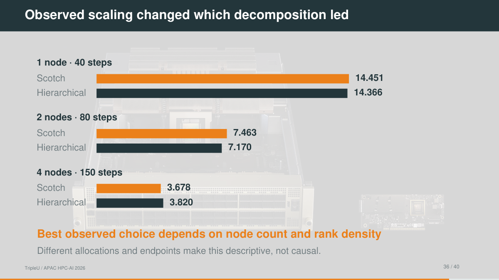

**Unchanged HPC section: explanation of the existing slide, not a new status or result update.**

### Purpose

Compare the observed Scotch and hierarchical means across one-, two-, and four-node allocations, while explicitly limiting the inference because work endpoints and allocations differ.

### What is on the slide

Three grouped pairs of horizontal bars are labeled 1 node · 40 steps, 2 nodes · 80 steps, and 4 nodes · 150 steps. Orange bars are Scotch; dark teal bars are Hierarchical, as confirmed by the adjacent labels. Values are seconds per solver step: 14.451 vs 14.366; 7.463 vs 7.170; 3.678 vs 3.820. Longer bars mean more seconds and therefore slower means. No separate axis labels or uncertainty intervals are shown.

### Terms and symbols

- **Scotch:** A graph-based mesh-decomposition method used by the OpenFOAM workflow.
- **Hierarchical:** A decomposition method that partitions the mesh using a hierarchy of spatial divisions.
- **s/step:** Mean wall-clock seconds for each timed solver iteration; lower is better.

### How to read the figure, axes, units and colors

- At one node hierarchical is slightly lower; at two nodes hierarchical is lower; at four nodes Scotch is lower.
- The displayed step endpoints are not identical, and each result came from a separate allocation.
- This is descriptive evidence about observed candidate means, not a controlled strong-scaling curve.

### Tradeoff and strength of evidence

- **Observation:** Hierarchical leads the displayed two-node pair, while Scotch leads the four-node pair; the one-node means are close with hierarchical lower.
- **Hypothesis:** The preferable partition may depend on node count, rank density, and allocation-specific conditions.
- **Supported conclusion:** There is no single decomposition winner across these observations; the four-node Scotch result motivates closer review.
- **Unknown / limitation:** Different allocations and endpoints prevent assigning the differences to node count alone or claiming causal scaling efficiency.

### Spoken script

The observed leader changes with the allocation. Hierarchical has a slightly lower one-node mean and leads at two nodes, while Scotch leads at four nodes. The values are seconds per solver step. However, these are separately allocated runs with different prescribed endpoints—40, 80 and 150 steps—so this is descriptive scaling evidence, not a controlled causal comparison. The candidate choice must be evaluated at the intended node count and rank density.

### Avoid this interpretation

Do not calculate or claim ideal speedup from these means. The bars show means only, without uncertainty ranges; the separate allocations and run lengths matter. This slide alone cannot show a universal advantage for either method.

### Transition

The four-node results can be split further by ranks per node, which is the next comparison.

---

## Slide 37 — At four nodes, the winner depends on ranks per node

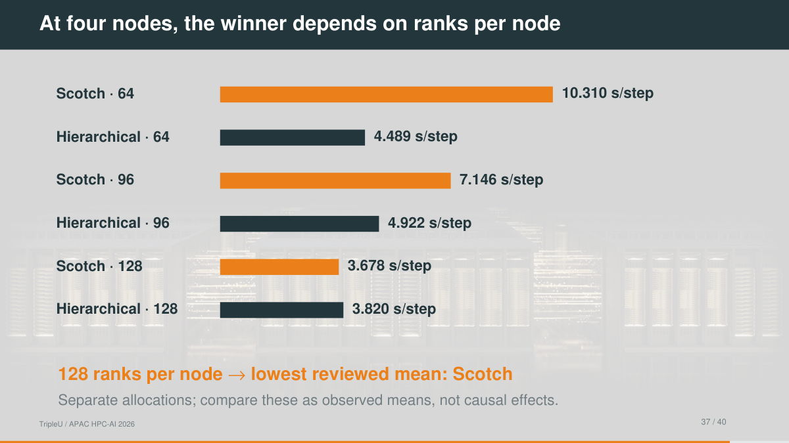

**Unchanged HPC section: explanation of the existing slide, not a new status or result update.**

### Purpose

Show that the four-node decomposition ranking changes with process density, and identify the lowest reviewed mean without overstating it as a universal optimum.

### What is on the slide

Six horizontal bars compare Scotch and Hierarchical at 64, 96, and 128 ranks per node. Orange represents Scotch; dark teal represents Hierarchical. Values printed at bar ends are seconds per step: Scotch/Hierarchical are 10.310/4.489 at 64; 7.146/4.922 at 96; and 3.678/3.820 at 128. Lower values appear as shorter bars and mean faster observed average steps. There is no visible numeric axis or uncertainty interval.

### Terms and symbols

- **ranks per node:** Number of MPI processes placed on each node; across four nodes the displayed settings correspond to 256, 384, and 512 ranks.
- **s/step:** Mean measured wall-clock seconds per solver step.
- **lowest reviewed mean:** The smallest mean among the reviewed observations in this set, not proof of global optimality.

### How to read the figure, axes, units and colors

- At 64 and 96 ranks per node hierarchical is lower; at 128 ranks per node Scotch is lower by about 0.142 seconds per step.
- The highlighted takeaway identifies Scotch-128 at 3.677906731 seconds per step as the lowest reviewed mean.
- Each bar summarizes a separate allocation; requested CPU counts also differ in some configurations.

### Tradeoff and strength of evidence

- **Observation:** The preferred method flips at the highest displayed rank density; Scotch-128 has the smallest observed mean among these six logs.
- **Hypothesis:** Decomposition quality may interact with the density of ranks on each node.
- **Supported conclusion:** Choose based on the measured node count and rank density; method name alone does not predict the winner.
- **Unknown / limitation:** Separate allocations and differing requested CPU counts prevent attributing the differences solely to decomposition or density.

### Spoken script

At four nodes, rank density changes which method has the lower observed mean. Hierarchical leads at 64 and 96 ranks per node. At 128, Scotch records 3.678 seconds per step versus 3.820 for hierarchical. That 3.678-second value is the lowest reviewed mean among these six observations. We treat it as a candidate for confirmation, not a causal effect or universal best method, because these are separate allocations and some requested CPU counts differ.

### Avoid this interpretation

The decimal labels are seconds per step, not speedup factors. The bar display has no explicit axis or error bars; avoid implying statistical significance from bar lengths. The slide does not establish stable repeatability.

### Transition

The next slide examines the full timing distribution behind the Scotch-128 mean, especially its slow tail.

---

## Slide 38 — Keep the slow step in the mean; inspect the tail

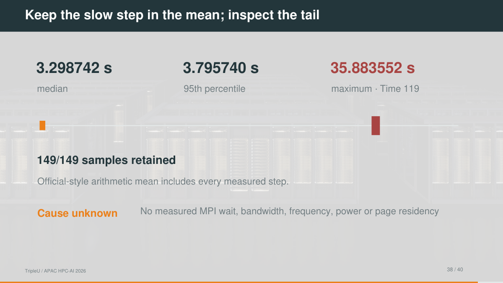

**Unchanged HPC section: explanation of the existing slide, not a new status or result update.**

### Purpose

Explain why every timed iteration, including an extreme slow step, remains in the official-style arithmetic mean, and separate observation from causal diagnosis.

### What is on the slide

Three summary statistics are presented across the top: median 3.298742 s, 95th percentile 3.795740 s, and maximum 35.883552 s at solver Time 119. The small orange vertical marker corresponds to the median and a much taller red marker calls attention to the maximum; the slide has no numeric axis scale, so use printed values rather than visually estimating positions. It states 149/149 samples retained and says the arithmetic mean includes every measured step.

### Terms and symbols

- **median:** Middle value after sorting the 149 timed samples.
- **95th percentile (p95):** A value at or below which approximately 95% of samples fall, under the percentile convention used.
- **maximum:** Largest recorded sample; here 35.883552 seconds at solver Time 119.
- **Time 119:** Solver iteration/time index reported by the run, not 119 seconds of wall-clock duration.

### How to read the figure, axes, units and colors

- The median and p95 are near 3.3–3.8 seconds, but one retained step is about 35.9 seconds.
- All 149 samples stay in the arithmetic mean; removing the outlier would change the stated performance metric.
- The red color marks the extreme maximum; it does not indicate a known failure mechanism.

### Tradeoff and strength of evidence

- **Observation:** One unusually slow step appears at index 119, while the center and p95 are much smaller.
- **Hypothesis:** A transient system or application event may have caused the spike, but telemetry is needed to test possibilities.
- **Supported conclusion:** Preserve the tail and investigate it; do not trim the slow point or alter the prescribed endpoint.
- **Unknown / limitation:** MPI wait, bandwidth, CPU frequency, power, and memory-page residency were not measured sufficiently to identify a cause.

### Spoken script

The median step is 3.299 seconds and the 95th percentile is 3.796 seconds, but the maximum reaches 35.884 seconds at solver Time 119. We retain all 149 timed samples in the arithmetic mean. That slow point is part of the measured run, not something to discard because it is inconvenient. The trace establishes that a spike occurred; it does not explain why. We need instrumentation and independent repeats to study its cause and stability.

### Avoid this interpretation

Do not call solver Time 119 119 seconds; it is the reported iteration/time index. Do not imply the median or p95 is the official arithmetic mean. Cause is explicitly unknown: missing telemetry is not evidence that MPI, memory, or hardware was healthy.

### Transition

That uncertainty is why the next slide asks for an independently repeated, fully evidenced run.

---

## Slide 39 — A reproducible candidate needs more than a fast log

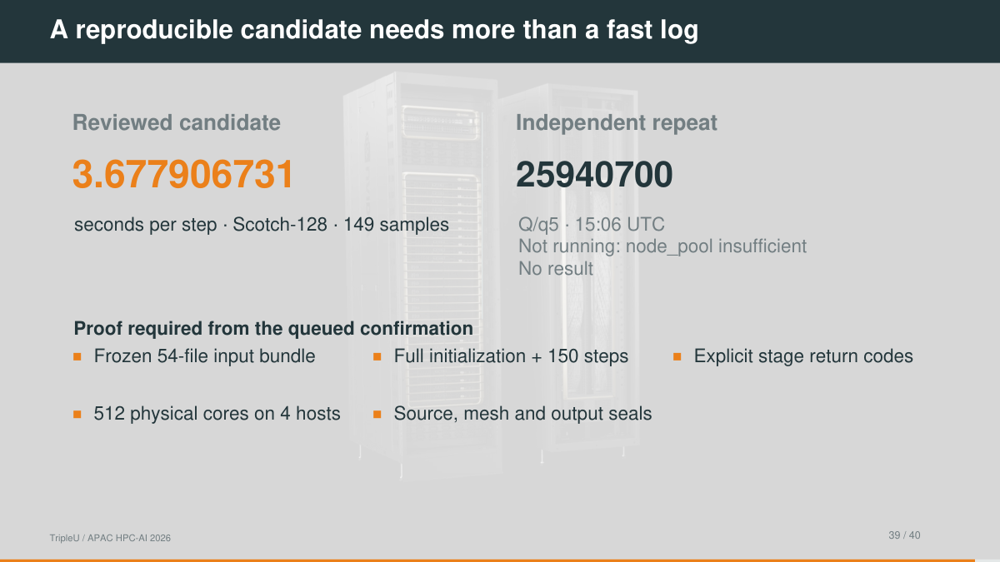

**Unchanged HPC section: explanation of the existing slide, not a new status or result update.**

### Purpose

Distinguish a reviewed candidate timing from an accepted official result and list the proofs required from an independent confirmation.

### What is on the slide

The left column reports reviewed candidate mean 3.677906731 seconds per step for Scotch-128 across 149 samples. The right column identifies independent-repeat job 25940700, queue Q/q5 at 15:06 UTC, with status “Not running: node_pool insufficient” and “No result.” Six orange-square checklist items specify a frozen 54-file bundle, all initialization plus 150 steps, explicit stage return codes, 512 physical cores on four hosts, source/mesh/output seals. No chart axes are present; columns contrast existing evidence with pending evidence.

### Terms and symbols

- **Q/q5:** Scheduler queue/state labels shown in the dated observation; the slide reports the job waiting, not executing.
- **Scotch-128:** Scotch decomposition at 128 MPI ranks per node on four nodes.
- **seal:** Recorded identity/integrity evidence for source, mesh, or output files; the slide lists required checks, not completed checks.

### How to read the figure, axes, units and colors

- The candidate has a measured mean and 149 samples, but that alone does not establish official acceptance.
- The independent job is queued and has no result in the shown status snapshot.
- The checklist is prospective proof required from that queued confirmation, not claims that the checks already passed.

### Tradeoff and strength of evidence

- **Observation:** The best reviewed candidate is 3.677906731 s/step; its independent confirmation job is waiting because node_pool resources are insufficient.
- **Hypothesis:** A fresh, frozen, full-pipeline repeat can test reproducibility and verify provenance and resource placement.
- **Supported conclusion:** Report the existing number as a candidate observation, not an accepted official score; review the repeat before choosing next.
- **Unknown / limitation:** The slide gives no result, terminal scheduler proof, or completed verification for job 25940700.

### Spoken script

The reviewed Scotch-128 candidate averages 3.677906731 seconds per step over 149 samples. That is a candidate observation, not an accepted official score. We submitted job 25940700 as an independent confirmation, but the dated scheduler status still shows it queued because node-pool resources are insufficient, so it has no result. Confirmation must preserve the input bundle, execute initialization and all 150 steps, record explicit stage exits, prove 512 physical cores across four hosts, and seal source, mesh, and outputs.

### Avoid this interpretation

All scheduler wording is a historical snapshot at 15:06 UTC on the slide; do not present it as live status. The checklist describes required proof, not verified completion. A fast log by itself is not full reproducibility or acceptance.

### Transition

The final slide summarizes the evidence discipline and the next review decision without claiming a new result.

---

## Slide 40 — What we learned — and the next measurement

**Unchanged HPC section: explanation of the existing slide, not a new status or result update.**

### Purpose

Close the HPC section with four measurement principles and the next decision point: inspect complete confirmation evidence before selecting another configuration.

### What is on the slide

Four numbered columns state: measure the whole job; trust runtime evidence; preserve every sample; confirm independently. Their short explanations emphasize keeping preparation and provenance, treating graph cut as distinct from speed, investigating tails with instrumentation, and reviewing job 25940700. A dated status line says 23 Oct 15:06 UTC, still Q/q5, node_pool insufficient, no result. Orange highlights the next action: review tails, terminal proof, and bounded hardware samples. No numerical plot is shown.

### Terms and symbols

- **terminal proof:** Evidence that the scheduler job reached a definite terminal state, paired with complete run outputs and return codes.
- **bounded hardware samples:** Limited, planned instrumentation samples collected with controlled scope, not an unbounded profiling run.
- **Q/q5:** The queue/state shown in the dated status snapshot, not a current query.

### How to read the figure, axes, units and colors

- The four principles connect validity, measured runtime, preservation of outliers, and independent reproducibility.
- The next step is review, not claiming a performance gain from the queued job.
- The status line freezes the state known at 23 October 15:06 UTC: the confirmation had no result.

### Tradeoff and strength of evidence

- **Observation:** Reviewed four-node data narrowed choices and identified Scotch-128 as the lowest mean among six observations, while the confirmation remained queued in the dated record.
- **Hypothesis:** Reviewing full terminal evidence, tails, and limited hardware sampling may clarify stability before another choice.
- **Supported conclusion:** The work narrows candidates and improves evidence requirements; it does not establish a global optimum or accepted score.
- **Unknown / limitation:** The slide does not report what later happened to job 25940700 or identify the cause of the timing spike.

### Spoken script

We take four lessons forward: measure the whole job, trust runtime evidence over a partition proxy, keep every timing sample, and confirm independently. The reviewed Scotch-128 mean narrowed our choice, but it is not a proven global optimum or accepted score. At the recorded time—23 October at 15:06 UTC—job 25940700 was still queued for node-pool resources and had no result. The next decision is to inspect terminal proof and timing tails, then collect bounded hardware samples before selecting another measurement.

### Avoid this interpretation

This is a dated handoff, not live scheduler status. Do not infer a later success or failure, and do not describe bounded sampling as already collected. The presentation summarizes published evidence; it does not certify new measurements.

### Transition

This concludes the HPC slides; return to the combined presentation's overall research conclusion.
