# Slide-by-slide transcript and learning guide — English

This is a **proposed speaking script and learning guide**, not a verbatim record of a delivered talk. It follows all 40 slides of the current presentation. The separately requested Vietnamese companion is a narrow language exception; code and other reports remain English.

**How to use it:** each slide starts with a **“Quick brief · 10–20 seconds”** that can be spoken directly: the main point, a standout result and its meaning. Essential terminology is explained within the brief, such as repeated meaning rerunning a benchmark to check reproducibility. Timing is a rehearsal target, not a timed recording. Continue with the purpose, technical interpretation, terms and longer script for deeper preparation or questions.

- **Slides 1–20:** main AI talk. Follow the [15–20 minute plan](PRESENTATION_PLAN.md); select and shorten the scripts when rehearsing.
- **Slides 21–32:** AI backup material. The main argument follows four research questions; the detailed historical journey is supporting backup.
- **Slides 33–40:** read-only explanation of the existing HPC section. Its scheduler statements are **23 October snapshots**, not live 30 October status. This guide neither updates nor independently certifies later HPC work. Do not automatically include HPC in the AI time allowance.
- Every slide has a **Hardware** label below its title. H200 means Firmus; H100 means NSCC ASPIRE 2A+. Mixed-platform and CPU-only evidence is attributed separately. Shared labels describe common rules or layouts, not a matched performance comparison.
- Colors have **slide-local meanings**. Orange does not always mean a win or a failure. Background photographs, gradients and footer decorations are not measurements.
- **↑ / ↓** generally indicate the desired optimization direction, not an observed increase/decrease. “No axes” means a table, card or schematic; do not invent X/Y quantities.
- Research has stopped at the owner's request. Future actions shown on slides are proposals or historical next decisions, not newly executed jobs.

Sources: [PowerPoint](../../VNUHCM%20-%20TripleU/Presentation/TripleU_APAC2026_Presentation.pptx), [PDF](../../submission-review/ai-reasoning-update-20261030/TripleU_APAC2026_Presentation.pdf), [Vietnamese companion](TRANSCRIPT_VI.md). PowerPoint SHA-256: `171fa7ce896ecbfc3708c1d15e5b603cb4bf80ee46a9c3a9f59af1ae0a1995d8`. This guide describes that version; recheck it if the deck changes.

## Understand the claims before presenting them

**Team-measured, formerly called “local”:** the benchmark ran on the assigned cluster's H200 or H100 compute nodes identified for that result. The team submitted the job and reviewed the data. Local described the scope of validation; it did not mean a laptop, the login node or a single compute node. Running on provided infrastructure does not itself make a result an organiser-scored or certified result.

**Full run:** the campaign protocol uses 60 seconds of warmup, 120 seconds of profiling, and 30 seconds of grace for outstanding requests to finish. Full distinguishes it from a shorter idea-screening test. It does not mean all model-quality datasets were evaluated or every request passed. The latency rule requires at least 90% of all requests to jointly meet both limits.

**Reviewed pass:** the team examined retained data against the checks implemented for that run, such as protocol, actual runtime settings, latency/errors and small output checks. Read each run's exact conditions. Scheduler COMPLETED alone means the script returned successfully. Neither label substitutes for the official model-quality evaluation requiring at least 99% of the organiser reference; that remains unverified.

**Control and candidate:** a control is the retained comparison configuration; a candidate changes the factor being tested. Cache candidate 27378 should be compared with fresh control 27376. Comparing it against a historical mean from another series mixes the tested change with time and environment differences.

**Repeat and useful gain:** another job returning a similar result is stronger evidence than one peak, although it may use the same physical GPUs. For late trials, the team used a prospective >1% gain threshold to select changes worth confirming. This is a team decision rule, not an organiser rule. A 0.24% observed increase did not meet it and was not shown to be separable from run-to-run variation.

**Observation, hypothesis and conclusion:** “TTFT rose” is measured. “The queue grew” is a hypothesis until wait and computation times are separated. “Keep the old setting because the candidate did not exceed our stated threshold” is a supported decision. State missing measurements rather than turning a plausible explanation into an established cause.

**A score inside a failed job:** GPU inference and the client can finish and save JSON, followed by a reader/summary exception that makes the job FAILED. Repairing that reader can recover a score from old data; it does not change the original job status or replace a fresh full-deployment replay after the fix.

## Shared vocabulary

| Symbol / term | Plain explanation |
|---|---|
| cluster / node / job | A cluster is a group of connected compute servers; a node is one server. A scheduler job requests resources and runs commands there. A job ID identifies that execution, not its performance rank. |
| allocation | A scheduler grant of particular nodes, CPUs/GPUs and time. A new allocation is a new grant; it can reuse the same physical GPUs. It is not automatically an independent hardware sample. |
| serving / inference | Inference computes a model response. Serving keeps the model loaded behind an API and schedules multiple incoming requests; the benchmark measures that service. |
| Qwen3-235B-A22B | The model has about 235 billion total parameters, with about 22 billion active per token. The total weights still need storage; active count is not the total model-memory footprint. |
| checkpoint / container image | A checkpoint stores the model parameters. A container image supplies the software and dependencies used to run them. Changing one is different from changing the other. |
| runtime / backend / native | Runtime is the software path executing the service. A backend is a selected implementation of one operation, such as attention. Native names the built-in execution path in this pinned software; it does not mean personal-machine execution or automatically faster code. |
| request | One prompt submitted to the service and its generated response. |
| token | A model vocabulary unit: a word, word fragment, or punctuation; it is not necessarily one word. |
| prefill / decode | Prefill processes the prompt; decode repeatedly generates the next token. |
| TTFT | Time to first token, in milliseconds (ms). Includes the observed wait before the first response token. |
| ITL | Inter-token latency. The gate here uses each request’s mean interval between output tokens, in ms. |
| SLO / SLA fraction | The latency objective / fraction of all requests jointly meeting both latency limits. This is not model accuracy. |
| goodput | Qualifying requests per second. The official displayed score is this value multiplied by 200 output tokens per request. |
| N / concurrency | Maximum simultaneous in-flight benchmark requests in the closed-loop workload; not the GPU count. |
| closed-loop | Keep up to N requests in flight; after one finishes, send another. There is no separate fixed request rate. |
| p50 / median; p95; max | Median: half the samples are at or below it. p95: 95% are at or below it. Max: largest observed value. A mean is a different statistic. |
| TP / EP / replica | Tensor parallelism splits model computation; expert parallelism distributes MoE experts; a replica is another worker instance. |
| MoE | Mixture of Experts: a model routes each token to selected expert networks rather than activating every expert. |
| KV cache | Stored attention keys and values representing processed context, used when generating later tokens. |
| attention | The model operation that lets the current token use relevant earlier context. Keeping earlier keys and values avoids recomputing those stored representations from scratch at every decode step. |
| batch / queue / in-flight | A batch groups work for one engine execution. A queue holds work waiting to run. In-flight includes requests sent but not finished. Client concurrency is not necessarily the instantaneous GPU batch size. |
| NIXL | The transfer layer used here to move KV state between prefill and decode workers. |
| FP8 / BF16 | 8-bit floating-point / 16-bit bfloat formats. Weights, activations and KV can use different formats. |
| FI / FA3 / DG / HPC-Ops | FlashInfer / FlashAttention 3 / DeepGEMM / the reused HPC-Ops kernel implementation. HPC-Ops is not the OpenFOAM HPC track. |
| kernel / GEMM | A GPU computation routine / general matrix multiplication. Faster isolated kernels do not automatically improve the whole service. |
| profiling / GPU utilization | Profiling records selected execution events to investigate time and work. GPU activity shows whether sampled GPU work was active; 100% activity does not establish peak FLOPs, a compute bottleneck, or absence of communication stalls. |
| MNNVL / collective | Multi-node NVLink communication path / an operation in which multiple ranks communicate together. The actual enabled path must be checked. |
| CUDA graph / bucket | A captured GPU execution graph / a selected execution shape to capture. Bucket count is not request concurrency. |
| baseline / control / candidate | Reference configuration / comparison arm / proposed changed configuration. State the exact baseline for every percentage. |
| matched trial / repeat | A comparison preserving intended factors except the tested change / another allocation to check reproducibility. Neither automatically proves causality. |
| gate / promotion / close a branch | A gate is a stated acceptance condition. Promotion means choosing a candidate as the retained setting. Closing a branch means deciding not to repeat the unchanged losing setting; none of these words implies organiser approval. |
| 99% of reference | A relative model-quality requirement, separate from the request latency fraction. As an arithmetic illustration, if a reference metric were 80 points, 99% of it would be 79.2 points, not 99% of answers correct. This example is not a measured contest result. |
| cold prefix / cold startup | Cold prefix means requests cannot reuse prompt KV from earlier requests. Cold startup means the service is newly starting; OS file caches can still be warm. These are different states. |
| ms / s / tokens/s / req/s | 1,000 ms = 1 s. tokens/s counts tokens per second; req/s counts requests per second. |
| % / percentage points | A move from 90% to 95% is +5 percentage points, or +5.56% relative to 90%; these are different. |
| 2,989.175 / 2.989,175 | The deck uses English separators: comma for thousands and point for decimals. These two forms express the same value in English and Vietnamese conventions. |
| MPI rank / affinity / NUMA | An MPI process / placement on CPU cores / a CPU memory architecture with different local and remote access costs. CPU HPC ranks differ from GPU serving ranks. |
| Scotch / Hierarchical / graph cut | Mesh partitioning methods / another partitioning method / a partition-boundary proxy. A smaller cut is not automatically faster runtime. |

## Slide navigation

- [Slide 01 — How do we reason about a fast Qwen service?](#slide-01)
- [Slide 02 — Define success before choosing an optimisation](#slide-02)
- [Slide 03 — Which GPU layouts are feasible candidates?](#slide-03)
- [Slide 04 — Why keep two TP4 prefills and one TP8 decode?](#slide-04)
- [Slide 05 — Worker readiness did not prove a working service](#slide-05)
- [Slide 06 — What does the profile identify—and what does it not?](#slide-06)
- [Slide 07 — Why investigate descriptor setup before bandwidth?](#slide-07)
- [Slide 08 — Do attention and communication choices interact?](#slide-08)
- [Slide 09 — Does a decode change improve the service objective?](#slide-09)
- [Slide 10 — Where should we stop increasing concurrency?](#slide-10)
- [Slide 11 — Which requests still fail after goodput improves?](#slide-11)
- [Slide 12 — Keep an intervention only if the objective improves](#slide-12)
- [Slide 13 — Did speculative decoding solve this workload?](#slide-13)
- [Slide 14 — Does the improvement survive another deployment?](#slide-14)
- [Slide 15 — Why did a later replay score lower?](#slide-15)
- [Slide 16 — Can one platform predict another reliably?](#slide-16)
- [Slide 17 — What does passing latency leave unverified?](#slide-17)
- [Slide 18 — Does the packaged deployment complete end to end?](#slide-18)
- [Slide 19 — Four decisions, each with an evidence boundary](#slide-19)
- [Slide 20 — What should the next iteration establish?](#slide-20)
- [Slide 21 — Backup · two platforms, separate experimental systems](#slide-21)
- [Slide 22 — Backup · FP8 geometry constrains a topology](#slide-22)
- [Slide 23 — Backup · historical milestones behind the decisions](#slide-23)
- [Slide 24 — Backup · request-scoped descriptor construction](#slide-24)
- [Slide 25 — Backup · what the KV recovery run actually proves](#slide-25)
- [Slide 26 — Backup · H100: first-token gain, goodput loss](#slide-26)
- [Slide 27 — Backup · does a startup saving survive reversed order?](#slide-27)
- [Slide 28 — Backup · source-supported changes that did not win](#slide-28)
- [Slide 29 — Backup · scope limits of kernel and source evidence](#slide-29)
- [Slide 30 — Backup · the retained settings on each platform](#slide-30)
- [Slide 31 — Backup · workload control and prefill chunk trial](#slide-31)
- [Slide 32 — Backup · less graph memory did not raise goodput](#slide-32)
- [Slide 33 — The task: same 65-million-cell airflow calculation](#slide-33)
- [Slide 34 — The whole required pipeline comes before the score](#slide-34)
- [Slide 35 — A smaller partition cut did not make the solver faster](#slide-35)
- [Slide 36 — Observed scaling changed which decomposition led](#slide-36)
- [Slide 37 — At four nodes, the winner depends on ranks per node](#slide-37)
- [Slide 38 — Keep the slow step in the mean; inspect the tail](#slide-38)
- [Slide 39 — A reproducible candidate needs more than a fast log](#slide-39)
- [Slide 40 — What we learned — and the next measurement](#slide-40)

---

## Slide 01 — How do we reason about a fast Qwen service?

**Hardware: H200 + H100**

### Quick brief · 10–20 seconds

We studied four questions: how to divide sixteen H 200 GPUs, what limits the service, which changes improve goodput, and whether results are reproducible. The contribution is the evidence behind our decisions, including failed hypotheses and unresolved quality checks.

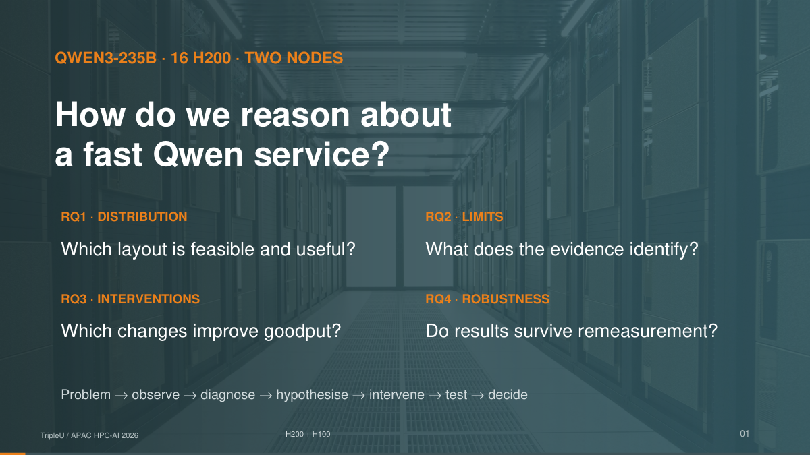

### Purpose

Introduce four research questions and the reasoning cycle used to answer them, rather than a chronology of runs.

### Technical interpretation and reasoning

We ask how to distribute the GPUs, what performance evidence identifies, which changes help qualifying throughput, and whether the result survives repeated deployment. The recurring cycle is problem, observation, analysis, hypothesis, intervention, causal assessment, and decision.

### Terms and symbols to understand

- **Qwen:** The family of language models used in the serving task; this study serves the specified Qwen3-235B checkpoint.
- **APAC HPC-AI 2026:** The competition context for the research, not a statement of award or official acceptance.
- **30 October 2026:** The date of this research update; results are historical observations through that date.
- **VNUHCM - TripleU:** The presenting team identity.

### Interpreting the evidence or diagram

- The title also states the argument: the distributed system must function correctly before its speed comparisons are meaningful.
- Reproduction here means similar results on another run; it does not establish all-platform or all-workload performance.

### Tradeoff and strength of evidence

- **Observation:** The work progressed from resolving the two-node serving topology and KV transfer to phase-specific backend experiments and repeated full-protocol measurements.
- **Hypothesis:** Reliable performance depends on making the deployment and measurement path work end to end before tuning individual kernels.
- **Supported conclusion:** The presentation will support a reproduced operating point and selected configuration, while distinguishing that evidence from isolated peaks and official accuracy verification.
- **Unknown / limitation:** Official full-set model accuracy remains unverified, and the local result is not an official contest ranking.

### Spoken script

We studied four questions: how to divide sixteen H 200 GPUs, what limits the service, which changes improve goodput, and whether results are reproducible. The contribution is the evidence behind our decisions, including failed hypotheses and unresolved quality checks.

### Avoid this interpretation

Do not call the displayed work a contest win, official acceptance, or accuracy certification. The date limits the claim to this research update.

### Transition

Instead of starting with the highest number, we begin with the fixed problem and what counts as success.

---

## Slide 02 — Define success before choosing an optimisation

**Hardware: H200 primary · H100 separate**

### Quick brief · 10–20 seconds

Our fixed problem is Qwen 3-235 B on two eight-H 200 nodes. Requests contain 4000 input and 200 output tokens. At least 90% must meet both first-token and token-gap limits. We optimize qualifying output tokens per second, not unrestricted aggregate throughput.

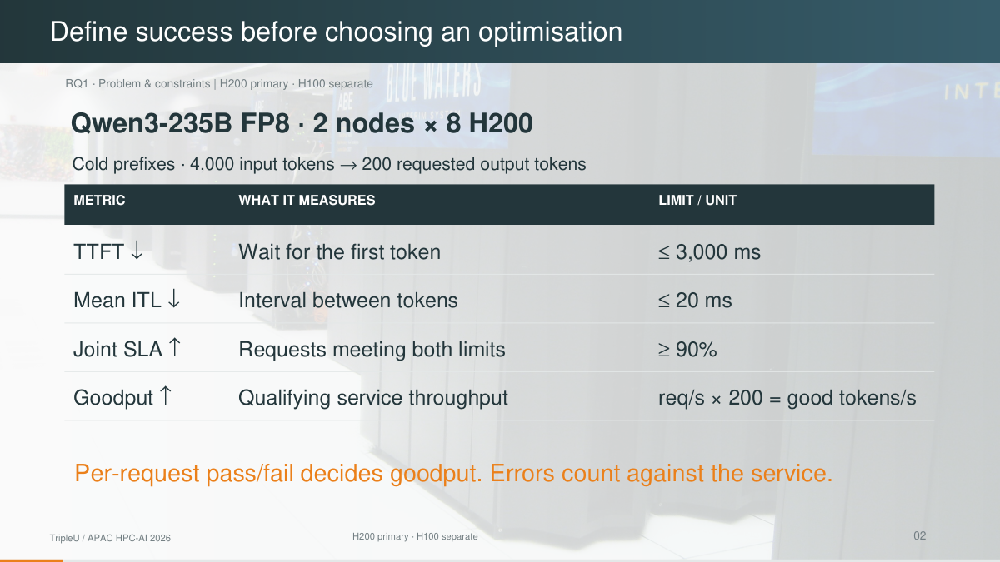

### Purpose

Define the fixed model, hardware envelope, workload and latency objective before comparing configurations.

### Technical interpretation and reasoning

Qwen 3-235 B FP 8 runs within two nodes of eight H 200 GPUs. The workload requests 4000 input and 200 output tokens. More raw output is useful only if each request qualifies under both latency limits and the total qualifying fraction is at least 90%.

### Terms and symbols to understand

- **4,000 input tokens → 200 output tokens:** The fixed synthetic request shape: a 4,000-token prompt and 200 requested output tokens.
- **TTFT ↓:** Time to first token; lower is better, with a per-request limit of 3,000 milliseconds.
- **Mean ITL ↓:** Mean inter-token latency, the average interval between generated tokens in a request; lower is better, limit 20 milliseconds.
- **Joint SLA ↑:** Share of all evaluated requests that satisfy both latency limits; target is at least 90%. Errors remain in the denominator.
- **Goodput ↑:** Rate of requests that qualify under the joint gate. Multiply qualifying requests per second by 200 to report good output tokens per second.
- **ms:** Milliseconds, one thousandth of a second; a latency unit.
- **req/s × 200:** Qualifying requests per second multiplied by the requested 200 output tokens per request.

### Interpreting the evidence or diagram

- Read each arrow as the preferred direction: latency down, qualifying share and goodput up.
- Both TTFT and mean ITL limits must pass on the same request for it to count as qualifying.
- The 90% threshold applies to the proportion of all evaluated requests, not just successful requests.

### Tradeoff and strength of evidence

- **Observation:** The benchmark fixes the request size and applies a joint per-request latency rule; errors count against the service. Goodput is based on requests passing both limits.
- **Hypothesis:** A system that produces more raw tokens can still be worse if too many requests violate first-token or token-spacing requirements.
- **Supported conclusion:** We judge candidates by qualifying throughput together with the latency and output gates, not by a single mean or raw token count.
- **Unknown / limitation:** The table defines the protocol but contains no candidate measurement; it does not show any configuration's actual latency distribution.

### Spoken script

Our fixed problem is Qwen 3-235 B on two eight-H 200 nodes. Requests contain 4000 input and 200 output tokens. At least 90% must meet both first-token and token-gap limits. We optimize qualifying output tokens per second, not unrestricted aggregate throughput.

### Avoid this interpretation

Do not infer per-request compliance from an aggregate mean. Do not drop errors from the denominator or multiply by a different output length.

### Transition

With the success criterion fixed, the first research question is which GPU layouts are viable.

---

## Slide 03 — Which GPU layouts are feasible candidates?

**Hardware: 16 H200 · Firmus**

### Quick brief · 10–20 seconds

Seventeen usable configurations support the topology decision. The selected split reached about 1912 qualifying tokens per second at 48 concurrent requests. Because loads differ across layouts, the evidence identifies a feasible choice rather than a globally optimal topology.

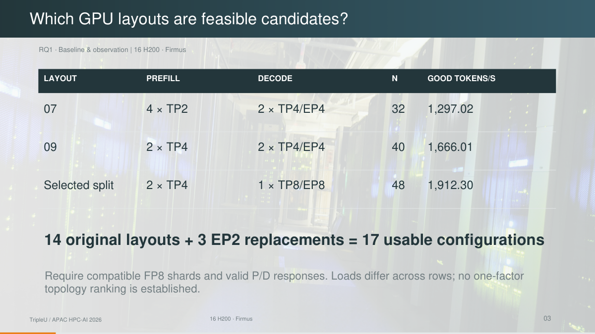

### Purpose

Use the topology campaign as evidence for a feasible resource decision, not as the storyline.

### Technical interpretation and reasoning

A wider tensor-parallel worker divides one model over more GPUs, reducing the number of replicas that fit into a fixed GPU budget. More replicas can serve independent requests, but each has less GPU memory and a different communication cost. Candidates must load compatible FP 8 shards, complete transfer and answer correctly before scores matter.

### Terms and symbols to understand

- **07 / 09:** Identifiers for early layout trials, not software versions.
- **4 × TP2 / 2 × TP4:** Four prefill workers with tensor parallelism two; the next listed layout uses two prefill workers with tensor parallelism four.
- **TP4/EP4:** Decode workers configured with tensor parallelism four and expert parallelism four.
- **Selected split: 2 × TP4; 1 × TP8/EP8:** Two prefill workers each TP4 and one decode worker TP8/EP8.
- **N:** Client concurrency: the target number of requests kept in flight, not number of GPUs or tokens.
- **good tokens/s:** Qualifying output token throughput under the per-request latency gate.
- **14 + 3 = 17 usable configurations:** Fourteen measured original layouts plus three measured EP2 replacements in the recovery ledger.

### Interpreting the evidence or diagram

- Compare rows horizontally across role topology, concurrency N, and good output tokens per second.
- N rises from 32 to 40 to 48 across these illustrative rows; the measurements also differ in load and transport history.
- The summary counts usable measured configurations; it does not say all attempted originals passed.

### Tradeoff and strength of evidence

- **Observation:** The selected split reached 1912.30 good tokens/s at N48 in this early topology sample, after displayed N32 and N40 configurations reached 1297.02 and 1666.01. Overall, the recovery ledger counted 14 original layouts plus three EP2 replacements.
- **Hypothesis:** A balanced allocation of prefill replication and decode parallelism could better serve the chosen request concurrency.
- **Supported conclusion:** These trials established a usable architecture to develop. They are initial operating points, not a clean causal ranking because load and transport history varied.
- **Unknown / limitation:** The slide does not show all 17 configurations or confidence intervals; it cannot isolate which topology change caused the score differences.

### Spoken script

We compared layouts that trade replica count against GPU sharing within a model. Seventeen usable configurations supply evidence. The selected split reached about 1912 qualifying tokens per second at 48 concurrent requests. Because loads and transfer histories differ, this supports a viable choice, not a controlled proof of the globally best topology.

### Avoid this interpretation

Do not treat 07 or 09 as software versions. Do not infer that the throughput increase was caused only by the displayed topology because N and other history differed.

### Transition

The selected layout is a decision under the observed constraints; here is how it uses the two nodes.

---

## Slide 04 — Why keep two TP4 prefills and one TP8 decode?

**Hardware: 16 H200 · Firmus**

### Quick brief · 10–20 seconds

We retain two four-GPU prefill workers and one eight-GPU decode worker. This keeps tensor-parallel groups within nodes and allows phase-specific implementations. KV transfer must work correctly; the historical scores do not isolate a one-factor architectural speedup.

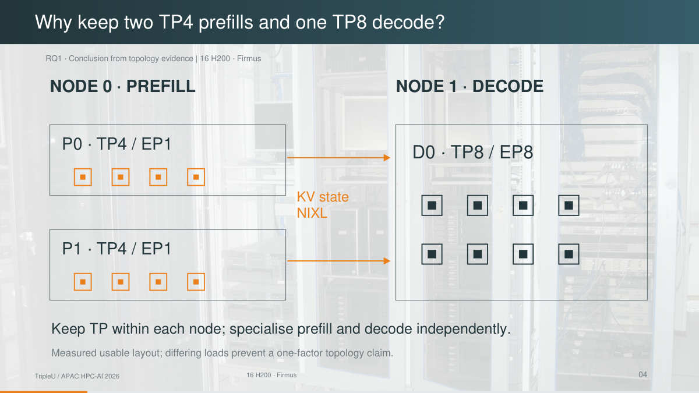

### Purpose

Explain the technical tradeoff behind retaining two TP 4 prefills and one TP 8/EP 8 decode, without inventing a one-factor topology speedup.

### Technical interpretation and reasoning

The first node holds two prefill workers of four GPUs each; the second has one eight GPUdecode worker. All tensor-parallel groups stay within a node. Separating phases lets each use a suitable implementation, but requires KV transfer. This is a measured usable split; the historical layout table alone does not isolate the contribution of each architectural change.

### Terms and symbols to understand

- **Prefill:** The prompt-processing phase. It reads the input tokens and creates the KV state needed for generation.
- **Decode:** The token-generation phase. It produces the requested output tokens using the prompt's KV state.
- **P0 / P1 / D0:** Names for two prefill workers and one decode worker; they are worker labels, not GPU IDs.
- **TP4 / TP8:** Tensor parallelism across four or eight GPUs within the worker. TP is a model-partitioning configuration.
- **EP1 / EP8:** Expert parallelism across one or eight expert partitions for the mixture-of-experts model.
- **KV state:** Key/value attention data generated during prompt processing and required to continue decoding the same request.
- **NIXL:** The transfer mechanism used here to move KV data between the prefill and decode sides.
- **2 × 4 + 1 × 8 = 16 GPUs:** Two four-GPU prefill workers plus one eight-GPU decode worker, for sixteen GPUs total.

### Interpreting the evidence or diagram

- Read from left to right: requests are processed for prefill on either P0 or P1, then KV data moves to D0 for generated output.
- Each prefill worker is TP4/EP1; the decode worker is TP8/EP8. The TP groups stay within their node.
- Orange squares and arrows are visual role cues in this slide, not a general chart color key or evidence of traffic volume.

### Tradeoff and strength of evidence

- **Observation:** The selected layout allocates two TP4/EP1 prefill workers on Node 0 and one TP8/EP8 decode worker on Node 1; the request's KV state must cross between roles.
- **Hypothesis:** Separating prompt processing from generation can let each phase use a fitting topology, but adds a correctness- and startup-sensitive transfer path.
- **Supported conclusion:** Round-robin routes requests to a prefill worker, and decode produces all generated tokens. The diagram defines the experiment's architecture, not a measured performance benefit by itself.
- **Unknown / limitation:** The drawing does not quantify network bandwidth, transfer latency, utilization or the causal advantage over a unified deployment.

### Spoken script

We retain two four-GPU prefill workers and one eight-GPU decode worker. Tensor-parallel groups stay inside their node, while the phases can use different GPU implementations. KV transfer is the extra requirement. The choice is supported by usable measurements, not a claim that every alternative was tested under identical load.

### Avoid this interpretation

TP and EP values are specific to each worker and this configuration. Do not interpret each square as a measured GPU utilization or claim the diagram proves a speedup.

### Transition

A layout that loads successfully still needs to demonstrate that requests can complete.

---

## Slide 05 — Worker readiness did not prove a working service

**Hardware: H200 · hetero-TP recovery branch**

### Quick brief · 10–20 seconds

In job 22271, H200 workers loaded, but the P-to-D pair warmup timed out after 360 seconds. No AIPerf benchmark ran, so this is a transfer-readiness failure, not a throughput measurement.

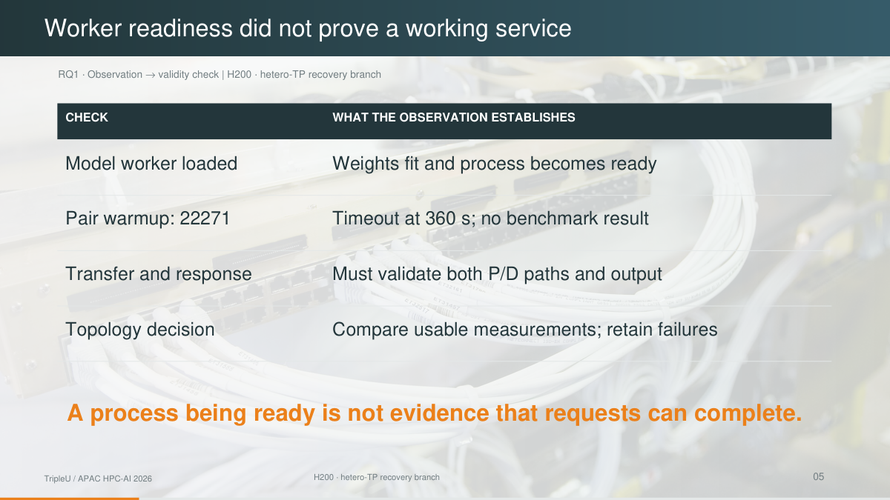

### Purpose

Establish the observed failure before explaining the proposed fix. Workers had loaded, but the actual heterogeneous prefill-to-decode path had not become ready for a benchmark request. This separates a startup/transfer symptom from an assumed steady-state performance problem.

### Technical interpretation and reasoning

Tell the audience this slide represents the baseline stage of the seven-step reasoning chain: symptom, job evidence, and failure boundary. The title's contrast is literal: model workers were ready, while pair warmup was not. No numeric chart or axes are implied.

### Terms and symbols to understand

- **H200 Firmus:** The GPU platform and site for this historical trial; do not merge this result with H100 NSCC measurements.
- **P8 / D8:** Labels for the prefill-side and decode-side groups in this topology; retain the labels without assuming they mean eight workers.
- **TP8/EP2 → TP4/EP4:** Prefill used tensor parallelism eight and expert parallelism two; decode used tensor parallelism four and expert parallelism four. The settings differ across roles.
- **job 22271:** The retained baseline job. The model workers loaded, but pair warmup ended in an HTTP TimeoutError after 360 seconds.
- **360 seconds:** The timeout duration for this pair-warmup attempt, not a benchmark measurement window.
- **AIPerf:** The benchmark client/export path. It did not run for job 22271 because warmup failed first.
- **P/D pair warmup:** A request sent through both prefill and decode roles to check that the disaggregated path can serve before scoring.

### Interpreting the evidence or diagram

- Step 1 — Symptom: the client could not complete pair warmup, even though workers had loaded.
- Step 2 — Evidence and boundary: job 22271 timed out after 360 seconds with HTTP TimeoutError; no AIPerf export or throughput score exists.
- The topology is heterogeneous TP: P8 TP8/EP2 to D8 TP4/EP4. It is not the two-TP4 prefill plus TP8/EP8 decode topology selected later.
- The contemporaneous review says bootstrap/transfer was not yet proven. It does not identify bandwidth saturation or a measured slow KV copy.

### Tradeoff and strength of evidence

- **Observation:** Job 22271 loaded the model workers but its heterogeneous P/D warmup request timed out after 360 seconds. The retained log ends in HTTP TimeoutError; AIPerf did not run, so there is no score.
- **Hypothesis:** The immediate failure lies somewhere in cold P/D bootstrap or transfer readiness; a specific descriptor bottleneck is not yet established by this symptom alone.
- **Supported conclusion:** Treat this as a pre-benchmark readiness failure and preserve the exact topology and terminal evidence. Do not call it a throughput regression.
- **Unknown / limitation:** The timeout alone does not locate the stalled work, quantify transfer latency, or rule out other bootstrap and placement causes.

### Spoken script

Our starting symptom was specific. On H200 Firmus, job 22271 used a heterogeneous layout: prefill P8 with TP8 and EP2, sending to decode D8 with TP4 and EP4. The model workers loaded, but a request through the prefill-to-decode pair did not finish warmup. The retained log ends with an HTTP timeout after 360 seconds. AIPerf never ran, so this job produced no benchmark score. We therefore had evidence of a cold path that was not ready, not evidence of steady-state network saturation or slow KV-copy bandwidth. This topology is also different from the two-TP4 prefill and TP8/EP8 decode layout selected later.

### Avoid this interpretation

Never report 22271 as a low score or compare its timeout duration with the later 0.68–0.70 second warmup as a measured speedup. There is no AIPerf result for this baseline.

### Transition

We next inspect the performance observations and distinguish them from causal bottleneck proof.

---

## Slide 06 — What does the profile identify—and what does it not?

**Hardware: H200 · N48 diagnostic**

### Quick brief · 10–20 seconds

The separate N48 profile assigns about 23.48% of summed kernel duration to communication and normalization. That suggests experiments, not a wall-time bottleneck percentage. Later N64 first-token failures also lack a complete causal time breakdown.

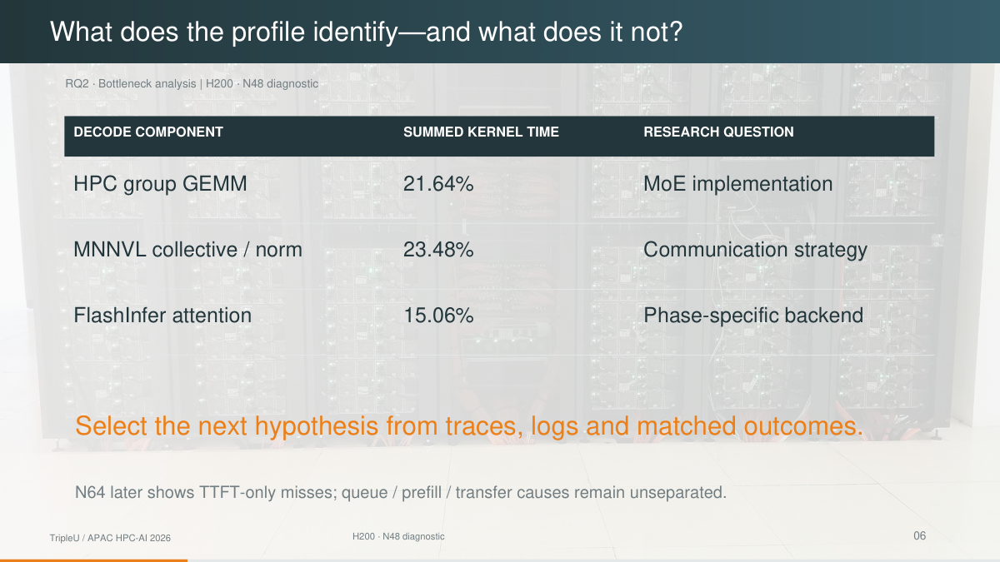

### Purpose

Put observations before optimizations and separate suspected performance limits from a proven bottleneck.

### Technical interpretation and reasoning

The separate N 48 profile records matrix work, communication/normalization and attention. Their summed kernel durations suggest trial targets; they are not wall-time shares because kernels can overlap. A later N 64 run has TTFT-only failures, but no complete queue/prefill/transfer breakdown explains them. These evidence types concern different runs.

### Terms and symbols to understand

- **GEMM:** General matrix multiplication used in compute kernels.
- **MNNVL:** NVIDIA NVLink communication backend.
- **RMSNorm:** Root mean square normalization operation.
- **Kernel duration:** Recorded GPU-kernel time; not end-to-end wall time.
- **N48/N58:** Separate diagnostic and repeated deployment concurrency settings.
- **Profile:** A diagnostic run that records selected GPU kernel timings and other runtime signals while serving a workload.
- **Kernel-time share:** A named group's fraction of summed recorded kernel durations. GPU kernels can overlap, so this is not its fraction of elapsed request walltime.
- **N48 diagnostic vs N58 repeat:** Separate stages in job 24819: N58 repeats a deployment; N48 collects profile traces. Do not attribute N48 kernel shares to N58 service behavior.
- **MNNVL / RMSNorm:** MNNVL is the NVLink collective communication path; RMSNorm normalizes model activations.

### Interpreting the evidence or diagram

- Named decode groups are HPC group GEMM 21.642%, MNNVL collective/RMSNorm 23.479%, and FlashInfer paged attention 15.064% of summed recorded kernel duration. These percentages are descriptive sums, not shares of end-to-end wall time: kernels can overlap and the trace covers only recorded activity. Terms: GEMM is matrix multiplication; MNNVL is a communication backend; RMSNorm normalizes hidden activations; rank is one distributed process. The three groups suggest questions about MoE implementation, communication strategy, and phase-specific attention backend. They do not predict equivalent speedups, prove FLOP saturation, or causally explain N58/N60 service results. Keep the N48 diagnostic distinct from the N58 repeat. Hypothesis: large recorded groups deserve follow-up. Conclusion: use traces to design a controlled full-service test. Unknown: per-request phase attribution and causal latency shares.
- A profile is instrumentation: it records selected activity while a workload is running. The percentages sum kernel durations across recorded ranks/GPUs. Because kernels overlap and because queueing, CPU work, communication gaps, and unrecorded activity also consume elapsed time, those percentages cannot be read as the fraction of a request spent in each component. The N48 diagnostic was separate from the N58 deployment repeat.

### Tradeoff and strength of evidence

- **Observation:** Three named groups account for stated shares of recorded kernel duration.
- **Hypothesis:** Large recorded groups may guide next experiments.
- **Supported conclusion:** Use profile as a hypothesis source, not an end-to-end explanation.
- **Unknown / limitation:** Wall-time shares, overlap effects, FLOP saturation and causality are unknown.

### Spoken script

Profiling at a separate N 48 diagnostic shows substantial matrix, communication and attention work. Communication and normalization account for about 23.48% of summed recorded kernel durations. That motivates experiments; it does not prove a 23.48% wall-time bottleneck. Later first-token misses also remain causally unresolved.

### Avoid this interpretation

Keep units and configuration attached; do not state a hypothesis as a measured cause.

### Transition

The next example shows how we prioritised a narrow source-supported hypothesis while leaving alternative causes open.

---

## Slide 07 — Why investigate descriptor setup before bandwidth?

**Hardware: H200 branch · CPU/source diagnostics**

### Quick brief · 10–20 seconds

Source review found about 403.8 million whole-pool descriptors per source rank, versus 188 for one contiguous 4,000-token request. That justified testing setup work first, but did not rule out bandwidth or placement causes.

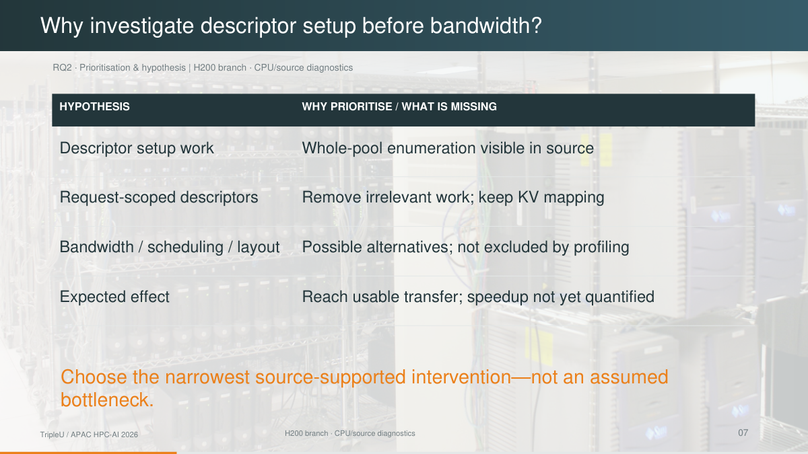

### Purpose

Explain the prioritization decision: the symptom occurred before scoring, and source inspection exposed a large amount of descriptor setup work aligned with the cold-warmup failure. This is a reason to test the setup hypothesis, not proof that other bottlenecks were absent.

### Technical interpretation and reasoning

Present the evidence chain as seven-step flow steps 3 and 4: identify the affected component, then state why its setup cost was prioritized. The two counts have different scopes—whole pool per rank versus one request—so they must not be shown as a timing ratio or speedup.

### Terms and symbols to understand

- **NIXL:** The transfer path involved in moving KV state between disaggregated prefill and decode workers.
- **heterogeneous TP:** Different attention tensor-parallel sizes on the prefill and decode sides; this changes how KV heads and byte ranges map to peers.
- **descriptor:** Metadata describing memory ranges for transfer, not the KV tensor payload itself.
- **403.8 million per source rank:** Approximate whole-pool source descriptor count derived for representative TP8 geometry from 2,148,119 KV slots, 94 layers, and K/V entries.
- **188 per request:** CPU geometry count for a contiguous 4,000-token TP8-to-TP4 request after adjacent ranges are coalesced.
- **source rank:** One distributed source-side model process/partition whose descriptor list is being prepared.
- **steady-state traffic:** The ongoing scored request traffic after the workers and transfer path are ready; it is distinct from cold bootstrap and warmup.

### Interpreting the evidence or diagram

- Step 3 — Component: source inspection located the affected work in heterogeneous-TP NIXL KV descriptor preparation and transfer.
- Step 4 — Evidence to prioritize: source notes derive about 403.8 million descriptors for the full pool per rank, while CPU geometry gives 188 descriptors for one contiguous 4,000-token request.
- Those values count descriptors, not bytes, seconds, bandwidth, or speed. Their scopes differ and they do not quantify setup time.
- Because the failure was pre-score and the proposed work targeted setup, this was more directly supported than first tuning steady-state bandwidth, KV layout, or scheduler placement. These alternatives were not experimentally ruled out.

### Tradeoff and strength of evidence

- **Observation:** Source-backed geometry showed a very large whole-pool enumeration signal—about 403.8 million descriptors per source rank—compared with 188 coalesced ranges for one representative request.
- **Hypothesis:** Building descriptors only for the pages of the current request could reduce cold setup work and help pair warmup complete.
- **Supported conclusion:** Descriptor setup was a rational first target because it matched a pre-benchmark symptom and had a concrete source-level cost signal. This is prioritization, not diagnosis of the sole cause.
- **Unknown / limitation:** No old-code initialization duration was measured. Bandwidth utilization, KV layout, scheduling/placement, and other bootstrap work remain possible contributors.

### Spoken script

After locating the failure in the cold prefill-to-decode path, we inspected the NIXL descriptor preparation used for heterogeneous tensor parallelism. The source-level geometry gave us a reason to test that setup first. For a representative TP8 source rank, describing the whole KV pool involved about 403.8 million entries. For a contiguous 4,000-token TP8-to-TP4 request, the CPU geometry calculation gave 188 coalesced entries. Those are descriptor counts with different scopes, not bytes, seconds, or a measured speedup. Since the symptom happened before scoring and descriptor construction was an identifiable setup cost, it was a more direct first experiment than tuning steady-state bandwidth, KV layout, or scheduler placement. But those alternatives were not ruled out.

### Avoid this interpretation

Do not call 403.8 million divided by 188 a two-million-fold speedup. No old-versus-new setup timing, network utilization, or causal decomposition was collected.

### Transition

The patch mechanics and feasibility evidence are in backups24–25; next we test interventions against useful service throughput.

---

## Slide 08 — Do attention and communication choices interact?

**Hardware: H200 · N52**

### Quick brief · 10–20 seconds

At H200 N52, combining attention and communication measured about 1.43 percent above a later MNNVL control. This supports the combined setting at this load, not additive component gains or a universal rule.

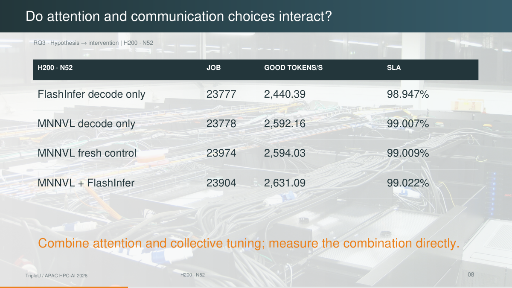

### Purpose

Ask whether attention and collective-communication choices work better together than separately at a fixed H200 load. The comparison is a motivation for a combination, not proof that independent component gains add up.

### Technical interpretation and reasoning

Interpret the N52 observations as separate backend configurations at one load: FlashInfer alone 2,440.386, MNNVL alone 2,592.162, the combined choice 2,631.085, and a later MNNVL control 2,594.028 good tokens/s. Compare the combination with the later same-load MNNVL control: about +1.43%.

### Terms and symbols to understand

- **N52:** Client concurrency setting of 52 in-flight requests; not GPU count or decode batch size.
- **FlashInfer:** GPU attention implementation tested in the serving path.
- **MNNVL:** NVIDIA NVLink collective communication path.
- **Interaction:** The combined result can differ from what either component alone would suggest; this needs a matched combined test.
- **Good tokens/s:** Qualifying requests per second multiplied by the fixed 200 output-token target.

### Interpreting the evidence or diagram

- Question: does choosing both an attention implementation and a communication backend improve the service? At H200 N52, the standalone and combined observations are 2,440.386, 2,592.162, and 2,631.085 good tokens/s. A later MNNVL control at the same load is 2,594.028; the combined observation is approximately 1.43% higher than that control.
- The evidence supports testing or retaining the combined operating point for this configuration. It does not establish a general interaction law, isolate each backend's causal contribution, or permit adding the standalone differences as if the components were independent.

### Tradeoff and strength of evidence

- **Observation:** The combined observation exceeds the later MNNVL control by about 1.43% at H200 N52; standalone FlashInfer and MNNVL observations are lower.
- **Hypothesis:** The attention and communication choices may interact favorably when used together.
- **Supported conclusion:** The measured combination is promising at this load and merits comparison as a complete serving setting.
- **Unknown / limitation:** The result does not quantify component-level causal gains or establish behavior at another load, model, or hardware setup.

### Spoken script

We asked whether attention and communication choices interact. At H200 N52, the combined setting reached 2,631 good tokens per second, compared with a later MNNVL control at 2,594, about 1.43 percent lower. The standalone measurements help motivate the combination, but they cannot be added to predict its result. This supports the tested operating point; it does not establish a universal backend rule.

### Avoid this interpretation

These are same-load observations, not a full factorial proof that each component independently caused a share of the combined gain. Do not add standalone gains.

### Transition

Having identified a promising combination, we next ask whether a decode-runner change improves the full service objective.

---

## Slide 09 — Does a decode change improve the service objective?

**Hardware: H200 · full N60**

### Quick brief · 10–20 seconds

At H200 full N60, the decode change raises goodput 5.295 percent and lowers ITL, but mean TTFT rises about 125 milliseconds. A treatment repeat is close; the claim remains specific to this setup.

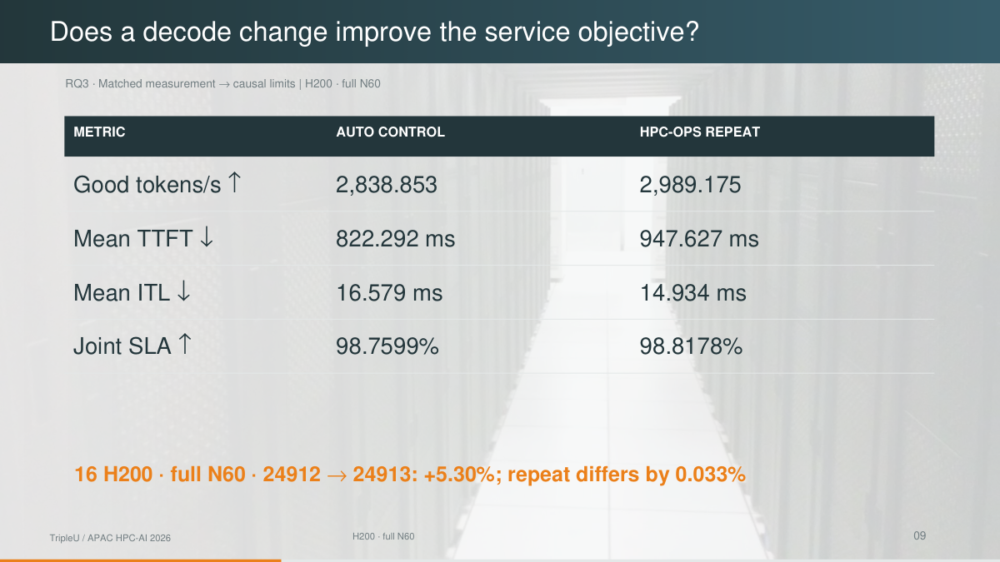

### Purpose

Evaluate a decode-runner change using complete-service outcomes. A matched control asks whether the treatment changed goodput at this configuration; the latency rows show the cost of that gain.

### Technical interpretation and reasoning

Compare fresh auto-decode control 24912 with HPC-Ops decode repeat 24913 at the same full N60 configuration. Goodput rises from 2,838.853 to 2,989.175 tokens/s; mean TTFT rises 822.292→947.627 ms, mean request-mean ITL falls 16.579→14.934 ms, and joint SLA changes 98.7599%→98.8178%.

### Terms and symbols to understand

- **Full N60:** Full benchmark at client concurrency 60; both arms retain DeepGEMM prefill and chunk size 8,192.
- **HPC-Ops:** A supplied decode runner/backend tested here; the team did not invent the backend.
- **TTFT:** Time from request start until its first generated token.
- **Request-mean ITL:** Average interval between generated tokens within one request.
- **Matched control:** Fresh auto-decode run used to compare the intended decode-runner change.

### Interpreting the evidence or diagram

- The control-to-treatment goodput increase is 5.295%. Mean TTFT increases 125.335 ms, while mean request-mean ITL decreases 1.644 ms. The joint SLA rate changes only slightly upward. The treatment repeat 24913 is 0.033% below original treatment 24738 at 2,990.151 tokens/s.
- The result supports a repeatable interaction between the decode runner and this H200 N60 service setting. It does not establish a universal HPC-Ops advantage. The older 24913 extended inspection lacks a dedicated continuous hardware telemetry series; a separate N48 kernel profile cannot causally explain this N60 result.

### Tradeoff and strength of evidence

- **Observation:** Goodput rises 5.295% and ITL improves, but mean TTFT increases about 125 ms; a separate treatment deployment reproduces nearly the same goodput.
- **Hypothesis:** The decode-runner change may improve useful throughput in this configuration while changing the latency balance between first token and later tokens.
- **Supported conclusion:** The matched full result and independent treatment repeat support this H200 N60 operating point.
- **Unknown / limitation:** Exact kernel-level cause, queue/compute attribution, broad hardware generalization, and official full-set model quality remain unverified.

### Spoken script

At full N60, the fresh auto-decode control reached 2,839 good tokens per second. The HPC-Ops decode repeat reached 2,989, a 5.295 percent increase. Mean TTFT became about 125 milliseconds slower, while inter-token time improved. The independent treatment repeat was only 0.033 percent below the original. This supports the tested setting, with a clear latency tradeoff; it does not prove that HPC-Ops is universally faster.

### Avoid this interpretation

The treatment repeat uses the same serving configuration and hardware family; it is not a second hardware-generation comparison. Do not use the separate N48 profile to explain N60 causally.

### Transition

Next we test how far the full-run benefit continues as client concurrency increases from N62 to N64.

---

## Slide 10 — Where should we stop increasing concurrency?

**Hardware: H200 · N62 → N64**

### Quick brief · 10–20 seconds

N64 improves full goodput 1.083 percent over N62 and repeats within 0.014 percent. TTFT rises modestly. N68’s short-screen advantage shrinks to 0.083 percent in a full pair, so N64 is the supported stopping point.

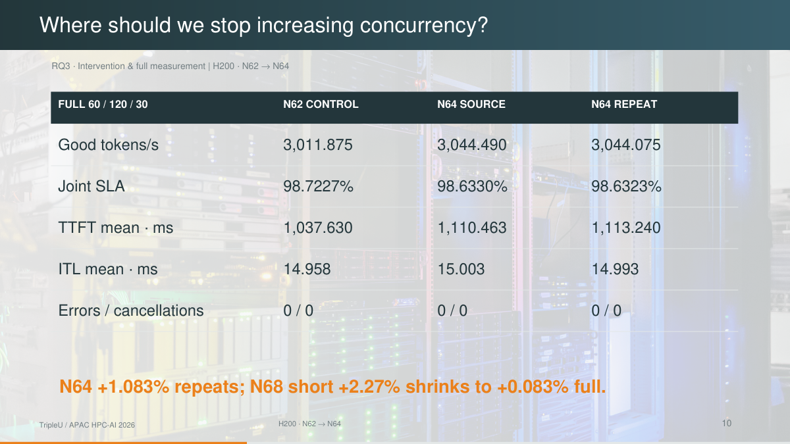

### Purpose

Choose a useful concurrency point with a full-protocol control and an independent N64 repeat, while resisting a larger but unconfirmed short-screen result.

### Technical interpretation and reasoning

Read three columns: N62 control 25365; N64 candidate 25366; N64 repeat 25373. Goodput is 3,011.875 / 3,044.490 / 3,044.075 tokens/s. The full N64 gain over N62 is 1.082867%; the N64 repeat is only 0.013634% below the candidate. TTFT rises modestly, ITL is nearly stable, SLA is slightly lower, and errors/cancellations are zero.

### Terms and symbols to understand

- **Concurrency N62/N64:** Number of client requests allowed in flight; it is not the actual decode batch size.
- **Full 60/120/30:** 60 seconds warmup, 120 scored seconds, and 30-second grace for outstanding requests.
- **Goodput:** Qualifying request rate × fixed 200 output tokens.
- **N68 screen:** Short test whose apparent +2.27% gain narrowed to +0.083% in the full matched pair.
- **Independent allocation:** A new scheduler allocation/run; not proof of unique GPUs or different hardware generation.

### Interpreting the evidence or diagram

- Full N62 control 25365 versus N64 candidate 25366 gains 1.082867%. Independent N64 run 25373 reaches 3,044.075 tokens/s, 0.013634% below the candidate. The two N64 runs sampled the same GPU UUID set, limiting hardware diversity and not providing a confidence interval.
- Mean TTFT is 1,037.630 ms at N62 and 1,110.463 ms at N64; mean ITL changes from 14.958 to 15.003 ms. Joint SLA is 98.7227% versus 98.6330%, with zero errors/cancellations. N68's favorable short screen did not persist: the full pair gain is only 0.083056%.

### Tradeoff and strength of evidence

- **Observation:** N64 gains about 1.083% goodput over N62 and repeats within 0.014%; TTFT rises modestly, SLA dips slightly, and ITL is nearly unchanged.
- **Hypothesis:** Moderately higher client concurrency may increase pipeline utilization enough to improve throughput.
- **Supported conclusion:** Keep N64 as a reproduced operating point; do not choose the short-screen N68 result over full evidence.
- **Unknown / limitation:** These runs do not separate queueing, transfer and compute effects, establish a confidence interval, or find a global optimum.

### Spoken script

A full N62 control reached 3,012 good tokens per second. N64 reached 3,044, and an independent N64 run was almost identical. That is a 1.083 percent gain, with modestly higher TTFT and slightly lower joint SLA. A short N68 screen looked stronger, but its full-pair gain shrank to 0.083 percent. We stop at N64 because that gain survives a full run and repeat; we do not call it a global maximum.

### Avoid this interpretation

N62/N64/N68 are client concurrency settings, not GPU counts or decode batch sizes. Two repeated allocations do not provide a formal confidence interval.

### Transition

Although the service meets the joint threshold on most requests, the next slide examines the specific requests that still miss.

---

## Slide 11 — Which requests still fail after goodput improves?

**Hardware: H200 · N64 · job 26766**

### Quick brief · 10–20 seconds

This H200 N64 scatterplot shows 1,875 of 1,902 requests pass both limits. The remaining 27 miss TTFT only. Their timing near profile admission is a clue to investigate, not proof of the cause.

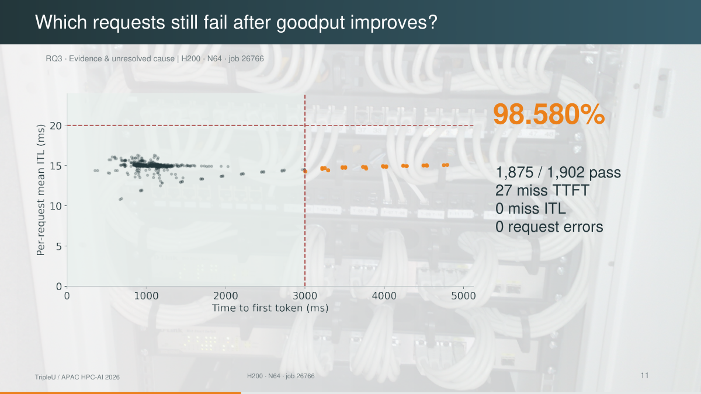

### Purpose

Move from averages to request-level acceptance. The scatterplot reveals that every observed miss is on TTFT, while explicitly preserving the distinction between an association near admission and a causal explanation.

### Technical interpretation and reasoning

Each point is one request: x is time to first token (TTFT, ms), y is that request's mean inter-token latency (ITL, ms). Red vertical/horizontal thresholds are 3,000 ms TTFT and 20 ms ITL. Dark teal #23373B (may appear blue-green) jointly passes; orange #EB811B (may appear yellow) misses at least one. Pale green marks TTFT only, not joint acceptance. Dark overlap is alpha rendering, not a separate class.

### Terms and symbols to understand

- **TTFT:** Time from request start until its first generated token.
- **Request-mean ITL:** Mean interval between generated tokens within one request.
- **Joint pass:** A request meets both TTFT ≤ 3,000 ms and request-mean ITL ≤ 20 ms.
- **P95:** 95th percentile; 95% of observations are at or below it, describing the tail rather than the mean.
- **Native runtime:** The server execution path used by job 26766, distinct from the portable replay software path.

### Interpreting the evidence or diagram

- The full native-runtime job 26766 produces 3,045.501509 good output tokens/s. Of 1,902 profiled requests, 1,875 (98.580%) meet both limits. The 27 failures miss TTFT; none miss request-mean ITL, and there are zero request errors or cancellations.
- Mean/p95 TTFT is 1,108.869/1,311.693 ms; mean/p95 ITL is 15.0075/15.1930 ms. All 27 misses start within 13.004085 ms of profiling admission. This timing is an initial-cohort association, not proof that startup, queueing, prefill, transfer, or compute caused the misses.

### Tradeoff and strength of evidence

- **Observation:** 1,875/1,902 requests jointly pass; all 27 misses are TTFT-only, with no request errors/cancellations.
- **Hypothesis:** Requests arriving at the beginning of the scored profile may face a distinct startup/admission effect.
- **Supported conclusion:** The distribution shows the remaining acceptance gap is first-token tail behavior in this run.
- **Unknown / limitation:** The timing association does not identify whether queueing, prefill, KV transfer, or computation caused the TTFT misses.

### Spoken script

Each dot is one request. It passes only if TTFT is at most 3,000 milliseconds and request-mean ITL is at most 20. There are 1,875 joint passes from 1,902; all 27 misses are TTFT-only, with no request errors. They begin close to profile admission. That makes the initial cohort worth studying, but timing alone does not prove a startup cause.

### Avoid this interpretation

The pale green region checks TTFT only. Do not read it as the joint pass area, and keep all 1,902 requests in the denominator.

### Transition

The next slide compares separate intervention results and asks which ones actually improved the objective.

---

## Slide 12 — Keep an intervention only if the objective improves

**Hardware: H200 results + separate H100 FA3 pair**

### Quick brief · 10–20 seconds

Three separate interventions improve a secondary metric but fail their service adoption rule: H200 cache gain is below 1%, sparse graphs lose goodput, and H100 FA3 loses goodput despite faster TTFT. Their results cannot be combined.

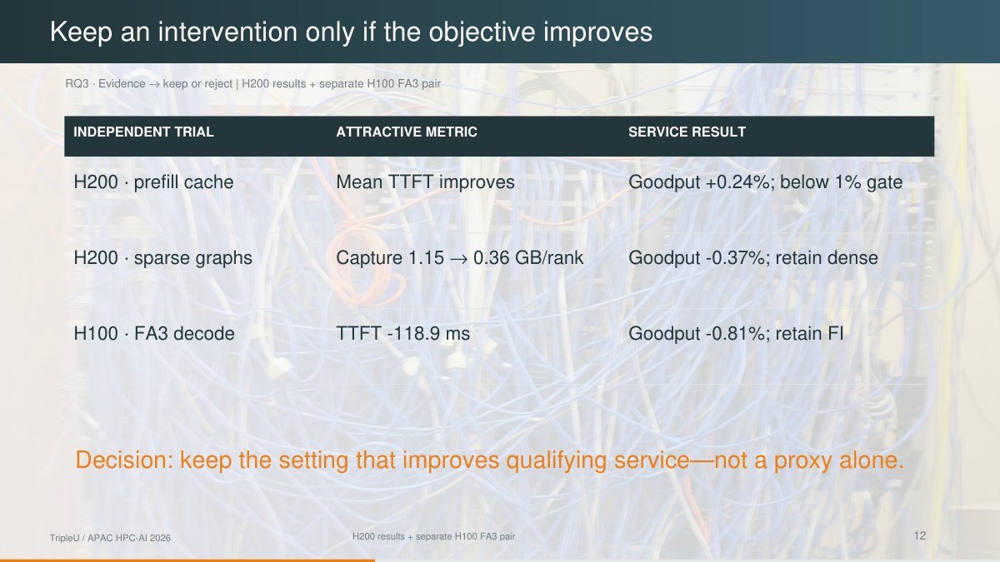

### Purpose

This is a decision table, not a single experiment or a hardware comparison. It brings together three independent H200 intervention results and one separate H100 attention result. Each row compares the tested change with its own control and applies the useful-gain rule.

### Technical interpretation and reasoning

Read four evidence groups independently: H200 prefill cache 27376→27378 gains 0.240921%, below the prospective 1% useful threshold; H200 sparse decode graphs reduce capture memory 1.15→0.36 GB/rank but lose 0.370208% goodput; a separate H100 N54 FlashInfer→FA3 decode pair lowers TTFT 118.922 ms but loses 0.812% goodput. Do not compare their raw throughputs as one experiment.

### Terms and symbols to understand

- **Useful-gain threshold:** The prospective requirement of more than 1% gain used for H200 promotion decisions; a small positive result is not sufficient.
- **Prefill cache:** Cache that can reuse processed prompt-prefix state; the H200 trial disabled this cache for prefill.
- **Sparse decode graphs:** Captures only selected decode batch sizes instead of a dense set; memory is capture allocation, not total GPU VRAM.
- **Capture memory per rank:** Memory used for graph capture by one distributed process, measured in GB/rank.
- **TTFT / goodput:** Time to first token / qualifying output tokens per second; improving one may worsen the other.

### Interpreting the evidence or diagram

- H200 cache pair: fresh control 27376 scores 3,041.119598; candidate 27378 scores 3,048.446289, a +0.240921% difference. Candidate passes local request/output gates (1,879/1,905 joint requests; zero errors), but does not pass the prospective >1% useful-gain decision threshold.
- H200 sparse graph job 27510 scores 3,029.861122 versus control 27376 at 3,041.119598, or −0.370208%. Decode graph-capture memory falls from 1.15 to 0.36 GB per rank; this resource reduction does not improve goodput. Separately, H100 N54 FA3 lowers mean TTFT by 118.922 ms but raises ITL and mean request latency; goodput falls 0.812%. These are distinct trials on distinct hardware, with separate controls.

### Tradeoff and strength of evidence

- **Observation:** The cache result is +0.240921%, sparse graphs save capture memory but lose 0.370208% goodput, and H100 FA3 reduces TTFT while losing 0.812% goodput.
- **Hypothesis:** Cache, graph capture, or attention changes might improve one resource or latency metric without damaging the service objective.
- **Supported conclusion:** Keep the replicated N64/cache setting; retain dense graphs and FlashInfer decode for the measured settings. None of these interventions meets its adoption criterion.
- **Unknown / limitation:** The three results do not share a control or hardware; their effects cannot be added, ranked by raw score, or generalized beyond each setup.

### Spoken script

This slide combines independent decisions, not one factorial experiment. On H200, disabling prefill cache gains 0.24 percent, below our 1 percent useful threshold. Sparse graphs save capture memory, from 1.15 to 0.36 gigabytes per rank, but goodput falls 0.37 percent. On a separate H100 N54 pair, FA3 improves TTFT yet goodput falls 0.812 percent. We keep the settings that better support the full objective; we do not compare or add these unrelated gains.

### Avoid this interpretation

The H100 pair is not an H200 row. Capture memory is not total VRAM, and lower TTFT or memory alone does not establish a better serving configuration.

### Transition

One proposed way to reduce latency was speculative decoding; next we trace its failed hypothesis and later tests.

---

## Slide 13 — Did speculative decoding solve this workload?

**Hardware: H200 · EAGLE3**

### Quick brief · 10–20 seconds

EAGLE3 placement missed latency; a validator bug was repaired; the short retry and separate full shallow trial both lost goodput. The tested method therefore did not help this workload, although other configurations remain untested.

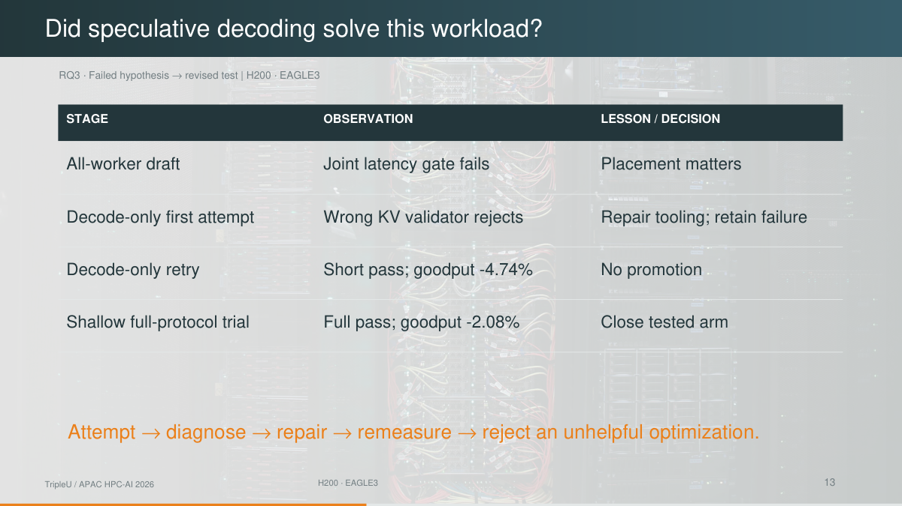

### Purpose

Trace the full EAGLE3 reasoning chain: a placement hypothesis, a validator defect, a corrected short retry, and a separate full test. Repairing a measurement tool makes a rerun valid; it does not turn a losing performance result into a win.

### Technical interpretation and reasoning

Read stages in order: all-worker draft 25948 fails the joint latency gate; decode-only attempt 25988 is rejected because the validator expects draft KV regions on target-only prefill; repaired short run 25998 passes its limited protocol but loses 4.74% goodput; separate shallow full run 27238 loses 2.080318% versus control 26949.

### Terms and symbols to understand

- **EAGLE3 speculative decoding:** A draft model proposes output tokens and the target model verifies them; correctness of transfer alone does not prove faster serving.
- **Target-only prefill:** Prompt-processing worker that runs the target model but does not host the draft model.
- **KV region:** Memory region holding key/value states; the validator must check it only on roles that actually host draft execution.
- **Short protocol:** Limited run that cannot replace the full fixed workload for service performance claims.
- **Goodput loss:** Lower qualifying output tokens per second than the matched target-only control.

### Interpreting the evidence or diagram

- The initial all-worker trial 25948 misses the joint latency gate. Moving the draft to decode-only was hypothesized to reduce first-token delay. Attempt 25988 is then rejected by a validator that wrongly applies draft KV-region counts to target-only prefill; the role-aware repair preserves the original failure.
- Short retry 25998 passes its limited protocol but loses 4.74% goodput against its own target-only control. Later full shallow run 27238 reaches 2,971.628430 versus control 26949 at 3,034.761104, a 2.080318% loss. Low draft acceptance is descriptive telemetry, not a causal timing explanation.

### Tradeoff and strength of evidence

- **Observation:** After validator repair, the short decode-only retry loses 4.74%, and the distinct shallow full trial loses 2.080318% goodput.
- **Hypothesis:** Restricting draft execution to decode or using a shallow draft may reduce TTFT without sacrificing total service throughput.
- **Supported conclusion:** The tested variants do not solve this workload; close them while preserving the tooling failure and repair history.
- **Unknown / limitation:** The observations do not explain precisely which service phase causes the slowdown, nor rule out every possible speculative configuration.

### Spoken script

We tried EAGLE3 to reduce generation delay. Running draft workers everywhere failed the joint latency rule. Moving draft to decode-only was reasonable, but the validator first made an incorrect check on target-only prefill. We repaired that check and preserved the failure. The short retry then ran but lost 4.74 percent goodput; a separate full shallow trial lost 2.08 percent. These configurations do not solve this workload. Functional draft transfer is not evidence of faster service.

### Avoid this interpretation

Distinguish the validator error from a model failure, and the short retry from the complete run. Do not turn low acceptance telemetry into a causal latency breakdown.

### Transition

We now ask whether the selected N64 improvement repeats across deployments and how to compare other full results fairly.

---

## Slide 14 — Does the improvement survive another deployment?

**Hardware: H200 · full N64 repeats**

### Quick brief · 10–20 seconds

Three H200 full N64 runs average 3,044.40. The native-runtime result is separate. A higher cache score gains only 0.24 percent against its own control, below the useful threshold; recovered raw output from a failed job is not a complete successful repeat.

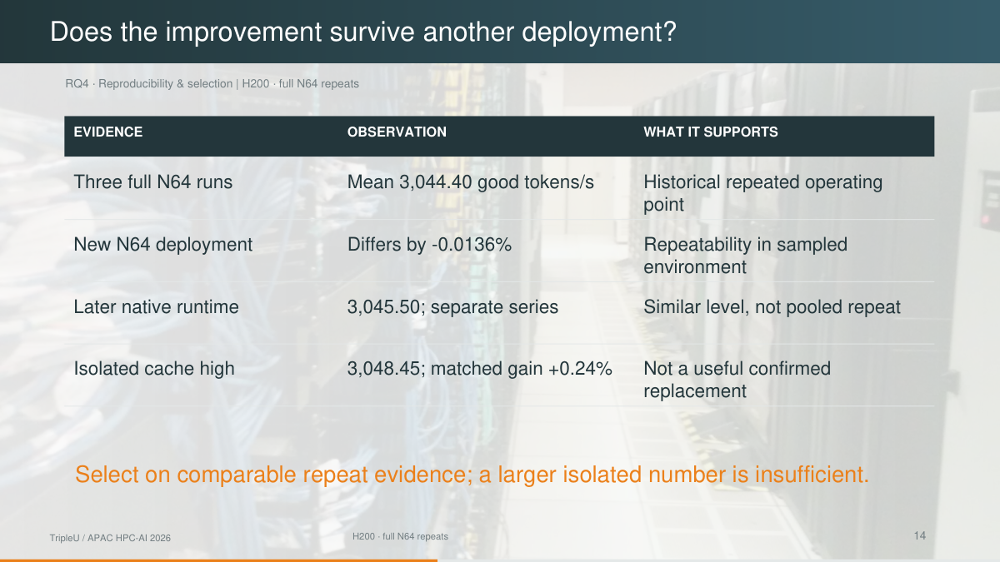

### Purpose

Distinguish replicated operating points from isolated peaks and from a later software-runtime series. Selection rests on repeatability and the declared useful-gain rule, not the largest number on the slide.

### Technical interpretation and reasoning

Three historical complete N64 runs 25366/25373/25487 average 3,044.400475 good tokens/s. Native-runtime job 26766 is a separate complete result at 3,045.501509 and 98.580442% joint SLA. Cache candidate 27378 is numerically higher at 3,048.446289, but its matched fresh control 27376 is 3,041.119598, making the gain only +0.240921%, below the >1% useful threshold.

### Terms and symbols to understand

- **Independent deployment repeat:** Another scheduled run of the same configuration; it tests repeatability, not necessarily unique GPUs or a different hardware system.
- **Native runtime:** A distinct server software execution environment, not a new GPU generation.
- **Matched fresh control:** New comparison run using the baseline setting for the cache pair.
- **Team-reviewed complete run:** The team ran the full protocol on the assigned organiser accelerator cluster, then inspected raw request outputs and runtime gates. It was not run on a personal laptop and is not an organiser-issued ranking or official accuracy validation.
- **Useful-gain threshold:** The prospective >1% improvement requirement for considering an intervention useful.

### Interpreting the evidence or diagram

- The three historical N64 full runs average 3,044.400475 good tokens/s and support choosing N64 for replication. Native-runtime 26766 separately reaches 3,045.501509 and 98.580442%; do not pool it with the historical trio because the server runtime path differs.
- The highest complete cache candidate 27378 reaches 3,048.446289, but relative to its own fresh control 27376 at 3,041.119598 the gain is +0.240921%, below the >1% useful threshold. The numerical high is not a confirmed useful improvement. A recovered portable raw score of 3,055.330517 came from job 27145, whose scheduler job failed during postprocessing; it is not a successful whole-allocation repeat.

### Tradeoff and strength of evidence

- **Observation:** Historical N64 repeats average 3,044.400475; native job 26766 is similar but separate; cache job 27378 is only +0.240921% above its own fresh control.
- **Hypothesis:** A repeated point is a more defensible selection basis than the highest isolated observation.
- **Supported conclusion:** Retain replicated N64 and do not select the small cache difference as a useful gain.
- **Unknown / limitation:** No result establishes a global optimum, cross-runtime causality, organiser ranking, or official model quality.

### Spoken script

Three historical full N64 runs average 3,044.40 good tokens per second. A later native-runtime run is similar, but we report it separately because the software execution path differs. The highest cache candidate is 3,048.45, only 0.24 percent above its own fresh control, below the one-percent useful threshold. We retain replicated N64 rather than selecting the largest isolated score. A recovered raw score from a failed postprocessing job is not a successful complete deployment.

### Avoid this interpretation

A deployment repeat is not necessarily new physical hardware. A full team-reviewed run is not an official contest ranking or quality certificate. Do not replace failed job state with recovered raw evidence.

### Transition

Even within H200, later replay results differ; next we examine runtime and workload confounders rather than assume the score change has one cause.

---

## Slide 15 — Why did a later replay score lower?

**Hardware: H200 · distinct runtime series**

### Quick brief · 10–20 seconds

Historical full N64 averaged 3,044.40 while a newer short control was about 2,560. Graph policy, server admission cap and measurement procedure changed. The completed tests did not isolate one cause, so we retain the drift without attributing it to one flag.

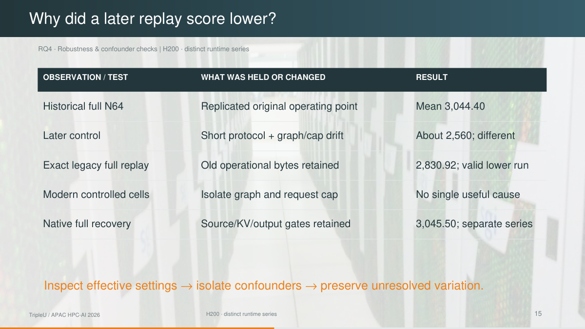

### Purpose

Investigate a discrepancy rather than explain it with a convenient single flag. The evidence identifies changed settings and measurement context, but the completed comparison does not isolate one sufficient cause.

### Technical interpretation and reasoning

The question is why historical full N64 averaged 3,044.400475 while a newer short control was about 2,560. Show that ServerArgs differ in prefill graph policy and max-running-request cap, and that harness/observation protocol also differs. Exact legacy replay 26313 reaches 2,830.923547; new native run 26766 reaches 3,045.501509. These rows are different runtime/protocol series, not a clean single-factor ladder.

### Terms and symbols to understand

- **ServerArgs:** Runtime server configuration arguments that control graph policy, admission limits, and other behavior.
- **Prefill graph policy:** Which prompt-processing shapes are captured or executed through GPU graphs.
- **Max running requests:** Server-side cap on concurrently admitted/running requests; distinct from client concurrency.
- **Harness / observation protocol:** Client and measurement procedure determining warmup, scoring, and accounting.
- **Confounder:** A factor that changes with the comparison and can also affect the outcome, preventing single-cause attribution.

### Interpreting the evidence or diagram

- The historical full N64 mean is 3,044.400475, while a later short control is approximately 2,560. Actual ServerArgs show a changed prefill graph policy and max-running-request cap; harness and observation conditions also differ.
- An exact legacy operational replay 26313 reaches 2,830.923547, and native-runtime full run 26766 reaches 3,045.501509. The completed graph/admission factorial did not identify one useful cause. Therefore neither restoring one flag nor changing the launcher alone can be credited for the whole score difference.

### Tradeoff and strength of evidence

- **Observation:** Scores vary across the historical full series, short control, legacy replay, and native runtime; several settings and measurement conditions changed together.
- **Hypothesis:** Changed graph policy, server admission cap, runtime, or measurement harness could contribute to the observed drift.
- **Supported conclusion:** Retain the lower valid result and label its protocol/runtime; no single-factor explanation was established.
- **Unknown / limitation:** The factorial evidence did not isolate one causal factor sufficient to explain the historical-to-new score difference.

### Spoken script

A newer short control scored about 2,560, below the historical full N64 mean of 3,044. We inspected the actual server settings and found both prefill graph policy and the server request cap had changed; the harness and measurement window also differed. A legacy replay and a new native run each answer different comparisons, and the completed factorial did not isolate one cause. We therefore report the drift and its confounders, rather than credit one restored flag or launcher change.

### Avoid this interpretation

A short control is not directly comparable to a full run. Do not treat exact legacy replay as proof that one flag caused the difference.

### Transition

Cross-platform measurements raise a different robustness question: can a calibration on one accelerator forecast another?

---

## Slide 16 — Can one platform predict another reliably?

**Hardware: H100 inputs · H200 verification**

### Quick brief · 10–20 seconds

The N52 H200/H100 ratio is 1.1881. A forecast frozen before H200 N50 measured −1.5371 percent error, inside the team’s ±2 percent tolerance but outside an incomplete sensitivity range. One check does not validate a universal conversion.

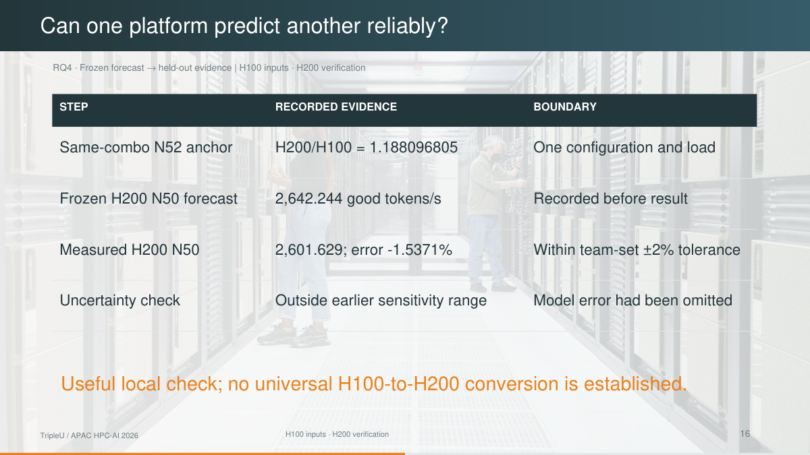

### Purpose

Evaluate one cross-platform forecast without changing it after seeing the test result. The evidence supports a single nearby operational check, while exposing that the earlier sensitivity range omitted a source of predictive uncertainty.

### Technical interpretation and reasoning

At the same N52 combo, the H100 mean is 2,215.460 good tokens/s from two allocations and the H200 mean is 2,632.181 from four; ratio H200/H100 = 1.188096805. This ratio was used with the H100 N50 mean to freeze an H200 N50 prediction of 2,642.244. Held-out job 24272 measures 2,601.629, signed error −1.5371%, within a predeclared team tolerance of ±2% but outside the earlier input-only sensitivity range.

### Terms and symbols to understand

- **Allocation:** One scheduler-granted run/resource assignment; allocation count is not the number of distinct hardware models or necessarily unique devices.
- **Calibration ratio:** H200 mean divided by H100 mean for the same N52 configuration; dimensionless and specific to that setup.
- **Held-out result:** Measurement not used to calculate the forecast, revealed afterward to test transfer to a new observation.
- **Sensitivity range:** Range caused by varying selected inputs; here it excluded model error, so it was not total predictive uncertainty.
- **±2% tolerance:** Team's predeclared operational acceptance band, not a 95% confidence interval or measurement error bar.

### Interpreting the evidence or diagram

- At N52, H100 averages 2,215.460 tokens/s across two allocations and H200 2,632.181 across four. Their ratio, 1.188096805, is a local system association for the same combo, not a universal hardware multiplier. Allocation repeats do not prove unique physical hardware.
- Before H200 N50 job 24272 was available, the prediction was frozen at 2,642.244 good tokens/s. The measured result is 2,601.629, signed error −1.5371%, within the team-set ±2% operational tolerance. However, the result falls outside the earlier sensitivity range because that range varied inputs but omitted model error. The factor is not refit, and broad predictive reliability is not established.

### Tradeoff and strength of evidence

- **Observation:** One held-out H200 N50 result is 1.5371% below prediction: within ±2% tolerance but outside the incomplete sensitivity range.
- **Hypothesis:** The N52 ratio may transfer well enough to forecast a nearby N50 H200 operating point.
- **Supported conclusion:** This single prospective check passes the team's operational tolerance; retain the missing-model-error limitation.
- **Unknown / limitation:** Prediction accuracy across more loads/configurations, complete uncertainty, and any universal H100-to-H200 conversion remain unknown.

### Spoken script

We measured the same N52 configuration on H100 and H200 and obtained a ratio of 1.1881. We used it to freeze an H200 N50 forecast before job 24272 ran. The prediction was 2,642.244; the measurement was 2,601.629, a −1.5371 percent error, inside our predeclared ±2 percent tolerance. It was outside the earlier sensitivity range, which omitted model error. This is one local check, not a universal conversion rule.

### Avoid this interpretation

Two and four allocations are repeat counts, not proof of distinct physical devices. The ±2% tolerance is not a statistical confidence interval; do not refit after viewing the held-out result.

### Transition

A service can pass latency and still leave answer quality unresolved; the next slide draws that boundary.

---

## Slide 17 — What does passing latency leave unverified?

**Hardware: H200 latency · official quality unknown**

### Quick brief · 10–20 seconds

H200 N64 passes its joint latency rule on 98.580 percent of requests. Small checks do not verify the separate official requirement of at least 99 percent of reference, so model quality remains unknown.

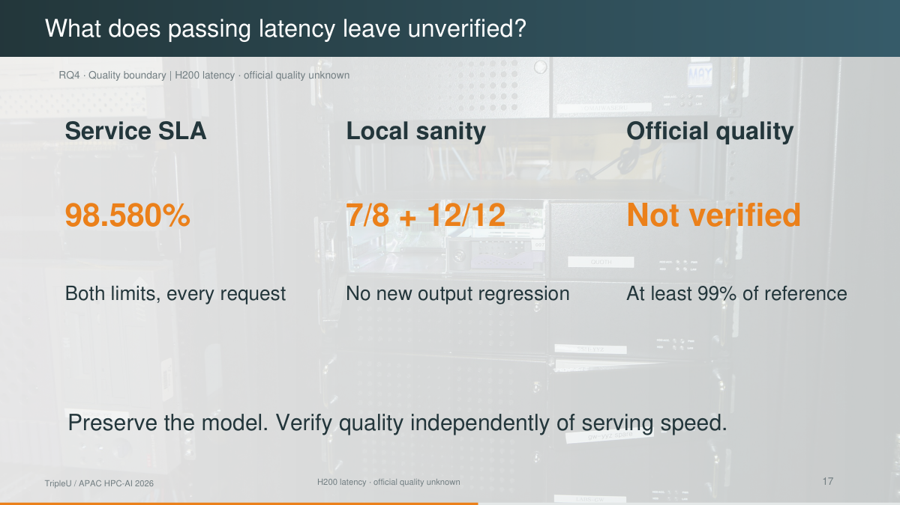

### Purpose

Separate service performance from model quality. Meeting request latency criteria answers whether the service responds quickly enough; it does not establish whether generated answers meet the organiser's full-set quality threshold.

### Technical interpretation and reasoning

Read three evidence levels: H200 job 26766 joint latency success 98.580442%; team-run smoke checks 7/8 with no new regression and retrieval checks 12/12; official quality requirement at least 99% of reference remains unverified. The local checks are small regression probes, not the required full quality evaluation.

### Terms and symbols to understand

- **Joint latency SLA:** A request-level rule requiring both TTFT and request-mean ITL limits.
- **Smoke / retrieval check:** Small regression and retrieval tests run by the team in the assigned H200 environment; they are not the organiser's prescribed full-set accuracy evaluation.
- **Official model quality:** Organiser-prescribed comparison of model answers against a reference over the full evaluation set.
- **99% of reference:** Required minimum relative to the official quality comparator; still not measured here.
- **FP8 weights / BF16 activation-KV:** Numerical formats retained in the selected model path; formats alone do not certify answer quality.

### Interpreting the evidence or diagram

- Full N64 job 26766 reaches 98.580442% joint latency success. The team-run smoke suite is 7/8 with no newly detected regression; retrieval is 12/12. These small suites do not estimate the organiser's full-set score.
- The required quality gate is at least 99% of reference on the official evaluation, and it remains unknown. The selected primary retains FP8 weights and BF16 activation/KV; it does not use quantized KV or speculative decoding. No organiser-issued accuracy certificate or ranking follows from this latency result.

### Tradeoff and strength of evidence

- **Observation:** Latency acceptance and small regression checks pass at their stated scope; official full-set quality was not verified.
- **Hypothesis:** Keeping model changes separate from serving changes helps measure throughput without conflating it with answer-quality effects.
- **Supported conclusion:** Report service latency and official model quality as separate questions; claim only the measured latency result.
- **Unknown / limitation:** Whether the system reaches at least 99% of reference on the official full evaluation remains unknown.

### Spoken script

This result measures service behavior, not answer accuracy. H200 job 26766 passes both latency limits on 98.580 percent of requests. Small smoke and retrieval checks show no new regression in their limited cases. The organiser's separate requirement is at least 99 percent of the reference on the full quality evaluation, which we have not verified. Therefore we report latency acceptance without claiming official model quality or ranking.

### Avoid this interpretation

Do not call 7/8 or 12/12 a quality score. Passing the latency SLA does not imply answer correctness or organiser approval.

### Transition

The final evidence question is whether the packaged deployment completes from launch through result processing.

---

## Slide 18 — Does the packaged deployment complete end to end?

**Hardware: H200 replay + CPU reader verification**

### Quick brief · 10–20 seconds

Two real H200 portable jobs completed serving but failed during result reading. A zero-GPU job verified reader fixes on real exports. This does not establish a successful full deployment after repair; the original jobs remain failed.

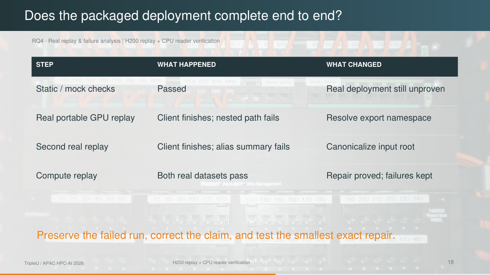

### Purpose

Distinguish successful GPU inference from successful end-to-end packaging. Two real portable allocations completed serving but failed while readers located and interpreted result files; a later CPU-only replay verified the reader repair, not a repaired full allocation.

### Technical interpretation and reasoning

Trace the pipeline in order: real portable jobs 27136 and 27145 ran the official GPU client and both semantic P/D routes, then failed in result processing. First repair handled exports nested in an immediate child directory; second canonicalized the input root where /scratch/home and /home paths referred to the same files. Actual zero-GPU compute job 27152 passed both repaired readers on both real datasets. Keep original scheduler states FAILED.

### Terms and symbols to understand

- **End-to-end deployment:** Complete path from launching servers and routes through official load client, exporting data, and producing a reviewed result.
- **Semantic P/D routes:** Prefill and decode service paths; both completed in the real GPU jobs.
- **Result reader:** Post-processing code that locates exported files, parses them, and calculates summaries.
- **Canonical path:** Resolved filesystem identity; /home and /scratch/home can be aliases to the same underlying location.
- **Compute-only verification:** CPU job checking corrected readers against real exports, without launching the GPU service again.

### Interpreting the evidence or diagram

- Real H200 portable jobs 27136 and 27145 completed both serving routes and the official client, but the scheduler jobs failed during post-processing. In 27136, AIPerf 0.12 placed exports in an immediate child directory; the first fix handled that layout. In 27145, lexical /home and canonical /scratch/home paths caused an alias mismatch; canonicalizing the root fixed the second issue.
- Zero-GPU job 27152 then ran the corrected readers on both real datasets and passed. Raw 27145 score 3,055.330517 is recoverable evidence from the failed original job, not a successful whole-allocation rerun after repair. No post-repair full GPU deployment is claimed.

### Tradeoff and strength of evidence

- **Observation:** Two real GPU jobs completed inference and client work but failed in result reading; CPU-only job 27152 verified both reader fixes on real outputs.
- **Hypothesis:** The deployment's remaining failure was caused by file-layout and path-alias assumptions in post-processing, rather than serving execution.
- **Supported conclusion:** The precise reader defects were repaired and verified against actual datasets; the full post-repair deployment remains unverified.
- **Unknown / limitation:** Whether a complete new allocation would pass launch, inference, export, reading, and all gates after the fixes is unknown.

### Spoken script

The real portable GPU jobs completed the prefill and decode routes and ran the official client, but both failed when post-processing read the exports. One reader expected files at the wrong directory level; another confused two path aliases for the same files. We fixed both and verified the readers on actual outputs in a zero-GPU CPU job. That verifies the reader repair, not a complete post-repair GPU allocation. The original scheduler jobs remain failed.

### Avoid this interpretation

Do not report 3,055.330517 as a successful complete deployment. The original job failed; CPU-only reader verification did not rerun GPU inference or the full allocation.

### Transition

Together these slides answer the four questions: choose a measured topology, test the limiting interactions, retain only useful gains, and bound reproducibility and quality claims.

---

## Slide 19 — Four decisions, each with an evidence boundary

**Hardware: H200 primary · H100 separate**

### Quick brief · 10–20 seconds

Our four decisions follow evidence: keep a usable layout, test suspected limits, retain measured service improvements, and require repeat results. Historical N64 averages about 3044 qualifying tokens per second; official quality and complete repaired deployment validation remain open.

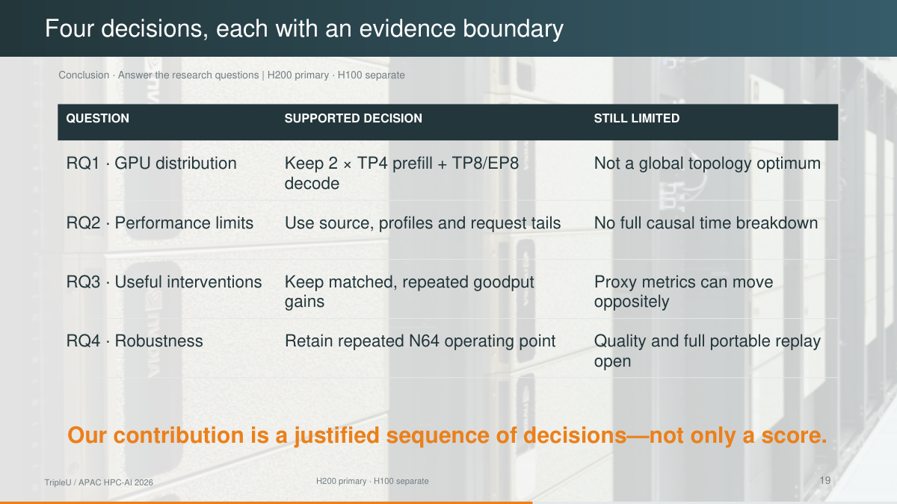

### Purpose

Answer the four questions with decisions and the boundary of their supporting evidence.

### Technical interpretation and reasoning

The layout is a usable 16 H 200 decision, profiles suggest rather than prove universal limits, matched useful service gains are retained, and repeatedN 64 measurements support an operating point. Unknown quality, limited hardware diversity and unfinished full portable replay keep robustness claims bounded.

### Terms and symbols to understand

- **Three-run mean:** Mean of historical full N64 runs 25366/25373/25487.
- **Native runtime:** Job 26766 uses the native server execution environment, separate from the historical runtime path. Runtime means software stack that launches/executes the serving server, not GPU hardware.
- **Cache pair:** 27376 fresh control versus 27378 candidate.
- **+0.240921%:** Candidate gain, below the prospective useful-gain gate.
- **Official quality:** Full-set accuracy requirement, not verified here.
- **Historical N64 series:** Three full runs 25366/25373/25487 average 3,044.400475 good output tokens/s.
- **Fresh cache control:** Job 27376 compared with candidate 27378; the +0.240921% score difference is below the useful-gain threshold.
- **Team-reviewed run:** A run executed by the team on the assigned organiser cluster and checked against local raw-output/runtime gates. This is not an organiser-issued ranking or quality certification.
- **Full protocol 60/120/30:** For this benchmark: 60 seconds warmup, 120 seconds scored measurement, and 30 seconds grace for in-flight requests; grace is not scored.
- **Team-run and team-reviewed:** The team submitted and inspected the run on the assigned organiser cluster. “Reviewed” means checking retained raw request results, runtime and required gates; it is not organiser certification, a contest ranking, or a claim that the run was on a personal machine.

### Interpreting the evidence or diagram

- Later native-runtime job 26766 independently reaches 3,045.501509 and 98.580442% joint SLA; keep it separate because runtime path differs. Highest full cache result 27378 reaches 3,048.446289, only +0.240921% over fresh control 27376, below useful-gain gate. Lower valid replays around 2,802–2,831 remain retained. Replication supports choosing N64, not a global optimum. No speculative speedup, official quality certificate, or causal native-runtime speedup is claimed.
- Good output tokens/s is a throughput unit (higher is desirable); latency values are milliseconds (lower is desirable); joint SLA is a percentage of requests, not model accuracy. N is concurrent client requests, not GPUs. Read only the metrics actually printed on this slide.
- The historical mean and the native-runtime score are both team-run, fully reviewed measurements on the assigned accelerator cluster; “reviewed” means raw request/runtime checks were inspected, not that the organiser certified a ranking or quality score. The native runtime is the software execution environment, not a new GPU generation. Keep its 3,045.501509 separate from the three-run historical mean because the runtime paths differ. A numerically higher cache result is not selected when its gain is below the predeclared useful-change threshold.

### Tradeoff and strength of evidence

- **Observation:** Historical N64 mean is replicated; cache point gains 0.240921%; native path is separate.
- **Hypothesis:** A reproduced point is a safer selection basis than isolated peak.
- **Supported conclusion:** Retain N64; do not select for the main configuration the small cache gain.
- **Unknown / limitation:** Global optimum, official quality and causal runtime differences are unknown.

### Spoken script

Our decisions follow evidence: retain a usable GPU split, test rather than assume bottlenecks, keep interventions that improve qualifying service, and prefer repeated results over isolated peaks. The historical N 64 mean is about 3044 good tokens per second. Official quality and complete repaired deployment validation remain open.

### Avoid this interpretation

Keep units and configuration attached; do not state a hypothesis as a measured cause.

### Transition

The final slide states what a future iteration would have to prove; research is currently stopped.

---

## Slide 20 — What should the next iteration establish?

**Hardware: Proposed validation · no new jobs**

### Quick brief · 10–20 seconds

The next iteration should close evidence gaps: official model quality, a complete packaged replay after reader repair, and phase timing before another bottleneck claim. We retain the repeated 64-request service meanwhile. These are proposed validation tasks; no new experiment is being launched as part of this report.

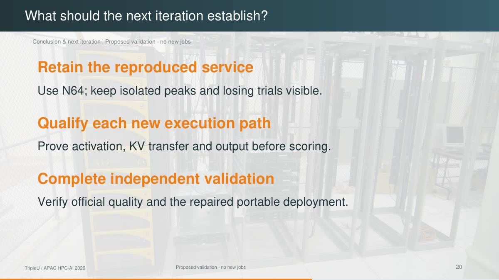

### Purpose

Make future validation follow the unresolved claims, rather than suggesting more trials merely to raise the headline score.

### Technical interpretation and reasoning

Official full-set quality would establish whether the accuracy requirement holds. A fresh complete portable replay would test deployment after reader repair. A compatible model path and bounded phase timing would be required before claiming compilation or bottleneck improvements. These are proposals, not accepted jobs.

### Terms and symbols to understand

- **target-only / EAGLE:** Target-only serves only the main model. EAGLE proposes draft tokens for that model to verify; the tested shallow full configuration lost performance.
- **independent validation:** A separate check of official full-set accuracy or the complete deployment, beyond the serving score and helper tests.
- **adopt a configuration:** Choose it as the team’s submission/deployment setting after evidence review. A high isolated observation alone is not enough.
- **source or CPU evidence:** Source shows what code may support; CPU fixtures test narrow helper behavior. Neither shows that the full GPU service activated the path or produced correct results.
- **unknown:** No sufficient retained measurement establishes the answer. It must not be described as zero, passed, or healthy.
- **official accuracy:** The full organizer quality evaluation; it must reach at least 99% of the FP8 reference and remains unverified.

### Interpreting the evidence or diagram

- Retain the replicated target-only N64 configuration rather than the highest isolated score. Cache, cap, and polling changes showed no useful gain; the tested shallow EAGLE configuration lost; sparse graph candidate goodput was 0.370208% below the earlier control.
- Any new implementation should show the intended backend active, correct KV movement, and valid outputs before its performance score is interpreted. CPU fixtures or source inspection alone do not satisfy that standard.

### Tradeoff and strength of evidence

- **Observation:** The selected N64 service has repeated full-run evidence; several optimization trials did not show useful gain. Accuracy and post-repair portable replay remain open.
- **Hypothesis:** Path-specific runtime and output checks can prevent unsupported deployment claims.
- **Supported conclusion:** Keep the reproduced service and treat the listed validation as future work, not as completed or queued research.
- **Unknown / limitation:** Official accuracy, full deployment behavior after reader repair, and a compatible compiled RoPE/KV path remain unknown.

### Spoken script

The next iteration should close evidence gaps: official model quality, a complete packaged replay after reader repair, and phase timing before another bottleneck claim. We retain the repeated 64-request service meanwhile. These are proposed validation tasks; no new experiment is being launched as part of this report.

### Avoid this interpretation

Do not claim official accuracy passed, repaired portable serving was fully rerun, sparse graphs improved goodput, or the compiled model interface was fixed.

### Transition

End the AI main talk here. Open the relevant backup for questions; the independent HPC section follows its own presentation.

---

## Slide 21 — Backup · two platforms, separate experimental systems

**Hardware: H200 + H100 · Firmus and NSCC ASPIRE 2A+**

### Quick brief · 10–20 seconds

Both systems allocate sixteen GPUs and use the same Qwen checkpoint and staged workload. Firmus uses H200s; NSCC uses H100s. Different hardware, schedulers, containers, and node conditions mean their scores are separate measurements, not a direct GPU conversion.

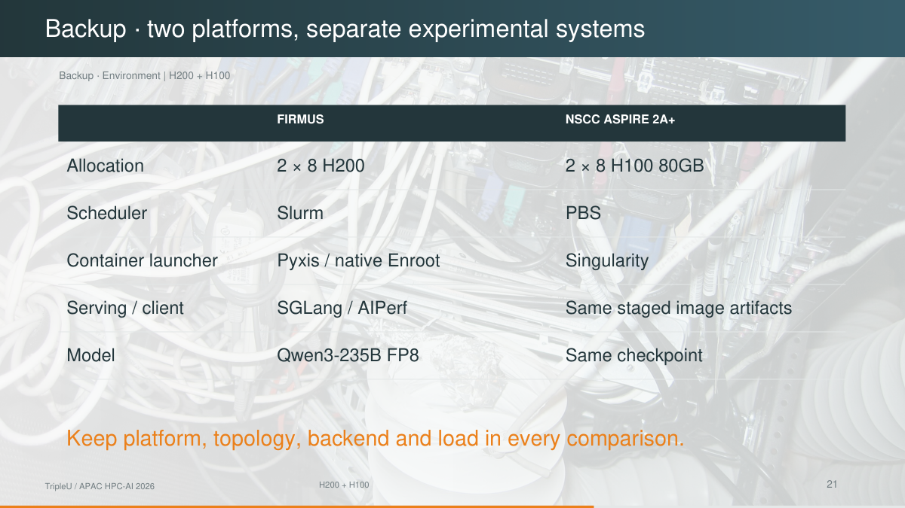

**AI backup section: open when a deeper explanation is needed.**

### Purpose

Set the comparison boundary for all later platform results: a shared model and client make experiments more comparable, but do not erase differences in hardware or deployment stack.

### Technical interpretation and reasoning

The table contrasts allocation, scheduler, container launcher, serving/client software, and model. Matching rows are useful controls: both systems have two eight-GPU nodes and use the same staged artifacts and Qwen3-235B FP8 checkpoint. Different rows are potential influences on latency and throughput. Slurm and PBS schedule resources; they do not execute model inference. Pyxis/Enroot and Singularity provide different container launch paths, while SGLang serves requests and AIPerf generates and measures client traffic. Therefore a score needs its platform, topology, backend, and load attached.

### Terms and symbols to understand

- **Firmus / NSCC ASPIRE 2A+:** Two separate compute sites: Firmus supplies H200 nodes; NSCC ASPIRE 2A+ supplies H100 nodes.
- **2 × 8 H200 / 2 × 8 H100:** Two nodes with eight GPUs each, sixteen GPUs per allocation. The GPU models and systems are different.
- **Slurm / PBS:** Schedulers that allocate and manage compute jobs. They are not the serving engine.
- **Pyxis / Enroot / Singularity:** Container launch tools. Containers package software, but different launchers and host stacks can still affect execution.
- **SGLang / AIPerf:** SGLang runs model serving; AIPerf sends benchmark requests and records service metrics.
- **FP8 checkpoint:** The shared model weights use an eight-bit floating-point representation; sharing weights does not make GPU runs equivalent.
- **platform comparison:** A comparison of complete systems. It needs matched workload plus explicit hardware, software, topology, and timing; GPU names alone are not a conversion factor.

### Interpreting the evidence or diagram

- Common controls are the two-node, sixteen-GPU allocation, the staged serving and client artifacts, and the Qwen checkpoint.
- Platform differences include H200 versus H100 GPU generation, Slurm versus PBS, and different container launchers. CPU, driver, network, node cache, and process placement can also differ.
- The table establishes context; it does not provide a controlled performance result or quantify each site's contribution.

### Tradeoff and strength of evidence

- **Observation:** Both sites provide sixteen GPUs across two nodes and share staged images and model checkpoint, while GPU family, scheduler, launcher, and host environment differ.
- **Hypothesis:** Matching the model and request workload is necessary, but platform differences may still affect serving measurements.
- **Supported conclusion:** Report each platform's results separately and name its deployment conditions.
- **Unknown / limitation:** This table does not isolate the effect of any one platform difference or define an H100-to-H200 score multiplier.

### Spoken script

We tested on two systems, each with sixteen GPUs. Firmus uses H200s, Slurm, and Enroot-based containers; NSCC ASPIRE 2A+ uses H100s, PBS, and Singularity. Both use the same model checkpoint and staged benchmark artifacts, but drivers, networks, host caches, and launch paths can differ. So this slide is a map of experimental environments, not a speed comparison. Every score needs its own platform and settings.

### Avoid this interpretation

Do not pool H100 and H200 observations into one series, or infer relative speed from GPU model or memory capacity alone.

### Transition

The next backup explains how the H200 weight layout imposed a concrete compatibility constraint.

---

## Slide 22 — Backup · FP8 geometry constrains a topology

**Hardware: H200 · tested FP8 path**

### Quick brief · 10–20 seconds

The failed TP8/EP1 partition had 192 elements, which leaves a 64-element remainder against a 128-wide FP8 block. EP2 changes the effective split to 384 elements, or three full blocks. That fixes this shape mismatch; it does not prove serving speed or quality.

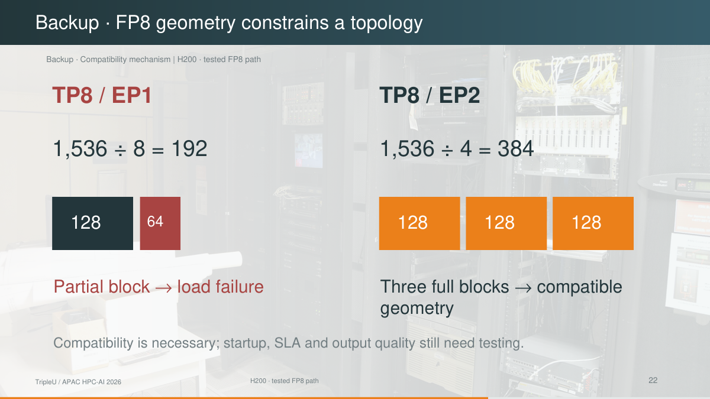

### Purpose

Teach a concrete compatibility failure from the model's weight geometry and distinguish a layout that can load from a deployment that has passed service tests.

### Technical interpretation and reasoning

Start with the MoE intermediate dimension, 1,536 elements, then divide by the effective tensor-parallel split. TP8/EP1 gives 1,536 ÷ 8 = 192. The tested kernel needs whole 128-element FP8 blocks, so 192 becomes one full block plus 64 unusable remainder elements. TP8/EP2 changes effective MoE tensor parallelism to four: 1,536 ÷ 4 = 384, exactly three full blocks. The red remainder marks a load-time compatibility failure, not lost output tokens. The arithmetic explains why the old shape failed and why the replacement shape is compatible; it is not a benchmark chart.

### Terms and symbols to understand

- **FP8 block:** A fixed group of 128 weight elements required by this tested kernel path. A partition ending halfway through a block cannot be loaded by that path.
- **MoE:** Mixture of Experts: a model layer routes tokens among expert sub-networks. Expert parallelism changes how those experts are distributed.
- **TP8 / EP1:** Eight-way tensor parallelism with one expert partition. Effective MoE tensor split is eight, producing 192 elements per partition.
- **TP8 / EP2:** Eight-way tensor parallelism with two expert partitions. Effective MoE tensor split is four, producing 384 elements per partition.
- **128 + 64:** The 192-element TP8/EP1 shard contains one complete 128 block plus a 64-element remainder, causing the tested load failure.
- **3 × 128 = 384:** The EP2 shard contains three complete blocks. The layout retains all model weights and experts; it changes partitioning.
- **compatibility vs performance:** Compatibility means the tensor shape meets a kernel's input requirement. Startup, latency, output quality, and throughput still need separate tests.

### Interpreting the evidence or diagram

- The two equations are the key evidence: TP8/EP1 produces 192 elements; TP8/EP2 produces 384.
- The 64-element remainder is why the first tested path failed during loading. EP2 removes that remainder by changing expert distribution, not precision or model size.
- The footer lists evidence still required after compatibility: successful startup, service-level latency checks, and output-quality checks.

### Tradeoff and strength of evidence

- **Observation:** TP8/EP1 yields a 192-element partition, not divisible into 128-wide blocks; TP8/EP2 yields 384 elements, exactly three blocks.
- **Hypothesis:** Changing expert partitioning can make the existing FP8 weights compatible with the kernel while retaining the model contents.
- **Supported conclusion:** EP2 corrects the tested block geometry and makes a compatible deployment attempt possible; this combined layout change is not an isolated TP speedup.
- **Unknown / limitation:** Alignment alone does not establish successful full startup, request SLA, output quality, or improved throughput.

### Spoken script

The model has an intermediate dimension of 1,536 elements, and this FP8 kernel requires complete blocks of 128. With TP8 and one expert partition, each shard gets 192 elements: 128 plus a leftover 64, so loading fails. With two expert partitions, the effective split is four and each shard gets 384, exactly three blocks. This keeps the weights and experts; it changes how they are distributed. The result is compatible geometry, not evidence of a faster or correct full service.

### Avoid this interpretation

The red 64 is a remainder of weight elements, not GPUs or tokens. Do not call compatibility a throughput result or an isolated TP improvement.

### Transition

The next backup uses a historical chart to show how the campaign reached later operating points.

---

## Slide 23 — Backup · historical milestones behind the decisions

**Hardware: H200 · different loads, layouts, and runtime settings**

### Quick brief · 10–20 seconds

The H200 chart rises from 1,297 good tokens/s at N32 to a 3,044 N64 mean. It shows better measured operating points over the campaign, but each milestone changes load or configuration, so the bars do not assign a causal gain to each optimization.

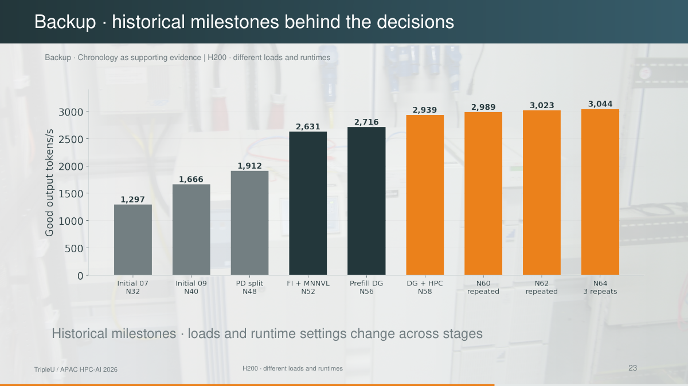

### Purpose

Use the historical chart as context for the research questions: it shows which operating points motivated later controlled tests, while teaching why a rising sequence is not a cumulative causal experiment.

### Technical interpretation and reasoning

The horizontal axis lists named milestones, not dates or equal time intervals. The vertical axis is good output tokens per second, so taller bars mean more requests meeting the latency limits under that milestone's workload. Gray marks early layouts, teal marks backend specialization, and orange marks later tuning and repeat points. The chart progresses from 1,297 at N32 and 1,666 at N40, through 1,912 at N48 and 2,631 at N52, to a rounded historical N64 mean of 3,044. Since concurrency, worker layout, backends, and runtime conditions change along the way, the chart shows the team found stronger measured configurations; it does not show how much any one change caused.

### Terms and symbols to understand

- **good output tokens/s:** Qualifying requests per second multiplied by the requested 200 output tokens; higher means more useful output under the latency rule.
- **milestone chart:** A grouped history of operating points. Horizontal spacing is categorical, not elapsed time, and neighboring bars are not necessarily matched experiments.
- **N32–N64:** Target numbers of simultaneous client requests, not GPU counts. Increasing N changes offered load and can change latency and useful throughput.
- **repeated point:** A configuration measured again to check reproducibility. A repeat tests consistency; it does not isolate the cause of an earlier gain.
- **causal ablation:** A comparison that changes one defined factor while holding others sufficiently constant. This historical chart is not one cumulative ablation.

### Interpreting the evidence or diagram

- The milestones are 1,297 (initial 07/N32), 1,666 (initial 09/N40), 1,912 (split/N48), 2,631 (FlashInfer plus MNNVL/N52), 2,716 (DeepGEMM prefill/N56), 2,939 (DeepGEMM plus HPC-Ops/N58), 2,989 (repeated N60), 3,023 (repeated N62), and 3,044 (three historical N64 runs). Labels are rounded.
- Later N62 runs measured 3,022.034919 and 3,023.072304; later N64 repeats measured 3,044.489701 and 3,044.074628. These support repeatability at those settings, not a universal optimum or causal explanation for every step.
- Colors group phases of work; they are not pass/fail marks. Bar height is a score, not a confidence interval.

### Tradeoff and strength of evidence

- **Observation:** Measured good output throughput rises across named operating points from 1,297 at N32 to a rounded 3,044 at historical N64.
- **Hypothesis:** Recovering a usable split and transfer path, then specializing attention, collective, prefill, and decode backends, helped identify stronger configurations.
- **Supported conclusion:** The chart is a map of milestones and later replication targets; it is not evidence the named optimizations add up to the full rise.
- **Unknown / limitation:** Loads, topology, runtime settings, and observation conditions vary; individual causal contributions and a global optimum are not established.

### Spoken script

This chart summarizes how H200 work moved from about 1,300 good output tokens per second at N32 to about 3,044 at N64. The horizontal axis names milestones, not dates; the vertical axis is latency-qualified output rate. Colors group phases of work. But load and software settings change between bars, so this is a history of better measured operating points, not proof that each named optimization caused the full increase.

### Avoid this interpretation

Do not read horizontal spacing as time, add bar differences as independent gains, or treat colors as pass/fail. N is request concurrency, not GPU count.

### Transition

The next backup combines two separate H100 observations into one decode tradeoff.

---

## Slide 24 — Backup · request-scoped descriptor construction

**Hardware: H200 branch · CPU geometry**

### Quick brief · 10–20 seconds

The patch builds descriptors for requested KV pages and coalesces contiguous ranges while preserving mapping and stride. CPU tests passed 720 geometry cases; the fixture explicitly did not validate real GPU transport.

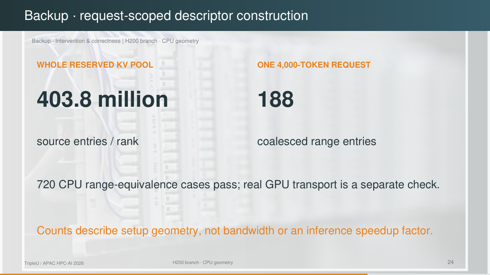

### Purpose

Describe the intervention precisely and put its correctness evidence at the right level. The patch changes descriptor scope and coalescing in heterogeneous-TP transfer while retaining the relevant mapping behavior; CPU equivalence is not the same as validating real transport on GPUs.

### Technical interpretation and reasoning

This is step 5 and the first half of step 6 in the seven-step chain: exact change, then the correctness gate that was actually run. Keep the distinction between address-range equivalence and real GPU transfer visible.

### Terms and symbols to understand

- **request-scoped descriptors:** Constructing transfer metadata only for KV pages needed by the current request instead of enumerating the entire KV pool.
- **coalesce contiguous ranges:** Combine adjacent memory ranges into fewer descriptors while preserving the locations and strides needed for the transfer.
- **KV head mapping:** The mapping from source KV heads to decode peer ranges; the patch metadata says this mapping was retained.
- **per-token stride:** The spacing between token-associated data locations when only a KV-head slice is sent; this must remain correct after coalescing.
- **720 cases:** Number of retained original-versus-patched CPU byte-range equivalence cases that passed.
- **real GPU transport: false:** The retained geometry fixture explicitly does not claim to have validated a real GPU transfer.
- **notifications:** Transfer completion signaling retained by the patch scope; it was not the changed experimental factor.

### Interpreting the evidence or diagram

- Step 5 — Intervention: replace full-pool source and destination descriptor enumeration with request-scoped descriptors, then coalesce contiguous ranges.
- The patch scope retains equal-TP behavior, weights, precision, KV-head mapping, per-token stride where a head slice is sent, and notifications.
- Step 6, correctness part: 720 original-versus-patched CPU geometry cases pass byte-range equivalence.
- The fixture records real GPU transport validation as false. Therefore CPU mapping checks do not prove GPU transfer, server readiness, or valid responses.

### Tradeoff and strength of evidence

- **Observation:** The patch implements request-only descriptor preparation and contiguous-range coalescing; retained CPU tests pass 720 range-equivalence cases, including the representative count of 188 for the contiguous request.
- **Hypothesis:** If the mapping is preserved while irrelevant pool ranges are omitted, setup can do less descriptor work without changing the KV bytes required by the request.
- **Supported conclusion:** The CPU fixture supports address and byte-range equivalence for its tested geometries. It is a correctness gate for the mapping, not a full deployment validation.
- **Unknown / limitation:** The fixture does not validate real GPU transport. It does not time old and new descriptor creation or establish that this change alone resolves the earlier timeout.

### Spoken script

The patch changed the scope of descriptor preparation. Instead of enumerating source and destination ranges across the whole KV pool, it builds descriptors for the current request and coalesces adjacent ranges. Its metadata says equal-TP transfers, model weights, precision, KV-head mapping, required per-token stride, and transfer notifications remain unchanged. We then checked original-versus-patched address and byte-range behavior on CPU across 720 geometry cases. Those tests support correctness of the tested mapping. The retained fixture explicitly says real GPU transport was not validated. So this step does not prove that the GPU copy worked, that the servers were ready, or that the request returned valid output. It is one correctness gate in the chain, not the end-to-end result.

### Avoid this interpretation

Do not describe 720 CPU geometry cases as 720 GPU transfers. Do not say that the patch changed all NIXL transfers or altered weights/precision.

### Transition

The final slide in this sequence reports what happened in the patched run and what remains unmeasured about speedup and causality.

---

## Slide 25 — Backup · what the KV recovery run actually proves

**Hardware: H200 · jobs 22271 / 22294**

### Quick brief · 10–20 seconds

On patched job 22294, pair warmup took 0.68–0.70 seconds per request and full N32 goodput was 1,422.96 with 95.87% joint SLA and zero errors. No matched unpatched control measures speedup.

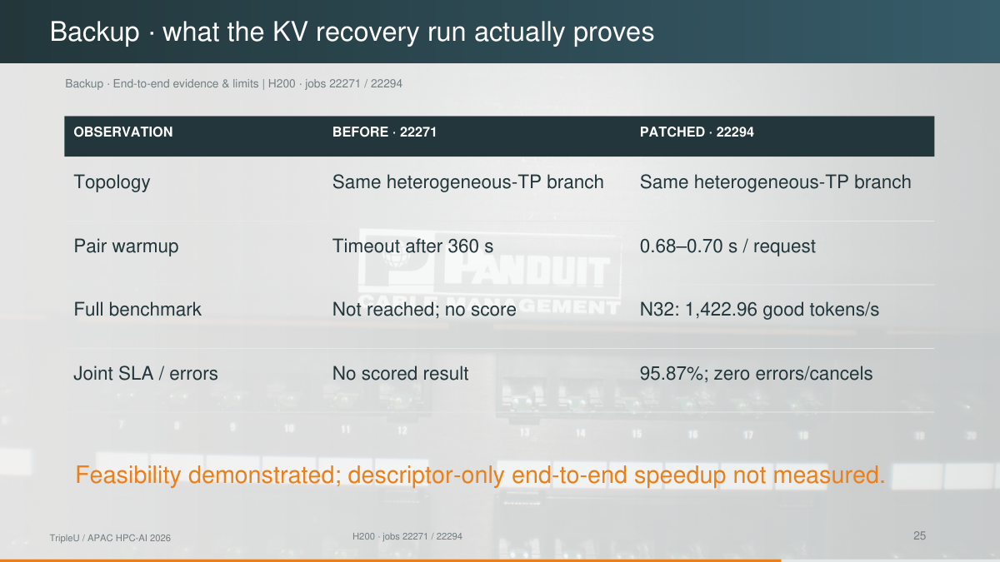

### Purpose

Close the seven-step chain with real end-to-end evidence and an explicit limit. The patched heterogeneous topology completed P/D warmup and a full N32 confirmation, but the absence of an equivalent successful no-patch run prevents causal speedup attribution.

### Technical interpretation and reasoning

This is steps 6 and 7: real path/result, then decision and unknowns. State the warmup duration, benchmark score, joint SLA, and zero errors as results of patched job 22294, not as a directly matched speedup over 22271.

### Terms and symbols to understand

- **job 22294:** The retained patched run on the same heterogeneous P8 TP8/EP2 to D8 TP4/EP4 topology family.
- **0.68–0.70 seconds/request:** Observed pair-warmup duration per request after the servers were ready; not a separately isolated descriptor-initialization timer.
- **N32:** Client concurrency target of 32 in-flight requests for the full confirmation benchmark.
- **1,422.96 good tokens/s:** Measured good output-token throughput for the full N32 confirmation on the patched topology.
- **95.87% joint SLA:** Share of evaluated requests passing both TTFT and mean ITL limits in this result.
- **zero errors/cancellations:** No request errors or cancellations were reported in the retained confirmation result.
- **matched unpatched control:** An otherwise equivalent run without the patch, required to attribute a performance difference to the patch; no successful one exists for this exact topology.

### Interpreting the evidence or diagram

- Step 6, end-to-end part: patched job 22294 completed both real prefill/decode warmup paths in 0.68–0.70 seconds per request after workers were ready.
- It then completed a full N32 confirmation: 1,422.96 good output tokens/s, 95.87% joint SLA, zero errors and zero cancellations.
- Step 7 — Decision: the run establishes feasibility of the patched heterogeneous topology and that this run served requests under the local benchmark protocol.
- It does not establish the patch's independent speedup: no successful no-patch end-to-end control exists for the same topology, and no old/new descriptor setup timer or causal latency decomposition was collected.

### Tradeoff and strength of evidence

- **Observation:** Patched job 22294 completed P/D warmup in 0.68–0.70 seconds per request after server readiness, then scored 1422.96 good tokens/s at N32 with 95.87% joint SLA and zero errors/cancellations.
- **Hypothesis:** Request-scoped descriptor setup may have helped the previously blocked topology reach a serving state, but differences between attempts could also explain the contrast.
- **Supported conclusion:** The supported claim is patched-path feasibility and an end-to-end result for this P8 TP8/EP2 to D8 TP4/EP4 run. The patch's speedup is unmeasured.
- **Unknown / limitation:** There is no successful matched unpatched run for this exact topology; old-versus-new setup time, network utilization, causal warmup decomposition, and the patch's independent goodput contribution remain unknown. Bandwidth, KV layout, placement, and other bootstrap explanations were not ruled out.

### Spoken script

The patched-path result is stronger than the CPU geometry test, but its interpretation still has a boundary. In job 22294, on H200 Firmus with the heterogeneous P8 TP8/EP2 to D8 TP4/EP4 layout, both real prefill and decode warmup paths completed in 0.68 to 0.70 seconds per request after the workers were ready. The full N32 confirmation measured 1,422.96 good output tokens per second, 95.87 percent joint SLA, and zero errors or cancellations. That establishes that this patched topology served requests in this run. It does not measure a patch speedup: we lack a successful no-patch control on the same topology, separate old-versus-new descriptor timings, and a causal latency breakdown. Network use, KV layout, placement, and other bootstrap work remain possible factors.

### Avoid this interpretation

Do not divide the 360-second timeout by 0.68–0.70 seconds and report a speedup. The baseline is a timeout without AIPerf; the patched run is a different attempt, and setup time was not isolated.

### Transition

The seven-step lesson is to move from symptom to source-backed hypothesis, validate each layer, report the end-to-end result, and stop at the limits of the available control.

---

## Slide 26 — Backup · H100: first-token gain, goodput loss

**Hardware: H100 · NSCC · full N54 · jobs 222027/222028**

### Quick brief · 10–20 seconds

In one matched H100 N54 pair, FA3 cut mean TTFT from 713.199 to 594.276 ms, but goodput fell from 2,420.945 to 2,401.284 tokens/s, about 0.812%. A faster first token did not improve the full request objective.

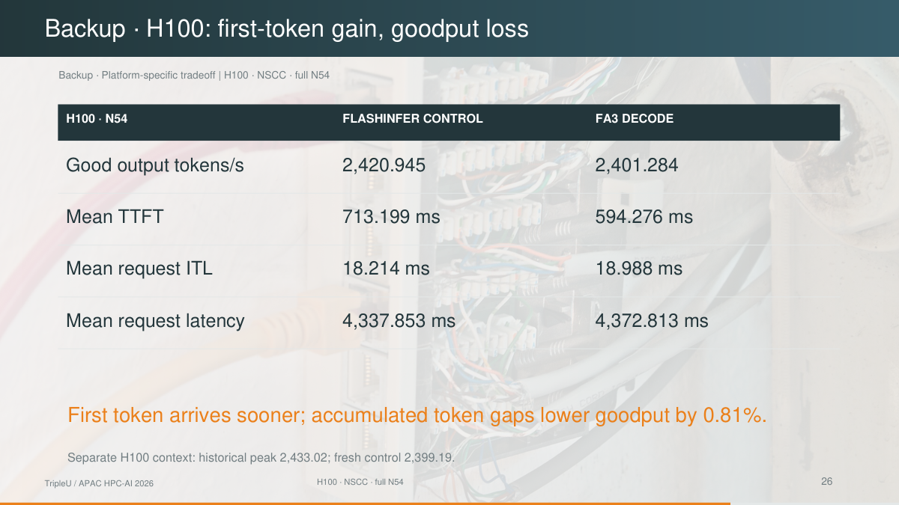

### Purpose

Explain why evaluating only time to first token can select the wrong decode backend: latency over a long answer and qualifying throughput also matter.

### Technical interpretation and reasoning

The pair changes decode attention from FlashInfer to FA3 while holding H100, N54 load, and the rest of the tested path matched. Read across each metric: FA3 lowers mean time to first token by 118.922 ms, but raises mean inter-token latency by 0.773 ms. Repeated over roughly 199 token intervals, that adds about 154 ms. Mean request latency rises from 4,337.853 to 4,372.813 ms, and goodput falls 0.812%. Thus the early response improves while the full answer becomes slower on average and fewer requests qualify per second. This is one pair for this H100 decode setting, not a general ranking of attention libraries.

### Terms and symbols to understand

- **FA3:** FlashAttention-3, an attention implementation tested here for decode. It remained the H100 prefill backend in this pair.
- **FlashInfer:** The decode-attention control implementation in the matched pair.
- **TTFT:** Time to first token: delay from request start until the first answer token arrives.
- **ITL:** Inter-token latency: time between consecutive generated tokens. A small increase repeated over a long answer can add substantial total time.
- **goodput:** Rate of requests meeting the service latency rules, converted to good output tokens/s. It captures more than startup latency.
- **H100 N54:** H100 system under a target of 54 simultaneous client requests; it is not the H200 N64 operating point.
- **matched pair:** Two runs with one intended setting change and otherwise aligned workload/configuration. One pair supports a local comparison, not universal ranking.

### Interpreting the evidence or diagram

- FlashInfer → FA3: good output tokens/s 2,420.945 → 2,401.284; mean TTFT 713.199 → 594.276 ms; mean ITL 18.214 → 18.988 ms; mean request latency 4,337.853 → 4,372.813 ms.
- Both runs passed team-reviewed protocol, runtime, and output checks on the assigned cluster, and FA3 was confirmed active on all eight decode ranks. That establishes the tested intervention actually ran, not that it improved the service.
- The historical H100 individual peak of 2,433.019859 and fresh N54 control of 2,399.186728 are context, not the two arms of this matched pair. They do not provide an H100/H200 hardware conversion.

### Tradeoff and strength of evidence

- **Observation:** FA3 improves mean TTFT by 118.922 ms but worsens mean ITL by 0.773 ms and mean request latency by 34.960 ms; goodput falls 0.812%.
- **Hypothesis:** Changing decode attention can move startup and per-token costs in opposite directions.
- **Supported conclusion:** Keep FlashInfer for this tested H100 decode setting; FA3 remains used for prefill.
- **Unknown / limitation:** One matched pair does not rank attention backends generally or isolate exact kernel-level causality.

### Spoken script

FA3 makes the first token arrive about 119 milliseconds sooner. But each later token is separated by a slightly longer gap. Across a long answer, those gaps add up: average request latency rises by about 35 milliseconds and goodput falls about 0.81 percent. Both runs were checked on the assigned H100 cluster, and the FA3 path was active on all decode ranks. For this one setting we keep FlashInfer for decode; this does not rank the libraries for every workload.

### Avoid this interpretation

Do not choose a backend from TTFT alone, treat a 0.812% one-pair result as universal, or compare the H100 peak directly with H200 results.

### Transition

The next backup asks whether a startup-time saving survives when the order of the runs is reversed.

---

## Slide 27 — Backup · does a startup saving survive reversed order?

**Hardware: H100 · NSCC · startup prefetch comparison**

### Quick brief · 10–20 seconds

Read-first initially reduced scheduler walltime by 18.74%, but the reversed-order confirmation saved only 9.84%, below the predeclared 10% threshold. Goodput changed slightly in both pairs; unknown cache state prevents a cold-storage causal claim.

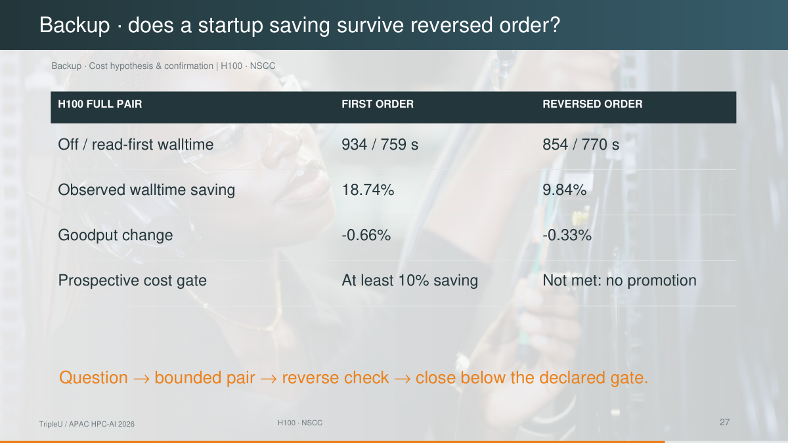

### Purpose

Teach why a favorable first pair is not enough for adopting a startup optimization: execution order, cache state, nodes, and the predeclared cost threshold affect interpretation.

### Technical interpretation and reasoning

Compare the first pair with the reversed-order confirmation. In the first pair, off/read-first walltime was 934/759 seconds, a reported 18.74% saving, while goodput fell 0.659%. In the reverse-order pair, walltime was 854/770 seconds, a 9.84% saving, and goodput changed −0.326388%. The planned rule required at least 10% walltime saving and at most 2% goodput loss. The reverse pair meets the throughput tolerance but misses the walltime requirement. Scheduler walltime includes startup and cleanup; it is not the 120-second steady-state score window.

### Terms and symbols to understand

- **read-first:** Read the prefill checkpoint before the measured serving phase to test whether startup can be shortened.
- **scheduler walltime:** Elapsed time for the whole scheduled job, including startup and cleanup. It is not steady-state goodput or the scored profiling window.
- **reversed-order confirmation:** Repeat the paired conditions in the opposite order to check whether order or warm cache influenced the first result.
- **predeclared threshold:** A decision rule written before seeing the confirmation result: save at least 10% walltime and lose no more than 2% goodput.
- **cold prefix vs cold OS cache:** Cold prefix means no reusable prompt/KV prefix. Cold OS cache means checkpoint file pages are not already in memory. This experiment did not verify cold OS cache.
- **goodput:** Throughput of requests meeting the joint latency rule; it is separate from total job walltime.

### Interpreting the evidence or diagram

- The first pair looked favorable for startup time but had a 0.659% goodput loss. The reversed pair cut the apparent saving below the 10% decision threshold.
- The reverse pair's 0.326388% goodput change is within the stated 2% tolerance, but that alone cannot rescue the branch because the walltime threshold was missed.
- Node differences and unverified file-cache state mean the result cannot be assigned to cold storage. A cold prefix is a model KV-cache condition and is not the same as cold filesystem pages.

### Tradeoff and strength of evidence

- **Observation:** Read-first saved 18.74% walltime in the first order but 9.84% after reversing the order; goodput changed −0.659% and −0.326388%, respectively.
- **Hypothesis:** Reading prefill weights before measured startup may reduce startup walltime.
- **Supported conclusion:** The reverse-order confirmation missed the predeclared 10% saving threshold, so the team did not adopt the change.
- **Unknown / limitation:** Unverified OS cache state and node differences prevent a causal cold-storage explanation.

### Spoken script

Reading weights before serving first appeared to save about 19 percent of job time. But the team repeated the pair in reverse order. The saving fell to 9.84 percent, below the 10-percent requirement set in advance. The small goodput change stayed within its tolerance, but the main time-saving rule was missed. We therefore did not adopt read-first from the favorable first pair. We also cannot blame cold storage because file-cache state was not verified.

### Avoid this interpretation

Do not equate scheduler walltime with scored serving time, call prompt-prefix cache a filesystem cache, or claim cold-storage causality.

### Transition

Next, review source-supported full-model changes that were tested but did not meet their useful-gain criteria.

---

## Slide 28 — Backup · source-supported changes that did not win

**Hardware: H200 · full-model serving comparisons**

### Quick brief · 10–20 seconds

Several H200 changes were activated and measured, but gains were small, negative, or worse in a tail metric. For example, a prefill attention change lost 6.385% goodput. A working flag is not enough to replace the selected configuration.

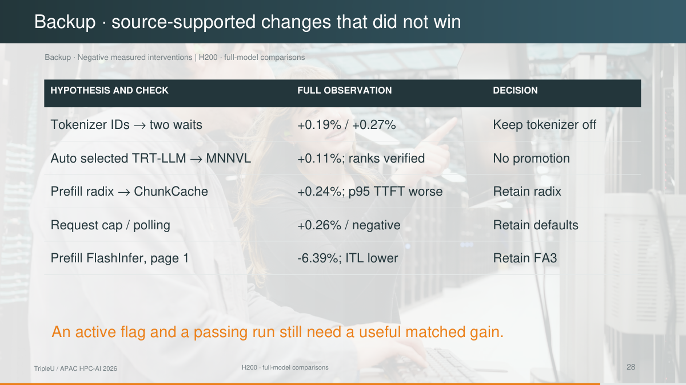

### Purpose

Show how the team used source inspection, runtime activation checks, matched controls, and output review to decide whether small interventions deserved adoption.

### Technical interpretation and reasoning

The rows are independent hypotheses, not pieces of one cumulative optimization. Source review first identified a setting the runtime could consume; logs then confirmed activation; full serving runs measured the result. A small positive goodput change can fall below a useful threshold or worsen p95 first-token latency. Negative and neutral results therefore answer the research question: functionality is necessary, but only improvement in the service objective justifies changing the retained configuration.

### Terms and symbols to understand

- **source inspection:** Reading implementation code to see whether a setting is supported and which code path it selects. It predicts behavior but does not prove the runtime used it.
- **runtime activation check:** Evidence in logs or per-rank state that the intended backend or option actually ran during the measured job.
- **matched control:** A comparison run with the intended factor changed and workload/configuration otherwise held sufficiently constant.
- **useful-gain threshold:** A preselected minimum improvement that makes the operational change worth keeping; a tiny positive percentage may be noise or too small to matter.
- **p95 TTFT:** The 95th-percentile time to first token. It measures a slow tail, which can worsen even when mean latency improves.
- **TRT-LLM / MNNVL:** Alternative collective communication backends; selecting one is a configuration change whose activation and full-run result must be checked.
- **ChunkCache / RadixCache:** Prefill cache implementations compared in a full serving pair; the small goodput difference came with worse p95 TTFT for ChunkCache.
- **page 1 attention:** A prefill FlashInfer setting affecting the first attention page; the tested change reduced ITL but lost goodput.

### Interpreting the evidence or diagram

- Tokenizer wait changes measured +0.192% and +0.270%; the team kept tokenizer batching off. Switching the auto-selected prefill collective from TRT-LLM to MNNVL activated on all eight prefill ranks but gained only +0.109807% in full run 27138.
- Prefill RadixCache to ChunkCache gained +0.240921%, but p95 TTFT worsened, so RadixCache stayed. Request-cap and polling comparisons were +0.26% or negative and did not demonstrate useful gain.
- Prefill FlashInfer page 1 reduced ITL but lost 6.385% goodput. Percentages belong to separate branches; do not add them as if they were components of one run.

### Tradeoff and strength of evidence

- **Observation:** Changes had source/runtime checks and full serving observations, but measured gains were small, negative, or mixed with worse tail latency.
- **Hypothesis:** Changes in tokenization, collective, cache, request cap, polling, or attention might improve goodput.
- **Supported conclusion:** Keep a change only when the intended path ran and a controlled service comparison improves the objective enough to matter.
- **Unknown / limitation:** Small single-run differences may reflect run variation; these rows do not establish a CPU bottleneck or universal feature ranking.

### Spoken script

These are separate full-model tests, not source-only guesses. The team checked that an option was supported, verified it actually activated, then measured serving against a control. A few changes were slightly positive, but gains were too small or came with worse tail latency. The prefill attention change lost about 6.4 percent goodput. So the existing choices stayed: a working flag is not enough unless the service objective improves.

### Avoid this interpretation

Do not add percentages from separate branches, treat runtime activation as a speedup, or call a small positive single-run change a robust win.

### Transition

The next backup limits kernel and source leads to the evidence they actually produced.

---

## Slide 29 — Backup · scope limits of kernel and source evidence

**Hardware: H200 + H100 + CPU · separate evidence rows**

### Quick brief · 10–20 seconds

The 2,549.20 N52 attention package changed several factors; representative Triton probes, CPU fixtures, and source review answer narrower questions. Full Qwen compilation stopped at a RoPE/KV assertion. None alone proves a full-model serving gain.

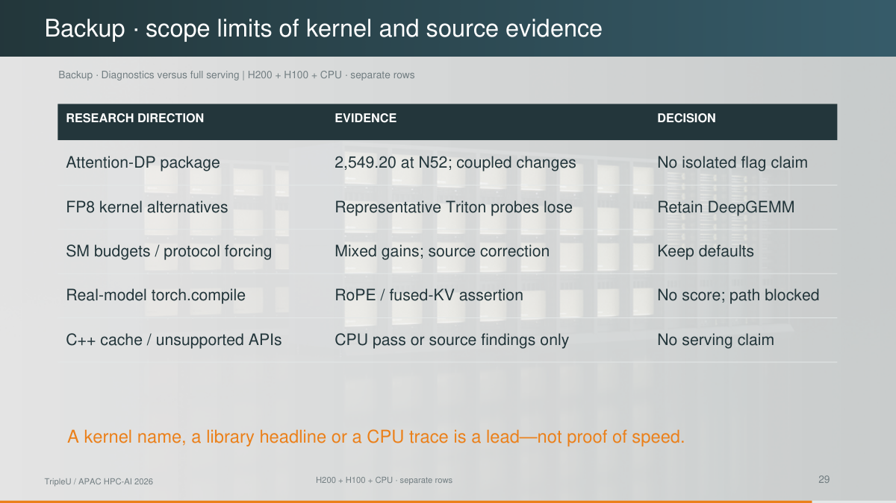

### Purpose

Answer what kernel names, profiles, and source inspection can establish, and prevent a component result on one hardware family from being mistaken for full-model evidence on another.

### Technical interpretation and reasoning

Read each row as an evidence boundary. The N52 H200 attention package is a real serving score but has coupled changes. H100 Triton probes test selected kernel shapes, not every model shape. SM budgets are bounded kernel/runtime checks, not model-level speed results. NCCL logs corrected an earlier interpretation: the label LL did not mean the tested control used that low-latency protocol for all messages. The real Qwen compile reached a native RoPE/fused-KV assertion before scoring. C++ CPU fixtures and source findings are narrower still. Mixing these rows would mix H200, H100, and CPU evidence.

### Terms and symbols to understand

- **attention-DP package:** An H200 N52 full-serving configuration combining attention data parallelism with DeepGEMM/DeepEP; several factors changed together, so attribution is coupled.
- **Triton probe:** A small GPU-kernel test on representative shapes. Losing on those shapes is evidence about those shapes, not every Qwen operation.
- **SM budget:** A limit on GPU streaming multiprocessors available to a kernel. A kernel/runtime result may not transfer to whole-service goodput.
- **NCCL LL / Simple:** Two collective communication protocols. The label LL alone did not prove LL was selected; logs showed Simple selected for the relevant large-message control.
- **torch.compile / RoPE / fused-KV:** PyTorch compilation of the real model stopped when rotary position encoding met an unsupported fused key-value-cache interface. No full-model score resulted.
- **C++ fixture:** A CPU test of helper/cache code. It can catch arithmetic or API behavior but does not load the Qwen model or serve on GPUs.
- **source finding:** Code review showing that a flag or API has, lacks, or may have a consumer. It does not prove activation at runtime.
- **hardware scope:** H200 package scores, H100 kernel probes, and CPU fixtures are distinct evidence and must not be merged into one comparison.

### Interpreting the evidence or diagram

- The H200 N52 attention-DP plus DeepGEMM/DeepEP package scored 2,549.20, below the retained MNNVL point; coupled settings block one-factor attribution.
- Representative H100 FP8 Triton probes lost to DeepGEMM in tested shapes. H100 SM budgets 80/96/120 were mixed or below consistency criteria; 132 was retained without claiming a model gain.
- The small 0.2315% NCCL point did not justify adoption after logs showed the control already selected Simple for large messages. Qwen compile failed before score; CPU fixtures did not test serving.

### Tradeoff and strength of evidence

- **Observation:** Evidence ranges from one H200 serving score through H100 kernel/resource probes to CPU-only helpers and source review; their scopes differ.
- **Hypothesis:** Alternative kernels, communication protocols, resource budgets, or APIs might improve a specific part of serving.
- **Supported conclusion:** Use component evidence to select a full-model test only when the code path and hardware support it; do not claim service improvement from probes or source alone.
- **Unknown / limitation:** Untested shapes and configurations may differ. The failed Qwen compile and CPU tests leave full-model compatibility and performance unresolved.

### Spoken script

This slide mixes evidence from H200, H100, and CPU, so keep the scopes separate. The attention package is a real H200 serving score, but it changed multiple factors. Triton probes cover selected H100 kernel shapes. CPU fixtures check helper code only. The full Qwen compile stopped at a position-encoding and KV-cache interface assertion and produced no score. These results help rule out or prioritize ideas; none alone proves faster full-model serving.

### Avoid this interpretation

Do not combine H200, H100, and CPU results, generalize representative kernels to all shapes, infer protocol from a kernel label, or invent a score for the failed compile.

### Transition

The next backup collects the actual H200 and H100 settings that the team retained.

---

## Slide 30 — Backup · the retained settings on each platform

**Hardware: H200 N64 · H100 N54**

### Quick brief · 10–20 seconds

The retained H200 setup uses N64, two TP4 DeepGEMM prefill workers with chunk 8,192, and TP8/EP8 HPC-Ops decode. H100 is separate: N54, HPC-Ops prefill with chunk 4,096, and its own measured settings.

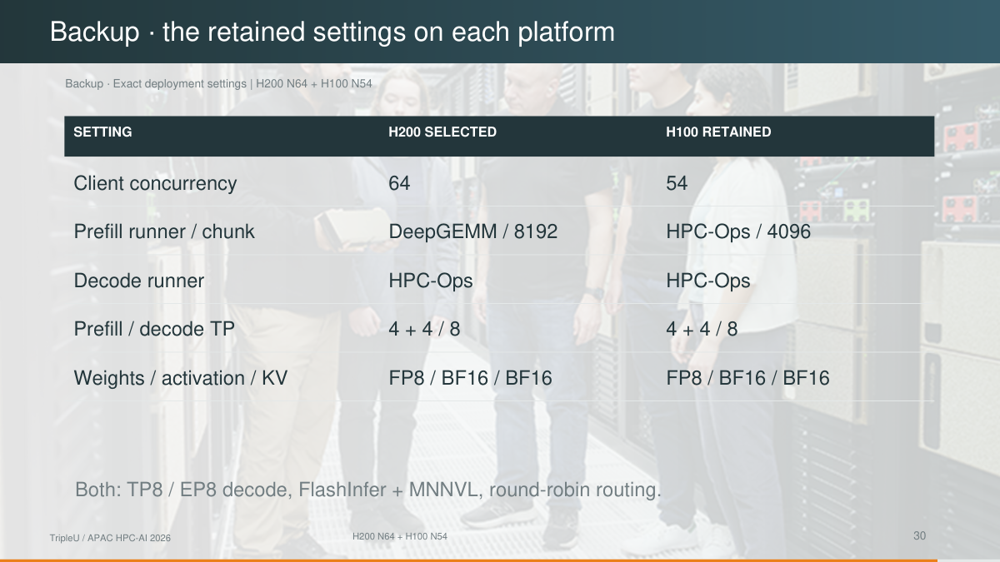

### Purpose

Provide exact deployment context so earlier results can be interpreted without mixing platform settings or treating configuration labels as performance evidence.

### Technical interpretation and reasoning

Read columns within each platform, not across H200 and H100 as if they were a matched benchmark. Both use target-model FP8 weights, BF16 activations and KV state, TP8/EP8 decode, FlashInfer decode attention, MNNVL collectives, and round-robin routing to two prefill workers. The H200 choice is N64 with DeepGEMM prefill, chunk 8,192, and dense decode graph buckets 1–64. H100 is N54 with HPC-Ops prefill and chunk 4,096. The table defines the operating points; it does not claim equal capacity or rank hardware performance.

### Terms and symbols to understand

- **H200 N64 / H100 N54:** GPU platform plus client concurrency target: 64 requests for H200, 54 for the separate H100 configuration.
- **prefill / decode:** Prefill processes prompt tokens; decode generates response tokens autoregressively, one step at a time.
- **TP / EP:** Tensor parallelism splits tensor operations across GPUs. Expert parallelism distributes MoE experts; retained decode uses TP8/EP8.
- **DeepGEMM / HPC-Ops:** DeepGEMM is selected H200 prefill backend. HPC-Ops is used for decode on both systems and prefill on H100.
- **FP8 / BF16:** Weights use 8-bit floating point; activations and KV cache use 16-bit brain floating point. They describe different model data.
- **FlashInfer / MNNVL:** FlashInfer implements decode attention; MNNVL handles GPU collective communication. They serve different functions.
- **round-robin:** The gateway sends successive requests to the two prefill workers in turn.
- **dense decode graphs:** The H200 configuration captures decode shapes 1 through 64. This is a graph-shape setting, not 64 concurrent requests.

### Interpreting the evidence or diagram

- H200: client concurrency 64; two TP4/EP1 prefill workers; DeepGEMM; chunk 8,192; one HPC-Ops TP8/EP8 decode worker.
- H100: client concurrency 54; two TP4/EP1 HPC-Ops prefill workers; chunk 4,096; TP8/EP8 HPC-Ops decode. Keep H100 point separate from H200 scores.
- Both use the listed weight/activation/KV precision and shared decode attention, collective, routing, and request-quality rules. Official full-set accuracy is not certified by this configuration table.

### Tradeoff and strength of evidence

- **Observation:** The retained configurations share some decode and precision settings but differ in hardware, concurrency, prefill backend, and chunk size.
- **Hypothesis:** Explicit platform-specific settings make the replicated operating points reproducible and interpretable.
- **Supported conclusion:** Use the H200 N64 settings for the selected primary and report H100 N54 independently.
- **Unknown / limitation:** This table does not establish that the settings are optimal or that performance transfers between platforms.

### Spoken script

This table records two separate operating points. H200 uses 64 simultaneous requests, two groups of four GPUs to process prompts, and one eight-GPU decode worker with experts distributed across it. H100 uses 54 requests and a different prompt-processing backend and chunk. Both use FP8 weights and BF16 activations and KV cache. Shared components do not make the two performance series interchangeable.

### Avoid this interpretation

Do not report H100 and H200 as a matched platform comparison or infer performance from precision and worker counts alone.

### Transition

The next backup applies a shared workload protocol to a full prefill-chunk comparison.

---

## Slide 31 — Backup · workload control and prefill chunk trial

**Hardware: H200 · full N64 prefill chunk study · jobs 26766/26768/26770**

### Quick brief · 10–20 seconds

Under the same full N64 workload, increasing prefill chunk from 8,192 to 12,288 reduced goodput from 3,045.50 to 3,020.94 tokens/s and worsened p95 TTFT. Each setting has one reviewed H200 run; this does not establish a global optimum.

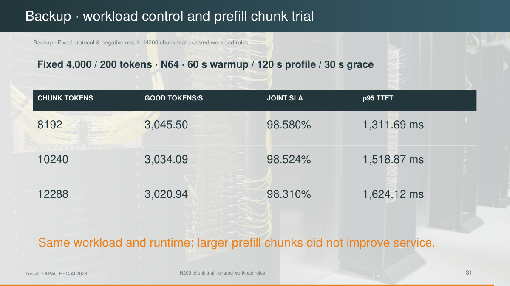

### Purpose

Explain the benchmark protocol behind the chunk table so its negative result is interpreted as a controlled, bounded comparison rather than a claim about all workloads.

### Technical interpretation and reasoning

The table compares three full runs with the same target concurrency, requested prompt/answer lengths, seed, cold-prefix setting, model, precision, and runtime path. Only prefill chunk size changes: 8,192, 10,240, or 12,288 input tokens handled together. Read good output tokens/s as qualifying throughput, joint SLA as the fraction meeting both limits, and p95 TTFT as the slow-response tail. Goodput and the tail both worsen at larger chunks. One run per setting supports retaining 8,192 for this configuration, but cannot identify a general optimum.

### Terms and symbols to understand

- **4,000 / 200 requested tokens:** The client requests 4,000 input and 200 output tokens. Requested lengths do not prove actual token IDs consumed/generated for every request.
- **closed-loop N64:** The client keeps 64 requests in flight, replacing each completion with another request.
- **60/120/30 protocol:** 60 seconds warmup, 120 seconds scored profiling, and 30 seconds grace. Only profiling is scored; grace drains outstanding requests.
- **cold prefix:** The request does not reuse a warm prompt-prefix KV-cache entry. This does not by itself mean filesystem cache is cold.
- **chunk size:** Input tokens processed together in one prefill scheduling unit; it is not concurrent request count.
- **SLA / p95 TTFT:** SLA is the share satisfying both request latency limits. p95 TTFT is the 95th-percentile wait for first token, showing the slow tail.
- **team-reviewed local result:** Here, local means run and reviewed by the team on the assigned H200 cluster. It is not a laptop run or organizer approval.
- **one run per setting:** Each chunk size is one experimental configuration with one full run; run order and engine-generated seeds may contribute to differences.

### Interpreting the evidence or diagram

- At chunk 8,192, job 26766 scored 3,045.501509 good output tokens/s, 98.580% joint SLA, and 1,311.69 ms p95 TTFT. At 10,240, job 26768 scored 3,034.088251, 98.524%, and 1,518.87 ms.
- At 12,288, job 26770 scored 3,020.943099, 98.310%, and 1,624.12 ms. All three were full N64 runs with the same 60/120/30 schedule and requested 4,000/200 workload; each chunk setting was observed once.
- The runs passed team protocol, runtime, latency, and output checks with zero profiling errors/cancellations. That is a reviewed result on the assigned cluster, not organizer quality certification.

### Tradeoff and strength of evidence

- **Observation:** Goodput decreases from 3,045.50 to 3,020.94 tokens/s and p95 TTFT increases from 1,311.69 to 1,624.12 ms as chunk grows from 8,192 to 12,288.
- **Hypothesis:** A larger prefill chunk might increase throughput by handling more input tokens per scheduling batch.
- **Supported conclusion:** Retain 8,192 for this service configuration; the tested larger chunks did not improve the objective.
- **Unknown / limitation:** One run per chunk makes the comparison bounded; it does not establish a global optimum or rule out order/seed variation.

### Spoken script

All three runs used 64 simultaneous requests, the same requested 4,000 input and 200 output tokens, and the full warmup, profiling, and grace schedule. Only the prompt-processing chunk changed. Goodput fell from about 3,045 to 3,021 as chunk grew, and the slow first-token tail worsened. The team checked these runs on the assigned H200 cluster, but one run per size cannot prove a universal best setting. We keep 8,192 for this deployment.

### Avoid this interpretation

Passing team checks is not organizer approval. Do not infer actual token lengths from requests, count grace as scored time, or generalize one run per chunk to all workloads.

### Transition

The final backup contrasts graph-capture resource savings with the service metric they were meant to support.

---

## Slide 32 — Backup · less graph memory did not raise goodput

**Hardware: H200 · sparse decode-graph trial · jobs 27376/27510**

### Quick brief · 10–20 seconds

Sparse capture cut logged memory from 1.15 to 0.36 GB per decode rank, but goodput fell 0.370208% and mean ITL worsened. Padding was not measured as a cause. The team retained dense graphs; this pair does not prove a causal effect.

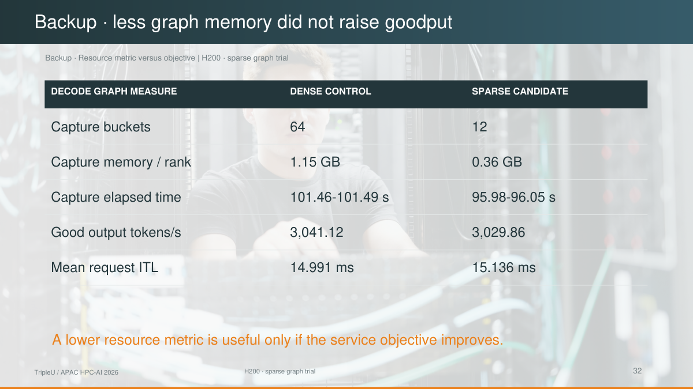

### Purpose

Explain why a lower resource metric is not automatically a service improvement, and separate capture memory from total GPU memory and end-to-end throughput.

### Technical interpretation and reasoning

Compare dense control 27376 with sparse candidate 27510. The candidate stores 12 decode graph buckets instead of 64 and reduces logged graph-capture memory per rank, but goodput is 3,029.861122 versus 3,041.119598, 0.370208% lower. Mean request ITL rises from 14.991 to 15.136 ms; TTFT improves. Fewer buckets may force requests into less exact padded shapes, which can add work, but padding was not isolated or measured here. The reported capture memory excludes other GPU allocations such as model weights and KV cache, so it is not a VRAM capacity figure. The service score, not the smaller capture number, determines whether this is useful.

### Terms and symbols to understand

- **decode graph bucket:** One captured GPU execution shape that can be replayed for a class of decode batches; bucket count is neither concurrency nor GPU count.
- **padding:** Filling a batch to fit a supported captured shape. Fewer buckets could increase padding, but this trial did not measure padding amount or cost.
- **capture memory:** Per-rank memory associated with recorded reusable graphs and their capture buffers. It is only one part of GPU memory use.
- **VRAM / GB / GiB:** VRAM means total GPU memory. The log reports capture-related GB per rank, not total VRAM or GiB; weights, KV cache, workspaces, and other allocations are additional.
- **rank:** One distributed worker process. The 1.15 and 0.36 GB figures are per decode rank, not summed across all eight GPUs.
- **ITL / TTFT:** ITL is the gap between generated tokens; TTFT is the wait until the first token. They measure different parts of request latency.
- **full local pass:** The team ran and reviewed the full workload on the assigned H200 cluster against local protocol/runtime/latency/output checks. This is not organizer approval or an accuracy certificate.

### Interpreting the evidence or diagram

- The dense control has 64 buckets, 1.15 GB capture memory per rank, 101.46–101.49 s capture time, 3,041.119598 good output tokens/s, and 14.991 ms mean ITL.
- The sparse candidate has 12 buckets, 0.36 GB/rank, 95.98–96.05 s capture time, 3,029.861122 good output tokens/s, and 15.136 ms mean ITL. Captures were confirmed on all eight decode ranks with model compilation off.
- Candidate mean/p95 TTFT was 1,102.404/1,240.481 ms and improved, while mean/p95 ITL was 15.136/15.324 ms and worsened. One earlier control, different engine seeds, and candidate-only startup instrumentation limit causal interpretation.

### Tradeoff and strength of evidence

- **Observation:** Sparse capture reduced logged per-rank graph memory from 1.15 to 0.36 GB and slightly shortened capture, while goodput fell by 0.370208% against the earlier control.
- **Hypothesis:** Fewer captured shapes might save resources while maintaining service throughput; padding was a possible mechanism but not measured.
- **Supported conclusion:** The service objective did not improve, so the team retained dense graphs for this deployment.
- **Unknown / limitation:** There is one earlier control and generated seeds differ; total VRAM use and any padding effect were not measured by the capture-memory metric.

### Spoken script

The sparse candidate used 12 captured decode shapes instead of 64. Logged graph memory fell from 1.15 to 0.36 gigabytes per rank, but goodput also fell by about 0.37 percent. Mean token gaps got slightly longer, even though time to first token improved. This memory number covers graph capture, not all GPU memory. Fewer shapes could add padding work, but that was not measured. We kept dense graphs; the comparison is too limited for a causal claim.

### Avoid this interpretation

Do not call buckets requests or GPUs, interpret capture memory as total VRAM, or claim padding caused the score difference. Lower capture memory alone is not a goodput win.

### Transition

This completes the selected backup evidence; the main conclusions still rest on replicated serving and explicit validation limits.

---

## Slide 33 — The task: same 65-million-cell airflow calculation

**Hardware: CPU · OpenFOAM HPC task — not an H100/H200 inference measurement.**

### Quick brief · 10–20 seconds

We fix the workload at 65.3 million cells, four nodes and 512 MPI ranks. All 150 solver steps run; 149 are timed. The measure is average seconds per step, with lower being better.

**Unchanged HPC section: explanation of the existing slide, not a new status or result update.**

### Purpose

Define the fixed CPU workload and the performance quantity being optimized. The comparison holds the prescribed calculation constant and asks how efficiently the cluster executes it.

### Technical interpretation and reasoning

Read the figures as the fixed-work contract: 65,334,765 mesh cells are distributed over four nodes and 512 MPI ranks, or 128 ranks on each node. An MPI rank is a software process; it is not the same thing as a physical CPU core. The prescribed calculation runs 150 solver iterations, with 149 timed samples because the first iteration is excluded from the reported mean. The unit is wall-clock seconds per solver step, so a smaller value means less elapsed time for each iteration. This slide defines the work and metric; it does not report an optimization result.

### Terms and symbols to understand

- **65.3 million:** Rounded display of the 65,334,765-cell mesh.
- **MPI rank:** One distributed solver process; 512 total means 128 per node on four nodes.
- **s/step:** Wall-clock seconds per solver iteration, not seconds of simulated driving.
- **physical CPU core:** A hardware execution core. An MPI rank is a software process; ranks may be bound to cores, but the mapping must be verified rather than assumed.

### Interpreting the evidence or diagram

- Read this as a workload definition, not a result comparison: same mesh and required solver work, executed on four CPU nodes.
- The 149 timed samples begin after the first solver iteration; the complete run still performs all 150 steps.
- The task is to reduce runtime through better CPU-resource use, not by reducing mesh size or required work.

### Tradeoff and strength of evidence

- **Observation:** The fixed run has substantial parallel work: roughly 65.3 million cells distributed across 512 ranks.
- **Hypothesis:** A more effective distribution and placement of work may reduce time per step.
- **Supported conclusion:** The slide establishes the measurement frame; it reports no tuning win by itself.
- **Unknown / limitation:** It does not identify a bottleneck or establish a causal performance improvement.

### Spoken script

We are optimizing the prescribed OpenFOAM airflow calculation, not changing its mathematics. The mesh has 65.3 million cells. On four nodes, 512 MPI ranks perform all 150 solver steps. The first iteration is excluded from timing, leaving 149 measured steps. We compare the average wall-clock seconds per step, where lower is better. That makes this a fixed-work CPU-efficiency question.

### Avoid this interpretation

Do not call 65.3 million the exact count, do not describe the 149 timed steps as the whole solve, and do not treat the displayed task definition as evidence of a speedup. The retained drag coefficient is a physical sanity check, not this performance metric.

### Transition

Next, show which preparation stages must be retained for a valid end-to-end run.

---

## Slide 34 — The whole required pipeline comes before the score

**Hardware: CPU · OpenFOAM HPC task — not an H100/H200 inference measurement.**

### Quick brief · 10–20 seconds

A valid comparison includes every preparation stage and all 150 solver steps. Decomposition assigns cells to ranks; CPU affinity assigns ranks to CPUs. These are separate choices that can each affect runtime.

**Unchanged HPC section: explanation of the existing slide, not a new status or result update.**

### Purpose

Explain why the score is meaningful only after preserving the full required pipeline, and distinguish mesh decomposition from CPU affinity.

### Technical interpretation and reasoning

The sequence is part of the measured task: decomposePar assigns mesh cells to MPI ranks; renumberMesh changes the ordering of local cell data; potentialFoam initializes flow fields; applyBoundaryLayer applies the required boundary treatment; simpleFoam then performs all 150 solver steps. Decomposition determines which cells a process owns and therefore which neighboring-cell exchanges cross process boundaries. CPU affinity determines where a rank runs. Affinity can affect access to nearby CPU cores and memory, but it does not change the cells owned by that rank. Both decisions can affect performance, and they must not be confused.

### Terms and symbols to understand

- **MPI:** Message Passing Interface; separate ranks exchange data, especially across partition boundaries.
- **decomposePar:** OpenFOAM utility that partitions mesh cells among ranks.
- **CPU affinity:** Binding a process or rank to CPU resources; distinct from assigning it mesh cells.
- **neighbor exchange:** Ranks exchange field values for cells adjacent across their partition boundary; more cut edges are only a proxy for the amount and cost of this traffic.

### Interpreting the evidence or diagram

- Follow the orange arrows from preprocessing into the solver; the final timing is not a substitute for those stages.
- A decomposition answers which cells a rank owns. Affinity answers where that rank executes.
- The sequence shown is the complete required preparation and 150-step solve, not an optional menu.

### Tradeoff and strength of evidence

- **Observation:** The pipeline contains data setup, initialization, boundary treatment, then iterative solving.
- **Hypothesis:** Choices in decomposition and placement can affect execution while preserving the prescribed calculation.
- **Supported conclusion:** Valid comparisons must retain each required stage and its successful completion.
- **Unknown / limitation:** This flow diagram alone does not measure the cost of each stage or prove which mapping is faster.

### Spoken script

Before comparing solver times, we keep the entire required pipeline: assign cells to MPI ranks, reorder the local data, initialize the flow, apply the prescribed boundary layer, and run all 150 simpleFoam steps. Decomposition decides which cells each rank owns. CPU affinity decides which CPU runs the rank. Those are separate decisions, and a valid run must preserve every preparation step as well as the solve.

### Avoid this interpretation

The slide gives process order, not per-stage timings, and it does not establish that affinity was measured or optimized in a particular result.

### Transition

With the workload and pipeline fixed, the next slide tests whether a locality proxy predicted solver runtime.

---

## Slide 35 — A smaller partition cut did not make the solver faster

**Hardware: CPU · OpenFOAM HPC task — not an H100/H200 inference measurement.**

### Quick brief · 10–20 seconds

The NUMA-aware partition reduced its graph-cut proxy by 10.63%, yet mean solver time worsened by 3.4416%, from 13.881 to 14.359 seconds per step. The proxy did not predict runtime.

**Unchanged HPC section: explanation of the existing slide, not a new status or result update.**

### Purpose

Show a failed NUMA-aware locality hypothesis and explain why a partition-graph proxy cannot stand in for a runtime measurement.

### Technical interpretation and reasoning

The orange −10.63% is a reduction in a partition-graph cut proxy: fewer weighted mesh connections cross the selected locality boundary. It does not mean communication time fell by 10.63%. Actual exchanges also depend on message sizes, frequency, network and MPI behavior, while solver time includes computation, synchronization, memory access and other work. The measured mean moved in the wrong direction, from 13.881 to 14.359 seconds per step (+3.4416%, slower). Thus the proxy improvement did not produce a runtime improvement in this comparison. The slide leaves the cause open because MPI wait, bandwidth, CPU frequency, power and memory-page placement were not measured.

### Terms and symbols to understand

- **NUMA:** Non-Uniform Memory Access: memory access cost can depend on which CPU socket or locality domain owns the memory.
- **graph cut:** A proxy count/weight of partition connections crossing a selected boundary; it is not a direct measurement of communication time.
- **−10.63%:** The graph-cut proxy was reduced by 10.63% for this candidate.
- **+3.4416%:** The solver mean became 3.4416% slower in the compared observation.
- **partition graph cut:** A weighted count of mesh-neighbor connections split between partitions. It estimates potential interface traffic, but does not measure bytes transferred, MPI wait, network time or total solver runtime.
- **NUMA locality:** On multi-socket servers, a CPU core can access memory attached to its own socket more directly than memory attached to another socket; placement can therefore affect latency and bandwidth.
- **MPI wait:** Time a process spends waiting for other processes or communication to complete; it was listed as unmeasured here.

### Interpreting the evidence or diagram

- Orange marks proxy improvement; red marks worse measured solver time. Their signs make the mismatch clear.
- A smaller proxy can coexist with slower execution because other partition properties and runtime effects also matter.
- The slide explicitly leaves the cause unmeasured; it records a rejected candidate, not a diagnosis.

### Tradeoff and strength of evidence

- **Observation:** Graph cut fell 10.63%, while mean runtime rose from 13.881 to 14.359 seconds per step.
- **Hypothesis:** Grouping work by memory locality might reduce remote-memory and interface cost.
- **Supported conclusion:** The unchanged NUMA-aware branch was closed; graph cut alone did not predict solver speed.
- **Unknown / limitation:** MPI wait, bandwidth, frequency, power, page residency, and other possible causes were not measured.

### Spoken script

We tested a NUMA-aware idea: grouping work by locality should reduce remote-memory or interface cost. The graph-cut proxy fell by 10.63 percent, but the measured solver mean worsened from 13.881 to 14.359 seconds per step, a 3.4416 percent slowdown. That is why we closed this unchanged candidate. A graph proxy describes the partition; it is not measured runtime or proof of less communication time.

### Avoid this interpretation

The comparison changed other partition properties, so do not attribute the slowdown to one mechanism. A separate offline mapping with a 4.5741% smaller proxy had no solver run and is not evidence of performance. Do not interpret the percentages as reciprocal measures.

### Transition

The next comparison asks whether the better observed decomposition changes with node count.

---

## Slide 36 — Observed scaling changed which decomposition led

**Hardware: CPU · OpenFOAM HPC task — not an H100/H200 inference measurement.**

### Quick brief · 10–20 seconds

The observed leader changes across allocations: Hierarchical is lower at one and two nodes, while Scotch is lower at four. Since run lengths and allocations differ, these values describe observations, not a causal scaling result.

**Unchanged HPC section: explanation of the existing slide, not a new status or result update.**

### Purpose

Compare the observed Scotch and hierarchical means across one-, two-, and four-node allocations, while explicitly limiting the inference because work endpoints and allocations differ.

### Technical interpretation and reasoning

The orange Scotch and dark-teal Hierarchical labels identify the two decomposition methods; every value is a mean in seconds per solver step, so lower is faster. Hierarchical is lower in the one-node observation (14.366 vs 14.451) and the two-node observation (7.170 vs 7.463); Scotch is lower in the four-node observation (3.678 vs 3.820). These are not points on a controlled scaling curve: each used a separate allocation, and the required endpoint changed from 40 to 80 to 150 steps. Node count, run length, allocation conditions and configuration therefore vary together. The bars describe what was observed; they cannot isolate node count as the cause of the ranking change.

### Terms and symbols to understand

- **Scotch:** A graph-based mesh-decomposition method used by the OpenFOAM workflow.
- **Hierarchical:** A decomposition method that partitions the mesh using a hierarchy of spatial divisions.
- **s/step:** Mean wall-clock seconds for each timed solver iteration; lower is better.
- **descriptive comparison:** A report of observed values. Because node count, step endpoint and allocation changed together, it cannot isolate the effect of any one factor.

### Interpreting the evidence or diagram

- At one node hierarchical is slightly lower; at two nodes hierarchical is lower; at four nodes Scotch is lower.
- The displayed step endpoints are not identical, and each result came from a separate allocation.
- This is descriptive evidence about observed candidate means, not a controlled strong-scaling curve.

### Tradeoff and strength of evidence

- **Observation:** Hierarchical leads the displayed two-node pair, while Scotch leads the four-node pair; the one-node means are close with hierarchical lower.
- **Hypothesis:** The preferable partition may depend on node count, rank density, and allocation-specific conditions.
- **Supported conclusion:** There is no single decomposition winner across these observations; the four-node Scotch result motivates closer review.
- **Unknown / limitation:** Different allocations and endpoints prevent assigning the differences to node count alone or claiming causal scaling efficiency.

### Spoken script

The observed leader changes with the allocation. Hierarchical has a slightly lower one-node mean and leads at two nodes, while Scotch leads at four nodes. The values are seconds per solver step. However, these are separately allocated runs with different prescribed endpoints—40, 80 and 150 steps—so this is descriptive scaling evidence, not a controlled causal comparison. The candidate choice must be evaluated at the intended node count and rank density.

### Avoid this interpretation

Do not calculate or claim ideal speedup from these means. The bars show means only, without uncertainty ranges; the separate allocations and run lengths matter. This slide alone cannot show a universal advantage for either method.

### Transition

The four-node results can be split further by ranks per node, which is the next comparison.

---

## Slide 37 — At four nodes, the winner depends on ranks per node

**Hardware: CPU · OpenFOAM HPC task — not an H100/H200 inference measurement.**

### Quick brief · 10–20 seconds

At four nodes, Hierarchical has lower means at 64 and 96 ranks per node; Scotch is lower at 128. Scotch-128's 3.678 seconds per step is the lowest reviewed mean, still a candidate observation needing confirmation.

**Unchanged HPC section: explanation of the existing slide, not a new status or result update.**

### Purpose

Show that the four-node decomposition ranking changes with process density, and identify the lowest reviewed mean without overstating it as a universal optimum.

### Technical interpretation and reasoning

At four nodes, the bars compare observed mean seconds per step at 64, 96 and 128 MPI ranks per node. Orange denotes Scotch and dark teal denotes Hierarchical. Hierarchical has the lower mean at 64 ranks (4.489 vs 10.310) and 96 ranks (4.922 vs 7.146); Scotch is slightly lower at 128 ranks (3.678 vs 3.820). Across four nodes these settings use 256, 384 and 512 ranks, respectively, but a rank is a process, not automatically one physical core. The 128-rank Scotch observation is the lowest reviewed mean among these six logs. Separate allocations and differences in requested CPU counts confound the comparison, so it identifies a candidate to repeat, not proof that rank density or method alone caused the difference.

### Terms and symbols to understand

- **ranks per node:** Number of MPI processes placed on each node; across four nodes the displayed settings correspond to 256, 384, and 512 ranks.
- **s/step:** Mean measured wall-clock seconds per solver step.
- **lowest reviewed mean:** The smallest mean among the reviewed observations in this set, not proof of global optimality.
- **rank density:** The number of MPI processes assigned per node. It is distinct from physical-core count and does not by itself prove CPU binding or exclusive core use.

### Interpreting the evidence or diagram

- At 64 and 96 ranks per node hierarchical is lower; at 128 ranks per node Scotch is lower by about 0.142 seconds per step.
- The highlighted takeaway identifies Scotch-128 at 3.677906731 seconds per step as the lowest reviewed mean.
- Each bar summarizes a separate allocation; requested CPU counts also differ in some configurations.

### Tradeoff and strength of evidence

- **Observation:** The preferred method flips at the highest displayed rank density; Scotch-128 has the smallest observed mean among these six logs.
- **Hypothesis:** Decomposition quality may interact with the density of ranks on each node.
- **Supported conclusion:** Choose based on the measured node count and rank density; method name alone does not predict the winner.
- **Unknown / limitation:** Separate allocations and differing requested CPU counts prevent attributing the differences solely to decomposition or density.

### Spoken script

At four nodes, rank density changes which method has the lower observed mean. Hierarchical leads at 64 and 96 ranks per node. At 128, Scotch records 3.678 seconds per step versus 3.820 for hierarchical. That 3.678-second value is the lowest reviewed mean among these six observations. We treat it as a candidate for confirmation, not a causal effect or universal best method, because these are separate allocations and some requested CPU counts differ.

### Avoid this interpretation

The decimal labels are seconds per step, not speedup factors. The bar display has no explicit axis or error bars; avoid implying statistical significance from bar lengths. The slide does not establish stable repeatability.

### Transition

The next slide examines the full timing distribution behind the Scotch-128 mean, especially its slow tail.

---

## Slide 38 — Keep the slow step in the mean; inspect the tail

**Hardware: CPU · OpenFOAM HPC task — not an H100/H200 inference measurement.**

### Quick brief · 10–20 seconds

Most steps were near 3.3 to 3.8 seconds, but one reached 35.884 seconds. We retain all 149 samples in the arithmetic mean; the spike is real in this run, while its cause remains unknown.

**Unchanged HPC section: explanation of the existing slide, not a new status or result update.**

### Purpose

Explain why every timed iteration, including an extreme slow step, remains in the official-style arithmetic mean, and separate observation from causal diagnosis.

### Technical interpretation and reasoning

These are distribution summaries for the 149 timed steps: median 3.298742 s, 95th percentile 3.795740 s, and maximum 35.883552 s at solver Time 119. The median is the middle observation; the p95 marks the point below which about 95% of observations fall. The arithmetic mean is different: add every sample and divide by 149, so the 35.9-second step remains in it and pulls the mean upward. Keeping that sample preserves the actual run rather than hiding a slow event. The orange and red markers distinguish typical timing from the extreme maximum; printed numbers carry the exact units. The event is visible, but its cause is not identified by these timings.

### Terms and symbols to understand

- **median:** Middle value after sorting the 149 timed samples.
- **95th percentile (p95):** A value at or below which approximately 95% of samples fall, under the percentile convention used.
- **maximum:** Largest recorded sample; here 35.883552 seconds at solver Time 119.
- **Time 119:** Solver iteration/time index reported by the run, not 119 seconds of wall-clock duration.
- **arithmetic mean:** Sum of all timed values divided by the number of values. Unlike the median, a very large sample can noticeably raise it.
- **tail:** The slowest portion of the timing distribution; p95 summarizes a high percentile, while the maximum records the single slowest sample.

### Interpreting the evidence or diagram

- The median and p95 are near 3.3–3.8 seconds, but one retained step is about 35.9 seconds.
- All 149 samples stay in the arithmetic mean; removing the outlier would change the stated performance metric.
- The red color marks the extreme maximum; it does not indicate a known failure mechanism.

### Tradeoff and strength of evidence

- **Observation:** One unusually slow step appears at index 119, while the center and p95 are much smaller.
- **Hypothesis:** A transient system or application event may have caused the spike, but telemetry is needed to test possibilities.
- **Supported conclusion:** Preserve the tail and investigate it; do not trim the slow point or alter the prescribed endpoint.
- **Unknown / limitation:** MPI wait, bandwidth, CPU frequency, power, and memory-page residency were not measured sufficiently to identify a cause.

### Spoken script

The median step is 3.299 seconds and the 95th percentile is 3.796 seconds, but the maximum reaches 35.884 seconds at solver Time 119. We retain all 149 timed samples in the arithmetic mean. That slow point is part of the measured run, not something to discard because it is inconvenient. The trace establishes that a spike occurred; it does not explain why. We need instrumentation and independent repeats to study its cause and stability.

### Avoid this interpretation

Do not call solver Time 119 119 seconds; it is the reported iteration/time index. Do not imply the median or p95 is the official arithmetic mean. Cause is explicitly unknown: missing telemetry is not evidence that MPI, memory, or hardware was healthy.

### Transition

That uncertainty is why the next slide asks for an independently repeated, fully evidenced run.

---

## Slide 39 — A reproducible candidate needs more than a fast log

**Hardware: CPU · OpenFOAM HPC task — not an H100/H200 inference measurement.**

### Quick brief · 10–20 seconds

Scotch with 128 processes per node measured about 3.678 seconds per step. In the slide’s 23 October snapshot, its confirmation job was still queued without a result. This remains a candidate observation, not an accepted official score.

**Unchanged HPC section: explanation of the existing slide, not a new status or result update.**

### Purpose

Distinguish a reviewed candidate timing from an accepted official result and list the proofs required from an independent confirmation.

### Technical interpretation and reasoning

The left side is an already reviewed candidate observation: Scotch-128 averaged 3.677906731 seconds per step over 149 samples. The right side is a different state of evidence: job 25940700 was shown waiting in Q/q5 at 15:06 UTC because node_pool resources were insufficient, with no result yet. Its frozen 54-file bundle is an exact, fixed input package; hashes and seals are checks that source, mesh and outputs match the recorded files. Provenance means the record of which inputs, commands, resources and outputs produced a run. The checklist also asks for successful return codes from every stage and proof that 512 physical CPU cores across four hosts were actually allocated. These are requirements for confirmation, not checks already passed.

### Terms and symbols to understand

- **Q/q5:** Scheduler queue/state labels shown in the dated observation; the slide reports the job waiting, not executing.
- **Scotch-128:** Scotch decomposition at 128 MPI ranks per node on four nodes.
- **seal:** Recorded identity/integrity evidence for source, mesh, or output files; the slide lists required checks, not completed checks.
- **frozen input bundle:** A fixed, versioned set of input files kept unchanged for a repeat, so the comparison uses the same declared inputs.
- **hash / seal:** A cryptographic digest or integrity record used to check whether a file is byte-for-byte the recorded version; a seal is evidence to verify, not a performance result.
- **provenance:** Traceable record of input identities, software/source, commands, allocated resources and produced outputs.
- **scheduler terminal proof:** A scheduler record showing a definite final state such as completed or failed, rather than merely queued or running.
- **return code:** A program exit status; checking each stage helps establish that every required command completed successfully.

### Interpreting the evidence or diagram

- The candidate has a measured mean and 149 samples, but that alone does not establish official acceptance.
- The independent job is queued and has no result in the shown status snapshot.
- The checklist is prospective proof required from that queued confirmation, not claims that the checks already passed.

### Tradeoff and strength of evidence

- **Observation:** The best reviewed candidate is 3.677906731 s/step; its independent confirmation job is waiting because node_pool resources are insufficient.
- **Hypothesis:** A fresh, frozen, full-pipeline repeat can test reproducibility and verify provenance and resource placement.
- **Supported conclusion:** Report the existing number as a candidate observation, not an accepted official score; review the repeat before choosing next.
- **Unknown / limitation:** The slide gives no result, terminal scheduler proof, or completed verification for job 25940700.

### Spoken script

The reviewed Scotch-128 candidate averages 3.677906731 seconds per step over 149 samples. That is a candidate observation, not an accepted official score. We submitted job 25940700 as an independent confirmation, but the dated scheduler status still shows it queued because node-pool resources are insufficient, so it has no result. Confirmation must preserve the input bundle, execute initialization and all 150 steps, record explicit stage exits, prove 512 physical cores across four hosts, and seal source, mesh, and outputs.

### Avoid this interpretation

All scheduler wording is a historical snapshot at 15:06 UTC on the slide; do not present it as live status. The checklist describes required proof, not verified completion. A fast log by itself is not full reproducibility or acceptance.

### Transition

The final slide summarizes the evidence discipline and the next review decision without claiming a new result.

---

## Slide 40 — What we learned — and the next measurement

**Hardware: CPU · OpenFOAM HPC task — not an H100/H200 inference measurement.**

### Quick brief · 10–20 seconds

We choose by measured runtime, retain slow samples, and require another run to confirm results. The lowest candidate mean is about 3.678 seconds per step; confirmation had no result on 23 October. A fast number needs adequate evidence.

**Unchanged HPC section: explanation of the existing slide, not a new status or result update.**

### Purpose

Close the HPC section with four measurement principles and the next decision point: inspect complete confirmation evidence before selecting another configuration.

### Technical interpretation and reasoning

The four principles connect a credible measurement to reproducible evidence: include preparation and the full solve; judge runtime rather than a graph-cut proxy; retain all samples, including slow-tail events; and repeat independently. The status line is explicitly a historical snapshot: on 23 October at 15:06 UTC, job 25940700 was still waiting for node_pool resources and had no result. A scheduler query or terminal record proves whether the job ran and how it ended; it does not by itself prove correct inputs or a valid measurement. Hashes, stage return codes, resource-placement evidence and complete output provenance address those separate questions. The next action stated here is to review the confirmation's terminal evidence and timing tails, then use bounded hardware sampling to investigate stability. No later outcome is asserted.

### Terms and symbols to understand

- **terminal proof:** Evidence that the scheduler job reached a definite terminal state, paired with complete run outputs and return codes.
- **bounded hardware samples:** Limited, planned instrumentation samples collected with controlled scope, not an unbounded profiling run.
- **Q/q5:** The queue/state shown in the dated status snapshot, not a current query.
- **bounded hardware sampling:** A small, preplanned set of hardware measurements taken for a stated interval or phase, with scope limited to avoid changing the workload materially.

### Interpreting the evidence or diagram

- The four principles connect validity, measured runtime, preservation of outliers, and independent reproducibility.
- The next step is review, not claiming a performance gain from the queued job.
- The status line freezes the state known at 23 October 15:06 UTC: the confirmation had no result.

### Tradeoff and strength of evidence

- **Observation:** Reviewed four-node data narrowed choices and identified Scotch-128 as the lowest mean among six observations, while the confirmation remained queued in the dated record.
- **Hypothesis:** Reviewing full terminal evidence, tails, and limited hardware sampling may clarify stability before another choice.
- **Supported conclusion:** The work narrows candidates and improves evidence requirements; it does not establish a global optimum or accepted score.
- **Unknown / limitation:** The slide does not report what later happened to job 25940700 or identify the cause of the timing spike.

### Spoken script

We take four lessons forward: measure the whole job, trust runtime evidence over a partition proxy, keep every timing sample, and confirm independently. The reviewed Scotch-128 mean narrowed our choice, but it is not a proven global optimum or accepted score. At the recorded time—23 October at 15:06 UTC—job 25940700 was still queued for node-pool resources and had no result. The next decision is to inspect terminal proof and timing tails, then collect bounded hardware samples before selecting another measurement.

### Avoid this interpretation

This is a dated handoff, not live scheduler status. Do not infer a later success or failure, and do not describe bounded sampling as already collected. The presentation summarizes published evidence; it does not certify new measurements.

### Transition

This concludes the HPC slides; return to the combined presentation's overall research conclusion.
