# Slide-by-slide transcript and learning guide — English

This is a **proposed speaking script and learning guide**, not a verbatim record of a delivered talk. It follows all 42 slides of the current presentation. The separately requested Vietnamese companion is a narrow language exception; code and other reports remain English.

**How to use it:** each slide starts with a **“Quick brief · 10–20 seconds”** that can be spoken directly: the main point, a standout result and its meaning. Essential terminology is explained within the brief, such as repeated meaning rerunning a benchmark to check reproducibility. Timing is a rehearsal target, not a timed recording. Continue with the purpose, technical interpretation, terms and longer script for deeper preparation or questions.

- **Slides 1–16:** main AI talk. Follow the [compact 10–12 minute AI rehearsal plan](PRESENTATION_PLAN.md), within the combined public 15–20 minute talk plus a separate 10-minute Q&A; preserve the agreed OpenFOAM allocation.
- **Slides 17–34:** AI backup material. Backups are hidden in the PowerPoint slide show: AI 16 advances to OpenFOAM 35. This guide keeps all 42 slides for study and questions.
- **Slides 35–42:** read-only explanation of the preserved HPC section. Its scheduler statements are **23 October snapshots**, not current scheduler status. This guide neither updates nor independently certifies later HPC work. Do not automatically include HPC in the AI time allowance.
- Every slide has a **Hardware** label below its title. H200 means Firmus; H100 means NSCC ASPIRE 2A+. Mixed-platform and CPU-only evidence is attributed separately. Shared labels describe common rules or layouts, not a matched performance comparison.
- Colors have **slide-local meanings**. Orange does not always mean a win or a failure. Background photographs, gradients and footer decorations are not measurements.
- **↑ / ↓** generally indicate the desired optimization direction, not an observed increase/decrease. “No axes” means a table, card or schematic; do not invent X/Y quantities.
- Broad optimisation remains stopped. The final acceptance job 28197 and the complete paired MMLU-Pro quality study have finished. Future actions are proposals unless explicitly labelled as executed.

Sources: [PowerPoint](../../VNUHCM%20-%20TripleU/Presentation/TripleU_APAC2026_Presentation.pptx), [PDF](../../submission-review/ai-quality-update-20261103/TripleU_APAC2026_Presentation.pdf), [Vietnamese companion](TRANSCRIPT_VI.md). PowerPoint SHA-256: `239a89d2b23fef51be4ae7f53b5de5ab79a725f6499c4a76268e40d9b81b642b`. This guide describes that version; recheck it if the deck changes.

## Understand the claims before presenting them

**Team-measured, formerly called “local”:** the benchmark ran on the assigned cluster's H200 or H100 compute nodes identified for that result. The team submitted the job and reviewed the data. Local described the scope of validation; it did not mean a laptop, the login node or a single compute node. Running on provided infrastructure does not itself make a result an organiser-scored or certified result.

**Full run:** the campaign protocol uses 60 seconds of warmup, 120 seconds of profiling, and 30 seconds of grace for outstanding requests to finish. Full distinguishes it from a shorter idea-screening test. It does not mean all model-quality datasets were evaluated or every request passed. The latency rule requires at least 90% of all requests to jointly meet both limits.

**Reviewed pass:** the team examined retained data against the checks implemented for that run, such as protocol, actual runtime settings, latency/errors and small output checks. Read each run's exact conditions. Scheduler COMPLETED alone means the script returned successfully. Neither label substitutes for the official model-quality evaluation requiring at least 99% of the organiser reference; that remains separate. The full local MMLU-Pro check now passes at 99.915433% retention; slide 16 explains its measured scope.

**Control and candidate:** a control is the retained comparison configuration; a candidate changes the factor being tested. Cache candidate 27378 should be compared with fresh control 27376. Comparing it against a historical mean from another series mixes the tested change with time and environment differences.

**Repeat and useful gain:** another job returning a similar result is stronger evidence than one peak, although it may use the same physical GPUs. For late trials, the team used a prospective >1% gain threshold to select changes worth confirming. This is a team decision rule, not an organiser rule. A 0.24% observed increase did not meet it and was not shown to be separable from run-to-run variation.

**Observation, hypothesis and conclusion:** “TTFT rose” is measured. “Longer queuing caused the TTFT increase” is a hypothesis until wait and computation times are separated. A sampled queue increase is an observation, but does not alone establish the latency cause. “Keep the old setting because the candidate did not exceed our stated threshold” is a supported decision. State missing measurements rather than turning a plausible explanation into an established cause.

**A score inside a failed job:** GPU inference and the client can finish and save JSON, followed by a reader/summary exception that makes the job FAILED. Repairing that reader can recover a score from old data; it does not change the original job status or replace a fresh full-deployment replay after the fix.

## Shared vocabulary

| Symbol / term | Plain explanation |
|---|---|
| cluster / node / job | A cluster is a group of connected compute servers; a node is one server. A scheduler job requests resources and runs commands there. A job ID identifies that execution, not its performance rank. |
| allocation | A scheduler grant of particular nodes, CPUs/GPUs and time. A new allocation is a new grant; it can reuse the same physical GPUs. It is not automatically an independent hardware sample. |
| serving / inference | Inference computes a model response. Serving keeps the model loaded behind an API and schedules multiple incoming requests; the benchmark measures that service. |
| Qwen3-235B-A22B | The model has about 235 billion total parameters, with about 22 billion active per token. The total weights still need storage; active count is not the total model-memory footprint. |
| checkpoint / container image | A checkpoint stores the model parameters. A container image supplies the software and dependencies used to run them. Changing one is different from changing the other. |
| runtime / backend / native | Runtime is the software path executing the service. A backend is a selected implementation of one operation, such as attention. Native names the built-in execution path in this pinned software; it does not mean personal-machine execution or automatically faster code. |
| request | One prompt submitted to the service and its generated response. |
| token | A model vocabulary unit: a word, word fragment, or punctuation; it is not necessarily one word. |
| prefill / decode | Prefill processes the prompt; decode repeatedly generates the next token. |
| TTFT | Time to first token, in milliseconds (ms). Includes the observed wait before the first response token. |
| ITL | Inter-token latency. The gate here uses each request’s mean interval between output tokens, in ms. |
| SLO / SLA fraction | The latency objective / fraction of all requests jointly meeting both latency limits. This is not model accuracy. |
| goodput | Qualifying requests per second. The official displayed score is this value multiplied by 200 output tokens per request. |
| N / concurrency | Maximum simultaneous in-flight benchmark requests in the closed-loop workload; not the GPU count. |
| closed-loop | Keep up to N requests in flight; after one finishes, send another. There is no separate fixed request rate. |
| p50 / median; p95; max | Median: half the samples are at or below it. p95: 95% are at or below it. Max: largest observed value. A mean is a different statistic. |
| TP / EP / replica | Tensor parallelism splits model computation; expert parallelism distributes MoE experts; a replica is another worker instance. |
| MoE | Mixture of Experts: a model routes each token to selected expert networks rather than activating every expert. |
| KV cache | Stored attention keys and values representing processed context, used when generating later tokens. |
| attention | The model operation that lets the current token use relevant earlier context. Keeping earlier keys and values avoids recomputing those stored representations from scratch at every decode step. |
| batch / queue / in-flight | A batch groups work for one engine execution. A queue holds work waiting to run. In-flight includes requests sent but not finished. Client concurrency is not necessarily the instantaneous GPU batch size. |
| NIXL | The transfer layer used here to move KV state between prefill and decode workers. |
| FP8 / BF16 | 8-bit floating-point / 16-bit bfloat formats. Weights, activations and KV can use different formats. |
| FI / FA3 / DG / HPC-Ops | FlashInfer / FlashAttention 3 / DeepGEMM / the reused HPC-Ops kernel implementation. HPC-Ops is not the OpenFOAM HPC track. |
| kernel / GEMM | A GPU computation routine / general matrix multiplication. Faster isolated kernels do not automatically improve the whole service. |
| profiling / GPU utilization | Profiling records selected execution events to investigate time and work. GPU activity shows whether sampled GPU work was active; 100% activity does not establish peak FLOPs, a compute bottleneck, or absence of communication stalls. |
| MNNVL / collective | Multi-node NVLink communication path / an operation in which multiple ranks communicate together. The actual enabled path must be checked. |
| CUDA graph / bucket | A captured GPU execution graph / a selected execution shape to capture. Bucket count is not request concurrency. |
| baseline / control / candidate | Reference configuration / comparison arm / proposed changed configuration. State the exact baseline for every percentage. |
| matched trial / repeat | A comparison preserving intended factors except the tested change / another allocation to check reproducibility. Neither automatically proves causality. |
| gate / promotion / close a branch | A gate is a stated acceptance condition. Promotion means choosing a candidate as the retained setting. Closing a branch means deciding not to repeat the unchanged losing setting; none of these words implies organiser approval. |
| 99% of reference | A relative model-quality requirement, separate from the request latency fraction. As an arithmetic illustration, if a reference metric were 80 points, 99% of it would be 79.2 points, not 99% of answers correct. This example is not a measured contest result. |
| cold prefix / cold startup | Cold prefix means requests cannot reuse prompt KV from earlier requests. Cold startup means the service is newly starting; OS file caches can still be warm. These are different states. |
| ms / s / tokens/s / req/s | 1,000 ms = 1 s. tokens/s counts tokens per second; req/s counts requests per second. |
| % / percentage points | A move from 90% to 95% is +5 percentage points, or +5.56% relative to 90%; these are different. |
| 2,989.175 / 2.989,175 | The deck uses English separators: comma for thousands and point for decimals. These two forms express the same value in English and Vietnamese conventions. |
| MPI rank / affinity / NUMA | An MPI process / placement on CPU cores / a CPU memory architecture with different local and remote access costs. CPU HPC ranks differ from GPU serving ranks. |
| Scotch / Hierarchical / graph cut | Mesh partitioning methods / another partitioning method / a partition-boundary proxy. A smaller cut is not automatically faster runtime. |

## Slide navigation

- [Slide 01 — Fast tokens count only when requests meet both latency limits](#slide-01)
- [Slide 02 — Three investigations support three different kinds of claim](#slide-02)
- [Slide 03 — Replica count and parallel width compete for the same 16 GPUs](#slide-03)
- [Slide 04 — Two TP4 prefills feed one TP8 decode within the two-node budget](#slide-04)
- [Slide 05 — Ready workers still failed before the first usable benchmark](#slide-05)
- [Slide 06 — Request-scoped descriptors remove work unrelated to the request](#slide-06)
- [Slide 07 — The patched path became usable; descriptor-only speedup is unknown](#slide-07)
- [Slide 08 — Profiles identify candidates for investigation, not a proven time budget](#slide-08)
- [Slide 09 — Test the decode implementation while holding the serving setup fixed](#slide-09)
- [Slide 10 — Higher goodput came with slower first tokens and faster streaming](#slide-10)
- [Slide 11 — N64 survives a full repeat; N68 loses its short-test advantage](#slide-11)
- [Slide 12 — The remaining latency failures are first-token tails](#slide-12)
- [Slide 13 — A complete portable run reproduces the retained operating level](#slide-13)
- [Slide 14 — Direct H200 tests decide which H100 ideas transfer](#slide-14)
- [Slide 15 — Better proxy metrics did not always improve qualifying throughput](#slide-15)
- [Slide 16 — The optimised service retains 99.9154% of reference accuracy](#slide-16)
- [Slide 17 — Backup · two platforms, separate experimental systems](#slide-17)
- [Slide 18 — Backup · FP8 geometry constrains a topology](#slide-18)
- [Slide 19 — Backup · historical milestones behind the decisions](#slide-19)
- [Slide 20 — Backup · request-scoped descriptor construction](#slide-20)
- [Slide 21 — Backup · what the KV recovery run actually proves](#slide-21)
- [Slide 22 — Backup · H100: first-token gain, goodput loss](#slide-22)
- [Slide 23 — Backup · does a startup saving survive reversed order?](#slide-23)
- [Slide 24 — Backup · source-supported changes that did not win](#slide-24)
- [Slide 25 — Backup · scope limits of kernel and source evidence](#slide-25)
- [Slide 26 — Backup · the retained settings on each platform](#slide-26)
- [Slide 27 — Backup · workload control and prefill chunk trial](#slide-27)
- [Slide 28 — Backup · less graph memory did not raise goodput](#slide-28)
- [Slide 29 — Why did a later replay score lower?](#slide-29)
- [Slide 30 — Did speculative decoding solve this workload?](#slide-30)
- [Slide 31 — Backup · real failures led to a complete portable acceptance](#slide-31)
- [Slide 32 — Do attention and communication choices interact?](#slide-32)
- [Slide 33 — Backup · one held-out forecast is not a GPU conversion rule](#slide-33)
- [Slide 34 — Backup · nine final H200 runs support retaining the recipe](#slide-34)
- [Slide 35 — The task: same 65-million-cell airflow calculation](#slide-35)
- [Slide 36 — The whole required pipeline comes before the score](#slide-36)
- [Slide 37 — A smaller partition cut did not make the solver faster](#slide-37)
- [Slide 38 — Observed scaling changed which decomposition led](#slide-38)
- [Slide 39 — At four nodes, the winner depends on ranks per node](#slide-39)
- [Slide 40 — Keep the slow step in the mean; inspect the tail](#slide-40)
- [Slide 41 — A reproducible candidate needs more than a fast log](#slide-41)
- [Slide 42 — What we learned — and the next measurement](#slide-42)

---

## Slide 01 — Fast tokens count only when requests meet both latency limits

**Hardware: 16 H200 · 2 nodes · Qwen3-235B FP8**

**Claim type: Framing / claim boundary.**

### Quick brief · 10–20 seconds

We serve Qwen3-235B FP8 on sixteen H200 GPUs. A request contributes only if it meets both latency limits; at least 90% must qualify. We report qualifying output tokens per second, not raw throughput.

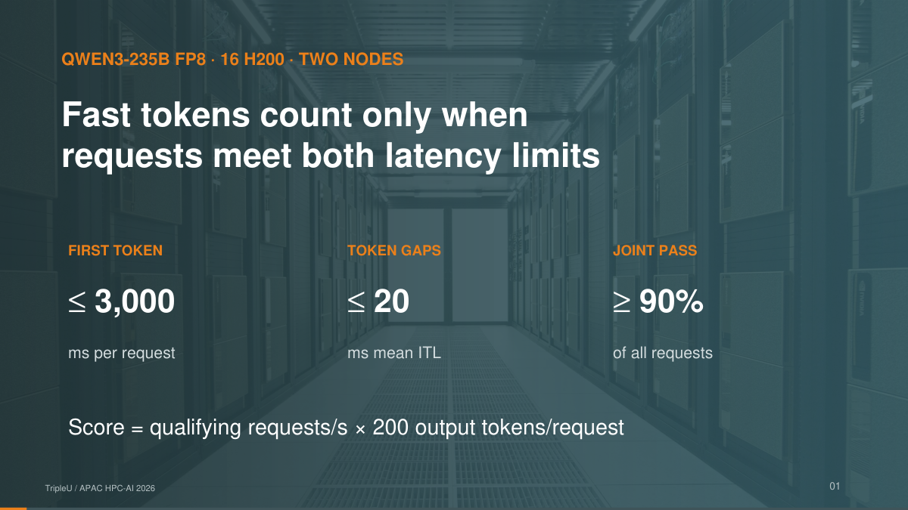

### Reasoning to communicate

- **Problem:** Choose how to serve the specified model within sixteen H200 GPUs while sustaining the fixed synthetic request workload.
- **Why it matters:** Latency failures make output unusable for the stated objective even when the system emits many raw tokens.
- **Why this test:** Fix the request shape and require both TTFT and mean ITL limits on each request, then aggregate only qualifying service as goodput.
- **What we learned:** The study optimizes useful, latency-qualified output and requires at least 90% of all requests to pass both limits.
- **Why the next step follows:** With success defined, the next slide separates which conclusions are engineering choices, direct team contributions, and measured backend findings.

### Purpose

Define the service objective before discussing optimizations. The system has a fixed model, GPU budget, request shape, and per-request latency gate. Every later topology or backend decision is judged against qualifying service output, not the largest unfiltered token count.

### Technical interpretation and reasoning

Explain the intended metric pipeline from one request to the final service score: the request enters with a fixed prompt and requested output; TTFT and mean ITL are checked for that request; passing requests contribute to goodput; goodput is multiplied by 200 requested output tokens to report good output tokens per second. Errors remain in the evaluated set. There are no unspecified chart glyphs or decorative encodings to interpret.

### Terms and symbols to understand

- **Qwen3-235B FP8:** The selected language-model checkpoint and eight-bit floating-point weight format.
- **16 H200 · 2 nodes:** The fixed primary compute envelope: sixteen H200 GPUs across two nodes.
- **4,000 input → 200 output tokens:** Synthetic workload request shape: a 4,000-token prompt asks the model to generate 200 tokens.
- **TTFT ≤ 3,000 ms:** Time to first token for an individual request must be at most 3,000 milliseconds.
- **Mean ITL ≤ 20 ms:** Mean inter-token latency, or average interval between generated tokens for one request, must be at most 20 milliseconds.
- **Joint SLA ≥ 90%:** At least 90% of all evaluated requests must meet both latency limits together. Errors count against this proportion.
- **Goodput × 200 = good output tokens/s:** Qualifying requests per second multiplied by the 200 requested output tokens per request. The result is the reported qualifying output-token rate.
- **ms:** Milliseconds, or thousandths of a second, used for latency.

### Interpreting the evidence or diagram

- Follow a request through both latency checks; passing only one limit is insufficient.
- The 90% requirement is a share of all evaluated requests, including errors in the denominator.
- Good output tokens per second is a derived service metric. It is not simply all generated tokens divided by run time.

### Tradeoff and strength of evidence

- **Observation:** The task fixes a 4,000-token prompt, 200 requested output tokens, two per-request latency limits, and a minimum 90% joint pass share.
- **Hypothesis:** A configuration with high raw output can still be a poor service if too many individual requests miss either latency limit.
- **Supported conclusion:** Use qualifying throughput under the joint gate as the objective for later engineering and experimental decisions.
- **Unknown / limitation:** The local full-set MMLU-Pro point gate is now measured and passes; this service metric does not establish BTC certification or a contest ranking.

### Spoken script

Our problem is to serve Qwen3-235B FP8 on sixteen H200 GPUs across two nodes. Each synthetic request has 4,000 input tokens and asks for 200 output tokens. A request counts only when it gets its first token within 3,000 milliseconds and its mean spacing between generated tokens is no more than 20 milliseconds. At least 90 percent of all requests must meet both conditions; errors count too. We therefore report goodput multiplied by the requested 200 output tokens. This measures qualifying output, not unrestricted token generation. The local full-set quality check is reported at the end; it is separate from this service metric and does not certify the organiser’s result.

### Avoid this interpretation

Do not drop errors, infer per-request success from an average latency, or describe this local service metric as official model-accuracy certification.

### Transition

Now that the objective is fixed, we can be precise about which parts of the work are engineering decisions, direct technical contribution, and separate experimental evidence.

---

## Slide 02 — Three investigations support three different kinds of claim

**Hardware: H200 primary · H100 kept separate**

**Claim type: Framing / claim boundary.**

### Quick brief · 10–20 seconds

We separate architecture choices, the team’s request-scoped KV patch, and backend measurements. These claims use different evidence: layout records, source plus transfer validation, and controlled experiments; H100 remains separate from H200.

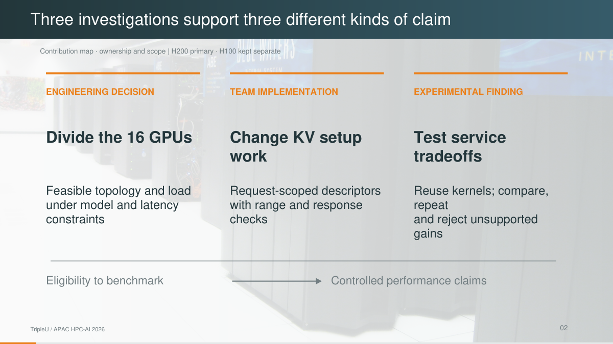

### Reasoning to communicate

- **Problem:** Present a long systems investigation without conflating topology choices, a code change, and performance experiments.
- **Why it matters:** Evidence that supports feasibility may not support speedup; a measured backend effect cannot automatically validate a separate transfer patch.
- **Why this test:** Assign each claim its own evidence gate and preserve the platform and configuration associated with each observation.
- **What we learned:** The team has an engineering selection, a direct KV-transfer implementation with bounded validation, and backend findings based on separate comparisons.
- **Why the next step follows:** First inspect the fixed sixteen-GPU topology tradeoff; then show the retained layout and the distinct historical branch where the KV failure occurred.

### Purpose

Map the presentation's contribution and prevent evidence from one type of claim being used to overstate another. Engineering decisions select a workable design; the KV patch is a specific team implementation; backend comparisons are measured findings that require their own controls and repeats.

### Technical interpretation and reasoning

Describe three claim lanes joined by a common objective. The architecture lane is supported by feasible layout records; the KV-transfer lane by source change, geometry checks, and a real patched run; the backend lane by controlled benchmark observations and replication. Each lane points toward the same success criterion but retains its own evidence gate. H100 observations stay in a separately labeled platform lane. This is a claim map, not three additive percentages.

### Terms and symbols to understand

- **Engineering decision:** A reasoned selection among layouts under the fixed hardware and service constraints; not automatically an isolated causal speedup claim.
- **Team KV patch:** The request-scoped NIXL heterogeneous-TP descriptor change and its tested correctness/feasibility evidence.
- **Backend experimental finding:** A measured comparison of serving backend choices under a named load and control; it should not be confused with the KV code contribution.
- **Evidence gate:** The kind of supporting record needed for a claim: deployment feasibility, implementation checks, or matched performance measurements.
- **H200 / H100:** Different GPU platforms whose measurements are kept in separate series rather than pooled as interchangeable results.

### Interpreting the evidence or diagram

- Read the three lanes independently: architecture choice, direct KV implementation, and backend experiments.
- A successful engineering deployment does not alone prove a speedup; a source patch does not alone prove a GPU transfer; a backend score does not prove model accuracy.
- All lanes are evaluated against slide 1's latency-qualified goodput objective, but their evidence is not interchangeable.
- The H200 primary and H100 observations must retain their platform labels.

### Tradeoff and strength of evidence

- **Observation:** The research contains layout decisions, a specific request-scoped transfer change, and separate backend trials; each has a different evidence trail.
- **Hypothesis:** Separating claim types will make it possible to explain what the team implemented, what it measured, and what remains only an engineering selection.
- **Supported conclusion:** Report each contribution at the level its evidence supports and keep H100 results distinct from the H200 primary series.
- **Unknown / limitation:** This contribution map does not make all findings causal, combine them into one gain, or establish official accuracy.

### Spoken script

There are three kinds of contribution here. First, engineering decisions: choosing a layout that fits the sixteen-GPU budget and can serve the workload. Second, a direct team contribution: changing heterogeneous-TP KV descriptor construction to work per request. Third, backend findings: measurements from controlled serving comparisons. These use different evidence. A working layout does not by itself prove a speedup. CPU geometry checks do not prove GPU transport. A backend score does not certify model accuracy. All results still use the same latency-qualified objective, but we keep their evidence separate. H200 is our primary platform; H100 results stay a distinct series.

### Avoid this interpretation

Do not combine the three lanes into one additive gain or use evidence from backend tuning to claim the KV patch's causal contribution.

### Transition

We begin with the engineering choice: how replicas and parallel width compete for the same sixteen GPUs.

---

## Slide 03 — Replica count and parallel width compete for the same 16 GPUs

**Hardware: H200 · historical topology observations**

**Claim type: Engineering decision.**

### Quick brief · 10–20 seconds

The topology trials exposed a tradeoff between more prompt workers and wider workers. We retained a split that fits two eight-GPU nodes, has a working transfer path and survives later full N64 repeats. The different-load scores do not prove it is globally best.

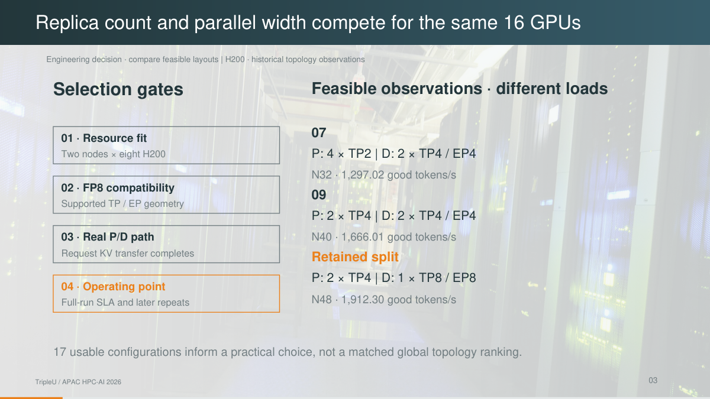

### Reasoning to communicate

- **Problem:** Allocate sixteen H200 GPUs across prefill and decode, balancing the number of worker replicas against the GPUs assigned to each worker.
- **Why it matters:** Too few replicas can limit prompt-side admission, while overly narrow workers may not process their share efficiently; decode also has different parallelism needs.
- **Why this test:** Apply the constraints in order: allocation and FP8 compatibility first, successful real P/D transfer second, then full latency-qualified performance and repeatability. Use historical different-load points only to understand the search.
- **What we learned:** The retained split is feasible and its N64 operating point is repeatable. Because the topology scores shown were measured at different concurrency settings, we cannot say the split beat all alternatives under the same load.
- **Why the next step follows:** After stating why this layout was retained, examine a separate heterogeneous-TP recovery branch. That branch teaches us about transfer readiness; it is not a topology comparison against this selected layout.

### Purpose

Explain the actual decision rule behind the retained topology. The choice was made from feasible model-compatible layouts that use the fixed two-node budget, can complete disaggregated requests and support a latency-qualified operating point that was later repeated. Historical scores at N32, N40 and N48 motivated the choice but cannot rank topology independently because load and trial conditions differ.

### Technical interpretation and reasoning

The left column lists four selection gates: fit two nodes of eight H200, pass FP8 parallel-shape compatibility, complete the real prefill/decode KV path, and establish a full-run SLA-qualified operating point with later repeats. The right column gives three historical layout observations at N32, N40 and N48. Orange highlights the retained split and the repeat requirement; it does not mark a controlled topology winner. There are no chart axes; the throughput unit is good output tokens/s. P means prefill workers and D means decode workers. Different loads prevent a topology-only causal ranking.

### Terms and symbols to understand

- **replica:** A separate worker instance that can process requests; more replicas can distribute incoming work but consume GPUs.
- **parallel width / TP:** Number of GPUs cooperating to serve one model worker through tensor parallelism.
- **EP:** Expert parallelism, which partitions expert computation in the mixture-of-experts model.
- **N32 / N40 / N48:** Client concurrency targets of 32, 40, and 48 requests in flight; N is not the number of GPUs.
- **good tokens/s:** Latency-qualified output tokens per second under the joint service gate.
- **17 usable configurations:** The reviewed topology recovery ledger counts fourteen measured original layouts plus three measured EP2 replacements. It is not a claim that all attempts succeeded or formed a matched ranking.

### Interpreting the evidence or diagram

- The resource constraint is exactly two nodes of eight H200 GPUs; each candidate must fit those resources.
- The model’s FP8 block geometry rules out some nominal parallel shapes before performance comparison.
- A split is useful only if real requests complete the prefill-to-decode KV transfer and the service meets the joint latency gate.
- The retained operating point later has full N64 repeats around 3,044 good output tokens/s; these repeats support the operating point, not its causal advantage over every topology.
- The older N32/N40/N48 values are shown to explain the search, not to claim increasing topology-only performance.

### Tradeoff and strength of evidence

- **Observation:** Seventeen usable measured topology configurations were recovered, including three EP2 replacements. Displayed examples use N32, N40 and N48, so they are not a common-load ranking.
- **Hypothesis:** A feasible phase-specialized split can provide a working transfer path and a repeatable latency-qualified service point within two nodes.
- **Supported conclusion:** Retain the documented two-TP4-prefill plus TP8/EP8-decode layout because it fits the allocation, is model-compatible, serves across the split and supports later repeated N64 measurements. This is a practical evidence-based selection, not a proven global optimum.
- **Unknown / limitation:** No matched, repeated comparison of every feasible topology at a shared load establishes the causal performance winner.

### Spoken script

We had two nodes with eight H200s each, and some apparent parallel layouts were not valid for this FP8 model. We therefore applied four practical gates: fit the allocation, pass the model’s parallel-shape constraints, complete a real request across prefill and decode, and sustain the latency rule in full runs. The retained two-TP4 prefill plus TP8/EP8 decode layout passes those feasibility gates, and its later N64 service point repeats around 3,044 good tokens per second. The N32, N40 and N48 topology scores on this slide used different loads. They explain what we explored; they do not prove this layout is the global performance winner. We chose a feasible, repeatable operating point with the evidence available.

### Avoid this interpretation

Do not say the different N32/N40/N48 points prove the topology caused their score differences or that the retained layout is globally optimal. Feasibility and a repeated operating point are the supported selection rationale.

### Transition

A separate historical heterogeneous-TP branch then exposed a transfer-readiness failure. We use it to explain the KV investigation, not as a matched topology control.

---

## Slide 04 — Two TP4 prefills feed one TP8 decode within the two-node budget

**Hardware: 16 H200 · Firmus**

**Claim type: Engineering decision.**

### Quick brief · 10–20 seconds

The retained split uses two four-GPU TP4/EP1 prefill workers on one node and one eight-GPU TP8/EP8 decode worker on the other. This fits sixteen H200s but adds KV transfer between roles.

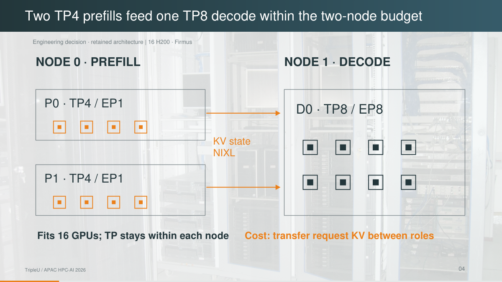

### Reasoning to communicate

- **Problem:** Turn topology candidates into a two-node serving architecture that uses the full sixteen-H200 allocation.
- **Why it matters:** The two service phases have different resource needs, and the chosen split determines both worker capacity and whether KV must move across nodes.
- **Why this test:** Retain two TP4/EP1 prefill workers and one TP8/EP8 decode worker as a feasible phase-specialized layout, then validate its actual transfer path.
- **What we learned:** The architecture fits the node budget and offers separate prefill and decode roles, but introduces a required inter-role KV transfer.
- **Why the next step follows:** A separate historical heterogeneous-TP recovery branch exposed a failure in that transfer warmup; its topology differs from this retained layout.

### Purpose

State the retained architecture clearly as an engineering decision within the two-node GPU budget. Explain how phase specialization uses replicas for prompt processing and wider parallelism for decode, while naming the additional KV transfer path as a cost of disaggregation.

### Technical interpretation and reasoning

Show Node 0 containing P0 and P1, each with four GPUs and TP4/EP1. Show Node 1 containing D0 with eight GPUs and TP8/EP8. Route a request to a prefill worker, then show its KV state crossing to decode, where output generation occurs. The layout sums to sixteen GPUs. This schematic represents roles and placement, not measured utilization or data volume.

### Terms and symbols to understand

- **Node 0 / Node 1:** The two H200 compute nodes used by this retained Firmus layout.
- **P0 / P1:** Two prefill worker instances on Node 0; each uses four GPUs.
- **D0:** The single decode worker on Node 1; it uses eight GPUs.
- **TP4 / TP8:** Tensor parallelism across four or eight GPUs inside a worker.
- **EP1 / EP8:** Expert parallelism across one or eight expert partitions for the model's expert layers.
- **KV state:** Key/value attention data created while processing the prompt and needed to generate output tokens.
- **Prefill / decode:** Prefill processes input tokens and prepares KV state; decode consumes that state to generate output tokens.
- **2 × 4 + 1 × 8 = 16:** Two four-GPU prefill workers plus one eight-GPU decode worker, totaling sixteen GPUs.

### Interpreting the evidence or diagram

- The two P workers are replicas to receive prompt work; the D worker uses a wider TP/EP configuration for generation.
- The split respects the two-node budget and keeps each worker's TP group within its node.
- Unlike a single co-located worker, this design must transfer request KV state between prefill and decode.

### Tradeoff and strength of evidence

- **Observation:** The retained H200 layout places two TP4/EP1 prefill workers on Node 0 and one TP8/EP8 decode worker on Node 1, using all sixteen GPUs.
- **Hypothesis:** Specializing allocation by phase can match prompt processing and generation to different replica and parallel-width needs.
- **Supported conclusion:** This is the retained engineering architecture for the selected service; it is not proof that this exact split causally beat every alternative at a matched load.
- **Unknown / limitation:** The diagram does not quantify the performance benefit of phase specialization or the transfer cost; request KV transfer must work for the architecture to serve.

### Spoken script

The architecture we retained uses both H200 nodes. Node 0 runs two prefill workers, P0 and P1, each on four GPUs with TP4 and EP1. Node 1 runs one decode worker on eight GPUs with TP8 and EP8. Together that uses all sixteen GPUs. The split reflects different roles: prefill handles the prompt and prepares key/value state, while decode uses that state to generate output. Separating the phases also means the request's KV data must move from one node to the other. This is our retained engineering design; the topology search did not prove a causal win against every alternative at the same load.

### Avoid this interpretation

Do not confuse this selected two-TP4-prefill topology with the historical P8 TP8/EP2 to D8 TP4/EP4 recovery branch on the next slides.

### Transition

To understand why transfer validation mattered, we now examine that separate historical branch where ready workers still could not complete warmup.

---

## Slide 05 — Ready workers still failed before the first usable benchmark

**Hardware: H200 · historical heterogeneous-TP branch**

**Claim type: Technical contribution.**

### Quick brief · 10–20 seconds

In job 22271, the P8 TP8/EP2 to D8 TP4/EP4 workers loaded but pair warmup timed out after 360 seconds. AIPerf never ran, so there was no baseline score.

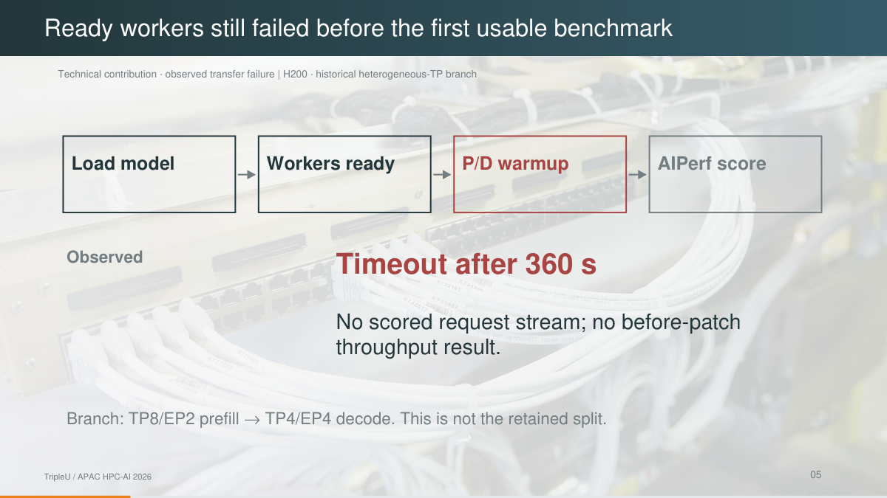

### Reasoning to communicate

- **Problem:** A historical heterogeneous-TP deployment had loaded workers but could not warm the prefill-to-decode path for a client request.
- **Why it matters:** Without pair readiness, there is no usable benchmark and no service result to optimize.
- **Why this test:** Inspect the retained job and warmup log to identify which stage failed before any performance interpretation.
- **What we learned:** Job 22271 waited 360 seconds and ended in HTTP TimeoutError; it produced no AIPerf score. The evidence is a readiness symptom, not a measured bandwidth diagnosis.
- **Why the next step follows:** Because failure occurred before scoring, the next step is to inspect the cold setup path and prioritize a source-backed hypothesis without claiming other causes are excluded.

### Purpose

Establish the observed transfer-readiness failure before describing a fix. This is a historical recovery branch with heterogeneous tensor parallelism, not the architecture retained on slide 4. The timeout happened before a usable benchmark result.

### Technical interpretation and reasoning

Show the request path from a ready prefill worker toward decode, then mark the pair-warmup request timing out at 360 seconds. Label job 22271 and explicitly mark that AIPerf did not run and no score exists. Do not represent this as a low point on a performance chart or as measured transfer latency.

### Terms and symbols to understand

- **job 22271:** The retained failed warmup attempt in the historical H200 heterogeneous-TP recovery branch.
- **P8 TP8/EP2 → D8 TP4/EP4:** The branch's prefill and decode configurations. TP and EP differ between roles; this is not slide 4's selected topology.
- **pair warmup:** A request sent through both prefill and decode to check whether the disaggregated service path can serve before benchmark scoring.
- **360-second timeout:** The maximum wait before this pair-warmup attempt ended in timeout, not a timed KV transfer measurement.
- **AIPerf did not run:** No benchmark export or throughput score was produced because warmup failed first.
- **bootstrap:** Startup work needed to bring both service roles and their transfer path into a state that can handle a request.

### Interpreting the evidence or diagram

- The model workers loaded, but an actual request through the P/D pair did not finish warmup.
- The retained log ends in HTTP TimeoutError after 360 seconds; there is no AIPerf export and no benchmark score.
- This establishes a cold readiness/bootstrap failure in this attempt, not steady-state bandwidth saturation or a slow KV copy measurement.
- Keep this historical branch distinct from the selected two-TP4 prefill plus TP8/EP8 decode layout.

### Tradeoff and strength of evidence

- **Observation:** Job 22271 loaded model workers on the heterogeneous-TP branch, then pair warmup timed out after 360 seconds with HTTP TimeoutError. AIPerf did not run.
- **Hypothesis:** The issue lies in cold P/D bootstrap or transfer readiness, but the symptom does not isolate descriptor construction as the cause.
- **Supported conclusion:** Classify 22271 as a pre-benchmark readiness failure and preserve the topology and log evidence. It has no baseline throughput value.
- **Unknown / limitation:** The timed-out phase was not decomposed. Descriptor setup, other bootstrap/transfer work, bandwidth, KV mapping, and placement were not individually measured or ruled out.

### Spoken script

The KV transfer investigation came from a separate historical branch, not the architecture we just selected. In job 22271, prefill P8 used TP8 and EP2, while decode D8 used TP4 and EP4. The model workers loaded, but the pair warmup request never completed. Its retained log ends with an HTTP timeout after 360 seconds. AIPerf did not run, so there is no baseline score. This tells us that the cold path was not ready; it does not tell us that steady-state network bandwidth was saturated or that a KV copy was measured to be slow. Since the failure came before scoring, we next looked for a setup hypothesis that could be tested directly.

### Avoid this interpretation

Do not report 22271 as a low-throughput baseline or divide 360 seconds by a later warmup duration to calculate speedup; these are not matched timed measurements.

### Transition

The timeout locates the symptom before scoring, but not its cause. We next inspect the setup path and choose a small, testable source-level hypothesis before claiming a bandwidth, layout or scheduling bottleneck.

---

## Slide 06 — Request-scoped descriptors remove work unrelated to the request

**Hardware: H200 transfer path · CPU geometry checks**

**Claim type: Technical contribution.**

### Quick brief · 10–20 seconds

Workers reached ready state but pair warmup timed out before AIPerf. Source inspection found request-independent enumeration of a large reserved KV pool. We tried request-scoped ranges first because this setup hypothesis was narrow and cheaply testable.

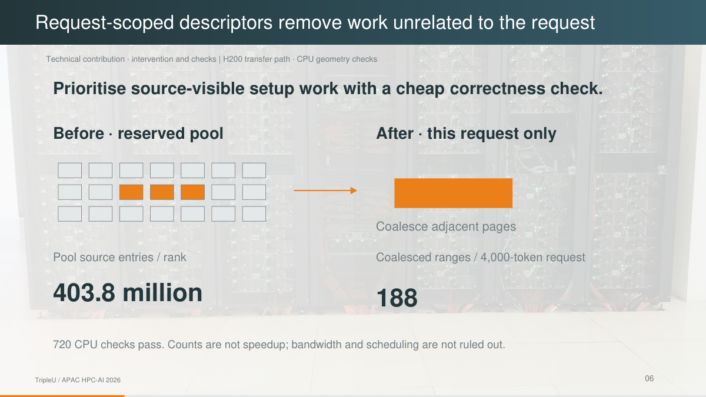

### Reasoning to communicate

- **Problem:** Full-pool descriptor enumeration appeared in the cold heterogeneous-TP path after pair warmup had failed.
- **Why it matters:** Preparing metadata for pages the request will not transfer could add setup work before the service can handle its first request.
- **Why this test:** The source exposed a concrete setup action that included data irrelevant to the request. Restricting that work had a clear correctness invariant and a cheap CPU check, so it was the lowest-cost discriminating first intervention. We did not first prove bandwidth, KV layout or scheduling innocent.
- **What we learned:** The 720 range checks support byte-range equivalence. They justify attempting the patched distributed path, but cannot identify the timeout’s cause or prove a performance bottleneck.
- **Why the next step follows:** The next run asks whether the patched branch can actually warm up and complete a full benchmark. Since the old branch has no successful scored control, interpret that result as feasibility evidence only.

### Purpose

Explain why descriptor construction was the first intervention. After the pre-score warmup failure, source inspection showed that heterogeneous-TP setup enumerated pool metadata unrelated to the current request. Restricting descriptors to request pages had a narrow correctness check in CPU fixtures and did not require assuming that network bandwidth, KV layout or scheduling had already been ruled out.

### Technical interpretation and reasoning

The preceding slide supplies the failed warmup context. Here the left grid illustrates the whole reserved KV pool, with orange pages representing the small requested subset. The right orange range illustrates selecting request pages and coalescing adjacent ranges. The labels compare representative pool-source entries per rank (403.8 million) with coalesced ranges for one 4,000-token request (188). These scopes differ; no axis or speed ratio exists. The heading explains why this bounded source-visible setup hypothesis was chosen first. The bottom note reports 720 CPU checks and says bandwidth and scheduling were not ruled out; CPU checks do not validate GPU transport.

### Terms and symbols to understand

- **NIXL:** The transfer mechanism used for KV state between disaggregated prefill and decode workers.
- **descriptor:** Metadata describing memory ranges for a transfer; it is not the KV data itself.
- **403.8 million per source rank:** Approximate source descriptor count for whole-pool enumeration in representative TP8 geometry, derived from 2,148,119 KV slots, 94 layers, and K/V entries.
- **188 per request:** CPU geometry count after coalescing adjacent ranges for a contiguous 4,000-token TP8-to-TP4 request.
- **coalescing:** Combining neighboring memory ranges into fewer descriptor entries while preserving required addresses and stride.
- **720 CPU cases:** Original-versus-patched byte-range equivalence cases that passed CPU geometry checks.
- **real GPU transport validation: false:** The retained fixture explicitly does not claim that the actual GPU transfer was validated by these geometry tests.
- **per-token stride:** The spacing of token-associated data when transferring a KV-head slice; it must be preserved when ranges are described.

### Interpreting the evidence or diagram

- The motivating symptom was a 360-second pair-warmup timeout before AIPerf, with no scored requests.
- Source review found descriptor setup traversing the whole registered pool even though the immediate request references only a subset of pages.
- The first intervention was deliberately narrow: build descriptors for request pages and merge adjacent byte ranges while preserving offsets and strides.
- 720 CPU fixtures checked range equivalence, making this a cheap correctness gate before another distributed GPU attempt. They do not validate real NIC/GPU transfer behavior.
- Bandwidth, KV layout and request scheduling remain competing explanations not isolated by these counts.

### Tradeoff and strength of evidence

- **Observation:** A heterogeneous-TP worker pair loaded, but the warmup timed out before a scored benchmark. Source showed whole-pool metadata enumeration; 720 CPU equivalence cases passed after the narrow patch.
- **Hypothesis:** Avoiding request-irrelevant descriptor construction may make this bootstrap path usable; a cheap exact-range check can reject an incorrect patch before spending another distributed allocation.
- **Supported conclusion:** Descriptor scoping was a sensible first engineering intervention because it was directly visible in source, bounded, and inexpensive to validate. Existing evidence does not establish that it was the dominant performance bottleneck.
- **Unknown / limitation:** No successful unpatched scored run, initialization timer, bandwidth profile, KV-layout comparison, or scheduling comparison exists for this branch. Which component caused the timeout and the descriptor-only end-to-end gain remain unknown.

### Spoken script

Why start with descriptors? In job 22271 both model workers loaded, but a real request through the pair timed out during warmup after 360 seconds; AIPerf never scored traffic. Reading the source showed setup enumerating the registered KV pool even when a request used only a small subset. That gave us a narrow hypothesis: build metadata for the request pages and coalesce adjacent ranges. It had a cheap check—720 CPU cases to verify the byte ranges still matched—before spending another multi-node run. We chose it because the extra setup work was visible and testable, not because we had already ruled out network bandwidth, KV layout or scheduling. Those alternatives remain unmeasured.

### Avoid this interpretation

Do not call descriptors the verified dominant bottleneck. The counts have different scopes, CPU geometry checks are not GPU transport tests, and bandwidth/layout/scheduling were not excluded.

### Transition

The CPU checks only establish that the patch describes the same byte ranges. The next slide asks whether the real distributed path becomes usable; it still cannot measure an isolated descriptor speedup.

---

## Slide 07 — The patched path became usable; descriptor-only speedup is unknown

**Hardware: H200 · same recovery topology · 22271 / 22294**

**Claim type: Technical contribution.**

### Quick brief · 10–20 seconds

Patched job 22294 completed warmup in 0.68–0.70 seconds per request and scored 1,422.96 good tokens/s at N32, with 95.87% joint SLA and zero errors. This proves feasibility, not isolated speedup.

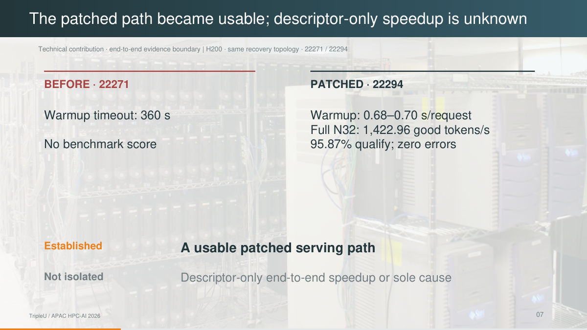

### Reasoning to communicate

- **Problem:** Determine whether the source change was followed by a usable service path, not just a passing CPU fixture.
- **Why it matters:** Only a real end-to-end request and benchmark can show the patched recovery topology became usable; CPU address checks alone cannot do that.
- **Why this test:** After a successful byte-range check, the necessary next gate was a real distributed request through both roles, followed by the complete benchmark protocol. This tests feasibility of the patched path, while the missing successful unpatched control limits causal comparison.
- **What we learned:** The patched branch warmed up and completed a full N32 run with 95.87% joint SLA and zero scored errors. That establishes a usable example path. It does not quantify descriptor-only speedup because the original run timed out before scoring.
- **Why the next step follows:** With a working path available, performance experiments become possible. The separate diagnostic profile on the next slide identifies candidates, not a proven bottleneck.

### Purpose

Report the end-to-end result of the patched recovery branch and define its evidence boundary. The path became usable and completed a full local N32 benchmark, but this does not measure the descriptor patch's independent contribution because there is no successful matched unpatched control.

### Technical interpretation and reasoning

Show before and after as two distinct job records, not a conventional speedup chart. Before: 22271 loaded workers, then timed out during pair warmup at 360 seconds; no AIPerf result. After: 22294 with the patch completed real P/D warmup in 0.68–0.70 seconds per request, then a full N32 benchmark produced 1,422.96 good tokens/s, 95.87% joint SLA, zero errors and cancellations. Place a clearly separate “not measured” callout for descriptor-only speedup and causal attribution.

### Terms and symbols to understand

- **job 22294:** The patched H200 recovery run on the same heterogeneous-TP topology family as the earlier timeout.
- **0.68–0.70 s/request:** Observed pair-warmup duration per request after the servers were ready; not an isolated descriptor-initialization timer.
- **N32:** Full benchmark concurrency target of 32 client requests in flight.
- **1,422.96 good tokens/s:** Measured latency-qualified output-token throughput for the full N32 confirmation in job 22294.
- **95.87% joint SLA:** Share of evaluated requests that passed both TTFT and mean ITL limits in the recorded run.
- **zero errors/cancellations:** No request errors or cancellations were recorded in the full confirmation result.
- **descriptor-only speedup:** The performance change attributable solely to descriptor construction; it requires a matched no-patch control and timing evidence that were not collected.

### Interpreting the evidence or diagram

- Before: job 22271 had a 360-second pair-warmup timeout and no AIPerf score.
- After: patched job 22294 completed real P/D warmup in 0.68–0.70 seconds per request after server readiness, then completed an N32 benchmark.
- The full result was 1,422.96 good tokens/s, 95.87% joint SLA, and zero errors or cancellations.
- The comparison establishes feasibility of the patched topology in that run. It is not a speedup ratio: there is no successful no-patch control, no isolated old/new setup timer, and no causal latency decomposition.

### Tradeoff and strength of evidence

- **Observation:** Job 22294's patched path completed both P/D warmup routes in 0.68–0.70 seconds per request after servers were ready, then scored 1422.96 good tokens/s at N32 with 95.87% joint SLA and zero errors/cancellations.
- **Hypothesis:** Request-scoped descriptors may have helped make the recovery path usable, but other run differences or bootstrap work could also explain why this attempt succeeded.
- **Supported conclusion:** The evidence supports patched-path feasibility and a complete local benchmark result for this recovery topology. Descriptor-only speedup and causal attribution are unknown.
- **Unknown / limitation:** There is no successful unpatched end-to-end control for this exact topology, no old-versus-new descriptor setup time, and no controlled warmup decomposition. Network utilization, KV layout, placement, other bootstrap work, and the patch's independent goodput contribution remain unmeasured.

### Spoken script

We then tested the patched path in the real H200 recovery topology. Job 22294 completed both prefill and decode warmup routes in 0.68 to 0.70 seconds per request after the servers were ready. Its full N32 local benchmark measured 1,422.96 good output tokens per second, with 95.87 percent of requests passing both latency limits and no errors or cancellations. That is meaningful end-to-end feasibility evidence: this patched topology served the workload in that run. But it is not a measured speedup over job 22271. The earlier job timed out and never ran AIPerf, so it is not a successful matched control. We also lack separate old-versus-new setup timing and a breakdown of the warmup delay. The patch's independent performance effect remains unknown.

### Avoid this interpretation

Do not divide the 360-second timeout by 0.68–0.70 seconds, call the result a speedup, or attribute the full 1,422.96 score to the patch. The jobs are not a matched performance comparison.

### Transition

The patch restores a measurable serving path but leaves the performance cause unresolved. We next inspect diagnostic profiles as hypothesis generators, not as a causal time breakdown.

---

## Slide 08 — Profiles identify candidates for investigation, not a proven time budget

**Hardware: H200 · N48 diagnostic profile; separate N64 request-tail observations**

**Claim type: Experimental finding / method.**

### Quick brief · 10–20 seconds

The separate N48 diagnostic assigns about 23.48% of summed recorded GPU-kernel duration to communication and normalization. This motivates a controlled test; it does not establish that communication consumes the same share of request latency or limits N64.

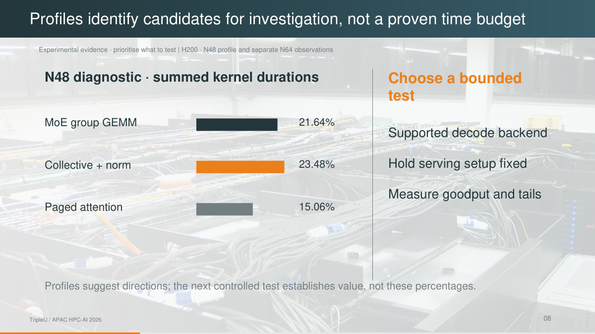

### Reasoning to communicate

- **Problem:** The campaign needed to choose which performance questions to test without claiming a bottleneck from a profile.
- **Why it matters:** Summed GPU kernel time can overlap and excludes other elapsed-time sources, so its percentages cannot be read as request-latency shares.
- **Why this test:** Collect a diagnostic N48 profile and separate N64 request-tail observations to identify candidate areas and symptoms. Kernel-duration sums cannot assign request wall time or select one causal fix, so the next backend comparison is described as a separate controlled probe, not the proven consequence of this profile.
- **What we learned:** Compute, collectives, attention and first-token queueing are plausible investigation areas, but none has a measured per-request time share here. The evidence does not tell us that HPC-Ops decode was the profile-selected remedy.
- **Why the next step follows:** We next report an independently motivated, supported decode-implementation probe with its own fresh control and repeat. Its measured effect stands on that control pair, not on the N48 kernel percentages.

### Purpose

Use instrumentation to prioritize a follow-up without mistaking recorded GPU activity for an end-to-end time budget or merging evidence from different runs.

### Technical interpretation and reasoning

The profile's categories are matrix operations, communication/normalization, and attention. The displayed percentages divide each category's recorded kernel duration by the sum of recorded kernel durations across profiled ranks. GPU kernels can overlap; queues, CPU work, gaps, and unrecorded activity also contribute to elapsed request time. Separate N64 requests later missed TTFT but passed ITL, which identifies the failed latency condition, not its cause. The N48 profile and N64 request outcomes are different observations.

### Terms and symbols to understand

- **GEMM:** General matrix multiplication, a common GPU computation.
- **MNNVL:** The NVLink collective communication path between GPUs.
- **RMSNorm:** A normalization operation applied to model activations.
- **kernel-time share:** A category's share of summed recorded GPU-kernel durations. Overlap means it is not that share of request elapsed time.
- **N48 / N64:** Client concurrency targets of 48 and 64 in separate runs; they are not GPU counts.
- **profile:** A diagnostic recording of selected activity while a workload runs; coverage is limited to the signals collected.

### Interpreting the evidence or diagram

- The N48 profile attributed 21.642% to GEMM, 23.479% to MNNVL collective plus RMSNorm, and 15.064% to FlashInfer paged attention, as shares of summed recorded kernel duration.
- A separate N64 run had 27 requests fail TTFT, zero fail ITL, and zero request errors among 1,902 profiling requests. This says which service limit was missed; it does not connect that tail to the N48 profile.
- The evidence motivates measuring phase-specific queueing and timing. It does not show that optimizing the largest kernel share yields an equal request-latency reduction.
- The horizontal bar lengths show each named group’s share of summed recorded kernel durations, in percent; the printed labels give the values. Colors identify/emphasize groups, not pass or failure. There is no per-request time axis or exclusive wall-time partition.

### Tradeoff and strength of evidence

- **Observation:** Three kernel groups account for the listed shares of recorded kernel duration; a separate N64 observation has TTFT-only failures.
- **Hypothesis:** Communication, matrix work, or attention could be useful targets for controlled follow-up; early request-tail timing could also merit investigation.
- **Supported conclusion:** Treat the profile as a prioritization clue. Keep its N48 scope separate from N64 service outcomes.
- **Unknown / limitation:** Per-request phase timing, total wall-time attribution, and a causal explanation for the N64 TTFT failures are unavailable.

### Spoken script

We profiled an N48 diagnostic run and separately inspected an N64 request trace. The profile records GPU kernel durations, not the fraction of each request spent waiting, computing or transferring KV. The N64 misses tell us first-token latency needs attention, but do not show its cause. These observations make compute, communication, attention and serving queues reasonable candidates. They did not establish that a particular kernel was the bottleneck or select HPC-Ops as the remedy. The next slide is a separate controlled probe of a supported decode implementation; its evidence comes from a fresh control and a repeat.

### Avoid this interpretation

Do not attribute N64 request failures to N48 kernel shares or claim an equal speedup from optimizing a percentage of summed kernel time.

### Transition

This diagnostic narrows the questions but does not choose a fix. We now show a separate controlled decode probe and explain its own control, held-fixed settings and limits.

---

## Slide 09 — Test the decode implementation while holding the serving setup fixed

**Hardware: H200 · full N60 · jobs 24912/24913**

**Claim type: Experimental finding / method.**

### Quick brief · 10–20 seconds

We compared automatic decode with HPC-Ops on the same full H200 N60 setup, holding DeepGEMM prefill and chunk 8,192 fixed. The hypothesis was that decode execution could improve useful throughput; a separate treatment repeat checks consistency.

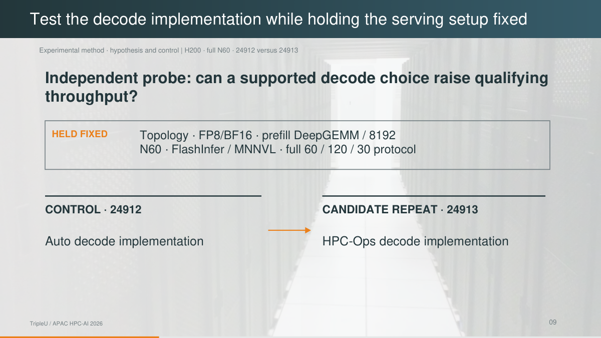

### Reasoning to communicate

- **Problem:** A backend change is only useful if a measured service objective improves under comparable workload conditions.
- **Why it matters:** Without a control and fixed prefill/load settings, observed score changes could come from other configuration differences.
- **Why this test:** The diagnostic profile did not identify a unique bottleneck. We therefore use a distinct, practical intervention with an available supported implementation and matched full-run control: change decode implementation, hold the serving topology, prefill, transport, workload and protocol fixed, then repeat the treatment.
- **What we learned:** The comparison can estimate the effect of this whole decode-setting change on the tested H200 service under the stated conditions. It cannot turn the prior profile into causal evidence or isolate an individual GPU kernel mechanism.
- **Why the next step follows:** The next slide reports goodput together with TTFT and ITL, then checks the treatment against its independent repeat.

### Purpose

Present a separate, supported test of a decode implementation after profiling raised several possible areas to investigate. This comparison asks whether the decode implementation changes end-to-end service performance with the rest of the measured setup held fixed. It is not a claim that the N48 profile identified HPC-Ops as the bottleneck or prescribed this intervention.

### Technical interpretation and reasoning

The setup diagram should be read as two otherwise matching full N60 runs: fresh automatic decode control 24912 and HPC-Ops decode treatment/repeat 24913. Both use sixteen H200 GPUs, DeepGEMM prefill, and chunk size 8,192 under the 60-second warmup, 120-second scoring, and 30-second grace protocol. The intended difference is the decode runner. Job 24913 also serves as an independent treatment repeat relative to original treatment 24738. Equal settings reduce confounding; they do not make all runtime randomness identical.

### Terms and symbols to understand

- **full N60:** The full benchmark protocol at 60 simultaneous client requests, not 60 GPUs.
- **HPC-Ops:** A supplied GPU decode execution backend tested by the team, not a component invented in this work.
- **DeepGEMM prefill:** The prompt-processing backend held constant in both arms.
- **matched comparison:** Runs aligned on workload and settings, with one intended change—in this case the decode runner.
- **treatment repeat:** An independent run of the changed setting to check whether its result is consistent with the original treatment.

### Interpreting the evidence or diagram

- The experiment holds hardware, load, prefill backend, and chunk size constant. The changed choice is automatic versus HPC-Ops decode.
- The full protocol is 60 seconds warmup, 120 scored seconds, and 30 seconds grace. This allows the comparison to include first-token and streaming behavior under the same workload window.
- The repeat addresses reproducibility of the treatment, not whether every request-level difference or mechanism has been explained.

### Tradeoff and strength of evidence

- **Observation:** Jobs 24912 and 24913 used the matched H200 N60 setup; 24913 independently repeated the HPC-Ops treatment.
- **Hypothesis:** Replacing automatic decode with HPC-Ops may improve goodput while altering the balance between first-token delay and later-token spacing.
- **Supported conclusion:** This design isolates the intended decode choice more cleanly than historical mixed-configuration milestones.
- **Unknown / limitation:** Generated engine seeds and uncollected phase-level telemetry prevent a fully deterministic or kernel-causal account.

### Spoken script

The profile did not tell us which component to change, so we should not present this as “the profile found the HPC-Ops fix.” We asked a separate practical question: does a supported HPC-Ops decode setting change full-service performance when topology, prefill, transport, workload and benchmark protocol stay fixed? We compared a fresh automatic-decode control with the HPC-Ops setting, then checked the treatment against its independent repeat. That design supports a service-level comparison. It does not isolate a particular kernel as the cause.

### Avoid this interpretation

The comparison supports only this H200 N60 setting. Do not treat the repeat as another hardware comparison or infer a kernel-level mechanism from score alone.

### Transition

Now read the paired result across goodput, first-token latency and token spacing; the repeat checks whether the service-level observation persists.

---

## Slide 10 — Higher goodput came with slower first tokens and faster streaming

**Hardware: H200 · full N60 · HPC-Ops decode**

**Claim type: Experimental finding / method.**

### Quick brief · 10–20 seconds

The decode change improves qualifying throughput by about 5.30% on H200, and a separate deployment repeats the result closely. First-token wait gets worse while streaming gaps improve. We retain this measured tradeoff, not a claim that everything became faster.

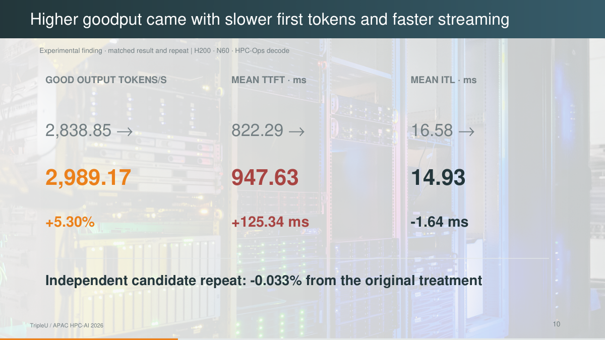

### Reasoning to communicate

- **Problem:** A higher throughput score alone can hide a worse first response or fail to repeat.
- **Why it matters:** Users experience both the wait for the first token and the pace of later tokens; the SLA checks both.
- **Why this test:** Compare the matched full N60 control/treatment on goodput, TTFT, request-mean ITL, and then check a separate treatment repeat.
- **What we learned:** Goodput rose 5.295%; TTFT slowed about 125 ms; ITL improved about 1.64 ms; the repeat was 0.033% below original.
- **Why the next step follows:** Carry this measured tradeoff to the load-selection question without generalizing the backend beyond N60.

### Purpose

Interpret the decode intervention as a multi-metric tradeoff rather than a single score change, and distinguish evidence of reproducibility from a universal backend claim.

### Technical interpretation and reasoning

The three metric arrows show opposing movements: goodput increases, mean time to first token increases (worse), and mean request-mean inter-token latency decreases (better). The result is from control 24912 versus treatment/repeat 24913 at full N60. Joint SLA changed only slightly, from 98.7599% to 98.8178%. Treatment 24913 measured 2,989.175 good tokens/s, just 0.033% below original treatment 24738 at 2,990.151. This is the observed service outcome; it does not say why each latency component moved.

### Terms and symbols to understand

- **goodput:** Rate of requests that meet both latency limits, multiplied by the fixed 200 output-token target for the reported unit.
- **TTFT:** Time from request start until its first generated token; a lower value is faster.
- **request-mean ITL:** Average time between generated tokens within each request; a lower value means faster streaming.
- **joint SLA:** Percentage of all requests meeting both TTFT and ITL limits together; it is not model accuracy.
- **treatment repeat:** Independent rerun of the changed configuration, used here to assess whether the throughput observation repeated.

### Interpreting the evidence or diagram

- Goodput rose 5.295%, from 2,838.853 to 2,989.175 tokens/s.
- Mean TTFT rose 125.335 ms, from 822.292 to 947.627 ms. Mean request-mean ITL fell 1.644 ms, from 16.579 to 14.934 ms.
- The separate treatment repeat was 0.033% below the original treatment. That supports repeatability of this operating point, while the slower first token remains a real tradeoff.

### Tradeoff and strength of evidence

- **Observation:** The treatment increased goodput and improved ITL but worsened TTFT; the independent treatment run was close to the original score.
- **Hypothesis:** The decode runner may shift work between startup and per-token streaming costs.
- **Supported conclusion:** The complete service result supports this H200 N60 configuration with an explicit first-token tradeoff.
- **Unknown / limitation:** The comparison does not isolate kernel-level causes, queue/compute timing, or behavior on other loads and hardware.

### Spoken script

The important observation is the tradeoff, not every cell of the benchmark. At fixed N60, the candidate raises qualifying throughput by about 5.30 percent. It also makes first tokens slower while reducing the gaps during streaming. We keep the configuration because the contest rewards qualifying service, and another deployment closely reproduces the treatment. This is an integrated service comparison using provided implementations; it does not identify one kernel as the sole cause. The next question is how much concurrent load this service should accept.

### Avoid this interpretation

Do not choose from goodput alone or present the repeat as proof across all hardware and loads. The N48 profile is not a causal explanation for this N60 result.

### Transition

Next, choose the request load by comparing N64 repetition with the apparent N68 short-screen gain.

---

## Slide 11 — N64 survives a full repeat; N68 loses its short-test advantage

**Hardware: H200 · client concurrency denotes requests, not GPUs**

**Claim type: Engineering decision.**

### Quick brief · 10–20 seconds

Full N64 beat N62 by 1.082867% and repeated within 0.013634%. N68 looked 2.27% better in a short screen, but the full pair showed only 0.083056%, below the useful-gain gate. N64 is the supported load choice.

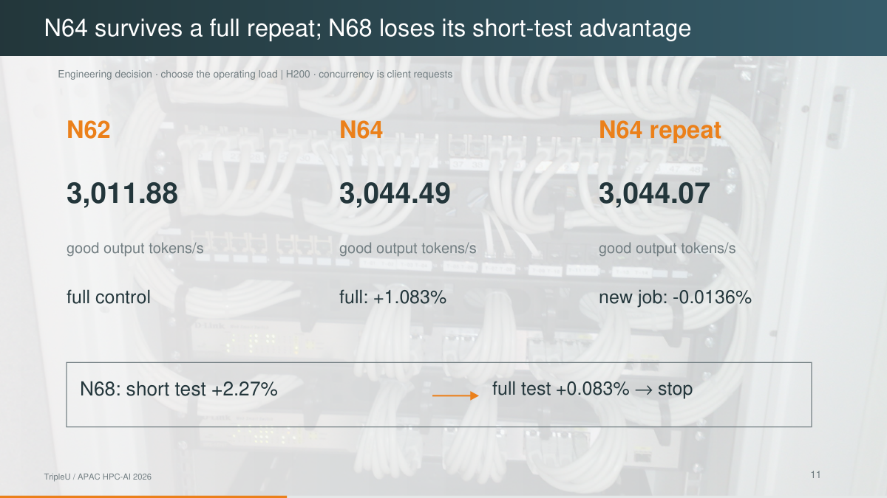

### Reasoning to communicate

- **Problem:** The team needed an operating load that improves useful throughput without trusting a short-test peak.
- **Why it matters:** Higher concurrency can create more work but also increase queueing and latency failures, so the full service objective may stop improving.
- **Why this test:** Compare full 60/120/30 N62 control with N64 candidate and repeat N64; use the full N68 pair to check its earlier short-screen signal.
- **What we learned:** N64 gained 1.082867% and repeated within 0.013634%; N68's short +2.27% became only +0.083056% full.
- **Why the next step follows:** Inspect request-level latency failures at the selected N64 load.

### Purpose

Choose an operating load using complete-protocol evidence and a repeat, while rejecting a larger-load claim that did not survive full measurement.

### Technical interpretation and reasoning

Follow the load decision, not a bar-height ranking. Full N62 control 25365 scored 3,011.875 good tokens/s; N64 candidate 25366 scored 3,044.490, a 1.082867% gain. Independent N64 repeat 25373 scored 3,044.075, 0.013634% below the candidate. A short N68 screen appeared 2.27% higher, but the later full N68 comparison reduced the difference to 0.083056%. The load decision is therefore based on N64's full gain and repeatability, not the short N68 signal.

### Terms and symbols to understand

- **N62 / N64 / N68:** Targets for simultaneous client requests in flight; not GPU counts or decode batch sizes.
- **full 60/120/30:** 60 seconds warmup, 120 scored seconds, and 30 seconds grace. Only the middle window supplies the full-run score.
- **screen:** A shorter exploratory measurement used to choose candidates; it is not equivalent to full confirmation.
- **repeat:** A separate full run of the same setting to check reproducibility.
- **useful-gain threshold:** The preselected minimum improvement needed to justify keeping a change; a positive value below it is not automatically useful.

### Interpreting the evidence or diagram

- Full N64 increased goodput from 3,011.875 at N62 to 3,044.490 tokens/s, +1.082867%.
- N64 repeat 25373 scored 3,044.075, only −0.013634% versus candidate 25366.
- N68's +2.27% short-screen result became +0.083056% in full measurement, so it did not establish a useful improvement over N64.

### Tradeoff and strength of evidence

- **Observation:** N64 gained 1.082867% over full N62 and repeated closely; N68's apparent short gain shrank to 0.083056% in the full comparison.
- **Hypothesis:** Increasing client load may raise qualifying throughput until latency costs erase the gain.
- **Supported conclusion:** Retain N64 as the supported operating load; do not promote N68 from its short screen or negligible full difference.
- **Unknown / limitation:** The observed load points do not define a universal maximum concurrency or performance curve.

### Spoken script

The full N62-to-N64 comparison gained about 1.08 percent, and another full N64 run was within 0.014 percent of the candidate. N68 first looked 2.27 percent better in a short screen, but the full comparison showed only 0.083 percent. That is too small to justify moving to higher load. We retain N64 because its full gain repeated, while the larger-load signal did not survive confirmation.

### Avoid this interpretation

N is concurrent client requests, not GPU count. Do not treat a short screen as a full result or extrapolate a universal concurrency curve from these points.

### Transition

At the selected N64 load, inspect which request-level latency condition still fails.

---

## Slide 12 — The remaining latency failures are first-token tails

**Hardware: H200 · N64 · job 26766 · 1,902 profiling requests**

**Claim type: Experimental finding / method.**

### Quick brief · 10–20 seconds

Of 1,902 requests, 1,875 met both latency limits; all 27 misses were TTFT-only. No request missed ITL, and there were zero request errors. The scatter identifies the failed condition, not why those first tokens were late.

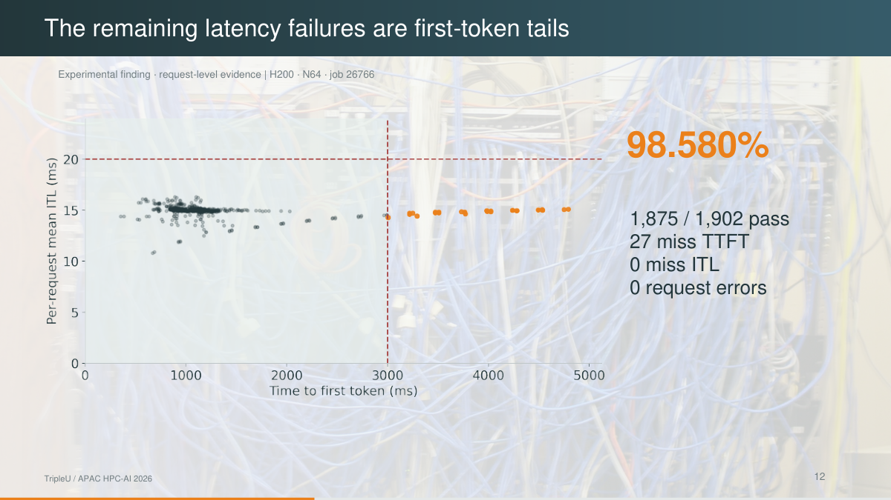

### Reasoning to communicate

- **Problem:** A mean score can hide which requests fail and which latency constraint they violate.
- **Why it matters:** The service rule requires each good request to meet both TTFT and ITL limits; aggregate goodput alone does not explain failures.
- **Why this test:** Plot each of the 1,902 scored requests against the two latency limits and classify requests that satisfy both inclusive boundaries.
- **What we learned:** There are 1,875 joint passes and 27 TTFT-only failures, with zero ITL misses and zero errors.
- **Why the next step follows:** Keep the cause unknown unless phase-level timing is collected; assess robustness separately from this request-level diagnosis.

### Purpose

Move from aggregate throughput to individual request evidence, showing exactly which SLA condition the remaining failures crossed without assigning an unsupported cause.

### Technical interpretation and reasoning

Each point represents one profiling request. The horizontal position is that request's time to first token in milliseconds; the vertical position is its request-mean inter-token latency in milliseconds. Teal points meet both inclusive limits: TTFT ≤3,000 ms and mean ITL ≤20 ms. Orange points fail at least one limit. The displayed evidence has 1,875 teal passes and 27 orange failures; all 27 are to the right of the TTFT boundary and none exceed the ITL boundary. This shows a first-token tail. It does not show whether queueing, prefill, transfer, or another phase caused the delay.

### Terms and symbols to understand

- **TTFT:** Time from the start of a request until its first generated token; threshold is at most 3,000 ms.
- **request-mean ITL:** Average interval between generated tokens for one request; threshold is at most 20 ms.
- **inclusive boundary:** A value exactly at either maximum passes because the requirement is less than or equal to the threshold.
- **joint SLA:** A request passes only if it meets both latency limits. The denominator includes every profiling request, including failures/errors.
- **profiling request:** One request counted in the scored measurement window; this plot is request-level, not an average across jobs.

### Interpreting the evidence or diagram

- Job 26766 contains 1,902 profiling requests; 1,875 pass both conditions, or 98.580442%.
- The 27 failures all miss TTFT. Zero miss request-mean ITL; request errors and cancellations are zero.
- The threshold lines classify pass/fail. Point position shows measured latency, but the plot does not include phase timing needed to explain the tail.

### Tradeoff and strength of evidence

- **Observation:** The N64 service has 98.580442% joint success; every one of its 27 SLA failures is TTFT-only.
- **Hypothesis:** A startup-side phase such as admission, queueing, prefill, or KV transfer may contribute to the late first tokens.
- **Supported conclusion:** The scatter localizes which latency metric fails but does not establish the responsible phase.
- **Unknown / limitation:** Per-request queue/prefill/transfer phase timing and a causal account of the 27 misses are not available.

### Spoken script

This scatter shows each of the 1,902 measured requests, with first-token delay horizontally and average token spacing vertically. The two limits are inclusive: at most 3,000 milliseconds to the first token and 20 milliseconds between later tokens on average. 1,875 requests passed both. The other 27 missed only the first-token limit; none missed ITL, and there were no errors. So we know the failure pattern, but not whether queueing, prefill, or transfer caused it.

### Avoid this interpretation

Do not infer a queueing or prefill cause from point location alone, and do not describe the 27 TTFT misses as ITL failures.

### Transition

Next, compare replicated N64 evidence with isolated higher or lower observations without pooling distinct runtime series.

---

## Slide 13 — A complete portable run reproduces the retained operating level

**Hardware: H200 · historical series, native run and portable acceptance reported separately**

**Claim type: Experimental finding / method.**

### Quick brief · 10–20 seconds

Three evidence series now meet: historical N64 mean 3,044.40, separate native run 3,045.50, and complete portable run 28197 at 3,051.52 good tokens/s. This confirms the packaged path once; lower valid replays still have no identified cause.

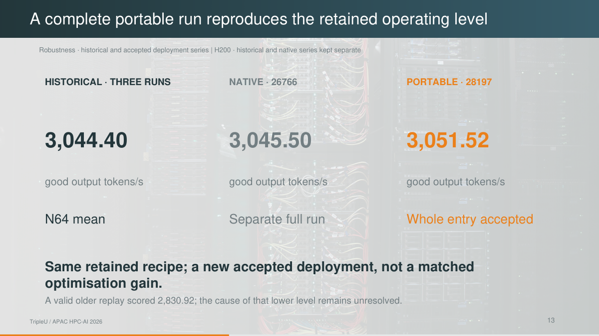

### Reasoning to communicate

- **Problem:** The earlier portable GPU jobs failed in result reading, so CPU-only reader checks did not establish that a complete packaged deployment worked after repair.
- **Why it matters:** A good benchmark score is useful for submission only if the actual portable package can pass readiness, serve both roles, run the client, read results and clean up in a real allocation.
- **Why this test:** After one exact-ZIP attempt failed before scoring because the gateway health check returned HTTP 200 while model registration still returned 503, change only the deployment readiness wait and checksum. Keep workers, official client, readers and semantic paths unchanged, then run a complete 16-H200 N64 entry.
- **What we learned:** Job 28197 completed the full portable entry in 611 seconds, passed both P/D semantic paths and summary gates, and scored 3051.518173 good tokens/s with 98.6366% joint SLA and zero errors/cancellations. This closes the post-reader-fix GPU acceptance gap.
- **Why the next step follows:** The package has one complete post-fix GPU acceptance run. Keep it separate from historical performance repeats; slide 16 reports the separately measured local full-set quality result and its limits.

### Purpose

Assess repeatability across distinct deployment paths without pooling them as one homogeneous series. The newly completed portable run used the repaired result readers and a genuine full H200 allocation. It supports the retained operating level and closes the previous post-reader-fix GPU acceptance gap, while leaving unexplained drift and single-run uncertainty visible.

### Technical interpretation and reasoning

Use three separately labelled evidence cards: (A) historical three-run N64 full-run mean 3044.400475 good tokens/s; (B) separate native job 26766 at 3045.501509; (C) new complete portable job 28197 at 3051.518173. Show its 1881/1907 joint SLA passes (98.6366%), zero errors/cancellations, mean/p95 TTFT 1100.315/1285.996 ms and request-mean ITL 15.010/15.186 ms. Footer: older valid low replay 26313 at 2830.923547 remains unexplained; earlier cache 27378 at 3048.446289 was the highest complete individual before 28197, not current peak. No axes: these are distinct measured series, not a continuous trend or error-bar plot.

### Terms and symbols to understand

- **historical three-run mean:** The arithmetic mean of the retained historical N64 full runs; it does not include the separate native or portable observations.
- **native run 26766:** A separately packaged/native full H200 N64 run at 3045.501509 good output tokens/s.
- **portable run 28197:** A full portable 16-H200 N64 acceptance entry completing gateway readiness, both P/D semantic paths, official client, result summary/gates and cleanup in 611 seconds.
- **joint SLA pass:** One request meets TTFT ≤3000 ms and its mean ITL ≤20 ms together; all requests, including errors, remain in the denominator.
- **no axes:** Three cards show distinct deployments and statistics; their positions do not encode a continuous timeline or confidence interval.

### Interpreting the evidence or diagram

- The historical three-run mean (3044.400475) summarizes its own series; do not mix it with later runtime paths.
- Native job 26766 at 3045.501509 is a separate complete run, not an additional replicate in that historical mean.
- Portable job 28197 is a full 16-H200 N64 package run at 3051.518173 good output tokens/s after the reader and gateway-readiness fixes.
- Its 1881/1907 requests jointly pass both SLA thresholds (98.63660199265862%); 26 miss TTFT, none miss ITL, and errors/cancellations are zero.
- Mean/p95 TTFT is 1100.3153/1285.9962 ms. Mean/p95 request-mean ITL is 15.009828/15.185750 ms.
- The earlier complete cache candidate 27378 scored 3048.446289, only +0.240921% over its own fresh control; 28197 is now higher, but these are different deployment series.
- Valid lower replay 26313 scored 2830.923547; its cause remains unresolved. This spread warns against claiming all drift is explained.

### Tradeoff and strength of evidence

- **Observation:** 28197 scored 3051.518173 good tokens/s with 1881/1907 jointly passing, zero errors/cancellations, mean/p95 TTFT 1100.3153/1285.9962 ms and ITL 15.009828/15.185750 ms. It completed the full portable entry after the exact-ZIP readiness attempt failed before benchmark.
- **Hypothesis:** Independent native and portable paths should reproduce the retained operating level if the fixes address packaging/readiness rather than changing model semantics or server/client behavior.
- **Supported conclusion:** The complete portable acceptance run supports the deployment path and is consistent with the prior roughly 3044–3046 operating series. It is one acceptance run, not a fresh matched performance treatment or proof of a global optimum.
- **Unknown / limitation:** The complete local MMLU-Pro comparison is reported on slide 16; BTC’s quality outcome remains unknown. The local result does not explain lower legacy replay variation or establish broader statistical repeatability.

### Spoken script

We now have three distinct pieces of repeatability evidence. The historical N64 series averages 3,044.40 good tokens per second. A separate native run reached 3,045.50. The new portable job 28197 completed the entire packaged path on sixteen H200s at N64 and scored 3,051.52. It passed both prefill/decode semantic routes, the official client, result summary and cleanup in 611 seconds. Of 1,907 requests, 1,881 met both latency limits, or 98.64 percent; there were 26 first-token misses and no ITL misses or errors. This confirms the repaired package can complete once and reproduces the operating level. It does not explain the older valid 2,830.92 result or prove a global optimum.

### Avoid this interpretation

Do not merge the historical mean, native run and portable run into one statistical series. A single portable acceptance proves package execution once, not BTC quality certification or the cause of prior drift.

### Transition

The successful portable entry closes the deployment-replay gap. The final slide reports the separate local full-set quality comparison and distinguishes it from BTC’s still-unknown decision.

---

## Slide 14 — Direct H200 tests decide which H100 ideas transfer

**Hardware: 16 H200 on Firmus, two nodes, N64; candidates derived from H100 experiments, all displayed scores measured on H200.**

### Quick brief · 10–20 seconds

We ported four distinct H100-derived settings onto the current H200 base. Every candidate stayed below the fresh H200 control: chunk 8192 lost 4.52%, while phase-mode changes gained at most 0.13%. Keep the H200 recipe.

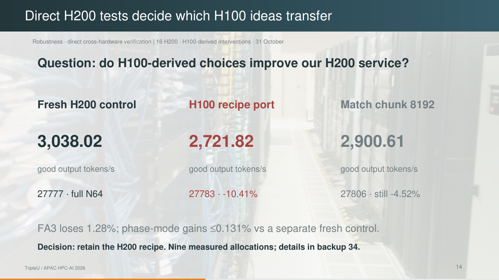

### Reasoning to communicate

- **Problem:** The H100 and H200 results cannot be compared as if only GPU type changed, so we needed to verify H100-derived ideas directly on target H200 hardware.
- **Why it matters:** A setting that wins or appears promising on H100 can lose on H200 because the hardware and deployment stack differ. Adopting it from cross-platform score ratios could degrade the actual H200 service.
- **Why this test:** Run four distinct H100-derived interventions on 16 H200 at N64 against fresh or explicit matched H200 controls. Check full protocol, joint SLA, runtime/source and output gates; keep each port’s changed factors visible.
- **What we learned:** FA3 and the H100 full recipe lost; HPC-Ops chunks recovered part of that branch’s loss but remained below the H200 incumbent; both inference-mode changes were below 0.14%. No transferred setting cleared the 1% usefulness gate.
- **Why the next step follows:** These tests close the current cross-hardware transfer question. We retain the H200-specific recipe, report the open official-quality limit, then hand over to the OpenFOAM speaker.

### Purpose

Answer the panel’s cross-hardware question using direct H200 measurements, not a conversion factor. A fresh H200 control lets us test selected H100-derived interventions on the target system. The runs show which tested ideas transfer, which lose, and why hardware-specific tuning remains necessary.

### Technical interpretation and reasoning

Three cards show target-hardware evidence, not a mixed H100/H200 score chart. All displayed throughput values are full N64 measurements on 16 H200. Teal is fresh control 27777 at 3,038.02 good output tokens/s. Red is the transferred full H100 recipe 27783 at 2,721.82, a 10.41% loss. Gray is HPC-Ops prefill with chunk 8192, job 27806 at 2,900.61, still 4.52% below that control. The smaller line summarises the FA3 loss and phase-mode changes; those mode gains use their separate 27826 control. There are no plot axes. Backup 34 provides the complete nine-job ledger, including N54, and the control for every delta.

### Terms and symbols to understand

- **H100-derived intervention:** A setting observed or selected during H100 work and then tested as an intervention on H200. This does not mean the complete original H100 deployment was reproduced byte for byte.
- **fresh H200 control 27777:** Current H200 DeepGEMM prefill with chunk 8192 and HPC-Ops/FlashInfer/MNNVL decode at N64; reference for the first transfer comparisons.
- **good output tokens/s:** AIPerf Goodput requests per second multiplied by the fixed 200 output-token target.
- **1% usefulness gate:** A prospective team decision threshold for deciding which small changes warrant confirmation; not an official contest rule.

### Interpreting the evidence or diagram

- All listed measurements ran on 16 H200 at N64, so the target-hardware comparisons use the H200 system rather than comparing H100 and H200 scores directly.
- Fresh control 27777 measured 3038.022907 good output tokens/s. FA3 decode 27779 measured 2999.245473 (−1.276404%).
- H100 full-recipe port 27783 measured 2721.815800 (−10.408319%). It changes a coupled prefill runner/chunk recipe, so its loss is not attributable to one factor.
- HPC-Ops prefill chunk 8192 job 27806 measured 2900.606831 (−4.523207%); chunk 6144 job 27804 measured 2821.884862 (−7.114431%). Larger chunks improved that losing branch versus chunk 4096, but did not beat the DeepGEMM incumbent.
- Phase-mode control 27826 measured 3039.167093; decode inference mode 27828 gained 0.006223%, and prefill inference mode 27830 gained 0.130765%. Both are below the team’s 1% usefulness gate.
- Four distinct additional H100-derived interventions are represented by jobs 27804, 27806, 27828 and 27830. Job 27826 is their explicit phase-mode control, not another candidate. The broader nine-job final verification also includes 27777, 27779, 27781 and 27783.
- MNNVL is the decode-side GPU collective communication path; NIXL transfers request KV state between the separate prefill and decode roles.

### Tradeoff and strength of evidence

- **Observation:** The direct H200 ports yielded losses for FA3, the H100 full recipe and both HPC-Ops chunk variants relative to their relevant H200 references. Phase-mode candidates were effectively flat against their explicit control.
- **Hypothesis:** Hardware-specific implementations or settings may not transfer as a complete recipe; test selected components on H200 under a matched target-system base before adopting them.
- **Supported conclusion:** Retain the H200 DeepGEMM/chunk-8192 prefill and HPC-Ops/FlashInfer/MNNVL decode recipe at N64. None of these tested ports improves goodput by the prospective 1% gate; this is the best-supported measured H200 recipe in this evidence set, not a claimed global optimum.
- **Unknown / limitation:** Each candidate is a single run; full official model accuracy is UNKNOWN. The H100 full-recipe port changes coupled settings, and chunk runner comparisons retain generated-seed and run-order limitations. These tests do not establish universal transferability.

### Spoken script

We asked whether ideas selected on H100 would help the H200 system. Rather than convert scores between GPUs, we tested them directly on 16 H200 at N64 against fresh H200 references. The H100-derived full recipe lost 10.41%; FA3 decode lost 1.28%. HPC-Ops prefill with chunk 8192 recovered part of that branch’s loss but remained 4.52% below the DeepGEMM control. The two phase-specific inference-mode tests changed goodput by only 0.006% and 0.131%, both below our 1% decision threshold. These results support keeping the H200-specific recipe. They are separate single-run comparisons, not a universal claim that H100 ideas never transfer, and the official model-quality score remains unknown.

### Avoid this interpretation

Do not compare an H100 score directly with an H200 score or call the best observed point a global optimum. The four distinct transferred settings are 27804, 27806, 27828 and 27830; 27826 is a control. No candidate cleared the team’s prospective 1% gate.

### Transition

This closes our measured AI transfer and tuning story. We retain the H200 recipe, state the remaining quality and packaged-replay limits, and hand over to OpenFOAM.

---

## Slide 15 — Better proxy metrics did not always improve qualifying throughput

**Hardware: H200 · two separate trials: sparse decode graphs and shallow EAGLE**

**Claim type: Experimental finding / method.**

### Quick brief · 10–20 seconds

Sparse graphs reduced capture memory but goodput fell 0.370208% versus control 27376. Full shallow EAGLE scored 2.080318% below target-only control 26949. These separate results reject neither idea universally; they bound the tested settings.

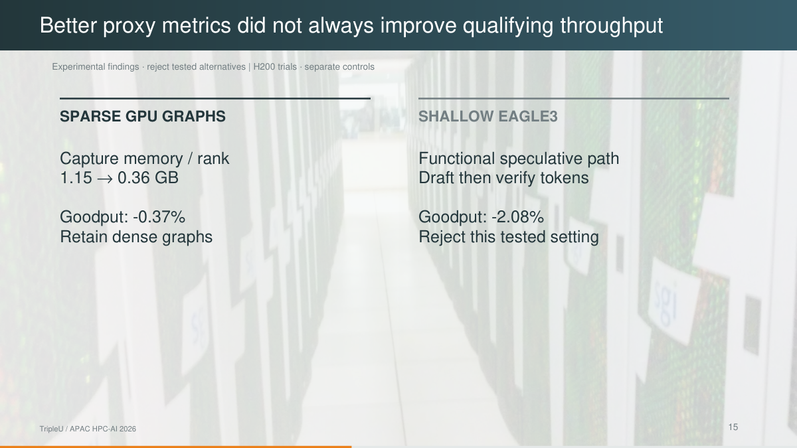

### Reasoning to communicate

- **Problem:** Optimizations can improve an attractive proxy while making the actual request-level objective worse.
- **Why it matters:** Resource savings and fewer decode steps matter only if they increase requests meeting both latency limits.
- **Why this test:** Place the sparse-graph control/candidate pair and the separate full EAGLE/target-only pair side by side, preserving each comparison's own baseline.
- **What we learned:** Sparse capture saved logged memory but reduced goodput 0.370208%; shallow EAGLE lost 2.080318% in its full pair.
- **Why the next step follows:** Keep the selected settings and avoid universal claims; any new variant needs its own matched full-service evidence.

### Purpose

Compare two proposed improvements that optimize a proxy or subcomponent, and explain why the team retained the existing serving choices after full-service outcomes did not improve.

### Technical interpretation and reasoning

Read the two evidence cards separately because they use different controls and answer different questions. Sparse-graph job 27510 compared with earlier control 27376: capture memory fell from 1.15 to 0.36 GB per rank, while goodput fell 0.370208%. This is a lower resource proxy, not a service win; the pair has one earlier control and differing seeds. The full shallow EAGLE run 27238 compared with target-only control 26949: 2,971.628430 versus 3,034.761104 good tokens/s, −2.080318%. The tested speculative configuration lost in its full workload. Neither card is a universal rejection of graph sparsity or speculative decoding; each closes the exact tested setting pending different evidence.

### Terms and symbols to understand

- **proxy metric:** A measurable resource or subcomponent value, such as capture memory, that may relate to the objective but is not the service objective itself.
- **goodput:** Rate of requests satisfying both latency limits, reported as good output tokens/s using the fixed 200-token target.
- **decode graph sparsity:** Using fewer captured decode shapes. It can reduce graph-related memory, but does not guarantee higher service throughput.
- **speculative decoding / EAGLE:** A draft method proposes tokens for the target model to verify. It can reduce decoding work only if verification and transfer overheads do not outweigh the savings.
- **target-only control:** The same serving path with only the target model and no draft-model speculation.
- **per-rank capture memory:** Memory logged for graph capture on one worker rank; it is not total VRAM and not an output-throughput metric.

### Interpreting the evidence or diagram

- Sparse graph card: 64 to 12 buckets and 1.15 to 0.36 GB capture memory per rank, but goodput is 0.370208% below earlier control 27376.
- EAGLE card: full 27238 reached 2,971.628430 versus target-only 26949 at 3,034.761104 good tokens/s, a 2.080318% loss.
- Each card supports keeping the tested alternative out of the selected configuration. The controls, mechanisms, and uncertainty differ; do not compare the two percentages as one experiment.

### Tradeoff and strength of evidence

- **Observation:** Sparse capture memory improved while goodput fell slightly; the full shallow EAGLE treatment lost goodput to its target-only control.
- **Hypothesis:** Less graph storage or draft-token speculation might improve useful serving throughput.
- **Supported conclusion:** Retain dense graphs and target-only serving for the tested configurations because the full service objective did not improve.
- **Unknown / limitation:** The results do not establish that all sparse graphs or all speculative methods fail; padding cost, other shapes, and alternative draft settings were not tested here.

### Spoken script

These cards show why a better component metric is not automatically a better service. Sparse graphs cut logged capture memory from 1.15 to 0.36 gigabytes per rank, yet goodput was 0.37 percent lower than its control. In a separate full comparison, shallow EAGLE scored 2.08 percent below the target-only control. The two tests have different controls, so we do not combine them. We retain dense graphs and target-only serving for these tested settings, without rejecting every possible variant.

### Avoid this interpretation

Do not treat capture memory as VRAM or goodput, compare the two percentages as one experiment, or claim universal failure of sparse graphs or speculative decoding.

### Transition

The closing slide separates what the serving evidence supports from two validation questions that remain open.

---

## Slide 16 — The optimised service retains 99.9154% of reference accuracy

**Hardware: Paired local MMLU-Pro study · same 16 H200 · official BTC quality decision remains unknown · handoff to unchanged OpenFOAM slide 35**

**Claim type: Local full-set quality measurement / claim boundary.**

### Quick brief · 10–20 seconds

On the same 12,032 MMLU-Pro questions and 16 H200s, the optimised service got 9,452 correct versus 9,460 for stock FP8. That retains 99.9154% of reference accuracy, above our local 99% threshold.

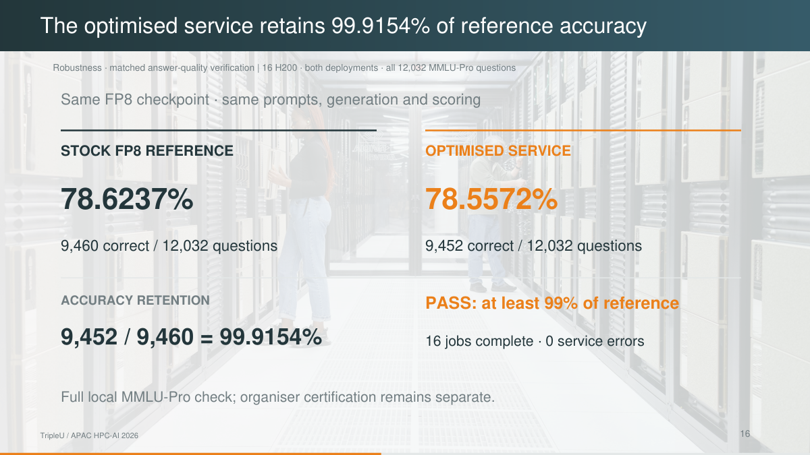

### Reasoning to communicate

- **Problem:** The accepted performance run proved that the service could meet its workload gates, but synthetic benchmark requests did not establish answer accuracy.
- **Why it matters:** Serving layout, kernels, batching and reductions can change generated answers even when the official checkpoint is retained. A quality claim therefore needs scored model answers, not only unchanged weights or good throughput.
- **Why this test:** Compare the stock official FP8 deployment with the accepted optimised service on the same two-node, 16-H200 hardware, identical pinned MMLU-Pro prompts and all 12,032 test questions. Keep the first response and use the frozen scorer. Count invalid parsed answers as wrong; keep length-capped answers in the denominator and score each parsed answer normally.
- **What we learned:** The stock deployment answered 9,460/12,032 correctly (78.623670%); the candidate answered 9,452/12,032 correctly (78.557181%). Their accuracy ratio is 99.915433%, above the local 99% point threshold. There were 434 candidate-only correct and 442 reference-only correct outcomes, so the net loss of eight is not only eight changed questions. All sixteen jobs completed with zero scored service errors.
- **Why the next step follows:** Close the AI section with the bounded local pass and its limits: one pass per role, category losses, and no BTC certification. Then hand over to the unchanged OpenFOAM section.

### Purpose

Close the AI talk with the completed full-set local quality comparison. Distinguish absolute accuracy from accuracy retention, show that the two complete deployments were compared on the same H200 hardware and inputs, and keep the local point-gate result separate from the organisers’ unknown quality decision.

### Technical interpretation and reasoning

The shared-input line reads “Same FP8 checkpoint · same prompts, generation and scoring”; the subtitle specifies 16 H200 GPUs, both complete deployments, and all 12,032 questions. Two comparison cards show stock reference (9,460/12,032 = 78.6237% accuracy) and the optimised service (9,452/12,032 = 78.5572% accuracy); this is not a chart and has no axes. The counts are numbers of questions; percentages label accuracy or accuracy retention. Dark teal identifies the stock reference, while orange identifies the candidate and threshold decision. These colors distinguish roles and the decision; they do not imply candidate accuracy is higher. Candidate accuracy (78.5572%) is below reference accuracy (78.6237%). Along the bottom, the left side gives “Accuracy retention = 9,452 / 9,460 = 99.9154%”; the right side shows PASS against the ≥99% threshold, plus 16/16 completed jobs and zero service errors. A neutral note says the organisers’ own quality decision remains separate. The oral handoff to OpenFOAM is unchanged.

### Terms and symbols to understand

- **accuracy:** The share of the 12,032 questions answered correctly: correct answers divided by all questions.
- **accuracy retention:** Candidate accuracy divided by reference accuracy. Here the equal question denominators cancel, so retention is 9,452/9,460 = 99.9154%. It is not the percentage of questions the candidate answered correctly.
- **stock FP8 reference:** Our local stock deployment of the official Qwen3-235B FP8 checkpoint. It is the measured denominator for this comparison, not a numeric organiser-provided score.
- **same 16 H200:** Both complete deployments used the same two-node, sixteen-H200 cluster. The comparison is H200-to-H200; no H100 estimate is involved.
- **local 99% point threshold:** The predeclared rule that candidate accuracy divided by this measured stock-reference accuracy must be at least 0.99. Passing it is a local result, not BTC certification.

### Interpreting the evidence or diagram

- Read each accuracy as correct answers divided by all 12,032 questions: stock 9,460/12,032 = 78.623670%; candidate 9,452/12,032 = 78.557181%.
- The candidate has eight fewer correct answers, a net difference of 0.066489 percentage points. Accuracy retention is the ratio of the two accuracies, 9,452/9,460 = 99.915433%, which passes the local 99% point threshold.
- The net difference hides 876 discordant outcomes: 434 questions were candidate-only correct and 442 were reference-only correct. There were gains and losses across shards and categories.
- Computer science retained 338/345 = 97.971014% and philosophy 383/387 = 98.966408%. The declared gate is aggregate only; these category results remain limitations.
- Each role received all 12,032 questions once, split into eight fixed shards. All sixteen jobs completed and both roles had zero scored service errors. The 101 invalid parses per role were scored wrong. Answers reaching the generation cap (1,484 reference; 1,468 candidate) stayed in the denominator and were scored normally from their parsed answer, not automatically marked wrong.
- This is one complete pass per deployment, not repeated independent deployments. Raw-answer replay verifies scoring but is not a second GPU trial. The local MMLU-Pro pass does not certify BTC’s evaluation or predict unseen benchmarks.

### Tradeoff and strength of evidence

- **Observation:** On identical 12,032-question inputs and the same 16 H200 GPUs, stock FP8 scored 9,460/12,032 (78.623670%) and the optimised deployment scored 9,452/12,032 (78.557181%). Both roles had zero scored service errors; all sixteen allocations completed.
- **Hypothesis:** The full local paired comparison tests whether the complete optimised serving implementation retains at least 99% of the measured stock deployment’s accuracy, while preserving every question and first response.
- **Supported conclusion:** The candidate retains 9,452/9,460 = 99.915433% of reference accuracy and passes the predeclared aggregate local 99% point threshold. This is a local MMLU-Pro result, not an organiser-certified result.
- **Unknown / limitation:** One complete pass per deployment does not establish statistical equivalence, identical answers, causality for any kernel or patch, or quality on unseen tasks. Category retention is below 99% in computer science and philosophy. BTC’s own quality outcome remains unknown.

### Spoken script

We tested the complete optimised service against a stock deployment of the same FP8 checkpoint, on the same sixteen H200 GPUs and all 12,032 MMLU-Pro questions. The stock deployment got 9,460 correct, or 78.62 percent. Our service got 9,452, or 78.56 percent. Dividing those accuracies gives 99.9154 percent retention, above our local 99 percent threshold. All sixteen jobs completed without scored service errors, and invalid answers stayed counted as wrong. This is one full local pass per deployment, not a BTC certificate or a guarantee for other benchmarks. I now hand over to OpenFOAM.

### Avoid this interpretation

Call 99.9154% accuracy retention, not candidate accuracy; candidate accuracy is 78.557181%. Do not say the services differed on only eight questions: 876 questions had discordant correctness outcomes. Do not present this local MMLU-Pro point-gate pass as BTC certification, statistical equivalence, causal attribution to one optimisation, or a guarantee on unseen tasks.

### Transition

The paired local quality check passes its aggregate point threshold, with its scope and limits clear. We now hand over to the unchanged OpenFOAM section.

---

## Slide 17 — Backup · two platforms, separate experimental systems

**Hardware: H200 + H100 · Firmus and NSCC ASPIRE 2A+**

### Quick brief · 10–20 seconds

Both systems allocate sixteen GPUs and use the same Qwen checkpoint and staged workload. Firmus uses H200s; NSCC uses H100s. Different hardware, schedulers, containers, and node conditions mean their scores are separate measurements, not a direct GPU conversion.

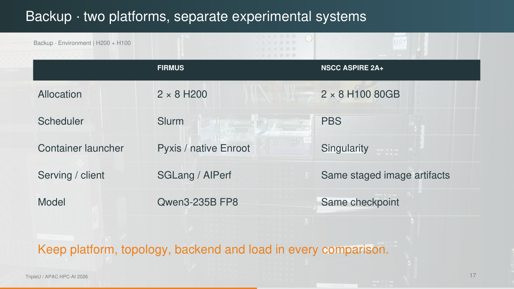

**AI backup section: open when a deeper explanation is needed.**

### Purpose

Set the comparison boundary for all later platform results: a shared model and client make experiments more comparable, but do not erase differences in hardware or deployment stack.

### Technical interpretation and reasoning

The table contrasts allocation, scheduler, container launcher, serving/client software, and model. Matching rows are useful controls: both systems have two eight-GPU nodes and use the same staged artifacts and Qwen3-235B FP8 checkpoint. Different rows are potential influences on latency and throughput. Slurm and PBS schedule resources; they do not execute model inference. Pyxis/Enroot and Singularity provide different container launch paths, while SGLang serves requests and AIPerf generates and measures client traffic. Therefore a score needs its platform, topology, backend, and load attached.

### Terms and symbols to understand

- **Firmus / NSCC ASPIRE 2A+:** Two separate compute sites: Firmus supplies H200 nodes; NSCC ASPIRE 2A+ supplies H100 nodes.
- **2 × 8 H200 / 2 × 8 H100:** Two nodes with eight GPUs each, sixteen GPUs per allocation. The GPU models and systems are different.
- **Slurm / PBS:** Schedulers that allocate and manage compute jobs. They are not the serving engine.
- **Pyxis / Enroot / Singularity:** Container launch tools. Containers package software, but different launchers and host stacks can still affect execution.
- **SGLang / AIPerf:** SGLang runs model serving; AIPerf sends benchmark requests and records service metrics.
- **FP8 checkpoint:** The shared model weights use an eight-bit floating-point representation; sharing weights does not make GPU runs equivalent.
- **platform comparison:** A comparison of complete systems. It needs matched workload plus explicit hardware, software, topology, and timing; GPU names alone are not a conversion factor.

### Interpreting the evidence or diagram

- This is supporting evidence for Q&A, hidden during the main slide show. It does not add a new experiment to the main argument.
- Common controls are the two-node, sixteen-GPU allocation, the staged serving and client artifacts, and the Qwen checkpoint.
- Platform differences include H200 versus H100 GPU generation, Slurm versus PBS, and different container launchers. CPU, driver, network, node cache, and process placement can also differ.
- The table establishes context; it does not provide a controlled performance result or quantify each site's contribution.

### Tradeoff and strength of evidence

- **Observation:** Both sites provide sixteen GPUs across two nodes and share staged images and model checkpoint, while GPU family, scheduler, launcher, and host environment differ.
- **Hypothesis:** Matching the model and request workload is necessary, but platform differences may still affect serving measurements.
- **Supported conclusion:** Report each platform's results separately and name its deployment conditions.
- **Unknown / limitation:** This table does not isolate the effect of any one platform difference or define an H100-to-H200 score multiplier.

### Spoken script

We tested on two systems, each with sixteen GPUs. Firmus uses H200s, Slurm, and Enroot-based containers; NSCC ASPIRE 2A+ uses H100s, PBS, and Singularity. Both use the same model checkpoint and staged benchmark artifacts, but drivers, networks, host caches, and launch paths can differ. So this slide is a map of experimental environments, not a speed comparison. Every score needs its own platform and settings.

### Avoid this interpretation

Do not pool H100 and H200 observations into one series, or infer relative speed from GPU model or memory capacity alone.

### Transition

Return to the question and main evidence after answering; these backups are not a second chronological talk.

---

## Slide 18 — Backup · FP8 geometry constrains a topology

**Hardware: H200 · tested FP8 path**

### Quick brief · 10–20 seconds

The failed TP8/EP1 partition had 192 elements, which leaves a 64-element remainder against a 128-wide FP8 block. EP2 changes the effective split to 384 elements, or three full blocks. That fixes this shape mismatch; it does not prove serving speed or quality.

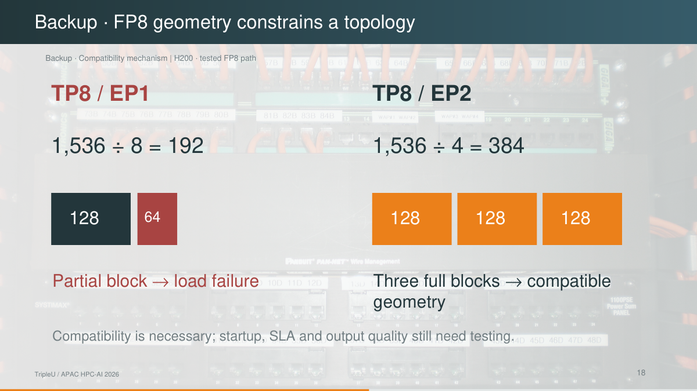

### Purpose

Teach a concrete compatibility failure from the model's weight geometry and distinguish a layout that can load from a deployment that has passed service tests.

### Technical interpretation and reasoning

Start with the MoE intermediate dimension, 1,536 elements, then divide by the effective tensor-parallel split. TP8/EP1 gives 1,536 ÷ 8 = 192. The tested kernel needs whole 128-element FP8 blocks, so 192 becomes one full block plus 64 unusable remainder elements. TP8/EP2 changes effective MoE tensor parallelism to four: 1,536 ÷ 4 = 384, exactly three full blocks. The red remainder marks a load-time compatibility failure, not lost output tokens. The arithmetic explains why the old shape failed and why the replacement shape is compatible; it is not a benchmark chart.

### Terms and symbols to understand

- **FP8 block:** A fixed group of 128 weight elements required by this tested kernel path. A partition ending halfway through a block cannot be loaded by that path.
- **MoE:** Mixture of Experts: a model layer routes tokens among expert sub-networks. Expert parallelism changes how those experts are distributed.
- **TP8 / EP1:** Eight-way tensor parallelism with one expert partition. Effective MoE tensor split is eight, producing 192 elements per partition.
- **TP8 / EP2:** Eight-way tensor parallelism with two expert partitions. Effective MoE tensor split is four, producing 384 elements per partition.
- **128 + 64:** The 192-element TP8/EP1 shard contains one complete 128 block plus a 64-element remainder, causing the tested load failure.
- **3 × 128 = 384:** The EP2 shard contains three complete blocks. The layout retains all model weights and experts; it changes partitioning.
- **compatibility vs performance:** Compatibility means the tensor shape meets a kernel's input requirement. Startup, latency, output quality, and throughput still need separate tests.

### Interpreting the evidence or diagram

- This is supporting evidence for Q&A, hidden during the main slide show. It does not add a new experiment to the main argument.
- The two equations are the key evidence: TP8/EP1 produces 192 elements; TP8/EP2 produces 384.
- The 64-element remainder is why the first tested path failed during loading. EP2 removes that remainder by changing expert distribution, not precision or model size.
- The footer lists evidence still required after compatibility: successful startup, service-level latency checks, and output-quality checks.

### Tradeoff and strength of evidence

- **Observation:** TP8/EP1 yields a 192-element partition, not divisible into 128-wide blocks; TP8/EP2 yields 384 elements, exactly three blocks.
- **Hypothesis:** Changing expert partitioning can make the existing FP8 weights compatible with the kernel while retaining the model contents.
- **Supported conclusion:** EP2 corrects the tested block geometry and makes a compatible deployment attempt possible; this combined layout change is not an isolated TP speedup.
- **Unknown / limitation:** Alignment alone does not establish successful full startup, request SLA, output quality, or improved throughput.

### Spoken script

The model has an intermediate dimension of 1,536 elements, and this FP8 kernel requires complete blocks of 128. With TP8 and one expert partition, each shard gets 192 elements: 128 plus a leftover 64, so loading fails. With two expert partitions, the effective split is four and each shard gets 384, exactly three blocks. This keeps the weights and experts; it changes how they are distributed. The result is compatible geometry, not evidence of a faster or correct full service.

### Avoid this interpretation

The red 64 is a remainder of weight elements, not GPUs or tokens. Do not call compatibility a throughput result or an isolated TP improvement.

### Transition

Return to the question and main evidence after answering; these backups are not a second chronological talk.

---

## Slide 19 — Backup · historical milestones behind the decisions

**Hardware: H200 · different loads, layouts, and runtime settings**

### Quick brief · 10–20 seconds

The H200 chart rises from 1,297 good tokens/s at N32 to a 3,044 N64 mean. It shows better measured operating points over the campaign, but each milestone changes load or configuration, so the bars do not assign a causal gain to each optimization.

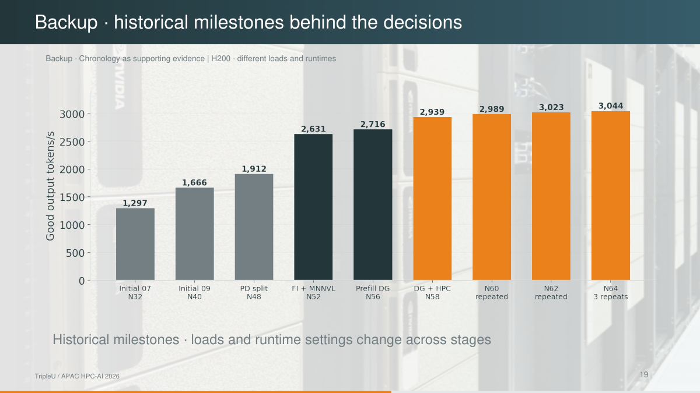

### Purpose

Use the historical chart as context for the research questions: it shows which operating points motivated later controlled tests, while teaching why a rising sequence is not a cumulative causal experiment.

### Technical interpretation and reasoning

The horizontal axis lists named milestones, not dates or equal time intervals. The vertical axis is good output tokens per second, so taller bars mean more requests meeting the latency limits under that milestone's workload. Gray marks early layouts, teal marks backend specialization, and orange marks later tuning and repeat points. The chart progresses from 1,297 at N32 and 1,666 at N40, through 1,912 at N48 and 2,631 at N52, to a rounded historical N64 mean of 3,044. Since concurrency, worker layout, backends, and runtime conditions change along the way, the chart shows the team found stronger measured configurations; it does not show how much any one change caused.

### Terms and symbols to understand

- **good output tokens/s:** Qualifying requests per second multiplied by the requested 200 output tokens; higher means more useful output under the latency rule.
- **milestone chart:** A grouped history of operating points. Horizontal spacing is categorical, not elapsed time, and neighboring bars are not necessarily matched experiments.
- **N32–N64:** Target numbers of simultaneous client requests, not GPU counts. Increasing N changes offered load and can change latency and useful throughput.
- **repeated point:** A configuration measured again to check reproducibility. A repeat tests consistency; it does not isolate the cause of an earlier gain.
- **causal ablation:** A comparison that changes one defined factor while holding others sufficiently constant. This historical chart is not one cumulative ablation.

### Interpreting the evidence or diagram

- This is supporting evidence for Q&A, hidden during the main slide show. It does not add a new experiment to the main argument.
- The milestones are 1,297 (initial 07/N32), 1,666 (initial 09/N40), 1,912 (split/N48), 2,631 (FlashInfer plus MNNVL/N52), 2,716 (DeepGEMM prefill/N56), 2,939 (DeepGEMM plus HPC-Ops/N58), 2,989 (repeated N60), 3,023 (repeated N62), and 3,044 (three historical N64 runs). Labels are rounded.
- Later N62 runs measured 3,022.034919 and 3,023.072304; later N64 repeats measured 3,044.489701 and 3,044.074628. These support repeatability at those settings, not a universal optimum or causal explanation for every step.
- Colors group phases of work; they are not pass/fail marks. Bar height is a score, not a confidence interval.

### Tradeoff and strength of evidence

- **Observation:** Measured good output throughput rises across named operating points from 1,297 at N32 to a rounded 3,044 at historical N64.
- **Hypothesis:** Recovering a usable split and transfer path, then specializing attention, collective, prefill, and decode backends, helped identify stronger configurations.
- **Supported conclusion:** The chart is a map of milestones and later replication targets; it is not evidence the named optimizations add up to the full rise.
- **Unknown / limitation:** Loads, topology, runtime settings, and observation conditions vary; individual causal contributions and a global optimum are not established.

### Spoken script

This chart summarizes how H200 work moved from about 1,300 good output tokens per second at N32 to about 3,044 at N64. The horizontal axis names milestones, not dates; the vertical axis is latency-qualified output rate. Colors group phases of work. But load and software settings change between bars, so this is a history of better measured operating points, not proof that each named optimization caused the full increase.

### Avoid this interpretation

Do not read horizontal spacing as time, add bar differences as independent gains, or treat colors as pass/fail. N is request concurrency, not GPU count.

### Transition

Return to the question and main evidence after answering; these backups are not a second chronological talk.

---

## Slide 20 — Backup · request-scoped descriptor construction

**Hardware: H200 branch · CPU geometry**

### Quick brief · 10–20 seconds

The patch builds descriptors for requested KV pages and coalesces contiguous ranges while preserving mapping and stride. CPU tests passed 720 geometry cases; the fixture explicitly did not validate real GPU transport.

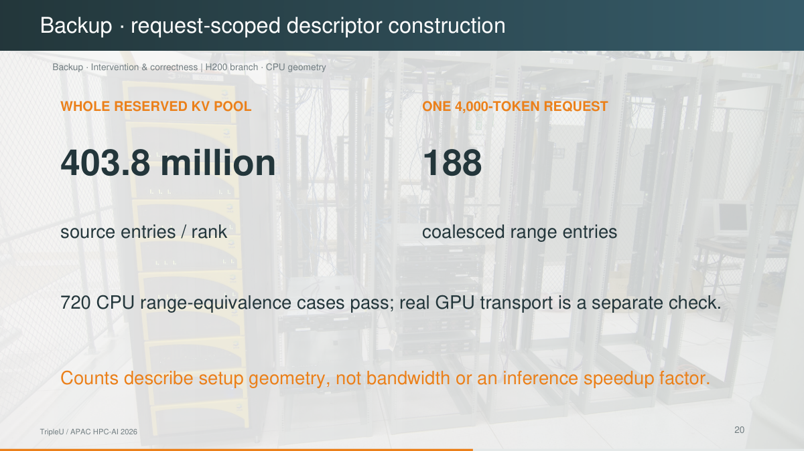

### Purpose

Describe the intervention precisely and put its correctness evidence at the right level. The patch changes descriptor scope and coalescing in heterogeneous-TP transfer while retaining the relevant mapping behavior; CPU equivalence is not the same as validating real transport on GPUs.

### Technical interpretation and reasoning

This is step 5 and the first half of step 6 in the seven-step chain: exact change, then the correctness gate that was actually run. Keep the distinction between address-range equivalence and real GPU transfer visible.

### Terms and symbols to understand

- **request-scoped descriptors:** Constructing transfer metadata only for KV pages needed by the current request instead of enumerating the entire KV pool.
- **coalesce contiguous ranges:** Combine adjacent memory ranges into fewer descriptors while preserving the locations and strides needed for the transfer.
- **KV head mapping:** The mapping from source KV heads to decode peer ranges; the patch metadata says this mapping was retained.
- **per-token stride:** The spacing between token-associated data locations when only a KV-head slice is sent; this must remain correct after coalescing.
- **720 cases:** Number of retained original-versus-patched CPU byte-range equivalence cases that passed.
- **real GPU transport: false:** The retained geometry fixture explicitly does not claim to have validated a real GPU transfer.
- **notifications:** Transfer completion signaling retained by the patch scope; it was not the changed experimental factor.

### Interpreting the evidence or diagram

- This is supporting evidence for Q&A, hidden during the main slide show. It does not add a new experiment to the main argument.
- Step 5 — Intervention: replace full-pool source and destination descriptor enumeration with request-scoped descriptors, then coalesce contiguous ranges.
- The patch scope retains equal-TP behavior, weights, precision, KV-head mapping, per-token stride where a head slice is sent, and notifications.
- Step 6, correctness part: 720 original-versus-patched CPU geometry cases pass byte-range equivalence.
- The fixture records real GPU transport validation as false. Therefore CPU mapping checks do not prove GPU transfer, server readiness, or valid responses.

### Tradeoff and strength of evidence

- **Observation:** The patch implements request-only descriptor preparation and contiguous-range coalescing; retained CPU tests pass 720 range-equivalence cases, including the representative count of 188 for the contiguous request.
- **Hypothesis:** If the mapping is preserved while irrelevant pool ranges are omitted, setup can do less descriptor work without changing the KV bytes required by the request.
- **Supported conclusion:** The CPU fixture supports address and byte-range equivalence for its tested geometries. It is a correctness gate for the mapping, not a full deployment validation.
- **Unknown / limitation:** The fixture does not validate real GPU transport. It does not time old and new descriptor creation or establish that this change alone resolves the earlier timeout.

### Spoken script

The patch changed the scope of descriptor preparation. Instead of enumerating source and destination ranges across the whole KV pool, it builds descriptors for the current request and coalesces adjacent ranges. Its metadata says equal-TP transfers, model weights, precision, KV-head mapping, required per-token stride, and transfer notifications remain unchanged. We then checked original-versus-patched address and byte-range behavior on CPU across 720 geometry cases. Those tests support correctness of the tested mapping. The retained fixture explicitly says real GPU transport was not validated. So this step does not prove that the GPU copy worked, that the servers were ready, or that the request returned valid output. It is one correctness gate in the chain, not the end-to-end result.

### Avoid this interpretation

Do not describe 720 CPU geometry cases as 720 GPU transfers. Do not say that the patch changed all NIXL transfers or altered weights/precision.

### Transition

Return to the question and main evidence after answering; these backups are not a second chronological talk.

---

## Slide 21 — Backup · what the KV recovery run actually proves

**Hardware: H200 · jobs 22271 / 22294**

### Quick brief · 10–20 seconds

On patched job 22294, pair warmup took 0.68–0.70 seconds per request and full N32 goodput was 1,422.96 with 95.87% joint SLA and zero errors. No matched unpatched control measures speedup.

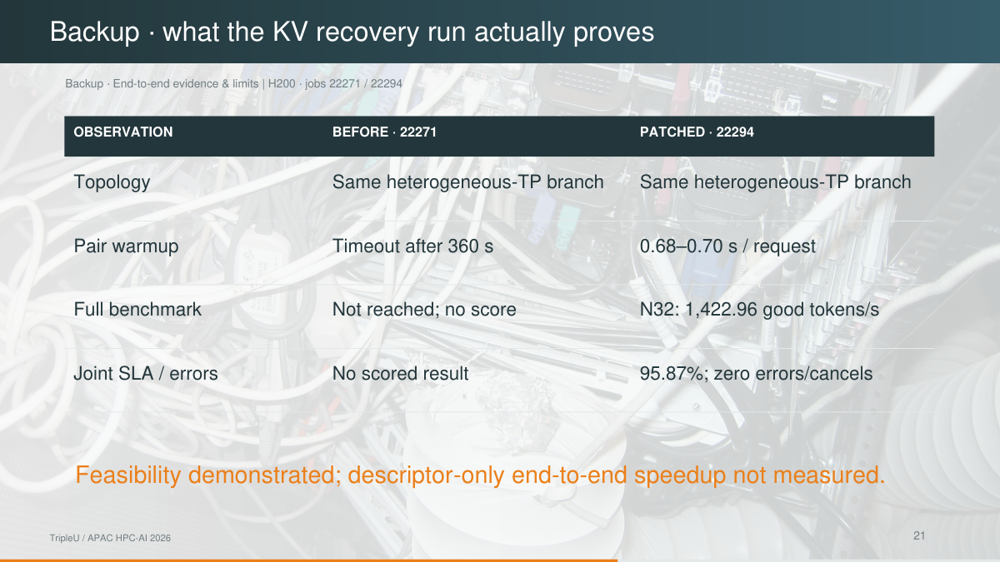

### Purpose

Close the seven-step chain with real end-to-end evidence and an explicit limit. The patched heterogeneous topology completed P/D warmup and a full N32 confirmation, but the absence of an equivalent successful no-patch run prevents causal speedup attribution.

### Technical interpretation and reasoning

This is steps 6 and 7: real path/result, then decision and unknowns. State the warmup duration, benchmark score, joint SLA, and zero errors as results of patched job 22294, not as a directly matched speedup over 22271.

### Terms and symbols to understand

- **job 22294:** The retained patched run on the same heterogeneous P8 TP8/EP2 to D8 TP4/EP4 topology family.
- **0.68–0.70 seconds/request:** Observed pair-warmup duration per request after the servers were ready; not a separately isolated descriptor-initialization timer.
- **N32:** Client concurrency target of 32 in-flight requests for the full confirmation benchmark.
- **1,422.96 good tokens/s:** Measured good output-token throughput for the full N32 confirmation on the patched topology.
- **95.87% joint SLA:** Share of evaluated requests passing both TTFT and mean ITL limits in this result.
- **zero errors/cancellations:** No request errors or cancellations were reported in the retained confirmation result.
- **matched unpatched control:** An otherwise equivalent run without the patch, required to attribute a performance difference to the patch; no successful one exists for this exact topology.

### Interpreting the evidence or diagram

- This is supporting evidence for Q&A, hidden during the main slide show. It does not add a new experiment to the main argument.
- Step 6, end-to-end part: patched job 22294 completed both real prefill/decode warmup paths in 0.68–0.70 seconds per request after workers were ready.
- It then completed a full N32 confirmation: 1,422.96 good output tokens/s, 95.87% joint SLA, zero errors and zero cancellations.
- Step 7 — Decision: the run establishes feasibility of the patched heterogeneous topology and that this run served requests under the local benchmark protocol.
- It does not establish the patch's independent speedup: no successful no-patch end-to-end control exists for the same topology, and no old/new descriptor setup timer or causal latency decomposition was collected.

### Tradeoff and strength of evidence

- **Observation:** Patched job 22294 completed P/D warmup in 0.68–0.70 seconds per request after server readiness, then scored 1422.96 good tokens/s at N32 with 95.87% joint SLA and zero errors/cancellations.
- **Hypothesis:** Request-scoped descriptor setup may have helped the previously blocked topology reach a serving state, but differences between attempts could also explain the contrast.
- **Supported conclusion:** The supported claim is patched-path feasibility and an end-to-end result for this P8 TP8/EP2 to D8 TP4/EP4 run. The patch's speedup is unmeasured.
- **Unknown / limitation:** There is no successful matched unpatched run for this exact topology; old-versus-new setup time, network utilization, causal warmup decomposition, and the patch's independent goodput contribution remain unknown. Bandwidth, KV layout, placement, and other bootstrap explanations were not ruled out.

### Spoken script

The patched-path result is stronger than the CPU geometry test, but its interpretation still has a boundary. In job 22294, on H200 Firmus with the heterogeneous P8 TP8/EP2 to D8 TP4/EP4 layout, both real prefill and decode warmup paths completed in 0.68 to 0.70 seconds per request after the workers were ready. The full N32 confirmation measured 1,422.96 good output tokens per second, 95.87 percent joint SLA, and zero errors or cancellations. That establishes that this patched topology served requests in this run. It does not measure a patch speedup: we lack a successful no-patch control on the same topology, separate old-versus-new descriptor timings, and a causal latency breakdown. Network use, KV layout, placement, and other bootstrap work remain possible factors.

### Avoid this interpretation

Do not divide the 360-second timeout by 0.68–0.70 seconds and report a speedup. The baseline is a timeout without AIPerf; the patched run is a different attempt, and setup time was not isolated.

### Transition

Return to the question and main evidence after answering; these backups are not a second chronological talk.

---

## Slide 22 — Backup · H100: first-token gain, goodput loss

**Hardware: H100 · NSCC · full N54 · jobs 222027/222028**

### Quick brief · 10–20 seconds

In one matched H100 N54 pair, FA3 cut mean TTFT from 713.199 to 594.276 ms, but goodput fell from 2,420.945 to 2,401.284 tokens/s, about 0.812%. A faster first token did not improve the full request objective.

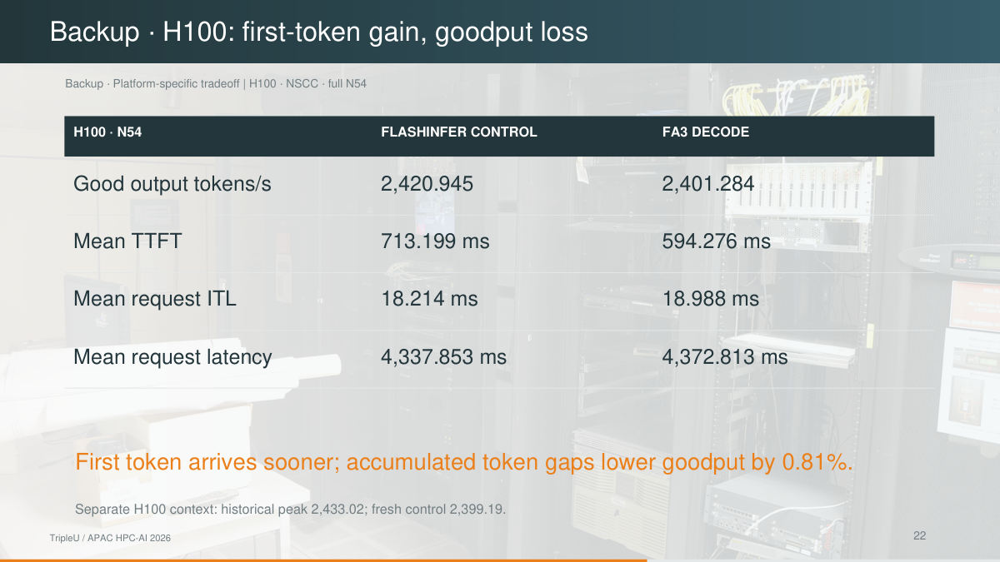

### Purpose

Explain why evaluating only time to first token can select the wrong decode backend: latency over a long answer and qualifying throughput also matter.

### Technical interpretation and reasoning

The pair changes decode attention from FlashInfer to FA3 while holding H100, N54 load, and the rest of the tested path matched. Read across each metric: FA3 lowers mean time to first token by 118.922 ms, but raises mean inter-token latency by 0.773 ms. Repeated over roughly 199 token intervals, that adds about 154 ms. Mean request latency rises from 4,337.853 to 4,372.813 ms, and goodput falls 0.812%. Thus the early response improves while the full answer becomes slower on average and fewer requests qualify per second. This is one pair for this H100 decode setting, not a general ranking of attention libraries.

### Terms and symbols to understand

- **FA3:** FlashAttention-3, an attention implementation tested here for decode. It remained the H100 prefill backend in this pair.
- **FlashInfer:** The decode-attention control implementation in the matched pair.
- **TTFT:** Time to first token: delay from request start until the first answer token arrives.
- **ITL:** Inter-token latency: time between consecutive generated tokens. A small increase repeated over a long answer can add substantial total time.
- **goodput:** Rate of requests meeting the service latency rules, converted to good output tokens/s. It captures more than startup latency.
- **H100 N54:** H100 system under a target of 54 simultaneous client requests; it is not the H200 N64 operating point.
- **matched pair:** Two runs with one intended setting change and otherwise aligned workload/configuration. One pair supports a local comparison, not universal ranking.

### Interpreting the evidence or diagram

- This is supporting evidence for Q&A, hidden during the main slide show. It does not add a new experiment to the main argument.
- FlashInfer → FA3: good output tokens/s 2,420.945 → 2,401.284; mean TTFT 713.199 → 594.276 ms; mean ITL 18.214 → 18.988 ms; mean request latency 4,337.853 → 4,372.813 ms.
- Both runs passed team-reviewed protocol, runtime, and output checks on the assigned cluster, and FA3 was confirmed active on all eight decode ranks. That establishes the tested intervention actually ran, not that it improved the service.
- The historical H100 individual peak of 2,433.019859 and fresh N54 control of 2,399.186728 are context, not the two arms of this matched pair. They do not provide an H100/H200 hardware conversion.

### Tradeoff and strength of evidence

- **Observation:** FA3 improves mean TTFT by 118.922 ms but worsens mean ITL by 0.773 ms and mean request latency by 34.960 ms; goodput falls 0.812%.
- **Hypothesis:** Changing decode attention can move startup and per-token costs in opposite directions.
- **Supported conclusion:** Keep FlashInfer for this tested H100 decode setting; FA3 remains used for prefill.
- **Unknown / limitation:** One matched pair does not rank attention backends generally or isolate exact kernel-level causality.

### Spoken script

FA3 makes the first token arrive about 119 milliseconds sooner. But each later token is separated by a slightly longer gap. Across a long answer, those gaps add up: average request latency rises by about 35 milliseconds and goodput falls about 0.81 percent. Both runs were checked on the assigned H100 cluster, and the FA3 path was active on all decode ranks. For this one setting we keep FlashInfer for decode; this does not rank the libraries for every workload.

### Avoid this interpretation

Do not choose a backend from TTFT alone, treat a 0.812% one-pair result as universal, or compare the H100 peak directly with H200 results.

### Transition

Return to the question and main evidence after answering; these backups are not a second chronological talk.

---

## Slide 23 — Backup · does a startup saving survive reversed order?

**Hardware: H100 · NSCC · startup prefetch comparison**

### Quick brief · 10–20 seconds

Read-first initially reduced scheduler walltime by 18.74%, but the reversed-order confirmation saved only 9.84%, below the predeclared 10% threshold. Goodput changed slightly in both pairs; unknown cache state prevents a cold-storage causal claim.

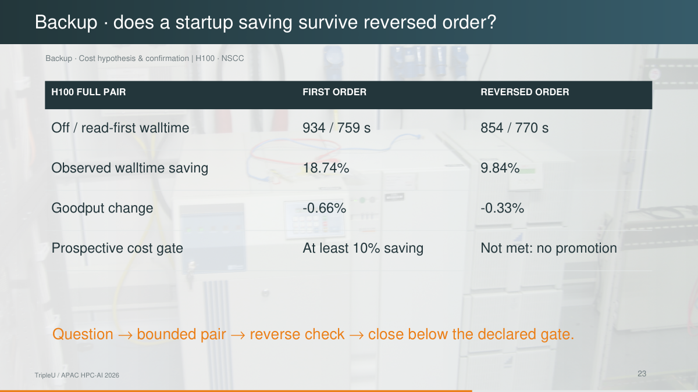

### Purpose

Teach why a favorable first pair is not enough for adopting a startup optimization: execution order, cache state, nodes, and the predeclared cost threshold affect interpretation.

### Technical interpretation and reasoning

Compare the first pair with the reversed-order confirmation. In the first pair, off/read-first walltime was 934/759 seconds, a reported 18.74% saving, while goodput fell 0.659%. In the reverse-order pair, walltime was 854/770 seconds, a 9.84% saving, and goodput changed −0.326388%. The planned rule required at least 10% walltime saving and at most 2% goodput loss. The reverse pair meets the throughput tolerance but misses the walltime requirement. Scheduler walltime includes startup and cleanup; it is not the 120-second steady-state score window.

### Terms and symbols to understand

- **read-first:** Read the prefill checkpoint before the measured serving phase to test whether startup can be shortened.
- **scheduler walltime:** Elapsed time for the whole scheduled job, including startup and cleanup. It is not steady-state goodput or the scored profiling window.
- **reversed-order confirmation:** Repeat the paired conditions in the opposite order to check whether order or warm cache influenced the first result.
- **predeclared threshold:** A decision rule written before seeing the confirmation result: save at least 10% walltime and lose no more than 2% goodput.
- **cold prefix vs cold OS cache:** Cold prefix means no reusable prompt/KV prefix. Cold OS cache means checkpoint file pages are not already in memory. This experiment did not verify cold OS cache.
- **goodput:** Throughput of requests meeting the joint latency rule; it is separate from total job walltime.

### Interpreting the evidence or diagram

- This is supporting evidence for Q&A, hidden during the main slide show. It does not add a new experiment to the main argument.
- The first pair looked favorable for startup time but had a 0.659% goodput loss. The reversed pair cut the apparent saving below the 10% decision threshold.
- The reverse pair's 0.326388% goodput change is within the stated 2% tolerance, but that alone cannot rescue the branch because the walltime threshold was missed.
- Node differences and unverified file-cache state mean the result cannot be assigned to cold storage. A cold prefix is a model KV-cache condition and is not the same as cold filesystem pages.

### Tradeoff and strength of evidence

- **Observation:** Read-first saved 18.74% walltime in the first order but 9.84% after reversing the order; goodput changed −0.659% and −0.326388%, respectively.
- **Hypothesis:** Reading prefill weights before measured startup may reduce startup walltime.
- **Supported conclusion:** The reverse-order confirmation missed the predeclared 10% saving threshold, so the team did not adopt the change.
- **Unknown / limitation:** Unverified OS cache state and node differences prevent a causal cold-storage explanation.

### Spoken script

Reading weights before serving first appeared to save about 19 percent of job time. But the team repeated the pair in reverse order. The saving fell to 9.84 percent, below the 10-percent requirement set in advance. The small goodput change stayed within its tolerance, but the main time-saving rule was missed. We therefore did not adopt read-first from the favorable first pair. We also cannot blame cold storage because file-cache state was not verified.

### Avoid this interpretation

Do not equate scheduler walltime with scored serving time, call prompt-prefix cache a filesystem cache, or claim cold-storage causality.

### Transition

Return to the question and main evidence after answering; these backups are not a second chronological talk.

---

## Slide 24 — Backup · source-supported changes that did not win

**Hardware: H200 · full-model serving comparisons**

### Quick brief · 10–20 seconds

Several H200 changes were activated and measured, but gains were small, negative, or worse in a tail metric. For example, a prefill attention change lost 6.385% goodput. A working flag is not enough to replace the selected configuration.

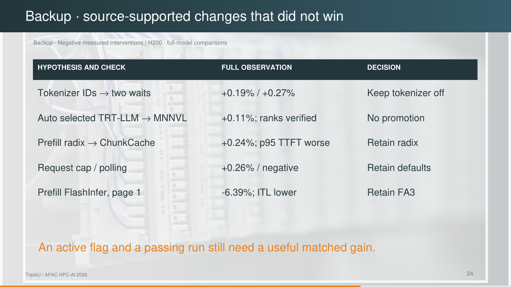

### Purpose

Show how the team used source inspection, runtime activation checks, matched controls, and output review to decide whether small interventions deserved adoption.

### Technical interpretation and reasoning

The rows are independent hypotheses, not pieces of one cumulative optimization. Source review first identified a setting the runtime could consume; logs then confirmed activation; full serving runs measured the result. A small positive goodput change can fall below a useful threshold or worsen p95 first-token latency. Negative and neutral results therefore answer the research question: functionality is necessary, but only improvement in the service objective justifies changing the retained configuration.

### Terms and symbols to understand

- **source inspection:** Reading implementation code to see whether a setting is supported and which code path it selects. It predicts behavior but does not prove the runtime used it.
- **runtime activation check:** Evidence in logs or per-rank state that the intended backend or option actually ran during the measured job.
- **matched control:** A comparison run with the intended factor changed and workload/configuration otherwise held sufficiently constant.
- **useful-gain threshold:** A preselected minimum improvement that makes the operational change worth keeping; a tiny positive percentage may be noise or too small to matter.
- **p95 TTFT:** The 95th-percentile time to first token. It measures a slow tail, which can worsen even when mean latency improves.
- **TRT-LLM / MNNVL:** Alternative collective communication backends; selecting one is a configuration change whose activation and full-run result must be checked.
- **ChunkCache / RadixCache:** Prefill cache implementations compared in a full serving pair; the small goodput difference came with worse p95 TTFT for ChunkCache.
- **page 1 attention:** A prefill FlashInfer setting affecting the first attention page; the tested change reduced ITL but lost goodput.

### Interpreting the evidence or diagram

- This is supporting evidence for Q&A, hidden during the main slide show. It does not add a new experiment to the main argument.
- Tokenizer wait changes measured +0.192% and +0.270%; the team kept tokenizer batching off. Switching the auto-selected prefill collective from TRT-LLM to MNNVL activated on all eight prefill ranks but gained only +0.109807% in full run 27138.
- Prefill RadixCache to ChunkCache gained +0.240921%, but p95 TTFT worsened, so RadixCache stayed. Request-cap and polling comparisons were +0.26% or negative and did not demonstrate useful gain.
- Prefill FlashInfer page 1 reduced ITL but lost 6.385% goodput. Percentages belong to separate branches; do not add them as if they were components of one run.

### Tradeoff and strength of evidence

- **Observation:** Changes had source/runtime checks and full serving observations, but measured gains were small, negative, or mixed with worse tail latency.
- **Hypothesis:** Changes in tokenization, collective, cache, request cap, polling, or attention might improve goodput.
- **Supported conclusion:** Keep a change only when the intended path ran and a controlled service comparison improves the objective enough to matter.
- **Unknown / limitation:** Small single-run differences may reflect run variation; these rows do not establish a CPU bottleneck or universal feature ranking.

### Spoken script

These are separate full-model tests, not source-only guesses. The team checked that an option was supported, verified it actually activated, then measured serving against a control. A few changes were slightly positive, but gains were too small or came with worse tail latency. The prefill attention change lost about 6.4 percent goodput. So the existing choices stayed: a working flag is not enough unless the service objective improves.

### Avoid this interpretation

Do not add percentages from separate branches, treat runtime activation as a speedup, or call a small positive single-run change a robust win.

### Transition

Return to the question and main evidence after answering; these backups are not a second chronological talk.

---

## Slide 25 — Backup · scope limits of kernel and source evidence

**Hardware: H200 + H100 + CPU · separate evidence rows**

### Quick brief · 10–20 seconds

The 2,549.20 N52 attention package changed several factors; representative Triton probes, CPU fixtures, and source review answer narrower questions. Full Qwen compilation stopped at a RoPE/KV assertion. None alone proves a full-model serving gain.

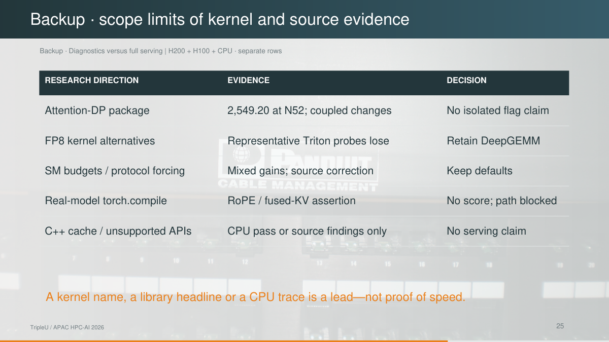

### Purpose

Answer what kernel names, profiles, and source inspection can establish, and prevent a component result on one hardware family from being mistaken for full-model evidence on another.

### Technical interpretation and reasoning

Read each row as an evidence boundary. The N52 H200 attention package is a real serving score but has coupled changes. H100 Triton probes test selected kernel shapes, not every model shape. SM budgets are bounded kernel/runtime checks, not model-level speed results. NCCL logs corrected an earlier interpretation: the label LL did not mean the tested control used that low-latency protocol for all messages. The real Qwen compile reached a native RoPE/fused-KV assertion before scoring. C++ CPU fixtures and source findings are narrower still. Mixing these rows would mix H200, H100, and CPU evidence.

### Terms and symbols to understand

- **attention-DP package:** An H200 N52 full-serving configuration combining attention data parallelism with DeepGEMM/DeepEP; several factors changed together, so attribution is coupled.
- **Triton probe:** A small GPU-kernel test on representative shapes. Losing on those shapes is evidence about those shapes, not every Qwen operation.
- **SM budget:** A limit on GPU streaming multiprocessors available to a kernel. A kernel/runtime result may not transfer to whole-service goodput.
- **NCCL LL / Simple:** Two collective communication protocols. The label LL alone did not prove LL was selected; logs showed Simple selected for the relevant large-message control.
- **torch.compile / RoPE / fused-KV:** PyTorch compilation of the real model stopped when rotary position encoding met an unsupported fused key-value-cache interface. No full-model score resulted.
- **C++ fixture:** A CPU test of helper/cache code. It can catch arithmetic or API behavior but does not load the Qwen model or serve on GPUs.
- **source finding:** Code review showing that a flag or API has, lacks, or may have a consumer. It does not prove activation at runtime.
- **hardware scope:** H200 package scores, H100 kernel probes, and CPU fixtures are distinct evidence and must not be merged into one comparison.

### Interpreting the evidence or diagram

- This is supporting evidence for Q&A, hidden during the main slide show. It does not add a new experiment to the main argument.
- The H200 N52 attention-DP plus DeepGEMM/DeepEP package scored 2,549.20, below the retained MNNVL point; coupled settings block one-factor attribution.
- Representative H100 FP8 Triton probes lost to DeepGEMM in tested shapes. H100 SM budgets 80/96/120 were mixed or below consistency criteria; 132 was retained without claiming a model gain.
- The small 0.2315% NCCL point did not justify adoption after logs showed the control already selected Simple for large messages. Qwen compile failed before score; CPU fixtures did not test serving.

### Tradeoff and strength of evidence

- **Observation:** Evidence ranges from one H200 serving score through H100 kernel/resource probes to CPU-only helpers and source review; their scopes differ.
- **Hypothesis:** Alternative kernels, communication protocols, resource budgets, or APIs might improve a specific part of serving.
- **Supported conclusion:** Use component evidence to select a full-model test only when the code path and hardware support it; do not claim service improvement from probes or source alone.
- **Unknown / limitation:** Untested shapes and configurations may differ. The failed Qwen compile and CPU tests leave full-model compatibility and performance unresolved.

### Spoken script

This slide mixes evidence from H200, H100, and CPU, so keep the scopes separate. The attention package is a real H200 serving score, but it changed multiple factors. Triton probes cover selected H100 kernel shapes. CPU fixtures check helper code only. The full Qwen compile stopped at a position-encoding and KV-cache interface assertion and produced no score. These results help rule out or prioritize ideas; none alone proves faster full-model serving.

### Avoid this interpretation

Do not combine H200, H100, and CPU results, generalize representative kernels to all shapes, infer protocol from a kernel label, or invent a score for the failed compile.

### Transition

Return to the question and main evidence after answering; these backups are not a second chronological talk.

---

## Slide 26 — Backup · the retained settings on each platform

**Hardware: H200 N64 · H100 N54**

### Quick brief · 10–20 seconds

The retained H200 recipe and H100 recipe remain separate. H200 now also has a complete portable acceptance run at 3,051.52 good tokens/s; this validates deployment, not H100-to-H200 conversion.

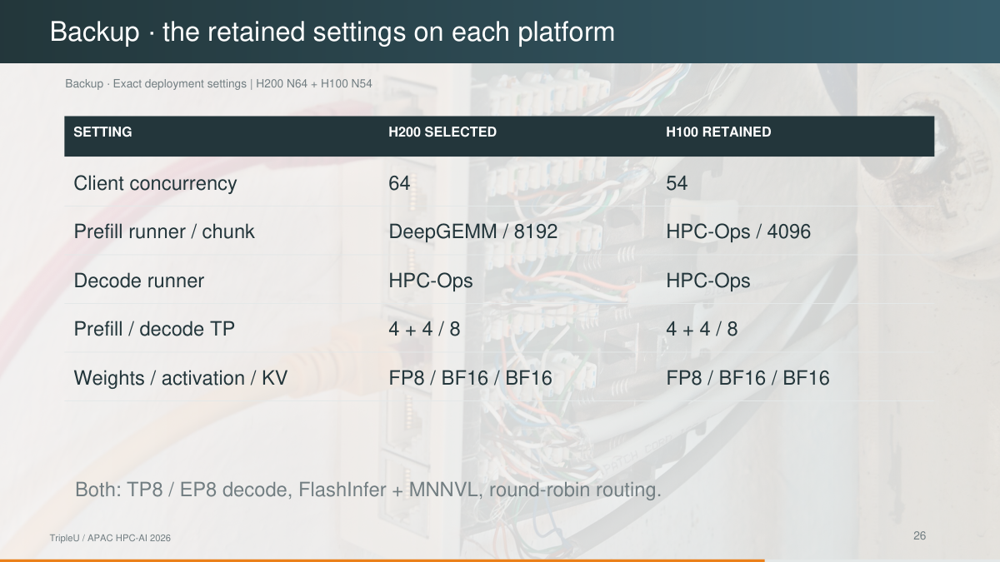

### Purpose

Document the currently retained measured recipes on each platform and add the completed H200 portable deployment acceptance. Keep H100 measurements separate; a successful H200 package run does not convert H100 scores or certify official quality.

### Technical interpretation and reasoning

Keep the existing H200/H100 configuration table and add a separate H200 acceptance note: job 28197, 16 H200, N64, full portable path, 611 seconds, 3051.518173 good tokens/s, 1881/1907 joint passes. Label H100 N54 configuration as its own measured operating point; do not imply it matches or predicts the H200 result. Note official model quality is UNKNOWN.

### Terms and symbols to understand

- **H200 N64 / H100 N54:** GPU platform plus client concurrency target: 64 requests for H200, 54 for the separate H100 configuration.
- **prefill / decode:** Prefill processes prompt tokens; decode generates response tokens autoregressively, one step at a time.
- **TP / EP:** Tensor parallelism splits tensor operations across GPUs. Expert parallelism distributes MoE experts; retained decode uses TP8/EP8.
- **DeepGEMM / HPC-Ops:** DeepGEMM is selected H200 prefill backend. HPC-Ops is used for decode on both systems and prefill on H100.
- **FP8 / BF16:** Weights use 8-bit floating point; activations and KV cache use 16-bit brain floating point. They describe different model data.
- **FlashInfer / MNNVL:** FlashInfer implements decode attention; MNNVL handles GPU collective communication. They serve different functions.
- **round-robin:** The gateway sends successive requests to the two prefill workers in turn.
- **dense decode graphs:** The H200 configuration captures decode shapes 1 through 64. This is a graph-shape setting, not 64 concurrent requests.

### Interpreting the evidence or diagram

- This is supporting evidence for Q&A, hidden during the main slide show. It does not add a new experiment to the main argument.
- H200: client concurrency 64; two TP4/EP1 prefill workers; DeepGEMM; chunk 8,192; one HPC-Ops TP8/EP8 decode worker.
- H100: client concurrency 54; two TP4/EP1 HPC-Ops prefill workers; chunk 4,096; TP8/EP8 HPC-Ops decode. Keep H100 point separate from H200 scores.
- Both use the listed weight/activation/KV precision and shared decode attention, collective, routing, and request-quality rules. Official full-set accuracy is not certified by this configuration table.
- New H200 portable acceptance job 28197 completed the full entry in 611 seconds at N64 and measured 3051.518173 good output tokens/s.
- This confirms the H200 package path once; it is not a matched H100/H200 GPU speed comparison and does not certify full-set quality.

### Tradeoff and strength of evidence

- **Observation:** The retained configurations share some decode and precision settings but differ in hardware, concurrency, prefill backend, and chunk size.
- **Hypothesis:** Explicit platform-specific settings make the replicated operating points reproducible and interpretable.
- **Supported conclusion:** Use the H200 N64 settings for the selected primary and report H100 N54 independently.
- **Unknown / limitation:** This table does not establish that the settings are optimal or that performance transfers between platforms.

### Spoken script

The retained configurations are still platform-specific: H200 uses N64 with DeepGEMM prefill at chunk 8192; H100 uses N54 with HPC-Ops prefill at chunk 4096. The newly completed portable acceptance job 28197 ran the H200 configuration through the full package path in 611 seconds and scored 3,051.52 good output tokens per second. That shows the H200 package can complete after repair. It does not mean the H100 recipe was faster or slower on identical terms, and it does not certify model quality.

### Avoid this interpretation

Do not report H100 and H200 as a matched platform comparison or infer performance from precision and worker counts alone.

### Transition

The platform configurations and the complete H200 acceptance are separate evidence; return to main conclusion for the remaining quality limit.

---

## Slide 27 — Backup · workload control and prefill chunk trial

**Hardware: H200 · full N64 prefill chunk study · jobs 26766/26768/26770**

### Quick brief · 10–20 seconds

Under the same full N64 workload, increasing prefill chunk from 8,192 to 12,288 reduced goodput from 3,045.50 to 3,020.94 tokens/s and worsened p95 TTFT. Each setting has one reviewed H200 run; this does not establish a global optimum.

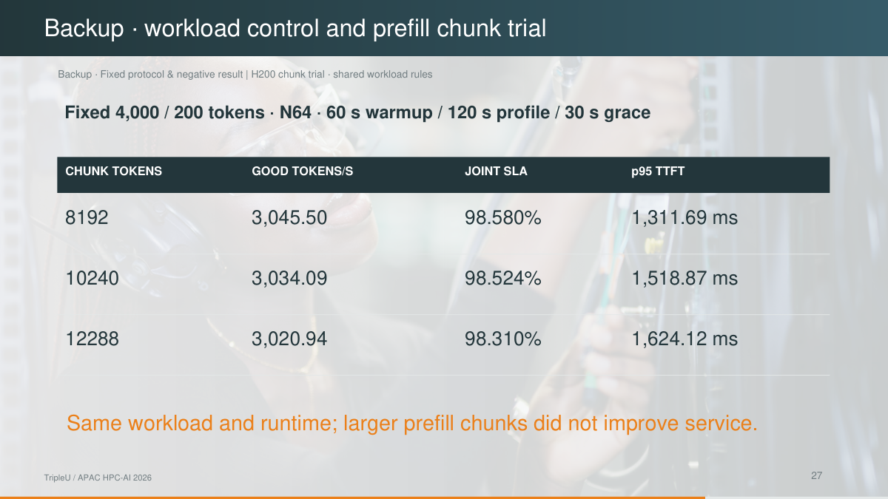

### Purpose

Explain the benchmark protocol behind the chunk table so its negative result is interpreted as a controlled, bounded comparison rather than a claim about all workloads.

### Technical interpretation and reasoning

The table compares three full runs with the same target concurrency, requested prompt/answer lengths, seed, cold-prefix setting, model, precision, and runtime path. Only prefill chunk size changes: 8,192, 10,240, or 12,288 input tokens handled together. Read good output tokens/s as qualifying throughput, joint SLA as the fraction meeting both limits, and p95 TTFT as the slow-response tail. Goodput and the tail both worsen at larger chunks. One run per setting supports retaining 8,192 for this configuration, but cannot identify a general optimum.

### Terms and symbols to understand

- **4,000 / 200 requested tokens:** The client requests 4,000 input and 200 output tokens. Requested lengths do not prove actual token IDs consumed/generated for every request.
- **closed-loop N64:** The client keeps 64 requests in flight, replacing each completion with another request.
- **60/120/30 protocol:** 60 seconds warmup, 120 seconds scored profiling, and 30 seconds grace. Only profiling is scored; grace drains outstanding requests.
- **cold prefix:** The request does not reuse a warm prompt-prefix KV-cache entry. This does not by itself mean filesystem cache is cold.
- **chunk size:** Input tokens processed together in one prefill scheduling unit; it is not concurrent request count.
- **SLA / p95 TTFT:** SLA is the share satisfying both request latency limits. p95 TTFT is the 95th-percentile wait for first token, showing the slow tail.
- **team-reviewed local result:** Here, local means run and reviewed by the team on the assigned H200 cluster. It is not a laptop run or organizer approval.
- **one run per setting:** Each chunk size is one experimental configuration with one full run; run order and engine-generated seeds may contribute to differences.

### Interpreting the evidence or diagram

- This is supporting evidence for Q&A, hidden during the main slide show. It does not add a new experiment to the main argument.
- At chunk 8,192, job 26766 scored 3,045.501509 good output tokens/s, 98.580% joint SLA, and 1,311.69 ms p95 TTFT. At 10,240, job 26768 scored 3,034.088251, 98.524%, and 1,518.87 ms.
- At 12,288, job 26770 scored 3,020.943099, 98.310%, and 1,624.12 ms. All three were full N64 runs with the same 60/120/30 schedule and requested 4,000/200 workload; each chunk setting was observed once.
- The runs passed team protocol, runtime, latency, and output checks with zero profiling errors/cancellations. That is a reviewed result on the assigned cluster, not organizer quality certification.

### Tradeoff and strength of evidence

- **Observation:** Goodput decreases from 3,045.50 to 3,020.94 tokens/s and p95 TTFT increases from 1,311.69 to 1,624.12 ms as chunk grows from 8,192 to 12,288.
- **Hypothesis:** A larger prefill chunk might increase throughput by handling more input tokens per scheduling batch.
- **Supported conclusion:** Retain 8,192 for this service configuration; the tested larger chunks did not improve the objective.
- **Unknown / limitation:** One run per chunk makes the comparison bounded; it does not establish a global optimum or rule out order/seed variation.

### Spoken script

All three runs used 64 simultaneous requests, the same requested 4,000 input and 200 output tokens, and the full warmup, profiling, and grace schedule. Only the prompt-processing chunk changed. Goodput fell from about 3,045 to 3,021 as chunk grew, and the slow first-token tail worsened. The team checked these runs on the assigned H200 cluster, but one run per size cannot prove a universal best setting. We keep 8,192 for this deployment.

### Avoid this interpretation

Passing team checks is not organizer approval. Do not infer actual token lengths from requests, count grace as scored time, or generalize one run per chunk to all workloads.

### Transition

Return to the question and main evidence after answering; these backups are not a second chronological talk.

---

## Slide 28 — Backup · less graph memory did not raise goodput

**Hardware: H200 · sparse decode-graph trial · jobs 27376/27510**

### Quick brief · 10–20 seconds

Sparse capture cut logged memory from 1.15 to 0.36 GB per decode rank, but goodput fell 0.370208% and mean ITL worsened. Padding was not measured as a cause. The team retained dense graphs; this pair does not prove a causal effect.

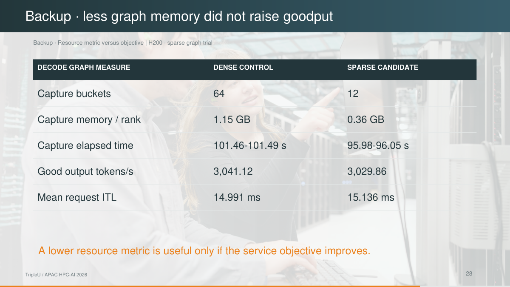

### Purpose

Explain why a lower resource metric is not automatically a service improvement, and separate capture memory from total GPU memory and end-to-end throughput.

### Technical interpretation and reasoning

Compare dense control 27376 with sparse candidate 27510. The candidate stores 12 decode graph buckets instead of 64 and reduces logged graph-capture memory per rank, but goodput is 3,029.861122 versus 3,041.119598, 0.370208% lower. Mean request ITL rises from 14.991 to 15.136 ms; TTFT improves. Fewer buckets may force requests into less exact padded shapes, which can add work, but padding was not isolated or measured here. The reported capture memory excludes other GPU allocations such as model weights and KV cache, so it is not a VRAM capacity figure. The service score, not the smaller capture number, determines whether this is useful.

### Terms and symbols to understand

- **decode graph bucket:** One captured GPU execution shape that can be replayed for a class of decode batches; bucket count is neither concurrency nor GPU count.
- **padding:** Filling a batch to fit a supported captured shape. Fewer buckets could increase padding, but this trial did not measure padding amount or cost.
- **capture memory:** Per-rank memory associated with recorded reusable graphs and their capture buffers. It is only one part of GPU memory use.
- **VRAM / GB / GiB:** VRAM means total GPU memory. The log reports capture-related GB per rank, not total VRAM or GiB; weights, KV cache, workspaces, and other allocations are additional.
- **rank:** One distributed worker process. The 1.15 and 0.36 GB figures are per decode rank, not summed across all eight GPUs.
- **ITL / TTFT:** ITL is the gap between generated tokens; TTFT is the wait until the first token. They measure different parts of request latency.
- **full local pass:** The team ran and reviewed the full workload on the assigned H200 cluster against local protocol/runtime/latency/output checks. This is not organizer approval or an accuracy certificate.

### Interpreting the evidence or diagram

- This is supporting evidence for Q&A, hidden during the main slide show. It does not add a new experiment to the main argument.
- The dense control has 64 buckets, 1.15 GB capture memory per rank, 101.46–101.49 s capture time, 3,041.119598 good output tokens/s, and 14.991 ms mean ITL.
- The sparse candidate has 12 buckets, 0.36 GB/rank, 95.98–96.05 s capture time, 3,029.861122 good output tokens/s, and 15.136 ms mean ITL. Captures were confirmed on all eight decode ranks with model compilation off.
- Candidate mean/p95 TTFT was 1,102.404/1,240.481 ms and improved, while mean/p95 ITL was 15.136/15.324 ms and worsened. One earlier control, different engine seeds, and candidate-only startup instrumentation limit causal interpretation.

### Tradeoff and strength of evidence

- **Observation:** Sparse capture reduced logged per-rank graph memory from 1.15 to 0.36 GB and slightly shortened capture, while goodput fell by 0.370208% against the earlier control.
- **Hypothesis:** Fewer captured shapes might save resources while maintaining service throughput; padding was a possible mechanism but not measured.
- **Supported conclusion:** The service objective did not improve, so the team retained dense graphs for this deployment.
- **Unknown / limitation:** There is one earlier control and generated seeds differ; total VRAM use and any padding effect were not measured by the capture-memory metric.

### Spoken script

The sparse candidate used 12 captured decode shapes instead of 64. Logged graph memory fell from 1.15 to 0.36 gigabytes per rank, but goodput also fell by about 0.37 percent. Mean token gaps got slightly longer, even though time to first token improved. This memory number covers graph capture, not all GPU memory. Fewer shapes could add padding work, but that was not measured. We kept dense graphs; the comparison is too limited for a causal claim.

### Avoid this interpretation

Do not call buckets requests or GPUs, interpret capture memory as total VRAM, or claim padding caused the score difference. Lower capture memory alone is not a goodput win.

### Transition

Return to the question and main evidence after answering; these backups are not a second chronological talk.

---

## Slide 29 — Why did a later replay score lower?

**Hardware: H200 · distinct runtime series**

### Quick brief · 10–20 seconds

Historical full N64 averaged 3,044.40 while a newer short control was about 2,560. Graph policy, server admission cap and measurement procedure changed. The completed tests did not isolate one cause, so we retain the drift without attributing it to one flag.

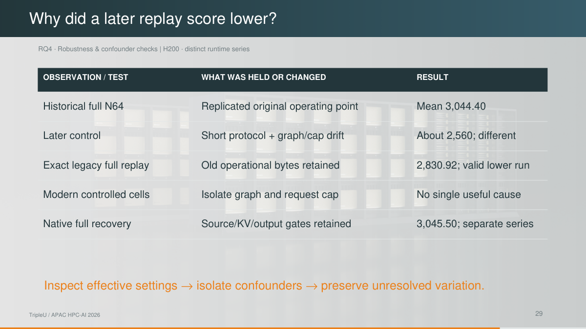

### Purpose

Investigate a discrepancy rather than explain it with a convenient single flag. The evidence identifies changed settings and measurement context, but the completed comparison does not isolate one sufficient cause.

### Technical interpretation and reasoning

The question is why historical full N64 averaged 3,044.400475 while a newer short control was about 2,560. Show that ServerArgs differ in prefill graph policy and max-running-request cap, and that harness/observation protocol also differs. Exact legacy replay 26313 reaches 2,830.923547; new native run 26766 reaches 3,045.501509. These rows are different runtime/protocol series, not a clean single-factor ladder.

### Terms and symbols to understand

- **ServerArgs:** Runtime server configuration arguments that control graph policy, admission limits, and other behavior.
- **Prefill graph policy:** Which prompt-processing shapes are captured or executed through GPU graphs.
- **Max running requests:** Server-side cap on concurrently admitted/running requests; distinct from client concurrency.
- **Harness / observation protocol:** Client and measurement procedure determining warmup, scoring, and accounting.
- **Confounder:** A factor that changes with the comparison and can also affect the outcome, preventing single-cause attribution.

### Interpreting the evidence or diagram

- This is supporting evidence for Q&A, hidden during the main slide show. It does not add a new experiment to the main argument.
- The historical full N64 mean is 3,044.400475, while a later short control is approximately 2,560. Actual ServerArgs show a changed prefill graph policy and max-running-request cap; harness and observation conditions also differ.
- An exact legacy operational replay 26313 reaches 2,830.923547, and native-runtime full run 26766 reaches 3,045.501509. The completed graph/admission factorial did not identify one useful cause. Therefore neither restoring one flag nor changing the launcher alone can be credited for the whole score difference.

### Tradeoff and strength of evidence

- **Observation:** Scores vary across the historical full series, short control, legacy replay, and native runtime; several settings and measurement conditions changed together.
- **Hypothesis:** Changed graph policy, server admission cap, runtime, or measurement harness could contribute to the observed drift.
- **Supported conclusion:** Retain the lower valid result and label its protocol/runtime; no single-factor explanation was established.
- **Unknown / limitation:** The factorial evidence did not isolate one causal factor sufficient to explain the historical-to-new score difference.

### Spoken script

A newer short control scored about 2,560, below the historical full N64 mean of 3,044. We inspected the actual server settings and found both prefill graph policy and the server request cap had changed; the harness and measurement window also differed. A legacy replay and a new native run each answer different comparisons, and the completed factorial did not isolate one cause. We therefore report the drift and its confounders, rather than credit one restored flag or launcher change.

### Avoid this interpretation

A short control is not directly comparable to a full run. Do not treat exact legacy replay as proof that one flag caused the difference.

### Transition

Return to the question and main evidence after answering; these backups are not a second chronological talk.

---

## Slide 30 — Did speculative decoding solve this workload?

**Hardware: H200 · EAGLE3**

### Quick brief · 10–20 seconds

EAGLE3 placement missed latency; a validator bug was repaired; the short retry and separate full shallow trial both lost goodput. The tested method therefore did not help this workload, although other configurations remain untested.

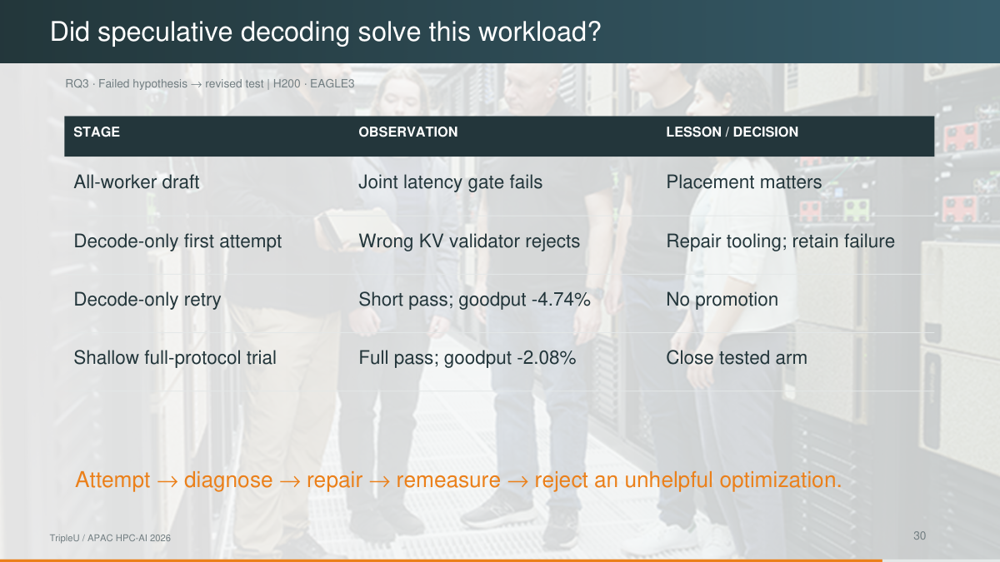

### Purpose

Trace the full EAGLE3 reasoning chain: a placement hypothesis, a validator defect, a corrected short retry, and a separate full test. Repairing a measurement tool makes a rerun valid; it does not turn a losing performance result into a win.

### Technical interpretation and reasoning

Read stages in order: all-worker draft 25948 fails the joint latency gate; decode-only attempt 25988 is rejected because the validator expects draft KV regions on target-only prefill; repaired short run 25998 passes its limited protocol but loses 4.74% goodput; separate shallow full run 27238 loses 2.080318% versus control 26949.

### Terms and symbols to understand

- **EAGLE3 speculative decoding:** A draft model proposes output tokens and the target model verifies them; correctness of transfer alone does not prove faster serving.
- **Target-only prefill:** Prompt-processing worker that runs the target model but does not host the draft model.
- **KV region:** Memory region holding key/value states; the validator must check it only on roles that actually host draft execution.
- **Short protocol:** Limited run that cannot replace the full fixed workload for service performance claims.
- **Goodput loss:** Lower qualifying output tokens per second than the matched target-only control.

### Interpreting the evidence or diagram

- This is supporting evidence for Q&A, hidden during the main slide show. It does not add a new experiment to the main argument.
- The initial all-worker trial 25948 misses the joint latency gate. Moving the draft to decode-only was hypothesized to reduce first-token delay. Attempt 25988 is then rejected by a validator that wrongly applies draft KV-region counts to target-only prefill; the role-aware repair preserves the original failure.
- Short retry 25998 passes its limited protocol but loses 4.74% goodput against its own target-only control. Later full shallow run 27238 reaches 2,971.628430 versus control 26949 at 3,034.761104, a 2.080318% loss. Low draft acceptance is descriptive telemetry, not a causal timing explanation.

### Tradeoff and strength of evidence

- **Observation:** After validator repair, the short decode-only retry loses 4.74%, and the distinct shallow full trial loses 2.080318% goodput.
- **Hypothesis:** Restricting draft execution to decode or using a shallow draft may reduce TTFT without sacrificing total service throughput.
- **Supported conclusion:** The tested variants do not solve this workload; close them while preserving the tooling failure and repair history.
- **Unknown / limitation:** The observations do not explain precisely which service phase causes the slowdown, nor rule out every possible speculative configuration.

### Spoken script

We tried EAGLE3 to reduce generation delay. Running draft workers everywhere failed the joint latency rule. Moving draft to decode-only was reasonable, but the validator first made an incorrect check on target-only prefill. We repaired that check and preserved the failure. The short retry then ran but lost 4.74 percent goodput; a separate full shallow trial lost 2.08 percent. These configurations do not solve this workload. Functional draft transfer is not evidence of faster service.

### Avoid this interpretation

Distinguish the validator error from a model failure, and the short retry from the complete run. Do not turn low acceptance telemetry into a causal latency breakdown.

### Transition

Return to the question and main evidence after answering; these backups are not a second chronological talk.

---

## Slide 31 — Backup · real failures led to a complete portable acceptance

**Hardware: H200 replay + CPU reader verification**

### Quick brief · 10–20 seconds

Jobs 27136 and 27145 failed in separate result-reader defects; 27152 verified both fixes on CPU. Exact-ZIP job 28194 then hit a gateway health/registration race before scoring. Job 28197 changed readiness wait/checksum and passed the full 611-second H200 entry.

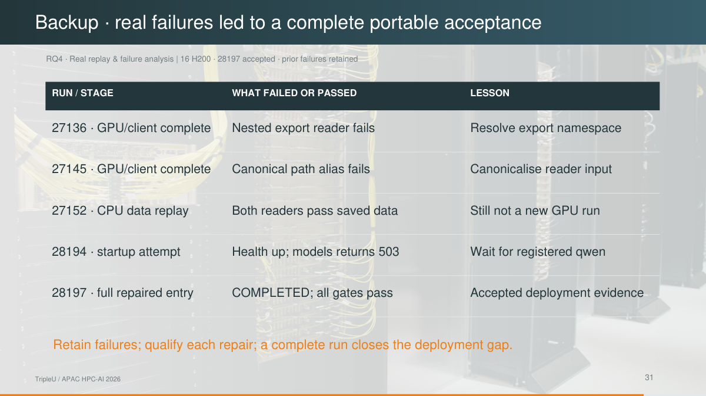

### Purpose

Present the complete debugging sequence so the audience can distinguish preserved failures, CPU-only reader repair, a separate gateway readiness race and the eventual complete GPU acceptance. Do not retroactively relabel any failed scheduler job as successful.

### Technical interpretation and reasoning

Use a four-step timeline: 27136 portable GPU inference/client completed then nested-result reader failed; 27145 portable GPU inference/client completed then alias-path reader failed; 27152 zero-GPU CPU job passed both readers on real saved exports; 28194 exact-ZIP retry failed prebenchmark with curl exit 22 because gateway health returned HTTP 200 while asynchronous model registration still returned HTTP 503; 28197 changed only deploy readiness wait/checksum, kept workers, official client, readers and semantic checks unchanged, and completed the whole entry in 611 seconds on 16 H200 N64. Mark each original failure FAILED; 28197 is the successful new allocation.

### Terms and symbols to understand

- **27136 / 27145:** Original portable GPU jobs that remain FAILED after separate result-reader defects.
- **27152:** Zero-GPU CPU job validating reader fixes against actual saved exports; not a GPU replay.
- **28194:** Exact-ZIP retry that failed before benchmark because HTTP health was ready before asynchronous model registration.
- **28197:** Complete 16-H200/N64 portable acceptance entry after changing deployment readiness wait/checksum.
- **HTTP 200 / HTTP 503:** Gateway health endpoint answered while model-registration endpoint was still unavailable; the two checks represent different readiness states.

### Interpreting the evidence or diagram

- 27136 and 27145 remain failed jobs; their saved outputs allowed diagnosis of two distinct reader bugs.
- CPU job 27152 verified both reader repairs against real saved data, but did not test a GPU deployment.
- Exact-ZIP retry 28194 was a separate failure before AIPerf scoring: health responded HTTP 200 before asynchronous model registration was ready, which still returned 503; curl exited 22.
- Job 28197 adjusted only readiness waiting and checksum. Worker images, official client, result readers and both semantic routes remained unchanged.
- 28197 completed gateway readiness, both P/D semantic routes, client workload, summary acceptance gates and cleanup in 611 seconds using 16 H200 at N64.
- The full entry scored 3051.518173 good output tokens/s, with 1881/1907 jointly qualifying requests, 26 TTFT misses, zero ITL misses and zero errors/cancellations.
- This closes full post-reader-fix GPU deployment acceptance once; it does not certify model quality or erase earlier failed statuses.

### Tradeoff and strength of evidence

- **Observation:** The two reader failures were corrected on CPU; one exact-ZIP attempt then failed prebenchmark due to a gateway readiness race; a new full GPU entry passed after a narrowly scoped readiness adjustment.
- **Hypothesis:** Waiting for actual model registration readiness, rather than accepting the health endpoint alone, addresses the remaining startup race.
- **Supported conclusion:** 28197 demonstrates that the repaired portable deployment can pass its full local acceptance path. Keep 27136, 27145 and 28194 recorded as failures.
- **Unknown / limitation:** One complete pass does not establish statistical deployment reliability or official model quality; broader failure mechanisms outside the observed paths remain unknown.

### Spoken script

This sequence has two separate fixes. Portable jobs 27136 and 27145 ran inference and the client, then failed because two result readers made different path assumptions. CPU job 27152 proved both reader fixes on the real saved exports, but it could not prove GPU deployment. An exact-ZIP retry, 28194, then failed before scoring: the gateway health endpoint returned HTTP 200 while asynchronous model registration still returned HTTP 503. We changed only the readiness wait and checksum. Job 28197 kept the workers, official client, readers and semantic paths unchanged, then completed all stages and cleanup in 611 seconds on sixteen H200s. It scored 3,051.52 good tokens per second with 98.64 percent joint SLA and no errors. The earlier jobs remain failed; the new one closes the full post-fix GPU acceptance check once.

### Avoid this interpretation

Do not relabel 27136, 27145 or 28194 as successful. CPU verification is not a GPU replay; HTTP health alone did not mean model registration was ready. Job 28197 is one full acceptance pass, not official accuracy certification.

### Transition

This appendix shows how the portable deployment failure was isolated and finally accepted. Return to main slide 16 for the concise result and quality boundary.

---

## Slide 32 — Do attention and communication choices interact?

**Hardware: H200 · N52**

### Quick brief · 10–20 seconds

At H200 N52, combining attention and communication measured about 1.43 percent above a later MNNVL control. This supports the combined setting at this load, not additive component gains or a universal rule.

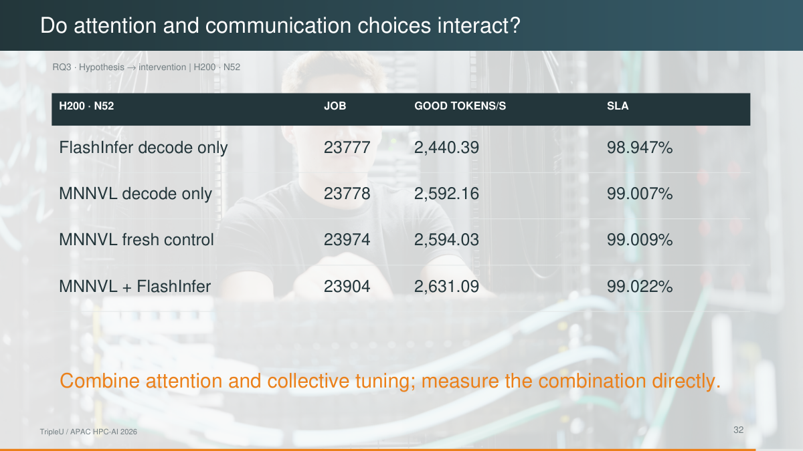

### Purpose

Ask whether attention and collective-communication choices work better together than separately at a fixed H200 load. The comparison is a motivation for a combination, not proof that independent component gains add up.

### Technical interpretation and reasoning

Interpret the N52 observations as separate backend configurations at one load: FlashInfer alone 2,440.386, MNNVL alone 2,592.162, the combined choice 2,631.085, and a later MNNVL control 2,594.028 good tokens/s. Compare the combination with the later same-load MNNVL control: about +1.43%.

### Terms and symbols to understand

- **N52:** Client concurrency setting of 52 in-flight requests; not GPU count or decode batch size.
- **FlashInfer:** GPU attention implementation tested in the serving path.
- **MNNVL:** NVIDIA NVLink collective communication path.
- **Interaction:** The combined result can differ from what either component alone would suggest; this needs a matched combined test.
- **Good tokens/s:** Qualifying requests per second multiplied by the fixed 200 output-token target.

### Interpreting the evidence or diagram

- This is supporting evidence for Q&A, hidden during the main slide show. It does not add a new experiment to the main argument.
- Question: does choosing both an attention implementation and a communication backend improve the service? At H200 N52, the standalone and combined observations are 2,440.386, 2,592.162, and 2,631.085 good tokens/s. A later MNNVL control at the same load is 2,594.028; the combined observation is approximately 1.43% higher than that control.
- The evidence supports testing or retaining the combined operating point for this configuration. It does not establish a general interaction law, isolate each backend's causal contribution, or permit adding the standalone differences as if the components were independent.

### Tradeoff and strength of evidence

- **Observation:** The combined observation exceeds the later MNNVL control by about 1.43% at H200 N52; standalone FlashInfer and MNNVL observations are lower.
- **Hypothesis:** The attention and communication choices may interact favorably when used together.
- **Supported conclusion:** The measured combination is promising at this load and merits comparison as a complete serving setting.
- **Unknown / limitation:** The result does not quantify component-level causal gains or establish behavior at another load, model, or hardware setup.

### Spoken script

We asked whether attention and communication choices interact. At H200 N52, the combined setting reached 2,631 good tokens per second, compared with a later MNNVL control at 2,594, about 1.43 percent lower. The standalone measurements help motivate the combination, but they cannot be added to predict its result. This supports the tested operating point; it does not establish a universal backend rule.

### Avoid this interpretation

These are same-load observations, not a full factorial proof that each component independently caused a share of the combined gain. Do not add standalone gains.

### Transition

Return to the question and main evidence after answering; these backups are not a second chronological talk.

---

## Slide 33 — Backup · one held-out forecast is not a GPU conversion rule

**Hardware: H100 input · H200 held-out check**

**Claim type: Backup · robustness check.**

### Quick brief · 10–20 seconds

A forecast recorded before the H200 measurement misses by about 1.54%, inside our stated 2% tolerance. It nevertheless exposes missing uncertainty. One near-correct prediction supports a limited check, not a universal H100-to-H200 conversion.

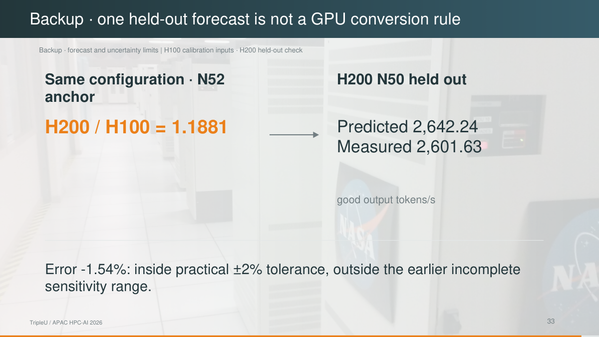

### Purpose

Assess whether a platform-specific calibration transfers to a nearby held-out operating point, while keeping an operational tolerance distinct from statistical uncertainty.

### Technical interpretation and reasoning

The calibration comparison uses the same N52 combo configuration: H100 mean 2,215.460 good tokens/s across two allocations and H200 mean 2,632.181 across four, ratio 1.188096805. Applying that ratio to H100 N50 produced a forecast frozen before seeing H200 job 24272: 2,642.244. The held-out H200 measurement is 2,601.629, signed error −1.5371%. It falls within the predeclared ±2% operational tolerance but outside the earlier input-only sensitivity range, which omitted model error. The forecast is not refit after seeing the answer.

### Terms and symbols to understand

- **calibration ratio:** H200 mean divided by H100 mean for the same N52 combo. It is specific to those systems and settings, not a GPU-generation constant.
- **allocation:** A scheduled resource assignment and run. Two or four allocations are repeat counts and do not prove distinct physical GPU devices.
- **held-out check:** A measurement not used to calculate the forecast, revealed afterward to test the prediction.
- **frozen forecast:** A prediction fixed before the held-out measurement; keeping it unchanged prevents tuning the answer after seeing the result.
- **sensitivity range:** A range produced by varying selected inputs. This earlier range omitted model error, so it did not cover all forecast uncertainty.
- **±2% tolerance:** The team's operational pass band. It is not a confidence interval, standard error, or proof of general prediction accuracy.

### Interpreting the evidence or diagram

- Same N52 combo: H100 mean 2,215.460; H200 mean 2,632.181 good tokens/s; ratio 1.188096805.
- Frozen H200 N50 forecast: 2,642.244. Held-out job 24272: 2,601.629, signed error −1.5371%.
- The result is within ±2% operational tolerance but outside the incomplete earlier sensitivity range. These statements are compatible because the range omitted model error.

### Tradeoff and strength of evidence

- **Observation:** One held-out H200 result is 1.5371% below forecast, within operational tolerance and outside the prior incomplete sensitivity range.
- **Hypothesis:** A ratio measured at N52 may predict a nearby H200 N50 result when the tested combo is held comparable.
- **Supported conclusion:** This one prospective check meets the team's tolerance; preserve the missing-model-error limitation and do not refit the forecast.
- **Unknown / limitation:** Accuracy across other loads/configurations, total predictive uncertainty, physical-device diversity, and a universal platform conversion remain unknown.

### Spoken script

We measured the same N52 configuration on H100 and H200 and calculated a ratio of 1.1881. Before an H200 N50 run was available, we fixed a forecast of 2,642.244. The held-out result was 2,601.629, an error of minus 1.5371 percent, within our predeclared two-percent tolerance. But it fell outside an earlier sensitivity range that omitted model error. This is one local forecast check, not a general GPU conversion rule.

### Avoid this interpretation

Do not call the ±2% band a confidence interval, infer that allocations were distinct physical GPUs, or refit the forecast after seeing the result.

### Transition

For the latest direct H200 transfer results, return to main slide 14; the complete nine-job ledger is backup slide 34.

---

## Slide 34 — Backup · nine final H200 runs support retaining the recipe

**Hardware: 16 H200 on Firmus, two nodes; H100-derived settings tested directly on H200. Ledger includes N54 and N64.**

### Quick brief · 10–20 seconds

Nine final H200 allocations tested controls and H100-derived alternatives. No distinct candidate cleared the team’s 1% usefulness gate; the existing H200 recipe remains the measured choice.

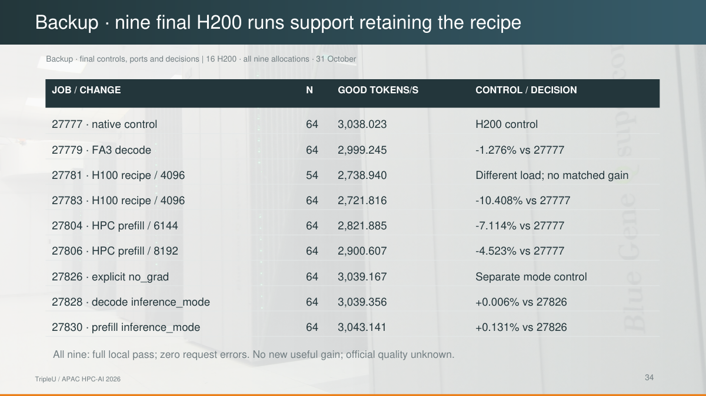

### Purpose

Keep the complete final H200 verification auditable for questions. Distinguish the nine scheduler jobs from the four distinct additional H100-derived intervention ports, show the proper control for each branch, and explain why none replaced the incumbent.

### Technical interpretation and reasoning

The compact ledger has with columns job, intervention/control, good output tokens/s and delta against its stated H200 control. Rows: 27777 fresh DeepGEMM/chunk-8192 incumbent control 3038.022907; 27779 FA3 decode 2999.245473 (−1.276404%); 27781 H100 both-HPC-Ops/chunk-4096 recipe N54 2738.940099; 27783 same recipe N64 2721.815800 (−10.408319% vs 27777); 27804 HPC-Ops chunk 6144 2821.884862 (−7.114431%); 27806 HPC-Ops chunk 8192 2900.606831 (−4.523207%); 27826 explicit no_grad phase control 3039.167093; 27828 decode-only inference mode 3039.356215 (+0.006223%); 27830 prefill-only inference mode 3043.141258 (+0.130765%). The control column labels comparison branches so percent denominators cannot be confused. Units: good output tokens/s. Nine GPU allocations include controls and repeated-load/coupled arms; they are not nine unique winning candidates.

### Terms and symbols to understand

- **fresh control:** A newly measured reference on the target H200 setup; each experimental branch has its applicable control.
- **four distinct ports:** Jobs 27804, 27806, 27828 and 27830. Job 27826 is the explicit phase-mode control and is not counted as a candidate.
- **N64:** Client concurrency target of 64 in-flight requests; it is not GPU count.
- **1% gate:** Team-set prospective useful-gain threshold, not an official contest threshold.

### Interpreting the evidence or diagram

- The nine jobs are one bounded target-hardware verification set, not nine independent innovations or nine candidates with the same denominator.
- Fresh incumbent control 27777 scored 3038.022907 good output tokens/s on 16 H200 at N64.
- FA3 27779 lost 1.276404%; the H100-derived recipe 27783 lost 10.408319% against that N64 control. Its partner 27781 ran at N54; that point describes the branch at a different load and is not a same-load comparison against the N64 incumbent.
- Within the HPC-Ops branch, chunk 6144/8192 recovered some performance versus its 4096 arm, but still lost 7.114431%/4.523207% versus incumbent 27777. The prefill runner and generated seeds differ in the incumbent comparison, so do not claim a pure chunk causal effect from that row.
- The explicit mode control 27826 is compared with decode-only 27828 and prefill-only 27830. Gains are +0.006223% and +0.130765%, both below the prospective 1% gate.
- All nine runs passed retained local raw/runtime/output gates; smoke checks were 7/8, retrieval 12/12, and official full-set model quality remains UNKNOWN.
- Decision: keep H200 DeepGEMM prefill/chunk 8192 and HPC-Ops/FlashInfer/MNNVL decode at N64. These comparisons do not establish a global optimum or official rank.

### Tradeoff and strength of evidence

- **Observation:** Nine allocations completed with zero scored errors/cancellations. The candidates either lost to their applicable H200 control or remained below the team’s prospective 1% threshold.
- **Hypothesis:** Testing H100-derived settings directly on the target H200 system can reject harmful transfers and identify small effects before changing the recipe.
- **Supported conclusion:** No candidate changes the H200 incumbent. Retain DeepGEMM prefill/chunk 8192 with HPC-Ops/FlashInfer/MNNVL decode at N64.
- **Unknown / limitation:** These are single-run ports and bounded local validation. They do not establish statistical confidence, official quality, or a global optimum.

### Spoken script

This appendix answers how many final transfer jobs produced the decision. Nine allocations completed on sixteen H200s: eight at N64 and one at N54, but they were controls and related intervention arms, not nine unique candidates. The fresh incumbent control was 3,038.02 good output tokens per second. FA3 lost 1.28 percent; the H100 full recipe lost 10.41 percent. HPC-Ops chunks recovered some of that branch but stayed 4.52 percent below the incumbent at chunk 8192. Two phase-specific inference-mode changes were nearly flat, at 0.006 and 0.131 percent above their explicit control. Neither clears our prospective one-percent gate. We therefore retain the DeepGEMM-prefill and HPC-Ops/FlashInfer/MNNVL-decode H200 recipe. Local gates passed, but full official model quality remains unknown.

### Avoid this interpretation

Do not call all nine jobs distinct candidates, compare percentages with different controls as one ranking, attribute a coupled runner/chunk loss to one factor, or claim official quality passed.

### Transition

Return to slide 16 for the main conclusion, or show slide 35 for the bounded held-out forecast check.

---

## Slide 35 — The task: same 65-million-cell airflow calculation

**Hardware: CPU · OpenFOAM HPC task — not an H100/H200 inference measurement.**

### Quick brief · 10–20 seconds

We fix the workload at 65.3 million cells, four nodes and 512 MPI ranks. All 150 solver steps run; 149 are timed. The measure is average seconds per step, with lower being better.

**Unchanged HPC section: explanation of the existing slide, not a new status or result update.**

### Purpose

Define the fixed CPU workload and the performance quantity being optimized. The comparison holds the prescribed calculation constant and asks how efficiently the cluster executes it.

### Technical interpretation and reasoning

Read the figures as the fixed-work contract: 65,334,765 mesh cells are distributed over four nodes and 512 MPI ranks, or 128 ranks on each node. An MPI rank is a software process; it is not the same thing as a physical CPU core. The prescribed calculation runs 150 solver iterations, with 149 timed samples because the first iteration is excluded from the reported mean. The unit is wall-clock seconds per solver step, so a smaller value means less elapsed time for each iteration. This slide defines the work and metric; it does not report an optimization result.

### Terms and symbols to understand

- **65.3 million:** Rounded display of the 65,334,765-cell mesh.
- **MPI rank:** One distributed solver process; 512 total means 128 per node on four nodes.
- **s/step:** Wall-clock seconds per solver iteration, not seconds of simulated driving.
- **physical CPU core:** A hardware execution core. An MPI rank is a software process; ranks may be bound to cores, but the mapping must be verified rather than assumed.

### Interpreting the evidence or diagram

- Read this as a workload definition, not a result comparison: same mesh and required solver work, executed on four CPU nodes.
- The 149 timed samples begin after the first solver iteration; the complete run still performs all 150 steps.
- The task is to reduce runtime through better CPU-resource use, not by reducing mesh size or required work.

### Tradeoff and strength of evidence

- **Observation:** The fixed run has substantial parallel work: roughly 65.3 million cells distributed across 512 ranks.
- **Hypothesis:** A more effective distribution and placement of work may reduce time per step.
- **Supported conclusion:** The slide establishes the measurement frame; it reports no tuning win by itself.
- **Unknown / limitation:** It does not identify a bottleneck or establish a causal performance improvement.

### Spoken script

We are optimizing the prescribed OpenFOAM airflow calculation, not changing its mathematics. The mesh has 65.3 million cells. On four nodes, 512 MPI ranks perform all 150 solver steps. The first iteration is excluded from timing, leaving 149 measured steps. We compare the average wall-clock seconds per step, where lower is better. That makes this a fixed-work CPU-efficiency question.

### Avoid this interpretation

Do not call 65.3 million the exact count, do not describe the 149 timed steps as the whole solve, and do not treat the displayed task definition as evidence of a speedup. The retained drag coefficient is a physical sanity check, not this performance metric.

### Transition

Next, show which preparation stages must be retained for a valid end-to-end run.

---

## Slide 36 — The whole required pipeline comes before the score

**Hardware: CPU · OpenFOAM HPC task — not an H100/H200 inference measurement.**

### Quick brief · 10–20 seconds

A valid comparison includes every preparation stage and all 150 solver steps. Decomposition assigns cells to ranks; CPU affinity assigns ranks to CPUs. These are separate choices that can each affect runtime.

**Unchanged HPC section: explanation of the existing slide, not a new status or result update.**

### Purpose

Explain why the score is meaningful only after preserving the full required pipeline, and distinguish mesh decomposition from CPU affinity.

### Technical interpretation and reasoning

The sequence is part of the measured task: decomposePar assigns mesh cells to MPI ranks; renumberMesh changes the ordering of local cell data; potentialFoam initializes flow fields; applyBoundaryLayer applies the required boundary treatment; simpleFoam then performs all 150 solver steps. Decomposition determines which cells a process owns and therefore which neighboring-cell exchanges cross process boundaries. CPU affinity determines where a rank runs. Affinity can affect access to nearby CPU cores and memory, but it does not change the cells owned by that rank. Both decisions can affect performance, and they must not be confused.

### Terms and symbols to understand

- **MPI:** Message Passing Interface; separate ranks exchange data, especially across partition boundaries.
- **decomposePar:** OpenFOAM utility that partitions mesh cells among ranks.
- **CPU affinity:** Binding a process or rank to CPU resources; distinct from assigning it mesh cells.
- **neighbor exchange:** Ranks exchange field values for cells adjacent across their partition boundary; more cut edges are only a proxy for the amount and cost of this traffic.

### Interpreting the evidence or diagram

- Follow the orange arrows from preprocessing into the solver; the final timing is not a substitute for those stages.
- A decomposition answers which cells a rank owns. Affinity answers where that rank executes.
- The sequence shown is the complete required preparation and 150-step solve, not an optional menu.

### Tradeoff and strength of evidence

- **Observation:** The pipeline contains data setup, initialization, boundary treatment, then iterative solving.
- **Hypothesis:** Choices in decomposition and placement can affect execution while preserving the prescribed calculation.
- **Supported conclusion:** Valid comparisons must retain each required stage and its successful completion.
- **Unknown / limitation:** This flow diagram alone does not measure the cost of each stage or prove which mapping is faster.

### Spoken script

Before comparing solver times, we keep the entire required pipeline: assign cells to MPI ranks, reorder the local data, initialize the flow, apply the prescribed boundary layer, and run all 150 simpleFoam steps. Decomposition decides which cells each rank owns. CPU affinity decides which CPU runs the rank. Those are separate decisions, and a valid run must preserve every preparation step as well as the solve.

### Avoid this interpretation

The slide gives process order, not per-stage timings, and it does not establish that affinity was measured or optimized in a particular result.

### Transition

With the workload and pipeline fixed, the next slide tests whether a locality proxy predicted solver runtime.

---

## Slide 37 — A smaller partition cut did not make the solver faster

**Hardware: CPU · OpenFOAM HPC task — not an H100/H200 inference measurement.**

### Quick brief · 10–20 seconds

The NUMA-aware partition reduced its graph-cut proxy by 10.63%, yet mean solver time worsened by 3.4416%, from 13.881 to 14.359 seconds per step. The proxy did not predict runtime.

**Unchanged HPC section: explanation of the existing slide, not a new status or result update.**

### Purpose

Show a failed NUMA-aware locality hypothesis and explain why a partition-graph proxy cannot stand in for a runtime measurement.

### Technical interpretation and reasoning

The orange −10.63% is a reduction in a partition-graph cut proxy: fewer weighted mesh connections cross the selected locality boundary. It does not mean communication time fell by 10.63%. Actual exchanges also depend on message sizes, frequency, network and MPI behavior, while solver time includes computation, synchronization, memory access and other work. The measured mean moved in the wrong direction, from 13.881 to 14.359 seconds per step (+3.4416%, slower). Thus the proxy improvement did not produce a runtime improvement in this comparison. The slide leaves the cause open because MPI wait, bandwidth, CPU frequency, power and memory-page placement were not measured.

### Terms and symbols to understand

- **NUMA:** Non-Uniform Memory Access: memory access cost can depend on which CPU socket or locality domain owns the memory.
- **graph cut:** A proxy count/weight of partition connections crossing a selected boundary; it is not a direct measurement of communication time.
- **−10.63%:** The graph-cut proxy was reduced by 10.63% for this candidate.
- **+3.4416%:** The solver mean became 3.4416% slower in the compared observation.
- **partition graph cut:** A weighted count of mesh-neighbor connections split between partitions. It estimates potential interface traffic, but does not measure bytes transferred, MPI wait, network time or total solver runtime.
- **NUMA locality:** On multi-socket servers, a CPU core can access memory attached to its own socket more directly than memory attached to another socket; placement can therefore affect latency and bandwidth.
- **MPI wait:** Time a process spends waiting for other processes or communication to complete; it was listed as unmeasured here.

### Interpreting the evidence or diagram

- Orange marks proxy improvement; red marks worse measured solver time. Their signs make the mismatch clear.
- A smaller proxy can coexist with slower execution because other partition properties and runtime effects also matter.
- The slide explicitly leaves the cause unmeasured; it records a rejected candidate, not a diagnosis.

### Tradeoff and strength of evidence

- **Observation:** Graph cut fell 10.63%, while mean runtime rose from 13.881 to 14.359 seconds per step.
- **Hypothesis:** Grouping work by memory locality might reduce remote-memory and interface cost.
- **Supported conclusion:** The unchanged NUMA-aware branch was closed; graph cut alone did not predict solver speed.
- **Unknown / limitation:** MPI wait, bandwidth, frequency, power, page residency, and other possible causes were not measured.

### Spoken script

We tested a NUMA-aware idea: grouping work by locality should reduce remote-memory or interface cost. The graph-cut proxy fell by 10.63 percent, but the measured solver mean worsened from 13.881 to 14.359 seconds per step, a 3.4416 percent slowdown. That is why we closed this unchanged candidate. A graph proxy describes the partition; it is not measured runtime or proof of less communication time.

### Avoid this interpretation

The comparison changed other partition properties, so do not attribute the slowdown to one mechanism. A separate offline mapping with a 4.5741% smaller proxy had no solver run and is not evidence of performance. Do not interpret the percentages as reciprocal measures.

### Transition

The next comparison asks whether the better observed decomposition changes with node count.

---

## Slide 38 — Observed scaling changed which decomposition led

**Hardware: CPU · OpenFOAM HPC task — not an H100/H200 inference measurement.**

### Quick brief · 10–20 seconds

The observed leader changes across allocations: Hierarchical is lower at one and two nodes, while Scotch is lower at four. Since run lengths and allocations differ, these values describe observations, not a causal scaling result.

**Unchanged HPC section: explanation of the existing slide, not a new status or result update.**

### Purpose

Compare the observed Scotch and hierarchical means across one-, two-, and four-node allocations, while explicitly limiting the inference because work endpoints and allocations differ.

### Technical interpretation and reasoning

The orange Scotch and dark-teal Hierarchical labels identify the two decomposition methods; every value is a mean in seconds per solver step, so lower is faster. Hierarchical is lower in the one-node observation (14.366 vs 14.451) and the two-node observation (7.170 vs 7.463); Scotch is lower in the four-node observation (3.678 vs 3.820). These are not points on a controlled scaling curve: each used a separate allocation, and the required endpoint changed from 40 to 80 to 150 steps. Node count, run length, allocation conditions and configuration therefore vary together. The bars describe what was observed; they cannot isolate node count as the cause of the ranking change.

### Terms and symbols to understand

- **Scotch:** A graph-based mesh-decomposition method used by the OpenFOAM workflow.
- **Hierarchical:** A decomposition method that partitions the mesh using a hierarchy of spatial divisions.
- **s/step:** Mean wall-clock seconds for each timed solver iteration; lower is better.
- **descriptive comparison:** A report of observed values. Because node count, step endpoint and allocation changed together, it cannot isolate the effect of any one factor.

### Interpreting the evidence or diagram

- At one node hierarchical is slightly lower; at two nodes hierarchical is lower; at four nodes Scotch is lower.
- The displayed step endpoints are not identical, and each result came from a separate allocation.
- This is descriptive evidence about observed candidate means, not a controlled strong-scaling curve.

### Tradeoff and strength of evidence

- **Observation:** Hierarchical leads the displayed two-node pair, while Scotch leads the four-node pair; the one-node means are close with hierarchical lower.
- **Hypothesis:** The preferable partition may depend on node count, rank density, and allocation-specific conditions.
- **Supported conclusion:** There is no single decomposition winner across these observations; the four-node Scotch result motivates closer review.
- **Unknown / limitation:** Different allocations and endpoints prevent assigning the differences to node count alone or claiming causal scaling efficiency.

### Spoken script

The observed leader changes with the allocation. Hierarchical has a slightly lower one-node mean and leads at two nodes, while Scotch leads at four nodes. The values are seconds per solver step. However, these are separately allocated runs with different prescribed endpoints—40, 80 and 150 steps—so this is descriptive scaling evidence, not a controlled causal comparison. The candidate choice must be evaluated at the intended node count and rank density.

### Avoid this interpretation

Do not calculate or claim ideal speedup from these means. The bars show means only, without uncertainty ranges; the separate allocations and run lengths matter. This slide alone cannot show a universal advantage for either method.

### Transition

The four-node results can be split further by ranks per node, which is the next comparison.

---

## Slide 39 — At four nodes, the winner depends on ranks per node

**Hardware: CPU · OpenFOAM HPC task — not an H100/H200 inference measurement.**

### Quick brief · 10–20 seconds

At four nodes, Hierarchical has lower means at 64 and 96 ranks per node; Scotch is lower at 128. Scotch-128's 3.678 seconds per step is the lowest reviewed mean, still a candidate observation needing confirmation.

**Unchanged HPC section: explanation of the existing slide, not a new status or result update.**

### Purpose

Show that the four-node decomposition ranking changes with process density, and identify the lowest reviewed mean without overstating it as a universal optimum.

### Technical interpretation and reasoning

At four nodes, the bars compare observed mean seconds per step at 64, 96 and 128 MPI ranks per node. Orange denotes Scotch and dark teal denotes Hierarchical. Hierarchical has the lower mean at 64 ranks (4.489 vs 10.310) and 96 ranks (4.922 vs 7.146); Scotch is slightly lower at 128 ranks (3.678 vs 3.820). Across four nodes these settings use 256, 384 and 512 ranks, respectively, but a rank is a process, not automatically one physical core. The 128-rank Scotch observation is the lowest reviewed mean among these six logs. Separate allocations and differences in requested CPU counts confound the comparison, so it identifies a candidate to repeat, not proof that rank density or method alone caused the difference.

### Terms and symbols to understand

- **ranks per node:** Number of MPI processes placed on each node; across four nodes the displayed settings correspond to 256, 384, and 512 ranks.
- **s/step:** Mean measured wall-clock seconds per solver step.
- **lowest reviewed mean:** The smallest mean among the reviewed observations in this set, not proof of global optimality.
- **rank density:** The number of MPI processes assigned per node. It is distinct from physical-core count and does not by itself prove CPU binding or exclusive core use.

### Interpreting the evidence or diagram

- At 64 and 96 ranks per node hierarchical is lower; at 128 ranks per node Scotch is lower by about 0.142 seconds per step.
- The highlighted takeaway identifies Scotch-128 at 3.677906731 seconds per step as the lowest reviewed mean.
- Each bar summarizes a separate allocation; requested CPU counts also differ in some configurations.

### Tradeoff and strength of evidence

- **Observation:** The preferred method flips at the highest displayed rank density; Scotch-128 has the smallest observed mean among these six logs.
- **Hypothesis:** Decomposition quality may interact with the density of ranks on each node.
- **Supported conclusion:** Choose based on the measured node count and rank density; method name alone does not predict the winner.
- **Unknown / limitation:** Separate allocations and differing requested CPU counts prevent attributing the differences solely to decomposition or density.

### Spoken script

At four nodes, rank density changes which method has the lower observed mean. Hierarchical leads at 64 and 96 ranks per node. At 128, Scotch records 3.678 seconds per step versus 3.820 for hierarchical. That 3.678-second value is the lowest reviewed mean among these six observations. We treat it as a candidate for confirmation, not a causal effect or universal best method, because these are separate allocations and some requested CPU counts differ.

### Avoid this interpretation

The decimal labels are seconds per step, not speedup factors. The bar display has no explicit axis or error bars; avoid implying statistical significance from bar lengths. The slide does not establish stable repeatability.

### Transition

The next slide examines the full timing distribution behind the Scotch-128 mean, especially its slow tail.

---

## Slide 40 — Keep the slow step in the mean; inspect the tail

**Hardware: CPU · OpenFOAM HPC task — not an H100/H200 inference measurement.**

### Quick brief · 10–20 seconds

Most steps were near 3.3 to 3.8 seconds, but one reached 35.884 seconds. We retain all 149 samples in the arithmetic mean; the spike is real in this run, while its cause remains unknown.

**Unchanged HPC section: explanation of the existing slide, not a new status or result update.**

### Purpose

Explain why every timed iteration, including an extreme slow step, remains in the official-style arithmetic mean, and separate observation from causal diagnosis.

### Technical interpretation and reasoning

These are distribution summaries for the 149 timed steps: median 3.298742 s, 95th percentile 3.795740 s, and maximum 35.883552 s at solver Time 119. The median is the middle observation; the p95 marks the point below which about 95% of observations fall. The arithmetic mean is different: add every sample and divide by 149, so the 35.9-second step remains in it and pulls the mean upward. Keeping that sample preserves the actual run rather than hiding a slow event. The orange and red markers distinguish typical timing from the extreme maximum; printed numbers carry the exact units. The event is visible, but its cause is not identified by these timings.

### Terms and symbols to understand

- **median:** Middle value after sorting the 149 timed samples.
- **95th percentile (p95):** A value at or below which approximately 95% of samples fall, under the percentile convention used.
- **maximum:** Largest recorded sample; here 35.883552 seconds at solver Time 119.
- **Time 119:** Solver iteration/time index reported by the run, not 119 seconds of wall-clock duration.
- **arithmetic mean:** Sum of all timed values divided by the number of values. Unlike the median, a very large sample can noticeably raise it.
- **tail:** The slowest portion of the timing distribution; p95 summarizes a high percentile, while the maximum records the single slowest sample.

### Interpreting the evidence or diagram

- The median and p95 are near 3.3–3.8 seconds, but one retained step is about 35.9 seconds.
- All 149 samples stay in the arithmetic mean; removing the outlier would change the stated performance metric.
- The red color marks the extreme maximum; it does not indicate a known failure mechanism.

### Tradeoff and strength of evidence

- **Observation:** One unusually slow step appears at index 119, while the center and p95 are much smaller.
- **Hypothesis:** A transient system or application event may have caused the spike, but telemetry is needed to test possibilities.
- **Supported conclusion:** Preserve the tail and investigate it; do not trim the slow point or alter the prescribed endpoint.
- **Unknown / limitation:** MPI wait, bandwidth, CPU frequency, power, and memory-page residency were not measured sufficiently to identify a cause.

### Spoken script

The median step is 3.299 seconds and the 95th percentile is 3.796 seconds, but the maximum reaches 35.884 seconds at solver Time 119. We retain all 149 timed samples in the arithmetic mean. That slow point is part of the measured run, not something to discard because it is inconvenient. The trace establishes that a spike occurred; it does not explain why. We need instrumentation and independent repeats to study its cause and stability.

### Avoid this interpretation

Do not call solver Time 119 119 seconds; it is the reported iteration/time index. Do not imply the median or p95 is the official arithmetic mean. Cause is explicitly unknown: missing telemetry is not evidence that MPI, memory, or hardware was healthy.

### Transition

That uncertainty is why the next slide asks for an independently repeated, fully evidenced run.

---

## Slide 41 — A reproducible candidate needs more than a fast log

**Hardware: CPU · OpenFOAM HPC task — not an H100/H200 inference measurement.**

### Quick brief · 10–20 seconds

Scotch with 128 processes per node measured about 3.678 seconds per step. In the slide’s 23 October snapshot, its confirmation job was still queued without a result. This remains a candidate observation, not an accepted official score.

**Unchanged HPC section: explanation of the existing slide, not a new status or result update.**

### Purpose

Distinguish a reviewed candidate timing from an accepted official result and list the proofs required from an independent confirmation.

### Technical interpretation and reasoning

The left side is an already reviewed candidate observation: Scotch-128 averaged 3.677906731 seconds per step over 149 samples. The right side is a different state of evidence: job 25940700 was shown waiting in Q/q5 at 15:06 UTC because node_pool resources were insufficient, with no result yet. Its frozen 54-file bundle is an exact, fixed input package; hashes and seals are checks that source, mesh and outputs match the recorded files. Provenance means the record of which inputs, commands, resources and outputs produced a run. The checklist also asks for successful return codes from every stage and proof that 512 physical CPU cores across four hosts were actually allocated. These are requirements for confirmation, not checks already passed.

### Terms and symbols to understand

- **Q/q5:** Scheduler queue/state labels shown in the dated observation; the slide reports the job waiting, not executing.
- **Scotch-128:** Scotch decomposition at 128 MPI ranks per node on four nodes.
- **seal:** Recorded identity/integrity evidence for source, mesh, or output files; the slide lists required checks, not completed checks.
- **frozen input bundle:** A fixed, versioned set of input files kept unchanged for a repeat, so the comparison uses the same declared inputs.
- **hash / seal:** A cryptographic digest or integrity record used to check whether a file is byte-for-byte the recorded version; a seal is evidence to verify, not a performance result.
- **provenance:** Traceable record of input identities, software/source, commands, allocated resources and produced outputs.
- **scheduler terminal proof:** A scheduler record showing a definite final state such as completed or failed, rather than merely queued or running.
- **return code:** A program exit status; checking each stage helps establish that every required command completed successfully.

### Interpreting the evidence or diagram

- The candidate has a measured mean and 149 samples, but that alone does not establish official acceptance.
- The independent job is queued and has no result in the shown status snapshot.
- The checklist is prospective proof required from that queued confirmation, not claims that the checks already passed.

### Tradeoff and strength of evidence

- **Observation:** The best reviewed candidate is 3.677906731 s/step; its independent confirmation job is waiting because node_pool resources are insufficient.
- **Hypothesis:** A fresh, frozen, full-pipeline repeat can test reproducibility and verify provenance and resource placement.
- **Supported conclusion:** Report the existing number as a candidate observation, not an accepted official score; review the repeat before choosing next.
- **Unknown / limitation:** The slide gives no result, terminal scheduler proof, or completed verification for job 25940700.

### Spoken script

The reviewed Scotch-128 candidate averages 3.677906731 seconds per step over 149 samples. That is a candidate observation, not an accepted official score. We submitted job 25940700 as an independent confirmation, but the dated scheduler status still shows it queued because node-pool resources are insufficient, so it has no result. Confirmation must preserve the input bundle, execute initialization and all 150 steps, record explicit stage exits, prove 512 physical cores across four hosts, and seal source, mesh, and outputs.

### Avoid this interpretation

All scheduler wording is a historical snapshot at 15:06 UTC on the slide; do not present it as live status. The checklist describes required proof, not verified completion. A fast log by itself is not full reproducibility or acceptance.

### Transition

The final slide summarizes the evidence discipline and the next review decision without claiming a new result.

---

## Slide 42 — What we learned — and the next measurement

**Hardware: CPU · OpenFOAM HPC task — not an H100/H200 inference measurement.**

### Quick brief · 10–20 seconds

We choose by measured runtime, retain slow samples, and require another run to confirm results. The lowest candidate mean is about 3.678 seconds per step; confirmation had no result on 23 October. A fast number needs adequate evidence.

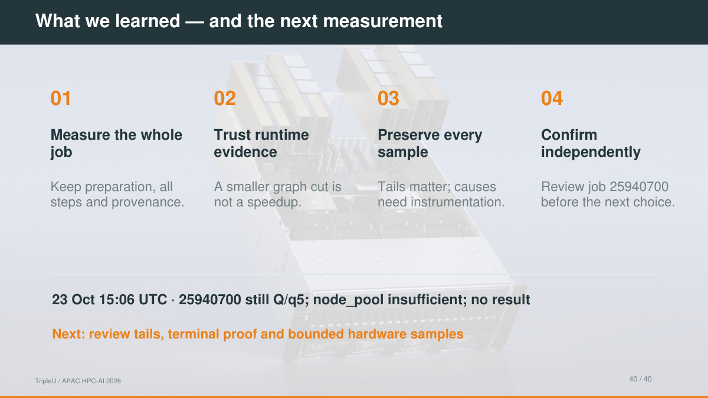

**Unchanged HPC section: explanation of the existing slide, not a new status or result update.**

### Purpose

Close the HPC section with four measurement principles and the next decision point: inspect complete confirmation evidence before selecting another configuration.

### Technical interpretation and reasoning

The four principles connect a credible measurement to reproducible evidence: include preparation and the full solve; judge runtime rather than a graph-cut proxy; retain all samples, including slow-tail events; and repeat independently. The status line is explicitly a historical snapshot: on 23 October at 15:06 UTC, job 25940700 was still waiting for node_pool resources and had no result. A scheduler query or terminal record proves whether the job ran and how it ended; it does not by itself prove correct inputs or a valid measurement. Hashes, stage return codes, resource-placement evidence and complete output provenance address those separate questions. The next action stated here is to review the confirmation's terminal evidence and timing tails, then use bounded hardware sampling to investigate stability. No later outcome is asserted.

### Terms and symbols to understand

- **terminal proof:** Evidence that the scheduler job reached a definite terminal state, paired with complete run outputs and return codes.
- **bounded hardware samples:** Limited, planned instrumentation samples collected with controlled scope, not an unbounded profiling run.
- **Q/q5:** The queue/state shown in the dated status snapshot, not a current query.
- **bounded hardware sampling:** A small, preplanned set of hardware measurements taken for a stated interval or phase, with scope limited to avoid changing the workload materially.

### Interpreting the evidence or diagram

- The four principles connect validity, measured runtime, preservation of outliers, and independent reproducibility.
- The next step is review, not claiming a performance gain from the queued job.
- The status line freezes the state known at 23 October 15:06 UTC: the confirmation had no result.

### Tradeoff and strength of evidence

- **Observation:** Reviewed four-node data narrowed choices and identified Scotch-128 as the lowest mean among six observations, while the confirmation remained queued in the dated record.
- **Hypothesis:** Reviewing full terminal evidence, tails, and limited hardware sampling may clarify stability before another choice.
- **Supported conclusion:** The work narrows candidates and improves evidence requirements; it does not establish a global optimum or accepted score.
- **Unknown / limitation:** The slide does not report what later happened to job 25940700 or identify the cause of the timing spike.

### Spoken script

We take four lessons forward: measure the whole job, trust runtime evidence over a partition proxy, keep every timing sample, and confirm independently. The reviewed Scotch-128 mean narrowed our choice, but it is not a proven global optimum or accepted score. At the recorded time—23 October at 15:06 UTC—job 25940700 was still queued for node-pool resources and had no result. The next decision is to inspect terminal proof and timing tails, then collect bounded hardware samples before selecting another measurement.

### Avoid this interpretation

This is a dated handoff, not live scheduler status. Do not infer a later success or failure, and do not describe bounded sampling as already collected. The presentation summarizes published evidence; it does not certify new measurements.

### Transition

This concludes the HPC slides; return to the combined presentation's overall research conclusion.
