# Transcript và hướng dẫn hiểu từng slide — Tiếng Việt

Đây là **lời thuyết trình mẫu và tài liệu học**, không phải bản chép lại một buổi nói đã diễn ra. Tài liệu đi theo đúng 34 slide AI của bản trình chiếu hiện tại. Bản tiếng Việt được tạo theo yêu cầu riêng của bạn; mã nguồn và các báo cáo khác vẫn dùng tiếng Anh.

**Cách dùng:** mỗi slide mở đầu bằng **“Nói nhanh · 10–20 giây”**, có thể nói ngay: ý chính, số liệu nổi bật và ý nghĩa của chúng. Các từ cần thiết được giải thích ngay trong đoạn ngắn, ví dụ “repeated” là chạy lại benchmark để kiểm tra kết quả có tái lập. Thời lượng là mục tiêu để luyện, không phải bản ghi đã bấm giờ. Khi cần hiểu sâu hoặc trả lời câu hỏi, đọc tiếp “Slide muốn nói gì”, phần lập luận, thuật ngữ và lời nói mẫu dài bên dưới.

- **Slide 1–16:** phần AI chính. Dùng [kế hoạch AI gọn khoảng 12–13 phút](PRESENTATION_PLAN.md), trong phần trình bày chung AI và HPC 15–20 phút, sau đó có 10 phút Q&A riêng; không chiếm thời gian đã thống nhất của OpenFOAM.
- **Slide 17–34:** phần AI dự phòng khi được hỏi. Slide dự phòng được ẩn khi trình chiếu PowerPoint; từ AI 16 sẽ chuyển sang OpenFOAM 35. Tài liệu này vẫn giữ đủ 34 slide AI để học và tra cứu.
- **Phần HPC 35–42** vẫn giữ trong deck chung. Hướng dẫn này chỉ nói phần AI 1–34; xem [ghi chú HPC hiện hành](../../submission-review/hpc-iris-slides-20261103/PRESENTER_NOTES.md) do người phụ trách HPC cập nhật riêng. Mục tiêu nói AI: **12–13 phút**, lịch tập 12:30.
- Mỗi slide có nhãn **Phần cứng** ngay dưới tiêu đề. H200 là Firmus, H100 là NSCC ASPIRE 2A+; slide có cả hai hoặc có phép kiểm tra CPU sẽ ghi riêng. Nhãn “chung” chỉ quy tắc hoặc bố trí dùng trên cả hai hệ thống, không biến chúng thành một phép so hiệu năng cùng điều kiện.
- Màu sắc có ý nghĩa **theo từng slide**. Cam không luôn là “thắng” hay “thua”. Ảnh nền, gradient và đường trang trí cuối slide không biểu diễn dữ liệu.
- **↑ / ↓** thường là hướng mong muốn tối ưu, không khẳng định số liệu thực tế đã tăng/giảm. “Không có trục” nghĩa là sơ đồ/bảng/card, không cần tự suy ra trục X/Y.
- Tối ưu mở rộng vẫn dừng. Job kiểm chứng cuối 28197 đã chạy xong theo yêu cầu; các việc “tiếp theo” là đề xuất trừ khi ghi rõ đã thực hiện.

Nguồn: [PowerPoint](../../VNUHCM%20-%20TripleU/Presentation/TripleU_APAC2026_Presentation.pptx), [PDF](../../submission-review/ai-narrative-12min-20261103/TripleU_APAC2026_Presentation.pdf), [bản tiếng Anh](TRANSCRIPT_EN.md). SHA-256 của PowerPoint: `0a5f347c8b276a60f87579315363c4d774226c7f3b7f09db546ee2117fb7f9af`. Đây là transcript của phiên bản này; đổi deck thì cần kiểm tra lại hướng dẫn.

## Những cách gọi cần hiểu trước khi thuyết trình

**“Nhóm tự đo” thay cho “chạy cục bộ”:** benchmark chạy trên cluster được cấp, gồm các compute node H200 hoặc H100 nêu ở từng kết quả. Nhóm tự gửi job và kiểm tra dữ liệu. Chữ “local” trong bản cũ nói về phạm vi xác minh của nhóm; nó không có nghĩa chạy trên laptop, trên login node hay chỉ một node. Kết quả trên hạ tầng được cấp vẫn chưa tự động thành điểm BTC chấm và xác nhận.

**“Phép đo đầy đủ”:** trong chiến dịch này là 60 giây warmup để dịch vụ hoạt động trước, 120 giây profiling để thu số đo, và 30 giây grace cho request còn lại hoàn tất. “Đầy đủ” phân biệt với phép thử ngắn dùng sàng lọc ý tưởng. Nó không có nghĩa đã chạy mọi bài đánh giá chất lượng hay mọi request đều đạt. Theo luật, ít nhất 90% request phải đồng thời đạt hai giới hạn độ trễ.

**“Đã kiểm tra đạt”:** nhóm kiểm tra dữ liệu theo những điều kiện đã triển khai cho lần chạy đó, chẳng hạn protocol, cấu hình thực sự được bật, độ trễ/lỗi và kiểm tra đầu ra nhỏ. Cần đọc điều kiện cụ thể của từng run; việc scheduler ghi COMPLETED chỉ cho biết script trả mã thành công. Cả hai chưa thay thế đánh giá chất lượng chính thức ≥99% điểm tham chiếu của BTC; kết quả chính thức đó vẫn tách biệt. Phép đối chứng MMLU-Pro đầy đủ của nhóm đã đạt tỷ lệ giữ điểm 99,915433%; slide 16 và dự phòng 19 giải thích phạm vi phép đo.

**“Đối chứng” và “ứng viên”:** đối chứng là cấu hình giữ để làm mốc; ứng viên là cấu hình đổi yếu tố muốn thử. Ví dụ cache mới 27378 phải so với đối chứng mới 27376. So nó với trung bình lịch sử của một chuỗi khác sẽ trộn thay đổi cần thử với khác biệt thời điểm và môi trường.

**“Lặp lại” và “cải thiện có ích”:** chạy lại bằng job khác cho kết quả gần nhau làm bằng chứng chắc hơn một đỉnh đơn lẻ, nhưng vẫn có thể dùng lại GPU cũ. Nhóm đặt ngưỡng tăng >1% cho các phép thử gần cuối để chọn nhánh đáng chạy xác nhận; đây là quy tắc quyết định của nhóm, không phải quy định BTC. Kết quả tăng 0,24% chưa đạt quy tắc đó và chưa chứng minh tách được khỏi biến động giữa các lần chạy.

**“Quan sát”, “giả thuyết”, “kết luận”:** “TTFT tăng” là số đã đo; “TTFT tăng do hàng đợi dài hơn” là giả thuyết nếu chưa tách thời gian chờ khỏi thời gian tính; số lượng request chờ tăng trong mẫu đo là quan sát, chưa đủ chứng minh nguyên nhân; “giữ cấu hình cũ vì ứng viên chưa vượt ngưỡng đã đặt” là quyết định được dữ liệu hỗ trợ. Nêu rõ điều chưa đo giúp giải thích trung thực, thay vì biến một suy đoán hợp lý thành nguyên nhân đã chứng minh.

**Ví dụ job có số nhưng vẫn lỗi:** GPU/client có thể đo xong và lưu JSON, rồi script đọc/tổng hợp JSON lỗi khiến cả job FAILED. Sửa chương trình đọc giúp lấy lại số từ dữ liệu cũ; nó không biến job gốc thành thành công, cũng không thay thế việc chạy lại toàn bộ triển khai sau sửa.

## Từ vựng dùng xuyên suốt

| Ký hiệu / thuật ngữ | Hiểu đơn giản |
|---|---|
| cluster / node / job | Cluster là cụm máy tính kết nối với nhau; node là một máy trong cụm. Job là công việc xin tài nguyên qua scheduler rồi chạy lệnh trên máy được cấp. Job ID nhận diện lần thực thi, không phải thứ hạng hiệu năng. |
| allocation | Một lần scheduler cấp máy, CPU/GPU và thời gian chạy. Lần cấp mới có thể vẫn dùng đúng những GPU cũ; không tự động là kiểm tra trên phần cứng khác. |
| serving / inference | Inference là tính câu trả lời bằng model. Serving giữ model trong bộ nhớ, mở API nhận request và điều phối nhiều request; benchmark ở đây đo dịch vụ đó. |
| Qwen3-235B-A22B | Model có khoảng 235 tỷ tham số tổng cộng và khoảng 22 tỷ tham số hoạt động cho mỗi token. Vẫn phải lưu trọng số của model; số tham số hoạt động không phải tổng bộ nhớ cần chứa model. |
| checkpoint / container image | Checkpoint chứa tham số đã học của model. Container image chứa môi trường phần mềm và thư viện để chạy model. Đổi checkpoint và đổi image là hai thay đổi khác nhau. |
| runtime / backend / native | Runtime là phần mềm/đường thực thi chạy dịch vụ. Backend là cách triển khai được chọn cho một phép tính, như attention. Native trong tài liệu chỉ đường thực thi tích hợp của phiên bản phần mềm đã dùng; không có nghĩa chạy máy cá nhân hoặc mặc nhiên nhanh hơn. |
| request | Một prompt gửi đến dịch vụ và câu trả lời được sinh ra. |
| token | Đơn vị trong từ vựng của model: có thể là từ, mảnh từ hoặc dấu câu; không nhất thiết là một từ. |
| prefill / decode | Prefill xử lý prompt đầu vào; decode lặp lại việc sinh token tiếp theo. |
| TTFT | Thời gian chờ token đầu tiên, đơn vị mili giây (ms). Bao gồm thời gian chờ quan sát được trước token đầu tiên. |
| ITL | Độ trễ giữa các token. Ngưỡng ở đây áp dụng cho khoảng thời gian trung bình giữa các token trong từng request, đơn vị ms. |
| SLO / SLA fraction | Mục tiêu độ trễ / tỷ lệ trên toàn bộ request đồng thời đạt cả hai ngưỡng độ trễ. Đây không phải độ chính xác của model. |
| goodput | Số request đạt chuẩn mỗi giây. Điểm hiển thị chính thức bằng số này nhân 200 token đầu ra cho mỗi request. |
| N / concurrency | Số request benchmark tối đa đang được xử lý đồng thời trong tải vòng kín; không phải số GPU. |
| closed-loop | Duy trì tối đa N request đang hoạt động; một request kết thúc thì gửi request mới. Không có tốc độ gửi request cố định riêng. |
| p50 / median; p95; max | Trung vị: một nửa mẫu không vượt mức đó. p95: 95% mẫu không vượt mức đó. Max: giá trị lớn nhất quan sát được. Mean là trung bình cộng, một thống kê khác. |
| TP / EP / replica | TP chia phép tính của model; EP phân phối các expert của model MoE; replica là một bản worker khác. |
| MoE | Model có nhiều mạng expert; mỗi token được định tuyến đến một số expert thay vì kích hoạt toàn bộ expert. |
| KV cache | Key và value của attention đã lưu, biểu diễn ngữ cảnh được xử lý để dùng khi sinh các token tiếp theo. |
| attention | Phép tính giúp token hiện tại sử dụng những phần ngữ cảnh trước đó có liên quan. Lưu key/value giúp không phải tính lại từ đầu các biểu diễn đã lưu ở mỗi bước decode. |
| batch / queue / in-flight | Batch gom công việc cho một lượt thực thi của engine. Queue chứa công việc đang chờ. In-flight là request đã gửi nhưng chưa xong. Concurrency của client không nhất thiết bằng kích thước batch GPU ở một thời điểm. |
| NIXL | Lớp truyền dữ liệu được dùng ở đây để chuyển KV từ worker prefill sang worker decode. |
| FP8 / BF16 | Định dạng số thực 8 bit / bfloat 16 bit. Trọng số, activation và KV có thể dùng định dạng khác nhau. |
| FI / FA3 / DG / HPC-Ops | FlashInfer / FlashAttention 3 / DeepGEMM / triển khai kernel HPC-Ops được tái sử dụng. HPC-Ops không phải track HPC OpenFOAM. |
| kernel / GEMM | Một chương trình tính toán trên GPU / phép nhân ma trận tổng quát. Kernel riêng lẻ nhanh hơn chưa chắc làm cả dịch vụ nhanh hơn. |
| profiling / GPU utilization | Profiling ghi một số sự kiện thực thi để điều tra thời gian và công việc. GPU activity cho biết GPU có hoạt động trong khoảng lấy mẫu; 100% hoạt động không chứng minh đạt FLOPs tối đa, bị nghẽn tính toán hay không phải chờ giao tiếp. |
| MNNVL / collective | Đường giao tiếp Multi-node NVLink / phép giao tiếp có nhiều rank cùng tham gia. Cần kiểm tra đường thực thi thực tế được bật. |
| CUDA graph / bucket | Đồ thị thực thi GPU được capture / một kích thước thực thi được chọn để capture. Số bucket không phải concurrency. |
| baseline / control / candidate | Cấu hình mốc / nhánh đối chứng / cấu hình thử thay đổi. Mỗi phần trăm tăng giảm cần chỉ rõ mốc so sánh. |
| matched trial / repeat | So sánh giữ các yếu tố dự định, chỉ đổi yếu tố cần thử / lần cấp tài nguyên khác để kiểm tra tái lập. Cả hai không tự động chứng minh quan hệ nhân quả. |
| gate / promotion / close a branch | Gate là điều kiện cần đạt. Promotion là chọn ứng viên thay cấu hình đang giữ. Đóng một nhánh là quyết định không lặp tiếp cùng cài đặt không có ích; các từ này không có nghĩa BTC phê duyệt. |
| 99% of reference | Yêu cầu chất lượng tương đối so với điểm tham chiếu, tách biệt tỷ lệ request đạt độ trễ. Ví dụ tính toán: nếu điểm tham chiếu là 80 thì 99% của nó là 79,2 điểm; không có nghĩa phải trả lời đúng 99% câu hỏi. Ví dụ này không phải kết quả đo của cuộc thi. |
| cold prefix / cold startup | Cold prefix nghĩa là request không dùng lại KV prompt từ request trước. Cold startup là dịch vụ mới khởi động; cache tệp của hệ điều hành vẫn có thể chứa dữ liệu. Không được coi các trạng thái này là một. |
| ms / s / tokens/s / req/s | 1.000 ms = 1 giây. tokens/s là token mỗi giây; req/s là request mỗi giây. |
| % / percentage points | Từ 90% lên 95% là tăng 5 điểm phần trăm, hoặc tăng tương đối 5,56% so với 90%; hai cách nói khác nhau. |
| 2,989.175 / 2.989,175 | Slide dùng kiểu Anh: dấu phẩy tách hàng nghìn, dấu chấm tách phần thập phân. 2,989.175 trên slide tương đương 2.989,175 theo cách viết Việt; không phải hai kết quả khác nhau. |
| MPI rank / affinity / NUMA | Một tiến trình MPI / gắn tiến trình vào lõi CPU / kiến trúc bộ nhớ CPU có chi phí truy cập gần và xa khác nhau. Rank trong HPC CPU khác với rank serving GPU. |
| Scotch / Hierarchical / graph cut | Các phương pháp chia lưới / một phương pháp chia lưới khác / chỉ số đại diện cho biên giữa các phần chia. Cut nhỏ hơn không tự động có thời gian chạy nhanh hơn. |

## Mục lục theo slide

- [Slide 01 — Fast tokens count only when requests meet both latency limits](#slide-01)
- [Slide 02 — Three investigations support three different kinds of claim](#slide-02)
- [Slide 03 — Replica count and parallel width compete for the same 16 GPUs](#slide-03)
- [Slide 04 — Two TP4 prefills feed one TP8 decode within the two-node budget](#slide-04)
- [Slide 05 — Ready workers still failed before the first usable benchmark](#slide-05)
- [Slide 06 — Request-scoped descriptors remove work unrelated to the request](#slide-06)
- [Slide 07 — The patched path became usable; descriptor-only speedup is unknown](#slide-07)
- [Slide 08 — Profiles identify candidates for investigation, not a proven time budget](#slide-08)
- [Slide 09 — Test the decode implementation while holding the serving setup fixed](#slide-09)
- [Slide 10 — Higher goodput came with slower first tokens and faster streaming](#slide-10)
- [Slide 11 — N64 survives a full repeat; N68 loses its short-test advantage](#slide-11)
- [Slide 12 — The remaining latency failures are first-token tails](#slide-12)
- [Slide 13 — A complete portable run reproduces the retained operating level](#slide-13)
- [Slide 14 — Direct H200 tests decide which H100 ideas transfer](#slide-14)
- [Slide 15 — Better proxy metrics did not always improve qualifying throughput](#slide-15)
- [Slide 16 — The retained recipe survives performance and quality checks](#slide-16)
- [Slide 17 — Backup · two platforms, separate experimental systems](#slide-17)
- [Slide 18 — Backup · FP8 geometry constrains a topology](#slide-18)
- [Slide 19 — Backup · full-set accuracy verification](#slide-19)
- [Slide 20 — Backup · request-scoped descriptor construction](#slide-20)
- [Slide 21 — Backup · what the KV recovery run actually proves](#slide-21)
- [Slide 22 — Backup · H100: first-token gain, goodput loss](#slide-22)
- [Slide 23 — Backup · does a startup saving survive reversed order?](#slide-23)
- [Slide 24 — Backup · source-supported changes that did not win](#slide-24)
- [Slide 25 — Backup · scope limits of kernel and source evidence](#slide-25)
- [Slide 26 — Backup · the retained settings on each platform](#slide-26)
- [Slide 27 — Backup · workload control and prefill chunk trial](#slide-27)
- [Slide 28 — Backup · less graph memory did not raise goodput](#slide-28)
- [Slide 29 — Why did a later replay score lower?](#slide-29)
- [Slide 30 — Did speculative decoding solve this workload?](#slide-30)
- [Slide 31 — Backup · real failures led to a complete portable acceptance](#slide-31)
- [Slide 32 — Do attention and communication choices interact?](#slide-32)
- [Slide 33 — Backup · one held-out forecast is not a GPU conversion rule](#slide-33)
- [Slide 34 — Backup · nine final H200 runs support retaining the recipe](#slide-34)

---

## Slide 01 — Fast tokens count only when requests meet both latency limits

**Phần cứng: 16 H200 · 2 nodes · Qwen3-235B FP8**

**Loại nội dung: Mục tiêu hoặc giới hạn kết luận.**

### Nói nhanh · 10–20 giây

Chúng tôi phục vụ Qwen3-235B FP8 trên 16 GPU H200. Một yêu cầu chỉ được tính khi đạt cả hai giới hạn độ trễ; ít nhất 90% phải đạt. Chỉ thông lượng đầu ra đạt chuẩn mới được báo cáo.

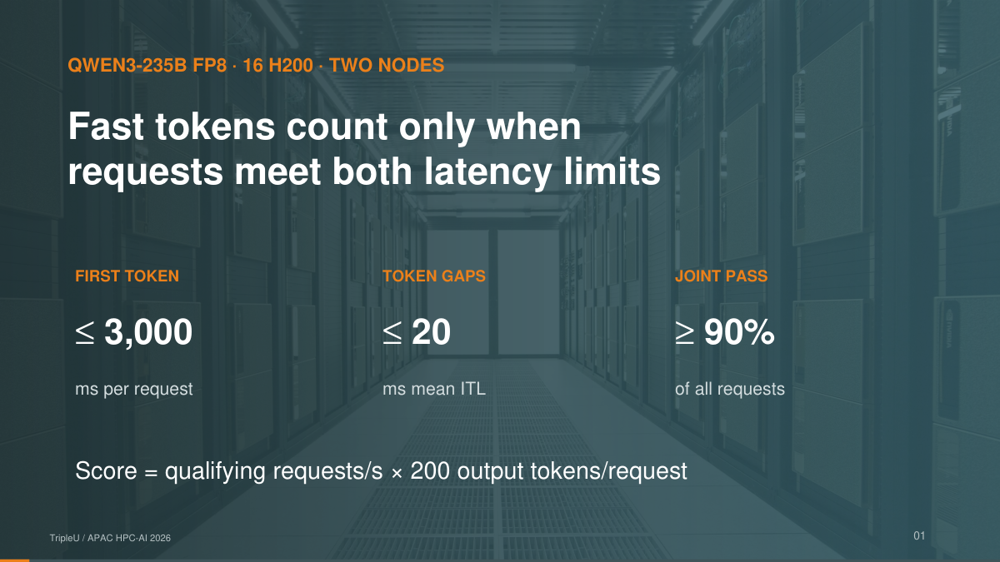

### Mạch suy luận để nói

- **Vấn đề:** Chọn cách phục vụ mô hình đã định trong ngân sách mười sáu H200, đồng thời xử lý workload tổng hợp cố định.
- **Vì sao quan trọng:** Yêu cầu trượt độ trễ không hữu ích cho mục tiêu đã đặt, dù hệ thống có thể sinh nhiều token thô.
- **Vì sao chọn phép thử này:** Cố định kích thước yêu cầu, kiểm tra cả TTFT lẫn mean ITL trên từng yêu cầu, rồi chỉ tổng hợp phần dịch vụ đạt chuẩn thành goodput.
- **Điều rút ra:** Nghiên cứu tối ưu đầu ra hữu ích đạt độ trễ và yêu cầu ít nhất 90% toàn bộ yêu cầu vượt qua cả hai giới hạn.
- **Vì sao chuyển sang bước tiếp:** Sau khi định nghĩa thành công, slide kế tiếp tách kết luận nào là quyết định kỹ thuật, đóng góp trực tiếp của nhóm và bằng chứng thực nghiệm riêng.

### Slide muốn nói gì

Định nghĩa mục tiêu dịch vụ trước khi bàn về tối ưu. Mô hình, ngân sách GPU, hình dạng yêu cầu và cổng độ trễ từng yêu cầu đều được cố định. Mọi quyết định topology hay backend sau đó được đánh giá theo đầu ra dịch vụ đạt chuẩn, không theo số token thô lớn nhất.

### Giải thích kết quả và lập luận

Giải thích luồng tính chỉ số từ một yêu cầu đến điểm dịch vụ cuối: yêu cầu có prompt và độ dài đầu ra cố định; TTFT và mean ITL được kiểm tra riêng cho yêu cầu đó; yêu cầu đạt chuẩn đóng góp vào goodput; goodput nhân với 200 token đầu ra yêu cầu để báo good output tokens mỗi giây. Lỗi vẫn thuộc tập được đánh giá. Không cần suy diễn ký hiệu biểu đồ hay màu trang trí không được nêu.

### Thuật ngữ và ký hiệu cần hiểu

- **Qwen3-235B FP8:** Checkpoint mô hình ngôn ngữ được chọn và định dạng trọng số dấu phẩy động tám bit.
- **16 H200 · 2 nodes:** Phạm vi tính toán chính cố định: mười sáu GPU H200 trên hai nút.
- **4,000 input → 200 output tokens:** Hình dạng yêu cầu tổng hợp: prompt 4.000 token yêu cầu mô hình sinh 200 token.
- **TTFT ≤ 3,000 ms:** Thời gian đến token đầu tiên của từng yêu cầu không quá 3.000 mili giây.
- **Mean ITL ≤ 20 ms:** Độ trễ trung bình giữa các token được sinh trong một yêu cầu không quá 20 mili giây.
- **Joint SLA ≥ 90%:** Ít nhất 90% toàn bộ yêu cầu được đánh giá phải đồng thời đạt hai giới hạn độ trễ. Yêu cầu lỗi làm giảm tỷ lệ này.
- **Goodput × 200 = good output tokens/s:** Số yêu cầu đạt chuẩn mỗi giây nhân với 200 token đầu ra được yêu cầu trên mỗi yêu cầu. Kết quả là tốc độ token đầu ra đạt chuẩn được báo cáo.
- **ms:** Mili giây, bằng một phần nghìn giây, dùng làm đơn vị độ trễ.

### Cách diễn giải số liệu hoặc sơ đồ

- Theo dõi từng yêu cầu qua cả hai kiểm tra độ trễ; chỉ đạt một giới hạn là chưa đủ.
- Điều kiện 90% tính trên toàn bộ yêu cầu được đánh giá, bao gồm cả lỗi trong mẫu số.
- Good output tokens mỗi giây là chỉ số dịch vụ được suy ra, không đơn giản là tổng token sinh chia cho thời gian chạy.

### Đánh đổi và mức độ bằng chứng

- **Quan sát:** Bài toán cố định prompt 4.000 token, 200 token đầu ra yêu cầu, hai giới hạn độ trễ từng yêu cầu và tỷ lệ đạt kết hợp tối thiểu 90%.
- **Giả thuyết:** Cấu hình tạo nhiều token thô vẫn có thể phục vụ kém nếu quá nhiều yêu cầu riêng lẻ trượt một trong hai giới hạn độ trễ.
- **Kết luận được hỗ trợ:** Dùng thông lượng đạt chuẩn dưới cổng kết hợp làm mục tiêu cho các quyết định kỹ thuật và thực nghiệm sau.
- **Chưa biết / giới hạn:** Cổng điểm MMLU-Pro cục bộ trên toàn bộ tập hiện đã được đo và đạt; chỉ số dịch vụ này không chứng minh BTC chứng nhận hay thứ hạng cuộc thi.

### Lời nói mẫu

Mục tiêu không chỉ là làm mô hình sinh token thật nhanh. Chúng tôi có mười sáu GPU H200 trên hai nút, checkpoint Qwen3-235B FP8 cố định, và workload mỗi request có 4.000 token đầu vào, yêu cầu 200 token đầu ra. Một request chỉ hữu ích nếu token đầu tiên đến trong ba giây và khoảng cách trung bình giữa các token sau không quá hai mươi mili giây. Ít nhất chín mươi phần trăm mọi request, kể cả request lỗi, phải đạt cả hai điều kiện. Mọi quyết định thiết kế đều phải phục vụ định nghĩa này.

### Điều không nên nói

Không bỏ lỗi, không suy ra tỷ lệ đạt từng yêu cầu từ độ trễ trung bình, và không gọi chỉ số dịch vụ cục bộ này là chứng nhận accuracy chính thức.

### Câu chuyển slide

Khi mục tiêu đã rõ, ta có thể phân biệt chính xác phần nào là quyết định kỹ thuật, đóng góp trực tiếp và bằng chứng thực nghiệm riêng.

---

## Slide 02 — Three investigations support three different kinds of claim

**Phần cứng: H200 primary · H100 kept separate**

**Loại nội dung: Mục tiêu hoặc giới hạn kết luận.**

### Nói nhanh · 10–20 giây

Chúng tôi tách lựa chọn kiến trúc, bản vá KV theo yêu cầu của nhóm và phép đo backend. Mỗi kết luận có loại bằng chứng riêng: hồ sơ layout, source cùng xác minh truyền, hoặc thử nghiệm có đối chứng; H100 được giữ riêng với H200.

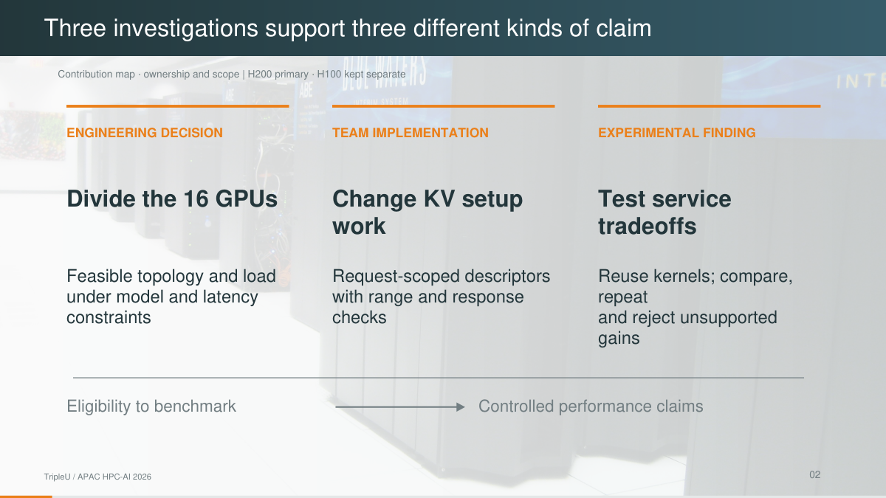

### Mạch suy luận để nói

- **Vấn đề:** Trình bày một nghiên cứu hệ thống dài mà không đánh đồng lựa chọn topology, thay đổi code và thí nghiệm hiệu năng.
- **Vì sao quan trọng:** Bằng chứng khả thi có thể chưa hỗ trợ tuyên bố tăng tốc; hiệu ứng backend đo được cũng không tự xác thực bản vá truyền khác.
- **Vì sao chọn phép thử này:** Gán mỗi kết luận một cổng bằng chứng riêng và giữ nhãn nền tảng/cấu hình gắn với từng quan sát.
- **Điều rút ra:** Nhóm có một lựa chọn kỹ thuật, một triển khai truyền KV trực tiếp với phạm vi xác minh giới hạn và các kết quả backend từ so sánh riêng.
- **Vì sao chuyển sang bước tiếp:** Trước hết xem đánh đổi topology trong ngân sách mười sáu GPU; sau đó xem layout được giữ lại và nhánh lịch sử riêng nơi xảy ra lỗi KV.

### Slide muốn nói gì

Lập bản đồ đóng góp của bài trình bày để không dùng bằng chứng của một loại kết luận nhằm nói quá loại khác. Quyết định kỹ thuật chọn thiết kế khả thi; bản vá KV là phần triển khai cụ thể của nhóm; so sánh backend là kết quả đo cần đối chứng và lặp lại riêng.

### Giải thích kết quả và lập luận

Mô tả ba luồng kết luận cùng hướng đến một mục tiêu. Luồng kiến trúc có hồ sơ layout khả thi hỗ trợ; luồng truyền KV có thay đổi source, kiểm tra hình học và lần chạy thật có bản vá; luồng backend có quan sát benchmark có kiểm soát và phép lặp. Mỗi luồng có cổng bằng chứng riêng. Kết quả H100 nằm trong luồng nền tảng riêng. Đây là bản đồ loại kết luận, không phải ba phần trăm có thể cộng lại.

### Thuật ngữ và ký hiệu cần hiểu

- **Engineering decision:** Lựa chọn có căn cứ giữa các layout theo ràng buộc phần cứng và dịch vụ; tự nó không phải tuyên bố tăng tốc nhân quả đơn lẻ.
- **Team KV patch:** Thay đổi NIXL theo yêu cầu cho descriptor TP khác nhau cùng bằng chứng kiểm tra đúng đắn/khả thi đã chạy.
- **Backend experimental finding:** So sánh đo được giữa lựa chọn backend phục vụ dưới tải và đối chứng đã nêu; không đồng nhất với đóng góp code KV.
- **Evidence gate:** Loại hồ sơ cần cho một kết luận: khả thi triển khai, kiểm tra thay đổi code, hoặc phép đo hiệu năng ghép cặp.
- **H200 / H100:** Hai nền tảng GPU khác nhau; kết quả được giữ ở chuỗi riêng, không gộp như thể có thể thay thế nhau.

### Cách diễn giải số liệu hoặc sơ đồ

- Đọc riêng ba luồng: lựa chọn kiến trúc, triển khai KV trực tiếp và thí nghiệm backend.
- Triển khai thành công chưa tự chứng minh tăng tốc; bản vá source chưa tự chứng minh truyền GPU; điểm backend không chứng nhận accuracy mô hình.
- Mọi luồng đều dùng mục tiêu goodput đạt độ trễ ở slide 1, nhưng bằng chứng giữa chúng không thể thay thế nhau.
- Nhãn nền tảng H200 chính và các quan sát H100 phải được giữ nguyên.

### Đánh đổi và mức độ bằng chứng

- **Quan sát:** Nghiên cứu có quyết định layout, một thay đổi truyền theo yêu cầu cụ thể và các thử nghiệm backend riêng; mỗi phần có đường bằng chứng khác nhau.
- **Giả thuyết:** Tách loại kết luận giúp giải thích điều nhóm triển khai, điều nhóm đo và điều vẫn chỉ là lựa chọn kỹ thuật.
- **Kết luận được hỗ trợ:** Báo cáo mỗi đóng góp đúng mức mà bằng chứng hỗ trợ, đồng thời giữ kết quả H100 tách khỏi chuỗi H200 chính.
- **Chưa biết / giới hạn:** Bản đồ đóng góp này không làm mọi kết quả thành quan hệ nhân quả, không cộng chúng thành một mức tăng và không xác lập accuracy chính thức.

### Lời nói mẫu

Chúng tôi tách ba loại bằng chứng để không cộng các mức tăng không liên quan thành một con số. Thứ nhất là quyết định kỹ thuật: bố trí worker prefill và decode trong hai nút được cấp. Thứ hai là phần triển khai có phạm vi rõ của nhóm: đổi cách một thư viện truyền dữ liệu sẵn có chuẩn bị metadata cho từng request. Thứ ba là lựa chọn backend được kiểm tra bằng các lượt chạy đầy đủ có đối chứng. Hồ sơ topology không chứng minh bản vá phần mềm gây tăng tốc; mã nguồn thay đổi cũng không chứng minh throughput tăng. Ta sẽ giữ riêng từng kết luận.

### Điều không nên nói

Không cộng ba luồng thành một mức tăng tổng hoặc dùng phép đo backend để nhận công nhân quả riêng cho bản vá KV.

### Câu chuyển slide

Ta bắt đầu từ quyết định kiến trúc: số replica và độ rộng song song cùng cạnh tranh một ngân sách mười sáu GPU.

---

## Slide 03 — Replica count and parallel width compete for the same 16 GPUs

**Phần cứng: H200 · historical topology observations**

**Loại nội dung: Quyết định kỹ thuật.**

### Nói nhanh · 10–20 giây

Nhóm chọn layout qua các điều kiện cấp phát, tương thích FP8, truyền dữ liệu hoạt động và bằng chứng full-run lặp lại. Điểm topology lịch sử khác tải nên không xếp hạng nhân quả.

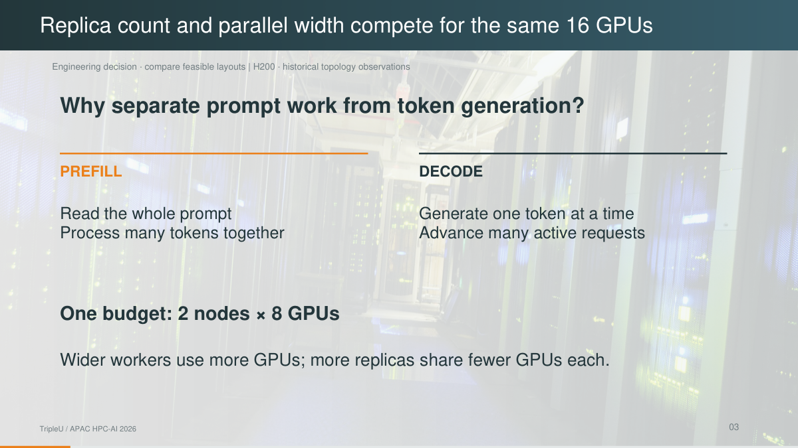

### Mạch suy luận để nói

- **Vấn đề:** Phân bổ mười sáu H200 giữa prefill và decode, cân bằng số replica worker với số GPU giao cho mỗi worker.
- **Vì sao quan trọng:** Quá ít replica có thể giới hạn tiếp nhận prompt; worker quá hẹp có thể xử lý phần việc kém hiệu quả; decode cũng có nhu cầu song song khác.
- **Vì sao chọn phép thử này:** Áp dụng ràng buộc theo thứ tự: vừa cấp phát và tương thích FP8 trước; truyền request thật giữa P/D tiếp theo; cuối cùng đo SLA trong bài đầy đủ và kiểm tra lặp lại. Điểm lịch sử khác tải chỉ giúp hiểu quá trình tìm kiếm.
- **Điều rút ra:** Layout được giữ lại là khả thi và điểm vận hành N64 có thể lặp lại. Vì các điểm topology nêu ở đây đo tại concurrency khác nhau, không thể nói layout này thắng mọi phương án ở cùng tải.
- **Vì sao chuyển sang bước tiếp:** Sau khi nêu lý do giữ layout, xem một nhánh khôi phục heterogeneous-TP riêng. Nhánh đó cho thấy vấn đề truyền readiness, không phải đối chứng topology với layout đã chọn.

### Slide muốn nói gì

Giải thích tiêu chí thực tế để giữ topology hiện tại. Nhóm chọn trong số các layout tương thích model, vừa ngân sách hai node, chạy được request qua đường truyền tách prefill/decode và duy trì điểm vận hành đạt SLA qua các lần chạy đầy đủ. Điểm N32, N40, N48 giúp hình thành quyết định nhưng không xếp hạng riêng topology vì tải và điều kiện thử khác nhau.

### Giải thích kết quả và lập luận

Chỉ trình bày giới hạn hai nút và lý do worker theo pha là thực tế. Prefill xử lý prompt; decode sinh token đầu ra. Một ngân sách cố định mười sáu GPU buộc nhóm đánh đổi giữa độ rộng worker và số replica. Slide không có danh sách điểm topology lịch sử hay trục số.

### Thuật ngữ và ký hiệu cần hiểu

- **replica:** Một worker riêng có thể xử lý yêu cầu; nhiều replica hơn có thể chia tải vào nhưng cũng tiêu tốn GPU.
- **parallel width / TP:** Số GPU phối hợp phục vụ một worker mô hình thông qua tensor parallelism.
- **EP:** Expert parallelism, cách chia tính toán expert trong mô hình mixture-of-experts.
- **N32 / N40 / N48:** Mục tiêu concurrency 32, 40 và 48 yêu cầu đang xử lý; N không phải số GPU.
- **good tokens/s:** Token đầu ra mỗi giây đạt giới hạn độ trễ kết hợp của dịch vụ.
- **17 usable configurations:** Sổ khôi phục topology đã rà soát đếm mười bốn layout gốc được đo cộng ba cấu hình thay thế EP2 được đo. Đây không phải khẳng định mọi lần thử đều thành công hay tạo thành thứ hạng cùng tải.

### Cách diễn giải số liệu hoặc sơ đồ

- Prefill xử lý prompt; decode sinh token, nên hình dạng worker phù hợp có thể khác nhau.
- Hai pha cùng dùng hai node, mỗi node tám H200.
- Worker rộng hơn chiếm nhiều GPU hơn; nhiều replica chia ngân sách đó cho nhiều worker.
- Sơ đồ giải thích ràng buộc lựa chọn thực tế, không xếp hạng các phép đo topology.

### Đánh đổi và mức độ bằng chứng

- **Quan sát:** Nhóm rà soát được 17 cấu hình topology đo được và dùng được, gồm ba phương án EP2 thay thế. Các ví dụ trình bày chạy ở N32, N40 và N48 nên không phải xếp hạng cùng tải.
- **Giả thuyết:** Một topology chuyên biệt theo từng pha có thể vừa hai node, truyền KV được và tạo điểm dịch vụ đạt latency có thể lặp lại.
- **Kết luận được hỗ trợ:** Giữ layout hai prefill TP4 và một decode TP8/EP8 vì vừa cấp phát, tương thích model, phục vụ được qua hai pha và có các lần đo N64 lặp lại. Đây là lựa chọn thực tế dựa trên bằng chứng, chưa phải tối ưu toàn cục đã chứng minh.
- **Chưa biết / giới hạn:** Chưa có phép so sánh lặp lại, cùng tải giữa mọi topology khả thi để xác định topology thắng về nhân quả.

### Lời nói mẫu

Câu hỏi kiến trúc là phân bổ mười sáu GPU thế nào cho hai giai đoạn khác nhau. Prefill xử lý prompt dài; decode sinh từng token, vì vậy cùng một kiểu song song chưa chắc phù hợp cả hai. Lựa chọn còn bị giới hạn bởi hai nút, mỗi nút tám GPU, và yêu cầu chia FP8 của model. Chúng tôi loại layout không vừa hoặc không chạy đúng trước; tiếp theo cần request thật đi từ prefill sang decode; cuối cùng mới xét đầu ra đạt độ trễ và khả năng lặp lại của full-run. Số đo topology lịch sử giúp thu hẹp hướng thử, nhưng tải khác nhau nên không chứng minh layout nào thắng về điểm.

### Điều không nên nói

Không gán điểm topology cũ cho một cấu hình có tên hay trình bày thành xếp hạng nhân quả. Slide giải thích ràng buộc phần cứng và cách chia pha thực tế.

### Câu chuyển slide

Sau đó, một nhánh heterogeneous-TP lịch sử riêng gặp lỗi sẵn sàng truyền KV. Ta dùng nhánh này để giải thích nghiên cứu KV, không làm đối chứng topology cùng tải.

---

## Slide 04 — Two TP4 prefills feed one TP8 decode within the two-node budget

**Phần cứng: 16 H200 · Firmus**

**Loại nội dung: Quyết định kỹ thuật.**

### Nói nhanh · 10–20 giây

Cách chia được giữ lại dùng hai worker prefill TP4/EP1, mỗi worker bốn GPU, trên một nút; nút kia chạy decode TP8/EP8 trên tám GPU. Cấu hình vừa 16 H200 nhưng cần truyền KV giữa hai vai trò. Cấu hình này được chọn để cân bằng hai pha trong ngân sách GPU.

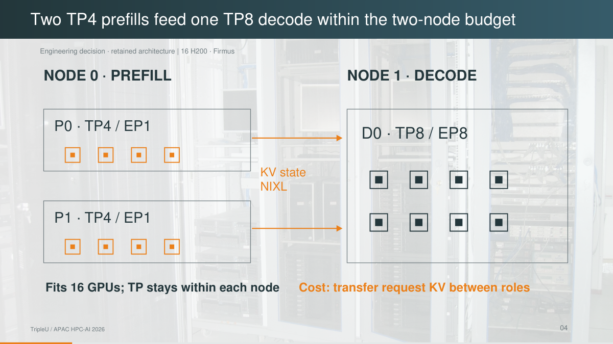

### Mạch suy luận để nói

- **Vấn đề:** Chuyển các ứng viên topology thành kiến trúc phục vụ hai nút, dùng phân bổ đủ mười sáu H200.
- **Vì sao quan trọng:** Hai giai đoạn dịch vụ có nhu cầu tài nguyên khác nhau; cách chia quyết định năng lực worker và việc KV phải chuyển qua nút hay không.
- **Vì sao chọn phép thử này:** Giữ hai worker prefill TP4/EP1 cùng một worker decode TP8/EP8 như layout chuyên biệt khả thi, rồi xác minh đường truyền thực tế.
- **Điều rút ra:** Kiến trúc vừa ngân sách nút và tách riêng vai trò prefill/decode, nhưng tạo ra yêu cầu truyền KV giữa hai vai trò.
- **Vì sao chuyển sang bước tiếp:** Một nhánh khôi phục lịch sử với TP khác nhau đã gặp lỗi warmup đường truyền; topology của nhánh đó khác layout được giữ lại ở đây.

### Slide muốn nói gì

Nêu rõ kiến trúc được giữ như quyết định kỹ thuật trong ngân sách hai nút. Giải thích cách chuyên biệt theo giai đoạn dùng replica cho xử lý prompt và song song rộng hơn cho decode, đồng thời nêu đường truyền KV bổ sung là chi phí của kiến trúc tách rời.

### Giải thích kết quả và lập luận

Thể hiện Node 0 có P0 và P1, mỗi worker bốn GPU với TP4/EP1. Node 1 có D0 với tám GPU và TP8/EP8. Yêu cầu đến một worker prefill, sau đó trạng thái KV được chuyển sang decode để sinh đầu ra. Tổng cấu hình là mười sáu GPU. Sơ đồ mô tả vai trò và vị trí, không phải mức sử dụng hay lưu lượng đã đo.

### Thuật ngữ và ký hiệu cần hiểu

- **Node 0 / Node 1:** Hai nút tính toán H200 trong layout Firmus được giữ lại.
- **P0 / P1:** Hai worker prefill trên Node 0; mỗi worker dùng bốn GPU.
- **D0:** Worker decode duy nhất trên Node 1; dùng tám GPU.
- **TP4 / TP8:** Tensor parallelism trên bốn hoặc tám GPU trong một worker.
- **EP1 / EP8:** Expert parallelism trên một hoặc tám phân vùng expert của các lớp expert trong mô hình.
- **KV state:** Dữ liệu key/value attention tạo ra khi xử lý prompt và cần để sinh token đầu ra.
- **Prefill / decode:** Prefill xử lý token đầu vào và chuẩn bị trạng thái KV; decode dùng trạng thái đó để sinh token đầu ra.
- **2 × 4 + 1 × 8 = 16:** Hai worker prefill bốn GPU cộng một worker decode tám GPU, tổng cộng mười sáu GPU.

### Cách diễn giải số liệu hoặc sơ đồ

- Hai worker P là replica nhận việc prompt; worker D dùng cấu hình TP/EP rộng hơn để sinh token.
- Cách chia phù hợp ngân sách hai nút và giữ nhóm TP của mỗi worker trong cùng nút.
- Khác với một worker đặt chung, thiết kế này phải truyền trạng thái KV của yêu cầu giữa prefill và decode.

### Đánh đổi và mức độ bằng chứng

- **Quan sát:** Layout H200 được giữ lại đặt hai worker prefill TP4/EP1 tại Node 0 và một worker decode TP8/EP8 ở Node 1, dùng đủ mười sáu GPU.
- **Giả thuyết:** Chuyên biệt tài nguyên theo giai đoạn có thể đáp ứng khác biệt giữa xử lý prompt và sinh token về số replica và độ rộng song song.
- **Kết luận được hỗ trợ:** Đây là kiến trúc kỹ thuật được giữ cho dịch vụ đã chọn; nó chưa chứng minh chính cách chia này nhân quả tốt hơn mọi phương án ở cùng tải.
- **Chưa biết / giới hạn:** Sơ đồ không định lượng lợi ích chuyên biệt theo giai đoạn hay chi phí truyền; muốn phục vụ được thì truyền KV giữa vai trò phải hoạt động.

### Lời nói mẫu

Thiết kế được giữ chạy hai worker prefill TP4/EP1 trên một nút và một worker decode TP8/EP8 trên nút kia. TP là tensor parallelism: nhiều GPU cùng tính một worker model. EP chia các expert giữa thiết bị. Nói đơn giản, cấu hình có hai worker nhận prompt và dành một worker rộng hơn cho việc sinh token. Nó vừa cấp phát và vượt kiểm tra đường chạy tách giai đoạn thực tế. Đổi lại, trạng thái key-value phải đi từ prefill sang decode. Vì vậy đây là lựa chọn kiến trúc khả thi, không phải tăng tốc miễn phí; tính đúng đắn của truyền dữ liệu trở thành một phần của hệ thống.

### Điều không nên nói

Không nhầm topology được chọn với nhánh khôi phục lịch sử P8 TP8/EP2 sang D8 TP4/EP4 ở các slide kế tiếp.

### Câu chuyển slide

Để hiểu vì sao phải xác minh truyền dữ liệu, ta xem nhánh lịch sử riêng nơi worker sẵn sàng nhưng warmup vẫn thất bại.

---

## Slide 05 — Ready workers still failed before the first usable benchmark

**Phần cứng: H200 · historical heterogeneous-TP branch**

**Loại nội dung: Phần nhóm sửa và xác minh.**

### Nói nhanh · 10–20 giây

Trong job 22271, worker P8 TP8/EP2 sang D8 TP4/EP4 đã nạp mô hình nhưng warmup cặp timeout sau 360 giây. AIPerf chưa chạy, vì vậy không có điểm baseline. Đây là dấu hiệu lỗi khởi động, chưa phải kết quả hiệu năng.

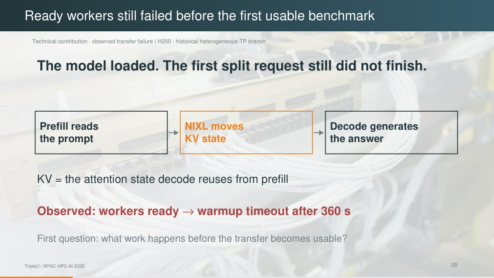

### Mạch suy luận để nói

- **Vấn đề:** Một triển khai TP khác nhau trong lịch sử đã nạp worker nhưng không warmup được đường prefill sang decode cho yêu cầu client.
- **Vì sao quan trọng:** Nếu cặp chưa sẵn sàng thì không có benchmark sử dụng được và không có kết quả dịch vụ để tối ưu.
- **Vì sao chọn phép thử này:** Kiểm tra hồ sơ job và log warmup được giữ lại để xác định giai đoạn thất bại trước khi diễn giải hiệu năng.
- **Điều rút ra:** Job 22271 chờ 360 giây rồi kết thúc với HTTP TimeoutError; không có điểm AIPerf. Bằng chứng là triệu chứng sẵn sàng, không phải chẩn đoán băng thông đã đo.
- **Vì sao chuyển sang bước tiếp:** Vì lỗi xảy ra trước khi chấm điểm, bước tiếp theo là xem đường setup lạnh và ưu tiên một giả thuyết dựa trên source mà không khẳng định đã loại trừ nguyên nhân khác.

### Slide muốn nói gì

Xác lập lỗi sẵn sàng truyền đã quan sát trước khi trình bày cách sửa. Đây là nhánh khôi phục lịch sử dùng tensor parallelism khác nhau, không phải kiến trúc được giữ ở slide 4. Timeout xảy ra trước khi có kết quả benchmark sử dụng được.

### Giải thích kết quả và lập luận

Thể hiện đường yêu cầu từ worker prefill sẵn sàng sang decode, rồi đánh dấu yêu cầu pair-warmup timeout sau 360 giây. Ghi job 22271 và nêu rõ AIPerf chưa chạy, không có điểm số. Không biểu diễn lỗi này thành điểm thấp trên biểu đồ hiệu năng hay độ trễ truyền đã đo.

### Thuật ngữ và ký hiệu cần hiểu

- **job 22271:** Lần thử warmup thất bại được lưu lại trong nhánh khôi phục H200 TP khác nhau lịch sử.
- **P8 TP8/EP2 → D8 TP4/EP4:** Cấu hình prefill và decode của nhánh này. TP và EP khác nhau giữa hai vai trò; không phải topology được chọn ở slide 4.
- **pair warmup:** Yêu cầu đi qua cả prefill và decode để kiểm tra đường dịch vụ tách rời có thể hoạt động trước khi benchmark chấm điểm.
- **360-second timeout:** Thời gian chờ tối đa trước khi lần pair-warmup kết thúc bằng timeout; không phải phép đo thời gian truyền KV.
- **AIPerf did not run:** Không có bản xuất benchmark hoặc điểm throughput vì warmup thất bại trước.
- **bootstrap:** Công việc khởi động cần để hai vai trò phục vụ cùng đường truyền sẵn sàng xử lý yêu cầu.

### Cách diễn giải số liệu hoặc sơ đồ

- Worker mô hình đã nạp, nhưng yêu cầu thật đi qua cặp P/D không hoàn tất warmup.
- Log lưu lại kết thúc bằng HTTP TimeoutError sau 360 giây; không có bản xuất AIPerf và không có điểm benchmark.
- Điều này xác lập lỗi sẵn sàng/bootstrap lúc lạnh trong lần thử, không phải phép đo nghẽn băng thông steady-state hay bản sao KV chậm.
- Giữ nhánh lịch sử này tách khỏi layout được chọn gồm hai prefill TP4 và decode TP8/EP8.

### Đánh đổi và mức độ bằng chứng

- **Quan sát:** Job 22271 nạp worker mô hình ở nhánh TP khác nhau, sau đó warmup cặp timeout sau 360 giây với HTTP TimeoutError. AIPerf chưa chạy.
- **Giả thuyết:** Vấn đề nằm trong bootstrap P/D lạnh hoặc độ sẵn sàng truyền, nhưng triệu chứng chưa tách riêng việc tạo descriptor thành nguyên nhân.
- **Kết luận được hỗ trợ:** Phân loại 22271 là lỗi sẵn sàng trước benchmark và giữ nguyên topology cùng bằng chứng log. Job không có giá trị throughput baseline.
- **Chưa biết / giới hạn:** Giai đoạn timeout chưa được phân rã. Chuẩn bị descriptor, bootstrap/truyền khác, băng thông, ánh xạ KV và vị trí tài nguyên chưa được đo riêng hoặc loại trừ.

### Lời nói mẫu

Điều tra KV xuất phát từ một nhánh TP khác nhau trong lịch sử, không phải layout được giữ. KV là trạng thái key và value: thông tin attention tạm thời được tạo khi xử lý prompt rồi dùng lại khi sinh các token tiếp theo. Trong job 22271, cả hai worker đều nạp xong, nhưng request không hoàn thành pair warmup trong 360 giây; benchmark chưa bắt đầu. Cơ chế truyền là NIXL, thư viện sẵn có để chuyển trạng thái này giữa các worker. Điều đó chỉ cho biết lỗi xuất hiện ở đâu trước khi chấm điểm. Nó chưa cho biết nguyên nhân là bandwidth, layout, lịch xử lý hay chi phí setup.

### Điều không nên nói

Không báo cáo 22271 như baseline throughput thấp hoặc chia 360 giây cho thời gian warmup về sau để tính tăng tốc; đây không phải các phép đo thời gian ghép cặp.

### Câu chuyển slide

Timeout xác định lỗi xảy ra trước khi chấm điểm nhưng chưa cho biết nguyên nhân. Tiếp theo ta xem đường setup và chọn một giả thuyết nhỏ, kiểm tra được từ source trước khi kết luận nghẽn bandwidth, layout hay scheduling.

---

## Slide 06 — Request-scoped descriptors remove work unrelated to the request

**Phần cứng: H200 transfer path · CPU geometry checks**

**Loại nội dung: Phần nhóm sửa và xác minh.**

### Nói nhanh · 10–20 giây

Hai worker đã sẵn sàng nhưng warmup qua cặp P/D timeout trước AIPerf. Source cho thấy setup duyệt cả pool KV không phụ thuộc request. Nhóm thử giới hạn descriptor theo request trước vì đây là giả thuyết nhỏ, kiểm tra được với chi phí thấp.

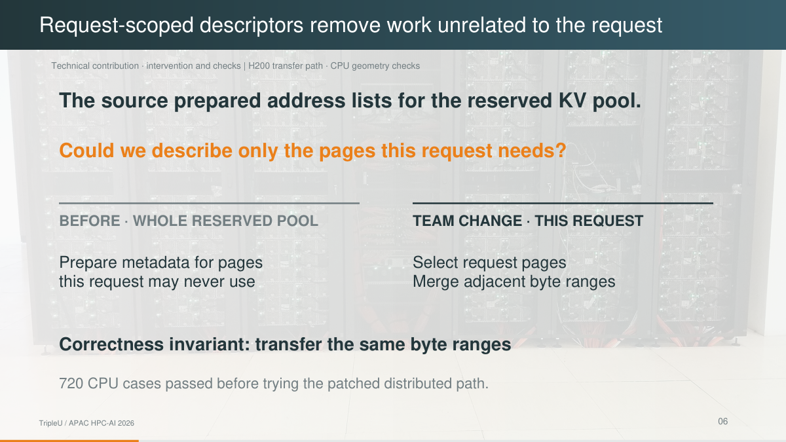

### Mạch suy luận để nói

- **Vấn đề:** Liệt kê descriptor toàn pool xuất hiện trong đường TP khác nhau khi khởi động lạnh, sau khi pair-warmup thất bại.
- **Vì sao quan trọng:** Chuẩn bị metadata cho những trang mà yêu cầu không truyền có thể thêm công việc trước khi dịch vụ xử lý được yêu cầu đầu tiên.
- **Vì sao chọn phép thử này:** Source cho thấy một bước setup xử lý dữ liệu không liên quan request. Giới hạn công việc này có điều kiện đúng đắn rõ ràng và kiểm tra CPU chi phí thấp, nên là can thiệp đầu tiên có thể phân biệt giả thuyết với chi phí nhỏ. Nhóm chưa chứng minh bandwidth, KV layout hay scheduling vô can.
- **Điều rút ra:** 720 phép kiểm tra hỗ trợ kết luận khoảng byte giữ nguyên. Chúng biện minh cho việc thử đường phân tán sau patch, nhưng không chỉ ra nguyên nhân timeout hoặc chứng minh bottleneck hiệu năng.
- **Vì sao chuyển sang bước tiếp:** Lần chạy tiếp theo hỏi liệu nhánh đã sửa có warmup được và hoàn tất benchmark không. Vì nhánh cũ không có control chấm điểm thành công, hãy hiểu kết quả như bằng chứng khả thi.

### Slide muốn nói gì

Giải thích vì sao nhóm thử tối ưu tạo descriptor trước tiên. Sau lỗi warmup trước khi chấm điểm, đọc source cho thấy setup heterogeneous-TP duyệt metadata của cả pool, kể cả phần không thuộc request hiện tại. Chỉ xử lý trang KV cần dùng có thể kiểm tra tính đúng đắn bằng fixture CPU mà không giả định bandwidth, KV layout hay scheduling đã bị loại trừ.

### Giải thích kết quả và lập luận

Bên trái biểu diễn toàn bộ KV pool đã dành; phía theo request chỉ chọn các trang cần dùng lúc này rồi gộp các dải byte liền kề. Có thể hình dung như đặt chỗ cả bãi xe nhưng chỉ viết đường đi cho xe trong chuyến này. Slide thể hiện khác biệt phạm vi và 720 kiểm tra hình học CPU, không phải biểu đồ tốc độ truyền.

### Thuật ngữ và ký hiệu cần hiểu

- **NIXL:** Cơ chế truyền trạng thái KV giữa worker prefill và decode tách rời.
- **descriptor:** Metadata mô tả các dải bộ nhớ để truyền; không phải bản thân dữ liệu KV.
- **403.8 million per source rank:** Số gần đúng descriptor nguồn khi liệt kê toàn pool trong hình học TP8 đại diện, suy ra từ 2.148.119 KV slot, 94 layer và các mục K/V.
- **188 per request:** Số từ hình học CPU sau khi gộp các dải liền kề cho yêu cầu liên tục 4.000 token TP8 sang TP4.
- **coalescing:** Gộp các dải bộ nhớ kề nhau thành ít entry descriptor hơn mà vẫn giữ đúng địa chỉ và stride cần thiết.
- **720 CPU cases:** Số trường hợp tương đương byte-range giữa code gốc và bản vá đã vượt kiểm tra hình học CPU.
- **real GPU transport validation: false:** Fixture lưu rõ rằng các kiểm tra hình học này không xác nhận truyền GPU thực tế.
- **per-token stride:** Khoảng cách giữa dữ liệu gắn với token khi truyền một lát KV head; cần được giữ đúng khi mô tả các dải.

### Cách diễn giải số liệu hoặc sơ đồ

- Triệu chứng trước đó là pair-warmup timeout trước benchmark; lần thử ấy không có request được chấm.
- Đọc source thấy setup làm việc trên pool đã dành, gồm cả trang nằm ngoài request hiện tại.
- Nhóm đổi cách dựng descriptor quanh thư viện truyền NIXL sẵn có; nhóm không tạo NIXL hay kernel model mới.
- Đường theo request giữ nguyên các dải byte nhưng tránh dựng metadata cho trang không liên quan.
- 720 trường hợp hình học CPU đã vượt qua; chúng không xác lập hiệu năng truyền GPU hay mạng thật.

### Đánh đổi và mức độ bằng chứng

- **Quan sát:** Một cặp worker heterogeneous-TP tải model được nhưng warmup timeout trước benchmark. Đọc source cho thấy duyệt metadata toàn pool; 720 ca tương đương CPU đạt sau bản sửa hẹp.
- **Giả thuyết:** Bỏ qua descriptor không liên quan request có thể giúp đường bootstrap hoạt động; kiểm tra CPU chính xác, rẻ có thể phát hiện patch sai trước khi tốn một allocation phân tán khác.
- **Kết luận được hỗ trợ:** Chọn giới hạn descriptor là can thiệp kỹ thuật đầu tiên hợp lý vì thấy trực tiếp trong source, phạm vi nhỏ và rẻ để kiểm tra. Bằng chứng hiện có chưa cho thấy đây là bottleneck hiệu năng chính.
- **Chưa biết / giới hạn:** Nhánh này không có run unpatched thành công để chấm điểm, timer khởi tạo, profile bandwidth, so sánh KV layout hay scheduling. Chưa biết thành phần nào gây timeout hoặc gain end-to-end riêng của descriptor.

### Lời nói mẫu

Vì sao xem descriptor trước? Source cho thấy bước setup mô tả cả KV pool đã dành, dù một request chỉ dùng một số trang. Hãy hình dung ta đặt chỗ cả bãi đỗ xe nhưng chỉ cần ghi chỉ dẫn cho những xe trong một chuyến. Phép đếm từ source lịch sử là khoảng 403,8 triệu descriptor tiềm năng so với 188 ở trường hợp giới hạn theo request; phạm vi hai số khác nhau nên không lấy tỷ số đó làm tốc độ tăng. Nhóm sửa phần triển khai của mình quanh thư viện NIXL sẵn có, không sửa thư viện truyền hay tạo kernel mới. 720 kiểm tra hình học CPU xác nhận các dải byte được chọn vẫn đúng. Đây là can thiệp đầu tiên rẻ và kiểm tra được, không phải bằng chứng nó là bottleneck lớn nhất.

### Điều không nên nói

Không suy ra tỷ lệ hiệu năng từ hai số đếm descriptor khác phạm vi. Đây là thay đổi triển khai có phạm vi; bandwidth, KV layout và scheduling chưa được chứng minh là không liên quan.

### Câu chuyển slide

Kiểm tra CPU chỉ xác nhận mô tả khoảng byte tương đương. Slide sau xem đường phân tán thật có hoạt động không; kết quả đó vẫn chưa đo riêng speedup do descriptor.

---

## Slide 07 — The patched path became usable; descriptor-only speedup is unknown

**Phần cứng: H200 · same recovery topology · 22271 / 22294**

**Loại nội dung: Phần nhóm sửa và xác minh.**

### Nói nhanh · 10–20 giây

Job 22294 có bản vá hoàn tất warmup trong 0,68–0,70 giây mỗi yêu cầu và đạt 1.422,96 good tokens/s ở N32, SLA kết hợp 95,87%, không lỗi. Kết quả chứng minh tính khả thi, không phải mức tăng tốc riêng. Đây là bằng chứng khả thi của một lần chạy cụ thể. Cần đối chứng thành công để ước lượng tác động riêng của bản vá.

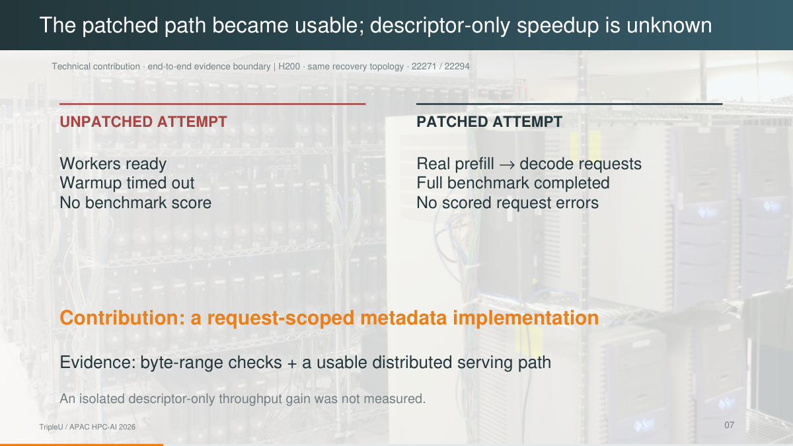

### Mạch suy luận để nói

- **Vấn đề:** Xác định thay đổi source có dẫn tới đường dịch vụ dùng được hay không, thay vì chỉ có fixture CPU vượt qua.
- **Vì sao quan trọng:** Chỉ yêu cầu đầu cuối và benchmark thật mới cho biết topology khôi phục có bản vá đã dùng được; kiểm tra địa chỉ CPU không thể chứng minh điều này.
- **Vì sao chọn phép thử này:** Sau khi kiểm tra khoảng byte, cửa tiếp theo cần thiết là gửi request phân tán thật qua cả hai vai trò rồi chạy đủ protocol benchmark. Đây là phép thử tính khả thi; thiếu control unpatched chạy chấm điểm thành công nên so sánh nhân quả bị giới hạn.
- **Điều rút ra:** Nhánh đã sửa warmup được và hoàn tất run N32 với 95,87% request đạt SLA chung, không có lỗi bị chấm. Điều đó chứng minh có một đường phục vụ hoạt động. Chưa định lượng speedup riêng do descriptor vì lần chạy gốc timeout trước khi chấm điểm.
- **Vì sao chuyển sang bước tiếp:** Khi đã có đường chạy được để đo, mới có thể làm thí nghiệm hiệu năng. Profile chẩn đoán ở slide sau đưa ra ứng viên cần khảo sát, không chứng minh bottleneck.

### Slide muốn nói gì

Báo cáo kết quả đầu cuối của nhánh khôi phục có bản vá và nêu ranh giới bằng chứng. Đường chạy đã dùng được và hoàn tất benchmark N32 cục bộ, nhưng không đo phần đóng góp độc lập của bản vá descriptor vì thiếu đối chứng không vá thành công được ghép cặp.

### Giải thích kết quả và lập luận

Hai thẻ job riêng, không phải biểu đồ tăng tốc. Lần thử trước không có bản vá có worker sẵn sàng nhưng pair warmup timeout trước AIPerf. Lần có bản vá hoàn thành request thật qua prefill sang decode và benchmark N32 đầy đủ, không có request lỗi được chấm. Một ô riêng nêu rằng chưa đo tốc độ tăng chỉ do descriptor.

### Thuật ngữ và ký hiệu cần hiểu

- **pair warmup:** Kiểm tra sẵn sàng bằng request thật đi qua worker prefill và decode.
- **tăng tốc chỉ do descriptor:** Thay đổi hiệu năng chỉ có thể quy cho bước dựng descriptor; chưa được đo bằng control khớp điều kiện.

### Cách diễn giải số liệu hoặc sơ đồ

- Lần trước dừng ở warmup trước khi có điểm benchmark.
- Trong lần có bản vá, request thật đi qua cả vai trò prefill và decode; benchmark N32 đầy đủ hoàn tất.
- Kết luận hữu ích là đường khôi phục có bản vá khả thi trong một lần chạy, không có request lỗi được chấm.
- Không có control không vá với điểm số thành công hay bộ định giờ descriptor riêng, nên slide không tuyên bố tăng tốc chỉ do descriptor.

### Đánh đổi và mức độ bằng chứng

- **Quan sát:** Đường chạy có bản vá của job 22294 hoàn tất cả hai tuyến warmup P/D trong 0,68–0,70 giây mỗi yêu cầu sau khi server sẵn sàng, rồi đạt 1422,96 good tokens/s ở N32 với SLA kết hợp 95,87%, không lỗi/hủy.
- **Giả thuyết:** Descriptor theo yêu cầu có thể giúp đường khôi phục dùng được, nhưng khác biệt giữa các lần chạy hoặc bootstrap khác cũng có thể giải thích lần này thành công.
- **Kết luận được hỗ trợ:** Bằng chứng hỗ trợ tính khả thi của đường có bản vá và kết quả benchmark cục bộ đầy đủ cho topology khôi phục này. Mức tăng tốc riêng do descriptor và quy kết nhân quả vẫn chưa biết.
- **Chưa biết / giới hạn:** Không có đối chứng đầu cuối không vá thành công trên đúng topology này, không có thời gian setup descriptor cũ-mới và không có phân rã warmup có kiểm soát. Mức sử dụng mạng, bố trí KV, vị trí tài nguyên, bootstrap khác và phần goodput riêng do bản vá đóng góp đều chưa được đo.

### Lời nói mẫu

Kiểm tra CPU chỉ xác nhận bản vá chọn đúng dải bộ nhớ. Tiếp theo cần đường phân tán thật hoạt động. Trong job 22294, setup TP khác nhau có bản vá hoàn tất pair warmup trong 0,68 đến 0,70 giây mỗi request và chạy xong benchmark N32 đạt khoảng 1.423 token đầu ra tốt mỗi giây, SLA chung 95,87%, không có lỗi được chấm. Đây là kết quả đầu cuối của lượt khôi phục này. Job trước không có điểm và hai lượt không phải cặp hiệu năng khớp điều kiện. Vì thế ta có thể nói đường có bản vá đã chạy trong trường hợp này, nhưng không thể quy toàn bộ điểm số hoặc một mức tăng riêng cho descriptor.

### Điều không nên nói

Không đổi timeout trước đó thành tỷ lệ tăng tốc hay quy toàn bộ điểm nhánh khôi phục cho bản vá. Slide cho thấy đường chạy được, không cô lập nguyên nhân.

### Câu chuyển slide

Bản sửa khôi phục được đường serving có thể đo, nhưng nguyên nhân hiệu năng vẫn chưa rõ. Tiếp theo xem profile như gợi ý giả thuyết, không phải phân rã thời gian nhân quả.

---

## Slide 08 — Profiles identify candidates for investigation, not a proven time budget

**Phần cứng: H200 · profile chẩn đoán N48; quan sát đuôi request N64 riêng**

**Loại nội dung: Phương pháp hoặc phát hiện thực nghiệm.**

### Nói nhanh · 10–20 giây

Profile chẩn đoán gợi ý các vùng compute, communication và attention để khảo sát. Nó không xác lập phân bổ thời gian nhân quả hay bottleneck.

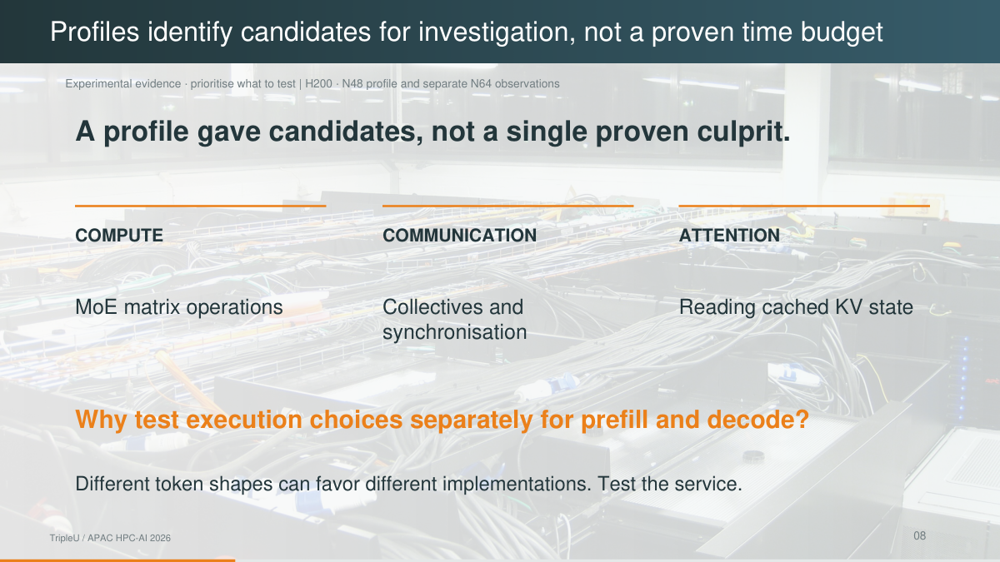

### Mạch suy luận để nói

- **Vấn đề:** Chiến dịch cần chọn câu hỏi hiệu năng để thử mà không kết luận bottleneck chỉ từ profile.
- **Vì sao quan trọng:** Tổng thời lượng kernel GPU có thể chồng lấp và bỏ qua nguồn thời gian khác, nên phần trăm không phải tỷ trọng latency request.
- **Vì sao chọn phép thử này:** Thu profile chẩn đoán N48 và quan sát request N64 riêng để tìm các khu vực ứng viên và triệu chứng. Tổng thời lượng kernel không phân bổ thời gian thực của request hay chỉ ra một cách sửa nhân quả, nên phép so backend tiếp theo được trình bày là thử nghiệm có đối chứng riêng, không phải hệ quả đã chứng minh từ profile.
- **Điều rút ra:** Compute, collective, attention và hàng đợi trước token đầu tiên đều là hướng đáng khảo sát, nhưng ở đây chưa đo tỷ phần thời gian của request. Bằng chứng không cho thấy HPC-Ops decode là giải pháp được profile chọn ra.
- **Vì sao chuyển sang bước tiếp:** Tiếp theo là phép kiểm riêng về decode implementation được hỗ trợ, có control mới và lần lặp. Tác động được đánh giá từ cặp control đó, không từ phần trăm kernel N48.

### Slide muốn nói gì

Dùng instrumentation để ưu tiên phép thử tiếp theo, không nhầm hoạt động GPU được ghi với ngân sách thời gian đầu-cuối hoặc gộp bằng chứng từ các lần chạy khác nhau.

### Giải thích kết quả và lập luận

Profile chia công việc ứng viên thành compute, communication và attention; không hiển thị thanh phần trăm. Quan sát đuôi request về sau là riêng và không thể quy cho chẩn đoán này. Các nhóm gợi ý một phép thử backend có kiểm soát, chi phí thấp, chứ không xác nhận bottleneck nhân quả.

### Thuật ngữ và ký hiệu cần hiểu

- **compute:** Các phép tính của model như phép toán ma trận.
- **communication:** Trao đổi dữ liệu và phối hợp giữa các GPU.
- **attention:** Phép toán model dùng thông tin query/key/value, gồm KV cache trong decode.
- **profile:** Mẫu chẩn đoán một số hoạt động runtime; có thể không bao phủ toàn bộ công việc hoặc giải thích độ trễ request.

### Cách diễn giải số liệu hoặc sơ đồ

- Chẩn đoán N48 và quan sát đuôi request N64 đến từ các điều kiện riêng.
- Compute, communication và attention là các vùng ứng viên để khảo sát, chưa phải bottleneck đã xác nhận.
- Tổng thời lượng kernel không phải ngân sách đầy đủ cho thời gian request vì công việc có thể chồng lấp, còn CPU và hàng đợi nằm ngoài tổng đó.
- Phép thử backend có phạm vi hẹp, giữ setting khác cố định, là bước tiếp theo hợp lý; profile không tự dự đoán mức tăng tốc.

### Đánh đổi và mức độ bằng chứng

- **Quan sát:** Ba nhóm chiếm các tỷ lệ nêu trên trong thời lượng kernel ghi được; một quan sát N64 riêng có lỗi chỉ ở TTFT.
- **Giả thuyết:** Giao tiếp, phép tính ma trận hoặc attention có thể là mục tiêu cho phép thử có kiểm soát; thời điểm request đầu chậm cũng đáng khảo sát riêng.
- **Kết luận được hỗ trợ:** Dùng profile như manh mối ưu tiên. Giữ phạm vi N48 riêng với kết quả dịch vụ N64.
- **Chưa biết / giới hạn:** Chưa có phân rã thời gian từng pha theo request, quy thuộc tổng walltime hay giải thích nhân quả cho lỗi TTFT N64.

### Lời nói mẫu

Sau khi đường truyền hoạt động, ta vẫn cần hỏi điều gì giới hạn dịch vụ đã chọn. Profiling đưa ra manh mối chứ không phải phán quyết: thời gian được gán cho kernel GPU không giải thích đầy đủ độ trễ request, và phép chẩn đoán chạy ở concurrency khác lượt cuối. Chúng tôi xem compute, giao tiếp collective và attention là các vùng ứng viên cần khảo sát. Bước hợp lý tiếp theo là phép thử backend có kiểm soát, chi phí thấp, chỉ đổi một cách triển khai trong khi giữ cấu hình serving cố định. Như vậy ta không biến một tỷ lệ trong profile thành câu chuyện nhân quả trước khi có phép đo đầu cuối khớp điều kiện.

### Điều không nên nói

Không trình bày phần trăm profile như tỷ trọng độ trễ request hoặc suy ra hoạt động kernel N48 gây ra lỗi TTFT riêng ở N64.

### Câu chuyển slide

Profile thu hẹp câu hỏi nhưng chưa chọn giải pháp. Bây giờ là phép thử decode riêng có đối chứng, cùng cách chọn control, các yếu tố giữ cố định và giới hạn.

---

## Slide 09 — Test the decode implementation while holding the serving setup fixed

**Phần cứng: H200 · N60 đầy đủ · jobs 24912/24913**

**Loại nội dung: Phương pháp hoặc phát hiện thực nghiệm.**

### Nói nhanh · 10–20 giây

Chúng tôi so decode tự động với HPC-Ops trên cùng cấu hình H200 N60 đầy đủ, giữ prefill DeepGEMM và chunk 8.192 cố định. Giả thuyết là decode có thể tăng thông lượng hữu ích; lần lặp treatment riêng kiểm tra độ nhất quán.

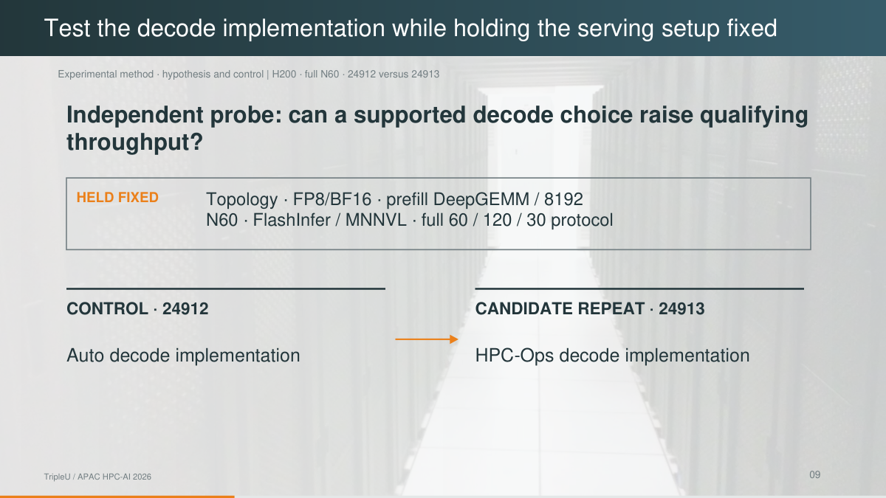

### Mạch suy luận để nói

- **Vấn đề:** Đổi backend chỉ hữu ích nếu mục tiêu dịch vụ đo được tốt hơn dưới workload tương đương.
- **Vì sao quan trọng:** Thiếu control và cài đặt prefill/tải cố định thì thay đổi điểm có thể do nhiều cấu hình khác.
- **Vì sao chọn phép thử này:** Profile chẩn đoán không xác định duy nhất một bottleneck. Vì vậy, nhóm chọn một can thiệp thực tế, có implementation được hỗ trợ và control chạy đầy đủ: đổi decode implementation, giữ cố định topology, prefill, transport, workload và protocol rồi chạy lặp lại treatment.
- **Điều rút ra:** Phép so sánh ước lượng tác động của thay đổi toàn bộ setting decode lên dịch vụ H200 đã thử trong điều kiện nêu rõ. Nó không biến profile trước đó thành bằng chứng nhân quả hoặc cô lập cơ chế của một kernel GPU.
- **Vì sao chuyển sang bước tiếp:** Slide sau trình bày goodput cùng TTFT và ITL, rồi đối chiếu treatment với lần lặp độc lập.

### Slide muốn nói gì

Trình bày một phép thử riêng, có hỗ trợ về decode implementation sau khi profiling nêu ra nhiều hướng cần khảo sát. Phép so sánh hỏi liệu implementation decode có đổi hiệu năng toàn dịch vụ khi giữ nguyên các thành phần khác hay không. Đây không phải kết luận profile N48 đã phát hiện HPC-Ops là bottleneck hoặc chỉ định can thiệp này.

### Giải thích kết quả và lập luận

Sơ đồ cấu hình biểu thị hai lần N60 đầy đủ khớp nhau: control decode tự động mới 24912 và treatment/lần lặp HPC-Ops 24913. Cả hai dùng 16 GPU H200, prefill DeepGEMM, chunk 8.192, cùng protocol warmup 60 giây, tính điểm 120 giây và grace 30 giây. Khác biệt dự định là decode runner. Job 24913 cũng là lần lặp độc lập của treatment so với treatment đầu 24738. Cài đặt khớp giảm yếu tố gây nhiễu, nhưng không làm seed runtime giống hệt.

### Thuật ngữ và ký hiệu cần hiểu

- **full N60:** Protocol benchmark đầy đủ với 60 request client đồng thời, không phải 60 GPU.
- **HPC-Ops:** Backend thực thi decode GPU được cung cấp và nhóm đem thử, không phải thành phần nhóm tự phát minh.
- **prefill DeepGEMM:** Backend xử lý prompt được giữ nguyên ở cả hai nhánh.
- **so sánh ghép cặp:** Các lần chạy khớp workload và cài đặt, chỉ có một thay đổi dự định—ở đây là decode runner.
- **lặp treatment:** Lần chạy độc lập của cài đặt đã đổi để xem kết quả có nhất quán với treatment đầu không.

### Cách diễn giải số liệu hoặc sơ đồ

- Thí nghiệm giữ phần cứng, tải, backend prefill và chunk cố định. Lựa chọn đổi là decode tự động hay HPC-Ops.
- Protocol đầy đủ gồm warmup 60 giây, 120 giây tính điểm và grace 30 giây. Nhờ vậy so sánh bao gồm cả token đầu lẫn quá trình stream trong cùng cửa sổ workload.
- Lần lặp kiểm tra độ tái lập treatment; nó không giải thích mọi khác biệt request hay cơ chế gây ra chúng.

### Đánh đổi và mức độ bằng chứng

- **Quan sát:** Jobs 24912 và 24913 dùng cấu hình H200 N60 khớp; 24913 lặp độc lập treatment HPC-Ops.
- **Giả thuyết:** Thay decode tự động bằng HPC-Ops có thể tăng goodput đồng thời đổi cân bằng giữa độ trễ token đầu và khoảng cách token sau.
- **Kết luận được hỗ trợ:** Thiết kế này tách lựa chọn decode rõ hơn các mốc lịch sử thay đổi nhiều cấu hình.
- **Chưa biết / giới hạn:** Seed engine và telemetry theo pha chưa thu thập ngăn giải thích hoàn toàn tất định hoặc nhân quả ở cấp kernel.

### Lời nói mẫu

Chúng tôi thử cách triển khai decode trên workload H200 N60 đầy đủ. Decode tự động là control; HPC-Ops decode là ứng viên. Backend prefill, kích thước chunk và protocol serving được giữ cố định, nên cặp này trả lời câu hỏi hẹp hơn profile tổng quát: khi đổi cách chạy decode trong cấu hình này thì điều gì thay đổi? Goodput đo được tăng từ 2.838,853 lên 2.989,175 token mỗi giây. Sau đó chúng tôi kiểm tra độ trễ đuôi và một lần lặp riêng trước khi quyết định kết quả có hữu ích không. Đây là so sánh cách triển khai, không chứng minh riêng một kernel hay primitive giao tiếp nào gây ra mức tăng.

### Điều không nên nói

So sánh chỉ hỗ trợ cấu hình H200 N60 này. Không coi lần lặp là so sánh phần cứng hay suy cơ chế kernel từ điểm số đơn thuần.

### Câu chuyển slide

Bây giờ đọc kết quả theo goodput, độ trễ token đầu và khoảng cách giữa token; lần lặp kiểm tra quan sát dịch vụ có tồn tại tiếp không.

---

## Slide 10 — Higher goodput came with slower first tokens and faster streaming

**Phần cứng: H200 · N60 đầy đủ · decode HPC-Ops**

**Loại nội dung: Phương pháp hoặc phát hiện thực nghiệm.**

### Nói nhanh · 10–20 giây

Cặp HPC-Ops khớp điều kiện tăng goodput 5,30%; TTFT trung bình tăng 125 ms, ITL trung bình giảm 1,64 ms. Lần lặp cho kết quả gần.

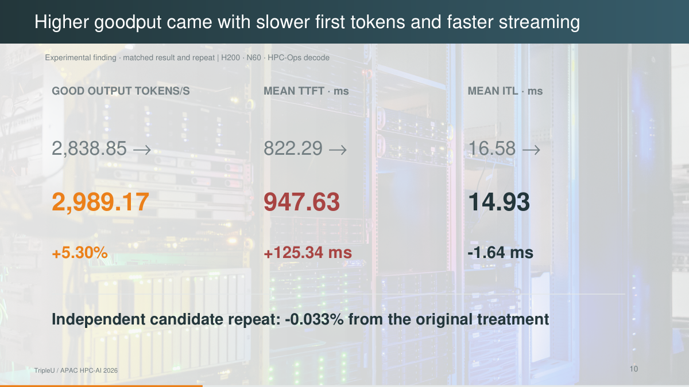

### Mạch suy luận để nói

- **Vấn đề:** Điểm throughput cao hơn có thể che giấu phản hồi đầu chậm hoặc kết quả không lặp.
- **Vì sao quan trọng:** Người dùng trải nghiệm cả thời gian chờ token đầu lẫn tốc độ các token sau; SLA xét cả hai.
- **Vì sao chọn phép thử này:** So control/treatment N60 đầy đủ theo goodput, TTFT, ITL trung bình/request rồi kiểm tra lần treatment riêng.
- **Điều rút ra:** Goodput tăng 5,295%; TTFT chậm khoảng 125 ms; ITL tốt hơn khoảng 1,64 ms; lần lặp thấp hơn bản đầu 0,033%.
- **Vì sao chuyển sang bước tiếp:** Mang đánh đổi đo được này sang câu hỏi chọn tải, nhưng không khái quát backend ngoài N60.

### Slide muốn nói gì

Diễn giải can thiệp decode như đánh đổi nhiều chỉ số thay vì chỉ nhìn điểm, đồng thời phân biệt khả năng lặp lại với khẳng định backend phổ quát.

### Giải thích kết quả và lập luận

Ba mũi tên chỉ các hướng trái ngược: goodput tăng, TTFT trung bình tăng (xấu hơn), và ITL trung bình/request giảm (tốt hơn). Kết quả là control 24912 so với treatment/lặp 24913 ở N60 đầy đủ. SLA chung chỉ đổi nhẹ từ 98,7599% lên 98,8178%. Treatment 24913 đạt 2.989,175 token tốt/giây, thấp hơn treatment đầu 24738 đạt 2.990,151 chỉ 0,033%. Đây là kết quả dịch vụ quan sát được; nó không giải thích vì sao từng phần độ trễ đổi.

### Thuật ngữ và ký hiệu cần hiểu

- **goodput:** Tốc độ request đạt đồng thời hai giới hạn độ trễ, nhân mục tiêu cố định 200 token đầu ra theo đơn vị báo cáo.
- **TTFT:** Thời gian từ lúc bắt đầu request đến token đầu tiên; thấp hơn nghĩa là nhanh hơn.
- **ITL trung bình/request:** Thời gian trung bình giữa các token trong một request; thấp hơn nghĩa là stream nhanh hơn.
- **SLA chung:** Phần trăm mọi request đạt cả giới hạn TTFT và ITL; không phải độ chính xác model.
- **lặp treatment:** Chạy lại độc lập cấu hình đã đổi để xem kết quả thông lượng có lặp không.

### Cách diễn giải số liệu hoặc sơ đồ

- Goodput tăng 5,295%, từ 2.838,853 lên 2.989,175 token/s.
- TTFT trung bình tăng 125,335 ms, từ 822,292 lên 947,627 ms. ITL trung bình/request giảm 1,644 ms, từ 16,579 xuống 14,934 ms.
- Lần treatment lặp riêng thấp hơn bản đầu 0,033%. Điều này hỗ trợ độ lặp lại điểm vận hành, nhưng token đầu chậm hơn vẫn là đánh đổi thực tế.

### Đánh đổi và mức độ bằng chứng

- **Quan sát:** Treatment tăng goodput và cải thiện ITL nhưng làm xấu TTFT; lần chạy treatment độc lập gần điểm ban đầu.
- **Giả thuyết:** Decode runner có thể phân bố lại chi phí giữa lúc bắt đầu và từng token stream.
- **Kết luận được hỗ trợ:** Kết quả dịch vụ đầy đủ ủng hộ cấu hình H200 N60 này, kèm đánh đổi TTFT rõ ràng.
- **Chưa biết / giới hạn:** So sánh không tách nguyên nhân kernel, thời gian queue/tính toán hay hành vi ở tải và phần cứng khác.

### Lời nói mẫu

Cặp N60 khớp điều kiện tăng goodput khoảng 5,30 phần trăm, nhưng cần nhìn cả đánh đổi. Thời gian token đầu trung bình tăng khoảng 125 mili giây, trong khi khoảng cách token trung bình giảm khoảng 1,64 mili giây. Người dùng chờ token đầu lâu hơn một chút, nhưng các token sau đến nhanh hơn trung bình. Một deployment độc lập lặp lại mức tăng, lệch khoảng 0,03 phần trăm so với lần xử lý ban đầu. Nhóm giữ cách triển khai vì full-run hỗ trợ kết quả cấp dịch vụ, đồng thời báo rõ chi phí TTFT. Ta không gán nguyên nhân cho riêng kernel hay cộng phần trăm này với tối ưu khác.

### Điều không nên nói

Không chọn chỉ theo goodput hoặc coi lần lặp là bằng chứng cho mọi phần cứng và tải. Profile N48 không giải thích nhân quả kết quả N60 này.

### Câu chuyển slide

Tiếp theo, chọn tải request bằng cách đối chiếu N64 lặp lại với lợi thế N68 trên phép thử ngắn.

---

## Slide 11 — N64 survives a full repeat; N68 loses its short-test advantage

**Phần cứng: H200 · concurrency là request client, không phải GPU**

**Loại nội dung: Quyết định kỹ thuật.**

### Nói nhanh · 10–20 giây

N64 đầy đủ tăng 1,08% so với N62 và lặp trong 0,014%; N68 chỉ còn 0,08% ở cặp đầy đủ, dưới ngưỡng giữ lại.

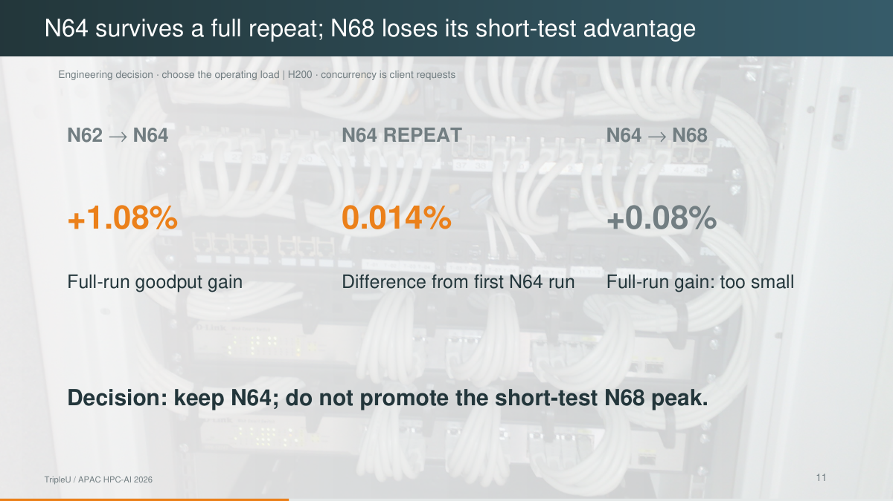

### Mạch suy luận để nói

- **Vấn đề:** Cần chọn tải vận hành tăng thông lượng hữu ích mà không dựa vào đỉnh phép thử ngắn.
- **Vì sao quan trọng:** Concurrency cao hơn tạo thêm công việc nhưng cũng tăng hàng đợi và lỗi độ trễ; mục tiêu dịch vụ có thể ngừng cải thiện.
- **Vì sao chọn phép thử này:** So control N62 đầy đủ 60/120/30 với ứng viên và lần lặp N64; dùng cặp N68 đầy đủ kiểm tra tín hiệu screen trước đó.
- **Điều rút ra:** N64 tăng 1,082867% và lặp trong 0,013634%; N68 từ +2,27% ngắn còn +0,083056% đầy đủ.
- **Vì sao chuyển sang bước tiếp:** Kiểm tra lỗi độ trễ ở cấp request tại tải N64 đã chọn.

### Slide muốn nói gì

Chọn tải vận hành bằng bằng chứng quy trình đầy đủ và lần lặp, đồng thời loại bỏ tuyên bố tải cao hơn không còn đứng vững khi đo đầy đủ.

### Giải thích kết quả và lập luận

Ba thẻ phần trăm so sánh mức tăng đầy đủ N62 sang N64 (+1,08%), độ lệch lần lặp N64 (0,014%) và mức tăng đầy đủ N68 so với N64 (+0,08%). Phép screen N68 ngắn chỉ giải thích vì sao cần so đầy đủ, không phải kết quả được chọn.

### Thuật ngữ và ký hiệu cần hiểu

- **N62 / N64 / N68:** Mục tiêu số request client đồng thời đang xử lý; không phải số GPU hay kích thước batch decode.
- **đầy đủ 60/120/30:** Warmup 60 giây, đo tính điểm 120 giây và grace 30 giây. Chỉ cửa sổ ở giữa cung cấp điểm đầy đủ.
- **screen:** Phép đo khám phá ngắn để chọn cấu hình ứng viên; không tương đương xác nhận đầy đủ.
- **lần lặp:** Lần chạy đầy đủ riêng của cùng cấu hình để kiểm tra khả năng tái lập.
- **ngưỡng tăng hữu ích:** Mức cải thiện tối thiểu đặt trước để đáng giữ thay đổi; số dương dưới ngưỡng không tự động hữu ích.

### Cách diễn giải số liệu hoặc sơ đồ

- So sánh N62/N64 đầy đủ tăng goodput 1,08%.
- Một lượt N64 đầy đủ độc lập chỉ lệch lượt đầu 0,014%.
- So sánh đầy đủ của N68 chỉ còn 0,08%; tín hiệu lớn hơn ở phép screen ngắn không giữ được qua protocol đầy đủ.
- Nhóm giữ N64 như điểm vận hành đo được và có thể lặp lại; bằng chứng không xác lập concurrency tối ưu phổ quát.

### Đánh đổi và mức độ bằng chứng

- **Quan sát:** N64 tăng 1,082867% so với N62 đầy đủ và lặp sát; gain ngắn N68 giảm còn 0,083056% ở so sánh đầy đủ.
- **Giả thuyết:** Tăng tải client có thể tăng thông lượng request đạt chuẩn đến khi chi phí độ trễ xóa mất lợi ích.
- **Kết luận được hỗ trợ:** Giữ N64 làm tải vận hành được bằng chứng hỗ trợ; không chọn N68 theo thử ngắn hay chênh đầy đủ rất nhỏ.
- **Chưa biết / giới hạn:** Các điểm tải quan sát được không xác định concurrency tối đa hay đường hiệu năng phổ quát.

### Lời nói mẫu

Tiếp theo là chọn concurrency client, tức số request đang chạy đồng thời, không phải số GPU. N64 đầy đủ tăng goodput 1,08 phần trăm so với N62 đầy đủ; một lần N64 độc lập khác chỉ lệch 0,014 phần trăm. N68 ban đầu có vẻ hơn 2,27 phần trăm trong phép screen ngắn, nhưng so sánh đầy đủ chỉ còn 0,08 phần trăm, dưới quy tắc hữu ích một phần trăm của nhóm. Vì vậy chúng tôi chọn N64 như một điểm vận hành lặp lại được, không gọi đây là tối ưu phổ quát. Protocol đầy đủ đã thay đổi quyết định vì lợi thế của phép thử ngắn không còn.

### Điều không nên nói

N là số request client đồng thời, không phải GPU. Không trình bày phép screen ngắn như kết quả đầy đủ hoặc nói concurrency đơn độc gây mọi khác biệt.

### Câu chuyển slide

Ở tải N64 đã chọn, tiếp theo xem điều kiện độ trễ nào còn bị request trượt.

---

## Slide 12 — The remaining latency failures are first-token tails

**Phần cứng: H200 · N64 · job 26766 · 1.902 request profiling**

**Loại nội dung: Phương pháp hoặc phát hiện thực nghiệm.**

### Nói nhanh · 10–20 giây

Trong 1.902 request, có 1.875 đạt cả hai giới hạn; cả 27 request trượt đều chỉ lỗi TTFT. Không request nào trượt ITL và không có lỗi request. Scatter cho biết điều kiện bị vi phạm, không giải thích vì sao token đầu trễ.

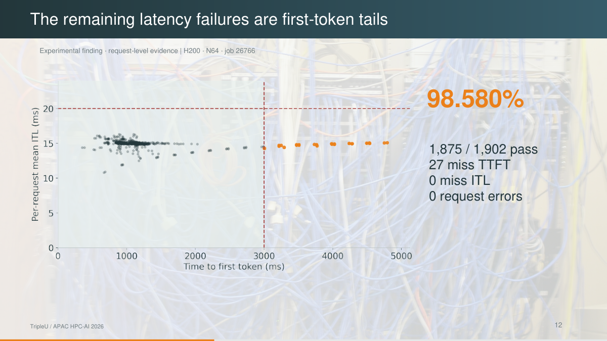

### Mạch suy luận để nói

- **Vấn đề:** Điểm trung bình có thể che khuất request nào trượt và vi phạm ràng buộc độ trễ nào.
- **Vì sao quan trọng:** Quy tắc dịch vụ yêu cầu request tốt đạt cả TTFT lẫn ITL; goodput tổng hợp không giải thích lỗi.
- **Vì sao chọn phép thử này:** Vẽ từng request trong 1.902 request theo hai giới hạn độ trễ và phân loại điểm đạt đồng thời hai biên tính cả dấu bằng.
- **Điều rút ra:** Có 1.875 request đạt cả hai và 27 request chỉ trượt TTFT; ITL không trượt, không có lỗi.
- **Vì sao chuyển sang bước tiếp:** Giữ nguyên nguyên nhân chưa biết nếu chưa thu timing từng pha; đánh giá độ vững riêng với chẩn đoán request này.

### Slide muốn nói gì

Chuyển từ throughput tổng hợp sang từng request, chỉ rõ điều kiện SLA nào còn bị trượt mà không gán nguyên nhân thiếu bằng chứng.

### Giải thích kết quả và lập luận

Mỗi điểm là một request trong profiling. Vị trí ngang là TTFT request đó tính bằng mili giây; vị trí dọc là ITL trung bình của request, cũng bằng mili giây. Điểm xanh ngọc đạt cả hai giới hạn bao gồm biên: TTFT ≤3.000 ms và ITL trung bình ≤20 ms. Điểm cam trượt ít nhất một giới hạn. Dữ liệu có 1.875 điểm đạt và 27 điểm trượt; cả 27 nằm ngoài biên TTFT, không điểm nào vượt biên ITL. Đây là đuôi token đầu. Scatter không cho biết hàng đợi, prefill, truyền KV hay pha nào khác gây trễ.

### Thuật ngữ và ký hiệu cần hiểu

- **TTFT:** Thời gian từ khi request bắt đầu đến token đầu tiên; ngưỡng tối đa 3.000 ms.
- **ITL trung bình/request:** Khoảng trung bình giữa các token sinh trong một request; ngưỡng tối đa 20 ms.
- **biên bao gồm:** Giá trị đúng bằng ngưỡng tối đa vẫn đạt vì điều kiện là nhỏ hơn hoặc bằng.
- **SLA chung:** Request chỉ đạt khi qua cả hai giới hạn độ trễ. Mẫu số gồm mọi request profiling, kể cả lỗi.
- **request profiling:** Một request trong cửa sổ đo được chấm; scatter ở cấp request, không phải trung bình nhiều job.

### Cách diễn giải số liệu hoặc sơ đồ

- Job 26766 có 1.902 request profiling; 1.875 qua cả hai điều kiện, tức 98,580442%.
- Cả 27 lỗi đều trượt TTFT. Không request nào trượt ITL trung bình/request; lỗi và hủy request bằng không.
- Các đường ngưỡng phân loại đạt/trượt. Vị trí điểm cho biết độ trễ đo được nhưng không có timing theo pha để giải thích đuôi chậm.

### Đánh đổi và mức độ bằng chứng

- **Quan sát:** Dịch vụ N64 đạt đồng thời 98,580442%; cả 27 lỗi SLA chỉ trượt TTFT.
- **Giả thuyết:** Một pha trước token đầu như tiếp nhận, hàng đợi, prefill hoặc truyền KV có thể góp phần gây trễ.
- **Kết luận được hỗ trợ:** Scatter xác định metric bị trượt nhưng không xác lập pha chịu trách nhiệm.
- **Chưa biết / giới hạn:** Chưa có timing từng request cho queue/prefill/transfer và giải thích nhân quả của 27 lỗi.

### Lời nói mẫu

Ở N64, chúng tôi xem từng request thay vì chỉ nhìn điểm trung bình. Trong 1.902 request được profile, 1.875 đạt cả hai giới hạn độ trễ. 27 request còn lại đều trượt giới hạn token đầu; không request nào trượt giới hạn khoảng cách trung bình giữa token và không có lỗi request. Như vậy ta biết chính xác điều kiện dịch vụ nào còn chưa đạt. Scatter không cho biết vì sao token đầu bị trễ. Muốn kiểm tra nguyên nhân cần đo đồng bộ hàng đợi, prefill và các pha của request. Phân biệt này quan trọng: xác định triệu chứng là một kết quả; chẩn đoán nguồn gốc cần bằng chứng khác.

### Điều không nên nói

Không suy ra nguyên nhân hàng đợi/prefill chỉ từ vị trí điểm và không gọi 27 lỗi TTFT là lỗi ITL.

### Câu chuyển slide

Tiếp theo, so bằng chứng N64 lặp lại với các quan sát cao/thấp riêng mà không gộp chuỗi runtime khác nhau.

---

## Slide 13 — A complete portable run reproduces the retained operating level

**Phần cứng: H200 · báo riêng chuỗi lịch sử, run native và portable acceptance**

**Loại nội dung: Phương pháp hoặc phát hiện thực nghiệm.**

### Nói nhanh · 10–20 giây

Job portable 28197 đạt 3.051,52 token tốt/giây sau khi model registration, cả hai đường P/D, client, reader và cleanup đều đạt.

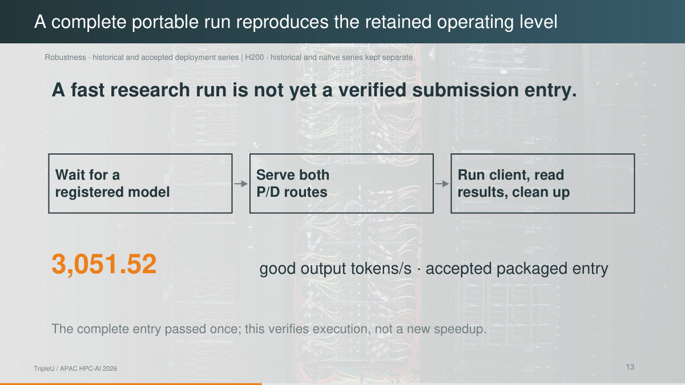

### Mạch suy luận để nói

- **Vấn đề:** Các job GPU portable trước thất bại khi đọc kết quả nên kiểm tra reader trên CPU chưa chứng minh package đầy đủ chạy được sau sửa.
- **Vì sao quan trọng:** Điểm benchmark chỉ dùng cho nộp bài khi package thật qua readiness, phục vụ cả hai vai trò, chạy client, đọc kết quả và cleanup trong allocation GPU thật.
- **Vì sao chọn phép thử này:** Sau lần dùng ZIP nguyên trạng lỗi trước khi chấm vì health gateway trả HTTP 200 trong khi model registration vẫn trả 503, chỉ đổi thời gian đợi readiness và checksum. Giữ nguyên worker, official client, reader, hai đường semantic rồi chạy entry đầy đủ 16 H200 N64.
- **Điều rút ra:** Job 28197 hoàn tất entry portable trong 611 giây, qua hai đường semantic P/D và summary gate, đạt 3051,518173 good tokens/s với 98,6366% SLA chung và không lỗi/hủy. Điều này đóng khoảng trống GPU acceptance sau sửa reader.
- **Vì sao chuyển sang bước tiếp:** Package có một lượt acceptance GPU đầy đủ sau sửa. Giữ riêng kết quả này với các lần đo performance lịch sử; slide 16 trình bày kết quả quality cục bộ trên toàn bộ tập và các giới hạn.

### Slide muốn nói gì

Đánh giá khả năng tái lập qua các đường triển khai riêng mà không gộp chúng thành một chuỗi đồng nhất. Run portable mới đã dùng reader sửa và allocation H200 đầy đủ. Kết quả hỗ trợ điểm vận hành được giữ và đóng khoảng trống GPU acceptance sau sửa reader, đồng thời vẫn nêu rõ drift chưa giải thích và giới hạn một lần chạy.

### Giải thích kết quả và lập luận

Slide theo dõi entry portable qua đăng ký model, hai đường prefill/decode, client, bộ đọc kết quả và cleanup. Kết quả performance là 3.051,52 good output tokens/s. Đây là một lần acceptance deployment hoàn chỉnh, không phải mức tăng có đối chứng.

### Thuật ngữ và ký hiệu cần hiểu

- **good output tokens/s:** Request đạt giới hạn độ trễ mỗi giây nhân với mục tiêu đầu ra cố định 200 token.
- **portable acceptance:** Một lượt chạy đầy đủ package qua startup, kiểm tra serving, đọc kết quả benchmark và cleanup.

### Cách diễn giải số liệu hoặc sơ đồ

- Entry portable chính xác hoàn thành một lần toàn bộ deployment và kiểm tra hiệu năng.
- Job 28197 đo được khoảng 3.052 token tốt mỗi giây và hoàn tất kiểm tra serving.
- Một lượt được chấp nhận xác minh package chạy được; không có control khớp điều kiện nên không chứng minh tăng tốc mới.
- Request đạt performance và accuracy câu trả lời là hai đại lượng riêng; quality được kiểm tra ở slide kết.

### Đánh đổi và mức độ bằng chứng

- **Quan sát:** 28197 đạt 3051,518173 good tokens/s với 1881/1907 cùng đạt SLA, không lỗi/hủy, TTFT mean/p95 1100,3153/1285,9962 ms và ITL 15,009828/15,185750 ms. Job hoàn tất entry portable sau khi lần thử ZIP nguyên trạng lỗi trước benchmark.
- **Giả thuyết:** Đường native và portable độc lập sẽ tái lập điểm vận hành nếu sửa readiness/đóng gói không đổi ngữ nghĩa model hay hành vi server/client.
- **Kết luận được hỗ trợ:** Run portable đầy đủ hỗ trợ deployment hoạt động và cùng mức với chuỗi vận hành trước khoảng 3044–3046. Đây là một lần acceptance, không phải treatment hiệu năng matched mới hay chứng minh tối ưu toàn cục.
- **Chưa biết / giới hạn:** Phép so sánh MMLU-Pro cục bộ đầy đủ được trình bày ở slide 16; kết quả quality của BTC vẫn chưa biết. Kết quả cục bộ không giải thích biến động của replay cũ thấp hơn hay chứng minh tính lặp thống kê rộng hơn.

### Lời nói mẫu

Chúng tôi cũng phải xác minh entry portable chính xác, vì run native tốt chưa đủ nếu package không khởi động, phục vụ được cả hai vai trò, chạy official client và cleanup. Entry trước thất bại trước khi chấm do race readiness. Job sửa lại 28197 hoàn tất trên mười sáu H200 ở N64, đạt khoảng 3.052 token đầu ra tốt mỗi giây và vượt kiểm tra semantic và performance. Đây là acceptance deployment và một quan sát điểm vận hành hữu ích. Lượt đó không có control khớp điều kiện, nên không phải bằng chứng cho một mức tăng tốc mới.

### Điều không nên nói

Không gọi 28197 là recipe mới, mức tăng optimization có đối chứng hay kết quả accuracy.

### Câu chuyển slide

Run portable thành công đóng khoảng trống replay deployment. Slide cuối trình bày phép so sánh quality cục bộ trên toàn bộ tập và phân biệt kết quả đó với quyết định của BTC vẫn chưa biết.

---

## Slide 14 — Direct H200 tests decide which H100 ideas transfer

**Phần cứng: 16 H200 tại Firmus, hai node, N64; ứng viên xuất phát từ nghiên cứu H100 nhưng mọi số điểm đang hiển thị đều đo trên H200.**

### Nói nhanh · 10–20 giây

Trên H200, port nguyên recipe H100 giảm 10,41%, chunk 8192 giảm 4,52%, phase-mode tăng dưới 0,14%; không phương án nào qua ngưỡng 1%.

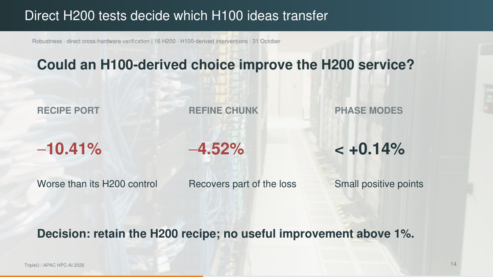

### Mạch suy luận để nói

- **Vấn đề:** Không thể xem số H100 và H200 như thể chỉ khác mẫu GPU, vì vậy cần kiểm tra trực tiếp các ý tưởng từ H100 trên phần cứng H200 mục tiêu.
- **Vì sao quan trọng:** Một setting có triển vọng trên H100 có thể thua trên H200 do phần cứng và stack khác. Chọn theo tỷ số điểm giữa hai hệ thống có thể làm dịch vụ H200 chậm hơn.
- **Vì sao chọn phép thử này:** Chạy bốn can thiệp H100 khác nhau trên 16 H200 N64, so với control H200 mới hoặc control riêng phù hợp. Kiểm tra protocol đầy đủ, SLA chung, runtime/source và output; giữ rõ yếu tố nào đổi ở từng port.
- **Điều rút ra:** FA3 và recipe H100 đầy đủ bị giảm; chunk HPC-Ops khôi phục một phần nhánh đó nhưng vẫn dưới incumbent H200; hai thay đổi inference-mode dưới 0,14%. Không phương án nào vượt ngưỡng hữu ích 1%.
- **Vì sao chuyển sang bước tiếp:** Các phép thử đóng câu hỏi chuyển giao phần cứng trong phạm vi hiện tại. Nhóm giữ recipe H200, nêu giới hạn quality chính thức còn mở rồi bàn giao sang OpenFOAM.

### Slide muốn nói gì

Trả lời câu hỏi so sánh hai nền tảng bằng phép đo H200 trực tiếp, không dùng hệ số quy đổi. Control H200 mới cho phép thử các can thiệp chọn từ H100 trên đúng hệ thống mục tiêu. Kết quả cho thấy hướng nào chuyển được, hướng nào thua và vì sao cần tối ưu theo phần cứng.

### Giải thích kết quả và lập luận

Ba thẻ tóm tắt bằng chứng H200 trực tiếp: port recipe H100 đầy đủ −10,41%; nhánh chunk 8192 −4,52%; biến thể phase-mode dưới +0,14%. Mỗi kết quả được so với control H200 phù hợp; không kết quả nào vượt ngưỡng hữu ích 1% của nhóm.

### Thuật ngữ và ký hiệu cần hiểu

- **can thiệp rút ra từ H100:** Một setting được quan sát hoặc chọn trong nghiên cứu H100 rồi đưa sang thử như một can thiệp trên H200. Điều này không có nghĩa toàn deployment H100 được dựng lại y nguyên.
- **control H200 mới 27777:** Prefill DeepGEMM chunk 8192 và decode HPC-Ops/FlashInfer/MNNVL hiện tại ở N64; mốc tham chiếu cho các phép thử chuyển giao đầu tiên.
- **good output tokens/s:** Goodput request mỗi giây của AIPerf nhân mục tiêu cố định 200 token đầu ra.
- **ngưỡng hữu ích 1%:** Ngưỡng quyết định nội bộ đặt trước để chọn thay đổi nhỏ có đáng xác nhận tiếp không; không phải luật cuộc thi.

### Cách diễn giải số liệu hoặc sơ đồ

- Mọi ứng viên hiển thị đều được đo trực tiếp trên H200; không quy đổi điểm H100 sang H200.
- Port recipe đầy đủ giảm 10,41%; nhánh chunk 8192 vẫn thấp hơn control 4,52%.
- Điểm phase-mode hơi dương, dưới 0,14%, nhưng vẫn dưới ngưỡng 1%.
- Quyết định là giữ recipe H200 hiện tại; không có nghĩa mọi ứng viên đều âm.

### Đánh đổi và mức độ bằng chứng

- **Quan sát:** Các phép thử trực tiếp trên H200 cho thấy FA3, recipe H100 đầy đủ và hai biến thể chunk HPC-Ops đều giảm so với mốc H200 liên quan. Hai candidate phase-mode gần như ngang control riêng.
- **Giả thuyết:** Kernel hay setting thắng trên H100 có thể không chuyển thành recipe thắng trên H200; cần thử từng hướng đã chọn trên nền H200 và đối chứng ở hệ thống đích trước khi dùng.
- **Kết luận được hỗ trợ:** Giữ recipe H200: prefill DeepGEMM/chunk 8192 và decode HPC-Ops/FlashInfer/MNNVL ở N64. Không can thiệp nào vượt ngưỡng hữu ích 1% đã đặt. Đây là recipe H200 được bằng chứng hiện có hỗ trợ tốt nhất, chưa phải tối ưu toàn cục đã chứng minh.
- **Chưa biết / giới hạn:** Mỗi ứng viên chỉ có một lần chạy; chất lượng model toàn tập chính thức vẫn UNKNOWN. Recipe H100 đổi nhiều yếu tố cùng lúc; so sánh runner/chunk còn chịu ảnh hưởng seed và thứ tự chạy. Kết quả không chứng minh mọi hướng H100 đều chuyển giao tốt hoặc xấu.

### Lời nói mẫu

Câu hỏi xuyên phần cứng là các setting có vẻ tốt trên H100 có giúp dịch vụ H200 không. Chúng tôi thử trực tiếp trên H200 thay vì quy đổi điểm giữa các thế hệ GPU. Port đầy đủ recipe giảm 10,41 phần trăm so với control khớp. Nhánh chunk khớp vẫn thấp hơn recipe hiện tại 4,52 phần trăm. Hai ứng viên phase-mode có điểm dương nhỏ, đều dưới 0,14 phần trăm và dưới ngưỡng giữ lại một phần trăm. Vì vậy bằng chứng không nói mọi biến thể đều âm; nó nói không biến thể nào đủ lý do thay setting đang giữ. Recipe H200 là lựa chọn đã đo, không phải tối ưu phổ quát.

### Điều không nên nói

Không nói mọi ứng viên phase-mode đều thấp hơn control; các mức dương nhỏ vẫn không đạt ngưỡng hữu ích.

### Câu chuyển slide

Đây là kết quả cuối của phần tuning AI trong bằng chứng hiện có. Nhóm giữ recipe H200, nêu rõ giới hạn quality và replay đóng gói, rồi chuyển lời cho phần OpenFOAM.

---

## Slide 15 — Better proxy metrics did not always improve qualifying throughput

**Phần cứng: H200 · hai phép thử riêng: graph decode thưa và EAGLE nông**

**Loại nội dung: Phương pháp hoặc phát hiện thực nghiệm.**

### Nói nhanh · 10–20 giây

Graph thưa giảm bộ nhớ capture nhưng goodput thấp hơn control 27376 là 0,370208%. EAGLE nông đầy đủ đạt thấp hơn control target-only 26949 là 2,080318%. Đây là hai kết quả riêng, giới hạn đúng cấu hình đã thử chứ không bác bỏ mọi biến thể.

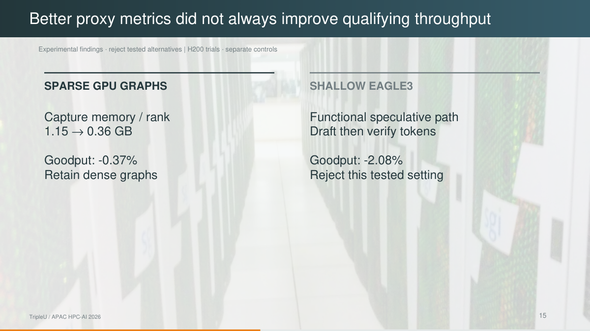

### Mạch suy luận để nói

- **Vấn đề:** Tối ưu có thể cải thiện proxy hấp dẫn nhưng làm xấu mục tiêu thật ở cấp request.
- **Vì sao quan trọng:** Tiết kiệm tài nguyên hay giảm bước decode chỉ có ích nếu tăng request đạt cả hai giới hạn độ trễ.
- **Vì sao chọn phép thử này:** Đặt cặp control/ứng viên graph thưa cạnh cặp EAGLE đầy đủ/target-only riêng, giữ đúng baseline của mỗi so sánh.
- **Điều rút ra:** Capture thưa tiết kiệm bộ nhớ log nhưng giảm goodput 0,370208%; EAGLE nông mất 2,080318% trong cặp đầy đủ.
- **Vì sao chuyển sang bước tiếp:** Giữ cài đặt đã chọn và tránh khẳng định phổ quát; biến thể mới cần bằng chứng riêng từ serving đầy đủ có đối chứng.

### Slide muốn nói gì

Đặt cạnh nhau hai cải tiến đề xuất nhắm vào chỉ số phụ hoặc thành phần, giải thích vì sao nhóm giữ lựa chọn serving cũ khi kết quả dịch vụ đầy đủ không tốt hơn.

### Giải thích kết quả và lập luận

Đọc riêng hai thẻ bằng chứng vì chúng dùng control khác nhau và trả lời câu hỏi khác nhau. Job graph thưa 27510 so với control trước 27376: bộ nhớ capture giảm 1,15 xuống 0,36 GB mỗi rank, trong khi goodput giảm 0,370208%. Đây là proxy tài nguyên thấp hơn, không phải chiến thắng dịch vụ; cặp chỉ có một control trước và seed khác. Lần EAGLE nông đầy đủ 27238 so với control target-only 26949: 2.971,628430 so với 3.034,761104 token tốt/giây, giảm 2,080318%. Cấu hình speculative đã thử thua trong workload đầy đủ. Hai thẻ không bác bỏ phổ quát graph thưa hay speculative decoding; chúng chỉ đóng cấu hình đã thử trừ khi có bằng chứng khác.

### Thuật ngữ và ký hiệu cần hiểu

- **chỉ số proxy:** Đại lượng tài nguyên/thành phần đo được như bộ nhớ capture, có thể liên quan mục tiêu nhưng không phải mục tiêu dịch vụ.
- **goodput:** Tốc độ request đạt cả hai giới hạn độ trễ, báo cáo thành token đầu ra tốt/giây với mục tiêu cố định 200 token.
- **độ thưa graph decode:** Dùng ít dạng decode được capture hơn. Có thể giảm bộ nhớ liên quan graph nhưng không đảm bảo thông lượng dịch vụ cao hơn.
- **speculative decoding / EAGLE:** Phương pháp draft đề xuất token để model đích xác minh. Nó chỉ giảm công việc decode nếu chi phí xác minh và truyền không lớn hơn phần tiết kiệm.
- **control target-only:** Đường serving cùng loại chỉ dùng model đích, không có dự đoán bằng model draft.
- **bộ nhớ capture mỗi rank:** Bộ nhớ log cho capture graph trên một rank worker; không phải tổng VRAM hay chỉ số thông lượng đầu ra.

### Cách diễn giải số liệu hoặc sơ đồ

- Thẻ graph thưa: bucket giảm từ 64 xuống 12, bộ nhớ capture mỗi rank từ 1,15 xuống 0,36 GB, nhưng goodput thấp hơn control trước 27376 là 0,370208%.
- Thẻ EAGLE: lần đầy đủ 27238 đạt 2.971,628430, so với target-only 26949 đạt 3.034,761104 token tốt/giây, giảm 2,080318%.
- Mỗi thẻ hỗ trợ không đưa biến thể đã thử vào cấu hình chọn. Control, cơ chế và bất định khác nhau; không so hai phần trăm như cùng một thí nghiệm.

### Đánh đổi và mức độ bằng chứng

- **Quan sát:** Bộ nhớ capture graph thưa tốt hơn trong khi goodput giảm nhẹ; treatment EAGLE nông đầy đủ mất goodput so với control target-only.
- **Giả thuyết:** Ít bộ nhớ graph hoặc dự đoán token draft có thể cải thiện thông lượng serving hữu ích.
- **Kết luận được hỗ trợ:** Giữ graph dày và serving target-only cho các cấu hình đã thử vì mục tiêu dịch vụ đầy đủ không cải thiện.
- **Chưa biết / giới hạn:** Không thể kết luận mọi graph thưa hay mọi cách speculative đều thất bại; chi phí padding, dạng khác và cấu hình draft khác chưa thử ở đây.

### Lời nói mẫu

Hai phép thử sau nhắc ta đánh giá mục tiêu dịch vụ, không chỉ một chỉ số phụ hấp dẫn. Graph decode thưa giảm bộ nhớ capture trong log, nhưng goodput đầy đủ giảm 0,37 phần trăm so với control. Speculative decoding dạng nông cũng thấp hơn khoảng 2,08 phần trăm trong so sánh đầy đủ. Đây là hai thí nghiệm riêng, mỗi thí nghiệm có control riêng. Kết quả graph không có nghĩa tiết kiệm bộ nhớ luôn vô ích; kết quả EAGLE không loại bỏ mọi phương pháp speculative. Chúng chỉ cho biết các dạng đã thử không cải thiện throughput đạt chuẩn của workload này, nên nhóm giữ cấu hình hiện tại và không promotion chúng.

### Điều không nên nói

Không coi bộ nhớ capture là VRAM hay goodput, không so hai phần trăm như một thí nghiệm, và không tuyên bố mọi graph thưa hay speculative đều thất bại.

### Câu chuyển slide

Slide kết luận tách điều bằng chứng serving hỗ trợ khỏi hai câu hỏi xác minh còn mở.

---

## Slide 16 — The retained recipe survives performance and quality checks

**Phần cứng: Phép đo MMLU-Pro của nhóm trên cluster H200 · cùng 16 GPU · kết luận quality của BTC chưa rõ · bàn giao sang slide OpenFOAM 35 không đổi**

**Loại nội dung: Đo quality trên toàn bộ tập do nhóm thực hiện / giới hạn kết luận.**

### Nói nhanh · 10–20 giây

Hai thẻ bằng chứng khép lại câu chuyện: khoảng 3.052 token tốt/giây ở deployment được chấp nhận và giữ lại 99,9154% accuracy cục bộ. Quyết định của BTC là riêng.

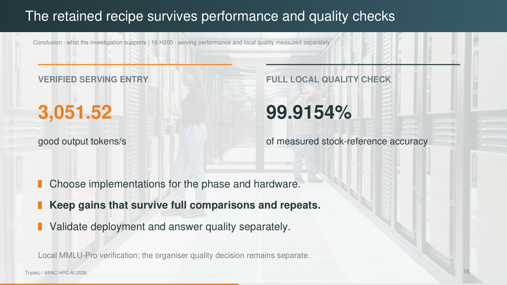

### Mạch suy luận để nói

- **Vấn đề:** Lượt performance được chấp nhận chứng minh dịch vụ đạt cổng workload, nhưng yêu cầu tổng hợp của benchmark không đo accuracy câu trả lời.
- **Vì sao quan trọng:** Layout serving, kernel, batching và phép reduction có thể làm đổi câu trả lời sinh ra dù vẫn giữ checkpoint chính thức. Vì vậy, tuyên bố về quality cần câu trả lời model được chấm, không chỉ trọng số không đổi hay throughput tốt.
- **Vì sao chọn phép thử này:** So sánh deployment FP8 chính thức nguyên bản với dịch vụ tối ưu đã được chấp nhận trên cùng phần cứng hai nút, 16 H200, cùng prompt MMLU-Pro đã ghim phiên bản và toàn bộ 12.032 câu kiểm tra. Giữ phản hồi đầu tiên và dùng scorer đã cố định. Câu trả lời không phân tích được tính là sai; câu chạm giới hạn sinh vẫn nằm trong mẫu số và được chấm bình thường theo đáp án đã phân tích.
- **Điều rút ra:** Deployment nguyên bản trả lời đúng 9.460/12.032 câu (78,623670%); ứng viên đúng 9.452/12.032 câu (78,557181%). Tỷ số accuracy là 99,915433%, cao hơn ngưỡng kiểm tra của nhóm 99%. Có 434 câu chỉ ứng viên đúng và 442 câu chỉ tham chiếu đúng, nên mức giảm ròng tám câu không đồng nghĩa chỉ có tám câu khác kết quả. Cả mười sáu job hoàn tất và không có lỗi dịch vụ được chấm.
- **Vì sao chuyển sang bước tiếp:** Khép phần AI bằng kết quả nhóm tự đo trên cluster H200 với giới hạn rõ ràng: mỗi vai trò một lượt, có mất mát ở một số hạng mục, và không có chứng nhận BTC. Sau đó bàn giao sang phần OpenFOAM không đổi.

### Slide muốn nói gì

Khép lại bằng hai câu hỏi mà thử nghiệm performance không thể tự trả lời: package được chấp nhận có phục vụ workload được không, và toàn bộ dịch vụ có giữ chất lượng câu trả lời không? Sau đó nêu các bài học quyết định đã định hình quá trình khảo sát.

### Giải thích kết quả và lập luận

Hai thẻ bằng chứng báo 3.051,52 good output tokens/s cho entry portable được chấp nhận và tỷ lệ giữ accuracy 99,9154% trong phép kiểm quality cục bộ đủ tập. Ba bài học quyết định tiếp theo: chọn cách triển khai theo từng pha từ bằng chứng khớp điều kiện; chỉ giữ setting khi full-run lặp lại hỗ trợ; xác minh quality riêng với performance. Đánh giá của BTC là quyết định độc lập.

### Thuật ngữ và ký hiệu cần hiểu

- **accuracy:** Tỷ lệ câu trả lời đúng trên toàn bộ 12.032 câu: số câu đúng chia cho tổng số câu.
- **tỷ lệ giữ accuracy:** Accuracy của ứng viên chia cho accuracy của tham chiếu. Vì hai mẫu số đều là 12.032, phép tính rút gọn thành 9.452/9.460 = 99,9154%. Đây không phải tỷ lệ câu hỏi mà ứng viên trả lời đúng.
- **tham chiếu FP8 nguyên bản:** Deployment nguyên bản của checkpoint Qwen3-235B FP8 chính thức, do nhóm đo trên cluster H200. Đây là mẫu số thực nghiệm của phép so sánh, không phải điểm số do ban tổ chức công bố.
- **cùng 16 H200:** Cả hai deployment hoàn chỉnh đều dùng cùng cụm hai nút, mười sáu H200. Đây là so sánh H200 với H200, không có ước tính từ H100.
- **ngưỡng kiểm tra của nhóm 99%:** Quy tắc định trước yêu cầu accuracy của ứng viên chia cho accuracy tham chiếu đo được phải đạt ít nhất 0,99. Đạt ngưỡng này là kết quả nhóm tự đo, không phải chứng nhận BTC.

### Cách diễn giải số liệu hoặc sơ đồ

- Mỗi accuracy là số câu đúng chia cho toàn bộ 12.032 câu: FP8 nguyên bản 9.460/12.032 = 78,623670%; ứng viên 9.452/12.032 = 78,557181%.
- Ứng viên ít hơn tám câu đúng, chênh lệch ròng 0,066489 điểm phần trăm. Tỷ lệ giữ accuracy là tỷ số của hai accuracy, 9.452/9.460 = 99,915433%, đạt ngưỡng kiểm tra của nhóm 99%.
- Chênh lệch ròng che khuất 876 kết quả bất đồng: có 434 câu chỉ ứng viên trả lời đúng và 442 câu chỉ tham chiếu trả lời đúng. Có cả tăng lẫn giảm giữa các shard và hạng mục.
- Khoa học máy tính giữ 338/345 = 97,971014%; triết học giữ 383/387 = 98,966408%. Cổng đã định chỉ áp dụng cho tổng thể; đây vẫn là các giới hạn theo hạng mục.
- Mỗi vai trò nhận đủ 12.032 câu đúng một lần, chia thành tám shard cố định. Cả mười sáu job hoàn tất và hai vai trò đều không có lỗi dịch vụ được chấm. Câu trả lời không phân tích được (101 mỗi vai trò) được tính là sai. Câu chạm giới hạn sinh (1.484 tham chiếu; 1.468 ứng viên) vẫn nằm trong mẫu số và được chấm theo đáp án đã phân tích, không mặc định là sai.
- Mỗi deployment chỉ có một lượt hoàn chỉnh, không phải nhiều lần chạy độc lập. Phát lại câu trả lời thô xác minh cách chấm nhưng không phải lần chạy GPU thứ hai. Phép đo MMLU-Pro này do nhóm thực hiện trên cluster H200; nó không chứng nhận đánh giá của BTC hay dự đoán benchmark chưa kiểm tra.

### Đánh đổi và mức độ bằng chứng

- **Quan sát:** Trên cùng 12.032 câu hỏi và cùng 16 GPU H200, FP8 nguyên bản đạt 9.460/12.032 (78,623670%) còn deployment tối ưu đạt 9.452/12.032 (78,557181%). Cả hai vai trò không có lỗi dịch vụ được chấm; cả mười sáu allocation đã hoàn tất.
- **Giả thuyết:** Phép so sánh đầy đủ có đối chứng do nhóm thực hiện trên cluster H200 kiểm tra liệu toàn bộ implementation serving tối ưu có giữ ít nhất 99% accuracy của deployment nguyên bản được đo hay không, trong khi giữ mọi câu hỏi và phản hồi đầu tiên.
- **Kết luận được hỗ trợ:** Ứng viên giữ 9.452/9.460 = 99,915433% accuracy tham chiếu và vượt ngưỡng kiểm tra tổng thể 99% đã định trước của nhóm. Đây là kết quả MMLU-Pro do nhóm tự đo trên cluster H200, không phải kết quả được ban tổ chức chứng nhận.
- **Chưa biết / giới hạn:** Một lượt hoàn chỉnh mỗi deployment không chứng minh tương đương thống kê, câu trả lời giống hệt, nguyên nhân từ kernel hay patch cụ thể, hoặc quality trên tác vụ chưa thấy. Tỷ lệ giữ theo hạng mục thấp hơn 99% ở khoa học máy tính và triết học. Kết quả quality riêng của BTC vẫn chưa biết.

### Lời nói mẫu

Khép lại bằng hai thẻ vì tốc độ và chất lượng trả lời là hai câu hỏi khác nhau. Deployment portable được chấp nhận, job 28197, đạt khoảng 3.052 token đầu ra tốt mỗi giây và vượt kiểm tra serving; một lượt đơn xác nhận package chạy được, không chứng minh mức tăng so với đối chứng. Riêng phép so MMLU-Pro cục bộ đủ tập giữ 99,9154% accuracy của tham chiếu gốc, cao hơn ngưỡng điểm cục bộ 99%. Quyết định của nhóm rút ra ba bài học: chọn cách triển khai theo từng pha bằng bằng chứng khớp điều kiện, chỉ giữ setting khi full-run lặp lại hỗ trợ, và kiểm tra quality riêng với performance. Đánh giá quality của BTC vẫn là quyết định độc lập.

### Điều không nên nói

Gọi 99,9154% là tỷ lệ giữ accuracy, không phải accuracy của ứng viên; accuracy ứng viên là 78,557181%. Không nói hai dịch vụ chỉ khác nhau ở tám câu: có 876 câu bất đồng về đúng/sai. Không trình bày phép đo này như chứng nhận BTC, tương đương thống kê, kết luận nhân quả cho một tối ưu riêng hay bảo đảm trên tác vụ chưa kiểm tra.

### Câu chuyển slide

Chúng tôi bàn giao sang phần OpenFOAM riêng; số đo CPU và kết luận ở đó thuộc một hướng nghiên cứu khác.

---

## Slide 17 — Backup · two platforms, separate experimental systems

**Phần cứng: H200 · Firmus + H100 · NSCC — hai môi trường riêng.**

### Nói nhanh · 10–20 giây

Cả hai hệ thống cấp mười sáu GPU và dùng cùng checkpoint Qwen cùng workload đã staging. Firmus dùng H200; NSCC dùng H100. Phần cứng, scheduler, container và điều kiện node khác nhau, nên đây là các phép đo riêng, không phải hệ số quy đổi GPU.

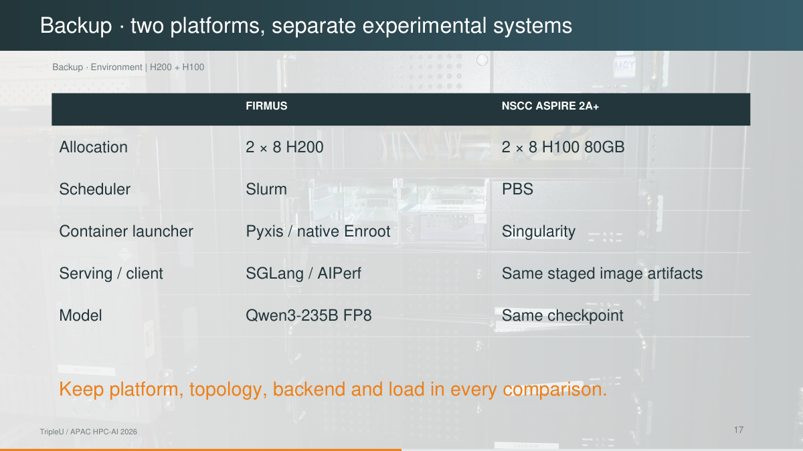

**Phần dự phòng AI: chỉ mở khi cần giải thích sâu hơn.**

### Slide muốn nói gì

Đặt ranh giới so sánh cho các kết quả nền tảng sau: cùng model và client giúp phép thử gần nhau hơn, nhưng không xóa khác biệt phần cứng và stack triển khai.

### Giải thích kết quả và lập luận

Bảng đối chiếu phân bổ GPU, scheduler, công cụ chạy container, phần mềm serving/client và model. Các hàng giống nhau là điểm kiểm soát hữu ích: cả hai có hai node tám GPU và dùng cùng artifact đã staging cùng checkpoint Qwen3-235B FP8. Các hàng khác nhau có thể ảnh hưởng độ trễ và thông lượng. Slurm và PBS cấp tài nguyên; chúng không thực thi suy luận model. Pyxis/Enroot và Singularity là đường chạy container khác nhau; SGLang phục vụ request còn AIPerf tạo và đo lưu lượng client. Vì vậy mỗi điểm số cần gắn với nền tảng, topology, backend và tải.

### Thuật ngữ và ký hiệu cần hiểu

- **Firmus / NSCC ASPIRE 2A+:** Hai địa điểm tính toán riêng: Firmus cấp node H200; NSCC ASPIRE 2A+ cấp node H100.
- **2 × 8 H200 / 2 × 8 H100:** Hai node, mỗi node tám GPU, tổng cộng mười sáu GPU mỗi allocation. Mẫu GPU và hệ thống khác nhau.
- **Slurm / PBS:** Scheduler cấp phát và quản lý job tính toán; không phải engine phục vụ model.
- **Pyxis / Enroot / Singularity:** Công cụ khởi chạy container. Container đóng gói phần mềm, nhưng launcher và host khác nhau vẫn có thể ảnh hưởng thực thi.
- **SGLang / AIPerf:** SGLang chạy serving model; AIPerf gửi request benchmark và ghi chỉ số dịch vụ.
- **checkpoint FP8:** Trọng số model chung dùng biểu diễn số dấu phẩy động tám bit; dùng chung trọng số không làm hai lần chạy GPU tương đương.
- **so sánh nền tảng:** So sánh toàn hệ thống. Cần workload khớp cùng thông tin phần cứng, phần mềm, topology và thời gian; tên GPU không phải hệ số quy đổi.

### Cách diễn giải số liệu hoặc sơ đồ

- Đây là bằng chứng dự phòng khi trả lời câu hỏi, được ẩn trong mạch trình chiếu chính. Slide không bổ sung một thí nghiệm mới vào mạch lập luận.
- Các điểm kiểm soát chung là phân bổ hai node, mười sáu GPU, artifact serving/client đã staging và checkpoint Qwen.
- Khác biệt gồm thế hệ GPU H200 so với H100, Slurm so với PBS, và launcher container khác nhau. CPU, driver, mạng, cache node và vị trí tiến trình cũng có thể khác.
- Bảng cung cấp bối cảnh; nó không phải kết quả hiệu năng có kiểm soát và không định lượng đóng góp riêng của từng khác biệt.

### Đánh đổi và mức độ bằng chứng

- **Quan sát:** Cả hai site cấp mười sáu GPU trên hai node và dùng chung image đã staging cùng checkpoint, nhưng khác họ GPU, scheduler, launcher và môi trường host.
- **Giả thuyết:** Khớp model và workload request là cần thiết, nhưng khác biệt nền tảng vẫn có thể ảnh hưởng số đo serving.
- **Kết luận được hỗ trợ:** Báo cáo kết quả từng nền tảng riêng và ghi rõ điều kiện triển khai.
- **Chưa biết / giới hạn:** Bảng không cô lập tác động của khác biệt nền tảng nào và không đưa ra hệ số đổi điểm H100 sang H200.

### Lời nói mẫu

Chúng tôi đo trên hai hệ thống, mỗi hệ thống có mười sáu GPU. Firmus dùng H200, Slurm và container Enroot; NSCC ASPIRE 2A+ dùng H100, PBS và Singularity. Cả hai dùng cùng checkpoint và artifact benchmark đã staging, nhưng driver, mạng, cache máy chủ và đường khởi chạy vẫn có thể khác. Vì vậy slide này mô tả môi trường thí nghiệm, không so tốc độ. Mỗi điểm số cần ghi nền tảng và cài đặt riêng.

### Điều không nên nói

Không gộp số đo H100 và H200 thành một chuỗi hoặc suy ra tốc độ chỉ từ mẫu GPU hay dung lượng bộ nhớ.

### Câu chuyển slide

Sau khi trả lời, quay về câu hỏi và bằng chứng chính; không trình bày hết phần dự phòng như một bài kể lịch sử thứ hai.

---

## Slide 18 — Backup · FP8 geometry constrains a topology

**Phần cứng: H200 · đường FP8 đã thử; phép tính block không phải số đo tốc độ.**

### Nói nhanh · 10–20 giây

Phân vùng TP8/EP1 thất bại có 192 phần tử, dư 64 so với block FP8 rộng 128. EP2 đổi phép chia hiệu dụng thành 384 phần tử, vừa ba block đầy. Điều này sửa sai hình dạng tensor, chưa chứng minh serving nhanh hay đúng.

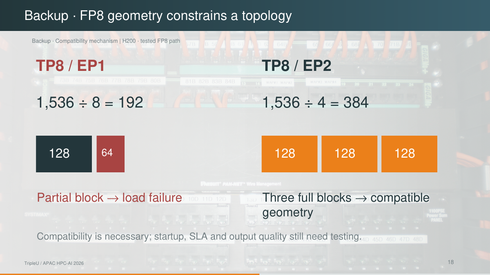

### Slide muốn nói gì

Giải thích lỗi tương thích cụ thể từ hình học trọng số của model và phân biệt cách chia có thể tải với triển khai đã qua kiểm tra dịch vụ.

### Giải thích kết quả và lập luận

Bắt đầu từ chiều trung gian MoE gồm 1.536 phần tử, rồi chia cho tensor-parallel hiệu dụng. TP8/EP1 cho 1.536 ÷ 8 = 192. Kernel đã thử cần block FP8 nguyên 128 phần tử, nên 192 gồm một block đầy cộng 64 phần tử dư không thể tải. TP8/EP2 đổi tensor parallelism MoE hiệu dụng thành bốn: 1.536 ÷ 4 = 384, vừa đúng ba block đầy. Phần dư màu đỏ biểu thị lỗi tương thích lúc tải, không phải mất token đầu ra. Phép tính giải thích vì sao hình dạng cũ lỗi và hình dạng thay thế tương thích; đây không phải biểu đồ benchmark.

### Thuật ngữ và ký hiệu cần hiểu

- **block FP8:** Nhóm cố định 128 phần tử trọng số mà đường kernel đã thử yêu cầu. Phân vùng kết thúc giữa block thì đường này không tải được.
- **MoE:** Mixture of Experts: tầng model định tuyến token tới các mạng con chuyên gia. Expert parallelism thay đổi cách phân phối các chuyên gia đó.
- **TP8 / EP1:** Tensor parallelism tám phần, một phân vùng chuyên gia. Tensor split MoE hiệu dụng là tám, tạo 192 phần tử mỗi phân vùng.
- **TP8 / EP2:** Tensor parallelism tám phần, hai phân vùng chuyên gia. Tensor split MoE hiệu dụng là bốn, tạo 384 phần tử mỗi phân vùng.
- **128 + 64:** Shard TP8/EP1 gồm một block đầy 128 cộng 64 phần tử dư, gây lỗi tải trong đường đã thử.
- **3 × 128 = 384:** Shard EP2 có ba block đầy. Cách chia giữ nguyên mọi trọng số và chuyên gia; chỉ thay đổi phân vùng.
- **tương thích và hiệu năng:** Tương thích nghĩa là hình dạng tensor đáp ứng đầu vào kernel. Khởi động, độ trễ, chất lượng đầu ra và thông lượng vẫn phải đo riêng.

### Cách diễn giải số liệu hoặc sơ đồ

- Đây là bằng chứng dự phòng khi trả lời câu hỏi, được ẩn trong mạch trình chiếu chính. Slide không bổ sung một thí nghiệm mới vào mạch lập luận.
- Hai phép tính là bằng chứng chính: TP8/EP1 tạo 192 phần tử; TP8/EP2 tạo 384.
- Phần dư 64 phần tử giải thích vì sao đường đầu tiên lỗi khi tải. EP2 bỏ phần dư bằng cách phân phối lại chuyên gia, không đổi độ chính xác hay kích thước model.
- Dòng cuối nhắc các bằng chứng còn cần sau tương thích: khởi động thành công, kiểm tra độ trễ dịch vụ và kiểm tra chất lượng đầu ra.

### Đánh đổi và mức độ bằng chứng

- **Quan sát:** TP8/EP1 cho phân vùng 192 phần tử, không chia hết theo block rộng 128; TP8/EP2 cho 384 phần tử, vừa ba block.
- **Giả thuyết:** Đổi phân vùng chuyên gia có thể làm trọng số FP8 hiện có tương thích với kernel mà vẫn giữ nguyên nội dung model.
- **Kết luận được hỗ trợ:** EP2 sửa hình học block đã thử và cho phép thử triển khai tương thích; đây là thay đổi bố trí kết hợp, không phải tăng tốc TP riêng lẻ.
- **Chưa biết / giới hạn:** Căn chỉnh đúng chưa xác nhận toàn bộ khởi động, SLA request, chất lượng đầu ra hay thông lượng tăng.

### Lời nói mẫu

Chiều trung gian model có 1.536 phần tử, còn kernel FP8 này yêu cầu block đủ 128. Với TP8 và một phân vùng chuyên gia, mỗi shard có 192 phần tử: 128 cộng 64 dư, nên tải lỗi. Với hai phân vùng chuyên gia, phép chia hiệu dụng là bốn và mỗi shard có 384, đúng ba block. Trọng số và chuyên gia vẫn giữ nguyên; chỉ đổi cách phân phối. Đây là hình dạng tương thích, chưa chứng minh dịch vụ đầy đủ nhanh hay đúng.

### Điều không nên nói

Số 64 màu đỏ là phần dư của trọng số, không phải GPU hay token. Không gọi tương thích là kết quả thông lượng hoặc tăng tốc TP riêng.

### Câu chuyển slide

Sau khi trả lời, quay về câu hỏi và bằng chứng chính; không trình bày hết phần dự phòng như một bài kể lịch sử thứ hai.

---

## Slide 19 — Backup · full-set accuracy verification

**Phần cứng: Bằng chứng MMLU-Pro cục bộ theo cặp · cùng 16 H200**

### Nói nhanh · 10–20 giây

So sánh đủ tập có 9.460 câu đúng ở tham chiếu và 9.452 ở ứng viên trong 12.032 câu: giữ 99,9154%, chỉ là kết quả cục bộ.

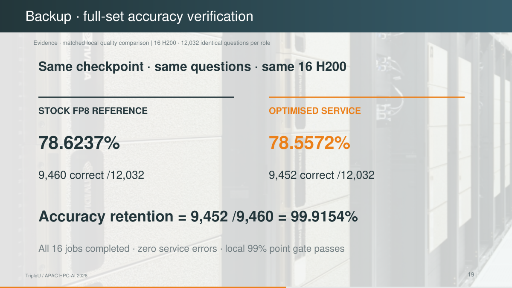

### Slide muốn nói gì

Giữ phương pháp quality chi tiết để trả lời câu hỏi. Giải thích phép đánh giá cặp đủ tập giải quyết khoảng trống giữa performance đạt chuẩn và tính đúng của câu trả lời ra sao, đồng thời giữ ranh giới tuyên bố về BTC.

### Giải thích kết quả và lập luận

Hồ sơ quality theo cặp so sánh FP8 gốc và ứng viên trên cùng câu hỏi MMLU-Pro. Báo cáo ghi accuracy tuyệt đối, tỷ lệ giữ 99,915433% và ngưỡng điểm cục bộ 99%. Hồ sơ cũng nêu kết quả bất đồng và giữ câu trả lời lỗi phân tích/chạm giới hạn trong mẫu số. Đây không phải chứng nhận BTC.

### Thuật ngữ và ký hiệu cần hiểu

- **accuracy:** Số câu đúng chia cho toàn bộ 12.032 câu.
- **tỷ lệ giữ accuracy:** Accuracy ứng viên chia accuracy tham chiếu gốc; đây không phải accuracy tuyệt đối của ứng viên.
- **kết quả bất đồng:** Câu hỏi chỉ một deployment trả lời đúng; hai hệ thống có thể khác ở nhiều câu dù chênh lệch ròng nhỏ.

### Cách diễn giải số liệu hoặc sơ đồ

- Accuracy tham chiếu là 9.460/12.032 = 78,623670%; accuracy ứng viên là 9.452/12.032 = 78,557181%.
- Tỷ lệ giữ là 9.452 chia 9.460, bằng 99,915433%; đạt ngưỡng điểm cục bộ 99% của nhóm.
- Có 876 kết quả bất đồng: 434 câu chỉ ứng viên đúng, 442 câu chỉ tham chiếu đúng; ròng ứng viên ít hơn tám câu đúng.
- Câu không phân tích được và câu sinh đến giới hạn vẫn ở mẫu số; hai vai trò không có lỗi dịch vụ.
- Đây là một phép so MMLU-Pro cục bộ đủ tập, không chứng minh tương đương thống kê hay chứng nhận BTC.

### Đánh đổi và mức độ bằng chứng

- **Quan sát:** Ứng viên ít hơn ròng tám câu đúng và 876 kết quả theo cặp bất đồng, trong khi tỷ lệ giữ tổng thể là 99,915433%.
- **Giả thuyết:** Cần đánh giá đủ tập theo cặp vì performance đạt chuẩn không tự chứng minh chất lượng câu trả lời.
- **Kết luận được hỗ trợ:** Cổng điểm tổng thể cục bộ đạt. Giữ checkpoint chính thức và báo riêng giới hạn theo hạng mục cùng đánh giá của BTC.
- **Chưa biết / giới hạn:** Mỗi vai trò một lượt chạy; không khẳng định tương đương thống kê và không có kết quả quality chính thức từ BTC.

### Lời nói mẫu

Nếu được hỏi kết quả quality nghĩa là gì, hãy phân biệt accuracy với tỷ lệ giữ accuracy. Ứng viên đúng 9.452 trên 12.032 câu, tức 78,557181 phần trăm. Tham chiếu gốc đúng 9.460 câu, tức 78,623670 phần trăm. Lấy accuracy ứng viên chia cho accuracy tham chiếu được 99,915433 phần trăm, cao hơn ngưỡng điểm cục bộ 99 phần trăm. Câu trả lời theo cặp không giống nhau hoàn toàn: 876 kết quả khác nhau, trong đó ứng viên chỉ đúng 434 câu, còn tham chiếu chỉ đúng 442 câu, ròng ứng viên ít hơn tám câu đúng. Câu lỗi phân tích và chạm giới hạn sinh vẫn nằm trong mẫu số. Đây là một phép đánh giá MMLU-Pro cục bộ, không chứng minh tương đương thống kê và không phải quyết định quality của BTC.

### Điều không nên nói

Không gọi 99,9154% là accuracy ứng viên, không giấu kết quả bất đồng và không trình bày kết quả cục bộ này như quyết định của BTC.

### Câu chuyển slide

Sau khi trả lời, quay về câu hỏi và bằng chứng chính; không trình bày hết phần dự phòng như một bài kể lịch sử thứ hai.

---

## Slide 20 — Backup · request-scoped descriptor construction

**Phần cứng: CPU — phép kiểm hình học cho đường truyền hetero-TP trên H200.**

### Nói nhanh · 10–20 giây

Bản vá tạo descriptor cho các trang KV cần thiết rồi gộp dải liên tục, đồng thời giữ nguyên ánh xạ và stride. Kiểm tra CPU đạt 720 trường hợp hình học; fixture ghi rõ chưa xác minh truyền GPU thật.

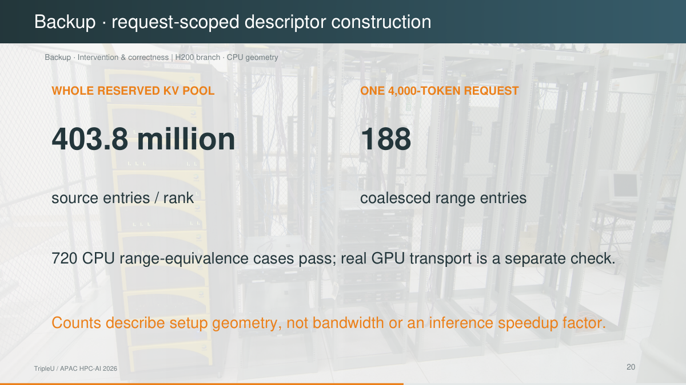

### Slide muốn nói gì

Mô tả chính xác thay đổi và đặt bằng chứng đúng ở cấp độ của nó. Bản vá đổi phạm vi descriptor và cách gộp trong đường truyền TP khác nhau, đồng thời giữ hành vi ánh xạ liên quan; kiểm tra tương đương trên CPU không đồng nghĩa đã xác minh truyền thật trên GPU.

### Giải thích kết quả và lập luận

Đây là bước 5 và nửa đầu bước 6 trong chuỗi bảy bước: thay đổi cụ thể, rồi cổng đúng đắn thực sự đã chạy. Cần giữ rõ khác biệt giữa tương đương dải địa chỉ và truyền GPU thật.

### Thuật ngữ và ký hiệu cần hiểu

- **request-scoped descriptors:** Tạo metadata truyền chỉ cho các trang KV mà yêu cầu hiện tại cần, thay vì liệt kê cả pool KV.
- **coalesce contiguous ranges:** Gộp các dải bộ nhớ liền kề thành ít descriptor hơn nhưng vẫn giữ đúng vị trí và bước nhảy cần cho truyền dữ liệu.
- **KV head mapping:** Ánh xạ KV head nguồn sang dải peer decode; metadata bản vá ghi rằng ánh xạ này được giữ nguyên.
- **per-token stride:** Khoảng cách giữa các vị trí dữ liệu gắn với token khi chỉ gửi một lát KV head; phải giữ đúng sau khi gộp.
- **720 cases:** Số trường hợp tương đương byte-range giữa hình học CPU code cũ và mới đã được giữ lại và vượt qua.
- **real GPU transport: false:** Fixture hình học lưu rõ rằng nó không xác minh một lần truyền GPU thật.
- **notifications:** Tín hiệu báo hoàn tất truyền được giữ nguyên trong phạm vi bản vá; đây không phải yếu tố thí nghiệm bị đổi.

### Cách diễn giải số liệu hoặc sơ đồ

- Đây là bằng chứng dự phòng khi trả lời câu hỏi, được ẩn trong mạch trình chiếu chính. Slide không bổ sung một thí nghiệm mới vào mạch lập luận.
- Bước 5 — Can thiệp: thay việc liệt kê descriptor nguồn và đích cho toàn pool bằng descriptor theo yêu cầu, sau đó gộp các dải liên tục.
- Phạm vi bản vá giữ nguyên hành vi TP bằng nhau, trọng số, độ chính xác, ánh xạ KV head, stride theo token khi gửi lát head và thông báo hoàn tất.
- Bước 6, phần đúng đắn: 720 trường hợp hình học CPU so sánh code cũ và mới vượt kiểm tra tương đương byte-range.
- Fixture ghi xác minh truyền GPU thật là false. Vì vậy, kiểm tra ánh xạ CPU chưa chứng minh truyền GPU, server sẵn sàng hay phản hồi hợp lệ.

### Đánh đổi và mức độ bằng chứng

- **Quan sát:** Bản vá triển khai chuẩn bị descriptor theo yêu cầu và gộp dải liền kề; 720 trường hợp CPU đã lưu vượt kiểm tra tương đương dải, gồm ví dụ yêu cầu liên tục có 188 descriptor.
- **Giả thuyết:** Nếu giữ nguyên ánh xạ nhưng bỏ các dải toàn pool không liên quan, bước setup có thể làm ít việc descriptor hơn mà không đổi byte KV yêu cầu cần.
- **Kết luận được hỗ trợ:** Fixture CPU hỗ trợ tính tương đương địa chỉ và byte-range cho các hình học đã thử. Đây là cổng đúng đắn cho ánh xạ, chưa phải xác minh triển khai đầy đủ.
- **Chưa biết / giới hạn:** Fixture chưa xác minh truyền GPU thật. Nó cũng không đo thời gian tạo descriptor cũ và mới hoặc xác lập thay đổi này một mình đã giải quyết timeout trước đó.

### Lời nói mẫu

Bản vá thay đổi phạm vi chuẩn bị descriptor. Thay vì liệt kê dải nguồn và đích cho cả pool KV, nó tạo descriptor cho yêu cầu hiện tại rồi gộp các dải liền kề. Metadata ghi rằng truyền TP bằng nhau, trọng số mô hình, độ chính xác, ánh xạ KV head, stride theo token cần thiết và thông báo truyền vẫn được giữ nguyên. Sau đó, chúng tôi kiểm tra hành vi địa chỉ và byte-range giữa bản gốc với bản vá trên CPU qua 720 trường hợp hình học. Các kiểm tra đó hỗ trợ tính đúng của ánh xạ đã thử. Fixture được lưu rõ là chưa xác minh truyền GPU thật. Vì thế bước này chưa chứng minh bản sao GPU chạy được, server đã sẵn sàng hay yêu cầu trả về đầu ra hợp lệ. Đây là một cổng đúng đắn trong chuỗi, chưa phải kết quả đầu cuối.

### Điều không nên nói

Không gọi 720 trường hợp hình học CPU là 720 lần truyền GPU. Không nói bản vá đổi mọi kiểu truyền NIXL hoặc thay đổi trọng số/độ chính xác.

### Câu chuyển slide

Sau khi trả lời, quay về câu hỏi và bằng chứng chính; không trình bày hết phần dự phòng như một bài kể lịch sử thứ hai.

---

## Slide 21 — Backup · what the KV recovery run actually proves

**Phần cứng: H200 · Firmus — job 22271 và 22294 trên cùng nhánh topology.**

### Nói nhanh · 10–20 giây

Job 22294 có bản vá warmup cặp mất 0,68–0,70 giây mỗi yêu cầu; benchmark N32 đạt 1.422,96 good tokens/s, SLA kết hợp 95,87% và không có lỗi. Chưa có đối chứng cùng topology để đo mức tăng tốc trong lần này.

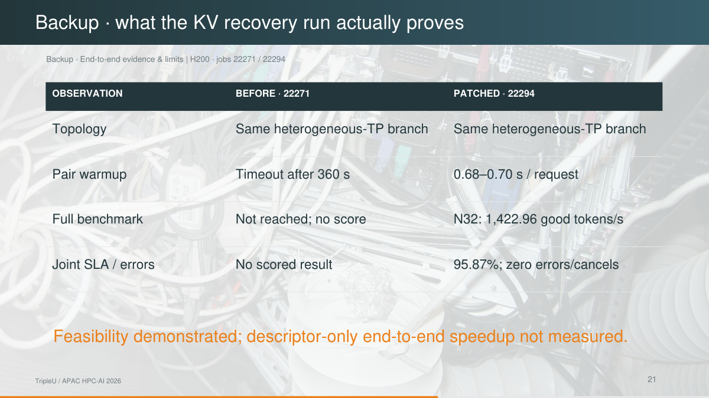

### Slide muốn nói gì

Khép chuỗi bảy bước bằng bằng chứng đầu cuối thật và giới hạn được nêu rõ. Topology TP khác nhau có bản vá đã hoàn tất warmup P/D và phép xác nhận N32 đầy đủ, nhưng không có lần chạy không bản vá tương đương thành công nên không thể quy mức tăng tốc cho quan hệ nhân quả.

### Giải thích kết quả và lập luận

Đây là bước 6 và 7: kết quả đường chạy thật, sau đó là quyết định và điều chưa biết. Nêu thời gian warmup, điểm benchmark, SLA kết hợp và không lỗi như kết quả của job 22294 có bản vá, không phải mức tăng tốc so sánh ghép cặp trực tiếp với 22271.

### Thuật ngữ và ký hiệu cần hiểu

- **job 22294:** Lần chạy có bản vá được lưu lại trên topology dị thể P8 TP8/EP2 sang D8 TP4/EP4 cùng nhánh.
- **0.68–0.70 seconds/request:** Thời gian warmup cặp quan sát được trên mỗi yêu cầu sau khi server sẵn sàng; không phải bộ định giờ riêng cho khởi tạo descriptor.
- **N32:** Mục tiêu concurrency 32 yêu cầu đang xử lý cho benchmark xác nhận đầy đủ.
- **1,422.96 good tokens/s:** Thông lượng token đầu ra đạt chuẩn đo được trong xác nhận đầy đủ N32 trên topology có bản vá.
- **95.87% joint SLA:** Tỷ lệ yêu cầu được đánh giá đồng thời đạt giới hạn TTFT và mean ITL trong kết quả này.
- **zero errors/cancellations:** Kết quả xác nhận được lưu không báo lỗi yêu cầu hoặc yêu cầu bị hủy.
- **matched unpatched control:** Lần chạy tương đương nhưng không có bản vá, cần để quy chênh lệch hiệu năng cho bản vá; không có lần nào thành công trên đúng topology này.

### Cách diễn giải số liệu hoặc sơ đồ

- Đây là bằng chứng dự phòng khi trả lời câu hỏi, được ẩn trong mạch trình chiếu chính. Slide không bổ sung một thí nghiệm mới vào mạch lập luận.
- Bước 6, phần đầu cuối: job 22294 có bản vá hoàn tất cả hai đường warmup prefill/decode thật trong 0,68–0,70 giây mỗi yêu cầu sau khi worker sẵn sàng.
- Sau đó job hoàn tất xác nhận N32: 1.422,96 good output tokens/s, SLA kết hợp 95,87%, không lỗi và không hủy.
- Bước 7 — Quyết định: lần chạy chứng minh topology dị thể có bản vá khả thi và đã phục vụ yêu cầu theo giao thức benchmark cục bộ trong lần chạy này.
- Nó không xác lập mức tăng tốc độc lập của bản vá: không có đối chứng đầu cuối không bản vá thành công trên cùng topology, cũng không có bộ định giờ setup descriptor cũ/mới hay phân rã độ trễ nhân quả.

### Đánh đổi và mức độ bằng chứng

- **Quan sát:** Job 22294 có bản vá hoàn tất warmup P/D trong 0,68–0,70 giây mỗi yêu cầu sau khi server sẵn sàng, rồi đạt 1422,96 good tokens/s ở N32 với SLA kết hợp 95,87%, không lỗi hay hủy.
- **Giả thuyết:** Setup descriptor theo yêu cầu có thể đã giúp topology trước đó bị chặn đạt trạng thái phục vụ, nhưng khác biệt giữa hai lần thử cũng có thể giải thích sự tương phản.
- **Kết luận được hỗ trợ:** Khẳng định có căn cứ là đường chạy có bản vá khả thi và có kết quả đầu cuối cho lần chạy P8 TP8/EP2 sang D8 TP4/EP4 này. Mức tăng tốc của bản vá chưa được đo.
- **Chưa biết / giới hạn:** Không có lần chạy không bản vá thành công được ghép cặp trên topology chính xác này; thời gian setup cũ-mới, mức sử dụng mạng, phân rã warmup nhân quả và phần goodput riêng do bản vá đóng góp đều chưa biết. Băng thông, bố trí KV, vị trí tài nguyên và bootstrap khác chưa bị loại trừ.

### Lời nói mẫu

Kết quả có bản vá mạnh hơn kiểm tra hình học CPU, nhưng cách diễn giải vẫn có giới hạn. Trong job 22294 trên H200 Firmus với layout TP khác nhau P8 TP8/EP2 sang D8 TP4/EP4, cả hai đường warmup prefill và decode thật đều hoàn tất trong 0,68 đến 0,70 giây mỗi yêu cầu sau khi worker sẵn sàng. Phép xác nhận đầy đủ N32 đo được 1.422,96 good output tokens mỗi giây, SLA kết hợp 95,87%, không lỗi và không hủy. Điều đó chứng minh topology có bản vá đã phục vụ yêu cầu trong lần chạy này. Nó không đo mức tăng tốc của bản vá: chúng tôi thiếu đối chứng không bản vá thành công trên cùng topology, thời gian descriptor cũ-mới tách riêng và phân rã độ trễ nhân quả. Mức dùng mạng, bố trí KV, vị trí tài nguyên và công việc bootstrap khác vẫn có thể liên quan.

### Điều không nên nói

Không lấy timeout 360 giây chia cho 0,68–0,70 giây rồi báo là mức tăng tốc. Baseline timeout không có AIPerf; lần chạy có bản vá là lần thử khác và thời gian setup chưa được tách riêng.

### Câu chuyển slide

Sau khi trả lời, quay về câu hỏi và bằng chứng chính; không trình bày hết phần dự phòng như một bài kể lịch sử thứ hai.

---

## Slide 22 — Backup · H100: first-token gain, goodput loss

**Phần cứng: H100 · NSCC · cặp decode N54; các đỉnh H100 khác báo riêng.**

### Nói nhanh · 10–20 giây

Trong một cặp H100 N54 khớp điều kiện, FA3 giảm TTFT trung bình từ 713,199 xuống 594,276 ms, nhưng goodput giảm từ 2.420,945 xuống 2.401,284 token/s, khoảng 0,812%. Token đầu đến nhanh hơn không cải thiện mục tiêu toàn request.

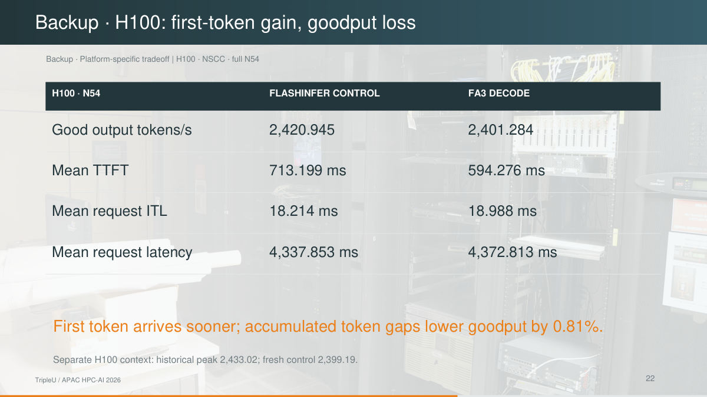

### Slide muốn nói gì

Giải thích vì sao chỉ nhìn thời gian token đầu có thể dẫn tới chọn sai backend decode: còn phải xét độ trễ của câu trả lời dài và thông lượng request đạt chuẩn.

### Giải thích kết quả và lập luận

Cặp thử chỉ đổi attention decode từ FlashInfer sang FA3, còn H100, tải N54 và phần đường thử khác được giữ khớp. So từng chỉ số: FA3 giảm TTFT trung bình 118,922 ms nhưng tăng ITL trung bình 0,773 ms. Lặp qua khoảng 199 khoảng token, phần tăng cộng lại khoảng 154 ms. Độ trễ request trung bình tăng từ 4.337,853 lên 4.372,813 ms, goodput giảm 0,812%. Vậy phản hồi ban đầu nhanh hơn nhưng toàn câu trả lời chậm hơn trung bình và ít request đạt chuẩn hơn mỗi giây. Đây là một cặp cho cấu hình decode H100 này, không phải xếp hạng thư viện attention nói chung.

### Thuật ngữ và ký hiệu cần hiểu

- **FA3:** FlashAttention-3, cách triển khai attention được thử cho decode ở đây. FA3 vẫn được dùng cho prefill H100 trong cặp này.
- **FlashInfer:** Cách triển khai attention decode làm đối chứng trong cặp khớp điều kiện.
- **TTFT:** Time to first token, thời gian từ lúc bắt đầu request đến khi token trả lời đầu tiên xuất hiện.
- **ITL:** Inter-token latency, khoảng thời gian giữa hai token sinh liên tiếp. Tăng nhẹ lặp qua câu trả lời dài có thể làm tổng thời gian tăng đáng kể.
- **goodput:** Tốc độ request đạt quy tắc độ trễ dịch vụ, đổi ra token đầu ra tốt/giây. Chỉ số này bao quát hơn độ trễ lúc bắt đầu.
- **H100 N54:** Hệ H100 với mục tiêu 54 request client đồng thời; không phải điểm vận hành H200 N64.
- **cặp khớp điều kiện:** Hai lần chạy chỉ có một thay đổi dự định, còn workload/cấu hình khác được căn chỉnh. Một cặp hỗ trợ so sánh cục bộ, không xếp hạng phổ quát.

### Cách diễn giải số liệu hoặc sơ đồ

- Đây là bằng chứng dự phòng khi trả lời câu hỏi, được ẩn trong mạch trình chiếu chính. Slide không bổ sung một thí nghiệm mới vào mạch lập luận.
- FlashInfer → FA3: token đầu ra tốt/giây 2.420,945 → 2.401,284; TTFT trung bình 713,199 → 594,276 ms; ITL trung bình 18,214 → 18,988 ms; độ trễ request trung bình 4.337,853 → 4.372,813 ms.
- Cả hai lần chạy qua kiểm tra protocol, runtime và đầu ra do nhóm xem xét trên cluster được giao; FA3 được xác nhận hoạt động trên cả tám rank decode. Điều đó chứng minh can thiệp đã chạy, không chứng minh nó cải thiện dịch vụ.
- Đỉnh H100 lịch sử 2,433.019859 và đối chứng N54 mới 2,399.186728 chỉ là bối cảnh, không phải hai nhánh của cặp này. Chúng không tạo hệ số quy đổi H100/H200.

### Đánh đổi và mức độ bằng chứng

- **Quan sát:** FA3 cải thiện TTFT trung bình 118,922 ms nhưng làm ITL tăng 0,773 ms, độ trễ request tăng 34,960 ms; goodput giảm 0,812%.
- **Giả thuyết:** Đổi attention decode có thể làm chi phí lúc bắt đầu và chi phí mỗi token biến động ngược chiều.
- **Kết luận được hỗ trợ:** Giữ FlashInfer cho cấu hình decode H100 đã thử; FA3 tiếp tục dùng cho prefill.
- **Chưa biết / giới hạn:** Một cặp khớp điều kiện không xếp hạng backend nói chung hay cô lập chính xác nguyên nhân ở mức kernel.

### Lời nói mẫu

FA3 giúp token đầu đến sớm hơn khoảng 119 mili giây. Nhưng khoảng cách giữa các token sau dài hơn một chút. Với câu trả lời dài, những khoảng tăng này cộng lại: độ trễ request trung bình tăng khoảng 35 mili giây và goodput giảm khoảng 0,81 phần trăm. Cả hai lần đo được nhóm kiểm tra trên cluster H100 được giao; FA3 chạy trên đủ rank decode. Với cấu hình này, nhóm giữ FlashInfer cho decode, không xếp hạng thư viện cho mọi workload.

### Điều không nên nói

Không chọn backend chỉ từ TTFT, không khái quát kết quả 0,812% của một cặp, và không so trực tiếp đỉnh H100 với kết quả H200.

### Câu chuyển slide

Sau khi trả lời, quay về câu hỏi và bằng chứng chính; không trình bày hết phần dự phòng như một bài kể lịch sử thứ hai.

---

## Slide 23 — Backup · does a startup saving survive reversed order?

**Phần cứng: H100 · NSCC — thử chi phí khởi động và đảo thứ tự.**

### Nói nhanh · 10–20 giây

Read-first ban đầu giảm walltime scheduler 18,74%, nhưng phép xác nhận đảo thứ tự chỉ tiết kiệm 9,84%, thấp hơn ngưỡng 10% đã đặt. Goodput đổi nhẹ ở cả hai cặp; cache chưa rõ nên không thể kết luận nguyên nhân do lưu trữ lạnh.

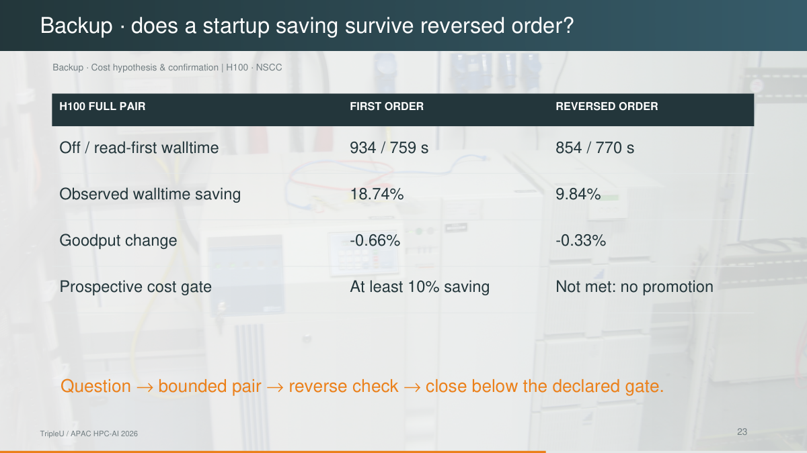

### Slide muốn nói gì

Giải thích vì sao một cặp đo thuận lợi chưa đủ để chọn tối ưu khởi động: thứ tự chạy, trạng thái cache, node và ngưỡng chi phí đặt trước đều ảnh hưởng cách diễn giải.

### Giải thích kết quả và lập luận

So sánh cặp đầu với lần xác nhận đảo thứ tự. Ở cặp đầu, walltime off/read-first là 934/759 giây, tiết kiệm 18,74%, còn goodput giảm 0,659%. Ở cặp đảo thứ tự, walltime là 854/770 giây, tiết kiệm 9,84%, goodput đổi −0,326388%. Quy tắc đặt trước yêu cầu tiết kiệm walltime ít nhất 10% và mất không quá 2% goodput. Cặp đảo đạt dung sai thông lượng nhưng không đạt yêu cầu walltime. Walltime scheduler gồm khởi động và dọn dẹp; nó không phải cửa sổ điểm serving ổn định 120 giây.

### Thuật ngữ và ký hiệu cần hiểu

- **read-first:** Đọc checkpoint prefill trước pha serving được tính điểm để thử xem có rút ngắn khởi động không.
- **walltime scheduler:** Thời gian thực của cả job đã lập lịch, gồm startup và cleanup. Nó khác goodput ổn định và cửa sổ profiling được chấm.
- **xác nhận đảo thứ tự:** Chạy lại hai điều kiện theo thứ tự ngược để kiểm tra thứ tự hoặc cache ấm có ảnh hưởng kết quả đầu không.
- **ngưỡng định trước:** Quy tắc quyết định viết trước khi xem kết quả xác nhận: tiết kiệm ít nhất 10% walltime và mất không quá 2% goodput.
- **prefix lạnh và cache hệ điều hành lạnh:** Prefix lạnh nghĩa là không tái dùng tiền tố/KV prompt. Cache hệ điều hành lạnh nghĩa là trang file checkpoint chưa ở bộ nhớ. Thí nghiệm không xác minh cache hệ điều hành lạnh.
- **goodput:** Thông lượng request đạt quy tắc độ trễ kết hợp; khác với walltime toàn job.

### Cách diễn giải số liệu hoặc sơ đồ

- Đây là bằng chứng dự phòng khi trả lời câu hỏi, được ẩn trong mạch trình chiếu chính. Slide không bổ sung một thí nghiệm mới vào mạch lập luận.
- Cặp đầu có vẻ thuận lợi cho thời gian khởi động nhưng goodput giảm 0,659%. Cặp đảo thứ tự làm mức tiết kiệm thấp hơn ngưỡng quyết định 10%.
- Goodput của cặp đảo đổi 0,326388%, vẫn trong dung sai 2%; điều đó không cứu được nhánh vì ngưỡng walltime chính không đạt.
- Node khác nhau và trạng thái cache file chưa kiểm chứng nên không thể quy kết quả cho lưu trữ lạnh. Prefix lạnh là trạng thái KV cache của model, không phải trang file lạnh của hệ thống tệp.

### Đánh đổi và mức độ bằng chứng

- **Quan sát:** Read-first tiết kiệm 18,74% walltime ở thứ tự đầu nhưng chỉ 9,84% sau khi đảo; goodput đổi −0,659% và −0,326388%, tương ứng.
- **Giả thuyết:** Đọc trọng số prefill trước khi startup được đo có thể giảm walltime khởi động.
- **Kết luận được hỗ trợ:** Lần xác nhận đảo thứ tự không đạt ngưỡng tiết kiệm 10% đã đặt trước, nên nhóm không chọn thay đổi này.
- **Chưa biết / giới hạn:** Cache hệ điều hành chưa xác minh và node khác nhau nên chưa thể giải thích nhân quả là do lưu trữ lạnh.

### Lời nói mẫu

Đọc trọng số trước khi phục vụ ban đầu có vẻ tiết kiệm khoảng 19 phần trăm thời gian job. Nhưng nhóm lặp lại cặp thử theo thứ tự ngược. Mức tiết kiệm còn 9,84 phần trăm, thấp hơn yêu cầu 10 phần trăm đặt trước. Goodput chỉ đổi nhẹ và vẫn trong dung sai, nhưng ngưỡng tiết kiệm chính không đạt. Vì vậy nhóm không chọn read-first chỉ dựa vào cặp đầu. Cache file chưa kiểm chứng nên cũng không thể quy cho lưu trữ lạnh.

### Điều không nên nói

Không đánh đồng walltime scheduler với thời gian serving được chấm, không gọi cache tiền tố prompt là cache hệ thống tệp, và không khẳng định nguyên nhân do lưu trữ lạnh.

### Câu chuyển slide

Sau khi trả lời, quay về câu hỏi và bằng chứng chính; không trình bày hết phần dự phòng như một bài kể lịch sử thứ hai.

---

## Slide 24 — Backup · source-supported changes that did not win

**Phần cứng: H200 · Firmus — các phép so toàn model.**

### Nói nhanh · 10–20 giây

Một số thay đổi H200 đã được kích hoạt và đo, nhưng mức tăng nhỏ, âm hoặc làm xấu chỉ số đuôi. Chẳng hạn, thay attention prefill làm goodput giảm 6,385%. Cờ hoạt động được chưa đủ để đổi cấu hình đang chọn.

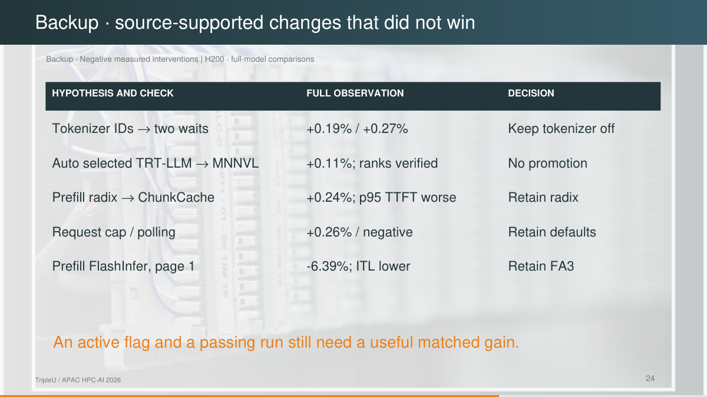

### Slide muốn nói gì

Cho thấy nhóm dùng đọc mã nguồn, xác nhận runtime kích hoạt, control ghép cặp và xem đầu ra để quyết định can thiệp nhỏ có đáng chọn hay không.

### Giải thích kết quả và lập luận

Các hàng là giả thuyết độc lập, không phải phần của một tối ưu tích lũy. Đọc mã nguồn cho biết runtime có thể dùng cài đặt; log xác nhận nó thực sự chạy; run serving đầy đủ mới đo kết quả. Goodput tăng nhẹ vẫn có thể dưới ngưỡng hữu ích hoặc làm xấu p95 TTFT. Vì vậy kết quả âm và trung tính cũng trả lời câu hỏi: tính năng hoạt động là điều kiện cần, nhưng chỉ cải thiện mục tiêu dịch vụ mới biện minh đổi cấu hình đang giữ.

### Thuật ngữ và ký hiệu cần hiểu

- **đọc mã nguồn:** Đọc code để biết cài đặt được hỗ trợ và chọn nhánh nào. Việc này dự đoán hành vi nhưng không chứng minh runtime đã dùng nó.
- **kiểm tra kích hoạt runtime:** Bằng chứng trong log hoặc trạng thái từng rank cho thấy backend/cờ dự định đã chạy trong job đo.
- **control ghép cặp:** Lần đối chứng chỉ đổi yếu tố dự định, còn workload/cấu hình khác được giữ đủ giống để so sánh.
- **ngưỡng tăng hữu ích:** Mức cải thiện tối thiểu đặt trước để đáng giữ thay đổi vận hành; phần trăm dương rất nhỏ có thể là nhiễu hoặc không đủ quan trọng.
- **p95 TTFT:** Phân vị 95 của thời gian tới token đầu. Nó đo đuôi chậm, có thể xấu đi dù độ trễ trung bình tốt hơn.
- **TRT-LLM / MNNVL:** Hai backend giao tiếp collective thay thế nhau; chọn một backend cần xác nhận kích hoạt và đo toàn serving.
- **ChunkCache / RadixCache:** Hai cách cache prefill được so trong cặp serving đầy đủ; chênh goodput nhỏ đi kèm p95 TTFT của ChunkCache xấu hơn.
- **attention page 1:** Cài đặt FlashInfer prefill tác động trang attention đầu; thay đổi đã thử giảm ITL nhưng mất goodput.

### Cách diễn giải số liệu hoặc sơ đồ

- Đây là bằng chứng dự phòng khi trả lời câu hỏi, được ẩn trong mạch trình chiếu chính. Slide không bổ sung một thí nghiệm mới vào mạch lập luận.
- Thay đổi thời gian chờ tokenizer đo +0,192% và +0,270%; nhóm giữ batching tokenizer tắt. Đổi collective prefill runtime tự chọn từ TRT-LLM sang MNNVL kích hoạt trên tám rank prefill nhưng chỉ tăng +0,109807% ở full run 27138.
- Đổi RadixCache sang ChunkCache cho prefill tăng +0,240921%, nhưng p95 TTFT xấu hơn nên giữ RadixCache. So sánh giới hạn request và polling tăng +0,26% hoặc âm, chưa chứng minh lợi ích hữu ích.
- FlashInfer prefill page 1 giảm ITL nhưng mất 6,385% goodput. Các phần trăm thuộc nhánh riêng, không cộng như thành phần của một lần chạy.

### Đánh đổi và mức độ bằng chứng

- **Quan sát:** Thay đổi được kiểm tra mã nguồn/runtime và có quan sát serving đầy đủ, nhưng mức tăng nhỏ, âm hoặc pha trộn với đuôi độ trễ xấu hơn.
- **Giả thuyết:** Thay đổi tokenizer, collective, cache, giới hạn request, polling hoặc attention có thể tăng goodput.
- **Kết luận được hỗ trợ:** Chỉ giữ thay đổi khi đường dự định thật sự chạy và so sánh có kiểm soát cải thiện mục tiêu đủ đáng kể.
- **Chưa biết / giới hạn:** Chênh lệch nhỏ từ một lần chạy có thể do biến động; các hàng không xác lập bottleneck CPU hay xếp hạng tính năng phổ quát.

### Lời nói mẫu

Đây là các phép thử toàn model riêng, không chỉ là phỏng đoán từ source. Nhóm kiểm tra cài đặt có được hỗ trợ, xác nhận nó thật sự kích hoạt, rồi đo serving so với control. Một vài thay đổi dương nhẹ nhưng lợi ích quá nhỏ hoặc đi cùng đuôi độ trễ xấu hơn. Thay attention prefill còn làm mất khoảng 6,4 phần trăm goodput. Vì vậy nhóm giữ lựa chọn cũ: cờ hoạt động chưa đủ nếu mục tiêu dịch vụ không tốt hơn.

### Điều không nên nói

Không cộng phần trăm từ nhánh riêng, coi runtime kích hoạt là tăng tốc, hay gọi mức tăng nhỏ trong một lần đo là chiến thắng bền vững.

### Câu chuyển slide

Sau khi trả lời, quay về câu hỏi và bằng chứng chính; không trình bày hết phần dự phòng như một bài kể lịch sử thứ hai.

---

## Slide 25 — Backup · scope limits of kernel and source evidence

**Phần cứng: H200 + H100 + CPU — đọc đúng nguồn từng dòng.**

### Nói nhanh · 10–20 giây

Gói attention N52 đạt 2.549,20 nhưng đổi nhiều yếu tố; Triton probe, fixture CPU và đọc mã nguồn trả lời câu hỏi hẹp hơn. Compile Qwen đầy đủ dừng ở assertion RoPE/KV. Không bằng chứng nào trong số đó tự chứng minh serving toàn model tăng tốc.

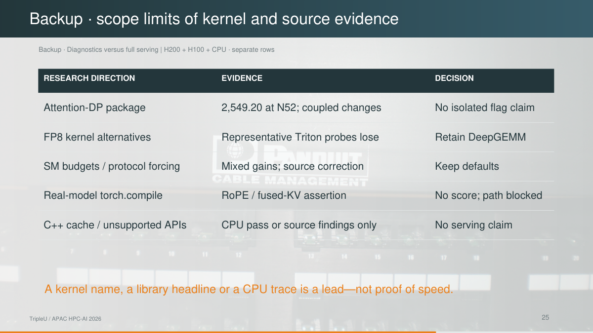

### Slide muốn nói gì

Trả lời kernel, profile và đọc mã nguồn chứng minh được điều gì, đồng thời tránh nhầm kết quả thành phần trên một họ phần cứng với bằng chứng toàn mô hình ở hệ khác.

### Giải thích kết quả và lập luận

Đọc mỗi hàng như một ranh giới bằng chứng. Gói attention H200 N52 là điểm serving thật nhưng đổi nhiều yếu tố cùng lúc. Triton probe H100 thử một số dạng kernel, không phải mọi dạng của model. Ngân sách SM là kiểm tra kernel/runtime giới hạn, không phải tốc độ toàn model. Log NCCL sửa cách hiểu trước đây: nhãn LL không có nghĩa control được thử dùng giao thức độ trễ thấp cho mọi thông điệp. Compile Qwen thật tới assertion native RoPE/fused-KV trước khi chấm điểm. Fixture C++ CPU và nhận xét source có phạm vi hẹp hơn nữa. Gộp các hàng này sẽ trộn bằng chứng H200, H100 và CPU.

### Thuật ngữ và ký hiệu cần hiểu

- **gói attention-DP:** Cấu hình serving H200 N52 kết hợp attention data parallel với DeepGEMM/DeepEP; nhiều yếu tố đổi cùng lúc nên không tách được đóng góp riêng.
- **Triton probe:** Phép thử kernel GPU nhỏ trên dạng đại diện. Thua ở các dạng đó chỉ là bằng chứng cho các dạng ấy, không phải mọi phép toán Qwen.
- **ngân sách SM:** Giới hạn streaming multiprocessor GPU được kernel dùng. Kết quả kernel/runtime có thể không chuyển thành goodput toàn dịch vụ.
- **NCCL LL / Simple:** Hai giao thức giao tiếp collective. Chỉ nhãn LL chưa chứng minh LL được chọn; log cho thấy control liên quan chọn Simple cho thông điệp lớn.
- **torch.compile / RoPE / fused-KV:** Biên dịch PyTorch cho model thật dừng khi mã hóa vị trí xoay gặp giao diện cache key-value hợp nhất không được hỗ trợ. Không có điểm mô hình đầy đủ.
- **fixture C++:** Phép thử CPU cho helper/cache. Nó phát hiện lỗi số học hoặc API nhưng không tải Qwen hay phục vụ request trên GPU.
- **nhận xét source:** Đọc code cho thấy cờ/API có thể có hoặc không có nơi sử dụng. Điều đó không chứng minh runtime đã kích hoạt.
- **phạm vi phần cứng:** Điểm serving H200, probe kernel H100 và fixture CPU là bằng chứng khác phạm vi, không gộp thành một so sánh.

### Cách diễn giải số liệu hoặc sơ đồ

- Đây là bằng chứng dự phòng khi trả lời câu hỏi, được ẩn trong mạch trình chiếu chính. Slide không bổ sung một thí nghiệm mới vào mạch lập luận.
- Gói attention-DP cộng DeepGEMM/DeepEP trên H200 N52 đạt 2.549,20, thấp hơn điểm MNNVL được giữ; các cài đặt ghép không cho phép quy một yếu tố.
- Probe FP8 Triton đại diện trên H100 thua DeepGEMM ở các dạng đã thử. Ngân sách SM 80/96/120 pha trộn hoặc không đạt tiêu chí ổn định; giữ 132 mà không khẳng định model tăng tốc.
- Điểm NCCL nhỏ 0,2315% không đủ để chọn sau khi log cho thấy control đã chọn Simple với thông điệp lớn. Compile Qwen lỗi trước khi có điểm; fixture CPU không thử serving.

### Đánh đổi và mức độ bằng chứng

- **Quan sát:** Bằng chứng trải từ điểm serving H200 qua probe kernel/tài nguyên H100 đến helper CPU và đọc source; phạm vi của chúng khác nhau.
- **Giả thuyết:** Kernel, giao thức giao tiếp, ngân sách tài nguyên hoặc API khác có thể cải thiện một phần cụ thể của serving.
- **Kết luận được hỗ trợ:** Dùng bằng chứng thành phần để chọn phép thử toàn model khi code path và phần cứng hỗ trợ; không tuyên bố dịch vụ tốt hơn chỉ từ probe hay source.
- **Chưa biết / giới hạn:** Dạng và cấu hình chưa thử có thể khác. Compile Qwen thất bại cùng test CPU chưa giải quyết tương thích hay hiệu năng toàn model.

### Lời nói mẫu

Slide này trộn bằng chứng H200, H100 và CPU nên cần giữ phạm vi riêng. Gói attention là điểm serving H200 thật nhưng đổi nhiều yếu tố. Triton probe chỉ thử một số dạng kernel H100. Fixture CPU chỉ kiểm helper. Compile Qwen thật dừng ở assertion giữa mã hóa vị trí và giao diện KV, không có điểm. Những kết quả này giúp loại bỏ hoặc ưu tiên ý tưởng; không cái nào tự chứng minh serving toàn model nhanh hơn.

### Điều không nên nói

Không gộp kết quả H200, H100 và CPU, không khái quát kernel đại diện cho mọi dạng, không suy giao thức từ nhãn kernel, và không tự thêm điểm cho compile thất bại.

### Câu chuyển slide

Sau khi trả lời, quay về câu hỏi và bằng chứng chính; không trình bày hết phần dự phòng như một bài kể lịch sử thứ hai.

---

## Slide 26 — Backup · the retained settings on each platform

**Phần cứng: Cấu hình H200 N64 và H100 N54 — hai cách triển khai riêng.**

### Nói nhanh · 10–20 giây

Recipe H200 và recipe H100 vẫn tách riêng. H200 nay có một lần portable acceptance đầy đủ đạt 3.051,52 good tokens/s; điều này xác minh deployment, không quy đổi H100 sang H200.

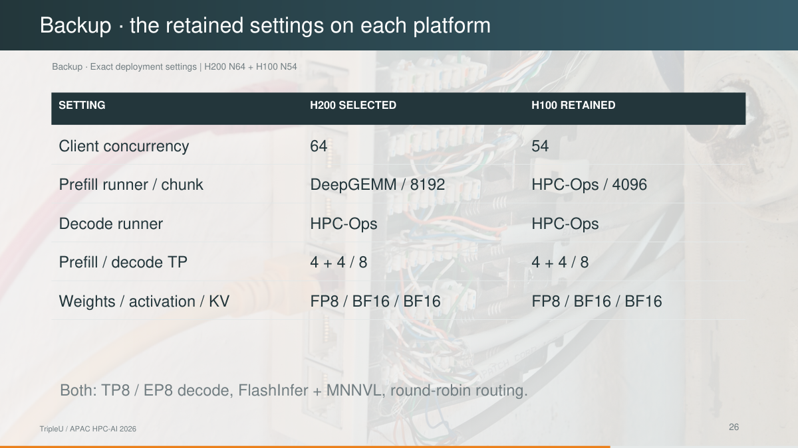

### Slide muốn nói gì

Ghi lại recipe đo được đang giữ trên mỗi nền tảng và bổ sung acceptance deployment portable H200 hoàn tất. Giữ phép đo H100 riêng; package H200 chạy qua không chuyển đổi điểm H100 hay chứng nhận quality chính thức.

### Giải thích kết quả và lập luận

Giữ bảng cấu hình H200/H100 hiện tại và thêm ghi chú acceptance H200 riêng: job 28197, 16 H200, N64, đường portable đầy đủ, 611 giây, 3051,518173 good tokens/s, 1881/1907 SLA chung. Gắn cấu hình H100 N54 là operating point đã đo riêng; không hàm ý nó khớp hoặc dự báo kết quả H200. Ghi quality model chính thức UNKNOWN.

### Thuật ngữ và ký hiệu cần hiểu

- **H200 N64 / H100 N54:** Nền tảng GPU cùng mức concurrency client: 64 request ở H200, 54 ở cấu hình H100 riêng.
- **prefill / decode:** Prefill xử lý token prompt; decode sinh token trả lời tự hồi quy từng bước.
- **TP / EP:** Tensor parallelism chia phép toán tensor qua GPU. Expert parallelism phân phối chuyên gia MoE; decode được giữ dùng TP8/EP8.
- **DeepGEMM / HPC-Ops:** DeepGEMM là backend prefill được chọn trên H200. HPC-Ops dùng cho decode ở cả hai hệ và prefill ở H100.
- **FP8 / BF16:** Trọng số dùng số dấu phẩy động 8 bit; activation và KV cache dùng brain floating point 16 bit. Đây là các loại dữ liệu khác nhau.
- **FlashInfer / MNNVL:** FlashInfer triển khai attention decode; MNNVL xử lý giao tiếp collective GPU. Chúng có chức năng riêng.
- **round-robin:** Gateway gửi các request liên tiếp luân phiên tới hai worker prefill.
- **graph decode dày:** Cấu hình H200 capture dạng decode từ 1 đến 64. Đây là thiết lập dạng graph, không phải 64 request đồng thời.

### Cách diễn giải số liệu hoặc sơ đồ

- Đây là bằng chứng dự phòng khi trả lời câu hỏi, được ẩn trong mạch trình chiếu chính. Slide không bổ sung một thí nghiệm mới vào mạch lập luận.
- H200: concurrency client 64; hai worker prefill TP4/EP1; DeepGEMM; chunk 8.192; một worker decode HPC-Ops TP8/EP8.
- H100: concurrency 54; hai worker prefill TP4/EP1 HPC-Ops; chunk 4.096; decode HPC-Ops TP8/EP8. Điểm H100 cần tách khỏi điểm H200.
- Cả hai dùng độ chính xác trọng số/activation/KV như đã nêu cùng attention decode, collective, định tuyến và quy tắc chất lượng request chung. Bảng không chứng nhận accuracy toàn tập chính thức.
- Job acceptance portable H200 mới 28197 hoàn tất entry trong 611 giây ở N64, đạt 3051,518173 good output tokens/s.
- Điều này xác nhận đường package H200 chạy được một lần; đây không phải so sánh tốc độ GPU H100/H200 cùng điều kiện và không chứng nhận quality toàn tập.

### Đánh đổi và mức độ bằng chứng

- **Quan sát:** Các cấu hình được giữ có chung một số thiết lập decode và độ chính xác, nhưng khác phần cứng, concurrency, backend prefill và chunk.
- **Giả thuyết:** Ghi riêng cài đặt từng nền tảng giúp điểm vận hành lặp lại được và dễ diễn giải.
- **Kết luận được hỗ trợ:** Dùng cài đặt H200 N64 cho cấu hình chính đã chọn và báo cáo H100 N54 độc lập.
- **Chưa biết / giới hạn:** Bảng không xác lập các cài đặt là tối ưu hay hiệu năng chuyển đổi được giữa hai nền tảng.

### Lời nói mẫu

Cấu hình được giữ vẫn riêng theo nền tảng: H200 dùng N64, prefill DeepGEMM chunk 8192; H100 dùng N54, prefill HPC-Ops chunk 4096. Job acceptance portable mới 28197 chạy cấu hình H200 qua toàn bộ package trong 611 giây, đạt 3.051,52 good output tokens mỗi giây. Điều đó cho thấy package H200 chạy trọn sau sửa. Nó không nói recipe H100 nhanh hơn hay chậm hơn trong điều kiện tương đương, và không chứng nhận quality model.

### Điều không nên nói

Không trình bày H100 và H200 như phép so sánh khớp điều kiện hoặc suy hiệu năng chỉ từ precision và số worker.

### Câu chuyển slide

Cấu hình từng nền tảng và acceptance H200 đầy đủ là hai loại bằng chứng riêng; quay lại kết luận chính để xem giới hạn quality còn mở.

---

## Slide 27 — Backup · workload control and prefill chunk trial

**Phần cứng: H200 · thử chunk; workload và cách chấm dùng chung hai hệ thống.**

### Nói nhanh · 10–20 giây

Cùng workload N64 đầy đủ, tăng chunk prefill từ 8.192 lên 12.288 làm goodput giảm từ 3.045,50 xuống 3.020,94 token/s và p95 TTFT xấu hơn. Mỗi cấu hình có một lần H200 được nhóm xem xét; chưa xác lập tối ưu chung.

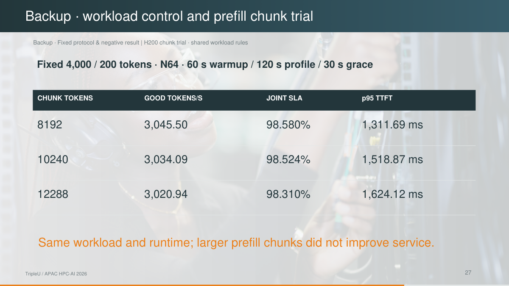

### Slide muốn nói gì

Giải thích protocol benchmark phía sau bảng chunk để kết quả âm được hiểu là phép so sánh có kiểm soát trong phạm vi giới hạn, không phải kết luận cho mọi workload.

### Giải thích kết quả và lập luận

Bảng so sánh ba lần chạy đầy đủ, cùng concurrency mục tiêu, độ dài prompt/câu trả lời yêu cầu, seed, prefix lạnh, model, precision và đường runtime. Chỉ kích thước chunk prefill thay đổi: 8.192, 10.240 hoặc 12.288 token đầu vào được xử lý cùng lúc. Good output tokens/s là thông lượng đạt chuẩn; joint SLA là tỷ lệ request đạt cả hai giới hạn; p95 TTFT là đuôi request phản hồi chậm. Goodput và đuôi đều xấu hơn khi chunk lớn. Một lần mỗi mức đủ để giữ 8.192 cho cấu hình này, nhưng không xác định tối ưu chung.

### Thuật ngữ và ký hiệu cần hiểu

- **4.000 / 200 token yêu cầu:** Client yêu cầu 4.000 token vào và 200 token ra. Độ dài yêu cầu không chứng minh ID token thực được đọc/sinh trong mọi request.
- **closed-loop N64:** Client giữ 64 request đang xử lý và thay mỗi request hoàn tất bằng request mới.
- **protocol 60/120/30:** Warmup 60 giây, profiling được tính điểm 120 giây và grace 30 giây. Chỉ profiling tính điểm; grace kết thúc request còn lại.
- **prefix lạnh:** Request không tái dùng mục KV cache của tiền tố prompt đã làm nóng. Điều này tự nó không có nghĩa cache hệ thống tệp lạnh.
- **kích thước chunk:** Số token đầu vào xử lý cùng nhau trong một đơn vị lập lịch prefill; không phải số request đồng thời.
- **SLA / p95 TTFT:** SLA là tỷ lệ request đạt cả hai giới hạn độ trễ. p95 TTFT là phân vị 95 thời gian chờ token đầu, cho thấy các request chậm.
- **kết quả local do nhóm xem xét:** Ở đây local nghĩa là nhóm chạy và xem xét trên cluster H200 được giao. Không phải kết quả laptop hay sự phê duyệt của ban tổ chức.
- **một lần mỗi cấu hình:** Mỗi kích thước chunk là một cấu hình thí nghiệm chỉ có một lần chạy đầy đủ; thứ tự và seed engine có thể góp phần tạo khác biệt.

### Cách diễn giải số liệu hoặc sơ đồ

- Đây là bằng chứng dự phòng khi trả lời câu hỏi, được ẩn trong mạch trình chiếu chính. Slide không bổ sung một thí nghiệm mới vào mạch lập luận.
- Chunk 8.192, job 26766 đạt 3,045.501509 token đầu ra tốt/giây, joint SLA 98.580% và p95 TTFT 1,311.69 ms. Chunk 10.240, job 26768 đạt 3,034.088251, 98.524% và 1,518.87 ms.
- Chunk 12.288, job 26770 đạt 3,020.943099, 98.310% và 1,624.12 ms. Cả ba là lần N64 đầy đủ cùng lịch 60/120/30 và workload yêu cầu 4.000/200; mỗi mức chunk chỉ đo một lần.
- Các lần chạy qua kiểm tra protocol, runtime, độ trễ và đầu ra của nhóm, không có lỗi/hủy trong profiling. Đây là kết quả được xem xét trên cluster được giao, không phải chứng nhận chất lượng của ban tổ chức.

### Đánh đổi và mức độ bằng chứng

- **Quan sát:** Goodput giảm từ 3.045,50 xuống 3.020,94 token/s và p95 TTFT tăng từ 1.311,69 lên 1.624,12 ms khi chunk tăng từ 8.192 lên 12.288.
- **Giả thuyết:** Chunk prefill lớn hơn có thể tăng thông lượng bằng cách xử lý nhiều token đầu vào hơn trong mỗi batch lập lịch.
- **Kết luận được hỗ trợ:** Giữ 8.192 cho cấu hình dịch vụ này; các chunk lớn hơn đã thử không cải thiện mục tiêu dịch vụ.
- **Chưa biết / giới hạn:** Mỗi mức chỉ một lần nên phép so sánh có giới hạn; chưa xác lập tối ưu cho workload khác hay loại trừ biến động thứ tự/seed.

### Lời nói mẫu

Cả ba lần chạy dùng 64 request đồng thời, cùng yêu cầu 4.000 token vào và 200 token ra, cùng lịch warmup, profiling và grace đầy đủ. Chỉ chunk xử lý prompt thay đổi. Goodput giảm khoảng 3.045 xuống 3.021 khi chunk lớn dần, còn đuôi token đầu chậm hơn. Nhóm kiểm tra các lần chạy trên cluster H200 được giao, nhưng mỗi mức chỉ đo một lần nên chưa chứng minh cài đặt tốt nhất phổ quát. Nhóm giữ 8.192 cho triển khai này.

### Điều không nên nói

Qua kiểm tra của nhóm không phải phê duyệt của ban tổ chức. Không suy token thực từ độ dài yêu cầu, tính grace vào thời gian chấm hay khái quát một lần đo cho mọi workload.

### Câu chuyển slide

Sau khi trả lời, quay về câu hỏi và bằng chứng chính; không trình bày hết phần dự phòng như một bài kể lịch sử thứ hai.

---

## Slide 28 — Backup · less graph memory did not raise goodput

**Phần cứng: H200 · graph thưa 27510 so với đối chứng 27376.**

### Nói nhanh · 10–20 giây

Capture thưa giảm bộ nhớ log từ 1,15 xuống 0,36 GB mỗi rank decode, nhưng goodput giảm 0,370208% và ITL trung bình xấu hơn. Chưa đo padding để quy nguyên nhân. Nhóm giữ graph dày; cặp này không chứng minh quan hệ nhân quả.

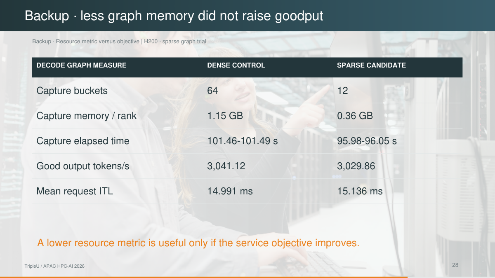

### Slide muốn nói gì

Giải thích vì sao chỉ số tài nguyên thấp hơn không tự động là dịch vụ tốt hơn, đồng thời tách bộ nhớ capture khỏi tổng bộ nhớ GPU và thông lượng end-to-end.

### Giải thích kết quả và lập luận

So sánh đối chứng dày 27376 với ứng viên thưa 27510. Ứng viên lưu 12 bucket graph decode thay vì 64 và giảm bộ nhớ graph capture theo log trên mỗi rank, nhưng goodput là 3,029.861122 so với 3,041.119598, thấp hơn 0,370208%. Mean request ITL tăng từ 14.991 lên 15.136 ms; TTFT cải thiện. Ít bucket hơn có thể buộc request vào dạng đệm kém khớp hơn, làm tăng việc xử lý, nhưng lần này không tách hay đo padding. Bộ nhớ capture không gồm cấp phát GPU khác như trọng số và KV cache, nên không phải dung lượng VRAM. Điểm dịch vụ, không phải con số capture nhỏ hơn, quyết định thay đổi có ích không.

### Thuật ngữ và ký hiệu cần hiểu

- **bucket graph decode:** Một dạng thực thi GPU đã capture để phát lại cho một lớp batch decode; số bucket không phải concurrency hay số GPU.
- **padding:** Đệm batch để khớp dạng graph được hỗ trợ. Ít bucket có thể tăng padding, nhưng phép thử này không đo lượng hay chi phí đó.
- **bộ nhớ capture:** Bộ nhớ mỗi rank liên quan các graph tái sử dụng đã ghi và buffer capture. Đây chỉ là một phần sử dụng bộ nhớ GPU.
- **VRAM / GB / GiB:** VRAM là tổng bộ nhớ GPU. Log ghi GB liên quan capture mỗi rank, không phải tổng VRAM hay GiB; trọng số, KV cache, workspace và cấp phát khác nằm ngoài số này.
- **rank:** Một tiến trình worker phân tán. Số 1,15 và 0,36 GB là mỗi rank decode, không phải tổng của tám GPU.
- **ITL / TTFT:** ITL là khoảng giữa các token sinh; TTFT là thời gian đợi token đầu. Chúng đo phần độ trễ request khác nhau.
- **full local pass:** Nhóm chạy và xem xét workload đầy đủ trên cluster H200 được giao theo kiểm tra protocol/runtime/độ trễ/đầu ra nội bộ. Đây không phải phê duyệt hay chứng nhận accuracy của ban tổ chức.

### Cách diễn giải số liệu hoặc sơ đồ

- Đây là bằng chứng dự phòng khi trả lời câu hỏi, được ẩn trong mạch trình chiếu chính. Slide không bổ sung một thí nghiệm mới vào mạch lập luận.
- Đối chứng dày có 64 bucket, bộ nhớ capture 1,15 GB mỗi rank, thời gian capture 101.46–101.49 giây, 3,041.119598 token đầu ra tốt/giây và ITL trung bình 14.991 ms.
- Ứng viên thưa có 12 bucket, 0,36 GB/rank, capture 95.98–96.05 giây, 3,029.861122 token tốt/giây và ITL trung bình 15.136 ms. Capture được xác nhận trên cả tám rank decode khi compile mô hình tắt.
- TTFT trung bình/p95 của ứng viên là 1,102.404/1,240.481 ms và cải thiện; ITL trung bình/p95 là 15.136/15.324 ms và xấu hơn. Một đối chứng trước, seed engine khác và instrumentation startup chỉ ở ứng viên hạn chế kết luận nhân quả.

### Đánh đổi và mức độ bằng chứng

- **Quan sát:** Capture thưa giảm bộ nhớ graph theo log mỗi rank từ 1,15 xuống 0,36 GB và rút ngắn capture chút ít, trong khi goodput giảm 0,370208% so với đối chứng trước.
- **Giả thuyết:** Ít dạng capture hơn có thể tiết kiệm tài nguyên mà vẫn giữ throughput; padding là cơ chế có thể có nhưng chưa đo.
- **Kết luận được hỗ trợ:** Mục tiêu dịch vụ không cải thiện, nên nhóm giữ graph dày cho triển khai này.
- **Chưa biết / giới hạn:** Chỉ có một đối chứng trước và seed tạo sinh khác nhau; tổng VRAM và tác động padding chưa được đo bằng chỉ số bộ nhớ capture.

### Lời nói mẫu

Ứng viên thưa dùng 12 dạng decode đã capture thay vì 64. Bộ nhớ graph theo log giảm từ 1,15 xuống 0,36 gigabyte mỗi rank, nhưng goodput cũng giảm khoảng 0,37 phần trăm. Khoảng token trung bình dài hơn chút dù thời gian token đầu tốt hơn. Số bộ nhớ này chỉ nói về capture graph, không phải toàn bộ GPU. Ít dạng có thể tạo thêm padding nhưng chưa đo. Nhóm giữ graph dày; phép so sánh quá giới hạn để kết luận nhân quả.

### Điều không nên nói

Không gọi bucket là request hay GPU, không hiểu bộ nhớ capture là tổng VRAM, và không nói padding gây chênh lệch điểm. Chỉ giảm bộ nhớ capture chưa phải cải thiện goodput.

### Câu chuyển slide

Sau khi trả lời, quay về câu hỏi và bằng chứng chính; không trình bày hết phần dự phòng như một bài kể lịch sử thứ hai.

---

## Slide 29 — Why did a later replay score lower?

**Phần cứng: H200 · Firmus — các protocol và đường thực thi khác nhau.**

### Nói nhanh · 10–20 giây

N64 đầy đủ lịch sử trung bình 3.044,40, còn control ngắn mới khoảng 2.560. Graph policy, giới hạn admission server và quy trình đo đều thay đổi. Phép thử hoàn tất không cô lập nguyên nhân, nên giữ drift mà không quy cho một flag.

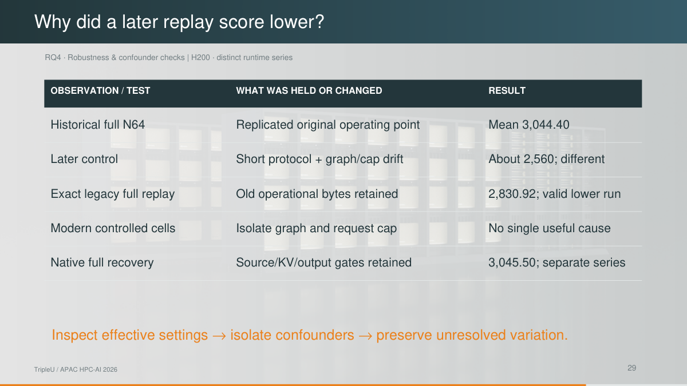

### Slide muốn nói gì

Điều tra chênh lệch thay vì giải thích bằng một flag thuận tiện. Bằng chứng xác định settings và bối cảnh đo đã đổi, nhưng so sánh hoàn tất không cô lập được một nguyên nhân duy nhất đủ giải thích.

### Giải thích kết quả và lập luận

Câu hỏi là vì sao N64 đầy đủ lịch sử trung bình 3.044,400475 trong khi control ngắn mới khoảng 2.560. ServerArgs cho thấy policy prefill graph và giới hạn max-running-request đã đổi; harness/cách quan sát cũng khác. Replay legacy chính xác 26313 đạt 2.830,923547; run native mới 26766 đạt 3.045,501509. Đây là các chuỗi runtime/protocol khác nhau, không phải thang đo một yếu tố duy nhất.

### Thuật ngữ và ký hiệu cần hiểu

- **ServerArgs:** Tham số cấu hình server runtime, điều khiển graph policy, giới hạn admission và hành vi khác.
- **Prefill graph policy:** Quy định các shape xử lý prompt nào được capture/chạy bằng GPU graph.
- **Max running requests:** Giới hạn phía server cho request được nhận/đang chạy đồng thời; khác concurrency client.
- **Harness / protocol quan sát:** Quy trình client và đo lường xác định warmup, cửa sổ điểm và cách tính.
- **Yếu tố gây nhiễu:** Yếu tố cùng thay đổi với phép so và cũng ảnh hưởng kết quả, khiến không thể quy cho một nguyên nhân.

### Cách diễn giải số liệu hoặc sơ đồ

- Đây là bằng chứng dự phòng khi trả lời câu hỏi, được ẩn trong mạch trình chiếu chính. Slide không bổ sung một thí nghiệm mới vào mạch lập luận.
- N64 đầy đủ lịch sử trung bình 3.044,400475, trong khi control ngắn mới xấp xỉ 2.560. ServerArgs thực tế cho thấy policy prefill graph và giới hạn max-running-request đã đổi; harness và điều kiện quan sát cũng khác.
- Replay vận hành legacy chính xác 26313 đạt 2.830,923547; run native-runtime đầy đủ 26766 đạt 3.045,501509. Factorial graph/admission đã hoàn tất nhưng không xác định một nguyên nhân hữu ích duy nhất. Vì vậy không thể ghi toàn bộ chênh lệch cho việc phục hồi một flag hay chỉ đổi launcher.

### Đánh đổi và mức độ bằng chứng

- **Quan sát:** Điểm số khác nhau giữa chuỗi full lịch sử, control ngắn, replay legacy và native runtime; nhiều setting và điều kiện đo cùng thay đổi.
- **Giả thuyết:** Graph policy, giới hạn admission server, runtime hoặc harness đo có thể góp phần tạo drift.
- **Kết luận được hỗ trợ:** Giữ kết quả thấp hợp lệ và ghi rõ protocol/runtime; chưa xác lập giải thích một yếu tố.
- **Chưa biết / giới hạn:** Bằng chứng factorial không cô lập được yếu tố nhân quả duy nhất đủ giải thích chênh lệch lịch sử với kết quả mới.

### Lời nói mẫu

Control ngắn mới đạt khoảng 2.560, thấp hơn trung bình N64 đầy đủ lịch sử 3.044. Kiểm tra server settings thực tế cho thấy cả policy prefill graph lẫn giới hạn request phía server đã đổi; harness và cửa sổ đo cũng khác. Replay legacy và run native mới trả lời so sánh khác nhau, còn factorial hoàn tất không cô lập được nguyên nhân. Vì vậy chúng tôi báo drift cùng yếu tố gây nhiễu, không ghi công cho một flag hay launcher riêng.

### Điều không nên nói

Control ngắn không so trực tiếp với run đầy đủ. Replay legacy chính xác không chứng minh một flag duy nhất gây ra chênh lệch.

### Câu chuyển slide

Sau khi trả lời, quay về câu hỏi và bằng chứng chính; không trình bày hết phần dự phòng như một bài kể lịch sử thứ hai.

---

## Slide 30 — Did speculative decoding solve this workload?

**Phần cứng: H200 · Firmus · EAGLE3.**

### Nói nhanh · 10–20 giây

Vị trí draft EAGLE3 làm trượt latency; validator được sửa; cả retry ngắn và thử nghiệm shallow đầy đủ riêng đều mất goodput. Cách đã thử không giúp workload này, dù còn cấu hình khác chưa được đo. Bằng chứng hiện tại chỉ áp dụng cho các cấu hình đã thử trên H200.

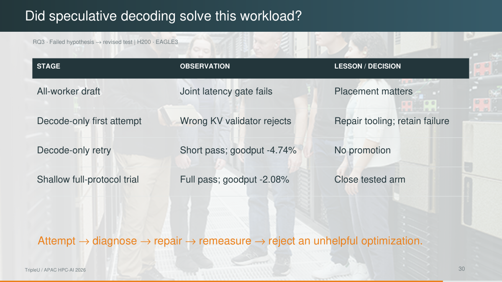

### Slide muốn nói gì

Theo dõi chuỗi lập luận EAGLE3: giả thuyết về vị trí chạy draft, lỗi validator, retry ngắn sau khi sửa và một phép đo đầy đủ riêng. Sửa công cụ đo giúp lần chạy sau hợp lệ; không biến kết quả hiệu năng thua thành thắng.

### Giải thích kết quả và lập luận

Đọc theo thứ tự: draft trên mọi worker 25948 trượt quy tắc latency đồng thời; thử decode-only 25988 bị validator từ chối vì đòi KV draft ở prefill chỉ chạy target; run ngắn sau sửa 25998 qua protocol giới hạn nhưng mất 4,74% goodput; run shallow đầy đủ riêng 27238 mất 2,080318% so với control 26949.

### Thuật ngữ và ký hiệu cần hiểu

- **Speculative decoding EAGLE3:** Model draft đề xuất token output, model target xác minh; truyền đúng không tự chứng minh phục vụ nhanh hơn.
- **Prefill chỉ chạy target:** Worker xử lý prompt bằng model target nhưng không chạy model draft.
- **KV region:** Vùng nhớ giữ trạng thái key/value; validator chỉ kiểm tra ở role thực sự chạy draft.
- **Protocol ngắn:** Run giới hạn, không thay thế workload cố định đầy đủ để kết luận hiệu năng dịch vụ.
- **Mất goodput:** Số output token đủ điều kiện mỗi giây thấp hơn control target-only ghép cặp.

### Cách diễn giải số liệu hoặc sơ đồ

- Đây là bằng chứng dự phòng khi trả lời câu hỏi, được ẩn trong mạch trình chiếu chính. Slide không bổ sung một thí nghiệm mới vào mạch lập luận.
- Thử nghiệm ban đầu mọi worker 25948 trượt giới hạn latency đồng thời. Chuyển draft sang decode-only được giả thuyết là giảm thời gian tới token đầu. Sau đó attempt 25988 bị validator từ chối vì validator áp sai số KV region của draft lên prefill chỉ chạy target; sửa theo role nhưng vẫn lưu lỗi ban đầu.
- Retry ngắn 25998 qua protocol giới hạn nhưng mất 4,74% goodput so với control target-only riêng. Run shallow đầy đủ sau đó 27238 đạt 2.971,628430 so với control 26949 ở 3.034,761104, giảm 2,080318%. Acceptance draft thấp là telemetry mô tả, không phải giải thích nhân quả cho thời gian.

### Đánh đổi và mức độ bằng chứng

- **Quan sát:** Sau khi sửa validator, retry decode-only ngắn mất 4,74%; thử nghiệm shallow đầy đủ riêng mất 2,080318% goodput.
- **Giả thuyết:** Giới hạn draft vào decode hoặc dùng draft nông có thể giảm TTFT mà không mất throughput dịch vụ tổng thể.
- **Kết luận được hỗ trợ:** Các cấu hình đã thử không giải quyết được workload này; dừng chúng và giữ lịch sử lỗi/sửa công cụ.
- **Chưa biết / giới hạn:** Quan sát chưa chỉ ra pha dịch vụ nào chính xác gây chậm và cũng không bác bỏ mọi cấu hình speculative khác.

### Lời nói mẫu

Chúng tôi thử EAGLE3 để giảm độ trễ sinh token. Chạy draft trên mọi worker trượt quy tắc latency kết hợp. Chuyển draft sang decode-only là giả thuyết hợp lý, nhưng validator kiểm tra sai prefill chỉ chạy target. Chúng tôi sửa và giữ lại lỗi đó. Retry ngắn chạy được nhưng mất 4,74 phần trăm goodput; thử nghiệm shallow đầy đủ riêng mất 2,08 phần trăm. Các cấu hình này không giúp workload hiện tại. Truyền draft đúng chức năng không đồng nghĩa dịch vụ nhanh hơn.

### Điều không nên nói

Phân biệt lỗi validator với lỗi model, và retry ngắn với run đầy đủ. Không biến telemetry acceptance thấp thành phân tích nhân quả latency.

### Câu chuyển slide

Sau khi trả lời, quay về câu hỏi và bằng chứng chính; không trình bày hết phần dự phòng như một bài kể lịch sử thứ hai.

---

## Slide 31 — Backup · real failures led to a complete portable acceptance

**Phần cứng: H200 chạy benchmark; CPU chỉ kiểm reader trên dữ liệu đã lưu.**

### Nói nhanh · 10–20 giây

Job 27136 và 27145 lỗi ở hai reader khác nhau; 27152 kiểm tra cả hai bản sửa trên CPU. ZIP nguyên trạng ở 28194 gặp race gateway trước benchmark. Job 28197 chỉ đổi readiness wait/checksum và qua entry H200 đầy đủ trong 611 giây.

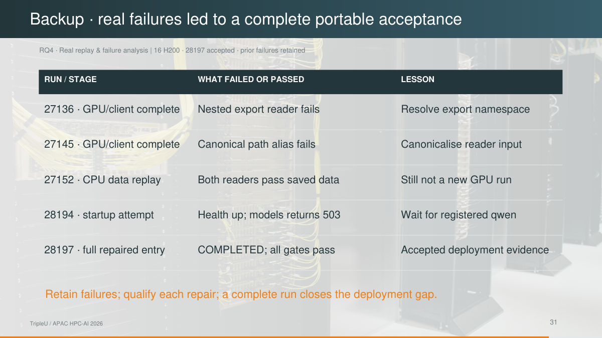

### Slide muốn nói gì

Trình bày đủ chuỗi debug để người nghe phân biệt job lỗi được giữ nguyên, sửa reader kiểm tra bằng CPU, race readiness gateway riêng và lần acceptance GPU đầy đủ cuối. Không đổi trạng thái scheduler thất bại trong quá khứ.

### Giải thích kết quả và lập luận

Vẽ timeline năm bước: 27136 chạy inference/client GPU portable xong rồi lỗi reader do output lồng thư mục; 27145 chạy inference/client xong rồi lỗi alias path; 27152 job CPU zero-GPU qua cả hai reader trên export thật; 28194 thử ZIP nguyên trạng nhưng fail trước benchmark với curl exit 22 vì health gateway HTTP 200 trong khi đăng ký model bất đồng bộ vẫn HTTP 503; 28197 chỉ đổi readiness wait/checksum, giữ worker, official client, reader và semantic check rồi hoàn tất entry trong 611 giây trên 16 H200 N64. Ghi rõ từng job lỗi vẫn FAILED; 28197 là allocation mới thành công.

### Thuật ngữ và ký hiệu cần hiểu

- **27136 / 27145:** Hai job GPU portable đầu vẫn FAILED do mỗi job có một lỗi reader kết quả khác nhau.
- **27152:** Job CPU zero-GPU kiểm tra reader đã sửa bằng export thật; không phải replay GPU.
- **28194:** Lần thử ZIP nguyên trạng lỗi trước benchmark vì health gateway sẵn sàng trước khi đăng ký model bất đồng bộ.
- **28197:** Entry acceptance portable đầy đủ 16 H200/N64 sau khi đổi readiness wait/checksum.
- **HTTP 200 / HTTP 503:** Endpoint health đã trả lời trong khi endpoint đăng ký model còn chưa sẵn sàng; hai check biểu thị hai trạng thái readiness khác nhau.

### Cách diễn giải số liệu hoặc sơ đồ

- 27136 và 27145 vẫn là job thất bại; output đã lưu giúp tìm ra hai lỗi reader khác nhau.
- Job CPU zero-GPU 27152 xác minh hai bản sửa reader bằng dữ liệu thật đã lưu, nhưng không chạy deployment GPU.
- Lần thử ZIP nguyên trạng 28194 là lỗi riêng trước AIPerf: endpoint health trả HTTP 200 trước khi đăng ký model bất đồng bộ sẵn sàng; model vẫn trả HTTP 503 và curl exit 22.
- Job 28197 chỉ chỉnh thời gian chờ readiness và checksum. Worker image, official client, reader và cả hai semantic route được giữ nguyên.
- 28197 hoàn tất gateway readiness, cả hai semantic path P/D, workload client, summary acceptance gate và cleanup trong 611 giây trên 16 H200 N64.
- Entry đầy đủ đạt 3051,518173 good output tokens/s, 1881/1907 request đạt SLA chung, 26 trượt TTFT, không trượt ITL, không error/cancel.
- Điều này đóng acceptance GPU deployment đầy đủ sau sửa reader một lần; không chứng nhận quality model và không xóa trạng thái job lỗi trước.

### Đánh đổi và mức độ bằng chứng

- **Quan sát:** Hai lỗi reader được sửa và kiểm tra trên CPU; một lần ZIP nguyên trạng sau đó lỗi trước benchmark vì race gateway; entry GPU đầy đủ mới qua sau điều chỉnh readiness hẹp.
- **Giả thuyết:** Chờ đúng trạng thái đăng ký model thay vì chỉ nhận endpoint health sẽ xử lý race khởi động còn lại.
- **Kết luận được hỗ trợ:** 28197 chứng minh deployment portable đã sửa có thể qua toàn bộ acceptance nội bộ. Giữ 27136, 27145 và 28194 là các job thất bại.
- **Chưa biết / giới hạn:** Một lần qua không xác lập độ tin cậy thống kê của deployment hoặc quality model chính thức; nguyên nhân khác ngoài các đường quan sát vẫn chưa rõ.

### Lời nói mẫu

Chuỗi này có hai lỗi khác nhau và hai bước sửa. Job portable 27136 và 27145 chạy xong inference cùng client nhưng thất bại vì hai reader giả định sai đường dẫn theo hai cách. Job CPU 27152 xác minh cả hai sửa bằng export thật nhưng không chứng minh được deployment GPU. Sau đó thử ZIP nguyên trạng ở job 28194 và lỗi trước khi chấm: health gateway trả HTTP 200 nhưng đăng ký model bất đồng bộ vẫn trả HTTP 503. Chúng tôi chỉ đổi thời gian chờ readiness và checksum. Job 28197 giữ nguyên worker, official client, reader và semantic path, rồi hoàn tất mọi bước và cleanup trong 611 giây trên 16 H200. Điểm đạt 3.051,52 good token mỗi giây, SLA chung 98,64%, không lỗi. Các job cũ vẫn thất bại; job mới đóng kiểm tra GPU toàn gói sau sửa một lần.

### Điều không nên nói

Không đổi 27136, 27145 hay 28194 thành thành công. Kiểm tra CPU không phải replay GPU; health HTTP một mình không có nghĩa model đã sẵn sàng. Job 28197 là một lần acceptance đầy đủ, không phải chứng nhận accuracy.

### Câu chuyển slide

Phụ lục giải thích cách cô lập lỗi deployment portable rồi qua acceptance. Quay lại slide chính 16 để xem kết quả ngắn và ranh giới quality.

---

## Slide 32 — Do attention and communication choices interact?

**Phần cứng: H200 · Firmus · N52.**

### Nói nhanh · 10–20 giây

Ở H200 N52, tổ hợp attention và giao tiếp đo cao hơn control MNNVL sau đó khoảng 1,43 phần trăm. Kết quả ủng hộ tổ hợp tại tải này, không chứng minh gain từng phần cộng lại hay quy tắc phổ quát.

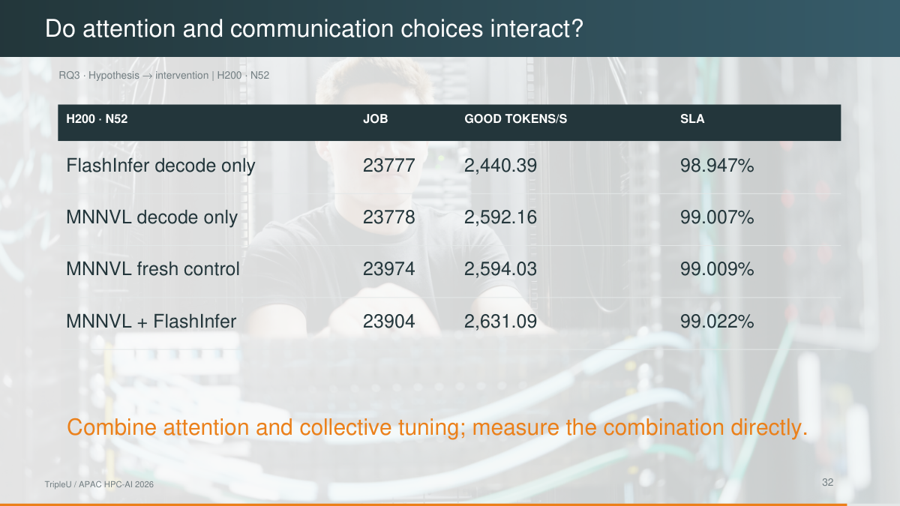

### Slide muốn nói gì

Đặt câu hỏi liệu lựa chọn attention và backend giao tiếp tập thể có phối hợp tốt hơn khi dùng cùng nhau ở một tải H200 cố định hay không. Kết quả gợi ý nên thử tổ hợp; chưa chứng minh gain của hai thành phần cộng tuyến tính.

### Giải thích kết quả và lập luận

Đọc các kết quả N52 như các cấu hình backend riêng ở cùng tải: FlashInfer 2.440,386; MNNVL 2.592,162; tổ hợp 2.631,085; control MNNVL đo sau đó 2.594,028 good tokens/s. Đối chiếu tổ hợp với control MNNVL cùng tải: cao hơn khoảng 1,43%.

### Thuật ngữ và ký hiệu cần hiểu

- **N52:** Cấu hình concurrency client 52 request đã gửi nhưng chưa hoàn tất; không phải số GPU hay batch decode.
- **FlashInfer:** Cách triển khai attention trên GPU được thử trong đường phục vụ.
- **MNNVL:** Đường giao tiếp collective qua NVIDIA NVLink.
- **Tương tác:** Kết quả dùng hai thành phần cùng lúc có thể khác điều dự đoán từ từng thành phần riêng; cần phép đo tổ hợp có đối chứng.
- **Good tokens/s:** Request đủ điều kiện mỗi giây nhân mục tiêu cố định 200 output token.

### Cách diễn giải số liệu hoặc sơ đồ

- Đây là bằng chứng dự phòng khi trả lời câu hỏi, được ẩn trong mạch trình chiếu chính. Slide không bổ sung một thí nghiệm mới vào mạch lập luận.
- Câu hỏi là: chọn cả cách triển khai attention và backend giao tiếp có cải thiện dịch vụ không? Ở H200 N52, các quan sát riêng và kết hợp lần lượt là 2.440,386; 2.592,162; 2.631,085 good tokens/s. Control MNNVL đo sau đó tại cùng tải đạt 2.594,028; quan sát kết hợp cao hơn khoảng 1,43%.
- Bằng chứng ủng hộ việc xem tổ hợp này là operating point đáng quan tâm trong cấu hình đo. Nó không chứng minh quy luật tương tác chung, không cô lập phần đóng góp nhân quả của từng backend và không cho phép cộng chênh lệch riêng như thể hai thành phần độc lập.

### Đánh đổi và mức độ bằng chứng

- **Quan sát:** Quan sát kết hợp cao hơn control MNNVL đo sau khoảng 1,43% tại H200 N52; các quan sát FlashInfer và MNNVL riêng thấp hơn.
- **Giả thuyết:** Attention và backend giao tiếp có thể phối hợp thuận lợi khi chạy cùng nhau.
- **Kết luận được hỗ trợ:** Tổ hợp đo được có triển vọng tại tải này và đáng so sánh như một cấu hình dịch vụ hoàn chỉnh.
- **Chưa biết / giới hạn:** Kết quả không lượng hóa gain nhân quả từng thành phần và chưa cho biết tải, model hay phần cứng khác sẽ ra sao.

### Lời nói mẫu

Chúng tôi hỏi liệu attention và giao tiếp có tương tác hay không. Ở H200 N52, tổ hợp đạt 2.631 good token mỗi giây, cao hơn control MNNVL đo sau ở 2.594 khoảng 1,43 phần trăm. Các phép đo riêng giúp hình thành giả thuyết, nhưng không thể cộng lại để dự đoán tổ hợp. Kết quả ủng hộ operating point đã thử, không phải quy tắc backend phổ quát.

### Điều không nên nói

Đây là các quan sát cùng tải, chưa phải chứng minh factorial đầy đủ rằng mỗi thành phần gây ra một phần gain. Không cộng gain đo riêng.

### Câu chuyển slide

Sau khi trả lời, quay về câu hỏi và bằng chứng chính; không trình bày hết phần dự phòng như một bài kể lịch sử thứ hai.

---

## Slide 33 — Backup · one held-out forecast is not a GPU conversion rule

**Phần cứng: H100 input · H200 held-out check**

**Loại nội dung: Backup · robustness check.**

### Nói nhanh · 10–20 giây

Dự báo được ghi trước khi có số đo H200 lệch khoảng 1,54%, trong dung sai 2% nhóm đặt. Tuy nhiên, phép kiểm còn bộc lộ phần bất định bị bỏ sót. Một dự báo gần đúng chỉ có giá trị kiểm tra giới hạn, chưa phải quy tắc đổi mọi điểm H100 sang H200.

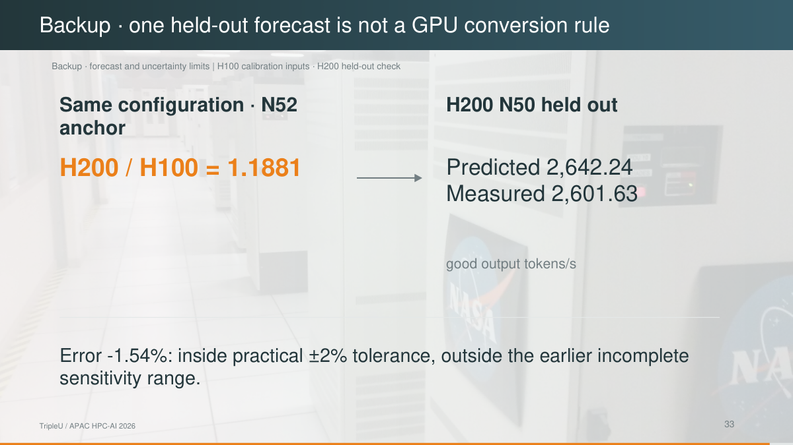

### Slide muốn nói gì

Đánh giá calibration theo nền tảng có chuyển sang điểm vận hành held-out gần đó không, đồng thời phân biệt dung sai vận hành với bất định thống kê.

### Giải thích kết quả và lập luận

Phép calibration dùng cùng combo N52: trung bình H100 là 2.215,460 token tốt/giây qua hai allocation; H200 là 2.632,181 qua bốn; tỷ số 1,188096805. Áp dụng tỷ số đó cho H100 N50 tạo dự báo H200 được khóa trước khi xem job 24272: 2.642,244. Kết quả H200 held-out là 2.601,629, sai số có dấu −1,5371%. Nó nằm trong dung sai vận hành ±2% đặt trước nhưng ngoài sensitivity range trước đó chỉ thay đầu vào và bỏ model error. Dự báo không được fit lại sau khi thấy đáp án.

### Thuật ngữ và ký hiệu cần hiểu

- **tỷ số calibration:** Trung bình H200 chia trung bình H100 cho cùng combo N52. Tỷ số chỉ thuộc hệ thống/cài đặt đó, không phải hằng số thế hệ GPU.
- **allocation:** Một lần scheduler cấp tài nguyên và chạy. Hai hay bốn allocation là số lần lặp, không chứng minh GPU vật lý riêng biệt.
- **kiểm tra held-out:** Phép đo không dùng để tính dự báo, chỉ được mở sau đó nhằm kiểm tra dự đoán.
- **dự báo khóa trước:** Dự đoán cố định trước phép đo held-out; giữ nguyên giúp tránh chỉnh đáp án sau khi biết kết quả.
- **sensitivity range:** Khoảng tạo bằng cách thay một số đầu vào. Khoảng cũ bỏ model error nên không bao hết bất định dự báo.
- **dung sai ±2%:** Khoảng đạt yêu cầu vận hành do nhóm đặt. Đây không phải khoảng tin cậy, sai số chuẩn hay bằng chứng dự báo đúng nói chung.

### Cách diễn giải số liệu hoặc sơ đồ

- Combo N52: trung bình H100 2.215,460; H200 2.632,181 token tốt/giây; tỷ số 1,188096805.
- Dự báo H200 N50 đã khóa: 2.642,244. Job held-out 24272: 2.601,629, sai số có dấu −1,5371%.
- Kết quả nằm trong dung sai vận hành ±2% nhưng ngoài sensitivity range cũ chưa đầy đủ. Hai điều này cùng đúng vì phạm vi cũ bỏ model error.

### Đánh đổi và mức độ bằng chứng

- **Quan sát:** Một kết quả H200 held-out thấp hơn dự báo 1,5371%, nằm trong dung sai vận hành và ngoài sensitivity range cũ chưa đầy đủ.
- **Giả thuyết:** Tỷ số đo ở N52 có thể dự đoán kết quả H200 N50 gần đó nếu combo được giữ tương đương.
- **Kết luận được hỗ trợ:** Một kiểm tra dự báo trước này đạt dung sai nhóm đặt; giữ rõ giới hạn thiếu model error và không fit lại dự báo.
- **Chưa biết / giới hạn:** Độ chính xác ở tải/cấu hình khác, bất định dự báo đầy đủ, độ đa dạng GPU vật lý và quy đổi nền tảng phổ quát vẫn chưa biết.

### Lời nói mẫu

Chúng tôi đo cùng cấu hình N52 trên H100 và H200, tính tỷ số 1,1881. Trước khi có run H200 N50, nhóm khóa dự báo 2.642,244. Kết quả held-out là 2.601,629, sai số âm 1,5371 phần trăm, trong dung sai hai phần trăm đặt trước. Tuy nhiên nó ngoài sensitivity range cũ vì phạm vi đó bỏ model error. Đây là một lần kiểm tra dự báo cục bộ, không phải quy tắc đổi GPU tổng quát.

### Điều không nên nói

Không gọi dải ±2% là khoảng tin cậy, không suy các allocation là GPU vật lý riêng, và không fit lại dự báo sau khi thấy kết quả.

### Câu chuyển slide

Xem kết quả chuyển giao H200 trực tiếp mới nhất ở slide chính 14; bảng đủ chín job nằm tại slide dự phòng 34.

---

## Slide 34 — Backup · nine final H200 runs support retaining the recipe

**Phần cứng: 16 H200 tại Firmus, hai node; kiểm chứng trực tiếp các ý tưởng từ H100. Bảng có N54 và N64.**

### Nói nhanh · 10–20 giây

Chín allocation H200 cuối kiểm tra control và các phương án rút từ H100. Không ứng viên riêng nào vượt ngưỡng hữu ích 1% của nhóm; recipe H200 hiện tại vẫn là lựa chọn theo số đo.

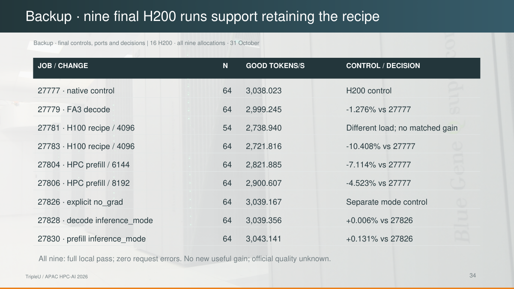

### Slide muốn nói gì

Giữ bằng chứng xác minh H200 cuối để trả lời câu hỏi. Phân biệt chín job scheduler với bốn can thiệp H100 khác nhau được port thêm, nêu đúng control của từng nhánh và giải thích vì sao không thay incumbent.

### Giải thích kết quả và lập luận

Dùng bảng nhật ký gọn với cột job, can thiệp/control, good output tokens/s và delta so với control H200 ghi rõ. Các dòng: 27777 control incumbent DeepGEMM/chunk-8192 mới 3038,022907; 27779 decode FA3 2999,245473 (−1,276404%); 27781 recipe H100 cả hai pha HPC-Ops/chunk-4096 ở N54 2738,940099; 27783 cùng recipe ở N64 2721,815800 (−10,408319% so với 27777); 27804 HPC-Ops chunk 6144 đạt 2821,884862 (−7,114431%); 27806 HPC-Ops chunk 8192 đạt 2900,606831 (−4,523207%); 27826 control phase no_grad rõ ràng 3039,167093; 27828 inference mode decode-only 3039,356215 (+0,006223%); 27830 inference mode prefill-only 3043,141258 (+0,130765%). Tách nhánh đối chiếu để không nhầm mẫu số phần trăm. Đơn vị: good output tokens/s. Chín allocation gồm control, nhánh tải khác và cấu hình đổi nhiều yếu tố; không phải chín ứng viên độc lập đều thắng.

### Thuật ngữ và ký hiệu cần hiểu

- **fresh control:** Mốc tham chiếu đo mới trên H200 mục tiêu; mỗi nhánh thí nghiệm có control phù hợp riêng.
- **four distinct ports:** Các job 27804, 27806, 27828 và 27830. Job 27826 là control phase-mode rõ ràng, không tính ứng viên.
- **N64:** Mục tiêu concurrency client 64 request đang bay; không phải số GPU.
- **1% gate:** Ngưỡng tăng hữu ích 1% do nhóm đặt trước, không phải ngưỡng chính thức của cuộc thi.

### Cách diễn giải số liệu hoặc sơ đồ

- Chín job là một đợt xác minh có giới hạn trên phần cứng đích, không phải chín sáng kiến độc lập hay chín ứng viên có chung mẫu số.
- Control incumbent mới 27777 đạt 3038,022907 good output tokens/s trên 16 H200 N64.
- FA3 27779 giảm 1,276404%; recipe đầy đủ rút từ H100 ở 27783 giảm 10,408319% so với control đó, nhưng job cặp N54 là 27781 ở tải khác, không dùng để cô lập tác động concurrency.
- Trong nhánh HPC-Ops, chunk 6144/8192 khôi phục một phần so với nhánh chunk 4096 nhưng vẫn thấp hơn incumbent 27777 lần lượt 7,114431%/4,523207%. So sánh với incumbent còn khác prefill runner và seed sinh tự động, nên không kết luận thuần chunk gây ra delta này.
- Control mode rõ ràng 27826 được so với decode-only 27828 và prefill-only 27830. Gain lần lượt +0,006223% và +0,130765%, đều thấp hơn ngưỡng 1% đặt trước.
- Cả chín run qua các cửa kiểm tra raw/runtime/output nội bộ đã lưu; smoke là 7/8, retrieval 12/12; quality toàn tập chính thức vẫn UNKNOWN.
- Quyết định: giữ prefill H200 DeepGEMM/chunk 8192 và decode HPC-Ops/FlashInfer/MNNVL N64. Các phép đo chưa chứng minh tối ưu toàn cục hay thứ hạng BTC.

### Đánh đổi và mức độ bằng chứng

- **Quan sát:** Chín allocation hoàn tất, không có lỗi/hủy request bị chấm. Ứng viên hoặc thấp hơn control H200 phù hợp hoặc dưới ngưỡng 1% đặt trước.
- **Giả thuyết:** Thử setting rút từ H100 trực tiếp trên H200 mục tiêu giúp loại chuyển giao có hại và đo mức tác động nhỏ trước khi đổi recipe.
- **Kết luận được hỗ trợ:** Không ứng viên nào thay được incumbent H200. Giữ prefill DeepGEMM/chunk 8192 cùng decode HPC-Ops/FlashInfer/MNNVL ở N64.
- **Chưa biết / giới hạn:** Đây là các port một lần chạy và xác minh nội bộ có giới hạn. Chưa xác lập độ tin cậy thống kê, quality chính thức hoặc tối ưu toàn cục.

### Lời nói mẫu

Phần phụ lục này trả lời có bao nhiêu job chuyển giao cuối tạo ra quyết định. Chín allocation hoàn tất trên 16 H200: tám lần ở N64 và một lần ở N54, nhưng gồm control và các nhánh can thiệp liên quan, không phải chín ứng viên khác nhau. Control incumbent mới đạt 3.038,02 good output tokens mỗi giây. FA3 giảm 1,28%; recipe H100 đầy đủ giảm 10,41%. Chunk HPC-Ops khôi phục một phần nhánh đó nhưng chunk 8192 vẫn thấp hơn incumbent 4,52%. Hai thay đổi inference-mode theo từng pha gần như ngang control riêng, tăng 0,006 và 0,131%. Cả hai không qua ngưỡng hữu ích 1% đặt trước. Vì vậy giữ recipe H200 dùng prefill DeepGEMM và decode HPC-Ops/FlashInfer/MNNVL. Các cửa nội bộ đạt, nhưng quality model toàn tập chính thức vẫn chưa biết.

### Điều không nên nói

Không gọi cả chín job là ứng viên riêng, không xếp hạng phần trăm có control khác nhau trong cùng một cột, không quy mức giảm cấu hình đổi runner/chunk cho một yếu tố và không nói quality chính thức đã đạt.

### Câu chuyển slide

Quay lại slide 16 để xem kết luận chính, hoặc mở slide 35 để xem phép kiểm dự báo held-out có giới hạn.
