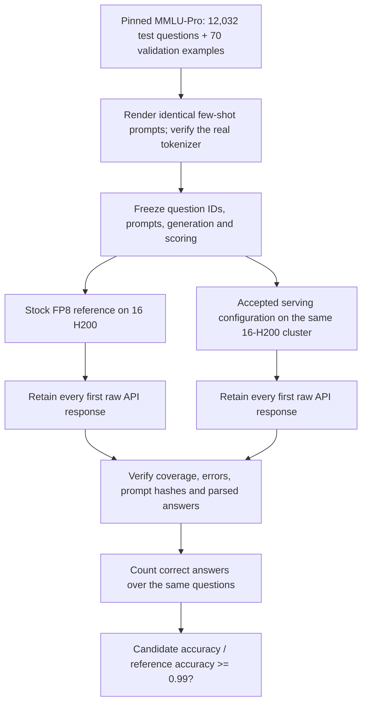

# How we test whether the optimised Qwen service preserves answer quality

Written 3 November 2026, Vietnam time (UTC+7). This explains work actually performed, including failures. It is not a reconstruction of an unpublished organiser evaluator.

## The question and the current answer

Our performance run already established that the submitted service works at the required load. It did not establish answer accuracy. This study asks a separate question: **does our serving configuration retain at least 99% of the accuracy of a stock deployment of the same official FP8 model?**

**The complete study now passes the local point gate:** reference **9,460/12,032 (78.623670%)**, candidate **9,452/12,032 (78.557181%)**, retention **99.915433%**. Both complete role results have zero service errors and every question is retained. [Final results](FULL_RESULTS.md) explain paired disagreements, per-category losses, independent raw-answer replay, all sixteen terminal job IDs and the limits of this finding. It is not an official BTC certificate.

The earlier first-two-shard result (100.124688% over 3,008 questions per role) is a historical progress snapshot. The separate 128-question pilot failed at 98.076923% and remains preserved. First-shard numbers later in this guide remain fixed worked examples; the complete result above supersedes prior statements that full-set quality was unmeasured.

## 1. Why a new test was necessary

The ranked performance client sends synthetic text and measures whether requests satisfy latency limits. It does not compare answers with correct subject-matter answers. A response can be fast and wrong. Therefore 3,051.518173 good output tokens/s in job 28197 is performance evidence, not accuracy evidence.

Keeping the checkpoint unchanged is necessary provenance, but it is not an empirical accuracy result. Tensor/expert layouts, arithmetic kernels, reduction order and batch shapes differ between deployments. Small numerical changes can alter a greedy choice and its subsequent answer. That is a possible explanation, not an identified cause of our observed differences.

We inspected the public competition repository at revision `b4df52907f5bbb9152ef6ae902c925fc79d54417`. Its [Q1 rule](https://github.com/hpcac/2026-APAC-HPC-AI/blob/b4df52907f5bbb9152ef6ae902c925fc79d54417/1.%20Qwen3%20AI%20Task%20Rules.md#q1-basic-vanilla) defines organiser-run checking against the organisers' unchanged official FP8 reference. The reviewed public material does not supply their complete executable quality recipe or numerical denominator. Our response was to measure a clearly labelled local regression check, rather than invent an official reference score. The [source-search report](../../../2026-APAC-HPC-AI/qwen-experiments/quality-evaluation-access-review-20261102/REPORT.md) records exactly what was inspected.

## 2. The experiment in one picture



The two deployments run sequentially on the shared cluster. The diagram means matched inputs, not simultaneous use of 32 GPUs. Hardware is **two H200 nodes, eight GPUs per node**. No H100 result or estimated H200 score enters this comparison.

## 3. What we compare, and what stays fixed

| Item | Stock reference | Our candidate |
|---|---|---|
| Checkpoint | `Qwen/Qwen3-235B-A22B-Instruct-2507-FP8` | Same shared checkpoint path |
| Weights / activation and KV | Published FP8 / BF16 runtime and KV | Same intended precision; no new quantisation |
| Hardware per job | 16 H200, two nodes | 16 H200, two nodes |
| Architecture | One colocated TP8/EP8 replica per node; two replicas | Two TP4/EP1 prefill workers on one node; TP8/EP8 decode on the other |
| Backend selection | Stock image defaults; no custom backend flags or NIXL patch | DeepGEMM prefill; HPC-Ops and FlashInfer decode; MNNVL; retained NIXL metadata patch |
| Serving context capacity | 8,192 tokens | 8,192 tokens |
| Full-study client load | At most 64 outstanding requests | At most 64 outstanding requests |
| Questions, prompts, generation, parser | Fixed common prepared corpus | Identical |

TP means tensor parallelism: a worker splits a model operation over that many GPUs. EP means expert parallelism: MoE experts are distributed over that many ranks. Prefill reads the prompt and builds its key/value cache; decode produces the answer one token at a time. Colocated means both phases run in the same replica. Our service separates the phases and transfers the cache.

This deliberately compares **complete serving implementations**. It cannot identify a quality change caused specifically by FlashInfer, the NIXL patch or one kernel. The same global client concurrency also gives different per-worker batch patterns in the two architectures. That is part of testing the actual deployment, not a controlled single-kernel ablation.

The candidate's model-worker files come from the accepted job 28197 payload. A derived driver substitutes the quality client for AIPerf. Worker/configuration/environment/placement/transport identities are retained. The model path is `/scratch/models/Qwen3-235B-A22B-Instruct-2507-FP8`. Metadata and tokenizer hashes are retained; the approximately 230 GB of weight shards are not reread solely for full hashing inside each 17-minute allocation. Names/sizes/metadata are not claimed to be a new complete weight-byte verification.

## 4. Where the questions and correct answers come from

We use [TIGER-Lab/MMLU-Pro](https://huggingface.co/datasets/TIGER-Lab/MMLU-Pro), pinned to dataset revision `b189ec765aa7ed75c8acfea42df31fdae71f97be`. It contains **12,032 test questions in 14 categories** and **70 validation examples**, five per category. Questions have multiple-choice options, up to A–J, and a stored correct answer. This is answer-quality testing; it is separate from AIPerf's synthetic performance workload.

We retained the raw dataset and the prompt-rendering source from the [benchmark's local evaluator](https://github.com/TIGER-AI-Lab/MMLU-Pro/blob/f418b116db00b065c2aea046518d8fcf74d39872/evaluate_from_local.py), pinned at commit `f418b116db00b065c2aea046518d8fcf74d39872`. “Upstream evaluator” here means the MMLU-Pro authors' evaluator, not the APAC organisers' hidden harness.

The validation questions and their reasoning/answers are demonstrations inside the few-shot prompt. The target test question's correct answer is retained only for local scoring and **is not sent to the model**. Both implementations receive the same target question, options, demonstrations and chat wrapper.

## 5. How we prepare prompts without dropping hard questions

Five-shot means showing five worked examples before asking the new question. We render the benchmark's source-order examples from the same subject category. The exact pinned Qwen chat template wraps that material as one user message, with the generation prompt enabled.

The source evaluator allows a 4,096-token sequence and reserves 2,048 tokens for the answer. Its input check is strict: prompt length must be **less than 2,048**, so the largest accepted prompt is 2,047 tokens. The serving worker's larger 8,192-token capacity does not change this chosen evaluation recipe.

For each target question we first try five examples. If the real tokenizer says it does not fit, we try four, then three, down to zero. We preserve the full target question and options. The result is prepared once and shared by both deployments; it is not chosen after seeing which answer is correct. If even zero-shot did not fit, preparation would block generation rather than truncate or drop the question.

Actual complete-corpus preparation gave:

| Demonstrations used | Test questions |
|---:|---:|
| 5 | 11,714 |
| 4 | 198 |
| 3 | 91 |
| 2 | 26 |
| 1 | 3 |
| Unfit, dropped or prompt-truncated | **0** |

Actual API usage was checked for all **24,064 response records** across the sixteen completed full-study jobs. Every reported prompt length matched the CPU-prepared length; none was missing. This checks lengths, not exact server-side input token IDs, which were not collected. The reproducible check and source-response hashes are in `monitoring/check_prompt_lengths.py` and `reviews/API_PROMPT_LENGTH_CHECK_FULL_24064.json`.

The native login Python lacked the tokenizer packages. We reused Python/Transformers from the organiser-supplied client image for CPU-only tokenisation. A real interface check exposed `BatchEncoding` instead of the expected token list; explicit `return_dict=False` plus shape checks fixed that before GPU admission. This was a preparation bug, not a quality loss. The resulting compiled corpus is frozen by SHA-256, including each question's prompt/token identities and shot count.

## 6. How a question is sent and answered

The client uses the OpenAI-compatible chat endpoint exposed by each service. It keeps at most N requests outstanding, submits another question as a slot frees, and records the first response. **N=16 for the pilot; N=64 for both full-study roles.** These are separate experiments; pilot responses are not mixed into the full-study score.

| Generation setting | Fixed value | Meaning |
|---|---|---|
| `temperature` | 0 | Greedy decoding rather than random sampling |
| `top_p` | 1 | No additional nucleus cutoff |
| `max_tokens` | 2,048 | Maximum answer allowance; not a forced output length |
| `stop` | `Question:` | Pinned benchmark stop string |
| `stream` | false | Retain one complete response body per request |
| Automatic retry | none | Do not replace a bad first response with a better retry |
| Request timeout | 120 seconds | A timed-out request cannot disappear from the denominator |

These are long reasoning answers, not the ranked performance recipe's fixed 200-token outputs. The full-study allocation is 1,020 seconds. The evaluation deadline is job-start +950 seconds with a ten-second client safety margin, leaving room for cleanup. Startup time is included in the allocation, not in each question's answer-generation time.

The pilot's question selection retains seed 2026. The full study uses prepared row index modulo eight, not a random draw. No API sampling seed is sent, and equality of engine RNG seeds across launches was not established. Greedy decoding is not a promise of identical strings across kernels, layouts or batch patterns.

## 7. How free-form reasoning becomes a scored answer

The model may produce a paragraph of reasoning and then a letter. We retain its raw API JSON and text, then apply the pinned source parser order:

1. First look for `answer is` followed by an optional opening parenthesis and an A–J letter.
2. Otherwise use the source `Answer:` pattern.
3. Otherwise use the last standalone A–J letter.
4. If no answer is parsed, count it as wrong. The source evaluator's random-guess fallback is deliberately disabled and disclosed.

The parsed letter equals the stored target letter only for a correct answer. A raw-body replay independently checks that the retained prediction and finish reason match what the server actually returned. The permissive last-letter fallback is a known local-protocol limitation; it is shared by both roles, not silently changed to improve our candidate.

An HTTP/client error is wrong and remains in the fixed denominator. An unparsed answer is also wrong but is **not an HTTP service error**. An answer stopped at `max_tokens` remains scored: it may still contain a correct extractable letter. We report length-capped and unparsed counts rather than remove those questions.

## 8. What “at least 99%” actually means

Let Q be the same fixed number of questions, R the reference's number correct, and C the candidate's number correct.

```text
Reference accuracy = R / Q                  [fraction, or multiply by 100 for %]
Candidate accuracy = C / Q                  [fraction]
Quality retention  = (C / Q) / (R / Q)
                   = C / R                 [unitless ratio]
Local point gate   = C / R >= 0.99
```

It does **not** require 99% of all questions to be correct. For the first full-study shard, R=1,200; the candidate would need at least 1,188 correct to meet the 0.99 point threshold. We measured 1,205.

```text
Reference: 1,200 / 1,504 = 79.787234%
Candidate: 1,205 / 1,504 = 80.119681%
Retention: 1,205 / 1,200 = 1.00416667 = 100.416667%
Accuracy difference: +0.332447 percentage points
```

Percentage points compare the two accuracies directly. Retention is their relative ratio. They are different quantities. A fixed-benchmark point gate also does not supply a statistical confidence guarantee about all possible questions or repeated deployments.

## 9. Why the pilot failed and why the complete study continues

| Run | Actual outcome | What we learned and decided |
|---|---|---|
| 28367, first reference | Failed before inference | TP8/EP1 FP8 expert geometry was incompatible; no accuracy score exists |
| 28368, candidate pilot | 102/128 correct, no request errors | The candidate API/scorer worked; a paired reference was still needed |
| 28371, corrected stock reference | 104/128 correct, no request errors | EP8 loads natively; pilot ratio 102/104=98.076923%, below 99% |
| 28373, first full reference shard | 1,200/1,504, no request errors | N64 long-answer shard fits the allocation |
| 28375, first full candidate shard | 1,205/1,504, no request errors | Same-shard point ratio 100.416667%; full study still required |

The first reference tried splitting a 1,536-wide expert intermediate across TP8: 1,536/8=192, which is not divisible by the FP8 block width 128. EP8 preserves a compatible expert layout. We changed that deployment parameter in a new reference bundle, preserving the original failure. We did not change model weights, target answers or the scorer to make the comparison pass.

The 128-question pilot is a small category-balanced sample, while a full-study shard follows the fixed complete-corpus ordering. It is possible for these subsets to give different point ratios. The correct response is to keep both outcomes and complete the already fixed test set. Neither picking the favorable shard nor declaring full-set failure from two lost pilot answers is justified.

In the first full shard, 1,148 questions were correct on both roles; 247 were wrong on both; 52 were correct only on the reference and 57 only on the candidate. The net is five more correct for the candidate. This is useful paired evidence, not proof of which implementation difference caused those changes.

## 10. How the complete test is divided and combined

We enumerate the prepared 12,032 rows in their fixed file order. Row i belongs to shard `i % 8`. There are eight shards per role, each containing exactly 1,504 unique IDs. Reference and candidate membership match for every shard. Within one role, the shards have no overlap and their union is the full test set.

We first ran one shard per role at N64 to verify runtime, complete coverage and error-free service. It was an infrastructure feasibility gate, not an accuracy-win gate. After that review, the other 14 fixed allocations became eligible. Each allocation requests two nodes /16 H200 /17 minutes maximum. The full stage is bounded by 16 allocations and 72.533333 GPU-hours, with no H100/PBS SU. At most five of our jobs are queued/running at once.

The finite Slurm wrapper runs the frozen driver, waits for its cleanup, then validates its one shard and may submit the next fixed shard when queue capacity permits. It does not launch Codex, select new hypotheses, retry failures, authenticate, send messages or run a recurring watcher. Invalid/missing evidence, scored service errors or an ambiguous submission stop further dispatch. A low quality score is retained as a result, not reclassified as an infrastructure error.

Once all sixteen valid events exist, the aggregator checks exact coverage and replays raw responses. It sums correct counts across the full set, then computes C/R. **It does not average the eight shard ratios.** The output is `workflow/FULL_COMPARISON.json`; a complete local FAIL is as legitimate a measured outcome as a PASS.

## 11. What we inspected beyond the accuracy percentage

The examples below retain the first pair at its original review time. The final sixteen-job review is in [FULL_RESULTS.md](FULL_RESULTS.md): all jobs completed, no scored service errors, 47.32 H200 GPU-hours for the full test and 51.533333 including pilots. Per-run tails, invalid outputs, length caps, logs and missing hardware telemetry are preserved there.

For the first full pair, both native top-level Slurm jobs are `COMPLETED 0:0`. Reference allocation time was 620 seconds; candidate allocation time was 739 seconds. Actual cost is `(620 + 739) ×16 /3600 = 6.04 H200 GPU-hours`. Together with all pilot allocations, including the failed startup, completed stage cost was 10.253333 GPU-hours at that review. Do not add worker-step times again: those steps share the same GPU allocation.

| Evidence | Reference 28373 | Candidate 28375 |
|---|---:|---:|
| Complete scored responses | 1,504 | 1,504 |
| Scored service errors | 0 | 0 |
| Unparsed answers | 13 | 10 |
| Answers ending at the length cap | 187 | 188 |
| Actual top-level completion | `0:0` | `0:0` |

We inspected the worker/router logs, model/backend provenance, readiness, semantic receipts, client completion, raw response parsing, errors/finish reasons and accounting. The candidate had one transient 503 during startup warmup, then both P/D paths passed. That startup request is outside the fixed scored question set; none of the 1,504 scored requests failed. Intentionally cancelled serving-worker steps are cleanup evidence, not automatically failed top-level measurements.

Hardware GPU utilisation, power, memory bandwidth and CPU sampling were **not collected** in this quality-only derivative. They are not assumed zero or healthy. These runs cannot establish a hardware bottleneck or isolate a kernel's contribution. [The first-pair review](../../../2026-APAC-HPC-AI/qwen-experiments/quality-verification-20261102/reviews/FIRST_FULL_PAIR.md) links the actual raw evidence and limits.

## 12. What is preserved and what a future reader can reproduce

The [study source](../../../2026-APAC-HPC-AI/qwen-experiments/quality-verification-20261102) contains the corpus builders, pinned-source identities, prepared manifest, compiled prompts, quality client, scoring/aggregation code, 16 frozen bundles, submission receipts, accounting and raw evaluation artifacts. Per-question records preserve question/category, expected and parsed answer, prompt/token hashes, shots, response text/raw body, HTTP status, latency in seconds, output usage and finish reason.

The original 310-file full-study payload manifest stays unchanged. Later monitoring/docs are separate artifacts. Two bytecode files are explicitly required by each immutable candidate checksum list; sixteen exact files across eight bundles are retained in the reviewed `workflow/required-bytecode.tar` with an allowlisted restore/check helper. General runtime caches and private container homes are excluded.

The Git archive keeps small reviewed files and hashes/manifests for large objects. A Git push alone does not upload the sibling external object bytes. Read [MATERIALS.md](MATERIALS.md) for actual capture and off-host evidence coverage, rather than assuming a GitHub clone alone contains every raw response. Model tensor weights, private runtime/authentication state and cluster scheduler availability are outside this recovery claim.

Some immutable inherited `environment.json` files still say `accuracy_check: NOT_RUN`: that is their historical pre-study packaging metadata, retained because the worker payload was frozen. New `evaluation/`, reviewed result records and the full aggregate establish what was measured later. Do not edit an old frozen file to make its timestamp look current.

## What the presenter can safely say

“We separated service speed from answer quality. We fixed a public benchmark and tested the same 12,032 questions with a stock FP8 reference and our optimised service on the same 16 H200 GPUs. The reference answered 9,460 correctly and our service 9,452, retaining 99.9154% of reference accuracy. This passes our local 99% threshold. Every first response, the failed pilot and all losing shards are preserved. The organisers' own quality decision remains separate.”

If asked “why do you know the weights being unchanged means PASS?”, answer: **we do not infer PASS from that fact. We use it as a control and measure the actual answers.**

## Technical identity appendix

These are retained source/image contracts, not a claim that every package or 26 GB image was freshly rehashed in each allocation. Per-run provenance and worker logs are the authority for what was invoked.

| Identity | Recorded value |
|---|---|
| Serving image | `/scratch/enroot-images/sglang-harbor.sqsh` |
| SGLang / router / NIXL | 0.5.17 / 0.3.2 / 1.3.2 |
| Quality client image | Supplied `/scratch/enroot-images/aiperf.sqsh`; the quality client itself is custom, not AIPerf scoring |
| Client Transformers / tokenizers | 5.14.1 / 0.22.2 |
| Tokenizer source revision | `ac9c66cc9b46af7306746a9250f23d47083d689e` |
| Compiled corpus SHA-256 | `6f80e430896a0aa12658678887676dbefae71460b6e8ea326f9bfc10ec1e0db9` |
| Prepared manifest SHA-256 | `bdd30112c2f4afb33eb77837b56e6cbd19f438256378726842a2a41bca8dc76a` |
| Frozen client SHA-256 | `993a3719558611298e2f25b5cc52d23826583bf54eab14628c538cc6e21fdca0` |

Full model/image/tokenizer contracts and patch identities remain in the frozen bundles and per-run provenance. The implementation evidence is separate from the presenter explanation above.
