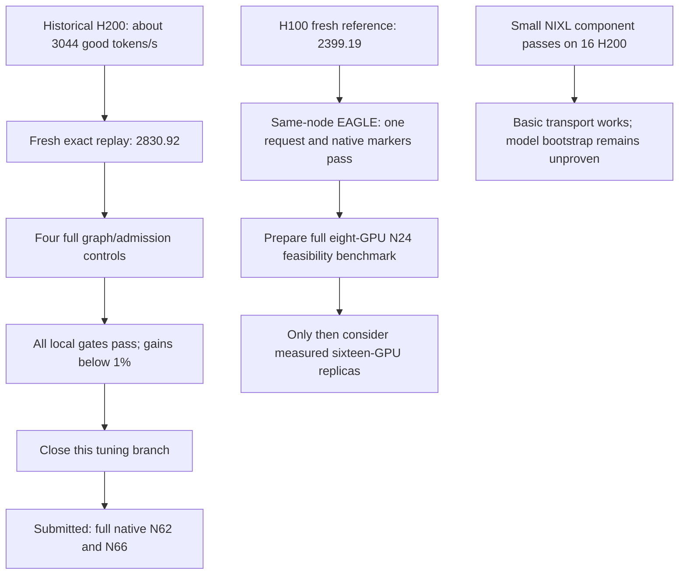

# Why the latest experiments changed direction

This is a learning and presentation supplement recorded on 26 October. The linked results are dated observations, not live scheduler state.

The old H200 configuration reached about 3,044 good output tokens per second in three retained runs. Replaying its actual operational files now produced 2,830.92. That reproduces the deployment and local checks, but does not reproduce the old speed. We keep both observations. Choosing only the old favorable runs would hide the uncertainty.

We then separated two settings that had drifted in newer experiments. A prefill CUDA graph reuses a prepared GPU execution path for reading prompts. The admission cap limits how many requests the prefill server can hold at once. We measured all four combinations with the same full workload, so a comparison can hold one setting fixed while changing the other.

| Prefill setting | Cap 64 | Native admission |
|---|---:|---:|
| Graph disabled | 2,807.33 | 2,802.50 |
| Graph enabled | 2,829.60 | 2,828.00 |

Values are good output tokens per second. Every arm passed the local latency and output checks. Enabling the graph helped by roughly 0.79–0.91%; changing admission barely helped. Our declared threshold was more than 1%, so we closed this tuning branch. One run per cell cannot prove a small causal effect or explain the entire gap to the old 3,044 result.

The next H200 experiment changes client concurrency: N62 and N66 around the full N64 control. N means requests in flight in the closed-loop client. When one finishes, the client starts another. More concurrency can keep the decoder busier, but can also increase waiting time. It is different from changing the number of GPUs or the number of model replicas. Jobs 26436 and 26438 are submitted; no measured result is claimed here.

On H100, the new full reference is 2,399.19 good output tokens/s with 98.02% of requests meeting both latency limits. It is 0.35% below its older control. We also verified one EAGLE request on a same-node P4/D4 layout: four GPUs read the prompt, four generate the answer. EAGLE drafts proposed tokens and the target model verifies them; this functional test does not establish throughput or official accuracy. The corrected observer now watches the native equal-TP transfer method, rather than incorrectly requiring a different method used with unequal TP.

The next H100 question is whether one eight-GPU EAGLE unit can sustain the full workload at N24. Two such units could be a future 16-GPU layout, but their combined performance must be measured. A single-unit score multiplied by two is an estimate, not a result. The full-set accuracy requirement remains unverified.

For presentation, explain the transition as a series of questions answered by evidence. We recovered the old configuration, isolated runtime drift, closed changes too small to justify confirmation, and opened a different architecture test after its functional prerequisites passed. We did not find or prove a global optimum.

Sources: [full H200 study](/home/apacsc42/2026-APAC-HPC-AI/qwen-experiments/h200-factorial-review-20261026/REVIEW.md), [H100 raw review](/home/apacsc42/2026-APAC-HPC-AI/qwen-experiments/h100-review-225227-225228-20261026/REVIEW.md), [score-window resource interpretation](/home/apacsc42/2026-APAC-HPC-AI/qwen-experiments/h100-score-window-225227-20261026/REVIEW.md), [small transport boundary](/home/apacsc42/2026-APAC-HPC-AI/qwen-experiments/research-review-26337-20261026/REVIEW.md).
