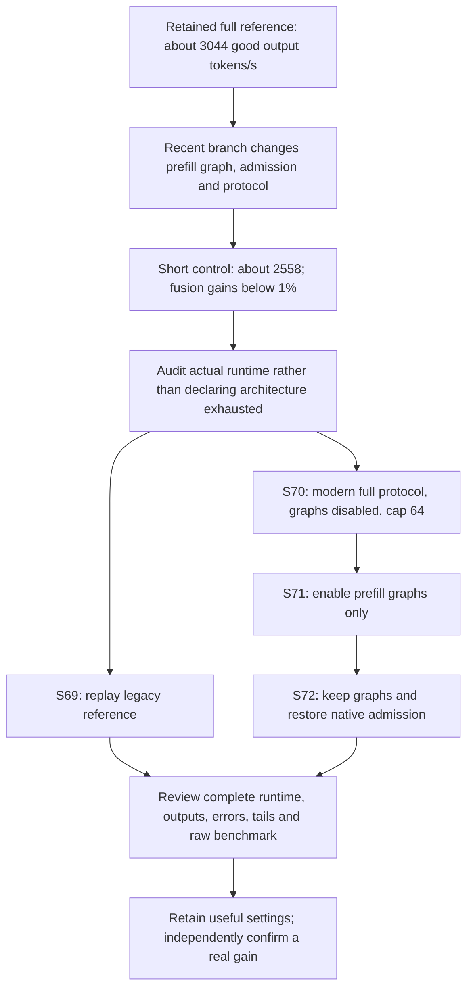

# Why an older run reached 3k while recent screens reached 2.56k

*Retrospective learning supplement written 26 October 2026. New recovery jobs are not measured yet.*

The useful result is still the retained full N64 reference: three runs scored 3044.49, 3044.07 and3044.64 good output tokens/s, averaging 3044.400475. We did not establish that the current architecture is exhausted. We found that newer experiments drifted away from that reference while investigating EAGLE and correctness. Their lower scores therefore do not by themselves show that the earlier result disappeared.

## What changed

| Setting | Retained full reference 25487 | Recent control 26083 | Why the difference matters |
|---|---|---|---|
| AIPerf warmup/measurement/grace | 60/120/30 seconds | 20/40/30 seconds | A short screen has a different transient/tail contribution; it cannot replace a full score |
| Prefill CUDA graph | Breakable, actual graph use logged | Disabled, actual graph use logged | Captured GPU operations can replay with fewer CPU launches; benefit must be measured |
| Maximum running requests per prefill worker | Native setting (None) | Explicit 64 | Controls server admission, not the client's N64 request concurrency |
| Model activation dtype argument | Auto | Explicit BF16 | The old actual KV was BF16; auto is a choice rule, not proof of different arithmetic |
| NIXL wrapper/harness | Legacy source | Added native geometry observations and stricter gates | Additional changes remain when comparing old and new harnesses |

A **CUDA graph** records a sequence of GPU operations for repeated execution. Preparing it can take time during startup. Replaying it may reduce repeated launch work while serving requests. Startup cost and serving speed are different metrics: a faster startup does not imply better goodput, and disabling a graph to simplify one experiment should not silently redefine the strongest baseline.

**Prefill** processes the input prompt; **decode** repeatedly produces output tokens. Prefill graph settings and decode graph settings are separate. The recent experiments kept decode graphs but disabled prefill graphs. Saying only “CUDA graph is enabled” hides that distinction.

**Client concurrency N64** means the benchmark maintains up to 64 simultaneous request slots. **Server max_running_requests 64** limits admission inside each worker; it is not the same knob. None means the native configuration/capacity logic decides; it does not mean infinite GPU memory.

## What the evidence actually proves

The real 25487 prefill logs show 932 cuda graph: True batch records inside the observed first-to-last profiling-request start span. The real 26083 logs show 306 False records. Those counts are sparse logged batches, not every kernel call or request, and the durations differ. They prove the two deployments actually used different graph paths; they do not quantify a graph speedup.

The first explanation in chat emphasized short versus full benchmark timing. The later source/log comparison found the graph and admission differences too. The current explanation includes those corrections. We should not select a convenient cause until a controlled comparison tests it.

## What each new job answers

26313 (S69) checks whether the exact legacy operational deployment still reproduces. 26315 (S70) measures the recent control with the full protocol. 26317 (S71) changes only prefill graph relative to S70. 26319 (S72) changes only admission relative to S71. A matched result can identify a useful intervention; comparison across harnesses still includes other differences. No new job is a score until it actually produces and passes the required evidence.

If the old reference reproduces, it stays available while we study improvements. If it does not, investigate actual runtime, workload and resource evidence before claiming a loss or changing the benchmark. A new independent run checks reproducibility; it is not an invitation to keep rerunning until a favorable number appears.

## The separate NIXL failure

Component 26308 failed at the strict source-identity gate because our script omitted its required patched-source mount. All 16 processes started on distinct H200 GPUs, but no NIXL agent or transfer was created. That failure teaches a packaging lesson; it says nothing about network speed. The derived 26337 adds the missing mount, keeps all hashes and byte checks, and has one bounded attempt. Its small direct-memory component cannot prove the whole Qwen P/D serving topology works.

## A short presenter explanation

“Our earlier 3k result was reproduced on the full benchmark. Later experiments changed the control while testing another technique, including disabling prefill CUDA graphs. The lower recent scores are not directly comparable. We audited actual runtime and prepared full controlled tests to isolate graph and admission effects. We retain the old reference, preserve failed branches, and require complete output/latency checks plus independent confirmation before announcing a new improvement.”

Sources: [full correction and results](/home/apacsc42/2026-APAC-HPC-AI/qwen-experiments/research-review-26083-26091-20261026/REVIEW.md), [actual graph-use audit](/home/apacsc42/2026-APAC-HPC-AI/qwen-experiments/incumbent-graph-evidence-20261026/README.md), [controlled full study](/home/apacsc42/2026-APAC-HPC-AI/qwen-experiments/h200-incumbent-recovery-20261026/PLAN.md), [definite full job receipts](/home/apacsc42/2026-APAC-HPC-AI/qwen-experiments/h200-incumbent-recovery-20261026/submission-receipts.json), [NIXL prerequisite failure](/home/apacsc42/2026-APAC-HPC-AI/qwen-experiments/research-review-26308-20261026/REVIEW.md).
