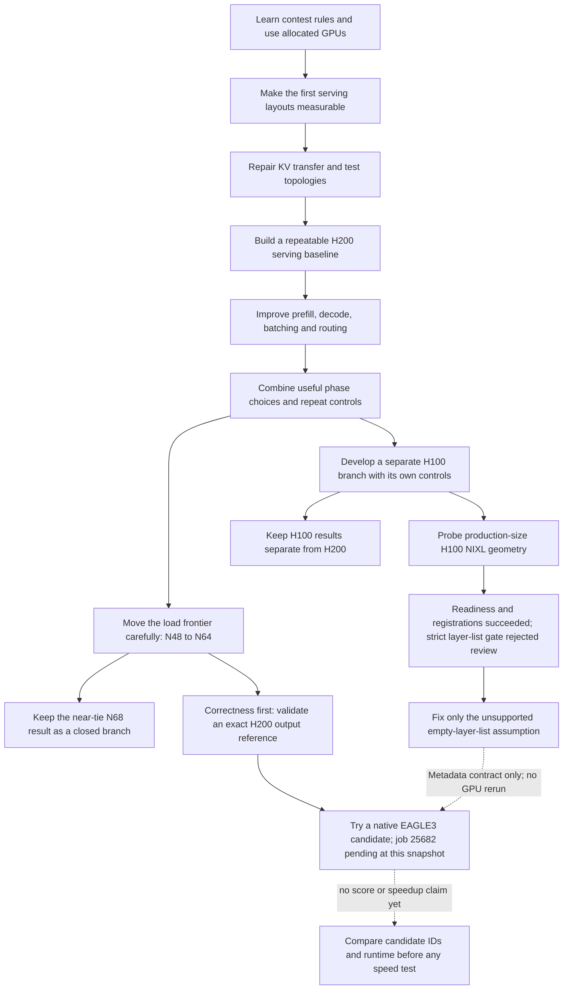

# How the Qwen research got here

*A beginner-friendly, source-linked account of the AI track, through 23 October 2026.*

This is a guide to the reasoning, not a list of folders or every job. It explains why the experiments changed, what they taught us, and what is still unknown. The older [32-stage journal](../research-journey-20261019/journal/JOURNEY.md) and its [individual job index](../research-journey-20261019/journal/JOBS.md) contain the full retained history through 19 October and link the individual records. The sources linked here extend that story through 23 October. Start with the [glossary](GLOSSARY.md) when a term is unfamiliar, then use the [speaker notes](SPEAKER_NOTES.md) to practice explaining the decisions. Not every old conversation or discarded edit can be reconstructed; where evidence is thin, this account says so.

## The route, in one picture

A path marked failed or pending is part of the research history, not an established optimization. H100 and H200 are separate measurement branches because the hardware, scheduler and system differ.

## 1. First learn what the contest measures

The AI track is a serving problem: each official request uses fixed input/output length settings of 4,000/200 tokens, with zero standard deviation. A test request is **good** only when its first token arrives within 3,000 milliseconds and its average time between generated tokens is at most 20 milliseconds. At least 90% of all requests must satisfy both limits; errors stay in the denominator.

The official AIPerf measurement uses a closed loop at a chosen concurrency. A completed request frees a slot for the next one; the benchmark does not send requests at a preset rate. The organizer clarified that the ranking's “good output tokens per second” is **Goodput in requests per second × 200**. This fixed multiplier changes the unit, not the ranking. Goodput measures qualifying serving performance; the separate accuracy evaluation checks answers. Passing one does not prove the other. Raw output throughput is not the score. For a units example, 15 qualifying requests/s × 200 gives 3,000 good output tokens/s; this example is not another measured run.

The work also begins with an infrastructure lesson. A GPU cluster login node is not the GPU itself: Slurm or PBS grants a scheduled allocation on compute nodes. A job script, its logs and persistent shared files matter because the process ends when its allocation ends. The AI experiments used Slurm on H200 and PBS on H100. This separation later becomes essential for fair comparisons.

**Why this shaped the research:** Every candidate needed to be judged by the same workload and joint latency gate, while keeping output-quality checks and the contest's at-least-99%-of-reference accuracy threshold separate. The 99% accuracy result is still unverified. [Official metric clarification](../../notes/official-goodput-clarification-20261020.md) · [Rules and first stages](../research-journey-20261019/journal/JOURNEY.md#1-establish-the-rules-and-the-actual-objective)

## 2. Make the serving system measurable before tuning it

A “configuration” here is not just a model setting. It is a runnable serving package: how many GPUs serve prefill and decode, how tensor operations and model experts are distributed across GPUs, the request concurrency, runtime flags, router behavior, graph shapes, and the exact client protocol. A change to any of these can alter latency and throughput. The early topology sweep produced several useful measurements, but many jobs failed before measuring anything; a scheduler state of `COMPLETED` did not mean a benchmark had completed correctly.

A major early systems problem was moving the **KV cache** between prefill and decode. Prefill reads the prompt and builds the key/value tensors that summarize it; decode uses those cached tensors to produce the next tokens. **NIXL** is the transfer layer used to move those buffers between GPU workers. Initial layouts exposed descriptor overhead, startup timeouts and incompatible tensor-parallel shapes. Some branches failed on FP8 shard constraints or remote-transfer errors. Those failures were preserved as failures; CPU buffer-geometry tests alone could not prove the actual GPU transfer worked.

The project then narrowed to a repeatable design: multiple TP4 prefill workers and TP8/EP8 decode workers. **Tensor parallelism (TP)** splits each layer's work across GPUs; **expert parallelism (EP)** distributes the model's experts. This layout gave a stable baseline from which one could change a factor at a time. The 16-GPU split and every replacement were recorded so that an unmeasured topology did not quietly become a “zero score.” [Topology and NIXL history](../research-journey-20261019/journal/JOURNEY.md#4-expand-the-topology-search-and-correct-the-stopping-condition) · [NIXL request-scoped change](../../../2026-APAC-HPC-AI/qwen-experiments/nixl-ondemand/README.md)

## 3. Improve prefill and decode as different phases

A large model has two different kinds of work. **Prefill** processes the full prompt; its cost strongly affects time to first token. **Decode** repeatedly generates one token at a time; its speed affects inter-token latency. An optimization can help one phase and hurt the other, so “faster model” is too vague without a controlled full-service comparison.

The team first tested dense CUDA graphs for decode batches and prompt chunk sizes for prefill. CUDA graphs capture repeated GPU operations so the runtime can replay them with less CPU launch overhead. Across that early progression, the operating point moved from roughly 1,912 at N48 to 2,079 at N52 good output tokens/s. That changes both configuration and load; it is a historical milestone comparison, not the isolated effect of graphs or chunking. Component conclusions come from each experiment’s matched controls. Later, profiling suggested testing the collective and attention paths. A collective combines partial results across GPUs; the fused MNNVL path improved decode behavior, while FlashInfer changed decode attention execution. On the H100 branch, phase-specific HPC-Ops trials also helped decode, while some prefill alternatives lost.

The results did not add like independent coupons: a prefill chunk that helped an old runner could be neutral on a new one, and lower decode ITL could come with higher TTFT. An important combined H200 point reached 2,938.628 at concurrency 58, then independent repeats landed at 2,935.879 and 2,937.148 good output tokens/s. At concurrency 60, one point reached 2,990.151. These measurements justified extending the load search, but none proved that higher concurrency would keep helping.

The workload and cache handling were also corrected during the project. Early cache-aware results and the current cold-prefix workload are not one normalized performance curve; historical numbers must retain their original protocol.

Some tempting branches were closed. Forced collective settings lost controlled screens; disabling a useful launch feature regressed; H100's tested dense FlashInfer prefill was slower than its control. These results are valuable because they tell us which ideas to stop repeating under the same conditions. [Matched H200 results and phase tradeoffs](../research-journey-20261019/journal/entries/20261020-serving-and-collective.md) · [Earlier 32-stage explanations](../research-journey-20261019/journal/JOURNEY.md#9-test-dense-decode-graphs-chunk-size-and-standalone-controls)

## 4. Increase load only when the full benchmark supports it

Concurrency **N** is how many requests are in flight at once. More requests can keep the GPUs busier, until queues make requests miss the TTFT or ITL limits. The serving engine also captures decode graphs for batch sizes 1 through 64; that graph range is not the same thing as the benchmark concurrency or the batch size at every instant.

A short screening run favored H200 N64 over N62, so the team ran full-duration, matched tests. The first full pair scored 3,044.490 at N64 versus 3,011.875 at N62, a 1.083% gain. N64 then independently repeated at 3,044.075, and a later fresh full N64 scored 3,044.637. The three-run N64 mean is **3,044.400 good output tokens/s**. In the latest control, 98.632% of requests met both latency limits; there were no request errors or cancellations, and all 12 long retrieval checks passed. These are local benchmark gates, not official accuracy results.

A full N68 candidate scored 3,047.166, only 0.083% above a fresh N64 control, while its joint pass fraction and TTFT were worse. The predeclared useful-gain threshold was 1%, so repeating unchanged N68 was closed. The slightly higher single number is a real observation, but it is not enough evidence to replace the replicated N64 choice. The H100 branch's local best, 2,433.020 at N54, remains a separate hardware result; it should not be plotted as though it were another H200 trial.

The latest same-protocol comparison can be explained directly:

| Full run | Load | Good output tokens/s | Joint latency pass | Mean TTFT (ms) | Decision |
|---|---:|---:|---:|---:|---|
| 25487 | N64 | 3,044.637 | 98.632% | 1,113.595 | Retain the reproduced choice |
| 25488 | N68 | 3,047.166 | 98.430% | 1,347.105 | Close unchanged replication |

This is a useful presentation example: a tiny throughput increase accompanies about a 21% rise in mean first-token delay. It does not establish a causal queueing bottleneck, but it explains why the largest single number is not our chosen operating point.

These current figures also explain why tail and request-level data matter. In the inspected H200 N64 tests, the requests that failed the joint SLA breached TTFT, not ITL; mean values alone would hide those misses. A benchmark can complete with zero errors and still have a fraction of requests that are too slow. [Full N64 review](../../../2026-APAC-HPC-AI/qwen-experiments/research-review-25487-25488-20261023/REVIEW.md) · [Matched N62/N64 and first repeat](../../../2026-APAC-HPC-AI/qwen-experiments/research-review-25366-20261022/REVIEW.md) · [H100/H200 distinction and history](../../notes/AI_CURRENT.md)

## 5. Verify correctness before calling EAGLE3 an optimization

EAGLE3 is speculative decoding: a smaller draft model proposes future tokens, then the main model verifies them. It can reduce decoding work if proposals are accepted, but it adds another model and more coordination. A server starting successfully is not proof that it returns the same answer as ordinary decoding, and a faster speculative run is not useful if its output changes incorrectly.

The H100 work first tested pieces of the NIXL path, then tried a full disaggregated run that failed on a remote transfer disconnect. Small-buffer registration success did not prove a full model's KV transfer. A later H100 geometry probe reached HTTP 200 readiness on four H100 GPUs, verified its target, draft and graph-source checks, and recorded eight before/after receipts: two for each of four ranks, covering 190 KV regions per rank. The independent checker rejected the run because it required a non-empty list of layer IDs. That was an overstrict validation rule: each rank supplied 190 stable KV regions, one local and four total KV heads, and page size one, while the runtime supplied an empty layer-ID list. Therefore this job is **not an accepted geometry review**, even though the server and native registrations reached readiness. The new candidate-local correction is narrowly scoped to allow this source-backed empty list only at the observed 190-region/head/page shape; it must not invent layer identities or semantic ordering. No EAGLE3 speedup follows from this probe.

In parallel, a repaired H200 target-only reference job 25585 completed with eight responses and 1,600 actual generated token IDs. Four exact repeated greedy pairs matched, and independent runtime and prefill/decode receipts passed. This supplies a trustworthy output reference for the next experiment. H200 EAGLE3 candidate 25682 was then submitted as a correctness-only diagnostic: it must match those reference IDs and pass runtime/receipt gates before any performance comparison. It was pending resources in the latest retained status. It has no scored benchmark result yet.

A later source check teaches another useful lesson. The library temporarily divides the 190-address target-plus-draft list into two 95-entry halves, which looks as if a target value buffer has entered the key group. But in our PP=1 configuration those complete halves are immediately recombined in the original order. The exact native builders, selector and frozen request-plan method preserve independent CPU labels in 16 cases. We therefore found no source-proven ordering bug and did not patch the transport. Real RDMA bytes and model outputs remain unverified: code inspection is not a transfer test. [Source review and actual CPU evidence](../../../2026-APAC-HPC-AI/qwen-experiments/eagle_kv_layout_review-20261023/REPORT.md).

This order matters: first establish a reference, then establish candidate output equivalence, then compare speed under a matched load. Neither EAGLE3 speedup nor the contest's official accuracy threshold can be claimed today. [Accepted H200 reference](../../../2026-APAC-HPC-AI/qwen-experiments/research-review-25585-20261023/REVIEW.md) · [Candidate receipt and pending state](../../../2026-APAC-HPC-AI/qwen-experiments/eagle3-h200-candidate-20261023/slurm-receipt.json) · [H100 original failure and new metadata assessment](../../../2026-APAC-HPC-AI/qwen-experiments/research-review-223788-20261023/REVIEW.md)

## 6. What can be presented honestly, and what comes next

The defensible story is a controlled systems-research journey: fix the measurement, establish a serving baseline, learn from transport and startup failures, improve different serving phases, repeat meaningful gains, stop near-ties, and require correctness before proposing speculative decoding. The strongest reproduced local H200 point is N64 at about 3,044.4 good output tokens/s under the stated local protocol. The separately measured H100 incumbent is about 2,433.0 on H100. Those numbers are platform-specific local results.

Do **not** present either as an official contest rank, call N68 a meaningful win, claim that EAGLE3 is faster, say that all requests pass, or say the 99%-of-reference accuracy bar was proven. The retained performance exports also do not preserve the generated token IDs for every request; output checks and official accuracy are not interchangeable.

The next decisions are bounded by evidence. The H100 terminal review preserves the failed original gate and replays its captured metadata under a source-backed, narrow corrected contract; no duplicate GPU startup is needed just to change that validation assumption. Review H200 job 25682 for exact output-ID equality and runtime acceptance. Only after that should EAGLE3 receive a matched short load comparison and, if it clears the gate, a full benchmark. Keep H100 and H200 plots separate and compare candidates only against controls on the same hardware and protocol.

For more detail, continue at the [research journal](../research-journey-20261019/journal/README.md), its [coverage audit](../research-journey-20261019/journal/AUDIT.md), and the live dated [AI handoff](../../notes/AI_CURRENT.md). The journal is intentionally more exhaustive than this beginner narrative. After the next completed milestone, add its concept, question, controlled change, result, lesson and next decision using the [learning entry guide](HOW_TO_UPDATE.md).

### Checking data movement before another full model run

A memory registration describes which address ranges the transfer engine can use. A correct registration and a correct pointer formula still do not prove that the data arrived. Our next bounded pilot allocates the observed 14.47 GB of KV spans per GPU on two H100 hosts without model weights, then transfers 97,280 selected KV bytes and checks the surrounding untouched memory on GPU. Large registered capacity and transferred payload size are different quantities. Ten auxiliary spans are tested as whole diagnostic items; their native per-request layout remains unknown.

During preparation we caught a flawed baseline: both endpoints were initially filled with source patterns. That could hide a missing auxiliary write and would make the untouched-memory check fail. Only the sender is now patterned. CPU checks accept the intended mapping and reject the contaminated receiver; GPU transport remains unverified at this preparation checkpoint. [Question, correction, cost and limits](../research-journey-20261019/journal/entries/20261023-full-span-transfer-preparation.md).

### What the full-size transfer actually proved

The first GPU run, 224116, passed the independent byte checks: 380 selected pages were correct, every other registered destination byte was checked on GPU, and the source stayed intact. This narrows the gap left by earlier 1 KiB test buffers. It does not mean 14.47 GB crossed the network: that is the registered capacity per GPU; the selected KV payload was 97,280 bytes.

The overall PBS job still failed with exit 1. A data check can succeed while cleanup, process teardown or scheduler staging fails. We retain both outcomes and will add durable exit receipts to isolate the failure before a full-model repair. There is no new goodput score or EAGLE speedup from this diagnostic. [Evidence and learning point](../research-journey-20261019/journal/entries/20261023-full-span-transfer-result.md).

### Completing the calculation and finishing the program

The native byte check is a calculation inside a program. After the calculation ends, the program still tears down its transport, the container exits and PBS stages output. A success message inside the calculation does not prove those later layers succeeded. The next derived diagnostic records each exit independently while preserving the tested transfer algorithm. Its CPU fixtures distinguish clean exits, errors, missing records and timeouts. GPU execution is still pending at this preparation checkpoint. [Controlled exit-boundary hypothesis](../research-journey-20261019/journal/entries/20261023-exit-boundary-preparation.md).

### Separate a prerequisite from the optimization itself

Our native EAGLE setup currently disables prefill CUDA graphs to initialize reliably. CUDA graphs can reduce repeated GPU launch overhead, while capture costs setup time and memory. If ordinary serving keeps graphs and EAGLE disables them, a comparison changes two things at once. We are therefore preparing a target-only graph-policy pair with the same explicit request limits and dtype on both sides. Both sides must prove the actual initialized settings before load. This can measure a policy cost or benefit; it does not measure EAGLE speedup. [Question, corrected backend syntax, controls and stopping rule](../research-journey-20261019/journal/entries/20261023-h200-prefill-graph-policy-preparation.md).

The graph-policy controls are now queued as 25712 and 25713 after existing correctness job 25682. No measurement is claimed yet. The [new journey diagram](../research-journey-20261019/journal/entries/20261023-h200-prefill-graph-policy-submitted.md) shows how this independent control informs later speculative performance comparisons while H100 access is unavailable.

### A failed job can hide a successful computation

The independent exit records narrowed the fault: both native Python programs and containers returned zero, but their surrounding shells returned one. We reproduced the error without GPUs. Only login mode combined with strict errexit and console-cleanup logout code failed in an eight-case CPU test. This supports changing our batch launcher to a normal shell with explicit environment setup, while keeping all error and byte checks. It does not repair or explain the separate full-model NIXL disconnect. [Full observations, negative control and next repair](../research-journey-20261019/journal/entries/20261023-login-shell-exit-failure-isolated.md).

### Check the row as well as the memory region

The transport registers a large memory region, but a request copies one row at a selected slot index. Whole-region registration and a whole-buffer copy do not prove the row width and index are correct on both sides. Our source review identifies the expected ten metadata rows and a remaining runtime gap: actual decoder pool size and hidden-state layout. Conditional arithmetic stays labelled conditional. [Source, limits and the next useful evidence](../research-journey-20261019/journal/entries/20261023-native-aux-slot-layout-source.md).
