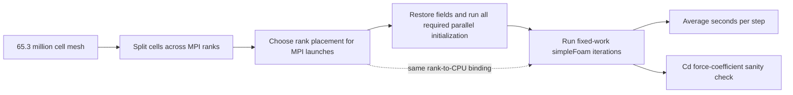

# OpenFOAM CPU task: foundations for a first presentation

This is an HPC-only teaching note. It uses the competition rules and evidence retained through 23 October 2026. Those are dated examples, not a live status report. A six-run four-node native review is now available, but missing terminal PBS history and other acceptance evidence mean it is not presented as an official accepted score.

## What the competition asks us to do

The task is to make the same car-aerodynamics calculation run faster on CPU nodes. The official workload is OpenFOAM v2512 and `simpleFoam`, using the unchanged coarse DrivAer mesh with 65,334,765 cells. The ASPIRE-2A reference nodes each provide 128 CPU cores and 440 GiB of memory. Computational fluid dynamics, or CFD, estimates how a fluid moves by solving conservation equations for mass and momentum over many small mesh cells. Here the fluid is air around a car. OpenFOAM also solves turbulence variables, so each cell carries more than just speed and pressure.

`simpleFoam` computes a steady flow: its numbered “time steps” are repeated solver iterations that work toward a steady answer. They are not seconds of real driving time. A 40-step run means 40 rounds of the prescribed numerical work, not 40 seconds. The task requires the same official endpoints at each scale: 40 steps on one node, 80 on two nodes, and 150 on four nodes. The four-node run is the scored performance run; one- and two-node runs are required scaling evidence. [The pinned task rules](https://github.com/hpcac/2026-APAC-HPC-AI/blob/b4df52907f5bbb9152ef6ae902c925fc79d54417/2.%20OpenFOAM%20HPC%20Task%20Rules.md) define the workload and endpoints.

## The work from mesh to result

The preparation commands are required parts of the computation. `decomposePar` splits the whole mesh into rank-sized pieces. `restore0Dir -processor` restores each piece's original starting fields. `renumberMesh -constant -overwrite -parallel` reorders mesh labels using the official default operation. `potentialFoam -initialiseUBCs -parallel` supplies an initial flow field. `applyBoundaryLayer -ybl 0.0450244 -parallel` applies the required boundary-layer initialization. Then `simpleFoam -parallel` performs the requested solver iterations. For example, retained native checks verify that each step solves Ux, Uy, and Uz for 15 iterations each, pressure for 12, and omega and k for 8 each. These exact operations and switches are in the official Allrun chain; omitting an initialization step changes the required work. [The official ASPIRE-2A notes](https://github.com/hpcac/2026-APAC-HPC-AI/blob/b4df52907f5bbb9152ef6ae902c925fc79d54417/4.3%20OpenFOAM%20Application%20Notes%20-%20ASPIRE-2A.md) show the commands in order.

An **MPI rank** is one solver process. Decomposition decides which cells a rank owns. An **allocated CPU** is a hardware core the scheduler grants to the job. A job can allocate 128 CPUs and launch only 64 MPI ranks; the remaining cores are still reserved and can still count toward cost. In the retained run review, job 25921832 used 64 Scotch ranks on a one-node allocation of 128 CPUs. A separate concern is **affinity**: binding each rank to a particular CPU. **NUMA** groups identify which memory is physically close to which CPUs. A NUMA node is a memory-locality group, not necessarily a socket: an EPYC 7713 in NPS4 mode can expose eight NUMA groups across two sockets. A rank-to-CPU startup map shows where ranks began; by itself it does not prove where their memory pages stayed during the solve.

## Decomposition, rank placement, and scale

For Basic work, the official choices are `hierarchical` and `scotch`. Hierarchical decomposition divides the mesh in geometric directions using specified factors. Scotch treats cells and their shared faces as a graph and tries to partition that graph while balancing work and limiting interfaces. Both determine cell ownership by MPI ranks; neither decides which physical CPU will execute a rank. Runtime affinity and NUMA placement are a later mapping from rank IDs to CPUs. Basic permits rank counts, supported method coefficients, binding, and MPI runtime settings. A custom partition method or source/solver alteration belongs to Bonus and needs the stated self-proof. [The pinned F1–F3 addendum](https://github.com/hpcac/2026-APAC-HPC-AI/blob/b4df52907f5bbb9152ef6ae902c925fc79d54417/2.%20OpenFOAM%20HPC%20Task%20Rules.md#addendum-2026-09-25) lists the tiers.

Adding nodes can shorten the time for each solver iteration, but it does not divide time perfectly. More ranks exchange more boundary data, coordinate more often, and can wait for the slowest rank. Imbalanced cell or communication work, inter-node links, memory locality, and variation between allocations all limit scaling. The required 1/2/4-node runs also use different endpoint iteration counts, and their preparation and whole-job times include work outside the solver timer. They are valuable scaling evidence, but comparing separate jobs is descriptive; it does not isolate one cause unless the control, rank layout, placement, and allocation are matched.

For context, the organizers' pinned ASPIRE-2A Scotch reference chain reported 14.049 seconds per step on 1 node (128 ranks), 7.196 on 2 nodes (256 ranks), and 3.576 on 4 nodes (512 ranks). Only the four-node configuration supplies the official performance score. These are organizers' reference measurements, not our team's result. The same note reports that repeated four-node Scotch runs varied, so a single small timing difference is not proof of a stable improvement. [The local pinned copy](../../../2026-APAC-HPC-AI/hpc-experiments/upstream-20261021/sources/4.3%20OpenFOAM%20Application%20Notes%20-%20ASPIRE-2A.md) preserves the reference table and run records.

One concrete, later team observation is useful for understanding the limits. In the sealed 22 October review, one-node Scotch job 25921487 used 128 ranks and recorded 14.450757 seconds per step over 40 steps. Two-node Scotch job 25921492 used 256 ranks and recorded 7.462835 seconds per step over 80 steps. Their ratio is about 1.94, close to but below ideal twofold scaling. The two-node run's p95 was 8.327817 seconds, and its slowest sample was 16.397209 seconds at Time 12; its 79 samples were below the logger's 225-sample recommendation. These are candidate native observations, not fully accepted scores: the retained review lacks frozen-submission and physical rank-affinity evidence, among other items. This dated example must not be presented as the latest result or as a controlled causal speedup. The 22 October data and its limits are in the [shared CPU density review](../../../2026-APAC-HPC-AI/hpc-experiments/shared-cpu-density-review-20261022/RESULTS.md) and [sealed intake review](../../../2026-APAC-HPC-AI/hpc-experiments/shared-cpu-intake-20261022/RESULTS.md). The 23 October four-node review found the lowest native Average at 3.677907 s/step for Scotch-128, but its largest step was 35.883552 seconds and every run emitted a short-sample warning. All six passed native work checks, including 150 steps on four hosts; however, PBS reports `UnknownJobId`, and frozen-submission proof, process return codes, final field seals, affinity proof, elapsed time and charge are unavailable. Treat these as reviewed native candidate observations, not accepted official scores. See the [four-node review and full limits](../../../2026-APAC-HPC-AI/hpc-experiments/four-node-review-20261023/RESULTS.md).

## Timing, drag, and service units answer different questions

The competition's timing number is the `Average wall-clock time per time step` printed by `simpleFoam`. The case timer starts at the second iteration, so the 40-step run contains 39 measured samples. This average describes solver speed in seconds per step. It is not the time for all initialization, and it is not the elapsed time for the complete scheduler job.

Whole-allocation elapsed time includes decomposition, restoration, initialization, solver startup, all iterations, and job shutdown. On ASPIRE-2A the retained notes describe one Service Unit (SU) as one requested CPU core used for one hour. The estimate is therefore `allocated CPUs × PBS elapsed seconds ÷ 3600`, using the applicable site rate. For job 25921487, 128 allocated CPUs for 1,081 seconds gives about 38.436 SU. Job 25921492 used 256 CPUs for 1,105 seconds, about 78.578 SU. These are estimates from the retained run records, not posted account charges. A lower seconds-per-step value can still cost more if the job holds more CPUs or spends more wall time in preparation.

`Cd` is the dimensionless drag coefficient in the last row of `postProcessing/forceCoeffsAll/.../coefficient.dat`; it is not the speed score. It helps catch a calculation that may be wrong, but by itself it does not prove the solver is accurate or fast. The official sanity reference is approximately 0.43 at 40 steps, 0.34 at 80, and 0.28–0.29 at 150. The Basic rules do not define a universal percentage pass band. The separate Bonus F3 proof compares each endpoint against that experiment's own matched pre-change baseline, requiring bit-identical coefficient output or each endpoint Cd within ±0.5%; a pure decomposition-method swap has an explicit exception. Do not apply that Bonus proof as an invented Basic gate, and do not import a Qwen/AI quality percentage into this CPU task. [The pinned rules and addendum](https://github.com/hpcac/2026-APAC-HPC-AI/blob/b4df52907f5bbb9152ef6ae902c925fc79d54417/2.%20OpenFOAM%20HPC%20Task%20Rules.md) state both checks.

## Basic, Bonus, and prohibited changes

Basic starts with unmodified official OpenFOAM v2512 in double precision, the official mesh and physics, unchanged `fvSchemes` and fixed-iteration solver settings, retained function objects, and the full preparation chain. It allows the supported hierarchical or Scotch setup, rank count and coefficients, CPU placement and affinity, and MPI/runtime environment choices. Basic is required even if a team also explores Bonus.

Bonus is optional. Judges can recognize particularly solid Basic tuning. Experimental changes outside Basic, such as a new decomposition method or source changes, require the exact change to be shown, a same-mathematics argument, the applicable Cd self-proof, and a speedup comparison against the team's Basic result on the same machine. Prohibited in every tier are GPU acceleration, reduced or mixed precision, changing the mesh or physics, reducing solver work, changing prohibited numerical settings, or skipping required setup or checks. The HPC score has 50 points: judges award up to 20 for Basic and 15 for Bonus, together 35 points (70%); performance and re-verification account for 15 points (30%), using the four-node Basic Average. Bonus is optional; the weighting does not make risky or out-of-scope changes mandatory, and judges can recognize strong Basic tuning. AI/Qwen scoring rules are separate. [The pinned general addendum](https://github.com/hpcac/2026-APAC-HPC-AI/blob/b4df52907f5bbb9152ef6ae902c925fc79d54417/README.md#r4-scoring) gives the breakdown.

## Short presenter script

“Our CPU task is to solve the same official airflow-around-a-car case faster, without changing the calculation. The 65-million-cell mesh is divided among MPI ranks, and every rank runs the same fixed numerical work. We first restore and initialize the fields using all required OpenFOAM steps, then measure the solver's average seconds per iteration. Decomposition decides which cells belong to each rank; CPU affinity decides where those ranks run, and NUMA describes which memory is near each CPU. More nodes usually help, but communication, waiting, memory placement, preparation, and machine variation keep scaling from being perfectly linear. We use Cd from the force file as a physical sanity check, not as the performance metric. One- and two-node results teach us about scaling; the official score comes from a complete four-node, 150-step Basic run. Our reviewed four-node logs currently support native candidate observations, not an accepted score.”

## Pinned references and retained evidence

- [Official OpenFOAM HPC Task Rules, pinned revision `b4df529`](https://github.com/hpcac/2026-APAC-HPC-AI/blob/b4df52907f5bbb9152ef6ae902c925fc79d54417/2.%20OpenFOAM%20HPC%20Task%20Rules.md) and its [local frozen copy](../../../2026-APAC-HPC-AI/hpc-experiments/upstream-20261021/sources/2.%20OpenFOAM%20HPC%20Task%20Rules.md).
- [Official ASPIRE-2A Application Notes, same pinned revision](https://github.com/hpcac/2026-APAC-HPC-AI/blob/b4df52907f5bbb9152ef6ae902c925fc79d54417/4.3%20OpenFOAM%20Application%20Notes%20-%20ASPIRE-2A.md), whose local snapshot and file hashes are in [`upstream-20261021/manifest.json`](../../../2026-APAC-HPC-AI/hpc-experiments/upstream-20261021/manifest.json).
- [General competition addendum, R2–R4](https://github.com/hpcac/2026-APAC-HPC-AI/blob/b4df52907f5bbb9152ef6ae902c925fc79d54417/README.md#r4-scoring).
- [HPC task overview and current distinctions](../hpc-openfoam-20261021/README.md) and [Basic/Bonus rules in plain language](../hpc-openfoam-20261021/RULES.md).
- [22 October native shared-run review](../../../2026-APAC-HPC-AI/hpc-experiments/shared-cpu-density-review-20261022/RESULTS.md), with per-run candidate-evidence limits.
- [23 October four-node native evidence review](../../../2026-APAC-HPC-AI/hpc-experiments/four-node-review-20261023/RESULTS.md), whose PBS history and acceptance limitations remain explicit.

## Where the job actually runs

The local workspace stores our research code, notes and backup. Through VPN and SSH we reach an ASPIRE-2A CPU login node. PBS receives the job script with `qsub`, allocates compute nodes and starts the script there; `qstat` queries that scheduler. Logging into the CPU cluster is not a resource allocation. The full mesh and processor files live on that cluster's shared scratch filesystem, which its compute nodes can access. This is not an automatic mount of the local VPS filesystem. We stage selected inputs to remote scratch and collect selected text outputs back to the workspace. Large CFD computation and preparation run inside allocated jobs, not on login CPUs. OpenFOAM and MPI modules are loaded in the job environment. This CPU/PBS workflow is distinct from the other chat's GPU serving work and its Slurm cluster.

## Official requirements and our evidence labels are different

Our labels such as native observation, statically qualified, and pending confirmation describe the completeness of our research record. They are not additional contest rules. The official submission asks for readable scripts, inputs, version/build information, solver and force logs, scaling evidence and presentation. Our source hashes, field seals, per-command returns, affinity probes and PBS cost records strengthen reproducibility and interpretation; the rules do not prescribe our private accounting format. An official accepted score still depends on the organizer's evaluation and re-verification. We report the old native measurements with limits and seek stronger confirmation rather than inventing proof.

A native warning that recommends more than 149 samples does not replace the official 150-step four-node endpoint. Keep every prescribed iteration and every timed sample. Use independent full-endpoint repetitions, or separately labeled unranked diagnostics, to study variation.
