# OpenFOAM CPU research journey: from access practice to four-node validation

This is a source-linked retrospective for learning and presentation, based on records retained through 23 October 2026. It is not a live scheduler report. Six four-node logs now have an independent native-evidence review, but cannot be called accepted official scores because final PBS history and several acceptance artifacts are unavailable. For the task concepts and scoring context, see [Foundations](FOUNDATIONS.md). The dated research log preserves finer detail and corrections: [HPC log](../hpc-openfoam-20261021/LOG.md).

## The story in one view

```mermaid
flowchart LR
    A[21 Oct: repair Iris access and practice native chain] --> B[21 Oct: establish ASPIRE one-node H baseline]
    B --> C[21 Oct: ordered H then Scotch pair; small noisy difference]
    C --> D[21 Oct: NUMA graph proxy improves cut, solver loses]
    D --> E[21–22 Oct: N256 graph screen; no solver timing]
    E --> F[22 Oct: rank-density wave; H2 lowest observed Average]
    F --> G[22 Oct: offline rank placement cuts logical crossings 4.57%]
    G --> H[22 Oct: mapped binding pair prepared, not submitted]
    H --> I[23 Oct: six four-node native logs independently reviewed]
    I --> J[Candidate observations; evidence limits retained]
    J --> K[23 Oct: authorize conservative CPU wave]
    K --> L[Independent four-node confirmation submitted; no new result]
```

The central lesson is that evidence has levels. A cleaner graph is only a graph result; a native timing is an observation; a matched pair can support a causal claim; and the official four-node performance score requires more than solver logs. Source, fixed work, outputs, physical placement, and scheduler accounting each answer different review questions.

## 1. 21 October — learn the real route and validate the required work

**Question and reason.** Could the team reach the actual Iris practice cluster and run the official OpenFOAM chain? Earlier remote-command SSH had stayed on a gateway, so it had been misread as evidence that the cluster route was unavailable. The correction came from the organiser's access instructions: use a forced interactive TTY with no remote command, then work from the Iris login prompt. Authentication and scheduler access are separate checks.

**What happened.** The unchanged native smoke job 2293751 completed on one Iris node with four MPI ranks and ten contiguous solver steps. It proved the MPI launch and native executable worked, but its tiny case could not validate the 65-million-cell workload. The team then inspected the official scripts and mesh header, and ran the full 65,334,765-cell case in stages: job 2293752 decomposed and restored the mesh; 2293753 completed renumbering, potential-flow initialization, and boundary-layer initialization; 2293754 ran the full mandatory preparation and 40 solver steps. The practice result averaged 21.965354 seconds per step, with p95 22.541902 and final Cd 0.4405543814. It was a practice-chain result, not an ASPIRE score.

Historical legacy CPU attempts were also reviewed rather than erased. Job 25740797 reached preparation and zero-step solver timer compilation, but the retained evidence does not establish its terminal outcome or explain the failure. Earlier wrappers could mask a native command's nonzero return after an `End` line; subsequent reviewers added explicit stage-return gates. This correction matters: an end marker alone does not prove successful command exit.

**Lesson and next decision.** The full preparation chain is part of the prescribed work, not optional overhead to omit. Stage-by-stage review caught access and provenance mistakes before the team used its CPU allocation for a real baseline. Continue with the genuine ASPIRE CPU project, keeping Iris practice separate from contest evidence.

**Presenter.** “We first had to establish what ‘access’ meant: a successful SSH command could still be on a gateway. Interactive login reached Iris, and a small native run proved launch mechanics. We then checked the full mesh and every required initialization stage before running the 40-step practice case. It taught us how to validate the workload, but it was not the contest benchmark.”

Sources: [retained Iris and CPU log](../hpc-openfoam-20261021/LOG.md), [Iris plan and evidence](../../../2026-APAC-HPC-AI/hpc-experiments/iris-65m-20261021/PLAN.md), [Iris solver review](../../../2026-APAC-HPC-AI/hpc-experiments/iris-65m-20261021/solver-review.json).

## 2. 21 October — establish a real CPU baseline, then compare methods carefully

**Question and reason.** Before trying to optimize, what does the unchanged Basic workload do on an ASPIRE-2A CPU node? Job 25905114 ran 128 ranks on one node, retained all required initialization, and completed 40 fixed-work steps using native OpenFOAM v2512 in double precision. Its Average was 14.921981 seconds per step, final Cd 0.4389323284, and estimated allocation charge 25.884444 SU. This is a reviewed one-node baseline, not the official four-node score.

The next question was whether graph-based Scotch partitioning could improve on the geometric hierarchical partition. The default-Scotch preparation job 25907236 produced 128 partitions with 1,549,377 interface faces, compared with 2,109,346 for hierarchical. However, Scotch had more cell imbalance and more maximum neighbor fan-out; its preparation also took 371 seconds versus 187. Those graph properties justified a bounded solver comparison, but they did not identify a measured bottleneck.

**What happened.** The same-node ordered pair 25907325 ran hierarchical first and Scotch second, with 128 ranks and 40 steps per arm. The means were 14.787224 and 14.640233 seconds per step, so Scotch was 0.994% lower in this single pair. The Scotch trace included a 21.120703-second step-9 outlier, and the native logger recommended more samples than were available. The p95 values were 15.222146 and 14.848304 seconds; final Cd values differed slightly. The order, one-pair sample, outlier, and logger warning limit the inference.

**Lesson and next decision.** The result was a weak observation, not a repeatable win. The graph cut reduction did not prove solver speedup, and the timing comparison could not establish a stable method advantage. Preserve the pair and its outlier; use graph evidence only to motivate a separate, explicitly testable placement question.

**Presenter.** “The one-node baseline established that the complete CPU workload passed. Scotch cut fewer interface faces, but had different imbalance and setup costs. In one ordered same-node pair its solver Average was about one percent lower, with a large slow step and limited samples. We kept that as a hypothesis-generating observation rather than declaring a winner.”

Sources: [baseline review](../../../2026-APAC-HPC-AI/hpc-experiments/nscc-cpu-solve-h128-20261021/review.json), [method-pair results](../../../2026-APAC-HPC-AI/hpc-experiments/nscc-cpu-method-pair128-20261021/RESULTS.md), [native method plan](../../../2026-APAC-HPC-AI/hpc-experiments/nscc-cpu-method-pair128-20261021/PLAN.md).

### Early CPU failures are part of the journey

| Attempt | Observation | Correction and lesson |
|---|---|---|
| 25904725 | Exited before any solver in 2 seconds: strict shell error handling stopped inside site module reset when an empty list made grep return nonzero. | Guard the reset operation and verify the loaded runtime. This was startup failure, not a slow solver measurement. |
| 25904765 | A small native tutorial exercised the official timing function: 4 MPI ranks, 5 steps, 84-second allocation. | Compiler/runtime mechanics passed. Its 0.01407-second toy mean is not comparable to the DrivAer workload or a contest score. |
| 25904959 | A 16-second preparation attempt stopped on a generated filename comment in a control-dictionary comparison. | Normalize only that exact metadata comment; preserve all numerical and executable tokens. This was an overstrict validator, not changed physics. |
| 25905006 | Fresh corrected preparation verified the mesh and produced the 128-way split in 187 seconds. | Input/preparation proof passed; the subsequent solver job still had to run the remaining mandatory chain. |

These failures are retained in their [startup review](../../../2026-APAC-HPC-AI/hpc-experiments/nscc-cpu-timing-probe-20261021/review.json), [native timing diagnostic](../../../2026-APAC-HPC-AI/hpc-experiments/nscc-cpu-timing-resetfix-20261021/review.json), [metadata rejection](../../../2026-APAC-HPC-AI/hpc-experiments/nscc-cpu-baseline-20261021/review.json), and [corrected preparation](../../../2026-APAC-HPC-AI/hpc-experiments/nscc-cpu-baseline-headerfix-20261021/review.json). A failed batch, passed toy diagnostic, prepared input, native solve and accepted score are five different states.

## 3. 21–22 October — the NUMA graph proxy did not predict solver time

**Question and reason.** Could the existing Scotch partition be arranged to reduce faces crossing eight logical NUMA groups? The graph screen used a synthetic 10:1 domain-weight contrast; it did not use measured memory traffic. Preparation job 25907688 reduced logical cross-group faces from 371,658 to 332,157 (10.63%), while total interface faces increased 1.34%. The graph also changed imbalance and fan-out. The groups were logical and their weights synthetic, not a measured traffic model.

**What happened.** A same-node default-Scotch versus NUMA-aware-Scotch solver comparison, job 25907753, completed the 40-step native work. The default Average was 13.880988 seconds per step; the NUMA candidate was 14.358715, 3.4416% slower. Its p95 was 14.566025 seconds and it contained a 16.614805-second maximum at step 10. Final Cd values were close, but that does not reverse the timing result. Scheduler history was unavailable when the retained files-only review was made, so exact final PBS accounting and posted cost are unknown; the reservation ceiling remains 61.866667 SU. The native logs support the timing and validity checks, not terminal PBS billing.

**Lesson and next decision.** This branch lost on its measured objective. A reduction in a logical graph cut did not translate to a faster solver in this run. No page-residency, memory-bandwidth, network-traffic, or MPI-wait data were collected, so the cause is unknown. Close the unchanged NUMA method branch; do not repeat it as though a missing telemetry measurement could turn the observed slowdown into a gain.

**Presenter.** “We tested whether a smaller NUMA-group graph cut would make the solve faster. It did not: the candidate was 3.44 percent slower in the measured Average. That is the key failed experiment in this story. Graph cuts are proxies, not hardware counters, and we did not measure page placement or memory traffic to explain the loss.”

Sources: [NUMA result and limits](../../../2026-APAC-HPC-AI/hpc-experiments/nscc-cpu-numa-scotch128-20261021/RESULTS.md), [graph and provenance correction](../../../2026-APAC-HPC-AI/hpc-experiments/nscc-cpu-numa-scotch128-20261021/PROVENANCE_CORRECTION.md), [native review record](../hpc-openfoam-20261021/LOG.md).

## 4. 21–22 October — N256 graph comparison narrowed, but did not settle, the scaling question

**Question and reason.** At two nodes and 256 ranks, did geometric decomposition, default Scotch, or a node-aware Scotch tree look most promising on the processor-boundary graph? The three preparation-only variants in job 25907772 preserved the same official cell count and partition count. Their cross-group face counts were 717,233 for hierarchical, 99,591 for default Scotch, and 127,359 for the node-aware tree. The node-aware tree therefore had 27.88% more cross-group faces than default Scotch. It also had somewhat fewer maximum faces per rank, but more cell imbalance.

**Lesson and next decision.** This job did not run `simpleFoam`, so it has no runtime ranking. The cuts were logical groups, not a validated map from two hosts to physical links. Scheduler history was lost, so exact terminal accounting is unknown. The sensible next experiment was a conventional rank-density screen with the task's full per-node CPU allocations, rather than interpreting a graph-only comparison as solver evidence.

**Presenter.** “At 256 ranks, Scotch had a much smaller boundary graph than hierarchical, but the more specialized tree did not beat default Scotch on that graph. Since there was no solver run and no verified physical host mapping, we used this only to choose what to measure next.”

Source: [N256 graph results](../../../2026-APAC-HPC-AI/hpc-experiments/nscc-cpu-three-cuts256-20261021/RESULTS.md).

## 5. 22 October — rank density produced a new observed two-node leader, not a causal winner

**Question and reason.** How do 64, 96, and 128 ranks per node compare at the official one- and two-node step endpoints? Six new runs and two prior Scotch controls were reviewed together. One-node jobs allocated 128 CPUs; two-node jobs allocated 256 CPUs. Rank count and allocated CPU count are different: a lower-rank run still reserved all node CPUs.

**What happened.** The lowest Average in the eight-run table was the two-node hierarchical run, job 25921809: 256 ranks, 80 steps, 7.169997 seconds per step, p95 8.009692, and maximum 10.075875 at Time 27. The prior two-node Scotch-128-per-node control, job 25921492, measured 7.462835 seconds per step. The apparent 3.92% lower time is a comparison between different allocations, not a matched causal test. Across the broader samples, 64 ranks per node was slower than denser configurations; 96 ranks were between the endpoints. The two-node Scotch control had a slow 16.397209-second sample and only 79 timed steps versus a logger recommendation of 225.

All runs retained fixed work and native timing rows, but these reviews also identified missing acceptance evidence: frozen submitted script provenance, per-stage return-code proof for the shared wrapper, final mesh/field seals, and physical rank-affinity records. PBS exit zero and native `End` markers do not fill those gaps. Whole-allocation SU numbers are estimates from elapsed time and allocated CPUs, not posted charges. Hardware performance counters, memory bandwidth, page locality, and per-rank physical placement were not collected.

**Lesson and next decision.** Hierarchical-256 was the new lowest observed candidate Average among the reviewed one/two-node records, while Scotch-128 was only a separate-allocation comparator. The result says which workload merits more controlled evidence; it does not prove why it is faster or predict the official four-node score. A runtime-affinity hypothesis could now be screened offline against the unchanged one-node Scotch graph.

**Presenter.** “The two-node hierarchical run had the smallest observed solver Average in this group. It was about 3.9 percent below a previous Scotch run, but those jobs were not a same-allocation pair and had different method and run history. We therefore call it an observed lead, not a causal speedup. The review also showed why allocation, rank placement, and missing source seals matter.”

Sources: [density and method review](../../../2026-APAC-HPC-AI/hpc-experiments/shared-cpu-density-review-20261022/RESULTS.md), [detailed intake limits](../../../2026-APAC-HPC-AI/hpc-experiments/shared-cpu-intake-20261022/RESULTS.md).

## 6. 22 October — offline rank placement improved the graph objective only

**Question and reason.** Could a runtime mapping reorder the unchanged 128 Scotch rank IDs across eight balanced logical NUMA groups to lower graph crossings, without changing the cell decomposition? The first seeded search found only 0.81% fewer crossing faces, so its result was not material enough to justify the proposed solver comparison. Review then noticed that all starts were random, with no known-good baseline start.

**What happened.** The bounded refinement preserved that initial result and added deterministic steepest improving balanced swaps, starting from the baseline and both prior best mappings. It checked incremental swap deltas against full graph recomputation on 100 deterministic swaps. The baseline cut was 371,658; the refined candidate reached 354,658, 17,000 fewer or 4.5741%. The graph SHA and all 128 partitions, 1,549,377 total faces, 42,141 maximum faces per rank, and 35 maximum neighbors remained unchanged. The search ran locally in about 3.49 seconds.

**Lesson and next decision.** The candidate is a better graph mapping, not measured solver speedup. No cluster job, page-placement, memory traffic, migration, or MPI wait was measured. Preserve it only as a candidate for a same-node runtime test; re-probe actual CPU and NUMA topology on the future node rather than carrying old CPU IDs forward.

**Presenter.** “We did not repartition the mesh. We only asked whether the existing rank labels could be assigned to eight balanced runtime groups with fewer weighted boundaries. Improving the search raised the graph reduction from 0.81 to 4.57 percent, but this is still an offline proxy. It earns a carefully controlled timing test only if resources and ownership permit.”

Sources: [screen method and result](../../../2026-APAC-HPC-AI/hpc-experiments/rank-placement-screen-20261022/PLAN.md), [machine-readable mapping](../../../2026-APAC-HPC-AI/hpc-experiments/rank-placement-screen-20261022/screen.json), [placement-pair readiness review](../../../2026-APAC-HPC-AI/hpc-experiments/nscc-cpu-rank-placement-pair128-20261022/PRE_SUBMIT_REVIEW.md).

## 7. 22 October — a mapped binding pair was prepared but remains unsubmitted

**Question and reason.** Can runtime rank-to-CPU affinity be tested without changing decomposition, source, fields, or physics? The prepared pair uses the same accepted default-Scotch N128 source and 40-step endpoint in both arms. A fresh baseline probe must prove a single host, 128 unique physical cores, and the expected blocks of 16 ranks across eight NUMA groups. The candidate mapping is rendered from that node's probe and re-probed before costly initialization; the same binding is applied to every candidate parallel initialization and solver launch. The control uses default placement. Both arms pin the same OMP and fabric settings.

The payload includes full restore, renumbering, potential initialization, boundary-layer initialization, and 40 solver steps. It is statically prepared and offline-qualified, with a 29-minute pair maximum of 61.866667 SU. It was explicitly not submitted: shared controller ownership, queue capacity, and active-job/budget caps had not been resolved. The payload's 3% timing threshold is a pre-registered research decision for whether to consider a reverse-order confirmation, not an official Basic pass threshold. Startup affinity is not proof of placement throughout the solve or of memory-page locality.

**Lesson and next decision.** The next measurement, if the existing constraints clear, must be a same-allocation comparison with all setup steps intact and verified physical binding. If the candidate fails physical topology checks or does not clear the practical threshold, close it. No solver performance result exists for this bundle.

**Presenter.** “The next prepared test changes only where the existing ranks run. It discovers topology on the actual node, applies the resulting binding during all parallel initialization and solving, and keeps transport settings the same in both arms. The bundle is ready for review but not submitted, because shared ownership and caps are unresolved.”

Source: [static pre-submit review and qualification limits](../../../2026-APAC-HPC-AI/hpc-experiments/nscc-cpu-rank-placement-pair128-20261022/PRE_SUBMIT_REVIEW.md).

## 8. 23 October — four-node native observations reverse the two-node leader, but remain unaccepted

**Question and reason.** What do the four-node, 150-step native logs show across decomposition method and rank density? The six retained runs covered hierarchical and Scotch at 64, 96 and 128 ranks per node. An independent offline review found that all six pass its native gates: source comparison to the accepted baseline within the documented decomposition/rank/end-time changes, OpenFOAM v2512 scalar64, mesh cell total, solver rank counts, four distinct hosts with expected rank groups, all 150 steps, five native `End` markers, fixed iterations, finite force rows, and all 149 time samples matched between solver logs and `wallClockTime` data.

| Method | Ranks per node | Native Average (seconds/step) | p95 | Maximum (Time) |
|---|---:|---:|---:|---|
| Scotch | 128 | 3.677907 | 3.795740 | 35.883552 (119) |
| Scotch | 96 | 7.146019 | 15.816692 | 31.677264 (130) |
| Scotch | 64 | 10.309944 | 19.637053 | 72.923052 (86) |
| Hierarchical | 128 | 3.819929 | 5.224630 | 12.925347 (129) |
| Hierarchical | 96 | 4.922348 | 11.762667 | 38.847831 (97) |
| Hierarchical | 64 | 4.488921 | 9.882991 | 20.984311 (35) |

At 128 ranks per node, Scotch's native Average was lower than hierarchical (3.677907 vs 3.819929). At 64 and 96 ranks, hierarchical was lower than Scotch (4.488921 vs 10.309944; 4.922348 vs 7.146019). This reverses the two-node comparison, where hierarchical-256 at 7.169997 had a lower observed Average than Scotch-256 at 7.462835. Thus the observed method leader depends on rank density in these separate runs. These are descriptive native comparisons, not controlled causal speedups: the runs are not matched controls, and resource allocations differ (for example, Scotch-64 requested 256 CPUs while hierarchical-64 requested 512).

**Tails and measurement limits.** All six native loggers warn that 149 timed samples are below their recommended minimums, which range from 943 to 8,329. The task's ranked endpoint remains the prescribed 150 steps; do not add iterations or change the scored endpoint to silence the warning. The Scotch-128 maximum of 35.883552 seconds at Time 119 is rare relative to its 3.677907-second Average and 3.298742-second median; it is retained, not removed. It is one of 11 IQR outliers, contributes 6.55% of the 149-sample sum, and contributes 0.240829 seconds to the untrimmed arithmetic mean (the maximum divided by 149). These diagnostics describe the tail; they do not justify trimming the official Average or prove the cause of the spike.

**Acceptance and next decision.** At review time, PBS returned `UnknownJobId` for all six jobs; the old queue metadata had only shown them queued. There is no verified final state, process exit code, scheduler elapsed time or posted charge. Frozen submission proofs, per-command return codes, final zero-field seals, rank-affinity evidence, and authoritative final mesh/field identity are also absent. Host names are parsed from solver/Pstream logs and do not prove which physical cores ranks used. Therefore the six runs pass native evidence checks but are not accepted official scores. The queue snapshot on 23 October at 12:11 UTC was empty; project usage showed 2,269.938 SU used and 27,730.062 balance, but shared ownership is unresolved and the existing 1,000-SU controller ceiling was not changed while the owner was asked whether to retain it or raise it to 5,000 SU. No jobs were submitted that day.

**Presenter.** “We now have an independent review of six four-node native logs. All six show the full 150-step work on four hosts and the time records agree. At 128 ranks per node, Scotch has the lowest observed mean, but its maximum is almost ten times that mean and every run is below the logger's recommended sample count. The mean still includes every prescribed sample; the tail is a diagnostic, not permission to discard a point. At lower rank densities hierarchical is faster in these observations, so the method ranking changes with density. Because PBS history and key acceptance evidence are missing, these are candidate native observations, not the official result.”

Source: [four-node results, metrics and limitations](../../../2026-APAC-HPC-AI/hpc-experiments/four-node-review-20261023/RESULTS.md), with full samples in [review.json](../../../2026-APAC-HPC-AI/hpc-experiments/four-node-review-20261023/review.json) and collection provenance in [COLLECTION.md](../../../2026-APAC-HPC-AI/hpc-experiments/four-node-review-20261023/COLLECTION.md).

## Questions a presenter is likely to get

**Why is the Iris result not the contest baseline?** It validated the required chain on Iris practice nodes. It was a different cluster and allocation; the contest's official performance figure is the complete four-node ASPIRE Basic run.

**Does a lower graph cut mean a faster solve?** No. It counts processor-interface faces under a chosen logical grouping. It does not measure actual traffic, waiting, page placement, or critical-path time. The NUMA-aware candidate is a direct counterexample: a better proxy preceded a slower measured solve.

**What does “40 steps” mean here?** For steady-state `simpleFoam`, these are prescribed solver iterations, not 40 seconds of real driving. The chain also includes required decomposition, field restoration, renumbering, and initialization.

**Why not declare the 3.9% two-node difference a win?** The 7.169997 and 7.462835 values came from different jobs and allocations. Method, timing history, and placement were not controlled as a same-allocation pair, and important provenance/physical-placement acceptance evidence was absent.

**How should I explain the long Scotch-128 step?** The 35.883552-second maximum at Time 119 is much larger than its 3.677907-second mean, but the official Average includes it. It is one of 11 IQR outliers and contributes 6.55% of the total sample sum; omitting it would bias the prescribed measurement. The cause was not established.

**What would make the binding test convincing?** A fresh actual-node topology probe, identical frozen input and work, consistent candidate binding through all MPI initialization and solve stages, validated stage exits and output seals, complete timer samples and tails, and terminal allocation accounting. A startup map alone cannot show page locality.

**Has the project produced its official score?** The four-node logs have been independently reviewed for native evidence, but they are not accepted scores: terminal PBS history, process exit accounting, frozen submitted bytes, final fields and affinity proof are missing. The official performance component uses the four-node Basic Average at its 150-step endpoint.

## 9. 23 October — authorize a conservative wave and submit independent confirmation

The owner explicitly raised the cumulative CPU research ceiling from 1,000 to 5,000 SU, including conservative shared use. The ledger keeps the project's posted-display increase and full allowances for missing-history jobs; it does not call these exact charges or erase uncertainty. At the retained pre-submit check, both CPU and separate read-only AI queues were empty, and the new request fit the existing active-job caps.

Job **25940700.pbs101** was submitted at **12:51 UTC** as one independent Scotch128 confirmation: four exclusive nodes, 512 total ranks, full original 150-step chain, 40-minute maximum, **341.333333 SU maximum**. The payload is fixed by 54 file hashes. Only the permitted rank count and endpoint differ from the accepted official case; explicit return checks, actual four-host/physical-core startup proof, mesh/source verification, before/after zero-field seals and durable wrapper/resource records address the earlier evidence gaps. It was **queued in q5** at 12:52 UTC with node_pool insufficiency, not failed. No new timing or accepted score is claimed.

**Presenter.** “The old records identify a promising configuration, but also show why we need stronger proof. We have now submitted an independent full-work confirmation with frozen inputs and explicit exit/field/placement checks. This is a replication with better evidence, not a new tuning trick or a second claimed result. Our next decision will depend on that reviewed output.”

Sources: [confirmation plan](../../../2026-APAC-HPC-AI/hpc-experiments/nscc-cpu-four-node-confirm-20261023/PLAN.md), [submission receipt](../../../2026-APAC-HPC-AI/hpc-experiments/nscc-cpu-four-node-confirm-20261023/submission.json), [conservative budget](../../../2026-APAC-HPC-AI/hpc-experiments/cpu-continuation-20261023/BUDGET.md). For reusable figures and a speaking route, use [the guide](README.md) and [presenter script](TALK_TRACK.md).
