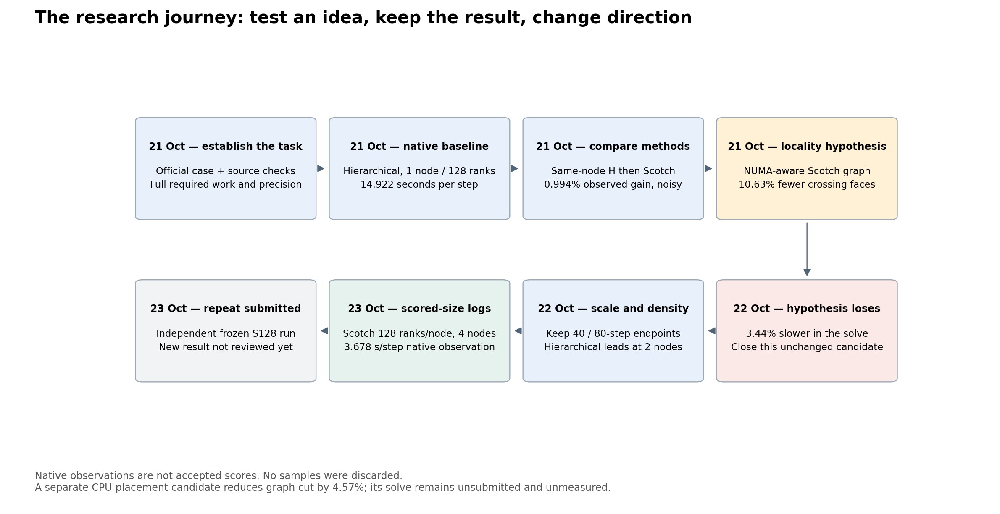
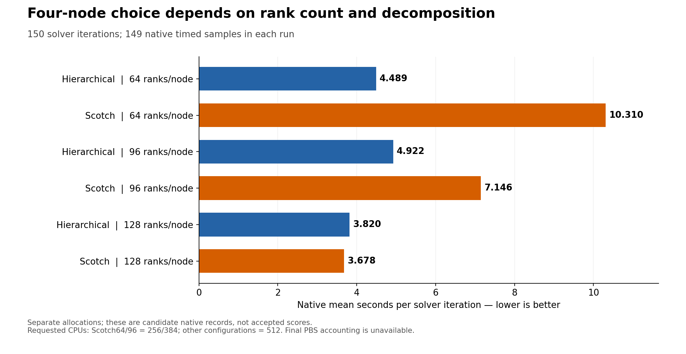
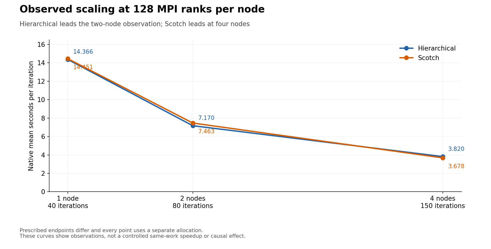
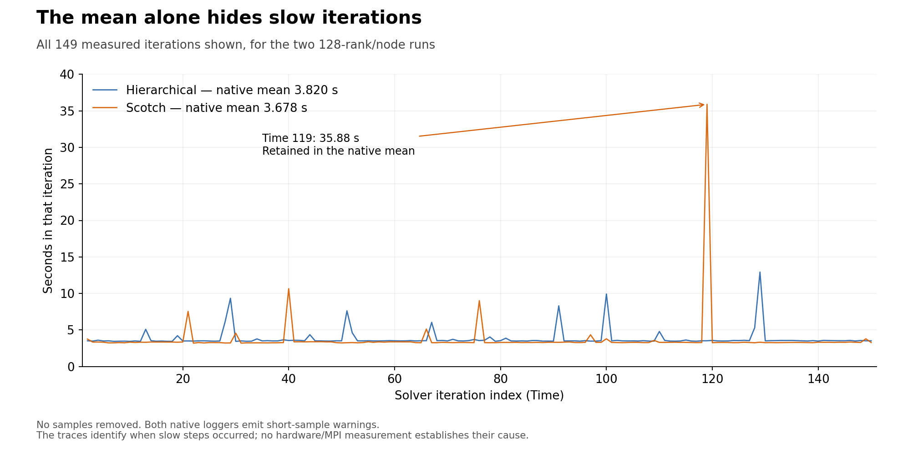

# Learn the HPC task and explain our research

Start with the computation, then the experiments, then rehearse the story. This guide covers our retained **OpenFOAM CPU work on 21–23 October 2026**. Earlier legacy attempts are marked historical; the Qwen/GPU journey is a separate track.

| Read | What you learn | Approximate time |
|---|---|---:|
| [Foundations](FOUNDATIONS.md) | CFD, cells, iterations, MPI, NUMA, required work, metrics, units and scoring | 10–15 minutes |
| [Research journey](JOURNEY.md) | Why each experiment was tried, what happened, what lost, and what changed next | 15–20 minutes |
| [Presenter script and Q&A](TALK_TRACK.md) | A short HPC story to say aloud, with figure explanations and limits | 3–4 minutes for the eight published slides; longer practice script retained |

The task rewards explanation: HPC has 50 points, comprising 20 Basic judging points, 15 Bonus judging points, and 15 performance/re-verification points. Solid Basic tuning can earn Bonus recognition; experimental source changes are optional. See the [official scoring addendum](https://github.com/hpcac/2026-APAC-HPC-AI/blob/b4df52907f5bbb9152ef6ae902c925fc79d54417/README.md#r4-scoring).

The [published 40-slide deck](../../VNUHCM%20-%20TripleU/Presentation/TripleU_APAC2026_Presentation.pptx) keeps AI as the main section: 32 AI slides and eight HPC slides, exactly 20% HPC. [The package update](../../submission-review/hpc-update-20261023/README.md) links the PDF, speaker notes, portable PBS scripts and historical native logs. The new scripts have passed offline validation, but have not produced a new compute result. The last verified confirmation status is Q/q5 at 23 October 15:06:39 UTC. The figures below retain their original earlier snapshot.

## The journey in one picture



The CPU-placement graph candidate is still unmeasured. The new independent four-node S128 confirmation **25940700.pbs101** was submitted on 23 October at 12:51 UTC and is queued in the retained 12:52 UTC snapshot. It is a confirmation attempt, not a new result. No live state is implied by this dated note.

## What the four-node records say



Default Scotch with **128 ranks per node** is the lowest native mean among these six logs: **3.677906731 seconds per solver iteration**, from 149 timed samples in a complete 150-step run. Every mean includes all recorded slow steps. Native source/work/time/force and actual four-host checks pass. Final PBS history, per-stage exits from the old wrapper, field/mesh seals and core affinity are missing, so these are **candidate native observations, not accepted scores**.

The best method depends on configuration. At 64/96 ranks per node, hierarchical has the lower observed mean; at 128, Scotch does. These are separate allocations. CPU request counts also differ: Scotch64/96 requested 256/384 CPUs; the hierarchical variants requested 512. We do not call this a controlled causal speedup or infer actual charges from requested CPUs.

## Why we keep one-, two- and four-node results



This deliberately uses the shared 128-rank/node series: H1/S1 jobs 25921831/25921487, H2/S2 25921809/25921492, H4/S4 25921692/25921488. It does not mix the best historical single-node record from another setup into this series. The official endpoints are 40, 80 and 150 iterations, and allocations differ, so this is an observational endpoint-scaling plot. It is not an identical-work strong-scaling experiment.

## Why a low mean does not explain the bottleneck



Scotch128's median is **3.298742 seconds**, p95 **3.795740 seconds**, and maximum **35.883552 seconds at Time 119**. That maximum alone contributes **0.240829 seconds** to the untrimmed mean, or **6.55%** of the total measured duration. It stays in the metric. This is its arithmetic contribution, not an estimate of recoverable optimization time. All six native loggers warn that their sample count is below the logger's recommendation; the recommendation is not a formal independent confidence interval. The logger warning does not replace the official 150-step endpoint; it motivates independent repeats, not a longer ranked run. The traces show when slow steps happened, not whether CPU frequency, MPI, I/O or another factor caused them. Those measurements were not collected.

## How this guide stays current

For each reviewed HPC milestone, add the question and previous evidence, hypothesis, exact change and control, job/source identity, measurements with units, failed checks or losing outcomes, interpretation limits, next decision, and a beginner-level explanation that can be spoken in the presentation. Keep the detailed journal and raw evidence linked separately. Preserve old snapshots as historical and never turn an unrun plan, graph improvement or failed job into a measured gain. Chat stays Vietnamese; these work artifacts stay English.

[Full six-run review](../../../2026-APAC-HPC-AI/hpc-experiments/four-node-review-20261023/RESULTS.md) and [machine-readable samples](../../../2026-APAC-HPC-AI/hpc-experiments/four-node-review-20261023/review.json) support the figures. [Current HPC handoff](../../notes/HPC_CURRENT.md) is the operational route; the dated [journal index](../research-journey-20261019/journal/README.md) preserves the whole recorded reasoning. Raw authentication/session material is excluded. Extracted safe text is preserved in Git; exact compressed raw archives stored as external objects still require a separate off-host copy.

## Export or regenerate figures

SVG copies in `figures/` can be placed in presentation software; PNG copies render directly in Markdown. `figures/provenance.json` records source review hashes and image hashes. The generation code reads only reviewed native data and never trims samples or invents error bars.

```bash
python3 -m venv /tmp/hpc-figure-env
/tmp/hpc-figure-env/bin/pip install -r requirements-figures.txt
/tmp/hpc-figure-env/bin/python render_figures.py
```

Figure generation uses local CPU work, not a cluster allocation. It does not change submission slides or the HPC_Task package.

## Latest continuation: test placement rather than change the partition

The [new research entry](../research-journey-20261019/journal/entries/20261023-hpc-four-node-placement.md) records the full tail audit, the 512-rank/four-logical-host graph candidate and dependent interface preflight 25943865. The graph cut improves 22.59%, but solver speedup is unmeasured. Presentation files retain their dated slide snapshot; this learning guide links the newer hypothesis separately.

The [host/NUMA trade-off refinement](../research-journey-20261019/journal/entries/20261023-hpc-fixed-host-numa-tradeoff.md) checks the second level of placement and explains the new figure. Lower cross-host face counts do not guarantee lower same-host NUMA counts, nor measured solver speedup.

The [balanced placement followup](../research-journey-20261019/journal/entries/20261023-hpc-balanced-placement-and-queue.md) removes the logical NUMA face-count regression while retaining a 15.86% host-cut reduction. Its new two-axis figure keeps the trade-offs visible. Neither candidate has a new solver measurement.
