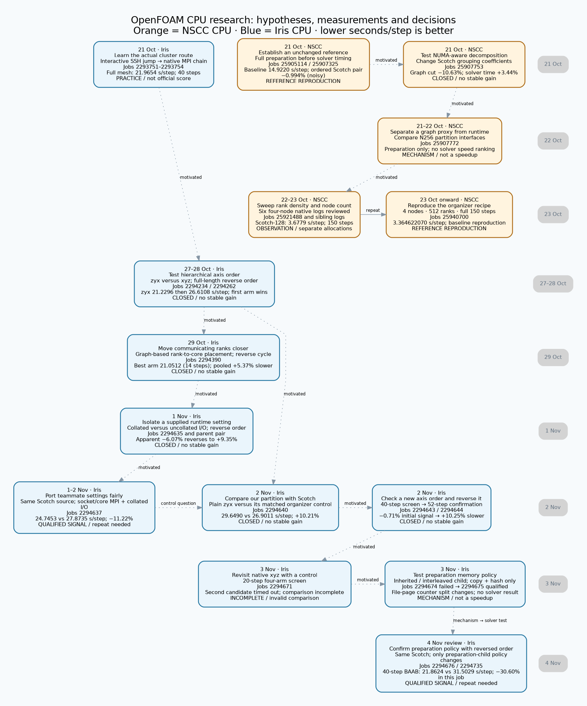

# OpenFOAM CPU research journey

This retrospective map groups **15 selected research milestones**, from the first Iris full-mesh practice to the preparation-policy investigation. Snapshot prepared 4 November 2026 including the completed native review on 4 November. It is an overview, not an exhaustive count of allocations or a live queue display.

Click the diagram to zoom. Orange identifies NSCC CPU; blue identifies Iris CPU. Read dates from top to bottom, as in the AI track. Milestones on the same date share a horizontal rank. Dotted arrows show which finding motivated the next question; they do not assert shared input payloads or direct code inheritance. The solid repeat arrow connects the historical four-node observations to the stronger organizer-recipe reproduction. Each node states its evidence level. A closed branch means the unchanged performance claim was rejected, not that its underlying diagnostic work was useless.

## What the investigation established

| Question | Retained answer |
|---|---|
| Can we reproduce the organizer recipe on NSCC? | Job 25940700: **3.364622070 seconds/step**, four nodes, 512 ranks, 150 steps. This is baseline reproduction, not our own optimization. |
| Do improved graph proxies ensure a faster solve? | No. The early NUMA candidate cut logical interfaces but ran **3.4416% slower**. The later reversed Iris graph-placement cycle ran **5.3685% slower**. |
| Did our own axis ordering beat its matched Scotch control? | Plain zyx was **10.2150% slower**. An xzy screen's **0.7097% lower time** reversed to **10.2525% slower**. No stable own matched win is established. |
| Did the supplied teammate runtime settings help on Iris? | Job 2294637: **24.7453 vs 27.8735 seconds/step**, or **11.2228% lower time**, with roughly 18–21% repeat drift. A qualified short-run signal; the recipe remains attributed to the teammate. |
| What is the latest distinct mechanism? | Preparation-child memory policy consistently changed aggregate file-page distribution in 2294675. It ran no solver. Native follow-up 2294676 gave a 1.77% screen; reverse 40-step 2294735 completed at 21.8624 versus 31.5029 s/step (30.60% lower in this job). Control drift and cross-allocation effect variation still limit promotion. |

A second is the wall-clock unit; one step is one solver iteration. Mean seconds/step includes every prescribed measured interval after the first iteration. Lower is better. A 14-step screen has 13 measured intervals; a 40-step test has 39, and a 150-step run has 149. Faster isolated arms and different horizons cannot establish a matched improvement.

Our selected Iris minimum **21.051168942 seconds/step** is one completed 14-step graph-placement arm. Organizer **22.358237138** and teammate **22.396949743** minima are separate 40-step arms. They are not a three-way ranking. NSCC's organizer reference **3.210832548** and the supplied Gadi result **2.079045460** belong to other runs/platforms and are not plotted as improvements along the Iris path.

## Explore and reproduce

- [Zoomable SVG](journey.svg), [PDF](journey.pdf), [PNG](journey.png).
- [Offline hover/zoom viewer](index.html), also [compressed for download](index.html.gz). Extract the gzip file and open the HTML locally. Hover shows result and decision; evidence links require the preserved repository tree.
- [Milestone data](milestones.json), [CSV](milestones.csv), [source hashes and validation](validation.json).
- [Earlier detailed journey](../hpc-research-journey-20261023/JOURNEY.md), [own-research attribution](../hpc-own-research-status-20261102/README.md), [matched Iris comparisons](../hpc-iris-comparison-20261103/README.md), [lowest-observation clarification](../hpc-iris-comparison-20261103/BEST_RECORDED.md).

Run `python3 build.py` from this directory with Python 3 and Graphviz `dot`. Rendering checks that each cited source exists and records its SHA-256. The build does not query clusters, authenticate or submit jobs. Prepared 4 November from retained written evidence; missing reviews are not invented. The graph is a source-linked research narrative, not a statistically validated causal model.
