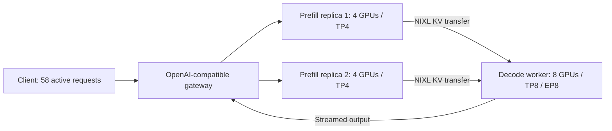

# How Qwen serving reached 2,938.628 good tokens/s

**Research review dated 19 October 2026.** This report explains the measured progression, the latest gain, what remains unproven, and where to spend the next GPU time. It does not submit a new job or change the official submission package.

An [illustrated overview of the full research journey](diagram/README.md) shows the GPU layout, measured progression, rejected branches, separate H100 lane and remaining verification loop. [Open the vector diagram](diagram/research-journey.svg) or [download the PDF](diagram/research-journey.pdf).

## Current answer

**Job 24724 is our highest locally accepted H200 observation: 2,938.628 good output tokens/s.** It combines DeepGEMM for prefill, an 8,192-token prefill chunk and HPC-Ops for decode. At the same concurrency of 58, the fresh auto-decode control 24721 scores 2,780.403: **a 5.6907% increase**.

This is our best measured H200 point, not a demonstrated global optimum or a contest leaderboard position. It is still **one successful deployment** of this combination. Its independent repeat 24737 and fresh control 24736 are pending. Full organiser accuracy at 99% of the reference evaluation score is also unverified.

**The research is not at a dead end.** A new interaction has just produced a useful gain. The sensible next move is to verify it, find its useful load range and inspect the remaining bottleneck. Increasing every setting or restarting a broad topology search would spend GPU time without answering those questions.

The H100 results remain separate: our highest locally accepted H100 observation is job 221590 at **2,430.891 good tokens/s**, using both-phase HPC-Ops at concurrency 54. Its repeat and next load step are queued. H200 and H100 scores are not pooled or converted into one ranked result.

## 1. What the number means

The workload asks the gateway to handle prompts of about **4,000 input tokens** and generate **200 output tokens**, with several requests active concurrently. The client replaces a completed request immediately; this is a **closed-loop** benchmark.

| Term | Meaning | Unit / condition |
|---|---|---|
| Concurrency, N | Number of requests the client keeps active | requests |
| TTFT | Time from request submission to its first output token | milliseconds; each good request must be ≤ 3,000 ms |
| Mean ITL within a request | Average time between successive output tokens for that request | milliseconds per token interval; each good request must be ≤ 20 ms |
| Joint SLA success | Fraction of all requests satisfying both limits, including failures in the denominator | percent; at least 90% required |
| Goodput | Rate of requests that satisfy both limits | good requests/s |
| Reported good output throughput | Goodput multiplied by the prescribed 200 output tokens | good tokens/s; the quantity we maximise |

A good score does not mean one request generates 2,939 tokens every second. Job 24724 serves **14.693 good requests/s in aggregate**, across the 58 active requests and all 16 GPUs.

The scored exports make the arithmetic inspectable:

| Item | Fresh control 24721 | Candidate 24724 |
|---|---:|---:|
| Scored requests | 1,734 | 1,829 |
| Requests meeting both latency limits | 1,713 | 1,809 |
| Effective scored elapsed time | 123.219530 s | 123.118666 s |
| Joint success fraction | 98.7889% | 98.9065% |
| Good output throughput | 1,713 / 123.219530 × 200 = **2,780.403** | 1,809 / 123.118666 × 200 = **2,938.628** |

The configured scoring phase is 120 seconds, with a 30-second grace period. Requests already in flight affect the exported effective elapsed time; the calculation above uses the validated export rather than silently substituting 120 as the denominator. Warmup and the separate profiler are not scored. The gain is mostly more completed good requests, not simply a better success percentage: joint success improves by only **0.1176 percentage points**.

Source: [contest rules](../../../2026-APAC-HPC-AI/1.%20Qwen3%20AI%20Task%20Rules.md), [numeric evidence](evidence.json), and the [validated latest comparison](../../../2026-APAC-HPC-AI/qwen-experiments/research-followup-20261019-0600/RESULTS.md).

## 2. What is running on the GPUs

The current layout is `P8-TP4_D8-TP8-EP8`, using **two nodes and 16 H200 GPUs**:



**Prefill** processes the input prompt and builds the attention key/value cache. **Decode** repeatedly produces the next output token. They have different batch shapes and costs, so the fastest implementation for one phase need not be the fastest for the other.

`TP4` means a prefill replica splits tensor computation across four GPUs. There are two such replicas. The decode worker uses eight GPUs with tensor and expert parallelism. Expert parallelism distributes the mixture-of-experts work; it does not remove model experts or choose a smaller model.

The current candidate retains the official FP8 checkpoint, BF16 KV cache, request-scoped heterogeneous-TP NIXL transport, round-robin prefill routing, FlashInfer decode attention and the MNNVL decode collective backend. **DeepGEMM and HPC-Ops are alternative GPU implementations of the MoE computation inside the same SGLang deployment.** We changed the prefill and decode implementations independently. We did not switch to a different model or use speculative decoding.

The 8,192-token **prefill chunk** is a token-processing budget for a prefill batch/iteration. It does not change the fixed roughly 4,000-token input workload into an 8,192-token prompt, shorten outputs or alter the per-request context limit.

Exact scripts: [24724 frozen configuration](../../../2026-APAC-HPC-AI/qwen-experiments/runs/24724/submitted/config.json), [worker](../../../2026-APAC-HPC-AI/qwen-experiments/runs/24724/submitted/worker.sh), and [submitted checksums](../../../2026-APAC-HPC-AI/qwen-experiments/runs/24724/submitted/SHA256SUMS).

## 3. The research progression

The work followed a repeated loop: inspect a failure or profile, propose a limited change, freeze its scripts, measure it, compare with a relevant control, and retain both successful and unsuccessful outcomes. Failed allocations were not counted as performance results.

### First, make the topology run correctly

Early topology trials exposed tokenizer/offline-cache problems, router startup races, conflicting ports, FP8 partition constraints and KV-transfer failures. Those problems had to be separated from performance. A topology that fails before scoring is not a slow-but-valid benchmark.

The heterogeneous-TP NIXL change prepares transfer descriptors for the current request. It enabled the selected TP4-prefill to TP8-decode layout to be explored. CPU byte-range checks were useful but did not prove model correctness: a later equal-TP8/EP2 candidate reached measurement yet failed output checks and was quarantined. We did not keep it because it ran successfully.

### Then, optimise the usable serving pipeline

The following milestones show where the retained trajectory went. These are **descriptive checkpoints**, not a controlled ablation in which each row changes exactly one factor. Loads, backends and deployment times differ. Do not add their percentages together.

| H200 milestone | Job / load | Good tokens/s | What the measurement contributed |
|---|---|---:|---|
| Working TP4-prefill → TP8/EP8-decode layout | 22415 / N48 | 1,912.300 | Early full-duration starting point; predates some later quality checks |
| Prefill chunk 4096 and load refinement | 23114 / N52 | 2,140.096 | Showed that batching and the operating load mattered |
| Round-robin prefill routing, decode graph tuning and MNNVL | 23778 / N52 | 2,592.162 | A later improved pipeline; this row does not isolate each component |
| Add FlashInfer decode attention to the retained pipeline | 23975 / N52 | 2,632.610 | Combination supported by repeat/control and long-output review |
| Extend that pipeline's load | 24263 / N56 | 2,667.465 | Established the next control region |
| DeepGEMM prefill | 24327 / N56 | 2,716.787 | Independent repeat; +1.7401% versus fresh 24320 |
| Intermediate prefill chunk 6144 | 24573 / N56 | 2,737.410 | Repeated small gain versus a fresh 4096-token control |
| Prefill chunk 8192 at N58 | 24721 / N58 | 2,780.403 | Fresh control, nearly identical to 24647 at 2,780.483 |
| Same auto-decode configuration at N60 | 24722 / N60 | 2,839.532 | Independent repeat 24732 now passes at **2,836.531** |
| Chunk 8192 plus HPC-Ops decode | 24724 / N58 | **2,938.628** | New interaction at fixed N58; its own repeat is pending |

Relative to the early 1,912.300 point, the latest observation is **53.67% higher** on H200. That is a description of the total measured trajectory, not a causal attribution to one patch, a same-load comparison or proof that all stages satisfy identical historical quality evidence.

Sources: [early tuning hypotheses](../../../2026-APAC-HPC-AI/qwen-experiments/serving-tuning/PLAN.md), [matched MNNVL/FlashInfer review](../../../2026-APAC-HPC-AI/qwen-experiments/serving-tuning-10/MATCHED_REVIEW.md), [DeepGEMM repeats](../../../2026-APAC-HPC-AI/qwen-experiments/research-followup-20261017-2335/RESULTS.md), [prefill/profile review](../../../2026-APAC-HPC-AI/qwen-experiments/research-followup-20261018-0800/RESULTS.md), [chunk repeats](../../../2026-APAC-HPC-AI/qwen-experiments/research-followup-20261018-1845/RESULTS.md), and [latest N60 repeat review](24732-review.json).

## 4. Why the latest combination can be faster

This is the strongest immediate evidence because both measurements use N58, the same chunk size and the same ranked protocol. The reviewer allows only the intended decode MoE runner difference and inherited speculative-runner setting, apart from random seeds. Speculative decoding itself remains disabled.

| Metric | Auto decode 24721 | HPC-Ops decode 24724 | Change |
|---|---:|---:|---:|
| Mean TTFT | 784.526 ms | 871.991 ms | **87.465 ms slower** |
| Mean ITL | 16.498 ms/interval | 14.998 ms/interval | **1.500 ms faster** |
| Joint SLA success | 98.7889% | 98.9065% | +0.1176 percentage points |
| Good output throughput | 2,780.403 | 2,938.628 good tokens/s | **+5.6907%** |

A rough way to understand the tradeoff is:

```text
request time ≈ TTFT + 199 output-token intervals × ITL
```

Saving about 1.500 ms across roughly 199 intervals corresponds to about **298 ms**. Subtract the additional 87 ms before the first token and the rough request cycle is about **211 ms shorter**. In a closed loop, earlier completions allow the client to start more requests. That is consistent with the higher count of completed good requests.

This arithmetic is an explanation of plausibility, not a performance model. Means do not reconstruct each request, GPU overlap, queues, transfer delays or the critical path. We have not yet profiled the exact winning H200 combination to prove which kernel or batch shape caused all of the gain.

The interaction itself matters. At chunk 4096 and N58, HPC-Ops decode gained only about **0.21%** (24639 versus 24589). At chunk 8192 and N58, it gains **5.69%** (24724 versus 24721). Both are observations, not proof of a universal rule. A plausible hypothesis is that prefill batching and decode implementation change each other's effective utilisation or request cadence. A fresh matched repeat and a profile of the winning configuration are needed to test that explanation.

## 5. Why this is not just a looser benchmark

The scored candidates keep the full 60-second warmup, 120-second scoring phase and 30-second grace period, the fixed workload/seed/cache-bust protocol, gateway endpoint and prescribed output settings. No request-rate substitution, failed-request filtering or new lossy precision change was introduced. The 360-second whole-client limit aborts a stalled client; it does not make a truncated benchmark count as passing.

Acceptance checks include terminal accounting, sealed artifacts, frozen submitted hashes, raw request/phase counts, intended resolved runtime, decode rank coverage, zero errors/cancellations, the per-request joint SLA gate, short-output nonregression and all 12 long retrieval cases. Exported output lengths are retained: both 24721 and 24724 span **199–200 tokens**, with means **199.99885** and **199.99781** respectively. We report that observation rather than claiming every token counter is exactly 200; the unchanged scoring convention multiplies qualifying requests/s by 200. This tiny export-length difference is not evidence of an intentional output-shortening optimisation.

The remaining important gap is **full official accuracy**, which compares benchmark task scores with the organiser's unmodified FP8 reference. Local short/long diagnostics do not replace it. Neither a fast result nor these output checks is an official score or final compliance certificate.

## 6. Is it the best yet?

| Question | Answer supported by the evidence |
|---|---|
| Best observed H200 goodput in our retained full-protocol data? | **Yes: 24724, 2,938.628 good tokens/s.** A snapshot scan finds 99 eligible H200 observations and no higher one. |
| Independently reproduced at this configuration/load? | **Not yet.** 24737 is pending. The newly completed 24732 repeats the different auto-decode N60 configuration. |
| Best on every metric? | **No.** The new point improves goodput while worsening mean TTFT versus its matched control. A low-load point can have better latency but lower total goodput. |
| Official contest winner or world SOTA? | **Unknown.** We do not have a verified cross-team leaderboard comparison or official scored rerun. |
| Globally optimal configuration? | **Not established.** The tested search is finite and several interactions remain unexplored. |
| Ready to claim full organiser accuracy? | **No.** That evaluation remains outstanding. |

The same scan finds 61 eligible H100 observations, topped by 221590 at 2,430.891. The scan checks exported full-duration protocol, reported SLA pass and zero errors/cancellations; it is not a new full runtime/quality audit of every historical point. The current candidate's stronger local review is linked separately. See [ranking snapshot and scope](historical-ranking-scan.json).

## 7. What failed, and what those failures tell us

| Branch | Retained result | Research decision |
|---|---|---|
| Increase H200 chunk from 8192 to 12288 at N58 | 24723: 2,714.261, **−2.3789%** versus 24721 | Stop increasing chunk; larger batches are not automatically faster. |
| Combine HPC-Ops prefill with chunk 6144 on H200 | 24640: 2,714.903, below the better individual observations | Do not assume gains add; keep phase choices platform-specific. |
| Disable prefill CUDA graphs with DeepGEMM | 24426: 1,590.313, joint success 72.721% | Reject this setting; fewer startup graph seconds do not justify a failing serving point. |
| Equal-TP8/EP2 topology repair | 24375: 28.329, joint success 1.9978%, short outputs fail | Quarantine; correct-looking transfer geometry is not end-to-end correctness. |
| Prefetch as a throughput improvement on H100 | Initial small gain reversed in the paired repeat | Separate startup-cost observations from sustained-throughput claims. |
| N58 chunk-8192 repeat stalls during warmup | 24588: no scored result | Preserve failure; bounded later success does not establish the stall's root cause is repaired. |

A losing branch is not the same as a dead research programme. These results narrow where the next experiment can be informative. Repeating the same failure, or increasing a losing chunk without a new explanation, would be a poor use of GPU time.

## 8. Recommended next direction

### Priority 1 — establish a dependable incumbent

Finish the already submitted fresh control 24736 and interaction repeat 24737. Compare the new candidate with the new control at identical N58, not only the most favourable old number. Retain every run. If the gain repeats with the complete local gates, designate this exact frozen bundle as the incumbent. If the gain vanishes, inspect nodes, runtime, phase counts and request distributions before deciding whether an additional paired measurement is justified.

The N60 auto-decode repeat 24732 passes at 2,836.531, only **0.106% below** its original 2,839.532. That demonstrates useful stability for that configuration; it does not validate the separate HPC-Ops interaction.

### Priority 2 — find the useful load range, then stop tuning load

Use already queued 24738 to compare the interaction at N60 against the N58 interaction repeat. Compare it with auto-decode N60 repeat 24732 to isolate the runner at matched load. Existing 24733 tests auto decode at N62. H100 221645/221646 independently test N54 repeat and N56. Their results should guide the next decision; no automatic higher load follows.

Stop load expansion when it adds no practically useful goodput or consumes too much per-request latency margin. The 90% threshold is a pass line, not a target to approach unnecessarily. If the next small gain reverses across repeats, report a plateau rather than continually choosing the maximum noisy point. Judge practical value against observed repeat variation; do not invent a universal noise threshold from two samples.

### Priority 3 — close the official accuracy and reproducibility gap

Establish the actual organiser evaluation tasks, harness settings and reference score. Run that evaluation on the frozen candidate when the required materials and GPU budget are available. Keep it separate from throughput tuning. Preserve checkpoint identity, image hashes, worker flags, transport patches and exact launch scripts so the organiser can reproduce the deployment. A failed official accuracy check takes precedence over a higher throughput number.

### Priority 4 — follow profiling into communication or scheduling

Profile the actual winning H200 combination after its repeat, using separate diagnostic traffic. The older H100 trace already motivates a **fixed-load, prefill-only NCCL Tree trial**, job 221669, queued after the H100 load pair. Source and runtime establish NCCL 2.28.9, but the new trace still must prove Tree execution. Automatic NCCL selection may be faster; forcing Tree is a testable hypothesis, not an assumed optimisation.

If that changes the bottleneck usefully, test the corresponding idea on H200 with its own control. If not, close it. Only investigate a custom collective, another communication path, more expert-parallel changes or a kernel implementation after the winning trace shows a relevant cost and the exact image supports the change. Avoid reopening quarantined transfer configurations without an isolated correction and strong output evidence.

### When should we change direction more substantially?

Change from configuration/load tuning to a deeper bottleneck investigation when useful nearby settings repeatedly plateau, confirmed gains become too small relative to run variation, or the profile shows remaining cost that the current settings cannot address. A more expensive alternative runtime or custom kernel project should have a measurable target, an accuracy plan and a bounded experiment before allocating a new campaign.

That condition has **not yet been established here**: the latest useful change is +5.69%, its repeat is still pending, and several informative jobs are already queued. We should complete those decisions before declaring the approach exhausted.

## 9. Use credit for decisions, not version counts

At the last reconciled ledger snapshot, 19 October 13:40:01 SGT, the project has **36,024.320 SU Balance**. Three queued PBS jobs reserve at most **4,608 SU**; conservative headroom under the existing internal 51,000-SU operating bound is **18,416.320 SU**, with a separate 13,000-SU buffer. These are planning bounds, not organiser-imposed research caps or a freshly queried ledger for this report.

Prefer one change, one relevant control and a stated stopping rule. Preserve queue positions and avoid spending H100 credit on a branch already contradicted by its outputs. The organiser rules allow short exploratory runs; they can be useful for labelled screening when startup can be amortised safely. Keep those results out of the full-duration comparison and use full runs for confirming an incumbent. A shorter benchmark does not remove model-loading cost, so compare information gained per allocation as well as seconds of client traffic.

This report creates **no new GPU job** and restarts no VPN or automation. Existing jobs continue. Commit category requested by the owner: **`report`**. New future measurements must update the handoff and relevant report rather than silently treating this dated snapshot as live.

## Evidence and reproduction

- [Machine-readable numbers and caveats](evidence.json); regenerate with `python3 build-evidence.py` on the original source tree.
- [Review of completed N60 repeat 24732](24732-review.json) and [review script](review-latest-repeat.py).
- [Dated Slurm accounting](slurm-accounting.txt), [Slurm queue](slurm-queue.txt), and [PBS queue/accounting](pbs-queue-accounting.txt).
- [Latest single-factor candidate reviews](../../../2026-APAC-HPC-AI/qwen-experiments/research-followup-20261019-0600/slurm-reviews.json).
- [Pending jobs, source hashes and stopping rules](../../../2026-APAC-HPC-AI/qwen-experiments/research-followup-20261019-0600/PLAN.md).
- [Exact current runtime source and failed extraction corrections](../../../2026-APAC-HPC-AI/qwen-experiments/research-followup-20261019-0600/engine-source-manifest-v2.json).
- [NVIDIA NCCL 2.28 algorithm selection reference](https://docs.nvidia.com/deeplearning/nccl/archives/nccl_2283/user-guide/docs/env.html#nccl-algo), previously checked during preparation of the communication trial.

Links use repository-relative paths so the report can be read on GitHub. Larger raw artifacts referenced by run paths require the sibling object store; GitHub hosts their manifests, not those external bytes. Historical milestones have unequal validation coverage, so this report does not upgrade old evidence to a later acceptance standard.
