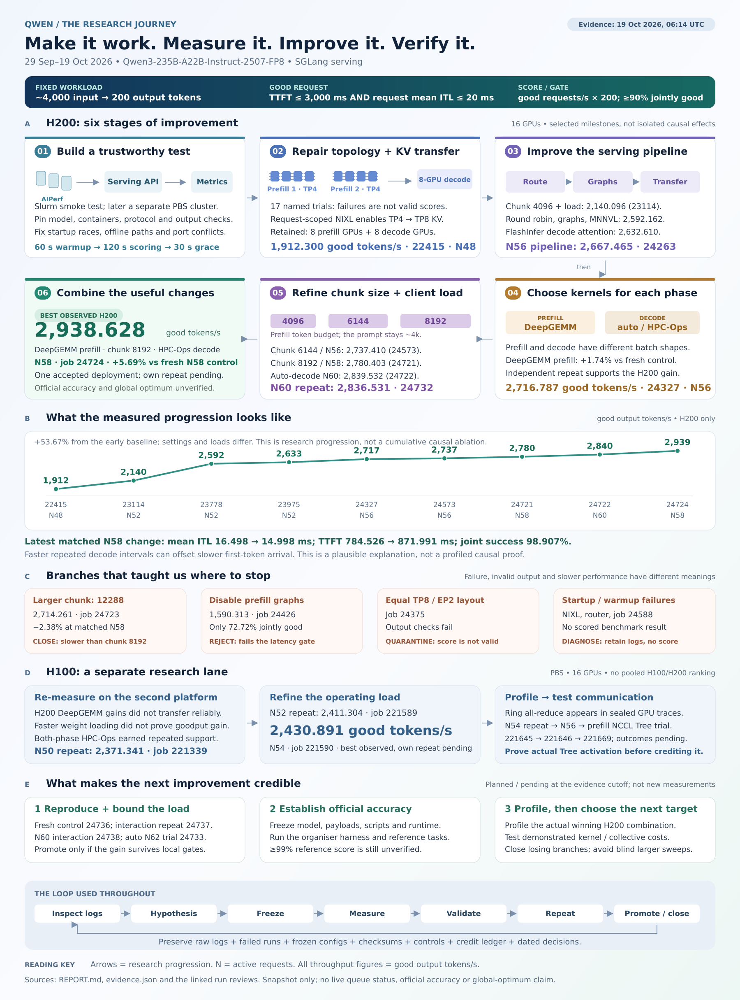
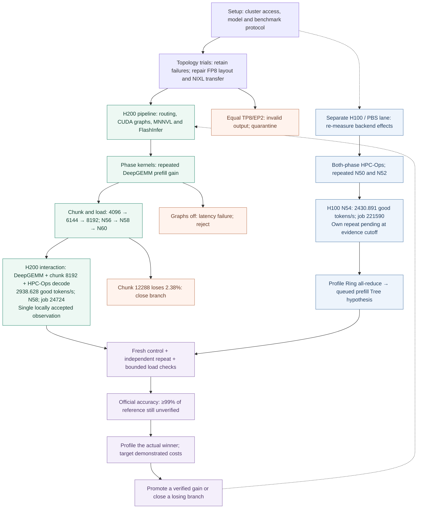

# The Qwen research journey, illustrated

**Evidence reviewed through 19 October 2026, 06:14 UTC.** This is the research history from the first cluster smoke test through the latest reviewed improvement. Pending labels are from that dated review, not live scheduler status.

[Open the scalable diagram](research-journey.svg) · [Download the PDF](research-journey.pdf) · [Open the full-size PNG](research-journey.png) · [Read the detailed research report](../REPORT.md)



## How to read the picture

Follow the numbered H200 path **01 → 02 → 03 → 04 → 05 → 06**; the second row runs from right to left. The GPU drawing shows two four-GPU prefill replicas feeding an eight-GPU decode worker. The phase-specific kernel drawing shows where DeepGEMM and HPC-Ops operate. The chunk blocks illustrate a batch token budget, not a change to the roughly 4,000-token prompts.

The measured H200 trajectory rises from **1,912.300 to 2,938.628 good output tokens/s**, a descriptive increase of **53.67%**. Loads and settings differ across the milestones; the arrows do not establish the separate causal contribution of every change. The early baseline also predates some later output checks. The plot uses selected categorical milestones, not elapsed time or every measured result. Rounded plot labels are illustrative; the exact figures and run paths are retained in [evidence.json](../evidence.json).

The latest matched comparison holds concurrency at 58: **2,780.403 → 2,938.628 good tokens/s**, or **+5.69%**, with DeepGEMM prefill, chunk 8192 and HPC-Ops decode. Mean inter-token time improves from 16.498 to 14.998 ms, while mean time to first token rises from 784.526 to 871.991 ms. Repeated decode savings can outweigh the initial delay. This explains why the observation is plausible; a profile of the actual winning deployment is still needed to establish the mechanism.

The orange branches retain unsuccessful research: a slower chunk setting, a latency-gate failure, an output-check failure and attempts that never reached scoring. They are different outcomes, and none is silently counted as a successful configuration.

The blue H100 lane is separate because hardware effects must be measured on that platform. Its highest reviewed local observation is **2,430.891 good tokens/s**. It is not plotted as a competing H200 point or converted into an H200 estimate.

The last row shows the remaining gates: independent repeats and fresh controls, useful load range, organiser accuracy and profiling. The H200 peak remains **one locally accepted deployment** of that combination. Neither a global optimum nor official accuracy at 99% of the reference score has been demonstrated.

## Terms used in the diagram

| Term | Meaning |
|---|---|
| Prefill | Process an input prompt and build its attention key/value cache. |
| Decode | Generate output tokens repeatedly using that cache. |
| TP4 / TP8 | Split tensor computation over four / eight GPUs. |
| EP8 | Distribute mixture-of-experts computation across eight GPUs. |
| NIXL | The transport used here to transfer the key/value cache between prefill and decode workers. |
| SGLang | The serving runtime hosting the checkpoint and the tested backends. |
| DeepGEMM / HPC-Ops | Alternative GPU implementations for mixture-of-experts computation inside the serving runtime. |
| CUDA graphs | Replay prepared GPU execution sequences to reduce launch overhead. |
| MNNVL / NCCL | Communication implementations used or investigated for cooperation between GPUs. |
| FlashInfer | The selected decode attention implementation in the retained pipeline. |
| Chunk size | The token-processing budget of a prefill batch or iteration. |
| N | Number of requests kept active concurrently by the benchmark client. |
| TTFT / ITL | Time to first token / mean interval between tokens within a request, measured in milliseconds. |
| Good tokens/s | Requests meeting both latency limits per second, multiplied by the prescribed 200 output tokens. Errors remain in the success-rate denominator. |
| Fresh control / repeat | A new deployment of the comparison configuration / a new deployment of the candidate. They help distinguish useful changes from run variation. |

## Evidence behind the stages

| Illustrated stage | Retained evidence |
|---|---|
| Setup, topology and transfer repair | [Topology results](../../../../2026-APAC-HPC-AI/qwen-experiments/TOPOLOGY_RESULTS.md), [recovery results](../../../../2026-APAC-HPC-AI/qwen-experiments/RECOVERY_RESULTS.md), [early tuning plan](../../../../2026-APAC-HPC-AI/qwen-experiments/serving-tuning/PLAN.md) |
| Routing, graphs, MNNVL and attention | [Matched pipeline review](../../../../2026-APAC-HPC-AI/qwen-experiments/serving-tuning-10/MATCHED_REVIEW.md) |
| Phase-specific kernels and invalid topology | [DeepGEMM repeat and topology review](../../../../2026-APAC-HPC-AI/qwen-experiments/research-followup-20261017-2335/RESULTS.md) |
| Graph-off and profile interpretation | [Prefill experiments](../../../../2026-APAC-HPC-AI/qwen-experiments/research-followup-20261018-0800/RESULTS.md) |
| Chunk and backend repeats | [Matched repeat review](../../../../2026-APAC-HPC-AI/qwen-experiments/research-followup-20261018-1845/RESULTS.md) |
| H100 profiling and recovered results | [Cross-platform review](../../../../2026-APAC-HPC-AI/qwen-experiments/research-followup-20261019-0400/RESULTS.md) |
| H200 N60 and H100 N54 | [Load refinement](../../../../2026-APAC-HPC-AI/qwen-experiments/research-followup-20261019-0527/RESULTS.md), [independent H200 N60 review](../24732-review.json) |
| Best H200 interaction and next controls | [Latest interaction review](../../../../2026-APAC-HPC-AI/qwen-experiments/research-followup-20261019-0600/RESULTS.md) |

## Editable flow version

The Mermaid version exposes the branch relationships in a form GitHub can render. The SVG/PNG above contains the GPU illustration and the measured trajectory as well.



## Rebuild

From this directory, run:

```bash
python3 build-diagram.py
```

The builder reads numeric milestones from the parent `evidence.json`, writes vector SVG, renders PNG and PDF with `rsvg-convert`, and checks the plotted figures and percentage arithmetic. It uses local vector illustrations; there are no downloaded images, external fonts, network calls, GPU jobs or runtime asset dependencies. The PNG was visually reviewed after rendering. `validation.json` records the numerical checks; this is diagram validation, not a new benchmark or model-quality evaluation.
