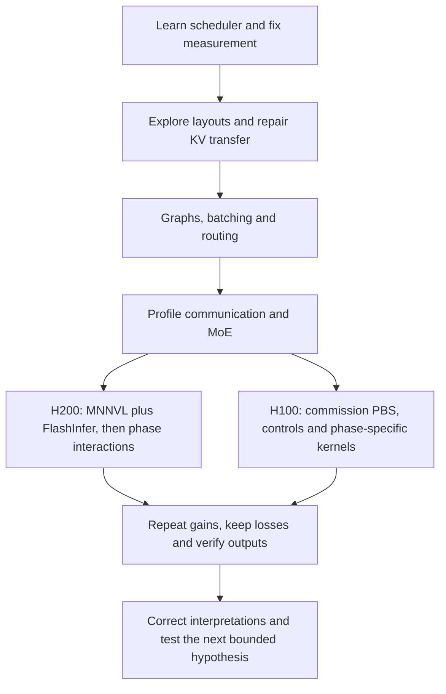

Latest continuation: [N60 repeat, raw failure attribution and observed polling trials](entries/20261020-receive-polling.md).

Latest methodology review: [20 October observability, missing telemetry and profiler-control fix](entries/20261020-observability.md).

Latest continuation: [20 October 2026 — runner confirmation, collective screens and decode attention](entries/20261020-serving-and-collective.md). The 32-stage retrospective below retains its original dated scope.

# The research journey: observations, decisions and improvements

This is a retrospective reading guide to the **retained** Qwen research, from the first cluster experiments through the inference-mode submissions recorded on 19 October 2026. It was assembled from the existing plans, run notes and reviews; it is not a recreated verbatim conversation or an assertion that every original thought survived. H200 and H100 work proceeded in parallel, so the sections follow the decisions in each branch rather than inventing one universal execution timeline.

For an individual attempt, use the [194-job index](JOBS.md). For every retained written record, use the [247-document index](DOCUMENTS.md). The [coverage audit](AUDIT.md) distinguishes records actually committed to Git from claims that cannot be established. The original [illustrated journey](../diagram/README.md) and [numeric overview](../REPORT.md) remain dated companions.

Every stage below answers: **what prompted the test, what changed, what was observed, and what we decided next**. A failed allocation is not a benchmark result; a pending plan is not an improvement. All quoted throughput is **good output tokens/s**, unless explicitly labelled otherwise. The benchmark requires TTFT ≤3000 ms and request-mean ITL ≤20 ms, jointly satisfied by at least 90% of all requests; errors remain in the denominator. Local output diagnostics never certify the official ≥99%-of-reference accuracy requirement.

## 1. Establish the rules and the actual objective

**Question.** What does a successful submission optimise, and which track applies?

**Work.** Read the Qwen task rules and preserve explanations of the synthetic throughput workload, request-level latency limits, goodput and the separate accuracy evaluation. Keep Qwen serving as the active scope; leave HPC submission directories empty.

**Observation.** Completing the dataset or maximising raw generated tokens is insufficient. A request contributes to goodput only when both latency conditions pass. An altered output from a precision change can also affect the independent accuracy requirement.

**Decision.** Keep performance, output diagnostics and official accuracy as distinct gates. Do not claim contest acceptance from a fast API benchmark. [Rules](../../../../2026-APAC-HPC-AI/1.%20Qwen3%20AI%20Task%20Rules.md), [initial research](../../../APAC-HPC-AI-2026-research.vi.md), [metric definitions and calculation](../REPORT.md).

## 2. Learn login nodes, GPU allocations and persistent storage

**Question.** Why use Slurm instead of running Python directly, why does a job see only one H200, and how are files shared?

**Work.** Preserve the hello-GPU example and explanations of sbatch, srun, interactive allocations, logs, shared paths and job lifetime. The early hello-GPU job 20201 demonstrated a real allocated GPU worker.

**Observation.** The login machine is not an unrestricted GPU allocation. Running an sbatch file with plain bash does not create Slurm variables or reserve resources. Seeing one GPU reflects that allocation, not the complete cluster inventory. Files must be placed on paths visible to the allocated nodes.

**Decision.** Launch compute through the scheduler and preserve scripts, job IDs and logs together. Later distinguish the H200 Slurm platform from the H100 PBS platform. [Tutorial collection](../../../tutorial/README.md), [conversation milestones](../../../notes/TIMELINE.md).

## 3. Make the first 07/09 comparisons measurable

**Question.** Can the initial disaggregated serving layouts complete the actual benchmark?

**Work.** Test the original candidate layouts, repair tokenizer/offline-cache setup and separate cold KV bootstrap from steady-state measurements. The names 07 and 09 are experiment identifiers, not performance ranks.

**Observation.** Job 22130 failed before a valid export. Job 22131's long N32 point reached 1472.73 with passing latency, while higher-load and cold-path attempts did not establish a usable gain. Some early files were edited before/during client execution, so those snapshots are not immutable submission-time history.

**Decision.** Preserve those provenance limitations, confirm full-duration points and refine load rather than declaring the largest short sweep the winner. [Initial results](../../../../2026-APAC-HPC-AI/qwen-experiments/RESULTS.md), [individual run notes](../../../../2026-APAC-HPC-AI/qwen-experiments/RUNS.md#job-22131).

## 4. Expand the topology search and correct the stopping condition

**Question.** Would different prefill/decode GPU splits and TP/EP layouts improve the serving pipeline?

**Work.** Submit 17 original topology attempts across the fixed 16-GPU resource envelope, retaining all attempted layouts and exports.

**Observation.** The first wave produced measurements for only eight layouts; nine failed before benchmarking. Two layouts had passing long confirmations, including 22219 at N40 and 1666.01. Terminal scheduler states had been incorrectly treated as completing the research request.

**Decision.** Correct the count explicitly: finishing a job is not finishing a measurement. Build a recovery plan around missing exports and retain deployment failures as failures, not zero-throughput observations. [First-wave review](../../../../2026-APAC-HPC-AI/qwen-experiments/TOPOLOGY_REVIEW.md), [all layouts](../../../../2026-APAC-HPC-AI/qwen-experiments/TOPOLOGY_RESULTS.md).

## 5. Separate incompatible FP8 layouts, startup errors and transfer timeouts

**Question.** Why did the missing layouts fail, and what can legitimately be repaired?

**Work.** Inspect first exceptions, distributed ports, model shard geometry and each prefill/decode warmup path. Test EP2 replacements for the TP8/EP1 weight-loading incompatibility and use distinct identities for the replacements.

**Observation.** A 192-wide shard did not satisfy the 128-wide FP8 block constraint on the original path. A separate attempt hit an occupied distributed port. Other workers became ready but their pair warmups timed out; increasing timeouts alone did not prove a transport repair.

**Decision.** Preserve the three incompatible originals as unmeasured. Keep replacements separately named, fix isolated operational errors and investigate transfer work rather than assigning every failure the same cause. [Failure classification](../../../../2026-APAC-HPC-AI/qwen-experiments/TOPOLOGY_REVIEW.md), [recovery decisions](../../../../2026-APAC-HPC-AI/qwen-experiments/RECOVERY_RESULTS.md).

## 6. Replace full-pool heterogeneous-TP descriptors with request-scoped work

**Question.** Is preparing KV descriptors for the entire cache an avoidable startup burden?

**Work.** Inspect the exact image's NIXL implementation, create descriptors only for the current request and coalesce appropriate contiguous ranges. Compare byte ranges in 720 CPU geometry cases, then test real GPU transport.

**Observation.** The old TP8 example could prepare approximately 403.8 million descriptors per rank. Job 22294 completed actual transfers and a full N32 confirmation at 1422.96 with no errors/cancellations. CPU range equivalence alone had not established GPU transport or model accuracy.

**Decision.** Retain the narrowly scoped patch, source hashes and separate GPU evidence; do not generalise it to every topology or call it an accuracy certificate. [Patch, hypothesis and validation](../../../../2026-APAC-HPC-AI/qwen-experiments/nixl-ondemand/README.md).

## 7. Complete the equal-TP recovery without hiding the failed attempts

**Question.** Why did the remaining TP8→TP8 variant still spend so long warming up?

**Work.** Preserve partial job 22750 and timeout 22778, then prepare a separately scoped equal-TP8 descriptor change. Validate 936 CPU cases and excluded-layout fallbacks before another GPU attempt.

**Observation.** Job 22809 completed all four sweeps and a long N32 point at 1507.96, with 95.38% joint success. N40/N48 did not pass the required fraction. The retained search now had 14 measured original layouts and three measured EP2 replacements, not successful measurements of the three incompatible originals.

**Decision.** Keep the counting distinction and all historical attempts. Use the stronger measured layout rather than selecting this repaired layout merely because it now ran. [Equal-TP patch and GPU review](../../../../2026-APAC-HPC-AI/qwen-experiments/nixl-equal-ondemand/README.md), [recovery ledger](../../../../2026-APAC-HPC-AI/qwen-experiments/RECOVERY_RESULTS.md).

## 8. Choose a usable baseline and inspect its decode batch shapes

**Question.** What should configuration tuning start from after topology recovery?

**Work.** Retain TP4 prefill replicas feeding TP8/EP8 decode, with eight GPUs assigned to each phase. Establish full-duration baseline repeats and a separate diagnostic profile.

**Observation.** Job 22415 provided the early N48 point at 1912.30. Fresh 23102/23104 N48 controls were approximately 1911.08/1910.32. Actual decode batches commonly fell between captured graph sizes, motivating a denser list.

**Decision.** Use this deployment as an inspectable baseline and test graph/batching changes at matched load. Historical quality coverage is weaker than later strict reviews and is not retroactively upgraded. [First serving plan](../../../../2026-APAC-HPC-AI/qwen-experiments/serving-tuning/PLAN.md).

## 9. Test dense decode graphs, chunk size and standalone controls

**Question.** Do graph padding and prefill batching leave useful performance on the table?

**Work.** Capture decode batch sizes 1–64, test chunk4096 and compare standalone deployments rather than relying only on points measured after another load in the same process.

**Observation.** Initial graph/chunk observations were positive but varied across controls. The later matched chunk4096+dense N52 points were 2078.96 and 2079.18; the chunk-only repeat was about 2032.13. A high earlier point by itself was insufficient to identify the cause.

**Decision.** Retain the repeated scheduling configuration and keep workload, precision and fixed-load comparisons explicit. Reject additive interpretations across differently loaded stages. [Wave 1](../../../../2026-APAC-HPC-AI/qwen-experiments/serving-tuning/PLAN.md), [standalone comparison plan](../../../../2026-APAC-HPC-AI/qwen-experiments/serving-tuning-02/PLAN.md), [completed summary](../../../../2026-APAC-HPC-AI/qwen-experiments/serving-tuning-03/PLAN.md).

## 10. Keep a model-output baseline separate from throughput

**Question.** Does an output failure come from a serving change or exist in the reference deployment too?

**Work.** Preserve the original eight short cases and the independent monolithic diagnostic 23146, then compare new cases against that baseline without weakening expected answers.

**Observation.** The reverse-string case already failed independently. Later research eligibility could therefore record 7/8 with no new failure; that did not turn the wrong answer into a pass or establish official task accuracy.

**Decision.** Keep exact responses, expected answers and nonregression limits. Add stronger long-context checks later, while leaving the organiser's separate accuracy requirement unresolved. [Recorded diagnostic and gates](../../../../2026-APAC-HPC-AI/qwen-experiments/serving-tuning-03/PLAN.md), [23146 notes](../../../../2026-APAC-HPC-AI/qwen-experiments/RUNS.md#job-23146).

## 11. Find a useful load range rather than increasing concurrency blindly

**Question.** How far can the repeated scheduling baseline sustain more simultaneous requests?

**Work.** Run a fresh N52 control, bounded higher-load points, a midpoint when needed and a repeat of the selected point.

**Observation.** The old cache-aware pipeline reached approximately 2157.31/2159.79 at N58. These were usable observations, not proof that every still larger load would improve goodput.

**Decision.** Use measured joint latency, errors and goodput decline to guide load steps. A startup failure does not identify a capacity boundary. [Load-refinement plan and results](../../../../2026-APAC-HPC-AI/qwen-experiments/serving-tuning-03/PLAN.md).

## 12. Change prefill routing after observing poor first-token latency

**Question.** Would distributing these synthetic requests across prefill replicas more evenly help admission?

**Work.** Compare round-robin prefill routing with the cache-aware policy and separately test a one-request prefill-batch restriction.

**Observation.** Round-robin pilot 23325 reached 2402.64 at N52 versus 2075.11 for the fresh control, a single 15.78% observation. Mean TTFT fell from 1437.63 to 333.25 ms while mean ITL rose near the 20 ms limit. The other prefill restriction added only about 0.34%.

**Decision.** Repeat round-robin and examine decode latency headroom. Faster admission filling decode more heavily is a plausible mechanism, not a proven causal decomposition. [Prefill hypotheses](../../../../2026-APAC-HPC-AI/qwen-experiments/serving-tuning-04/RESEARCH.md), [confirmation plan](../../../../2026-APAC-HPC-AI/qwen-experiments/serving-tuning-05/PLAN.md).

## 13. Revisit backend effects on the new, fuller pipeline

**Question.** Do old backend results transfer after routing changes the sustained batch shape?

**Work.** Collect a fresh round-robin control/profile and test FP8 KV and DeepGEMM decode independently at N52. Refine load around the repeated router configuration.

**Observation.** Control 23607 scored about 2400.02. FP8 KV 23608 and DeepGEMM decode 23609 failed the required joint success fraction in this configuration. N53 reached 2433.41 and was independently repeated as 23773.

**Decision.** Keep BF16 KV and close the tested losing backend branches. Their failure does not rule out a different phase/backend interaction later. [New-profile/backend plan](../../../../2026-APAC-HPC-AI/qwen-experiments/serving-tuning-06/PLAN.md).

## 14. Follow the profile into collective and attention implementations

**Question.** Can the decode collective or attention path improve the current operating point?

**Work.** Prepare separate MNNVL fusion, FlashInfer attention and CUTLASS MoE pilots, requiring resolved runtime evidence and full exports.

**Observation.** MNNVL 23778 scored 2592.16 and repeat 23839 approximately 2592.92, about 8% above the matched N52 control. TTFT increased while ITL improved. FlashInfer alone was only a near-tie with the existing incumbent. CUTLASS 23776 failed during graph capture before measurement; the asynchronous CUDA traceback did not identify a proven faulty kernel.

**Decision.** Retain the reproduced collective improvement, preserve the tradeoff and investigate combinations. Keep the capture failure incomplete rather than reporting a low benchmark score. [Backend plan and completed reviews](../../../../2026-APAC-HPC-AI/qwen-experiments/serving-tuning-07/PLAN.md).

## 15. Test attention-DP as a package, without copying competitor claims

**Question.** Could attention data parallelism with distributed experts change the useful architecture?

**Work.** Use public scheduler labels only to motivate a hypothesis, inspect the exact runtime and test DP attention with DeepGEMM/DeepEP at the established load.

**Observation.** Job 23780 reached 2549.20 at N52, above the old control but below MNNVL's observation. It changed scheduling, attention grouping, dispatch and fusion together. Another team's job names revealed neither its implementation nor its benchmark results.

**Decision.** Treat it as an architecture-package comparison with its own repeat and output constraints; do not attribute the outcome to one flag or claim access to a competitor's research. [Public-history limits](../../../../2026-APAC-HPC-AI/qwen-experiments/research-public-slurm-2026-10-15/README.md), [architecture pilot and repeat audit](../../../../2026-APAC-HPC-AI/qwen-experiments/serving-tuning-08/PLAN.md).

## 16. Test interactions rather than adding independent speedups

**Question.** Does FlashInfer decode attention help when MNNVL is already enabled?

**Work.** Test the combined deployment, separate chunk alternatives, independent combo repeats and a fresh MNNVL control. Append long retrieval diagnostics after scoring.

**Observation.** The combined pipeline reached the later 2632.610 observation at N52. Its evidence includes repeated comparisons, actual resolved backends and the stronger long-output review. Separate chunk alternatives did not automatically compound the earlier improvements.

**Decision.** Carry forward the measured combination and require comparable controls for future phase interactions. [Interaction plan](../../../../2026-APAC-HPC-AI/qwen-experiments/serving-tuning-09/PLAN.md), [matched repeat review](../../../../2026-APAC-HPC-AI/qwen-experiments/serving-tuning-10/MATCHED_REVIEW.md).

## 17. Commission the second platform before comparing performance

**Question.** Can the same research be deployed on the PBS/H100 cluster?

**Work.** Establish access without retaining authentication material, transfer verified image/model assets and adapt execution through PBS/Singularity. Preserve the initial probe and environment failures.

**Observation.** Jobs 220453–220457 exposed wrapper/environment issues before the successful GPU probe. A private temporary cache fixed a later permission problem; 220489 still timed out while weights were loading. Baseline 220562 finally produced a full N32 point near 1565.16 after long startup.

**Decision.** Separate access, launch and loader failures from serving throughput. Use the H100 platform to test hypotheses with its own controls; do not pool or blindly scale its scores into H200 rankings. [PBS deployment history](../../../../2026-APAC-HPC-AI/qwen-experiments/nscc-pbs/README.md), [cross-platform comparison limits](../../cross-platform-20261017/REPORT.md), [access explanations](../../../notes/TIMELINE.md).

## 18. Reduce wasted startup and charge credit conservatively

**Question.** Can each allocation deliver more useful measurements, and why is prefill loading slower?

**Work.** Use a bounded in-allocation load grid, inspect exact loader defaults and prepare prefill-only checkpoint prefetch. Preserve accounting, maximum reservations and reconciliation against the published ledger.

**Observation.** Baseline prefill load was about 851 seconds versus approximately 99 seconds for decode, but EP ownership, CPU placement and cache state also differed. Prefetch later reduced observed startup, while its small sustained-throughput gain did not survive the paired repeat.

**Decision.** Do not identify I/O as the sole cause from timings or claim a repeatable throughput gain from prefetch. Release reservations only after charges reconcile; the initial campaign cap is historical and later changes are explicitly recorded. [Loader investigation](../../../../2026-APAC-HPC-AI/qwen-experiments/nscc-pbs/LOADER_RESEARCH.md), [initial bounded campaign](../../../../2026-APAC-HPC-AI/qwen-experiments/nscc-pbs/CONTINUOUS_RESEARCH.md), [later results](../../../../2026-APAC-HPC-AI/qwen-experiments/research-followup-20261018-0800/RESULTS.md).

## 19. Establish each platform's frontier and retain design-only alternatives

**Question.** Where do the measured pipelines plateau, and which larger alternatives are actually implemented?

**Work.** Repeat the H200 N56/N58 and H100 N48/N50/N52 regions, while researching EAGLE3/native token comparison and an alternative vLLM runtime separately.

**Observation.** The 17 October frontier review found H200 N56 around 2670.46 mean and H100 N50 around 2223.93 mean; higher tested loads did not automatically win. EAGLE3 token-suite/source work and the alternative-runtime plan remained preparation, not scored model deployments.

**Decision.** Stop blind load growth and use the actual incumbent profile for the next factor. Keep proposed, CPU-validated, GPU-executed and quality-accepted work distinct. [Frontier review](../../../../2026-APAC-HPC-AI/qwen-experiments/nscc-pbs/inspection/manual-20261017-0858/RESULTS.md), [design-only branches](../../../../2026-APAC-HPC-AI/qwen-experiments/nscc-pbs/research-next/README.md).

## 20. Test DeepGEMM specifically in prefill

**Question.** Would a MoE implementation that lost in decode behave differently on larger prefill batches?

**Work.** Test prefill-only DeepGEMM with a fresh control and independent repeat, retaining decode, workload and quality checks.

**Observation.** H200 repeat 24327 reached 2716.787 at N56, about 1.7401% above fresh control 24320. H100 had separate compatibility/time-budget issues and did not inherit that conclusion automatically.

**Decision.** Retain the H200 prefill result as phase/platform-specific evidence, then investigate batching and graph interactions. [Independent result review](../../../../2026-APAC-HPC-AI/qwen-experiments/research-followup-20261017-2335/RESULTS.md).

## 21. Locate the failed requests before choosing a latency fix

**Question.** Are the remaining misses steady-state decode failures or initial admission delays?

**Work.** Reconcile raw request journals with the scored exports and examine start times and which individual latency condition failed.

**Observation.** In the studied H200 runs, TTFT failures belonged to the initial burst within roughly 30 ms; request mean ITLs passed. Recorded warmup overlap did not explain a doubled load. Removing every miss at unchanged total throughput would offer only about 1.2%, not an unlimited speedup.

**Decision.** Keep initial requests in the score and improve the actual service. A larger gain needs more total useful service as well as fewer misses; queue/transfer attribution still needs aligned evidence. [Burst analysis and next hypothesis](../../../../2026-APAC-HPC-AI/qwen-experiments/research-followup-20261017-1830/RESULTS.md).

## 22. Reject graph removal and correct the kernel classifier

**Question.** Would disabling prefill graphs improve dynamic batches or reduce overall cost?

**Work.** Run graph-off ablations with matched settings and inspect the actual prefill profile. Revisit a classifier that missed renamed DeepGEMM kernels.

**Observation.** The tested graph-off branches lost; H200 24426 reached 1590.313 with only 72.721% joint success. The earlier roughly 0.8% MoE attribution was an undercount, corrected to around 34.8% summed prefill kernel duration in the newer trace.

**Decision.** Keep graphs and fix the interpretation instead of reporting the classification bug as an architectural discovery. Kernel-duration sums are still not end-to-end critical-path shares. [Ablation and classifier correction](../../../../2026-APAC-HPC-AI/qwen-experiments/research-followup-20261018-0800/RESULTS.md).

## 23. Find a useful HPC-Ops decode path on H100

**Question.** Can a supported Hopper MoE implementation reduce decode cost on the H100 incumbent?

**Work.** Test decode-only HPC-Ops at N50, independently repeat it and obtain a fresh reversed-order auto control.

**Observation.** Candidate 221263 scored 2308.308 versus 2245.534 control, +2.7955%. Repeat 221274 scored 2304.083 and remained above fresh control 221275. ITL improved while TTFT rose.

**Decision.** Carry the observed repeated direction forward, preserve the latency tradeoff and profile the resulting deployment before changing another factor. [Original comparison](../../../../2026-APAC-HPC-AI/qwen-experiments/research-followup-20261018-0900/RESULTS.md), [repeat](../../../../2026-APAC-HPC-AI/qwen-experiments/research-followup-20261018-0917/RESULTS.md), [fresh-control continuation](../../../../2026-APAC-HPC-AI/qwen-experiments/research-followup-20261018-0925/PLAN.md).

## 24. Test prefill HPC-Ops independently and refine its load

**Question.** Does the same implementation also help prefill, and where is that combined pipeline useful?

**Work.** Compare H100 decode-only with both-phase HPC-Ops, repeat with fresh controls and evaluate N52/N54 before a bounded N56 test.

**Observation.** Initial both-phase job 221315 reached 2371.961 versus 2308.979 control. Later N54 observation 221590 reached 2430.891; repeat 221645 was 2418.588. N56 did not establish an improvement over the nearby baseline region.

**Decision.** Keep phase-specific comparisons and the repeat range. The highest single observation is not a universal optimum, and moving to a higher load is not progress by itself. [Initial prefill comparison](../../../../2026-APAC-HPC-AI/qwen-experiments/research-followup-20261018-1323/RESULTS.md), [late load comparison](../../../../2026-APAC-HPC-AI/qwen-experiments/status-review-20261019-1111/RESULTS.md).

## 25. Revisit chunk size on the new H200 prefill runner

**Question.** Does DeepGEMM's prefill batch shape change which chunk size is useful?

**Work.** Test intermediate and larger chunks with fresh controls and repetitions, instead of retrying the old auto-runner configuration unchanged.

**Observation.** Chunk6144 produced repeated small gains. Chunk8192 at N58 later scored around 2780.4 in matched deployments; chunk12288 lost. On H100, the tested chunk8192 and later chunk6144 interactions did not provide a useful gain.

**Decision.** Keep platform-specific chunk choices. Larger token budgets are not inherently faster, and these settings do not change the prescribed roughly 4000-token request input. [Chunk repeats and controls](../../../../2026-APAC-HPC-AI/qwen-experiments/research-followup-20261018-1845/RESULTS.md), [later H200 review](../../../../2026-APAC-HPC-AI/qwen-experiments/research-followup-20261019-0600/RESULTS.md), [H100 matched batch](../../../../2026-APAC-HPC-AI/qwen-experiments/research-followup-20261019-1418/RESULTS.md).

## 26. Reject a superficially running topology on output evidence

**Question.** Does a repaired equal-TP8/EP2 path produce trustworthy serving results?

**Work.** Review actual protocol, runtime, latency and responses rather than relying on successful startup or descriptor geometry.

**Observation.** Later job 24375 reached measurement but scored only 28.329 with about 1.9978% joint success, and short outputs failed. Earlier CPU geometry checks could not establish end-to-end correctness.

**Decision.** Quarantine that candidate and preserve the failure; do not let a running server qualify as a usable topology. [Recorded evidence and lessons](../REPORT.md), [individual job record](../../../../2026-APAC-HPC-AI/qwen-experiments/RUNS.md#job-24375).

## 27. Find the larger H200 runner/chunk interaction

**Question.** Does HPC-Ops decode behave differently with DeepGEMM prefill and chunk8192?

**Work.** Compare fixed N58 control 24721 with candidate 24724, then queue fresh controls, an independent interaction repeat and a separate profile.

**Observation.** Candidate 24724 scored 2938.628 versus 2780.403, +5.6907%. Mean TTFT worsened from 784.526 to 871.991 ms, while mean ITL improved from 16.498 to 14.998 ms. The gain was larger than the earlier chunk4096 interaction; individual gains cannot simply be added.

**Decision.** Treat this as the strongest retained H200 observation and a promising interaction, not a confirmed global winner. Its own independent repeat still required review at the retained cutoff. [Matched review and queued followups](../../../../2026-APAC-HPC-AI/qwen-experiments/research-followup-20261019-0600/RESULTS.md), [numeric explanation](../REPORT.md).

## 28. Repeat the exact configuration, not merely another high score

**Question.** What does the independent N60 result establish?

**Work.** Review completed auto-decode repeat 24732 at the same configuration/load as 24722, keeping it separate from the new HPC-Ops interaction.

**Observation.** It passed at 2836.531 versus the original 2839.532, a small descriptive difference. This validates useful stability for that auto-decode N60 configuration only; it does not confirm the separate 2938.628 N58 interaction.

**Decision.** Preserve the candidate's own repeat and control positions, keep H100/H200 rankings separate and leave official accuracy outstanding. [N60 review and comparison limits](../REPORT.md), [raw review](../24732-review.json).

## 29. Close tested prefill branches that did not improve H100

**Question.** Can chunking, a forced collective setting or dense FlashInfer prefill raise the N54 frontier?

**Work.** Use fresh N54 controls, test chunk6144, a prefill Tree selector, Simple selectors and dense FlashInfer prefill, and retain their separate diagnostic traces.

**Observation.** Chunk6144 221828 scored 2411.995 versus 2413.802 control. Tree-selector job 221669 scored 2160.946. Dense FlashInfer-prefill 221880 scored 2227.031, −7.74% versus its fresh control, despite passing full local output/runtime/latency gates. Attention kernels were actually observed across the prefill ranks.

**Decision.** Close these tested performance branches. Passing the acceptance gates does not mean an optimisation improved throughput, and losing one branch does not stop the entire research programme. Interpret NCCL symbols only under the correction below. [Tree/load review](../../../../2026-APAC-HPC-AI/qwen-experiments/status-review-20261019-1111/RESULTS.md), [chunk/scoped-selector review](../../../../2026-APAC-HPC-AI/qwen-experiments/research-followup-20261019-1418/RESULTS.md), [attention regression](../../../../2026-APAC-HPC-AI/qwen-experiments/research-followup-20261019-1418/ATTENTION_RESULT.md).

## 30. Fix two review mistakes without changing the raw experiments

**Question.** Are reviewer failures and kernel names being mistaken for model/runtime failures?

**Work.** Validate chunk-derived graph buckets against the exact runtime generator, then inspect the matching NCCL source and already sealed TUNING logs.

**Observation.** A chunk reviewer initially rejected expected graph-bucket changes; the source-grounded validator corrected that tooling error. Separately, an LL-labelled representative kernel had been mistaken for evidence that Simple was not selected. Candidate 221885's actual logged decisions are Simple; its control already uses Simple for large 18–32 MiB operations. The candidate's +0.2315% observation does not establish a useful benefit.

**Decision.** Mark the old interpretations historical, keep original evidence and use actual selection records instead of symbol-name booleans. No extra GPU allocation was needed to explain the NCCL names. Keep automatic protocol policy on performance evidence. [Graph-review correction](../../../../2026-APAC-HPC-AI/qwen-experiments/research-followup-20261019-1418/REVIEW_CORRECTION.md), [NCCL correction and sources](../../../../2026-APAC-HPC-AI/qwen-experiments/status-review-20261019-1755/CORRECTION.md).

## 31. Collect CPU evidence and isolate the next phase hypothesis

**Question.** Does supported inference mode remove useful host work in prefill or decode?

**Work.** Obtain CPU+GPU traces after the unchanged scored baseline, inspect the pinned DynamicGradMode implementation and freeze explicit-default, decode-only and prefill-only treatments.

**Observation.** Baseline 221886 passed at 2425.886. Its traces contain CPU operations around graph launches, but synchronisation is waiting and nested durations do not establish CPU limitation. The preserved submission chain is 221923 → 221924 → 221966, each using the same fixed N54 protocol and context/runtime/output preflights. No outcome for those three is reviewed in this reading guide.

**Decision.** Compare each phase candidate with the shared control; require a fresh matched repeat for a useful gain and do not infer that the two phase effects combine. Read live scheduler/results separately. [CPU/profile review](../../../../2026-APAC-HPC-AI/qwen-experiments/research-followup-20261019-1720/RESULTS.md), [decode test](../../../../2026-APAC-HPC-AI/qwen-experiments/research-followup-20261019-inference-mode/PLAN.md), [prefill test and receipts](../../../../2026-APAC-HPC-AI/qwen-experiments/research-followup-20261019-prefill-inference/RESULTS.md).

## 32. Preserve the reasoning as well as the measurements

**Question.** Can this work be understood and continued after the temporary machine disappears?

**Work.** Keep active sources in two directories, explicitly capture milestones into the private Git archive, scan for sensitive material, preserve failures and push small coherent commits. Retain large objects with hashes and recovery metadata separately.

**Observation.** This audit verified 247 retained Markdown documents against original bytes, archive bytes and committed Git blobs. All 194 indexed research jobs have a Markdown reference; 127 have a dedicated original purpose/observation/lesson section. The rest link dated plans/reviews, and an ID mention alone does not certify a complete assessment. Deleted edits, unrecorded chat statements and uncollected remote evidence cannot be invented back into existence.

**Decision.** Use this journal as the reading route and the original linked records as evidence. Append each future hypothesis, change, job, observation, comparison, decision and correction at its real date, then capture/commit/push the milestone. A Git clone still needs the sibling external-object store for large evidence/runtime recovery; that store has not been claimed uploaded. [Coverage and boundaries](AUDIT.md), [preservation report](../../local-repository-backup-20261018/REPORT.md), [publication report](../../github-publication-20261019/REPORT.md).
