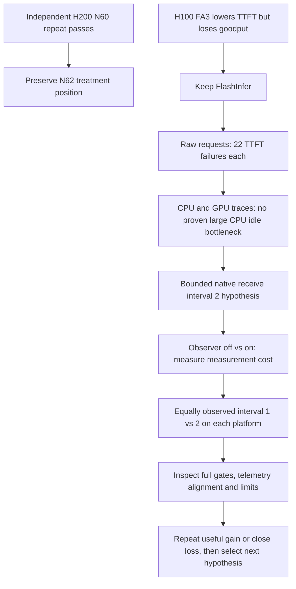

# 20 October 2026: repeated N60 gain, latency failure attribution and observed polling trials

## Prior question and completed evidence

Does the H200 runner interaction survive an independent N60 repeat, and is FA3 a better decoder for the current H100 runner? Complete local raw protocol/SLA/output/runtime checks accept **24913 = 2989.175 good output tokens/s**, versus original **24738 = 2990.151** and fresh auto N60 control **24912 = 2838.853**. The repeated treatment is +5.295% above control and differs by −0.033% from its own original. H200 N58 and N60 gains now both reproduce. The highest individual is still 24738, not a global optimum or official accuracy result.

Fresh auto N62 **24914 = 2890.878**, close to 24733 = 2890.551, passes all local gates. HPC-Ops N62 **24915** remains queued; its outcome is not inferred from the control. Keep its position and do not automatically increase to N64.

H100 **222027 FlashInfer = 2420.945** vs **222028 FA3 = 2401.284**, both accepted locally at N54. FA3 lowers mean TTFT 118.922 ms but raises mean ITL 0.773 ms and lowers goodput 0.812%. Keep FlashInfer and close this tested option; preserve the tradeoff rather than claim all metrics improved. Highest H100 individual remains 221590 = 2430.891. [Reviews, raw snapshots and extended inspection](/home/apacsc42/2026-APAC-HPC-AI/qwen-experiments/research-followup-20261020-0132/RESULTS.md).

## What was collected, inspected and learned

Raw scored requests isolate the failures: FlashInfer has 1517 requests, 1495 joint-good; FA3 has 1504 requests, 1482 joint-good. **Both have 22 TTFT breaches and zero request-mean ITL breaches/errors/cancellations.** TTFT p99 = 3454.130/3472.798 ms; ITL p99 = 19.036/19.648 ms. A better average first-token time did not remove the candidate's slow tail, while slower sustained decode reduced goodput. Do not convert a passing ITL gate into a claim that ITL no longer affects throughput.

Both 16-rank CPU/GPU diagnostics were inspected with file seals. N48 diagnostic generation succeeds 352/352 and 373/373; decoder recorded-kernel interval coverage is about 95–96%. CPU traces include batch processing, launch and Gloo work, but nested/waiting durations are not independent CPU work or end-to-end bottleneck percentages. There is no demonstrated large idle CPU bottleneck. A receive-poll test should therefore be bounded and may be flat.

Initial FA3 review incorrectly expected a hybrid-backend INFO line even when both phases use FA3. Corrected using resolved arguments plus sealed FA3 execution on all eight decode ranks; no acceptance gate was merely waived. Old profiler controls retain their JSON-parser and stop errors, despite usable sealed traces. New derived clients deploy the tested HTTP parsing fix; they still reject non-2xx responses and malformed generation JSON. Frozen old artifacts stay unchanged.

## Hypothesis and exact controlled change

Pinned native disaggregated decode calls `request_receiver.recv_requests()` every loop. Its skipper activates when scheduler_recv_interval exceeds 1. Actual DECODE weight 1 and default EXTEND weight 1000 make interval 2 alternate receives during decode while still polling extend immediately. Seven relevant source hashes match both runtime images; local fixtures execute the actual selector without model imports. This option reduces request polling/broadcast frequency, not token work, numerical precision or synchronization safety. Delayed admission could instead worsen latency. The native source is evidence of mechanism, not evidence of a serving speedup.

Implemented a five-second, bounded per-role collector: GPU UUID/index/activity, VRAM, W, temperature, MHz/P-state, node CPU/memory/interface counters and whitelisted worker metrics. It exits with its parent/job or a hard duration, and is not background Codex. UTC/monotonic client markers and retained exact AIPerf phase boundaries support later separation of scored and diagnostic samples. Unsupported data remains missing. Hardware field support, UUID mapping, time alignment and observer overhead still need actual-run inspection. Six local checks pass. [Collector, units and limitations](/home/apacsc42/2026-APAC-HPC-AI/qwen-experiments/resource-telemetry-20261020/README.md).

## Actual new submissions

| Platform | Observer off, interval 1 | Observer on control, interval 1 | Observer on candidate, decode interval 2 |
|---|---|---|---|
| H200, N60 | 24926 | 24927 | 24928 |
| H100, N54 | 222048.pbs111 | 222049.pbs111 | 222050.pbs111 |

New H200 jobs plus old 24915 were Resources-pending at 01:43:56 UTC. Verified PBS chain 222048→222049→222050 had R/H/H states. The off/on pair measures combined sampling/metrics overhead; compare the interval-2 candidate with its equally instrumented control. Common phase markers and post-score HTTP correction stay equal. Keep platform-specific incumbents: H200 DeepGEMM prefill chunk8192/HPC-Ops decode; H100 both-phase HPC-Ops/chunk4096. Numerical settings, placement/transport, graph list, full 4000/200 and 60/120/30 workload, raw errors and short/12-long checks remain.

An initial preparation guard rejected assuming H100 used H200's wrapped AIPerf invocation. Retained partial generated directories were archived before regenerating; no submitted payload or job was affected. No cancellation or uncertainty retry occurred. [Plan, validation, payloads and definite receipts](/home/apacsc42/2026-APAC-HPC-AI/qwen-experiments/research-followup-20261020-recv2/RESULTS.md).

## Cost, limits and next decision

Four preceding model/micro walltime charges reconcile the published 937.244-SU delta. Pre-submit Used 34972.443, Balance 29027.557, In Doubt zero. The new three serial H100 jobs reserve at most 4608 SU, leaving 11419.557 SU internal headroom under unchanged 51000 cap/13000 project buffer. Actual expected cost is not the reserved maximum. At most five active H200, three active PBS and one running PBS allocation. Existing access reused; no new authentication, schedules, background Codex, slides or official promotion.

Review completions without waiting for the unrelated platform. Require full gates, source activation and phase-aligned observer coverage; report off/on overhead separately. Repeat a useful gain, close a losing interval-2 option, and choose a distinct justified next hypothesis. No automatic interval 4, combined knob or higher load. Official full-set accuracy remains unverified; cloning Git does not copy external large artifacts.

## Later interpretation question: is FA3 bad?

Clarified that the rejection is specific to the tested H100 N54 decode candidate, not all FA3 use. Prefill remains FA3. The candidate's 119-ms better mean first-token latency is outweighed by approximately 154 ms across subsequent token intervals, and actual mean end-to-end latency increases about 35 ms. A single −0.812% matched observation is not a universal or statistically established effect. No exact kernel-level cause has been proved; no unchanged retry or new GPU spend follows from this clarification. [Detailed arithmetic, evidence and primary reference](/home/apacsc42/2026-APAC-HPC-AI/qwen-experiments/research-followup-20261020-0132/RESULTS.md).
