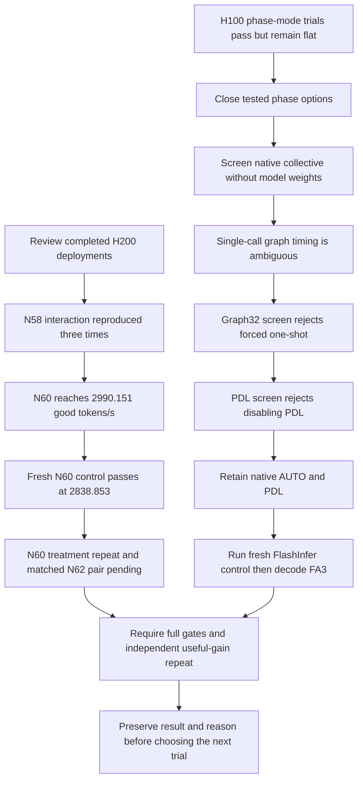

# 20 October 2026: confirm the runner interaction and screen the next costs

This entry continues the [32-stage retained retrospective](../JOURNEY.md). All observations below are local research measurements. Units are good output tokens per second unless stated otherwise; the score counts only requests meeting both latency limits and includes failures in the denominator. Full organiser accuracy at 99% of the reference remains unverified. H100 and H200 scores remain separate.

## Question: does the H200 interaction reproduce, and can it sustain more load?

The previous 24724 interaction combined DeepGEMM prefill at chunk8192 with HPC-Ops decode, reaching 2938.628 at N58. That isolated maximum was insufficient to claim a repeated gain. We reviewed the completed controls and independent deployments with the same raw 60/120/30 protocol, approximately 4000 input and 200 output tokens, latency/error accounting, submitted/runtime evidence, short output checks and 12 long-context cases. Scheduler exit status alone was not accepted.

| Job | Configuration | Good output tokens/s | Joint SLA fraction | Mean TTFT ms | Mean ITL ms |
|---|---|---:|---:|---:|---:|
| 24736 | Auto decode, N58 | 2775.642 | 0.988439 | 801.591 | 16.460 |
| 24737 | HPC-Ops decode, N58 repeat | 2935.879 | 0.989047 | 881.274 | 14.975 |
| 24819 | HPC-Ops decode, N58 repeat | 2937.148 | 0.989053 | 880.109 | 14.974 |
| 24738 | HPC-Ops decode, N60 | 2990.151 | 0.988191 | 947.652 | 14.931 |
| 24733 | Auto decode, N62 | 2890.551 | 0.986733 | 872.182 | 16.612 |

All five pass the complete local gates. The N58 interaction now repeats across three deployments including 24724; the new N58 treatment repeats are about 5.77% above the fresh auto control. Higher TTFT accompanies faster ITL. The N60 result is the new highest H200 individual observation, not a proven global optimum or independently repeated N60 gain. [Full reviewed evidence](/home/apacsc42/2026-APAC-HPC-AI/qwen-experiments/research-followup-20261020-0028/H200_RESULTS.md).

Decision: submit fresh auto N60 control **24912**, independent HPC-Ops N60 repeat **24913**, fresh auto N62 control **24914**, and bounded HPC-Ops N62/profile candidate **24915**. Preserve worker/client/precision/output protocol; do not assume load can grow without limit. By 00:51 UTC, 24912 passed at **2838.853**, joint fraction 0.987599, TTFT 822.292 ms and ITL 16.579 ms; the other three were pending for Resources. The original N60 treatment is 5.33% above this fresh control, but the treatment repeat is still required. No N64 follows yet. [Plans, receipts and first control review](/home/apacsc42/2026-APAC-HPC-AI/qwen-experiments/research-followup-20261020-h200-load/RESULTS.md).

## Question: which costs remain in the winning deployment?

Job 24819 additionally produced 16 sealed nonempty rank traces in a separate N48 diagnostic with 425/425 successful requests. Decode recorded kernel-time sums include approximately 21.642% named HPC group GEMM, 23.479% named MNNVL collective/RMSNorm and 15.064% named FlashInfer paged attention. These are summed recorded kernel durations, not wall-time critical-path percentages or measurements at the scored N58 load. They motivate experiments without establishing a causal speedup bound. [Analysis, executable parser and limitations](/home/apacsc42/2026-APAC-HPC-AI/qwen-experiments/research-followup-20261020-0028/H200_PROFILE.md).

The earlier NCCL correction remains in force: LL-labelled representative symbols do not identify selected protocols; sealed TUNING decisions do. Forced Simple was closed on flat performance, not failed activation. [Correction](/home/apacsc42/2026-APAC-HPC-AI/qwen-experiments/status-review-20261019-1755/CORRECTION.md).

## Question: can removing phase-specific autograd overhead improve H100?

All three completed model jobs pass the full local protocol/SLA/output/runtime gates:

| Job | Controlled change at N54 | Good output tokens/s | Joint SLA fraction | TTFT ms | ITL ms |
|---|---|---:|---:|---:|---:|
| 221923 | Explicit default no_grad control | 2424.365 | 0.985517 | 719.384 | 18.146 |
| 221924 | Decode-only inference_mode | 2430.657 | 0.986202 | 710.493 | 18.158 |
| 221966 | Prefill-only inference_mode | 2424.089 | 0.986184 | 717.194 | 18.165 |

Context preflights and hashes verify the intended phase change. Decode +0.260% and prefill −0.011% are flat observations, not established useful gains. Close these tested options; do not compound two unproven gains with a combined-mode test. H100's highest prior individual observation remains **221590 = 2430.891**. [Review and charge reconciliation](/home/apacsc42/2026-APAC-HPC-AI/qwen-experiments/research-followup-20261020-0028/H100_RESULTS.md).

## Question: should we override the native collective strategy?

A collective combines data across GPUs. The pinned FlashInfer MNNVL fused allreduce/residual/RMSNorm path can use one-shot or two-shot execution. The native AUTO threshold chooses one-shot up to 16 tokens and two-shot above 16 for TP8, hidden4096 and BF16. We first screened the kernel in isolation on 8 H100s without loading model weights. Every shape has a seeded CPU numerical reference, eight ranks, reversed strategy order and five samples. This is local numerical sanity, not model accuracy.

1. **222022**: one collective per CUDA graph showed large timing variation even when AUTO and the forced algorithm were identical. All gates passed, but launch cadence obscured interpretation. Preserve that ambiguity; do not patch the model from this screen. [First result and methodological correction](/home/apacsc42/2026-APAC-HPC-AI/qwen-experiments/research-followup-20261020-collective/RESULTS.md).
2. **222023**: put 32 collectives inside each graph, then measure worst-rank median microseconds per collective. All 288 rank/shape/round/strategy points and 24 traces passed. Forced one-shot lost both rounds at 32–64 tokens; at 54 it was 71.16%/74.34% slower, at 64 it was 106.03%/81.45% slower. Some same-algorithm noise remains, so avoid precise universal claims. **Keep AUTO; close forced one-shot without a full-model patch.** [Result](/home/apacsc42/2026-APAC-HPC-AI/qwen-experiments/research-followup-20261020-collective-graph/RESULTS.md).
3. **222026**: keep AUTO and isolate native PDL on/off. PDL means Programmatic Dependent Launch, a GPU launch mechanism. All 192 points and 16 traces passed. Disabling PDL was slower in both rounds at every tested shape; at 54 tokens, off was 22.90%/18.35% slower. **Keep PDL on; close PDL off without a full-model patch.** [Result](/home/apacsc42/2026-APAC-HPC-AI/qwen-experiments/research-followup-20261020-collective-pdl/RESULTS.md).

Each screen reserved at most 170.667 SU (8 GPUs, 10 minutes), rather than committing a 16-GPU model allocation to an unsupported kernel override. The first actually used 1:11 allocated wall time, about 20.196 SU. Actual charges and retained conservative bounds remain distinct. Standalone kernel timing is not model goodput and cannot establish a full-serving percentage gain.

## Next hypothesis: native decode attention with the current runner interaction

Attention still appears in recorded decode kernel sums. Earlier backend comparisons used different runner/load conditions. The pinned SGLang source registers FA3 and the deployment already uses FA3 in prefill, so a native decode-only comparison avoids a custom patch. Official documentation is linked in the [plan](/home/apacsc42/2026-APAC-HPC-AI/qwen-experiments/research-followup-20261020-decode-attention/PLAN.md).

Submitted **222027** (fresh FlashInfer control) → **222028** (decode FA3). At 00:52 UTC states were R/H. Both use N54, both-phase HPC-Ops, chunk4096, native MNNVL AUTO+PDL, default no_grad, unchanged BF16 and benchmark/output checks. Their separate CPU/GPU profiles follow scoring. No result is claimed. Validate runtime activation and all full-model gates, compare the fresh control, repeat any useful gain, and close a loss rather than repeat it unchanged. [Receipts, resource bound and status](/home/apacsc42/2026-APAC-HPC-AI/qwen-experiments/research-followup-20261020-decode-attention/RESULTS.md).

## Credit, operational corrections and preservation

The three inference-mode jobs reconcile to **1410.275 SU**. The initial accounting parser rejected published signed `−0.000`; numeric parsing was corrected before any budget mutation. At the 08:40 SGT ledger publication, Used was **34035.199 SU**, Balance **29794.134 SU**, In Doubt **170.667 SU**. Balance already excludes that prepayment. After the attention-pair reservation, total unreleased maximum bounds were **3413.333 SU**, leaving **13551.468 SU** under the unchanged 51000-SU operating cap and 13000-SU project buffer. This includes ledger-lag micro reservations and is not an actual charge prediction.

One read-only PBS status command lacked the login-shell wrapper and returned `qstat: command not found`; adding `bash -lc` immediately returned PBS R/H. This was not authentication failure. Existing VPN/SSH was reused; no authentication material was captured. Autopilot stays off. Slides and submission materials were not promoted.

New code, receipts, raw artifacts, failed/ambiguous screens and reviews were captured, hash-verified and committed/pushed as separate milestones. The dated coverage index is refreshed after captures. GitHub backs up the Git portion; large external artifacts still need a separate off-host copy. Do not claim every old chat statement was recovered.

## Decision map

A local archive commit briefly collided with a read-only Git status index refresh. The lock disappeared when that command finished; no lock was forcibly removed. The reviewed staged checkpoint was then committed and pushed. The coverage builder correctly refused the intermediate uncommitted state and was rerun after publication. This was a local preservation-workflow issue, not a lost run or GPU failure. Future status checks during a checkpoint use `git --no-optional-locks status` and Git mutations remain serial.
