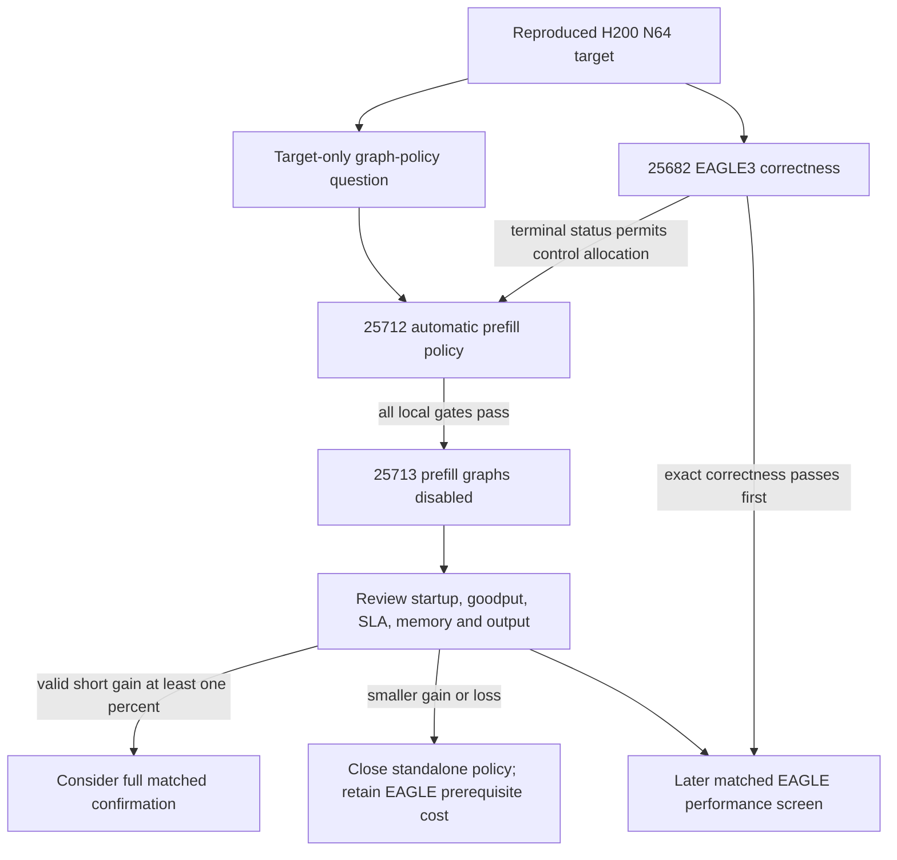

# Two H200 policy controls queued without displacing EAGLE correctness

23 October 2026, 14:54:36 UTC. Slurm accepted 25712 (s40 automatic prefill policy, afterany:25682) and 25713 (s41 disabled prefill policy, afterok:25712). Both are 16 H200/two-node/17-minute maximum short target-only screens, no PBS SU. The original 25682 payload and position are preserved; three own queued/active jobs fit the five-job limit.

The question and controlled design are [recorded before submission](20261023-h200-prefill-graph-policy-preparation.md). Common explicit BF16, prefill 64/decode 256 capacities and actual scheduler receipts prevent a second uncontrolled factor. Policy auto means omit the flag; role-specific native resolution is checked. Dense decode graphs 1–64 stay common. No result is available at submission. Capture actual startup/allocated GPU-hours separately from goodput. A valid short gain at least 1% permits only a separately reviewed full pair; a lower/loss result closes this standalone policy unchanged and preserves its information for future EAGLE evaluation.

H100 remains unavailable in a read-only check: VPN pane is dead, no live namespace. No fresh authentication, password input, budget mutation or H100 qsub occurs. The prepared exit-boundary diagnostic remains frozen and unsubmitted. The last credit snapshot stays historical with its outstanding maximum retained. This access limit does not stop feasible independent H200 work.

[Actual receipts and allocation bounds](/home/apacsc42/2026-APAC-HPC-AI/qwen-experiments/h200-prefill-graph-policy-20261023/RESULTS.md). No score, EAGLE speedup, official accuracy, or future successful runtime is claimed.
