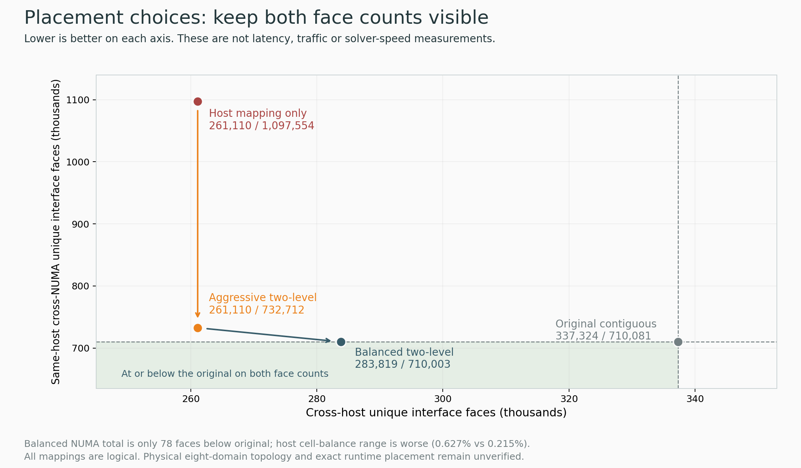

# A balanced placement option and a real explanation of the pending queue

## Question and prior evidence

The owner asked to improve the HPC work further. The aggressive two-level mapping cut logical cross-host faces to 261,110, but its same-host cross-NUMA count 732,712 remained 3.19% above the original 710,081. Can another balanced mapping remove that regression without assigning arbitrary host/NUMA latency weights? All three queued jobs remain separate, frozen experiments; no new solver result was available.

## What the scheduler inspection added

At 23 October 18:54:23 UTC, the ex CPU pool had 758 advertised 128-CPU nodes. Of these, 182 had PBS state free, yet zero state free nodes had all 128 CPUs unassigned. The largest free CPU count on any such node was 124. There were 7,528 unassigned CPU slots in total across those partially occupied nodes, which does not form four whole 128-core chunks. This supports the node_pool shortage for the exclusive four-node confirmation; it does not diagnose a scheduler fault, predict an ETA, or evaluate every memory/reservation/priority constraint.

The [safe aggregate inspector and raw snapshot](/home/apacsc42/2026-APAC-HPC-AI/hpc-experiments/queue-readiness-20261023/README.md) retain no other-user job IDs or environment. A correction also separates two counts: one node has zero assigned CPUs and one node is down, but those aggregates alone do not prove they are the same node. The earlier prose inference was corrected; the raw snapshot was not changed. No job was cancelled, requeued or retargeted to exploit fragments. A lower-rank or larger-node-count job would be a different configuration, not the same confirmation.

## Exact constrained search

Keep the 32 refined 16-rank logical NUMA groups intact, and reassign eight whole groups per proposed host. The graph has 1,933,200 faces inside those groups and 993,822 between groups. Any such reassignment therefore satisfies:

`same-host cross-NUMA faces = 993822 - cross-host faces`

To avoid worsening either original-control category, require cross-host faces between 283,741 and 337,324 inclusive. Search for the smallest feasible host cut inside that interval. This is an arithmetic feasibility constraint, not a physical weighting or performance model.

| Assignment | Cross-host faces | Same-host cross-NUMA faces | Host cell-total range / mean |
|---|---:|---:|---:|
| Original logical control | 337,324 | 710,081 | 0.215% |
| Aggressive two-level option | 261,110 | 732,712 | 0.702% |
| New balanced option | 283,819 | 710,003 | 0.627% |

The balanced option cuts host faces by 53,505, or 15.8616%, versus the original control. Its NUMA count is 78 faces lower (0.010985%), essentially a no-regression result rather than a material memory-benefit claim. It does not improve every metric: host cell balance is worse than original, and the aggressive option still has the lower host cut. Maximum host external-face proxy is 149,331 for the balanced option, 140,111 aggressive and 214,160 original; this is not measured traffic.

## Search, checks and reproduction

The deterministic first stage enumerated 384 inter-host single-group swaps, finding 179 feasible assignments with 178 distinct cut values. Seed 2026 exploration completed 500,000 proposals in about 1.4 local seconds and retained 1,098 sampled feasible trade-off values. The selected host cut is 78 above the arithmetic lower bound. All distinct feasible values trade one cut against the other because their sum is fixed; this is a sampled two-objective frontier, not an exhaustive Pareto set or global optimum.

All 32 original groups stay intact, each host has 128 ranks, every logical group has 16 ranks, all 512 ranks appear exactly once and rank 0 stays first. All 128 incremental swap checks matched full-supergraph recomputation. Root independently recomputed categories from the full 512-rank edge list, checked group identity, external-face totals and cell counts, and replayed the seeded search into temporary outputs. The selected mapping was identical; accepted source files were not overwritten. [Full source, inputs and review](/home/apacsc42/2026-APAC-HPC-AI/hpc-experiments/rank-placement-512-pareto-screen-20261023/RESULTS.md).

The [SVG](../../../hpc-research-journey-20261023/figures/placement-options.svg), [renderer](../../../hpc-research-journey-20261023/render_placement_options.py) and [source/output hashes](../../../hpc-research-journey-20261023/figures/placement-options-provenance.json) are retained separately. Lower-left in the figure means fewer faces in both categories, not necessarily faster execution.

## Decision and limits

Retain both aggressive and balanced options. Keep the current aggressive mapping in already submitted qualification 25947168 unchanged. That probe tests its exact MPI mapping and allocation; it does not silently qualify a new balanced file. The balanced option is unsubmitted and would need a derived, sealed input plus fresh actual MPI-world host/core/NUMA validation before a solver comparison.

No fourth job is submitted: the combined PBS cap 3 is occupied, and the last CPU ledger commitment remains 4,897.533333 / 5,000 SU including all retained maxima. The offline search itself makes no new SU reservation. The existing dependency chain and budget are preserved. Tiny additional improvements toward the 78-face constraint gap have low priority before runtime evidence; do not spend credit or keep searching solely to polish a proxy.

A later full comparison needs the same MPI mechanism, binding and transport in identity-control and candidate arms, original source/mesh, the full initialization, all 150 steps, every timed sample and terminal PBS/accounting evidence. The current default-Scotch confirmation is not automatically a matched control for a configuration that also enables explicit method 3 and thread binding. The eight-domain topology is still an assumption until actual allocated-node probes validate it. No bytes, page residency, kernel timings, MPI wait, solver speedup or official score is inferred from face counts.

## Beginner explanation

The old option emphasized keeping communication inside a server and accepted a small increase between logical memory domains. The new option relaxes some of that server-level improvement to remove the memory-domain face-count regression. Both keep exactly the same cells and numerical work. Which one is faster depends on the real machine and runtime; that question is still waiting for the scheduled tests. The original native timing leader remains 3.677906731 seconds per step, not a new result from this screen.
