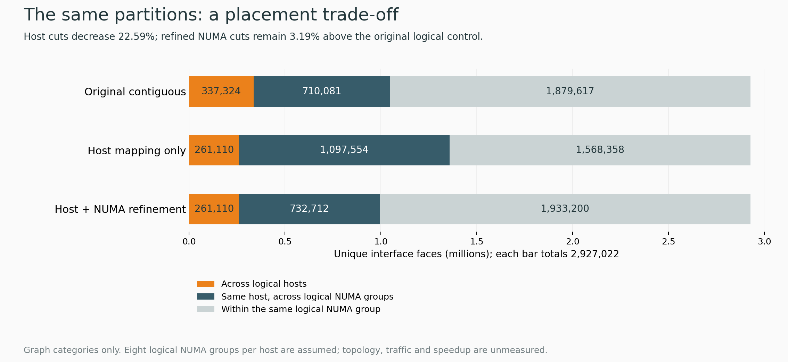

# Checking the locality trade-off before spending on a larger test

## Question and prior evidence

The owner asked to keep improving while both existing CPU jobs were pending. The previous four-host graph screen reduced crossing interface faces from 337,324 to 261,110, but did not optimize the arrangement of ranks inside each proposed host. Could its naive sorted rank order make the within-host NUMA proxy worse and undermine the reason to test it?

The source remains the same validated 512-rank graph from the old Scotch record 25921488. No new solver timing, actual NUMA placement or hardware traffic was measured. A later 17:48 UTC read-only PBS check still showed confirmation 25940700 Q/q5 and four-rank preflight 25943865 H/qdev with its dependency intact.

## Controlled change and complete observations

Hold the selected four host memberships fixed. Within each host, split 128 existing ranks into eight balanced logical groups of 16 and search only swaps inside that host. Eight groups are a declared logical assumption based on one historical node, not proof of topology on a future four-node allocation. Preserve every rank's original cells, all graph edges, host cell totals and rank 0's first slot.

| Logical assignment | Cross-host faces | Same-host cross-NUMA faces | Same-NUMA faces |
|---|---:|---:|---:|
| Original contiguous control | 337,324 | 710,081 | 1,879,617 |
| Host mapping only; sorted blocks inside a host | 261,110 | 1,097,554 | 1,568,358 |
| Fixed host mapping; refined NUMA groups | 261,110 | 732,712 | 1,933,200 |

Every row totals 2,927,022 unique interface faces. These are only faces between MPI partitions, not every internal face in the entire 65-million-cell mesh. The node-only mapping increased the second category by 54.57% versus the original logical control. The refinement recovers 364,842 faces, reducing that category 33.24% versus the node-only candidate. It remains 22,631 faces, or 3.1871%, above the original control. The cross-host proxy keeps its 22.5937% reduction. Both comparisons and denominators are necessary; neither percentage estimates solver speedup.

The new seed 2026 search completed 1,000,000 balanced proposals plus baseline-anchored refinements in about 5.05 local seconds. All four hosts improve the selected within-host cut, host memberships and cell totals are unchanged, and 128 incremental swap deltas match full recomputation. Independent root checks recompute all three categories, all 4 × 128 host memberships and 32 × 16 group sizes, and the full rank-zero-first 512-element permutation. The [full report and runtime gates](/home/apacsc42/2026-APAC-HPC-AI/hpc-experiments/rank-placement-512-numa-screen-20261023/RESULTS.md) retain the matrices, balance and limits. The heuristic proves no global optimum.

## A figure for explanation

[SVG copy](../../../hpc-research-journey-20261023/figures/placement-tradeoff.svg), [renderer](../../../hpc-research-journey-20261023/render_placement_tradeoff.py), and [source/output hashes](../../../hpc-research-journey-20261023/figures/placement-tradeoff-provenance.json) make the figure reproducible. The equal total bar lengths show that the partitions did not change. Orange and blue represent different interface categories, whose physical costs are not interchangeable.

## Assessment and next decision

The refined mapping is the preferred first graph candidate because it preserves the improved cross-host cut and improves the within-host proxy relative to the node-only candidate. Retain the earlier mapping as evidence; do not spend on both just to fill a queue. This selection is based on proxies, not a theorem about runtime dominance: NUMA page placement, communication volume, collective costs, critical paths and solver time remain unknown. Compared with the original control there is still a visible trade-off; no arbitrary host/NUMA cost weight is assigned.

The queued four-rank preflight tests MPI method-3 semantics on one host. At the preparation checkpoint, a separate three-minute 512-rank/four-node qualification was being prepared, conditional on both existing prerequisites succeeding. It will read actual MPI ranks and each rank's local host/core/NUMA properties, render against the observed identity slots and verify every intended placement. It runs no OpenFOAM solver and is not a score. Its request must pass a fresh budget and combined PBS cap check before any actual qsub; the current ceiling remains 5,000 SU. That earlier unsubmitted state is historical; the actual receipt is recorded below.

## Beginner explanation

A compute node is a server. A NUMA domain is a group of CPU cores and local memory within a server. Putting communicating ranks on the same server can still put them in different memory domains. This is why we checked both levels. Binding a process to a CPU identifies where it can execute; it does not by itself prove where its memory pages reside.

A group-major rank list is also insufficient as physical proof: PALS slot order may differ from NUMA order. The future renderer must use a fresh MPI-linked identity probe on every allocated host, map the logical groups to those observed slots, keep world rank 0 first, and re-probe the candidate. If topology or the fresh 512-way adjacency differs, stop and recompute. Do not use PMI environment rank IDs or the first host's sysfs as proof for other nodes.

## Preservation and limits

The parent graph and existing submitted payloads remain unchanged. Two development review errors were corrected before accepting this result: explanatory swap-edge comments were fixed, and the independent reviewer was updated to read the actual rank arrays rather than descriptive JSON strings. No failed numerical run or new performance claim resulted. All raw graph inputs, source, accepted mappings, proxy losses and validation records are captured in separate checkpoints. The existing 40-slide submission is unchanged; AI remains 80% of it. New research figures are learning artifacts, not an unmeasured result inserted into the presentation.

## Actual conditional submission

Job **25947168.pbs101** was submitted once and verified H/q5 at 2026-10-23T18:15:29.209000Z, with afterok dependencies on 25940700 and 25943865. It requests 4 × 128 CPUs/ranks, 32 GB/node, no GPU and three minutes, maximum 25.6 SU. It validates actual 512-rank placement only; no solver executes. The budget is now **4,897.533333 / 5,000 SU**, with **102.466667 SU** of conservative headroom. All older unknown maxima remain. Both existing jobs and their payloads are preserved. The combined PBS cap 3 is now full; no extra job is inferred from the broader site grant.

Root review added independent validation against original identity slots and logical-group co-location, tested inconsistent slot metadata and physically valid but graph-breaking permutations, corrected the NUMA fallback, and snapshotted PMI diagnostics before MPI initialization. Source seals and pins passed; the helper suite has one synthetic positive/seven negatives. A synthetic-header C syntax check is explicitly not a real MPI build. [Exact source, receipt, gates and limits](/home/apacsc42/2026-APAC-HPC-AI/hpc-experiments/nscc-cpu-mpi-placement512-preflight-20261023/STATUS.md).
