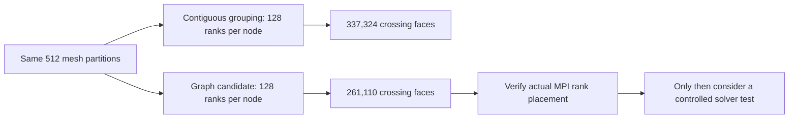

# A four-node placement candidate and a cheap MPI interface preflight

## Question and previous evidence

The owner asked to continue improving the HPC track after the combined submission update. Independent four-node Scotch-128 confirmation 25940700 was still Q/q5 at the fresh 23 October 15:38 UTC check, waiting for node_pool resources. Its frozen payload and queue position were preserved. The prior native leader remains 25921488 at 3.677906731 s/step, with 149 timed samples and incomplete historical scheduler/provenance proof. This milestone reports no new solver performance.

## What the slow-step review added

The [cadence audit](/home/apacsc42/2026-APAC-HPC-AI/hpc-experiments/four-node-stability-audit-20261023/RESULTS.md) retains all 894 samples from six separate allocations. All maxima occur in the interior, at Time 35–130. The case does not have a sparse full-field write in that window: its global interval is 100000, and several functions write each step. The audit now derives the 13 active probe includes from controlDict and checks all 13 output files, rather than accidentally counting 15 defined files including inactive probes. Missing calc_cp artifacts are unknown, not zero; the retained wallShearStress table has zero numeric rows, which does not prove its execute callback did no work.

The official custom stopwatch is first in the function list and measures between callbacks. A sample labelled Time t includes work across that callback interval, including later functions from the previous callback. A same-Time output row therefore cannot identify a causal file write. Native rounded ClockTime increments track the extreme elapsed events, while reported ExecutionTime increments are smaller. Those are reporting-process log values, not system-wide CPU use or a diagnosis of MPI, storage or scheduling. Keep every sample and compare the pending confirmation before choosing a stability intervention.

## Distinct hypothesis: place unchanged partitions closer

The losing NUMA-decomposition experiment changed partitions and was 3.44% slower. That branch remains closed. This new candidate leaves all 512 partitions unchanged and instead assigns their rank IDs to four balanced logical host groups of 128 ranks. A logical group is a proposed physical host only if a later allocated-node MPI placement check proves it.

Read-only intake collected 512 existing processor-boundary dictionaries and the decomposition log from the old Scotch run, with per-file hashes, strict ASCII checks and safe size bounds. The current decomposition log matches the sealed native intake. Boundary dictionaries declare a binary global file format but are text dictionaries; two initial collector calls rejected that header before the guard was corrected. No binary mesh or processor fields were copied. These boundaries were not sealed at original submission; matching logs do not prove full mesh identity or actual old physical placement.

The graph has 2,887 undirected rank-neighbor edges and 2,927,022 unique interface faces. Every reciprocal processor patch has matching nFaces; per-rank neighbor totals match the native log. A seeded, bounded local search plus balanced-swap refinement found:

| Quantity | Contiguous logical control | Candidate |
|---|---:|---:|
| Ranks per logical host | 128 | 128 |
| Faces crossing logical hosts | 337,324 | 261,110 |
| Maximum external-face total on one logical host | 214,160 | 140,111 |
| Range of hypothetical host cell totals / mean | 0.215% | 0.702% |

The cut decreases by 76,214 faces, **22.5937% of the original crossing cut**, or **2.6038% of all interface faces**. These are different denominators. The larger maximum-host proxy also decreases, but proposed cell-balance range increases. None of these quantities measures network bytes, MPI wait, memory traffic or solver speedup.

All rank IDs remain a bijection with 128 members per group and rank 0 first in the rendered permutation. Independent root checks recomputed every cut/matrix and balance and rejected wrong-rank/wrong-patch-count boundary fixtures. During development, 128 swap-delta comparisons caught an incorrect shared-edge adjustment before acceptance; the corrected formula then matched full recomputation. The repeated complete search retained the same candidate; it is a heuristic local result, not proof of a global optimum. [Graph, mapping and complete report](/home/apacsc42/2026-APAC-HPC-AI/hpc-experiments/rank-placement-512-screen-20261023/RESULTS.md).

## Compatibility and cost decision

The installed Cray MPICH 8.1.15 manual documents custom rank reordering via method 3 and MPICH_RANK_REORDER_FILE; PALS is 1.1.6. This is a read-only interface check, not a successful runtime test. [HPE documentation](https://h41374.www4.hpe.com/docs/24.03/mpt/mpich/intro_mpi.html) describes the same custom-order interface. A Python PMI_RANK value alone cannot validate library-level MPI_COMM_WORLD rank reordering.

Prepare a three-minute CPU preflight with four actual MPI ranks on one node. Compile the tiny MPI C probe on the allocated compute node, compare identity [0,1,2,3] with candidate [0,2,1,3], and validate actual MPI rank-to-host/CPU/physical-core mapping. Keep rank 0 first and both arms otherwise identical. This checks interface semantics only; it does not prove a 512-rank/four-host mapping, performance or score. A future full test must first verify the fresh 512-way adjacency matches the graph that selected this candidate, or stop and analyze the changed partition.

The cumulative CPU ceiling stays 5,000 SU. The locked check retained 4,865.533333 SU of consumed allowance and maxima, including 2,389.333333 SU for unresolved shared history. Detailed myprojects output reports 579.91 SU for 21–23 October but explicitly warns it may be inaccurate/incomplete; the project aggregate remains 2,269.938 SU with no authoritative per-job records. This cannot justify retiring unknown maxima. The normal routing queue and q5 execution destination are both enabled; q5 is route-only, so no alternate direct-q5 submission or cancellation was attempted. [NSCC queue documentation](https://help.nscc.sg/aspire2a/faqs/) and [CPU accounting units](https://nsccsg.github.io/quickstart/check-quota-and-usage/) support the interpretation; live metadata is retained separately.

The preflight requests four CPUs for 180 seconds (nominal maximum 0.2 SU at the checked rate), but its planned reservation is a conservative 6.4 SU, equivalent to 128 cores for the full three minutes. A dependency afterany 25940700 will prevent overlap with the existing CPU allocation. Actual submission remains subject to a fresh locked budget and combined PBS count check. A failed or ambiguous submission must retain its reservation and must not be blindly retried.

## Beginner explanation and next decision

Decomposition decides which cells each process owns. Placement decides which machine runs that process. This idea moves neighboring processes closer while keeping their cells and equations fixed. A smaller boundary count is a reason to test the placement, not a promise of speed. First prove that MPI actually applies the requested order; then, when the existing confirmation and budget permit, compare full native runs with the same numerical work and every timing sample retained.

No GPU work, submission deck, already submitted payload, autopilot or schedule was changed. New evidence is captured through explicit small Git checkpoints. Large external artifact bytes still require their independent off-host backup.

## Actual submission checkpoint

Preflight **25943865.pbs101** was submitted once at the retained receipt time with `afterany:25940700.pbs101`. The post-submit record shows **H/qdev**, an expected dependency hold; the parent remains **Q/q5**. Both resource requests and the dependency were checked from live PBS metadata. The new reservation raises conservative campaign commitment to **4,871.933333 / 5,000 SU**, leaving **128.066667 SU**. Original unknown shared/own reservations remain. No runtime interface result exists yet. [Receipt and limits](/home/apacsc42/2026-APAC-HPC-AI/hpc-experiments/nscc-cpu-mpi-reorder-preflight-20261023/STATUS.md).
