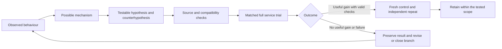

# How we arrived at the AI configuration

Written 1 November 2026 as a retrospective explanation grounded in retained plans, code and results. This is not a verbatim log of the team's thoughts before every experiment. Where a before-run hypothesis is retained, it is linked. Where only a result/review survives, the reasoning is presented as an explanation consistent with that evidence, not an invented original prediction.

## The answer to “How did you know this would be better?”

> We did not know the result in advance. We had a reason to expect a particular direction: an observed problem, a plausible mechanism and a controllable change. We then specified what would support or contradict that expectation. A promising result led to a matched repeat; a loss or invalid measurement changed the next decision. The final configuration emerged from those decisions rather than from one prediction of the final score.

Distinguish three things when answering: **why an idea was worth testing**, **what the test actually showed**, and **how much of its mechanism was established**. The first can be well motivated even when the experiment loses. A measured gain can justify a setting without proving every internal reason for that gain.

Read the following cases in terms of the decision being made. They are not all stages of one proven causal chain. KV recovery is a historical deployment branch; later backend and concurrency studies are separate controlled questions on usable configurations.

## 1. Why split the resources this way?

**Starting problem.** Sixteen H200 GPUs on two nodes must support the fixed Qwen3-235B model and long-prompt/short-output service. A layout has to load and transfer correct KV state before its throughput is meaningful.

**Reason to try it.** Prefill processes many prompt tokens, while decode repeatedly advances active requests. They can benefit from different worker shapes and implementations. Two four-GPU prefill workers let two workers process independent prompt work; an eight-GPU decode worker provides another candidate width for generation. Keeping each TP group inside its node avoids a cross-node TP group. These are architectural reasons to consider the split, not proof of its advantage over every alternative.

**Prediction and counterprediction.** If the split balances useful work across phases, the service should sustain more qualifying requests as load increases. If transfer cost, replica balance or parallel overhead dominates, the split can lose. TP4/EP1 prefill must also pass the actual FP8 shard geometry; nominal GPU arithmetic is not enough.

**How the choice was made.** Use resource fit, actual parallel-shape compatibility, real P/D request completion and subsequent full-run SLA/repetition as gates. The 17 usable historical configurations inform feasibility and tradeoffs. Their differing loads are not a controlled topology leaderboard.

**What we learned.** The retained 2×TP4/EP1 prefill plus TP8/EP8 decode path supported a repeatable operating point. Later repeated N64 performance supports using it; it does not prove the early architectural hypothesis was the sole source of improvement or that the layout is globally optimal.

**How to say it:**

> We chose a split worth testing because the two phases perform different work, the model shapes were compatible and each tensor group could stay within one node. We expected the replicas and wider decode worker might balance the pipeline, but cross-role transfer could erase that benefit. We therefore kept only layouts that served real requests and later repeated the full workload. The retained split is an evidence-supported operating choice, not a proven global optimum.

**Record:** [selected early layout](../../../2026-APAC-HPC-AI/qwen-experiments/runs/22415/config.json), [recovery review](../../../2026-APAC-HPC-AI/qwen-experiments/RECOVERY_RESULTS.md), [later N64 result](../../../2026-APAC-HPC-AI/qwen-experiments/research-review-25366-20261022/REVIEW.md). This architectural explanation is retrospective; do not present it as a recovered before-run quote.

## 2. Why did a warmup failure lead to the descriptor idea?

**Starting observation.** In historical heterogeneous-TP job 22271, model workers were ready, but pair warmup timed out after 360 seconds before benchmark scoring. That pointed to investigating the path between worker readiness and a usable P/D request, rather than blindly increasing client load.

**Mechanism noticed in source.** Cross-TP registration constructed descriptor lists for the reserved KV pool. A descriptor describes where bytes are, not the bytes themselves. A short request references only part of the pool. Creating unrelated range metadata was therefore a concrete candidate for avoidable setup work.

**Why this idea was prioritised.** It was narrow and checkable: construct descriptors only for request pages, merge adjacent ranges and compare the represented byte ranges with the original implementation. This offered a low-cost correctness screen before another distributed run. It did not require assuming the network bandwidth was the bottleneck.

**Prediction and counterprediction.** Request-scoped construction should reduce unnecessary metadata work. If that work were important to the failing setup path, readiness-to-request progress could improve. If the real problem were elsewhere in bootstrap or transport, the change would not solve it. Incorrect offsets or notifications could also break outputs, so fewer descriptors alone was not success.

**Test and update.** The 720 CPU equivalence cases passed; separate actual patched job 22294 completed P/D warmup and a full N32 score of 1422.96 good output tokens/s. This supported patched-path feasibility. No successful unpatched scored control or isolated initialisation timer exists, so a descriptor-only end-to-end percentage remains unknown.

The 403.8 million pool-source entries/rank and 188 coalesced ranges for one 4000-token request explain why the avoidable-work hypothesis was plausible. Their differing scopes do not predict a throughput multiplier.

**How to say it:**

> We first located the failure before scoring. Source inspection then showed work proportional to the reserved KV pool although the immediate request used only a subset. That suggested a specific way to remove irrelevant setup work. We checked byte-range equivalence cheaply, then tested real serving. The patched path became usable; we did not establish a descriptor-only speedup or rule out every other cause of the old timeout.

**Record:** [retained patch rationale and outcome](../../../2026-APAC-HPC-AI/qwen-experiments/nixl-ondemand/README.md), [CPU checks](../../../2026-APAC-HPC-AI/qwen-experiments/nixl-ondemand/geometry-test.json), [KV attribution audit](../ai-final-report-20261030/KV_TRANSFER_REASONING_AUDIT.md). The retained rationale contains the completed pilot as well as the explanation; it is not a separate timestamped pre-pilot causal proof.

## 3. Why revisit DeepGEMM after it lost in decode?

**Prior evidence.** One earlier round-robin N52 decode-only DeepGEMM trial failed the joint latency eligibility threshold. That established a losing setting on that phase/configuration; it did not establish that DeepGEMM was unsuitable for every phase.

**Reason to revise the question.** Kernel efficiency can depend on the number and arrangement of tokens presented to the operation. Prefill processes prompt-token batches; decode advances active sequences. A result from one phase cannot determine the other phase's implementation choice.

**Prediction and counterprediction.** Trying DeepGEMM only in prefill could help that work while preserving the known decode path. It could also lose through kernel/graph/shape interactions. The test needed fixed decode, workload and output checks, not an assumption that a library name implied a win.

**Test and update.** At N56, DeepGEMM-prefill 24291 scored 2715.842 and independent repeat 24327 scored 2716.787. The repeat was +1.7401% against its fresh control. The corresponding H100 observation did not establish the same gain. The supported lesson was phase- and platform-specific selection, not a universal DeepGEMM ranking.

**How to say it:**

> The earlier failure answered a decode question. We realised it did not answer the prefill question, because the operation sees different token shapes in the two phases. So we changed only prefill, kept decode fixed and repeated against a fresh control. That produced a small repeated H200 gain. The result justified a phase-specific recipe rather than declaring one backend best everywhere.

**Record:** [earlier decode plan and results](../../../2026-APAC-HPC-AI/qwen-experiments/serving-tuning-06/PLAN.md), [prefill result and independent repeat](../../../2026-APAC-HPC-AI/qwen-experiments/research-followup-20261017-2335/RESULTS.md), [retrospective journey stages 20–25](../research-journey-20261019/journal/JOURNEY.md). A separate original prefill hypothesis file was not found in the inspected followup directory; the phase/shape explanation here is a retrospective engineering rationale, not a fabricated pre-run statement.

## 4. Why change chunk size, then revisit the decode backend?

**Starting question.** Once the prefill implementation changed, a chunk limit selected for an older runner might no longer be the best operating setting. Chunking changes how prompt-token work is grouped; it does not change the prescribed 4000-token input per request.

**Reason to test the interaction.** A larger permitted prefill chunk can change the work presented per scheduling step. That may help implementation efficiency, or instead increase latency/interference. After the prefill path changes, an old decode comparison may no longer describe the integrated service. Retesting is justified by changed conditions, not by repeating an unchanged loss.

**Test design.** Hold the workload and load fixed. Test chunk settings within a runner, then compare decode choices at the retained chunk. Do not combine unreviewed changes and credit each separately. The retained 18 October results explicitly queued a larger-chunk arm and a decode-runner arm relative to declared controls.

**Observation and update.** At N58 with DeepGEMM prefill/chunk8192, auto-decode control 24721 scored 2780.403 and HPC-Ops decode 24724 scored 2938.628 (+5.6907%). Mean TTFT worsened, while ITL improved. Chunk12288 lost 2.3789% against its own chunk8192 control, so “larger is always better” was rejected. The promising decode interaction received its own controls/repeats; later full N60 comparison 24912/24913 retained about +5.30%.

**What explains the finding?** The measurements establish a setting-dependent service improvement and latency tradeoff. They do not identify which kernel, queue or transfer stage produced every part of it. A plausible efficiency mechanism remains distinct from a proven critical-path decomposition.

**How to say it:**

> Changing prefill changes the operating conditions of the pipeline, so we did not assume an old backend result would remain valid. We tested chunk and decode choices against declared same-load controls. The larger-chunk DeepGEMM path made the HPC-Ops decode combination worth confirming; a still larger chunk lost. That taught us to tune the interaction and verify the whole service, rather than adding isolated gains or choosing the largest setting.

**Record:** [18 October followup decisions](../../../2026-APAC-HPC-AI/qwen-experiments/research-followup-20261018-1845/RESULTS.md), [N58 interaction and losing chunk](../../../2026-APAC-HPC-AI/qwen-experiments/research-followup-20261019-0600/RESULTS.md), [before-followup plan](../../../2026-APAC-HPC-AI/qwen-experiments/research-followup-20261019-0600/PLAN.md), [separate controlled load/repeat plan](../../../2026-APAC-HPC-AI/qwen-experiments/research-followup-20261020-h200-load/PLAN.md).

The supplied N48 diagnostic chart is not evidence that this original choice was made from those percentages. It is a separate diagnostic observation; do not rewrite the source chronology to invent a profile-driven discovery.

## 5. Why try N64, and why stop at N68?

**Prior evidence.** The revised service already had repeated useful results around N58/N60. The retained load plan called for a fresh same-load control, an independent N60 repeat and one bounded next load, not an unlimited concurrency sweep.

**Reason to expect a benefit.** Additional in-flight requests can provide more work for batching and overlap in a pipeline. But beyond an operating region they can increase waiting/contention and first-token latency. Either outcome was plausible; concurrency is a test variable, not an automatic speed knob.

**What would support the idea?** More qualifying requests per second under the fixed request-level SLA and output checks, followed by a repeat. More raw throughput with too many slow requests would not support promotion. Late-stage usefulness was judged against a prospective team-set 1% gate.

**Test and update.** The later full N62 control 25365 scored 3011.875 and N64 25366 scored 3044.490 (+1.083%); N64 repeat 25373 scored 3044.075. Separate fresh N64/N68 comparison 25487/25488 then produced only +0.083%, while mean TTFT rose about 1113.6→1347.1 ms. Retain N64; close that unchanged N68 branch.

**How to say it:**

> After the backend change, the old load limit was another hypothesis to recheck. More requests could improve useful pipeline work, but could also worsen waiting. We therefore moved in bounded steps and judged goodput together with latency tails. N64's gain survived a full repeat; N68 mainly added first-token latency for a tiny throughput change. The measurements, not advance certainty, determined where we stopped.

**Record:** [retained next-load rationale](../../../2026-APAC-HPC-AI/qwen-experiments/research-followup-20261020-h200-load/PLAN.md), [N62 control](../../../2026-APAC-HPC-AI/qwen-experiments/research-review-25365-20261022/REVIEW.md), [N64 candidate](../../../2026-APAC-HPC-AI/qwen-experiments/research-review-25366-20261022/REVIEW.md), [N64 repeat](../../../2026-APAC-HPC-AI/qwen-experiments/research-review-25373-20261022/REVIEW.md), [N68 stopping evidence](../../../2026-APAC-HPC-AI/qwen-experiments/research-review-25487-25488-20261023/REVIEW.md). The first plan did not pre-authorise N64; the later reviewed steps supplied their own continuation evidence.

## 6. Why not select the highest isolated score?

**Problem noticed.** Different deployments and settings produced varying scores, including a valid lower legacy replay. A single peak could mix the tested change with time, seeds, node/cache state or harness differences.

**Hypothesis to check.** A configuration worth retaining should offer a useful improvement against its own fresh control and survive another launch under the same protocol. “A higher number exists somewhere” is a weaker criterion.

**What happened.** Three historical full N64 runs averaged 3044.400475 good output tokens/s; separate native 26766 was 3045.501509. Cache candidate 27378 reached 3048.446289, but its +0.240921% versus its own control was below the usefulness gate and p95 TTFT worsened. Recovered portable raw 27145 was higher still, but its original job failed after the GPU client. These are different evidence classes, not a leaderboard to sort blindly.

**How to say it:**

> We asked whether the apparent gain belonged to the configuration or to a particular run. That is why we used fresh controls and repeats instead of choosing the maximum observed number. The cache peak did not clear the useful-gain rule, and a score recovered from a failed portable job was not a successful whole-deployment repeat. We retained the stronger repeated operating evidence.

**Record:** [cache pair](../../../2026-APAC-HPC-AI/qwen-experiments/h200-cold-prefill-cache-study-20261029/RESULTS.md), [result classes and reproduction limits](../ai-final-report-20261030/REPORT.md). No formal confidence interval or broad physical-hardware diversity is claimed.

## 7. Why did the H100-to-H200 results lead to more specific tests?

**First uncertainty.** A setting useful or compatible on H100 might behave differently on H200. Direct target-hardware measurements were needed; a specification ratio could not settle the engineering choice.

**What the first H200 transfer exposed.** The H100 full recipe changed both prefill runner and chunk (HPC-Ops/4096), and lost to H200 DeepGEMM/8192. That result did not tell us whether the runner, the chunk or their interaction explained the loss. Raising its load N54→N64 also increased mean TTFT and sampled prefill queues without increasing goodput.

**The next testable question.** Retain HPC-Ops and test chunk6144/8192; then compare the 8192 arm with the incumbent at the same chunk. If the smaller chunk explained most of the loss, a larger chunk should recover the branch and might challenge the incumbent. If the runner interaction remained less suitable, it would still lose. The retained before-run plan states this question explicitly.

**What happened.** Chunk8192 recovered 6.568815% versus the same-runner 4096 arm, but was still 4.523207% below the DeepGEMM incumbent. So the team learned more than “the port lost”: changing chunk recovered part of that losing branch but did not justify replacing the H200 choice. Direct per-request time decomposition and a kernel-level cause remain unmeasured.

**A separate narrow idea.** Inference mode could reduce host tensor bookkeeping without changing weights or precision. The plan explicitly called this a hypothesis, not evidence of CPU starvation. Two phase-specific ports were compared with a fresh explicit no_grad control; +0.006223%/+0.130765% did not warrant promotion. The source H100 mode results were small, not four winning recipes.

**How to say it:**

> The full port lost, but it changed two important settings together. We therefore asked a narrower question instead of blaming the library: does matching the chunk recover its performance? It recovered part of the loss and still stayed below the incumbent. The separate mode changes were nearly flat against their own control. Those results narrowed the explanation and supported keeping the H200-specific recipe.

**Record:** [full transfer outcome](../../../2026-APAC-HPC-AI/qwen-experiments/h200-h100-transfer-review-20261031/FINAL_RESULTS.md), [explicit chunk hypothesis before submission](../../../2026-APAC-HPC-AI/qwen-experiments/h200-hpc-chunk-transfer-20261031/PLAN.md), [chunk result](../../../2026-APAC-HPC-AI/qwen-experiments/h200-hpc-chunk-transfer-20261031/RESULTS.md), [mode hypothesis and controls](../../../2026-APAC-HPC-AI/qwen-experiments/h200-phase-inference-transfer-20261031/PLAN.md), [mode result](../../../2026-APAC-HPC-AI/qwen-experiments/h200-phase-inference-transfer-20261031/RESULTS.md).

## 8. What did failed ideas teach the next decision?

Sparse graph capture reduced a resource proxy but did not raise useful throughput. That taught us to demand a service-level result rather than equate lower capture memory with speed. A functional EAGLE path still lost goodput; the team closed the tested setting rather than assuming feature support guaranteed a benefit. Runtime activation checks and small correctness screens were therefore necessary gates, with full performance and official model quality separate.

**How to say it:**

> A failed experiment was useful when it rejected a specific assumption. Smaller graph memory did not imply better goodput, and working speculative decoding did not imply faster serving. We retained those observations and stopped the tested settings. That prevented the final configuration from accumulating attractive features without measured benefit.

**Record:** [sparse-graph result](../../../2026-APAC-HPC-AI/qwen-experiments/h200-sparse-decode-compile-20261029/RESULTS-27510.md), [full shallow-EAGLE result](../../../2026-APAC-HPC-AI/qwen-experiments/h200-shallow-eagle-full-20261029/RESULTS.md).

## A compact way to present the entire reasoning

> We first asked which layouts could actually serve the fixed model on two nodes. On a failing transfer branch, source-visible unnecessary setup work gave us a bounded implementation hypothesis. On usable deployments, we separated prefill and decode choices because phase and batch shape could change backend behaviour. Each accepted change created a new context for the next controlled test; it did not license adding gains together. We then raised client load only while qualifying throughput improved and repeated promising points. Finally, direct H200 checks rejected several H100-derived alternatives. The result was a retained operating recipe with known limits, not an algorithm that predicted its final score before measurement.

When asked “Why did it work?”, separate **a plausible mechanism** from **what was established**. Say what prompted the test and how the result changed the decision. Do not fill a missing timing profile with a confident causal story. The retained evidence can establish useful engineering decisions even when a complete internal explanation remains open.

## 9. Why did the exact packaged run fail readiness, and what did the repair establish?

**Observed failure.** The first exact-entry attempt, job 28194, reached a router health response of HTTP 200 while asynchronous model registration was still underway. The next `/v1/models` request returned HTTP 503. The job failed before AIPerf; it has no performance score and is not relabelled as successful.

**Bounded repair.** The retry changed only the readiness gate: require a valid model-list response containing the Qwen model and verify that the launched workers are still alive, within the original job-start-plus-600-second deadline. Five local readiness/liveness fixtures exercised transient 503, invalid responses, absent model, expired deadline and dead workers. Those fixtures supported testing the GPU entry; they were not proof that the real gateway would pass.

**What happened on the real entry.** Job 28197 then ran the exact corrected packaged entry on 16 H200 at N64 and completed in 611 seconds. The exact run passed both P/D semantic routes, corrected result readers, the full performance gate and cleanup. It measured 3,051.518173 good output tokens/s; 1,881/1,907 requests (98.63660199%) passed both latency limits. There were 26 TTFT misses, no ITL misses, errors or cancellations. Mean/p95 TTFT was 1100.3153/1285.9962 ms; mean/p95 request-mean ITL was 15.009828/15.185750 ms.

**Decision and limit.** This closes the gap in which corrected readers had only been checked on saved data: the repaired full entry now completed on GPU. The 28197 score has no matched control and the readiness patch changed no serving recipe, so it is an acceptance observation, not an optimisation gain. Its 98.63660199% is the fraction of performance requests meeting latency conditions, not answer accuracy. The official Qwen FP8 checkpoint remains intact. The organiser-run full-set reference comparison is the Q1 model-quality checkpoint; this performance report keeps that result in its proper evaluation record. The 98.63660199% request fraction is not an accuracy score.

**How to explain the sequence.** “The original package health check answered the wrong question: the router was alive, but the model was not yet registered. We made readiness wait for the actual model list and live workers, then ran the exact package again. The complete run passed deployment and performance gates. Since there was no matched control and we changed no serving parameters, we treat it as package acceptance, not an optimisation.”

**Record:** [failure, repair and complete acceptance review](../../../2026-APAC-HPC-AI/qwen-experiments/final-portable-acceptance-r2-20261102/REVIEW.md), [scheduler state and receipts](../../../2026-APAC-HPC-AI/qwen-experiments/final-portable-acceptance-r2-20261102/STATUS.md), [portable result summary](../../../2026-APAC-HPC-AI/qwen-experiments/final-portable-acceptance-r2-20261102/delivery/VNUHCM%20-%20TripleU/AI_Task/logs/reruns/28197/summary.json), [official quality explanation](../../notes/ai-quality-threshold-clarification-20261102.md).

This is a post-release teaching and Q&A companion. It launches no further research or GPU work, changes no HPC payload and does not claim the combined human mock or official quality evaluation has occurred.
