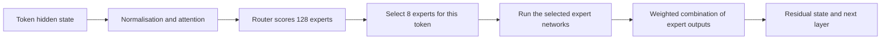

# What TP and EP actually do in our Qwen deployment

This learning note answers the owner's question about the work hidden behind “TP4/EP1” and “TP8/EP8.” It distinguishes model computation, weight placement and runtime communication. Written 3 November 2026. The explanation does not change any model, benchmark or submitted payload.

## Start with the numbers

TP is tensor parallel group size: how many participating GPU processes split tensor operations. EP is expert parallel group size: how many expert-placement ranks distribute different MoE experts. An expert is a learned feed-forward network inside one model layer, not another chatbot. EP8 means eight placement ranks, not eight experts and not eight active experts per token.

In our configuration, TP and EP reuse the same GPUs at different parts of a layer. TP8/EP8 occupies eight GPUs, not 64. Other engines can compose parallel dimensions differently, so this accounting is specific to the SGLang arrangement and flags we actually used. `dp_size=1`, `moe_dp_size=1` and `pp_size=1` are relevant assumptions; the two prefill replicas are separate worker instances.

The actual checkpoint config has 94 layers, hidden size 4096, 64 query heads, 4 KV heads, 128 routed experts per MoE layer, eight selected experts per token, and expert intermediate width1536. The eight selected experts and EP size are different quantities. A token's selected expert IDs can change between layers and between tokens.

## A token's journey through a layer

Text first becomes token IDs and numerical vectors. An intermediate token representation is called a hidden state. The simplified repeated layer is:

This is a conceptual dataflow, not a detailed kernel schedule; normalisation/residual ordering, fused kernels, batch handling and caching are omitted. The router selects existing expert weights. It does not ask eight independently hosted models to generate eight text answers.

An expert's approximate computation is a gated feed-forward block:

`Expert(x) = down( SiLU(gate(x)) * up(x) )`

The multiplication between the two intermediate vectors is elementwise. The final layer output combines selected experts using routing weights. For a toy two-expert selection, `output = 0.7*Expert3(x) + 0.3*Expert7(x)`. Those coefficients illustrate routing, not measured Qwen weights.

## TP: split matrices, then combine numerical results

A neural-network projection is matrix multiplication. Take a toy row vector `x` of length4 and a 4×4 matrix `W`. Real Qwen matrices are much larger.

With TP2, a column-parallel projection can store:

- GPU0: the first two columns `W_A`;
- GPU1: the last two columns `W_B`.

The GPUs calculate `y_A=xW_A` and `y_B=xW_B`. Together those pieces represent `y=xW`. Depending on what follows, the runtime can retain the split representation instead of immediately collecting the whole vector on every GPU.

For the contraction that follows, split the next weight matrix by rows: GPU0 computes `z_A=y_A V_A`, GPU1 computes `z_B=y_B V_B`. The full result is `z=z_A+z_B`. An all-reduce is one way to sum those partial outputs and make the sum available to every participating rank. Other schedules may use reduce-scatter and later gather operations. Not every operation uses an all-reduce, and not every tensor is divided identically.

Thus the GPUs usually collaborate on the same model layer and token batch, holding different weight slices. TP4 does not mean GPU0 processes layer1, GPU1 layer2, and so on; that would be a pipeline-style partition. It also does not mean that four independent model replicas receive four independent requests.

The checkpoint shards need to be read and the appropriate weight slices loaded into GPU memory during model startup. Once loaded, the large weights usually remain resident. Repeated inference communication chiefly exchanges hidden states, intermediate results and metadata rather than retransmitting all model weights for each token.

## EP: distribute different expert networks

Imagine a toy model with eight experts and EP2:

| Placement rank | Expert weights stored |
|---|---|
| GPU0 | E0–E3 |
| GPU1 | E4–E7 |

If a token selects E1 and E6, it needs computation on both owners. A conceptual dispatch sends its hidden state to the relevant experts; those networks compute their outputs; combine gathers/sums the routed contributions. Batched tokens are grouped by expert so the GPU can execute grouped matrix operations efficiently.

That conceptual data dependency does not require every implementation to issue an all-to-all primitive. Some implementations shuffle tokens via all-to-all; others replicate/gather the required activation data, calculate local expert contributions, then combine via reductions. Communication, buffering, padding and kernel fusion depend on the selected backend.

The expert selection is learned router behavior and may be uneven: an expert rank can receive more token work than another. EP size alone does not promise balanced load or improved performance.

## The combined layout in our SGLang configuration

For the simple MoE-data-parallel-size-one case used here, the model-parallel code constructs:

`MoE tensor parallel size = TP / EP`

The more general code also divides by MoE data parallel size. Expert count is split across EP ranks; an expert's intermediate width is split across its MoE tensor-parallel ranks. All GPU counts below describe one worker instance, excluding separate replicas and ignoring auxiliary padded/redundant expert arrangements.

| Worker layout | Physical GPUs | Experts represented per GPU, per layer | Share of each represented expert |
|---|---:|---:|---:|
| TP4 / EP1 | 4 | All128 | 1/4 |
| TP8 / EP1 | 8 | All128 | 1/8 |
| TP8 / EP2 | 8 | 64 | 1/4 |
| TP8 / EP8 | 8 | 16 | Full expert |

“Full expert” refers to that layer's expert weight tensors, not a full copy of the 235B model. Other layer components still follow their own partitioning rules. EP1 also does not mean every GPU stores a full copy of every expert: TP can still slice each expert's matrices.

For a toy TP4/EP1 worker with eight experts, each GPU holds one-quarter of E0, one-quarter of E1, and so on through E7. A selected expert therefore needs partial work from all four ranks.

For a toy TP4/EP4 worker, each GPU can own two complete experts. The same four GPUs can still tensor-parallelise attention, then perform expert-owned work in the MoE portion. Logical parallel groups do not create more physical GPUs.

## What our two nodes actually do

The accepted entry's actual server logs record:

| Worker | TP | EP | DP | PP | MoE runner | MoE all-to-all backend flag |
|---|---:|---:|---:|---:|---|---|
| Each prefill instance | 4 | 1 | 1 | 1 | deep_gemm | none |
| Decode instance | 8 | 8 | 1 | 1 | hpc_ops | none |

Node0 has two separate four-GPU prefill instances. A prompt goes to one instance, whose four ranks cooperate; this is not a single TP8 prefill worker. Node1 has one eight-GPU decode instance. Both phases have access to the model weights needed for their forward computation, arranged differently. These are phase-specialised workers, not pipeline stages that each own only some of the 94 layers.

After prefill processes a prompt, the generated KV state is transferred to decode through the NIXL disaggregation path. Decode uses that state while generating tokens. TP/EP communication inside a worker and the NIXL KV transfer between prefill and decode are different communication problems. The fact that our P/D transfer uses NIXL does not establish that MoE expert dispatch uses a NIXL all-to-all backend.

Our runtime records `moe_a2a_backend='none'`, so “EP8 always sends tokens with DeepEP/all-to-all” would be an inaccurate account of this run. Upstream documentation describes reduction/gather-based alternatives and the standard dispatcher; a detailed claim about exact invoked kernels would require the frozen source and execution trace, not only the EP flag.

## Attention and KV cache have their own sharding rules

The model has64 query heads but only4 KV heads. With plain attention TP8, query work can be split into eight query heads per GPU. KV heads cannot be split into half a head, so this GQA configuration requires replication/mapping when TP exceeds KV-head count. With TP4, query work can split into sixteen query heads per GPU, with one KV head per rank. These are logical head-count explanations, not claims about a particular physical stride or byte address.

This is why “everything is divided evenly by TP” is too simple. It is also why transferring KV between different TP arrangements needs correct head/offset mapping. A model's expert placement and attention/KV placement are not the same object.

## Why a nominally valid GPU count can still fail

The expert intermediate width is1536. In the historical FP8 blockwise path, width partitions must satisfy128-element block alignment:

- TP8/EP1: effective MoE TP8, `1536/8=192`, not divisible by128;
- TP8/EP2: effective MoE TP4, `1536/4=384`, divisible by128.

This explains a compatibility failure in that tested runtime path and why a corrected expert grouping was worth trying. It is not a universal statement that all TP8/EP1 engines or all quantisation implementations must fail: padding, formats and supported kernels can differ. Changing EP changes weight placement and communication; it does not prune experts or intentionally change the model's selected computation.

## Why we still benchmark instead of deriving the winner from TP/EP

More tensor ranks can reduce weight memory and local matrix work, but increase synchronisation or make local operations too small. More expert ranks can reduce within-expert slicing but add routing/combination costs or uneven expert work. Prefill and decode see different token/batch shapes. Two replicas can process different requests, but each replica has its own weights, queues and resource budget. There is no monotonic rule “larger TP/EP is faster.”

This is the defensible research contribution: choose compatible candidate layouts, verify real requests and correct transfer, then compare complete service behavior under the fixed latency objective. The flags explain what was tested, not why the result was guaranteed in advance.

## Presenter answer

> TP tells us how many GPU ranks cooperate on tensor operations. EP tells us how the MoE experts are placed across those ranks. In our SGLang worker they reuse the same GPUs, so TP8/EP8 is eight GPUs, not64. Each prefill has four GPUs sharing pieces of all experts; decode has eight GPUs each owning a subset of complete experts, while attention remains tensor-parallel. We retained the configuration because it was compatible, served real requests and survived complete measurements—not because larger parallelism must be faster.

## References and actual evidence

- [Official checkpoint configuration](https://huggingface.co/Qwen/Qwen3-235B-A22B-Instruct-2507-FP8/blob/main/config.json): layer/head/expert dimensions; checked against the supplied `/scratch/models/.../config.json`.
- [SGLang expert parallelism documentation](https://docs.sglang.io/docs/advanced_features/expert_parallelism): expert placement and backend-dependent communication.
- [SGLang v0.5.17 model-parallel group construction](https://github.com/sgl-project/sglang/blob/v0.5.17/python/sglang/srt/distributed/parallel_state.py): separate TP/EP/MoE-TP groups and the division by EP and MoE-DP sizes.
- [SGLang MoE weight partitioning](https://github.com/sgl-project/sglang/blob/v0.5.17/python/sglang/srt/layers/moe/fused_moe_triton/layer.py): local expert count and intermediate partition width.
- [SGLang standard token dispatcher](https://github.com/sgl-project/sglang/blob/v0.5.17/python/sglang/srt/layers/moe/token_dispatcher/standard.py): backend-dependent global/local expert ID handling; conceptual token routing is not proof of a particular network primitive.
- Actual flag evidence: `qwen-experiments/final-portable-acceptance-r2-20261102/delivery/VNUHCM - TripleU/AI_Task/logs/reruns/28197/{prefill-0,decode-0}.log`; launcher evidence: `workspace/VNUHCM - TripleU/AI_Task/job_scripts/{worker.sh,deploy-and-benchmark.sh}`. No new GPU job was run for this explanation.

Public upstream source explains the mechanism; the historical image and frozen run evidence remain authoritative for that particular execution. Public tagged sources and current documentation are not a new byte-level attestation of the supplied image.
