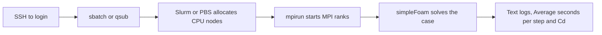

# SSH, Slurm/PBS, MPI and OpenFOAM

These are separate layers. SSH opens a terminal on a machine. Slurm or PBS
allocates compute resources and runs a job. MPI starts cooperating processes
on those allocated nodes. OpenFOAM is the simulation software those processes
execute. OpenFOAM does not require a particular scheduler.

| Competition environment | Scheduler | Submit | Inspect queue |
|---|---|---|---|
| Iris, practice | Slurm | sbatch job.sbatch | squeue; sinfo -p iris |
| Gadi normalsr, scored CPU runs | PBS | qsub job.pbs | qstat |
| ASPIRE-2A, scored CPU runs | PBS | qsub job.pbs | qstat |

The scheduler belongs to the cluster. A Qwen service and an OpenFOAM solver can
both be launched by Slurm if that cluster uses Slurm. Changing to OpenFOAM does
not switch a cluster to PBS. Likewise, a GPU is not required to use Slurm.

On a workstation with OpenFOAM installed, simpleFoam can run directly, and
mpirun can launch a local parallel run. On a shared HPC system, the job first
obtains resources through the site's scheduler. The APAC task requires its
specified CPU platform and node count; running on an unrelated SSH VM does not
produce a scored result.

## Why our SSH connection looked wrong

The supplied address is a gateway. An interactive SSH login automatically jumps
into Iris. A one-command SSH request stayed on the gateway VM, where scheduler
clients and Iris storage were not present. That was not a scheduler denying our
submission, and no sbatch rejection had been observed.

Using an interactive login now reaches login01.hpcadvisorycouncil.com with
working sbatch, srun and sinfo. Iris can accept submissions; a job still needs
valid resources and must pass the scheduler's usual checks. A submitted job
may queue before it runs. A successful SSH login alone does not allocate a CPU
node or guarantee that an OpenFOAM job succeeds.

Use the [verified access instructions](../reports/hpc-openfoam-20261021/IRIS_ACCESS.md).
Keep keys and authentication material outside Git. The kit's Iris-optimized
solver binaries should execute on allocated compute CPUs, not on the login CPU.

Sources: [HPCAC Iris scheduler guide](https://hpcadvisorycouncil.atlassian.net/wiki/spaces/HPCWORKS/pages/4207869953/Getting+Started+with+Iris+Cluster+-+ISC26+SCC),
[APAC Gadi application notes](https://github.com/hpcac/2026-APAC-HPC-AI/blob/b4df52907f5bbb9152ef6ae902c925fc79d54417/4.2%20OpenFOAM%20Application%20Notes%20-%20Gadi.md),
[APAC ASPIRE-2A application notes](https://github.com/hpcac/2026-APAC-HPC-AI/blob/b4df52907f5bbb9152ef6ae902c925fc79d54417/4.3%20OpenFOAM%20Application%20Notes%20-%20ASPIRE-2A.md).
The ISC page is used only for Iris access/scheduler context; APAC v2512 rules
and the current APAC kit govern the actual task.

## DUO, ASPIRE-2A and ASPIRE-2A+ are different layers

DUO is the second authentication factor for the VPN. The VPN provides a network
path; SSH logs into a particular cluster, and PBS checks that cluster's project
and queue when submitting a job. A working VPN does not automatically log SSH
into every NSCC machine.

Our existing H100 login is aspire2p.nscc.sg, ASPIRE-2A+. The contest CPU login
is aspire2a.nscc.sg, ASPIRE-2A. The HPC task uses the latter's standard AMD
EPYC 7713 CPU nodes, or Gadi normalsr. Both NSCC systems use PBS, but sharing
scheduler software does not make their nodes, projects or authenticated SSH
sessions interchangeable. A CPU program on a GPU node is still using that
GPU-cluster allocation, not the required standard CPU-node platform.

The 21 October read-only probe reaches the CPU endpoint through the existing
VPN, but password-free SSH has no usable authentication there. This is not a
failed DUO login and does not establish that the user's password is invalid.
After CPU SSH login, check myprojects and the module/queue before qsub.
[Actual dated probes](/home/apacsc42/2026-APAC-HPC-AI/hpc-experiments/nscc-cpu-access-20261021/REPORT.md).
